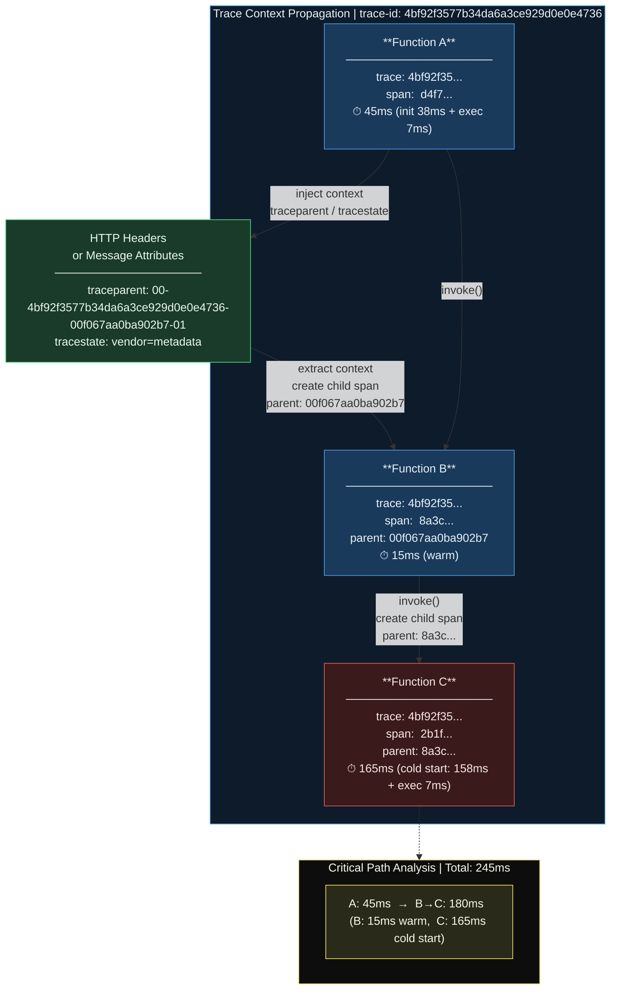

# Lesson 5: Observability, Tracing, Debugging Distributed Execution

## 1. First-Principles Intuition & Invariants

The ephemeral, distributed nature of serverless functions fundamentally inverts the classical observability model. In traditional monolithic or even microservice architectures, engineers instrument long-lived processes with stateful metrics collectors, attach debuggers to running processes, and tail persistent log files on predictable hosts. Serverless execution shatters these assumptions. Functions exist as transient compute quanta—materializing on-demand within isolated sandbox environments, executing for milliseconds to minutes, then vanishing without trace. The orchestration platform provisions execution contexts across a fleet of worker nodes whose identities remain abstracted from the developer. A single user request may cascade through dozens of asynchronous function invocations distributed across heterogeneous runtime environments, geographic regions, and execution tiers, with no single vantage point from which to observe the complete causal chain.

This architectural shift imposes three foundational observability invariants that must be satisfied through deliberate instrumentation and aggregation strategies. First, the **causality preservation invariant** demands that distributed trace context propagate across every asynchronous boundary—through message queues, event buses, HTTP redirects, and service mesh proxies—such that disparate function invocations can be logically reassembled into coherent request flows. Without explicit correlation identifiers threaded through execution metadata, engineers face an intractable combinatorial explosion when attempting to reconstruct failure paths from isolated log fragments scattered across ephemeral containers.

Second, the **cold start characterization invariant** requires that telemetry systems distinguish initialization overhead from steady-state execution performance. When a function invocation triggers runtime instantiation—downloading code bundles, initializing language runtimes, establishing database connection pools, and loading shared libraries—the resulting latency spike can dominate end-to-end request duration. These cold start penalties exhibit non-stationary statistical distributions shaped by platform scheduling policies, geographic proximity to artifact repositories, and resource contention on shared worker hosts. Observability instrumentation must capture this bimodal performance characteristic through structured metadata annotations rather than conflating initialization and execution into undifferentiated latency percentiles.

Third, the **resource attribution invariant** mandates precise mapping of consumed compute resources—CPU milliseconds, memory-seconds, network egress bytes, and persistent storage IOPS—to billable invocation identifiers. Serverless platforms charge granularly for actual resource consumption rather than provisioned capacity, transforming cost optimization from a capacity planning exercise into a per-invocation profiling challenge. Without fine-grained telemetry correlating resource metrics to individual function executions, cost anomalies remain undiagnosable, and runaway invocations can silently drain budgets before alerting thresholds trigger.

The mechanical foundation of serverless observability rests on three signal primitives: structured logs, metrics aggregates, and distributed traces. Structured logs encode discrete execution events as JSON or Protocol Buffer records with machine-parseable fields for timestamp, severity, correlation identifiers, and arbitrary contextual metadata. Unlike plaintext log lines designed for human grep patterns, structured logs enable high-cardinality queries across dimensions like function version, deployment region, and triggering event type. Metrics aggregates pre-compute statistical summaries—counts, sums, histograms, and quantiles—over sliding time windows, trading per-event fidelity for constant-space representations of high-throughput telemetry streams. Distributed traces reconstruct request flows as directed acyclic graphs where nodes represent function invocations and edges capture causal dependencies annotated with timing and metadata.

These primitives compose into a hierarchical signal pipeline. At the function boundary, instrumentation libraries inject trace context into outbound requests as HTTP headers or message envelope fields conforming to the W3C Trace Context specification. Each function invocation extracts this context from triggering events, generates a unique span identifier representing its execution scope, and appends structured log entries annotated with both the inherited trace ID and its own span ID. When the function completes, the runtime uploads these enriched logs to a centralized aggregation service alongside metrics capturing invocation count, duration, memory consumption, and error rate. A distributed tracing backend consumes these signals, reconstructing trace topologies by joining spans sharing common trace identifiers and computing critical path latencies through recursive traversal of the causal graph.

The cold start problem manifests as a phase transition in function lifecycle state machines. A function invocation begins in the **unprovisioned** state, existing only as immutable code artifacts and configuration metadata in the platform's control plane. When an event arrives, the scheduler transitions the function to **provisioning**, allocating an isolated sandbox environment—typically a lightweight VM or container—and downloading the code bundle from object storage. The runtime then enters **initialization**, where it constructs the language-specific execution context: loading shared libraries, parsing configuration, establishing database connection pools, and executing developer-provided initialization hooks. Only after initialization completes does the function reach **warm** state, ready to process the triggering event. Subsequent invocations targeting the same sandbox bypass provisioning and initialization, executing directly in warm state with latencies reduced by one to two orders of magnitude.

Cold start duration decomposes into four additive components, each exhibiting distinct performance characteristics and optimization levers. **Sandbox provisioning time** reflects the overhead of security isolation mechanisms—launching microVMs via Firecracker, initializing gVisor user-space kernels, or spawning containers with read-only root filesystems. This component scales with the complexity of security boundaries but remains largely invariant to function code characteristics. **Artifact download time** depends on code bundle size, network bandwidth to the object storage service, and cache hit rates on worker nodes. Compression algorithms and content-addressed storage can reduce this component, but geographic distribution of worker fleets imposes irreducible speed-of-light latencies. **Runtime initialization time** captures language-specific overhead: JVM class loading, Python module imports, Node.js dependency resolution. This component exhibits super-linear growth with dependency graph complexity, making aggressive tree-shaking and ahead-of-time compilation critical optimization strategies. **Developer initialization time** encompasses application-level setup logic—validating environment variables, warming caches, establishing keep-alive connections to downstream services. This component remains fully under developer control but must be carefully profiled to avoid inadvertently shifting steady-state latencies into initialization paths.

Resource consumption in serverless environments requires attribution across three orthogonal dimensions: temporal granularity, execution context, and cost allocation. Traditional infrastructure metrics aggregate resource usage at one-minute intervals across entire host machines, an approach incompatible with sub-second function invocations executing in shared multi-tenant sandboxes. Serverless platforms instead measure resource consumption at millisecond granularity within individual invocation boundaries, capturing snapshots of cgroup counters before and after function execution. CPU time measurement requires accounting for both user-space computation and kernel-space system calls, distinguishing voluntary context switches from preemption by the scheduler. Memory consumption tracking must separate heap allocations from memory-mapped files, anonymous pages from page cache, and resident set size from virtual address space reservations. Network egress attribution demands flow-level tagging to distinguish inter-function communication within the platform's private network from billable public internet transfers.

The failure modes of distributed serverless systems exhibit emergent complexity absent in monolithic architectures. A single failed function invocation may cascade through retry logic, exponential backoff policies, and dead letter queue processing, generating tens or hundreds of derivative invocations whose relationships remain opaque without distributed tracing. Timeout failures introduce ambiguity about whether downstream functions completed successfully after the caller's deadline expired, creating phantom partial failures that corrupt application state machines. Throttling and rate limiting manifest as intermittent errors sampled across invocation populations, requiring statistical analysis of error rates aggregated over sliding windows rather than binary success/failure classification. Memory exhaustion and out-of-memory kills produce silent failures where the platform terminates invocations without stack traces or structured error payloads, detectable only through monitoring invocation counts against billed execution duration.

## 2. Core Architecture & Mechanics

The distributed tracing protocol stack for serverless systems builds upon the W3C Trace Context specification, which defines a standardized mechanism for propagating correlation identifiers across distributed system boundaries. At its core, the protocol encodes two critical identifiers in HTTP header fields: the `traceparent` header carries a 55-byte ASCII string encoding the trace ID, parent span ID, and sampling decision, while the optional `tracestate` header transports vendor-specific metadata as a comma-delimited list of key-value pairs. The trace ID serves as a globally unique 128-bit identifier labeling the entire distributed transaction, ensuring cryptographic collision resistance across the invocation volume of planetary-scale platforms. The parent span ID encodes the 64-bit identifier of the immediate upstream caller, establishing directed edges in the causal graph. The trace flags byte encodes the sampling decision as a single bit, allowing upstream services to pre-determine whether downstream invocations should emit full telemetry or operate in low-overhead mode.

The mechanical flow of trace context propagation through a serverless invocation chain proceeds through five distinct phases, each requiring careful instrumentation to preserve causality invariants. In the **injection phase**, the calling function's instrumentation library serializes its current span context into the traceparent header format, appending this header to outbound HTTP requests, message envelope metadata, or event payload fields. For asynchronous messaging systems like SQS or EventBridge, injection occurs at message publication time, embedding trace context as message attributes rather than body fields to avoid coupling telemetry to application payload schemas. In the **transport phase**, the platform's networking layer forwards these annotated requests through load balancers, service meshes, and event routers without modification, treating trace context as opaque metadata. The **extraction phase** activates when the downstream function runtime receives the triggering event, parsing the traceparent header to recover the upstream trace ID and parent span ID. The runtime then enters the **span creation phase**, generating a fresh span ID for its own execution scope and establishing a parent-child relationship with the extracted context. Finally, in the **enrichment phase**, the function's structured logging library annotates all emitted log entries with both the inherited trace ID and its locally-generated span ID, ensuring that log aggregation services can reassemble the complete execution flow.

The internal architecture of a serverless observability pipeline consists of four major subsystems: the in-process instrumentation layer, the telemetry ingestion gateway, the storage and indexing layer, and the query and visualization frontend. The instrumentation layer operates as a sidecar library linked into the function runtime, intercepting execution control flow at framework boundaries—HTTP request handlers, message queue consumers, database client invocations—to emit structured telemetry signals. This layer must minimize performance overhead through careful design choices: asynchronous buffering of log entries to avoid blocking application threads, adaptive sampling algorithms that reduce telemetry volume during steady-state operation while capturing full traces during anomalous conditions, and binary encoding protocols like Protocol Buffers that compress telemetry payloads before transmission.

The telemetry ingestion gateway serves as a high-throughput, horizontally-scalable buffer absorbing bursty telemetry traffic from millions of concurrent function invocations. This component implements a multi-stage pipeline: a stateless frontend load balancer distributes inbound telemetry streams across a fleet of ingestion workers using consistent hashing on trace IDs to ensure all spans belonging to a single distributed transaction route to the same worker. Each ingestion worker maintains an in-memory aggregation window, accumulating spans and log entries for active traces before flushing completed transactions to persistent storage. The worker applies schema validation, rejecting malformed telemetry that violates structural invariants, and performs cardinality reduction by collapsing high-frequency events into histogram buckets. To handle transient network failures and downstream backpressure, the gateway implements bounded retry queues with exponential backoff and dead letter queue overflow, preventing telemetry loss during storage layer outages.

The storage layer partitions telemetry data across three specialized subsystems optimized for distinct query patterns. **Log storage** archives structured log entries in columnar format on object storage, organizing data by time-partitioned prefixes to enable efficient time-range scans. Each partition contains Parquet files compressed with Snappy, encoding repeated fields through dictionary compression to exploit the high redundancy of field names and common value patterns. **Metrics storage** employs time-series databases like Prometheus or M3DB, storing pre-aggregated histograms and counters with downsampling policies that progressively reduce resolution for older data: one-second granularity for recent hours, one-minute granularity for recent days, hourly rollups for months, and daily summaries for years. **Trace storage** maintains an inverted index mapping trace IDs to span collections, with secondary indices on high-cardinality fields like function name, AWS region, and error status. This index enables sub-second retrieval of individual traces while supporting exploratory queries across trace attributes without full-scan overhead.

The cold start instrumentation mechanism requires precise timestamp capture at seven lifecycle transition points, each marking a phase boundary in the function provisioning state machine. The platform runtime injects these timestamps as structured metadata fields in the initial log entry emitted by each function invocation:

1. **`platform.scheduleTime`**: The epoch millisecond when the platform scheduler received the triggering event and enqueued the invocation request.

2. **`platform.sandboxAllocateStart`**: The timestamp when the scheduler assigned the invocation to a worker node and initiated sandbox provisioning—launching a microVM, forking a container, or reusing a warm sandbox from the pool.

3. **`platform.sandboxAllocateEnd`**: The timestamp when sandbox initialization completed, marking the boundary between infrastructure provisioning and artifact download.

4. **`platform.artifactDownloadStart`**: The timestamp when the runtime began fetching the function's code bundle from object storage.

5. **`platform.artifactDownloadEnd`**: The timestamp when artifact download completed and the runtime began language-specific initialization.

6. **`platform.runtimeInitStart`**: The timestamp when the language runtime began executing developer-provided initialization code—the handler module's top-level statements in Python, static initializers in Java, or module-scope declarations in Node.js.

7. **`platform.runtimeInitEnd`**: The timestamp when initialization completed and the runtime invoked the developer's event handler function.

The difference between `runtimeInitEnd` and `scheduleTime` yields the end-to-end cold start duration, while pairwise differences between consecutive timestamps decompose this total into actionable components. A query aggregating these decomposed durations across thousands of invocations reveals the dominant cold start contributors: if `artifactDownloadEnd - artifactDownloadStart` contributes 80% of cold start latency, engineers should investigate code bundle size optimization, while if `runtimeInitEnd - runtimeInitStart` dominates, the focus shifts to dependency reduction and lazy initialization strategies.

Resource consumption attribution leverages Linux cgroup accounting interfaces exposed by the container runtime to the function execution sandbox. Prior to invoking the developer's handler function, the runtime snapshots four key cgroup counter files:

- **`/sys/fs/cgroup/cpu/cpuacct.usage_usec`**: Cumulative CPU time consumed by the cgroup in microseconds, aggregating both user-space and kernel-space execution across all threads.

- **`/sys/fs/cgroup/memory/memory.usage_in_bytes`**: Current resident set size in bytes, reflecting physical memory pages mapped into the cgroup's address space.

- **`/sys/fs/cgroup/memory/memory.max_usage_in_bytes`**: Peak memory usage since cgroup creation, capturing transient allocation spikes that may not appear in periodic sampling.

- **`/proc/net/dev`**: Network interface byte counters for eth0, distinguishing received bytes from transmitted bytes to enable egress cost attribution.

After the handler function returns, the runtime reads these same counter files a second time, computing delta values that isolate resource consumption attributable to the specific invocation. The platform then uploads these deltas as structured metric samples to the telemetry backend, tagged with the invocation's trace ID, span ID, function ARN, and execution region. This tagging enables cost attribution queries that join resource metrics with distributed traces, answering questions like "Which upstream API call triggered the function invocation that consumed 4GB-seconds of memory?" or "What percentage of CPU time is spent in cold start initialization versus steady-state handler execution?"

The metrics aggregation pipeline employs a hierarchical rollup architecture to balance query latency against storage cost. Raw per-invocation metrics flow into a real-time aggregation layer that maintains one-second resolution histograms over a sliding 24-hour window, using a sketch-based quantile estimation algorithm—t-digest or DDSketch—to compute accurate p50, p99, and p99.9 latencies without storing individual samples. After 24 hours, the aggregation service downsamples this data into one-minute buckets, discarding individual invocation timestamps while preserving count, sum, and pre-computed quantiles. This minute-resolution data persists for 30 days before further downsampling to hourly buckets, which remain queryable for one year. The final retention tier compresses data into daily summaries that archive indefinitely at negligible storage cost.

```mermaid
flowchart TD
    RAW["**Raw Invocation Metrics**
    ─────────────────────────────
    timestamp:    1704153845123 (epoch ms)
    trace_id:     4bf92f3577b34da6
    function_arn: ...function:processor
    duration_ms:  247
    billed_mb_ms: 12800 (256MB × 50ms)
    cpu_us:       183420
    mem_max_mb:   187"]

    DS1(["⬇ Real-time Aggregation
    1-second buckets · 24-hour retention"])

    SEC["**Second-Level Bucket**
    ─────────────────────────────
    window:      t = 1704153845
    function_arn: ...function:processor
    count:        1,847
    sum_duration: 456,789 ms
    histogram:    t-digest sketch
    ↳ p50: 235 ms · p99: 1,203 ms · p99.9: 2,841 ms
    sum_cost:     $0.0234
    error_count:  12"]

    DS2(["⬇ Downsampling
    1-minute buckets · 30-day retention"])

    MIN["**Minute-Level Bucket**
    ─────────────────────────────
    window:      t = 1704153840 (60 s)
    function_arn: ...function:processor
    count:        110,820
    sum_duration: 27,405,600 ms
    p50:          238 ms (merged t-digest)
    p99:          1,198 ms
    p99.9:        2,837 ms
    error_rate:   0.0065 (718 / 110,820)"]

    DS3(["⬇ Downsampling
    1-hour buckets · 1-year retention"])

    HOUR["**Hour-Level Bucket**
    ─────────────────────────────
    window:      t = 1704153600 (3600 s)
    function_arn: ...function:processor
    count:        6,649,200
    sum_duration: 1,644,540,000 ms
    p50:          240 ms
    p99:          1,205 ms
    sum_cost:     $82.23"]

    DS4(["⬇ Downsampling
    1-day buckets · indefinite retention"])

    DAY["**Daily Summary**
    ─────────────────────────────
    window:      date = 2024-01-02
    function_arn: ...function:processor
    count:        159,580,800
    sum_cost:     $1,973.52
    error_rate:   0.0062"]

    RAW --> DS1 --> SEC --> DS2 --> MIN --> DS3 --> HOUR --> DS4 --> DAY

    style RAW  fill:#1a1a2e,stroke:#4a9eff,stroke-width:2px,color:#e0e0e0
    style SEC  fill:#16213e,stroke:#4a9eff,stroke-width:2px,color:#e0e0e0
    style MIN  fill:#16213e,stroke:#4a9eff,stroke-width:2px,color:#e0e0e0
    style HOUR fill:#16213e,stroke:#4a9eff,stroke-width:2px,color:#e0e0e0
    style DAY  fill:#16213e,stroke:#4a9eff,stroke-width:2px,color:#e0e0e0
    style DS1  fill:#0f3460,stroke:#4a9eff,stroke-width:1px,color:#a0c4ff
    style DS2  fill:#0f3460,stroke:#4a9eff,stroke-width:1px,color:#a0c4ff
    style DS3  fill:#0f3460,stroke:#4a9eff,stroke-width:1px,color:#a0c4ff
    style DS4  fill:#0f3460,stroke:#4a9eff,stroke-width:1px,color:#a0c4ff
```

The distributed trace reconstruction algorithm operates as a streaming graph assembly process, incrementally building the causal topology as span records arrive from distributed function invocations. The trace backend maintains an in-memory cache of active traces indexed by trace ID, with each trace represented as a mutable directed acyclic graph where nodes store span metadata and edges encode parent-child relationships. When a span record arrives, the backend first checks whether its trace ID exists in the active cache. If not, it initializes a new trace graph with the span as the provisional root. If the trace already exists, the backend inserts the span as a new node and attempts to link it to its parent by searching for a node whose span ID matches the incoming span's parent span ID field. This parent-child linkage may succeed immediately if the parent span has already arrived, or it may pend if the parent remains in-flight due to network delays or out-of-order delivery.

The trace backend must handle three pathological scenarios arising from the asynchronous, unreliable nature of distributed telemetry. **Out-of-order span arrival** occurs when child spans reach the backend before their parents, common when upstream functions experience transient latency spikes or when telemetry routing takes divergent network paths. The backend accommodates this by maintaining a pending edge table mapping orphaned spans to their declared parent span IDs, periodically retrying linkage as new spans arrive. **Partial trace assembly** happens when some spans never arrive due to function crashes, telemetry buffer overflows, or silent network failures. After a configurable timeout—typically 30 seconds—the backend finalizes partial traces, marking missing spans as unknown and computing incomplete critical path metrics. **Sampling skew** emerges when adaptive sampling algorithms make inconsistent decisions across a trace, resulting in telemetry for some spans but not others. The backend addresses this by propagating sampling decisions deterministically through trace context headers, ensuring that once a trace is sampled for full telemetry, all descendant spans emit complete instrumentation.

## 3. High-Performance Optimization & Failure Modes

Optimizing cold start performance requires a systematic decomposition of initialization overhead into independently tunable components, each amenable to targeted mitigation strategies. The artifact download phase dominates cold start duration for functions with large dependency graphs—Python functions importing heavyweight libraries like NumPy or TensorFlow, Node.js functions bundling hundreds of npm packages, or Java functions packaging multi-megabyte Spring Boot fat JARs. The primary optimization here targets code bundle size reduction through aggressive tree-shaking and dead code elimination. Modern JavaScript bundlers like esbuild or swc traverse the module dependency graph, identifying imported symbols referenced in the function's execution paths and excluding unused exports from the final bundle. This analysis must operate at sub-function granularity, stripping unused class methods and unreachable conditional branches rather than retaining entire modules.

For interpreted languages, ahead-of-time compilation transforms runtime initialization overhead into build-time artifact generation. Python functions can leverage tools like Nuitka or PyOxidizer to compile modules into C extension libraries, eliminating the interpreter's module loading and bytecode compilation phases. Node.js functions benefit from V8 snapshot generation, where the runtime executes initialization code during build time, serializes the resulting heap state—including compiled JavaScript functions and initialized global variables—and embeds this snapshot in the deployment artifact. When a cold start occurs, the runtime deserializes the snapshot directly into memory, bypassing module parsing, compilation, and initialization execution. This technique reduces Node.js cold starts from hundreds of milliseconds to tens of milliseconds but requires careful snapshot hygiene: developers must ensure initialization code produces deterministic results and avoid capturing ephemeral state like timestamps or random seeds.

Connection pooling and warm-up strategies mitigate the latency of establishing network connections to downstream dependencies during function initialization. Database clients, HTTP libraries, and message queue consumers typically defer connection establishment until the first operation, shifting this overhead into the handler's critical path. By explicitly constructing connection pools in module-scope initialization code—outside the handler function—developers move this work into the cold start phase, ensuring warm invocations execute against pre-established connections. However, connection pools introduce lifecycle management complexity: serverless platforms may freeze sandboxes between invocations to conserve resources, suspending execution contexts for minutes or hours before resuming them for subsequent events. Long-lived TCP connections frozen mid-stream may encounter peer timeouts, half-open socket states, or server-side connection recycling, requiring robust reconnection logic with exponential backoff and circuit breaking.

The strategic use of provisioned concurrency transforms cold start mitigation from a reactive optimization into a proactive capacity planning problem. Provisioned concurrency instructs the platform to maintain a pool of pre-initialized sandbox environments for a function, keeping them warm and ready to handle invocations with single-digit millisecond latencies. The platform continuously refreshes this pool, retiring stale sandboxes and provisioning replacements to maintain the target concurrency level. This mode trades off infrastructure cost—provisioned sandboxes accrue charges proportional to configured memory and time regardless of invocation volume—for deterministic low-latency guarantees. Effective provisioned concurrency deployment requires analyzing traffic patterns to identify peak demand periods, configuring auto-scaling policies that ramp concurrency ahead of anticipated load, and monitoring sandbox utilization metrics to detect over-provisioning waste.

Telemetry volume reduction becomes critical at scale, where high-throughput functions generate millions of log entries and metric samples per minute, overwhelming ingestion pipelines and inflating storage costs. Adaptive sampling implements dynamic telemetry filtering based on observed traffic patterns and error rates, balancing the completeness of trace coverage against overhead constraints. Head-based sampling makes retention decisions at trace initiation, deterministically propagating the sampling bit through all descendant spans to ensure complete or absent traces rather than fragmentary partials. Tail-based sampling delays the decision until after trace completion, analyzing the assembled topology to preferentially retain traces exhibiting high latency, errors, or rare execution paths while discarding common success cases. Tail-based sampling requires buffering spans in memory until parent trace assembly completes, introducing state management complexity and memory pressure during traffic spikes.

Structured logging optimization focuses on minimizing serialization overhead and network transmission latency for high-frequency log events. JSON encoding, while human-readable and ubiquitously supported, incurs significant CPU cost due to its verbose textual representation and lack of schema-driven optimization. Binary encoding formats like Protocol Buffers or MessagePack reduce serialized payload size by 5-10× through compact varint integer encoding and schema-based field numbering, eliminating repetitive field name strings. However, binary encoding sacrifices ad-hoc queryability: downstream log analysis systems must possess the message schema to decode fields, creating coupling between function code and telemetry infrastructure. A hybrid approach encodes high-frequency structured fields in binary while preserving a small plaintext message field for freeform diagnostic context, balancing efficiency against operational flexibility.

The failure mode of cascading retry storms exemplifies the emergent complexity of distributed serverless observability. Consider a downstream database experiencing transient resource saturation, returning timeout errors to connecting functions. Each function invocation fails, triggering automatic retry logic configured by the event source—SQS visibility timeouts, EventBridge retry policies, or explicit application-level retry decorators. These retries amplify load against the already-struggling database, exacerbating saturation and increasing the proportion of failing requests. Meanwhile, functions configured with inadequate timeout values wait the full timeout duration before failing, accumulating billed execution time without productive work. Telemetry systems struggle to distinguish root cause from symptoms: the database's high error rate appears in metrics, but the causal dependency between database saturation and upstream function retry amplification remains obscured without distributed tracing correlating error spans across service boundaries.

Debugging this failure mode requires cross-service trace analysis powered by span metadata enrichment. Each function must annotate spans with retry-specific metadata: the current attempt number, the exponential backoff delay applied, and the triggering error class and message. The tracing backend aggregates these annotations, computing per-trace retry counts and identifying traces exhibiting abnormal retry patterns—more than three attempts, or total trace duration exceeding five times the p99 latency. By correlating these anomalous traces with error rate spikes in downstream database metrics, engineers isolate the database as the root cause trigger. The mitigation strategy then becomes clear: implement circuit breaker patterns that short-circuit requests to failing dependencies, returning fail-fast errors rather than accumulating timeouts; configure jittered exponential backoff to desynchronize retry attempts; and deploy rate limiting at the database layer to shed excess load gracefully.

Memory leak detection in serverless functions demands specialized instrumentation due to the ephemeral nature of execution contexts. Traditional memory profilers track heap allocations over multi-hour processes, building flamegraphs of retained object graphs to identify leak sources. Serverless sandboxes, recycled every few hundred invocations, may never accumulate sufficient leakage to trigger out-of-memory termination, masking gradual per-invocation growth. The detection strategy captures memory usage deltas across consecutive invocations within the same sandbox, monitoring for monotonic growth independent of workload characteristics. The runtime records the resident set size at handler entry and exit for each invocation, uploading these samples as metrics tagged with the sandbox ID. A leak detection algorithm sliding over this time series identifies sandboxes where memory fails to return to baseline between invocations, flagging the function for heap snapshot analysis. The developer then forces a heap snapshot by injecting diagnostic instrumentation that serializes the V8 or JVM heap state to object storage mid-execution, enabling offline analysis to pinpoint retained object paths.

The performance profiling workflow for CPU-bound serverless functions integrates language-specific profilers with platform telemetry aggregation. For Node.js, the V8 profiler captures CPU sample stacks at millisecond intervals, building a statistical flamegraph of function call hierarchies and their execution time attribution. The challenge lies in exporting this profiling data from ephemeral sandboxes before they terminate. One approach embeds the profiler in the function's initialization code, configuring it to write profiling output to a shared filesystem location like `/tmp`, then uploading the profile to S3 in a `finally` block that executes regardless of handler success or failure. An alternative approach leverages platform-native profiling integrations: AWS Lambda's code profiling feature automatically enables the profiler for sampled invocations, uploads profiles to CloudWatch, and aggregates them into composite flamegraphs across invocation populations. This platform integration eliminates manual instrumentation but provides coarser control over sampling rates and profile retention.

The failure mode of silent timeout-induced partial state mutations arises when functions timeout after successfully mutating external state but before acknowledging event completion. Consider a function processing a message from SQS: it reads the message, writes a record to DynamoDB, then attempts to invoke a downstream function via asynchronous HTTP request. If the function times out during the HTTP request phase, the platform terminates execution before the function can delete the SQS message. The message becomes visible again after the visibility timeout expires, triggering reprocessing. On retry, the function writes a duplicate DynamoDB record, violating idempotency assumptions. Telemetry systems observe the timeout but cannot determine which side effects completed—the DynamoDB write succeeded, but from the function's perspective, execution halted mid-flight without returning status to the caller.

Mitigating this failure mode requires designing functions as idempotent state machine transitions with explicit deduplication mechanisms. Each function invocation should include a unique idempotency key in external mutations—a request ID derived from the message's SQS message ID and receipt handle—that downstream services check before applying state changes. The function's first action reads this key from a deduplication table in DynamoDB, returning immediately if an entry exists, indicating prior processing. Only after recording the idempotency key does the function proceed with business logic. Telemetry instrumentation must annotate spans with idempotency metadata—the key value, whether the invocation was a duplicate, and which side effects completed before timeout. This enables post-mortem analysis correlating timeout events with state mutation counts, validating that duplicate invocations successfully detected prior processing and short-circuited redundant work.

The cost optimization workflow leverages resource attribution metrics to construct a per-invocation cost model mapping function execution characteristics to billable resource consumption. The model begins with the platform's pricing formula: for AWS Lambda, cost equals memory allocation in MB multiplied by billed duration in 100ms increments multiplied by the regional per-GB-second rate. However, this formula obscures the relationship between code changes and cost impact. Engineers need to answer questions like "If we increase the memory allocation from 512MB to 1024MB, will the corresponding reduction in execution time offset the higher per-millisecond rate?" The optimization workflow instruments functions to emit custom metrics capturing both wall-clock duration and CPU utilization percentage, then joins these metrics with platform-reported billed duration to model the cost-performance frontier. For CPU-bound workloads, increasing memory allocation also increases allocated CPU cores proportionally, reducing execution time super-linearly. The cost-optimal allocation minimizes the product of memory and duration, which often occurs at memory configurations higher than minimal viable settings.

The telemetry pipeline's failure mode of backpressure-induced data loss arises when transient ingestion throughput exceeds the backend's sustained write capacity. Functions continue emitting telemetry at high rates during traffic spikes, overwhelming ingestion workers' memory buffers and triggering buffer overflow drops. These drops remain invisible to developers examining dashboards, which display only successfully-ingested signals, creating survivorship bias where the highest-load periods appear to have normal telemetry volumes. Detecting this failure mode requires instrumenting the telemetry pipeline itself with meta-observability metrics: ingestion worker memory utilization, drop counters, and backpressure-induced latency increases. The mitigation strategy implements bounded queues with explicit overflow policies: when buffers fill, the ingestion layer returns backpressure errors to function runtimes, which respond by activating aggressive local sampling to reduce emission rate. The runtime dynamically adjusts its sampling ratio in response to ingestion ACKs versus NACKs, degrading telemetry fidelity gracefully under load rather than suffering silent data loss.
