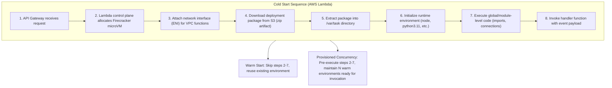
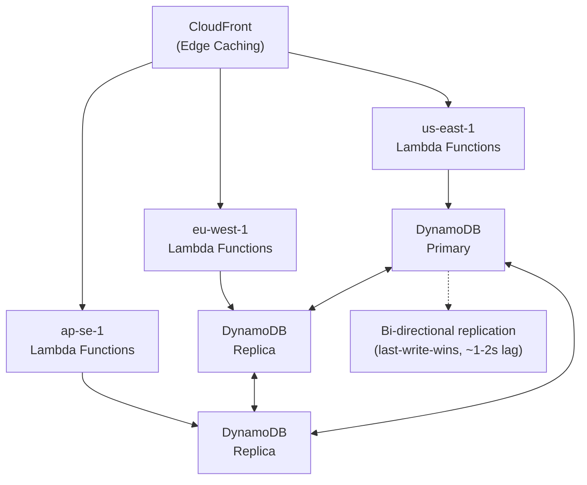

# Lesson 6: Production Architecture, Security, Cost Optimization

## 1. First-Principles Intuition & Invariants

Serverless computing presents a profound architectural paradox: the abstraction that makes it powerful—ephemeral, stateless compute units with millisecond lifecycles—also introduces unique failure modes, security boundaries, and cost characteristics that fundamentally differ from traditional infrastructure. When a Lambda function executes for 200 milliseconds to process an API request, the economic model charges for that exact duration, but the operational complexity emerges from what happens in the gaps: cold starts that introduce latency spikes, shared kernel infrastructure that creates new attack surfaces, IAM policies that must grant least-privilege access across hundreds of event sources, and global replication topologies where eventual consistency becomes a first-class design constraint rather than an implementation detail.

The production maturity of serverless systems hinges on understanding the distinction between the logical execution model presented by platforms like AWS Lambda, Google Cloud Functions, or Azure Functions, and the physical reality beneath. Each function invocation operates within a sandboxed execution environment—typically a Firecracker microVM or gVisor container—that persists between invocations to amortize initialization costs. This reuse creates a warm execution context where global variables, database connection pools, and TLS sessions survive across requests, but the platform offers no guarantees about context lifetime. A function might be frozen after five minutes of inactivity, replicated across availability zones during traffic spikes, or evicted entirely when the platform reclaims capacity. This nondeterministic lifecycle forces practitioners to architect for both ephemerality and selective statefulness, treating the execution environment as simultaneously disposable and potentially long-lived.

The security model in serverless environments operates on shared responsibility principles, but the boundary line shifts dramatically compared to EC2 instances or Kubernetes pods. Cloud providers guarantee isolation between tenant workloads through hardware-enforced virtualization and kernel-level sandboxing, but practitioners must still defend against attacks that exploit the logical application layer: confused deputy problems where IAM roles are over-privileged, event injection attacks where untrusted input flows directly into function parameters, and supply chain vulnerabilities in transitive dependencies that bloat deployment packages. The stateless nature of functions eliminates entire categories of persistence-based attacks—no SSH daemons to compromise, no long-running processes to hijack—but introduces new risks around secrets management, where API keys and database credentials must be fetched from external vaults on every cold start, and around observability, where distributed tracing becomes essential to reconstruct request flows across dozens of ephemeral function instances.

Cost optimization in serverless systems requires abandoning the mental model of fixed infrastructure capacity and embracing a marginal cost framework where every millisecond of execution and every megabyte of memory allocation contributes to the bill. The pricing function is nonlinear and discontinuous: Lambda charges in 1-millisecond increments but rounds memory to the nearest megabyte, creating step functions where a 129 MB allocation costs the same as 256 MB. Similarly, API Gateway charges per million requests regardless of payload size, while S3 event notifications are free but generate Lambda invocations that do incur charges. This creates optimization opportunities where strategic buffering, batching, and right-sizing can reduce costs by 60-80% without changing application logic. A common anti-pattern is over-provisioning memory to reduce execution time, but the cost/performance curve flattens beyond a certain threshold because most serverless workloads are I/O-bound rather than CPU-bound, waiting on database queries, HTTP requests, or S3 reads that do not benefit from additional memory.

Multi-region deployment topologies in serverless architectures expose the fundamental tension between latency, consistency, and cost. Unlike traditional active-passive failover where a standby region idles until promoted, serverless functions deploy to multiple regions simultaneously, with request routing handled by global load balancers like CloudFront or Cloudflare Workers. This active-active model eliminates failover time but introduces complexity in data replication. DynamoDB Global Tables provide last-write-wins conflict resolution with sub-second replication latency, but applications must tolerate eventual consistency where a write in us-east-1 might not be visible in eu-west-1 for several hundred milliseconds. More importantly, cross-region invocations—where a function in one region reads from a database in another—incur both data transfer costs ($0.02/GB between AWS regions) and latency penalties that negate the serverless promise of single-digit millisecond response times.

The cold start problem remains the most notorious performance characteristic of serverless platforms, arising from the physical reality that initializing a new execution environment requires loading runtime binaries, linking shared libraries, parsing application code, establishing network connections, and negotiating TLS sessions. For a Node.js function with 50 MB of dependencies, this initialization sequence can consume 400-800 milliseconds, during which the client request waits. Platforms mitigate this through provisioned concurrency—pre-warmed execution environments that never go cold—but this reintroduces fixed costs and eliminates much of the economic benefit of pay-per-use pricing. The engineering challenge is predicting traffic patterns well enough to provision the right amount of warm capacity without over-provisioning during off-peak hours or under-provisioning during unexpected spikes.

Operational maturity in serverless environments demands a shift from host-centric monitoring to request-centric observability. Traditional metrics like CPU utilization and memory pressure become meaningless when execution environments are ephemeral and shared across thousands of function instances. Instead, practitioners must instrument distributed traces that follow a single request across API Gateway, Lambda functions, DynamoDB tables, SQS queues, and Step Functions state machines, correlating logs through request IDs and reconstructing causal chains from asynchronous event flows. The challenge intensifies when debugging production incidents: there are no servers to SSH into, no core dumps to analyze, no persistent logs to grep. Every diagnostic signal must be emitted proactively through structured logging, CloudWatch metrics, and X-Ray traces, with sampling strategies that balance observability coverage against the overhead of trace data volume.

The architectural invariants that govern production serverless systems can be distilled into three core principles. First, design for disposability: every function invocation must assume it is the first and last, with no reliance on previous state or guarantees about future invocations. Second, embrace eventual consistency: in distributed serverless topologies, strong consistency is expensive and often impossible, so applications must tolerate stale reads, out-of-order events, and duplicate invocations through idempotent operations and client-side reconciliation. Third, optimize for marginal cost: the economic model rewards small, focused functions that execute quickly and scale independently, rather than monolithic handlers that amortize initialization overhead across multiple operations. These principles are not abstract guidelines but mechanical constraints imposed by the underlying platform architecture, and violations manifest as production incidents, cost overruns, and unscalable systems.

## 2. Core Architecture & Mechanics

The physical deployment topology of a production serverless system spans multiple layers of abstraction, each with distinct scalability characteristics and failure modes. At the edge, a global content delivery network like CloudFront or Fastly terminates TLS connections, caches static assets, and routes API requests to the nearest regional endpoint using anycast DNS and latency-based routing. This edge layer operates outside the traditional cloud region model, with hundreds of points of presence distributed worldwide, each maintaining a persistent connection pool to origin servers. When a request arrives at the edge, the CDN evaluates cached responses first, forwarding only cache misses to the origin. This creates a natural rate-limiting boundary where DDoS attacks and bot traffic are absorbed at the edge before consuming Lambda execution capacity.

Behind the edge layer, API Gateway serves as the regional entry point for serverless APIs, translating HTTP requests into Lambda invocations through a synchronous request-response protocol. API Gateway is not simply a reverse proxy but a full-featured API management plane that performs request validation against OpenAPI schemas, enforces rate limits through token bucket algorithms, handles authentication via IAM signatures or JWT validation, and transforms request/response payloads through Velocity Template Language mappings. Each API Gateway deployment creates a regional endpoint with its own invoke URL, and practitioners must explicitly configure custom domain names with Route 53 latency-based routing to implement multi-region active-active topologies.

The Lambda execution model operates on a unit called an execution environment, which is not a container in the Docker sense but a lightweight virtualization boundary implemented through Firecracker microVMs on AWS or gVisor sandboxes on Google Cloud. When a new invocation request arrives and no warm environment exists, the platform allocates a microVM, provisions the configured memory allocation, downloads the deployment package from S3, extracts the code bundle, initializes the runtime (Node.js, Python, Java, etc.), and executes any global initialization code before finally invoking the handler function. This entire sequence constitutes the cold start, and its duration depends on deployment package size, runtime initialization time, and network latency to S3.



Once initialized, the execution environment persists for an indeterminate period, handling subsequent invocations as warm starts that skip initialization and jump directly to handler execution. The Lambda platform manages a pool of execution environments per function version, scaling capacity dynamically based on incoming request rate. When concurrent requests exceed available warm environments, the platform launches new microVMs in parallel, subject to account-level concurrency limits (default 1000 concurrent executions per region, configurable via service quotas). This scaling behavior exhibits burst capacity during traffic spikes, where Lambda can instantiate up to 3000 execution environments in the first minute, then scale by 500 environments per minute thereafter. These limits exist to prevent runaway resource consumption but also create failure modes where sudden traffic surges trigger throttling errors when the burst limit is exhausted.

The memory model in Lambda is particularly nuanced because memory allocation directly determines CPU allocation, I/O bandwidth, and network throughput. Lambda allocates vCPU proportionally to memory: at 1769 MB, a function receives one full vCPU; below that threshold, CPU time is fractionally allocated in proportion to memory. A function configured with 128 MB receives approximately 0.072 vCPU (128/1769), which translates to slower execution for CPU-bound workloads but identical performance for I/O-bound operations waiting on external services. This creates a nonlinear optimization surface where increasing memory from 128 MB to 512 MB might reduce execution time by 60% for compute-intensive tasks but only 10% for database queries bound by network round-trip time.

Multi-region deployment introduces architectural complexity in data plane replication and control plane orchestration. A typical active-active topology deploys identical function versions to three regions—us-east-1, eu-west-1, ap-southeast-1—with Route 53 geolocation routing directing requests to the nearest region. Each region maintains its own DynamoDB table replica through DynamoDB Global Tables, which use a last-write-wins conflict resolution strategy based on timestamp. When a function in us-east-1 writes an item to the regional table, DynamoDB asynchronously replicates the write to eu-west-1 and ap-southeast-1 within 1-2 seconds. During this replication window, a read in eu-west-1 might return stale data, creating eventual consistency anomalies that applications must handle through versioning schemes or client-side timestamps.



The failure mode that emerges from this topology is split-brain consistency during network partitions. If replication between us-east-1 and eu-west-1 is delayed due to inter-region network congestion, concurrent writes to the same DynamoDB item in both regions will eventually converge, but the last-write-wins resolution might discard valid updates. Practitioners mitigate this through application-level conflict resolution: versioning items with monotonically increasing counters, using conditional writes with expected values, or implementing CRDTs (Conflict-free Replicated Data Types) where operations commute regardless of application order.

Security boundaries in serverless architectures operate at multiple layers, starting with the Lambda execution role that grants IAM permissions for resource access. Each function assumes an IAM role at invocation time, and the role's policy document enumerates allowed actions on specific resources. A critical security invariant is the principle of least privilege: a function that reads from S3 and writes to DynamoDB should receive only `s3:GetObject` on specific bucket prefixes and `dynamodb:PutItem` on specific table ARNs, not broad `s3:*` or `dynamodb:*` wildcards. Violations of this principle create confused deputy attacks where an attacker invokes the function with malicious input that exploits over-privileged IAM permissions to access unrelated resources.

```yaml
# Least-Privilege IAM Role for Order Processing Function
apiVersion: v1
kind: LambdaFunction
metadata:
  name: process-order
spec:
  runtime: python3.11
  handler: index.handler
  role:
    version: "2012-10-17"
    statement:
      # Read order data from specific S3 prefix
      - effect: Allow
        action:
          - s3:GetObject
        resource:
          - arn:aws:s3:::orders-bucket/incoming/*
        condition:
          StringEquals:
            s3:ExistingObjectTag/stage: production
      
      # Write processed orders to specific DynamoDB table
      - effect: Allow
        action:
          - dynamodb:PutItem
          - dynamodb:UpdateItem
        resource:
          - arn:aws:dynamodb:us-east-1:123456789012:table/ProcessedOrders
        condition:
          ForAllValues:StringEquals:
            dynamodb:LeadingKeys:
              - ${aws:PrincipalTag/tenant-id}
      
      # Publish success/failure events to specific SNS topic
      - effect: Allow
        action:
          - sns:Publish
        resource:
          - arn:aws:sns:us-east-1:123456789012:order-events
      
      # Read secrets from specific Parameter Store paths
      - effect: Allow
        action:
          - ssm:GetParameter
        resource:
          - arn:aws:ssm:us-east-1:123456789012:parameter/prod/db/password
          - arn:aws:ssm:us-east-1:123456789012:parameter/prod/api/key
```

This policy embodies several security best practices: resource-level restrictions using ARN patterns, condition keys that enforce object tags or tenant isolation, and separation of concerns where the function cannot modify its own IAM role or escalate privileges. The `dynamodb:LeadingKeys` condition enforces row-level security by restricting writes to items whose partition key matches the principal's tenant-id tag, preventing cross-tenant data leakage in multi-tenant systems.

Secrets management in serverless functions requires balancing security and performance because fetching secrets from AWS Secrets Manager or Parameter Store incurs network round-trip latency (20-50ms per call) and API request costs. The common pattern is to fetch secrets during cold start initialization and cache them in global variables for reuse across warm invocations, but this creates a credential rotation problem: if a secret is rotated while a function is warm, the cached value becomes stale. The solution is to implement TTL-based cache invalidation where secrets are refetched every N minutes, or to listen for secret rotation events via EventBridge and proactively invalidate the cache. Alternatively, Lambda extensions like the AWS Parameters and Secrets Lambda Extension run as a sidecar process that maintains a local caching proxy, reducing fetch latency from 50ms to < 1ms while handling rotation transparently.

Event-driven authorization introduces unique challenges because invocations originate from asynchronous event sources—SQS queues, SNS topics, EventBridge rules—rather than authenticated API clients. When a Lambda function is invoked by an SQS queue, the execution role grants the function permission to receive messages, but there is no end-user context to authorize. The architectural solution is to embed authorization metadata in the event payload itself: a signed JWT token, a cryptographic signature computed by the event producer, or a correlation ID that references an authorized session in DynamoDB. The function validates this embedded proof before processing, effectively implementing token-based authorization in an event-driven model where traditional session-based authentication does not apply.

## 3. High-Performance Optimization & Failure Modes

Cold start mitigation represents the most impactful performance optimization in serverless systems, and the solution space spans platform configuration, runtime optimization, and architectural redesign. The baseline approach is provisioned concurrency, where Lambda pre-initializes a configurable number of execution environments and keeps them perpetually warm, eliminating cold starts entirely for requests routed to provisioned capacity. However, provisioned concurrency incurs hourly charges regardless of invocation volume, effectively converting serverless into a fixed-cost model. For a function configured with 10 provisioned concurrent executions at 512 MB memory, the monthly cost is approximately $20 (0.0000041667 per GB-second × 512 MB × 10 instances × 2592000 seconds), plus per-invocation charges when traffic exceeds provisioned capacity and spills into on-demand scaling.

The strategic use of provisioned concurrency requires demand forecasting: analyzing historical traffic patterns to determine minimum baseline concurrency during off-peak hours and configuring Application Auto Scaling to increase provisioned capacity during predictable traffic surges. An e-commerce API might maintain 5 provisioned executions during overnight hours (02:00-06:00 UTC) but scale to 50 executions during peak shopping periods (18:00-22:00 UTC). This schedule-based scaling reduces costs by 70% compared to maintaining constant high provisioned concurrency while still eliminating cold starts during business-critical hours.

Runtime optimization focuses on reducing initialization time by minimizing deployment package size and deferring lazy initialization of heavyweight dependencies. A Node.js function that imports the entire AWS SDK bundle (70 MB) at the module level incurs 200-300ms of initialization overhead, but importing only the specific service clients needed (S3Client, DynamoDBClient) reduces bundle size to 5-8 MB and initialization time to 40-60ms. Similarly, database connection pools should initialize lazily on first invocation rather than during module load, allowing the Lambda platform to execute global code once and reuse the initialized state across warm invocations. The anti-pattern is eager initialization of all dependencies during cold start, which maximizes initialization latency and increases the likelihood that clients will experience timeout errors during traffic spikes.

```javascript
// Anti-Pattern: Eager initialization increases cold start time
const AWS = require('aws-sdk'); // Loads entire SDK (70+ MB)
const db = new DatabasePool({ /* connects immediately */ });
const cache = new RedisClient({ /* establishes connection */ });

exports.handler = async (event) => {
  // Handler logic
};

// Optimized: Lazy initialization and selective imports
const { S3Client, GetObjectCommand } = require('@aws-sdk/client-s3');
const { DynamoDBClient, PutItemCommand } = require('@aws-sdk/client-dynamodb');

let dbPool = null;
let s3Client = null;

async function getDbPool() {
  if (!dbPool) {
    dbPool = new DatabasePool({
      host: process.env.DB_HOST,
      maxConnections: 1, // Single connection per execution environment
      idleTimeout: 300000 // 5 minute timeout, aligned with Lambda freeze
    });
  }
  return dbPool;
}

function getS3Client() {
  if (!s3Client) {
    s3Client = new S3Client({ 
      region: process.env.AWS_REGION,
      maxAttempts: 3,
      requestTimeout: 5000
    });
  }
  return s3Client;
}

exports.handler = async (event) => {
  const db = await getDbPool();
  const s3 = getS3Client();
  // Handler logic with initialized clients
};
```

This pattern reduces cold start initialization from 500ms to under 100ms by deferring database connection establishment until the first invocation, and subsequent warm invocations reuse the cached clients without re-initialization overhead. The critical design choice is setting `maxConnections: 1` for database pools because Lambda execution environments are single-threaded and handle one invocation at a time, so a connection pool size larger than one wastes memory and database server resources.

Memory right-sizing is a non-obvious optimization because Lambda pricing is proportional to GB-seconds (memory allocation × execution duration), creating a counterintuitive cost curve where increasing memory can reduce total costs if it decreases execution duration proportionally. A function configured with 128 MB and 800ms execution time consumes 0.1 GB-seconds per invocation, while the same function at 512 MB might execute in 250ms, consuming 0.128 GB-seconds—a 28% cost increase. However, if the workload is CPU-bound and execution time decreases to 150ms at 512 MB, the cost drops to 0.0768 GB-seconds, a 23% reduction. The optimization strategy is to benchmark execution time across memory configurations (128, 256, 512, 1024, 1769, 3008 MB) and compute the cost/performance Pareto frontier.

```python
# Automated Memory Right-Sizing Benchmark
import boto3
import json
import time
from decimal import Decimal

lambda_client = boto3.client('lambda')
cloudwatch = boto3.client('cloudwatch')

MEMORY_CONFIGS = [128, 256, 512, 1024, 1536, 3008]
TEST_ITERATIONS = 50
FUNCTION_NAME = 'data-processor'

def benchmark_memory_config(memory_mb):
    """Execute function multiple times and collect performance metrics"""
    lambda_client.update_function_configuration(
        FunctionName=FUNCTION_NAME,
        MemorySize=memory_mb
    )
    
    # Wait for configuration update to propagate
    time.sleep(5)
    
    durations = []
    billed_durations = []
    
    for i in range(TEST_ITERATIONS):
        response = lambda_client.invoke(
            FunctionName=FUNCTION_NAME,
            InvocationType='RequestResponse',
            Payload=json.dumps({'test_iteration': i})
        )
        
        log_result = response['LogResult']
        # Parse CloudWatch Logs for REPORT line containing duration
        # REPORT RequestId: abc Duration: 245.67 ms Billed Duration: 246 ms Memory Size: 512 MB Max Memory Used: 128 MB
        # Extract billed duration from log
        
    avg_duration = sum(durations) / len(durations)
    avg_billed = sum(billed_durations) / len(billed_durations)
    
    # Lambda pricing: $0.0000166667 per GB-second
    price_per_gb_sec = Decimal('0.0000166667')
    gb_seconds = Decimal(memory_mb) / 1024 * Decimal(avg_billed) / 1000
    cost_per_invocation = gb_seconds * price_per_gb_sec
    
    return {
        'memory_mb': memory_mb,
        'avg_duration_ms': avg_duration,
        'avg_billed_ms': avg_billed,
        'cost_per_million': float(cost_per_invocation * 1_000_000)
    }

def find_optimal_memory():
    results = []
    
    for memory in MEMORY_CONFIGS:
        print(f"Benchmarking {memory} MB configuration...")
        result = benchmark_memory_config(memory)
        results.append(result)
        print(f"  Duration: {result['avg_duration_ms']:.2f}ms | Cost/M: ${result['cost_per_million']:.2f}")
    
    # Find configuration with lowest cost per million invocations
    optimal = min(results, key=lambda x: x['cost_per_million'])
    
    print(f"\nOptimal Configuration: {optimal['memory_mb']} MB")
    print(f"Cost per million invocations: ${optimal['cost_per_million']:.2f}")
    print(f"Average duration: {optimal['avg_duration_ms']:.2f}ms")
    
    return optimal

if __name__ == '__main__':
    optimal_config = find_optimal_memory()
```

This benchmarking script automates the empirical measurement of cost/performance tradeoffs across memory configurations, accounting for both execution duration and Lambda's pricing model. The optimal configuration is the one with the lowest cost per million invocations, not necessarily the fastest execution time, because serverless optimization targets total cost of ownership rather than raw performance.

Concurrency limits and throttling represent the most common failure mode in production serverless systems. Lambda enforces account-level concurrency quotas (default 1000 concurrent executions per region) shared across all functions in the account. When aggregate concurrent invocations exceed this limit, new invocations are throttled with a `TooManyRequestsException` error. The failure propagates differently depending on invocation type: synchronous invocations from API Gateway return 429 HTTP status codes to clients, while asynchronous invocations from SQS or EventBridge are automatically retried with exponential backoff up to six hours before being sent to a dead-letter queue.

The architectural solution is reserved concurrency, which allocates a dedicated portion of the account's concurrency limit to specific functions, preventing a single runaway function from exhausting capacity for others. A payment processing function might receive 300 reserved concurrent executions, guaranteeing that traffic surges to the payment API do not starve the order ingestion function of execution capacity. However, reserved concurrency also imposes a ceiling: if the payment function receives requests at a rate requiring 400 concurrent executions, the excess is throttled even if the account has 700 unreserved executions available. This creates a capacity planning problem where practitioners must forecast peak concurrency requirements per function and allocate reserved capacity accordingly.

```yaml
# Terraform Configuration: Reserved Concurrency and Dead Letter Queue
resource "aws_lambda_function" "payment_processor" {
  function_name = "payment-processor"
  runtime       = "python3.11"
  handler       = "index.handler"
  memory_size   = 1024
  timeout       = 30

  # Reserve 300 concurrent executions for payment processing
  reserved_concurrent_executions = 300

  # Send failed invocations to DLQ after all retries exhausted
  dead_letter_config {
    target_arn = aws_sqs_queue.payment_dlq.arn
  }

  environment {
    variables = {
      PAYMENT_GATEWAY_URL = var.payment_gateway_url
      MAX_RETRY_ATTEMPTS  = "3"
      IDEMPOTENCY_TABLE   = aws_dynamodb_table.idempotency.name
    }
  }
}

resource "aws_sqs_queue" "payment_dlq" {
  name                       = "payment-dlq"
  message_retention_seconds  = 1209600  # 14 days
  visibility_timeout_seconds = 300

  # Enable server-side encryption for sensitive payment data
  sqs_managed_sse_enabled = true
}

# CloudWatch Alarm: Trigger on DLQ message depth
resource "aws_cloudwatch_metric_alarm" "payment_dlq_alarm" {
  alarm_name          = "payment-dlq-messages"
  comparison_operator = "GreaterThanThreshold"
  evaluation_periods  = 1
  metric_name         = "ApproximateNumberOfMessagesVisible"
  namespace           = "AWS/SQS"
  period              = 60
  statistic           = "Average"
  threshold           = 10
  alarm_description   = "Alert when payment DLQ receives messages"
  alarm_actions       = [aws_sns_topic.ops_alerts.arn]

  dimensions = {
    QueueName = aws_sqs_queue.payment_dlq.name
  }
}

# Application Auto Scaling: Dynamic provisioned concurrency
resource "aws_appautoscaling_target" "lambda_provisioned" {
  max_capacity       = 100
  min_capacity       = 10
  resource_id        = "function:${aws_lambda_function.payment_processor.function_name}:provisioned-concurrency"
  scalable_dimension = "lambda:function:ProvisionedConcurrentExecutions"
  service_namespace  = "lambda"
}

resource "aws_appautoscaling_policy" "lambda_scale_policy" {
  name               = "lambda-scale-policy"
  policy_type        = "TargetTrackingScaling"
  resource_id        = aws_appautoscaling_target.lambda_provisioned.resource_id
  scalable_dimension = aws_appautoscaling_target.lambda_provisioned.scalable_dimension
  service_namespace  = aws_appautoscaling_target.lambda_provisioned.service_namespace

  target_tracking_scaling_policy_configuration {
    target_value = 0.70  # Maintain 70% provisioned concurrency utilization

    predefined_metric_specification {
      predefined_metric_type = "LambdaProvisionedConcurrencyUtilization"
    }

    scale_in_cooldown  = 300  # Wait 5 minutes before scaling down
    scale_out_cooldown = 60   # Scale up quickly (1 minute)
  }
}
```

This configuration implements several production-grade reliability patterns: reserved concurrency prevents resource starvation, dead-letter queues capture failed invocations for manual investigation, CloudWatch alarms notify operators when DLQ depth exceeds thresholds, and Application Auto Scaling dynamically adjusts provisioned concurrency based on utilization. The target tracking policy maintains 70% provisioned concurrency utilization, meaning if 10 provisioned executions are averaging 7 concurrent invocations, the auto scaler increases capacity to 14-15 provisioned executions to maintain the 70% target.

VPC integration introduces a hidden failure mode related to elastic network interface (ENI) creation and IP address exhaustion. When a Lambda function is configured to access resources in a VPC—RDS databases, ElastiCache clusters, private API endpoints—the Lambda service creates Hyperplane ENIs in each subnet specified in the function's VPC configuration. These ENIs consume IP addresses from the subnet's CIDR range, and if the subnet is undersized or heavily utilized, ENI creation fails with `EC2ThrottledException` errors. The symptom manifests as functions that work in one region but fail in another due to subnet IP exhaustion, or functions that work during low traffic but fail during scale-out when Lambda attempts to create additional ENIs.

The architectural fix is to provision dedicated subnets for Lambda functions with sufficiently large CIDR blocks (minimum /24, preferably /22 or /21 for high-scale functions) and to use NAT Gateways for internet-bound traffic rather than attaching functions to public subnets. The anti-pattern is sharing subnets between Lambda functions and EC2 instances or RDS databases, because Lambda's elastic scaling can consume all available IP addresses during traffic surges, starving other resources of network capacity.

```yaml
# VPC Configuration: Dedicated Lambda Subnets with NAT Gateway
AWSTemplateFormatVersion: '2010-09-09'
Description: VPC topology optimized for Lambda VPC integration

Resources:
  VPC:
    Type: AWS::EC2::VPC
    Properties:
      CidrBlock: 10.0.0.0/16
      EnableDnsHostnames: true
      EnableDnsSupport: true

  # Public subnet for NAT Gateway
  PublicSubnetA:
    Type: AWS::EC2::Subnet
    Properties:
      VpcId: !Ref VPC
      CidrBlock: 10.0.1.0/24
      AvailabilityZone: !Select [0, !GetAZs '']
      MapPublicIpOnLaunch: true

  # Private subnets for Lambda functions (large CIDR for scale)
  LambdaSubnetA:
    Type: AWS::EC2::Subnet
    Properties:
      VpcId: !Ref VPC
      CidrBlock: 10.0.32.0/20  # 4096 IP addresses
      AvailabilityZone: !Select [0, !GetAZs '']

  LambdaSubnetB:
    Type: AWS::EC2::Subnet
    Properties:
      VpcId: !Ref VPC
      CidrBlock: 10.0.48.0/20  # 4096 IP addresses
      AvailabilityZone: !Select [1, !GetAZs '']

  # Private subnets for RDS databases
  DatabaseSubnetA:
    Type: AWS::EC2::Subnet
    Properties:
      VpcId: !Ref VPC
      CidrBlock: 10.0.64.0/24  # 256 IP addresses (sufficient for RDS)
      AvailabilityZone: !Select [0, !GetAZs '']

  DatabaseSubnetB:
    Type: AWS::EC2::Subnet
    Properties:
      VpcId: !Ref VPC
      CidrBlock: 10.0.65.0/24
      AvailabilityZone: !Select [1, !GetAZs '']

  # Internet Gateway and NAT Gateway for Lambda internet access
  InternetGateway:
    Type: AWS::EC2::InternetGateway

  AttachGateway:
    Type: AWS::EC2::VPCGatewayAttachment
    Properties:
      VpcId: !Ref VPC
      InternetGatewayId: !Ref InternetGateway

  NATGatewayEIP:
    Type: AWS::EC2::EIP
    Properties:
      Domain: vpc

  NATGateway:
    Type: AWS::EC2::NatGateway
    Properties:
      AllocationId: !GetAtt NATGatewayEIP.AllocationId
      SubnetId: !Ref PublicSubnetA

  # Route tables
  PublicRouteTable:
    Type: AWS::EC2::RouteTable
    Properties:
      VpcId: !Ref VPC

  PublicRoute:
    Type: AWS::EC2::Route
    DependsOn: AttachGateway
    Properties:
      RouteTableId: !Ref PublicRouteTable
      DestinationCidrBlock: 0.0.0.0/0
      GatewayId: !Ref InternetGateway

  PrivateRouteTable:
    Type: AWS::EC2::RouteTable
    Properties:
      VpcId: !Ref VPC

  PrivateRoute:
    Type: AWS::EC2::Route
    Properties:
      RouteTableId: !Ref PrivateRouteTable
      DestinationCidrBlock: 0.0.0.0/0
      NatGatewayId: !Ref NATGateway

  # Associate Lambda subnets with private route table
  LambdaSubnetARouteAssociation:
    Type: AWS::EC2::SubnetRouteTableAssociation
    Properties:
      SubnetId: !Ref LambdaSubnetA
      RouteTableId: !Ref PrivateRouteTable

  LambdaSubnetBRouteAssociation:
    Type: AWS::EC2::SubnetRouteTableAssociation
    Properties:
      SubnetId: !Ref LambdaSubnetB
      RouteTableId: !Ref PrivateRouteTable

  # Security group for Lambda functions
  LambdaSecurityGroup:
    Type: AWS::EC2::SecurityGroup
    Properties:
      GroupDescription: Security group for Lambda functions in VPC
      VpcId: !Ref VPC
      # No ingress rules needed - Lambda functions receive invocations via AWS service endpoints
      # Egress rules allow Lambda to connect to databases and external APIs
      SecurityGroupEgress:
        - IpProtocol: tcp
          FromPort: 5432
          ToPort: 5432
          DestinationSecurityGroupId: !Ref DatabaseSecurityGroup  # PostgreSQL
        - IpProtocol: tcp
          FromPort: 443
          ToPort: 443
          CidrIp: 0.0.0.0/0  # HTTPS for external API calls

  DatabaseSecurityGroup:
    Type: AWS::EC2::SecurityGroup
    Properties:
      GroupDescription: Security group for RDS databases
      VpcId: !Ref VPC
      SecurityGroupIngress:
        - IpProtocol: tcp
          FromPort: 5432
          ToPort: 5432
          SourceSecurityGroupId: !Ref LambdaSecurityGroup

Outputs:
  LambdaSubnetIds:
    Description: Subnet IDs for Lambda function VPC configuration
    Value: !Join [',', [!Ref LambdaSubnetA, !Ref LambdaSubnetB]]
    Export:
      Name: !Sub '${AWS::StackName}-LambdaSubnets'

  LambdaSecurityGroupId:
    Description: Security group ID for Lambda functions
    Value: !Ref LambdaSecurityGroup
    Export:
      Name: !Sub '${AWS::StackName}-LambdaSecurityGroup'
```

This VPC topology separates Lambda and database subnets with appropriately sized CIDR blocks, routes Lambda traffic through a NAT Gateway for internet access, and uses security groups to enforce least-privilege network access where Lambda functions can only reach databases on port 5432 and cannot initiate connections to other services except via HTTPS. The large /20 subnets for Lambda provide 4096 IP addresses each, sufficient to support thousands of concurrent Lambda executions during traffic surges without ENI creation failures.

Cost modeling in serverless architectures requires understanding the composite pricing structure across multiple services: Lambda execution costs (GB-seconds), API Gateway request charges, data transfer fees, CloudWatch Logs storage, and DynamoDB read/write capacity units. A typical serverless API incurs costs in six dimensions: Lambda invocation costs ($0.20 per million requests), Lambda compute costs ($0.0000166667 per GB-second), API Gateway requests ($3.50 per million for REST APIs, $1.00 per million for HTTP APIs), CloudWatch Logs ingestion ($0.50 per GB), CloudWatch Logs storage ($0.03 per GB per month), and data transfer out to the internet ($0.09 per GB). For a function that executes 10 million times per month at 512 MB memory with 200ms average duration, the cost breakdown is: Lambda invocations ($2.00), Lambda compute ($17.07), API Gateway requests ($10.00-$35.00 depending on API type), CloudWatch Logs assuming 1KB per invocation ($5.00 ingestion + $0.30 storage), totaling approximately $34-$59 per month.

The optimization strategy focuses on reducing the highest-cost dimensions. Switching from REST API to HTTP API reduces API Gateway costs by 71% without functional loss for most use cases. Implementing structured logging with filtering reduces CloudWatch Logs ingestion by 40-60% by excluding DEBUG-level messages in production. Right-sizing memory allocation optimizes Lambda compute costs as discussed earlier. Batching DynamoDB writes using `BatchWriteItem` reduces write capacity consumption by 50% compared to individual `PutItem` calls. These optimizations are not theoretical—practitioners routinely achieve 60-80% cost reductions through systematic analysis and tuning without changing application logic.

Observability in serverless systems requires structured logging, distributed tracing, and custom CloudWatch metrics that expose business-level KPIs beyond platform metrics. The Lambda platform automatically publishes metrics for invocation count, error rate, duration, throttles, and concurrent executions, but these do not capture application-specific signals like payment processing success rate, order fulfillment latency, or inventory synchronization lag. The solution is to emit custom CloudWatch metrics using the AWS SDK's `putMetricData` API, aggregating business events into time-series data that can drive CloudWatch dashboards and alarms.

```python
# Structured Logging and Custom Metrics for Serverless Observability
import json
import time
import os
from decimal import Decimal
from aws_lambda_powertools import Logger, Tracer, Metrics
from aws_lambda_powertools.metrics import MetricUnit
from aws_lambda_powertools.utilities.typing import LambdaContext

# Initialize observability tools
logger = Logger(service="payment-processor")
tracer = Tracer(service="payment-processor")
metrics = Metrics(namespace="PaymentProcessing", service="payment-processor")

@logger.inject_lambda_context(log_event=True)
@tracer.capture_lambda_handler
@metrics.log_metrics(capture_cold_start_metric=True)
def handler(event: dict, context: LambdaContext) -> dict:
    """Process payment events with full observability instrumentation"""
    
    # Extract payment details from event
    payment_id = event.get('payment_id')
    amount = Decimal(event.get('amount', '0'))
    currency = event.get('currency', 'USD')
    
    # Add structured context to all subsequent logs
    logger.append_keys(payment_id=payment_id, amount=float(amount), currency=currency)
    
    logger.info("Processing payment", extra={
        "payment_method": event.get('payment_method'),
        "customer_id": event.get('customer_id')
    })
    
    start_time = time.time()
    
    try:
        # Simulate payment gateway call with tracing
        with tracer.provider.in_subsegment("payment_gateway_call") as subsegment:
            subsegment.put_annotation("payment_id", payment_id)
            subsegment.put_metadata("payment_details", event)
            
            # Actual payment processing logic here
            result = process_payment_via_gateway(event)
            
            subsegment.put_annotation("gateway_response_code", result['response_code'])
        
        # Record success metrics
        metrics.add_metric(name="PaymentSuccessful", unit=MetricUnit.Count, value=1)
        metrics.add_metric(name="PaymentAmount", unit=MetricUnit.None, value=float(amount))
        
        duration_ms = (time.time() - start_time) * 1000
        metrics.add_metric(name="PaymentProcessingDuration", unit=MetricUnit.Milliseconds, value=duration_ms)
        
        # Add dimensional metrics for filtering by currency
        metrics.add_dimension(name="Currency", value=currency)
        metrics.add_dimension(name="PaymentMethod", value=event.get('payment_method', 'unknown'))
        
        logger.info("Payment processed successfully", extra={
            "gateway_transaction_id": result['transaction_id'],
            "processing_duration_ms": duration_ms
        })
        
        return {
            "statusCode": 200,
            "body": json.dumps({
                "payment_id": payment_id,
                "status": "success",
                "transaction_id": result['transaction_id']
            })
        }
        
    except PaymentGatewayError as e:
        # Record failure metrics with error classification
        metrics.add_metric(name="PaymentFailed", unit=MetricUnit.Count, value=1)
        metrics.add_dimension(name="ErrorType", value=e.error_code)
        
        logger.error("Payment gateway error", extra={
            "error_code": e.error_code,
            "error_message": str(e),
            "gateway_response": e.gateway_response
        })
        
        # Re-raise for Lambda retry mechanism
        raise
        
    except Exception as e:
        # Catch-all for unexpected errors
        metrics.add_metric(name="PaymentError", unit=MetricUnit.Count, value=1)
        metrics.add_dimension(name="ErrorType", value="UnexpectedError")
        
        logger.exception("Unexpected error processing payment")
        
        return {
            "statusCode": 500,
            "body": json.dumps({"error": "Internal server error"})
        }

@tracer.capture_method
def process_payment_via_gateway(payment_details: dict) -> dict:
    """Call external payment gateway with tracing"""
    # Implementation of payment gateway integration
    pass

class PaymentGatewayError(Exception):
    """Custom exception for payment gateway errors"""
    def __init__(self, error_code: str, message: str, gateway_response: dict):
        self.error_code = error_code
        self.gateway_response = gateway_response
        super().__init__(message)
```

This implementation uses AWS Lambda Powertools to inject structured logging, distributed tracing, and custom metrics into every invocation. The `logger.inject_lambda_context` decorator automatically adds Lambda request IDs and cold start indicators to every log line. The `tracer.capture_lambda_handler` decorator creates an X-Ray segment for the entire function execution and allows adding subsegments for external service calls. The `metrics.log_metrics` decorator automatically publishes all accumulated metrics to CloudWatch at the end of the invocation, including dimensional metrics that allow filtering by currency, payment method, and error type. This observability foundation enables operators to answer questions like "What is the 99th percentile payment processing latency for EUR transactions?" or "How many payment gateway timeouts occurred in the last hour?" without instrumenting additional code.

The final operational maturity pattern is chaos engineering for serverless systems, where practitioners intentionally inject failures to validate resilience. Common chaos experiments include: terminating warm Lambda execution environments mid-invocation to test idempotency, throttling API Gateway requests to validate client retry logic, inducing DynamoDB throttling by consuming provisioned write capacity, simulating S3 eventual consistency by reading immediately after writing, and delaying inter-region replication in DynamoDB Global Tables to test conflict resolution. These experiments surface hidden assumptions—functions that are not idempotent and produce duplicate charges when retried, clients that do not implement exponential backoff and amplify failure through retry storms, and data models that assume strong consistency and break under eventual consistency semantics. The discipline of chaos engineering transforms serverless architectures from fragile systems that work only under ideal conditions into resilient systems that degrade gracefully under failure.
