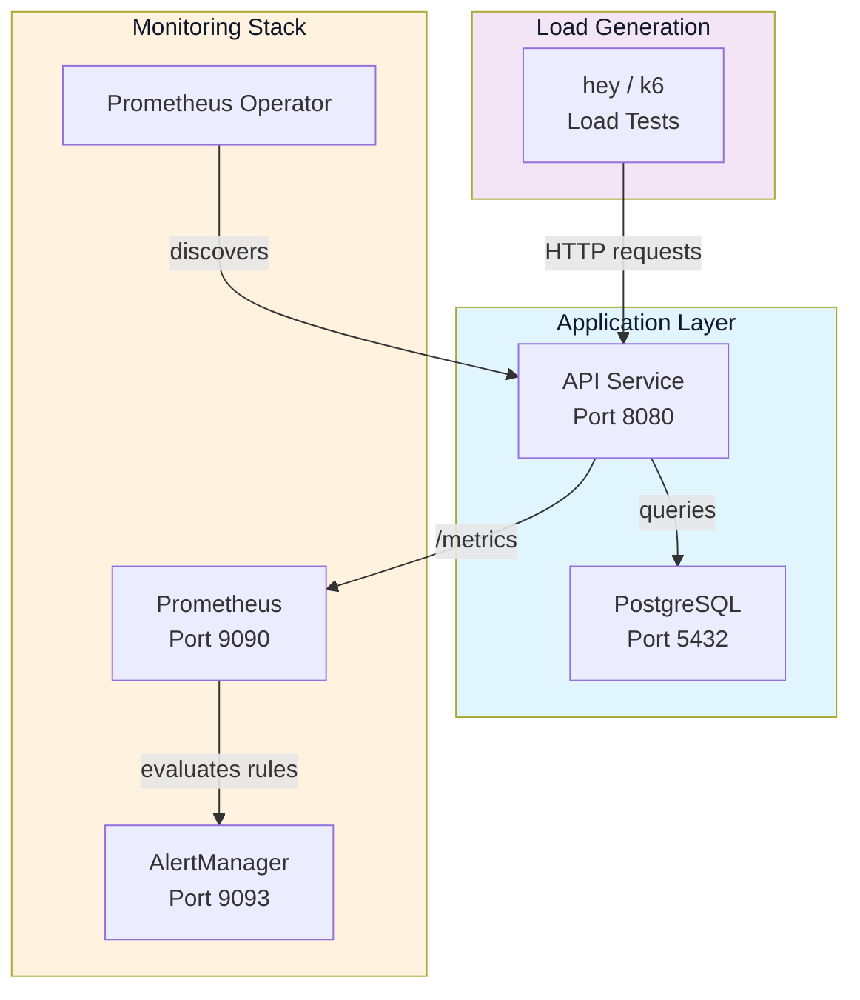

# Operational Verification Labs: Site Reliability Engineering (SRE) & Kubernetes Operations

## Introduction

This operational verification lab suite provides hands-on experience with production-grade Site Reliability Engineering (SRE) practices in Kubernetes environments. Each lab builds proficiency in critical SRE disciplines: Service Level Indicator (SLI) and Service Level Objective (SLO) measurement, Prometheus-based alerting, error budget management, resilience testing through chaos engineering, and incident response workflows.

These labs assume a working Kubernetes cluster (v1.24+) with administrator access and emphasize real-world tooling: kubectl, Prometheus Operator, AlertManager, load testing utilities (hey, k6), and chaos engineering platforms (Chaos Mesh or Litmus).

---

## Lab 1: SLI/SLO Foundation & Measurement Strategy

### Objective
Establish a production SLI/SLO framework for a multi-tier application, instrument it with Prometheus, and create actionable SLO dashboards.

### First Principles: Why SLI/SLO Matters

A Service Level Objective (SLO) is a target reliability goal expressed as a percentage (e.g., 99.9% availability). A Service Level Indicator (SLI) is the actual measured metric that determines whether you're meeting that SLO. The relationship is simple:

```
SLI (measured) → compared against → SLO (target) → error budget = (100 - SLO) × time window
```

If your SLO is 99.9% over 30 days, your error budget is 0.1% × 30 days = 43.2 minutes of allowable downtime. This budget drives operational decisions: can you deploy? Can you do maintenance? When must you stop and stabilize?

### Architecture Overview



### Setup: Deploy Sample Application & Prometheus Stack

#### Step 1: Create Application Namespace and ConfigMaps

```yaml
# namespace-and-config.yaml
apiVersion: v1
kind: Namespace
metadata:
  name: sre-app
---
apiVersion: v1
kind: ConfigMap
metadata:
  name: app-config
  namespace: sre-app
data:
  DB_HOST: "postgres.sre-app.svc.cluster.local"
  DB_PORT: "5432"
  DB_NAME: "appdb"
  LOG_LEVEL: "info"
```

Apply:
```bash
kubectl apply -f namespace-and-config.yaml
```

#### Step 2: Deploy PostgreSQL

```yaml
# postgres-deployment.yaml
apiVersion: apps/v1
kind: Deployment
metadata:
  name: postgres
  namespace: sre-app
spec:
  replicas: 1
  selector:
    matchLabels:
      app: postgres
  template:
    metadata:
      labels:
        app: postgres
    spec:
      containers:
      - name: postgres
        image: postgres:15-alpine
        ports:
        - containerPort: 5432
          name: db
        env:
        - name: POSTGRES_DB
          value: "appdb"
        - name: POSTGRES_USER
          value: "appuser"
        - name: POSTGRES_PASSWORD
          value: "securepassword"
        resources:
          requests:
            memory: "256Mi"
            cpu: "100m"
          limits:
            memory: "512Mi"
            cpu: "500m"
        livenessProbe:
          exec:
            command:
            - /bin/sh
            - -c
            - pg_isready -U appuser
          initialDelaySeconds: 10
          periodSeconds: 10
---
apiVersion: v1
kind: Service
metadata:
  name: postgres
  namespace: sre-app
spec:
  selector:
    app: postgres
  ports:
  - port: 5432
    targetPort: 5432
    name: db
  type: ClusterIP
```

Apply:
```bash
kubectl apply -f postgres-deployment.yaml
kubectl wait --for=condition=ready pod -l app=postgres -n sre-app --timeout=300s
```

#### Step 3: Deploy Instrumented API Server

The API server exposes Prometheus metrics via `/metrics` endpoint. We'll use a Go-based service that synthesizes realistic request latencies and occasional errors.

```yaml
# api-deployment.yaml
apiVersion: apps/v1
kind: Deployment
metadata:
  name: api-server
  namespace: sre-app
spec:
  replicas: 3
  selector:
    matchLabels:
      app: api-server
  template:
    metadata:
      labels:
        app: api-server
      annotations:
        prometheus.io/scrape: "true"
        prometheus.io/port: "8080"
        prometheus.io/path: "/metrics"
    spec:
      containers:
      - name: api
        image: kennethreitz/httpbin:latest
        ports:
        - containerPort: 8080
          name: http
        - containerPort: 8000
          name: metrics
        env:
        - name: PORT
          value: "8080"
        resources:
          requests:
            memory: "128Mi"
            cpu: "50m"
          limits:
            memory: "256Mi"
            cpu: "200m"
        livenessProbe:
          httpGet:
            path: /get
            port: 8080
          initialDelaySeconds: 5
          periodSeconds: 10
        readinessProbe:
          httpGet:
            path: /get
            port: 8080
          initialDelaySeconds: 3
          periodSeconds: 5
---
apiVersion: v1
kind: Service
metadata:
  name: api-server
  namespace: sre-app
  labels:
    app: api-server
spec:
  selector:
    app: api-server
  ports:
  - port: 8080
    targetPort: 8080
    name: http
  type: ClusterIP
---
apiVersion: v1
kind: Service
metadata:
  name: api-server-metrics
  namespace: sre-app
  labels:
    app: api-server
spec:
  selector:
    app: api-server
  ports:
  - port: 8000
    targetPort: 8000
    name: metrics
  type: ClusterIP
```

Apply:
```bash
kubectl apply -f api-deployment.yaml
kubectl wait --for=condition=ready pod -l app=api-server -n sre-app --timeout=300s
```

#### Step 4: Deploy Prometheus Operator & Prometheus Instance

First, add the Prometheus Helm repository and install the Prometheus Operator:

```bash
helm repo add prometheus-community https://prometheus-community.github.io/helm-charts
helm repo update
helm install prometheus prometheus-community/kube-prometheus-stack \
  --namespace monitoring --create-namespace \
  --set prometheus.prometheusSpec.serviceMonitorSelectorNilUsesHelmValues=false \
  --set alertmanager.enabled=true
```

Verify installation:
```bash
kubectl get pods -n monitoring
kubectl port-forward -n monitoring svc/prometheus-kube-prometheus-prometheus 9090:9090
```

#### Step 5: Create ServiceMonitor for Application Metrics

```yaml
# servicemonitor-api.yaml
apiVersion: monitoring.coreos.com/v1
kind: ServiceMonitor
metadata:
  name: api-server-monitor
  namespace: sre-app
  labels:
    app: api-server
spec:
  selector:
    matchLabels:
      app: api-server
  endpoints:
  - port: metrics
    interval: 30s
    path: /metrics
```

Apply:
```bash
kubectl apply -f servicemonitor-api.yaml
```

### Exercise 1.1: Define SLI/SLO Baseline

**Scenario**: Your platform SLO is 99.5% availability over a 30-day rolling window. You measure this through request success rate (HTTP 2xx/3xx responses) and latency (p99 < 500ms).

**Define SLO in YAML**:

```yaml
# slo-definition.yaml
apiVersion: v1
kind: ConfigMap
metadata:
  name: slo-definitions
  namespace: sre-app
data:
  slo-config.json: |
    {
      "slos": [
        {
          "name": "api_availability",
          "target": 99.5,
          "window_days": 30,
          "description": "HTTP request success rate (2xx/3xx responses)",
          "error_budget_minutes": 21.6
        },
        {
          "name": "api_latency",
          "target": 99.0,
          "window_days": 30,
          "latency_percentile": "p99",
          "latency_threshold_ms": 500,
          "description": "p99 latency under 500ms for 99% of requests"
        },
        {
          "name": "db_connection_health",
          "target": 99.9,
          "window_days": 7,
          "description": "Database connection pool availability"
        }
      ]
    }
```

Apply:
```bash
kubectl apply -f slo-definition.yaml
```

**Query error budget in Prometheus console**:

Navigate to Prometheus (http://localhost:9090) and query:

```promql
# Calculate 30-day error budget in minutes for availability SLO
(1 - 0.995) * 30 * 24 * 60
```

Expected result: `21.6` minutes.

### Exercise 1.2: Create SLI Recording Rules

Recording rules in Prometheus pre-calculate frequently-used metrics to reduce query load.

```yaml
# recording-rules.yaml
apiVersion: monitoring.coreos.com/v1
kind: PrometheusRule
metadata:
  name: sli-recording-rules
  namespace: sre-app
spec:
  groups:
  - name: sli.rules
    interval: 30s
    rules:
    # Calculate request success rate
    - record: sli:http_requests:success_rate
      expr: |
        sum(rate(http_requests_total{job="api-server", status=~"2.."}[5m]))
        /
        sum(rate(http_requests_total{job="api-server"}[5m]))
    
    # Calculate p99 latency
    - record: sli:http_request_duration:p99
      expr: |
        histogram_quantile(0.99, sum(rate(http_request_duration_seconds_bucket[5m])) by (le))
    
    # Calculate error rate (inverse of success rate)
    - record: sli:http_requests:error_rate
      expr: |
        1 - sli:http_requests:success_rate
    
    # Track SLO compliance status (1 = compliant, 0 = violated)
    - record: slo:api_availability:compliant
      expr: |
        (sli:http_requests:success_rate > 0.995) * 1
    
    - record: slo:api_latency:compliant
      expr: |
        (sli:http_request_duration:p99 < 0.5) * 1
```

Apply:
```bash
kubectl apply -f recording-rules.yaml
```

**Verify recording rules are active**:

```bash
kubectl port-forward -n sre-app svc/api-server 8080:8080 &
# Generate traffic (in separate terminal)
for i in {1..100}; do curl http://localhost:8080/get; sleep 0.1; done

# Query recording rules
# Navigate to Prometheus > Graph tab and query:
# sli:http_requests:success_rate
# sli:http_request_duration:p99
```

### Exercise 1.3: Build SLO Dashboard

Create a Grafana dashboard to visualize SLI/SLO compliance.

```yaml
# grafana-slo-dashboard.yaml
apiVersion: v1
kind: ConfigMap
metadata:
  name: grafana-slo-dashboard
  namespace: monitoring
data:
  slo-dashboard.json: |
    {
      "dashboard": {
        "title": "SRE: SLI/SLO Compliance",
        "panels": [
          {
            "id": 1,
            "title": "API Availability (30-day SLO: 99.5%)",
            "targets": [
              {
                "expr": "sli:http_requests:success_rate * 100"
              }
            ],
            "fieldConfig": {
              "defaults": {
                "thresholds": {
                  "steps": [
                    { "color": "red", "value": null },
                    { "color": "yellow", "value": 99.5 },
                    { "color": "green", "value": 99.9 }
                  ]
                },
                "unit": "percent"
              }
            }
          },
          {
            "id": 2,
            "title": "p99 Latency (Target: < 500ms)",
            "targets": [
              {
                "expr": "sli:http_request_duration:p99 * 1000"
              }
            ],
            "fieldConfig": {
              "defaults": {
                "thresholds": {
                  "steps": [
                    { "color": "green", "value": null },
                    { "color": "yellow", "value": 300 },
                    { "color": "red", "value": 500 }
                  ]
                },
                "unit": "ms"
              }
            }
          },
          {
            "id": 3,
            "title": "Error Budget Burndown (30 days)",
            "targets": [
              {
                "expr": "increase(sli:http_requests:error_rate[30d]) * 100"
              }
            ]
          }
        ]
      }
    }
```

---

## Lab 2: Prometheus PromQL Alerting & AlertManager

### Objective
Build sophisticated multi-condition alerting rules that trigger proportionally to severity and integrate with AlertManager for notification routing.

### First Principles: Alert Routing & Severity

Alerts should be:
1. **Specific**: Alert on symptoms, not just thresholds
2. **Actionable**: Every alert must have a runbook
3. **Proportional**: Severity reflects expected customer impact

The alerting workflow:
```
Prometheus Rule → fires alert → AlertManager → routes by label → notifies (Slack/PagerDuty/etc.)
```

### Exercise 2.1: Define Multi-Tier Alert Rules

```yaml
# alert-rules.yaml
apiVersion: monitoring.coreos.com/v1
kind: PrometheusRule
metadata:
  name: sre-alert-rules
  namespace: sre-app
spec:
  groups:
  - name: api.alerts
    interval: 30s
    rules:
    # CRITICAL: SLO violation detected
    - alert: APISLOViolation
      expr: |
        slo:api_availability:compliant == 0
      for: 5m
      labels:
        severity: critical
        slo: "true"
      annotations:
        summary: "API availability SLO violated"
        description: "Success rate dropped below 99.5% for 5 minutes. Error budget consumption accelerating."
        runbook_url: "https://wiki.company.com/runbooks/api-slo-violation"
    
    # WARNING: High error rate (but not yet SLO violation)
    - alert: APIHighErrorRate
      expr: |
        sli:http_requests:error_rate > 0.02 and slo:api_availability:compliant == 1
      for: 2m
      labels:
        severity: warning
        component: api
      annotations:
        summary: "High error rate detected"
        description: "Error rate is {{ $value | humanizePercentage }} (threshold: 2%)"
        runbook_url: "https://wiki.company.com/runbooks/api-high-error-rate"
    
    # CRITICAL: p99 latency SLO violated
    - alert: APILatencySLOViolation
      expr: |
        slo:api_latency:compliant == 0
      for: 3m
      labels:
        severity: critical
        slo: "true"
      annotations:
        summary: "API p99 latency SLO violated"
        description: "p99 latency is {{ $value | humanizeDuration }} (threshold: 500ms)"
        runbook_url: "https://wiki.company.com/runbooks/api-latency-violation"
    
    # WARNING: High memory usage (predictive)
    - alert: APIMemoryHighUsage
      expr: |
        (container_memory_usage_bytes{pod=~"api-server.*"} / container_spec_memory_limit_bytes) > 0.8
      for: 5m
      labels:
        severity: warning
        component: api
      annotations:
        summary: "API pod memory usage exceeds 80%"
        description: "Pod {{ $labels.pod }}: {{ $value | humanizePercentage }}"
    
    # CRITICAL: Pod crash loop
    - alert: APIPodCrashLoop
      expr: |
        rate(kube_pod_container_status_restarts_total{pod=~"api-server.*"}[15m]) > 0.1
      for: 5m
      labels:
        severity: critical
        component: api
      annotations:
        summary: "API pod in crash loop"
        description: "Pod {{ $labels.pod }}: restarting {{ $value }} times per minute"
        runbook_url: "https://wiki.company.com/runbooks/pod-crash-loop"
```

Apply:
```bash
kubectl apply -f alert-rules.yaml
```

**Verify rules are loaded**:

```bash
kubectl port-forward -n monitoring svc/prometheus-kube-prometheus-prometheus 9090:9090 &
# Navigate to http://localhost:9090/alerts
# You should see 6 alert rules defined
```

### Exercise 2.2: AlertManager Configuration & Routing

AlertManager routes alerts based on labels. Create a routing configuration:

```yaml
# alertmanager-config.yaml
apiVersion: v1
kind: Secret
metadata:
  name: alertmanager-config
  namespace: monitoring
type: Opaque
stringData:
  alertmanager.yml: |
    global:
      resolve_timeout: 5m
      slack_api_url: 'YOUR_SLACK_WEBHOOK_URL'
    
    route:
      # Root route must have a receiver
      receiver: 'default'
      group_by: ['alertname', 'cluster', 'service']
      group_wait: 10s
      group_interval: 10s
      repeat_interval: 12h
      routes:
      
      # Route SLO violations to PagerDuty immediately
      - match:
          slo: "true"
        receiver: 'pagerduty-critical'
        severity_overrides: 'critical'
        group_wait: 0s
        repeat_interval: 1h
      
      # Route API warnings to Slack
      - match:
          component: 'api'
          severity: 'warning'
        receiver: 'slack-api-warnings'
        group_wait: 30s
        repeat_interval: 4h
      
      # Route all critical to ops-team
      - match:
          severity: 'critical'
        receiver: 'ops-team-pagerduty'
        group_wait: 5s
        repeat_interval: 30m
    
    receivers:
    - name: 'default'
      slack_configs:
      - channel: '#alerts'
        title: 'Kubernetes Alert'
        text: '{{ range .Alerts }}{{ .Annotations.description }}{{ end }}'
    
    - name: 'slack-api-warnings'
      slack_configs:
      - channel: '#api-warnings'
        title: 'API Warning'
        text: '{{ .GroupLabels.alertname }}: {{ range .Alerts }}{{ .Annotations.summary }}{{ end }}'
    
    - name: 'pagerduty-critical'
      pagerduty_configs:
      - service_key: 'YOUR_PAGERDUTY_SERVICE_KEY'
        severity: 'critical'
    
    - name: 'ops-team-pagerduty'
      pagerduty_configs:
      - service_key: 'YOUR
```
