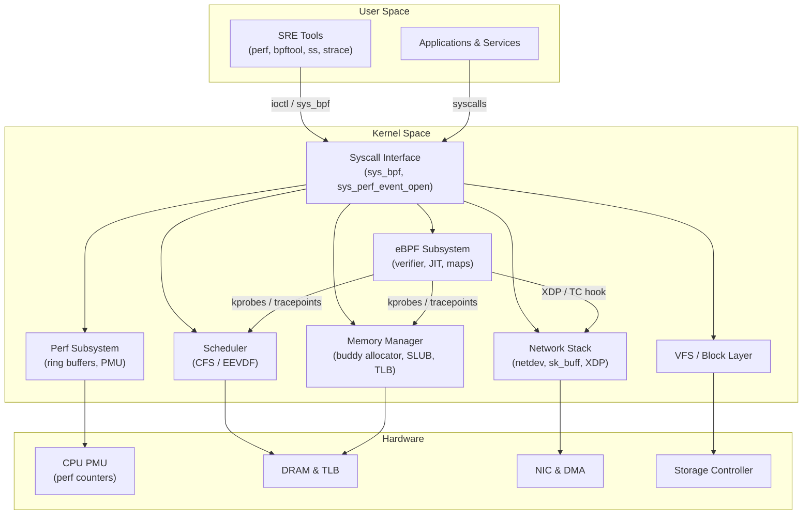
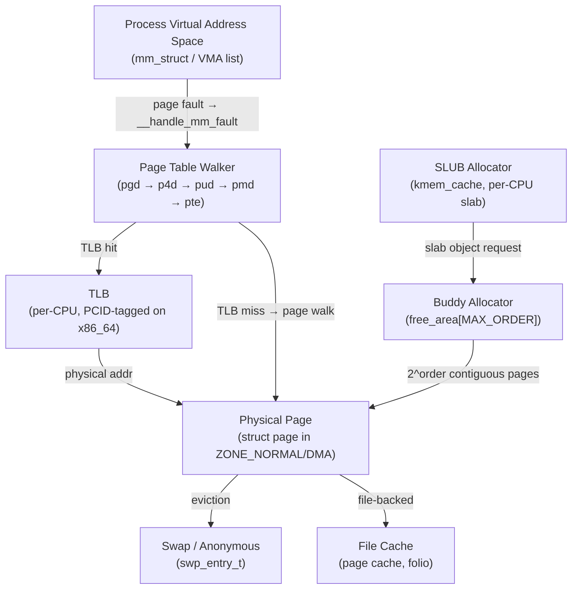
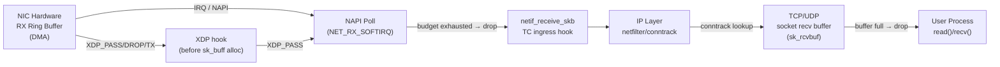
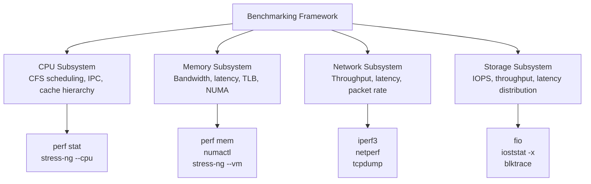
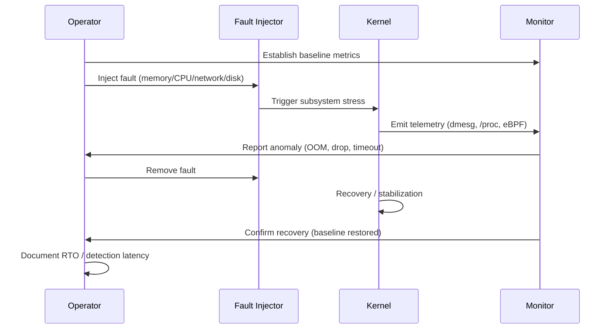
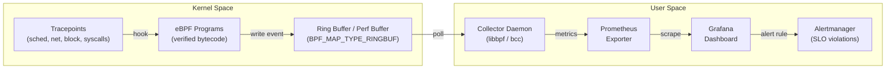

# Operational Verification Labs: Core SRE Infrastructure

## Preface: Mental Model and Scope

This lab guide targets systems engineers and SRE practitioners performing operational verification of core Linux infrastructure. The exercises are designed to build intuition about *why* subsystems behave as they do — not just how to observe them. Each section pairs mechanical tool usage with architectural explanation, so practitioners understand the causal chain between kernel internals and observable symptoms.

The progression is deliberate: inspection first (understand baseline state), then benchmarking (characterize limits), then fault injection (validate resilience contracts). Every command is chosen because it exposes a specific kernel data structure or subsystem boundary that matters in production.

---

## Architecture Overview

Before touching any tool, understand the observability stack you are operating against:



The critical insight here is that every observability tool — `perf`, `bpftool`, `strace` — ultimately exercises the same kernel interfaces (`perf_event_open(2)`, `sys_bpf(2)`, `ptrace(2)`) that production code runs through. This means observability overhead is real and must be budgeted for in production.

---

## Environment Setup and Prerequisites

### Required Tooling

| Tool | Package | Purpose |
|------|---------|---------|
| `bpftool` | `linux-tools-$(uname -r)` or `bpftool` | eBPF program/map introspection |
| `perf` | `linux-tools-$(uname -r)` | Kernel PMU and tracepoint profiling |
| `iproute2` | `iproute2` | Network namespace, route, and qdisc management |
| `tcpdump` | `tcpdump` | Packet capture via libpcap |
| `strace` | `strace` | `ptrace`-based syscall tracing |
| `stress-ng` | `stress-ng` | Synthetic load generation (CPU, VM, I/O) |
| `fio` | `fio` | Flexible I/O tester for storage benchmarking |
| `iperf3` | `iperf3` | TCP/UDP throughput measurement |
| `ss` | `iproute2` | Socket statistics via `netlink` |
| `numactl` | `numactl` | NUMA topology inspection and affinity |
| `dmesg`, `journalctl` | `util-linux`, `systemd` | Kernel ring buffer and journal access |

### Kernel Requirements

The lab requires a kernel ≥ 5.10 for stable BTF support. eBPF CO-RE (Compile Once, Run Everywhere) depends on BTF — the kernel's internal type metadata encoded in ELF sections. Without BTF, eBPF programs must be compiled per-kernel-version.

Verify eBPF and BTF support:

```bash
# Verify BPF syscall and JIT support
grep -E "^CONFIG_(BPF_SYSCALL|BPF_JIT|BPF_JIT_ALWAYS_ON|DEBUG_INFO_BTF)=" \
    /boot/config-$(uname -r)

# Expected output on a properly configured system:
# CONFIG_BPF_SYSCALL=y
# CONFIG_BPF_JIT=y
# CONFIG_BPF_JIT_ALWAYS_ON=y       (optional but recommended in prod)
# CONFIG_DEBUG_INFO_BTF=y           (required for CO-RE / bpftool inspect)

# Verify BTF is exposed via sysfs
ls -lh /sys/kernel/btf/vmlinux

# Verify bpftool version matches running kernel
bpftool version
```

The `CONFIG_DEBUG_INFO_BTF=y` flag causes the kernel to embed BTF type information directly into the `vmlinux` image. This is what enables tools like `bpftool btf dump` and libbpf CO-RE relocations to resolve struct field offsets at load time rather than compile time.

For containerized environments:

```bash
# Confirm kubectl context and cluster reachability
kubectl config current-context
kubectl get nodes -o wide

# Verify eBPF capability in the node's kernel from within a privileged pod
kubectl run bpf-probe --rm -it --privileged \
    --image=quay.io/cilium/cilium-dbg:latest -- \
    bpftool feature probe kernel
```

---

## Exercise 1: Live State & Internal Subsystem Inspection

The goal of this exercise is to build a complete snapshot of system state before any load is applied. This baseline is the reference against which all subsequent anomalies are measured.

### 1.1 eBPF Map and Program Inspection

eBPF programs are JIT-compiled bytecode verified by the kernel's verifier and loaded into kernel context. Maps are shared memory regions — implemented as kernel data structures (hash tables, arrays, ring buffers) — through which kernel-space eBPF programs and user-space tools communicate.

```bash
# List all loaded eBPF programs with their type, ID, and tag (SHA-1 of bytecode)
bpftool prog show

# Example output:
# 42: kprobe  name sys_execve_entry  tag a1b2c3d4e5f60718  gpl
#     loaded_at 2024-01-15T10:23:11+0000  uid 0
#     xlated 184B  jited 112B  memlock 4096B  map_ids 7

# List all eBPF maps with type, key/value sizes, and max entries
bpftool map show

# Dump the full contents of a map by ID
bpftool map dump id 7

# Inspect the BTF type information for a map (shows struct layouts)
bpftool btf dump id 7
```

A production-grade eBPF map definition using the BTF-annotated syntax (required for CO-RE):

```c
// SPDX-License-Identifier: GPL-2.0
#include <vmlinux.h>              // Auto-generated BTF header via bpftool
#include <bpf/bpf_helpers.h>
#include <bpf/bpf_tracing.h>
#include <bpf/bpf_core_read.h>   // CO-RE read macros

// Per-CPU array for syscall latency histogram (avoids lock contention)
struct latency_hist {
    __u64 slots[64];   // 64 buckets: 0-1us, 1-2us, 2-4us, 4-8us, ...
    __u64 overflow;
};

struct {
    __uint(type, BPF_MAP_TYPE_PERCPU_ARRAY);
    __uint(max_entries, 512);              // 512 syscall numbers
    __type(key,   __u32);                  // syscall NR
    __type(value, struct latency_hist);
} syscall_latency_hist SEC(".maps");

// Per-task start timestamps stored in hash map
struct {
    __uint(type, BPF_MAP_TYPE_HASH);
    __uint(max_entries, 65536);
    __type(key,   __u64);                  // tgid_pid
    __type(value, __u64);                  // ktime_ns at entry
} start_ts SEC(".maps");

// Ring buffer for structured events (preferred over perf_event_array for new code)
struct event {
    __u32 pid;
    __u32 syscall_nr;
    __u64 latency_ns;
    char  comm[16];
};

struct {
    __uint(type, BPF_MAP_TYPE_RINGBUF);
    __uint(max_entries, 1 << 22);          // 4 MiB ring buffer
} events SEC(".maps");

SEC("tracepoint/raw_syscalls/sys_enter")
int tp_sys_enter(struct trace_event_raw_sys_enter *ctx)
{
    __u64 key = bpf_get_current_pid_tgid();
    __u64 ts  = bpf_ktime_get_ns();
    bpf_map_update_elem(&start_ts, &key, &ts, BPF_ANY);
    return 0;
}

SEC("tracepoint/raw_syscalls/sys_exit")
int tp_sys_exit(struct trace_event_raw_sys_exit *ctx)
{
    __u64 key = bpf_get_current_pid_tgid();
    __u64 *tsp = bpf_map_lookup_elem(&start_ts, &key);
    if (!tsp)
        return 0;

    __u64 delta = bpf_ktime_get_ns() - *tsp;
    bpf_map_delete_elem(&start_ts, &key);

    // Determine histogram bucket (log2 of delta in nanoseconds)
    __u32 nr  = (__u32)ctx->id;
    __u32 bit = 0;
    __u64 val = delta >> 10;   // shift to microseconds for bucketing
    while (val > 0 && bit < 63) { val >>= 1; bit++; }

    struct latency_hist *hist = bpf_map_lookup_elem(&syscall_latency_hist, &nr);
    if (hist)
        __sync_fetch_and_add(&hist->slots[bit], 1);

    // Emit to ring buffer for user-space consumption
    struct event *e = bpf_ringbuf_reserve(&events, sizeof(*e), 0);
    if (e) {
        e->pid        = (__u32)(key >> 32);
        e->syscall_nr = nr;
        e->latency_ns = delta;
        bpf_get_current_comm(&e->comm, sizeof(e->comm));
        bpf_ringbuf_submit(e, 0);
    }

    return 0;
}

char LICENSE[] SEC("license") = "GPL";
```

Inspect the loaded program after attaching:

```bash
# Verify program is attached and JIT-compiled
bpftool prog show name tp_sys_exit

# Dump the JIT-compiled x86_64 assembly (requires CAP_SYS_ADMIN)
bpftool prog dump jited name tp_sys_exit

# Dump the verified BPF bytecode
bpftool prog dump xlated name tp_sys_exit opcodes
```

### 1.2 Virtual Memory Architecture and TLB State

The Linux memory manager operates through a layered hierarchy. Understanding which layer is under pressure determines the correct remediation.



Inspect virtual memory statistics with interpretive context:

```bash
# /proc/meminfo key fields explained:
# MemTotal:      total usable RAM (excludes firmware-reserved)
# MemFree:       completely idle pages (not useful alone)
# MemAvailable:  estimate of reclaimable memory without swapping (use this)
# Cached:        page cache (reclaimable under pressure)
# SReclaimable:  slab memory that can be reclaimed (dentries, inodes)
# SUnreclaim:    slab memory that cannot be reclaimed (must stay resident)
# Mlocked:       pages pinned via mlock(2) — excluded from reclaim
# AnonHugePages: THP-backed anonymous memory (reduces TLB pressure)
# DirectMap1G:   1 GiB huge pages in the kernel's direct map

cat /proc/meminfo

# /proc/vmstat key counters:
# pgpgin/pgpgout:   pages paged in/out from disk (file I/O, not swap)
# pswpin/pswpout:   pages swapped in/out (anonymous memory pressure)
# pgfault:          minor faults (page present in page cache, not in PTE)
# pgmajfault:       major faults (page must be read from disk — latency spike)
# thp_fault_alloc:  THP allocated on fault (good — reduces TLB pressure)
# thp_collapse_alloc: THP formed by khugepaged collapsing base pages
# nr_dirty:         pages dirty in page cache awaiting writeback
# nr_writeback:     pages currently being written to storage

cat /proc/vmstat

# Compute the page fault rate over a 10-second window
awk '/^pgmajfault/{print $2}' /proc/vmstat; \
sleep 10; \
awk '/^pgmajfault/{print $2}' /proc/vmstat
```

Trace page faults at the kernel level with `perf` to get call-graph attribution:

```bash
# Record page fault events with call graphs for 10 seconds across all CPUs
# --call-graph dwarf uses DWARF unwinding (more accurate than fp for optimized binaries)
perf record -e page-faults -a --call-graph dwarf -- sleep 10

# Generate a flame-graph-ready folded output
perf script | stackcollapse-perf.pl | flamegraph.pl > page_faults.svg

# Or use perf report directly
perf report --stdio --no-children | head -60
```

Inspect NUMA topology, which is the dominant source of unexpected memory latency on multi-socket systems:

```bash
# Show NUMA node topology and memory distribution
numactl --hardware

# Show per-NUMA-node memory statistics
cat /sys/devices/system/node/node*/meminfo

# Show NUMA hit/miss/interleave statistics
# numa_hit:   allocation succeeded on the intended node
# numa_miss:  allocation fell back to a remote node
# numa_foreign: allocation for a remote node landed here
cat /sys/devices/system/node/node*/numastat

# Inspect NUMA balancing activity
cat /proc/vmstat | grep -E "^(numa_|pgmigrate)"
```

### 1.3 Scheduler State and Process Inspection

The Completely Fair Scheduler (CFS) — now being superseded by EEVDF (Earliest Eligible Virtual Deadline First) in kernels ≥ 6.6 — maintains a red-black tree of runnable tasks, keyed by their virtual runtime (`vruntime`). The task with the leftmost node (smallest `vruntime`) is next to run.

```bash
# Show per-CPU runqueue depth and scheduler statistics
# nr_running: runnable tasks on this CPU's runqueue (>1 means contention)
# load_avg:   weighted CPU load average (exponentially decayed)
cat /proc/schedstat

# Inspect scheduler statistics for a specific process
# se.sum_exec_runtime: total CPU time consumed (ns)
# se.nr_migrations:    times the task was migrated between CPUs
# nr_voluntary_switches:   task yielded CPU (I/O wait, mutex, etc.)
# nr_involuntary_switches: task was preempted (CPU overloaded)
cat /proc/<PID>/schedstat
cat /proc/<PID>/sched

# High-resolution process snapshot sorted by CPU consumption
ps -eo pid,tid,ppid,stat,pri,ni,psr,pcpu,pmem,vsz,rss,comm \
    --sort=-%cpu | head -20

# Show thread-level detail for a specific PID
ps -eLf -p <PID>
```

Use `strace` with overhead awareness:

```bash
# Trace specific syscall classes with timestamps and duration
# WARNING: strace adds ~10-20% overhead via ptrace stops; never use on latency-critical processes in prod
strace -p <PID> \
    -e trace=network,ipc,memory \
    -T \          # print time spent in each syscall
    -ttt \        # absolute timestamps (epoch.microseconds)
    -o strace_$(date +%s).log

# Count syscall frequencies (less overhead than full trace — single ptrace intercept per syscall)
strace -p <PID> -c -S calls -- sleep 30
```

### 1.4 Network Stack Internals and Interface Metrics

The Linux network stack processes packets through a layered path. Understanding where drops occur — NIC ring buffer, softirq budget, socket receive buffer — determines the right fix.



```bash
# Socket statistics: show all TCP sockets with memory and timer state
ss -tmopi

# Key fields:
# skmem:(r<rmem_alloc>,rb<rcvbuf>,t<wmem_alloc>,tb<sndbuf>,...)
# rcvbuf / sndbuf: current socket buffer sizes (auto-tuned by default)
# retrans: retransmission counter (non-zero in production = problem)
# timer: retransmit timer state

# Show network interface statistics including RX/TX drops
ip -s link show

# Deep per-NIC statistics (driver-level counters, requires ethtool)
ethtool -S <interface>  | grep -E "(drop|error|miss|overflow)"

# Show NIC ring buffer sizes and NAPI budget
ethtool -g <interface>
ethtool -c <interface>   # interrupt coalescing settings

# Monitor netdev backlog drops (packet dropped because softirq budget exhausted)
# softnet_stat columns: total_received, dropped, time_squeezed, 0, 0, 0, 0, 0, 0, cpu_collision, received_rps, flow_limit_count
cat /proc/net/softnet_stat

# Targeted packet capture: capture first 128 bytes of TCP SYN packets only
# Use -B to increase capture buffer and avoid drops in pcap itself
tcpdump -i any -B 65536 -s 128 -n \
    'tcp[tcpflags] & (tcp-syn) != 0' \
    -w /tmp/syn_capture_$(date +%s).pcap &

# Inspect conntrack table utilization (important for NAT-heavy environments)
cat /proc/sys/net/netfilter/nf_conntrack_count
cat /proc/sys/net/netfilter/nf_conntrack_max
conntrack -L --output extended 2>/dev/null | wc -l
```

### 1.5 Kernel Ring Buffer and Log Analysis

```bash
# Kernel ring buffer with human-readable timestamps (monotonic since boot)
dmesg -T --level=err,warn,crit,alert,emerg

# Common patterns indicating subsystem stress:
# "Out of memory: Kill process" — OOM killer activated
# "NOHZ: local_softirq_pending" — softirq starvation on nohz CPU
# "BUG: soft lockup" — CPU stuck in kernel code >20s (watchdog trigger)
# "NMI watchdog: BUG: hard lockup" — CPU stuck >10s (hardware watchdog)
# "EXT4-fs error" / "XFS: metadata I/O error" — filesystem corruption path
# "EDAC MC0: CE" — correctable memory error (ECC)
# "mce: [Hardware Error]" — machine check exception

dmesg -T | grep -E \
    "(OOM|killed|oom_kill|soft lockup|hard lockup|mce|EDAC|EXT4-fs error|XFS.*error)"

# Structured journal query for a service with priority filtering
journalctl -u kubelet.service \
    --since "2 hours ago" \
    --priority=err \
    --output=json-pretty | \
    jq '.MESSAGE' | \
    sort | uniq -c | sort -rn | head -20
```

---

## Exercise 2: Benchmarking and Saturation Profiling

Saturation profiling characterizes the system's capacity limits. The RED method (Rate, Errors, Duration) and USE method (Utilization, Saturation, Errors) provide the theoretical framework; the tools below provide the measurements.



### 2.1 CPU Saturation and Scheduler Profiling

CPU saturation manifests as runqueue depth > 1 sustained over time, not momentary spikes. The scheduler's response to saturation — increased context switches and involuntary preemptions — degrades cache locality and IPC.

```bash
# Establish CPU performance baseline with hardware PMU counters
# IPC < 1.0 = memory-bound; IPC > 2.5 = well-optimized compute workload
perf stat -a \
    -e cycles,instructions,cache-references,cache-misses,\
branch-instructions,branch-misses,\
stalled-cycles-frontend,stalled-cycles-backend \
    -- sleep 10

# Record scheduler switch events with call graphs for flame graph generation
# This reveals which code paths are being descheduled and why
perf record \
    -e sched:sched_switch,sched:sched_wakeup \
    -a \
    --call-graph dwarf \
    -- sleep 30

perf script | head -100

# Apply CPU load with precise control over worker count and affinity
# --cpu-method all cycles through all CPU stress methods
# Isolate to specific CPUs to avoid contaminating measurement CPUs
stress-ng \
    --cpu 4 \
    --cpu-method matrixprod \
    --taskset 0-3 \
    --metrics-brief \
    --timeout 60s

# Monitor scheduler migration events across CPUs (high migration = poor affinity)
perf stat -e sched:sched_migrate_task -a -- sleep 10

# Per-CPU runqueue depth monitoring via sar
sar -u ALL 1 10        # per-CPU utilization: usr, sys, iowait, steal
sar -q 1 10            # runqueue length (ldavg-1, runq-sz)
```

A production-relevant eBPF-based scheduler latency profiler:

```python
#!/usr/bin/env python3
"""
run_latency.py — measure scheduler run queue latency using BCC
Measures time from wakeup (sched_wakeup) to actual run (sched_switch ON)
Requires: bcc (BPF Compiler Collection), Python 3, root privileges
"""

from bcc import BPF
import signal
import sys
import ctypes

PROGRAM = r"""
#include <uapi/linux/ptrace.h>
#include <linux/sched.h>

BPF_HASH(start, u32, u64);                          // pid -> wakeup timestamp

// Latency histogram: power-of-2 buckets in microseconds
BPF_HISTOGRAM(run_latency_us, u64, 64);

TRACEPOINT_PROBE(sched, sched_wakeup) {
    u32 pid = args->pid;
    u64 ts  = bpf_ktime_get_ns();
    start.update(&pid, &ts);
    return 0;
}

TRACEPOINT_PROBE(sched, sched_wakeup_new) {
    u32 pid = args->pid;
    u64 ts  = bpf_ktime_get_ns();
    start.update(&pid, &ts);
    return 0;
}

TRACEPOINT_PROBE(sched, sched_switch) {
    u32 pid = args->next_pid;
    u64 *tsp = start.lookup(&pid);
    if (!tsp) return 0;

    u64 delta_us = (bpf_ktime_get_ns() - *tsp) / 1000;
    start.delete(&pid);

    // Clamp to histogram range
    if (delta_us < 1)       delta_us = 1;
    if (delta_us > 1000000) delta_us = 1000000;

    run_latency_us.increment(bpf_log2l(delta_us));
    return 0;
}
"""

b = BPF(text=PROGRAM)
print("Tracing scheduler run queue latency... Ctrl-C to dump histogram")

def handler(sig, frame):
    print("\n--- Run Queue Latency Histogram (microseconds, log2 scale) ---")
    b["run_latency_us"].print_log2_hist("latency (us)")
    sys.exit(0)

signal.signal(signal.SIGINT, handler)
signal.pause()
```

### 2.2 Memory Subsystem Profiling

Memory bandwidth and latency are distinct bottlenecks. High bandwidth utilization reduces effective latency for all accessors. TLB pressure from large working sets causes frequent page walks even when data is in DRAM.

```bash
# Memory bandwidth and latency profiling with perf mem
# Requires Precise Event Based Sampling (PEBS) support on Intel or AMD IBS
perf mem record -a -- sleep 10
perf mem report --stdio | head -40

# Detailed memory event statistics
perf stat -a \
    -e LLC-loads,LLC-load-misses,\
LLC-stores,LLC-store-misses,\
dTLB-loads,dTLB-load-misses,\
iTLB-loads,iTLB-load-misses \
    -- sleep 10

# TLB miss rate = dTLB-load-misses / dTLB-loads
# LLC miss rate = LLC-load-misses / LLC-loads
# iTLB-load-misses > 1% typically indicates large binary or JIT-heavy workload

# Stress memory subsystem with controlled parameters
stress-ng \
    --vm 2 \
    --vm-bytes 4G \
    --vm-method all \
    --vm-keep \           # keep pages mapped (tests sustained bandwidth)
    --page-in \           # fault all pages in before timing
    --metrics-brief \
    --timeout 60s

# Monitor NUMA memory migration (kcompactd and kswapd activity)
while true; do
    echo "=== $(date +%T) ==="
    grep -E "^(pgmigrate|kswapd|compact)" /proc/vmstat | \
        awk '{printf "%-30s %s\n", $1, $2}'
    sleep 2
done
```

Measure memory latency across NUMA nodes:

```c
/* mem_latency.c — pointer-chasing benchmark to measure memory access latency
 * Compile: gcc -O2 -o mem_latency mem_latency.c
 * Usage: ./mem_latency <size_mb> <iterations>
 * Run with numactl --membind=1 --cpunodebind=0 ./mem_latency 256 1000000
 * to measure remote NUMA latency
 */
#include <stdio.h>
#include <stdlib.h>
#include <stdint.h>
#include <string.h>
#include <time.h>
#include <numa.h>   // link with -lnuma

#define CACHE_LINE 64

static uint64_t get_ns(void)
{
    struct timespec ts;
    clock_gettime(CLOCK_MONOTONIC_RAW, &ts);
    return (uint64_t)ts.tv_sec * 1000000000ULL + ts.tv_nsec;
}

int main(int argc, char *argv[])
{
    if (argc != 3) {
        fprintf(stderr, "Usage: %s <size_mb> <iterations>\n", argv[0]);
        return 1;
    }

    size_t   size_mb   = (size_t)atol(argv[1]);
    uint64_t iters     = (uint64_t)atoll(argv[2]);
    size_t   size      = size_mb * 1024 * 1024;
    size_t   n_lines   = size / CACHE_LINE;

    // Allocate on the NUMA node bound by numactl (or default node)
    uintptr_t *buf = (uintptr_t *)numa_alloc_local(size);
    if (!buf) { perror("numa_alloc_local"); return 1; }

    // Build a random pointer chain spanning the entire buffer
    // Each element points to the next cache line (randomized order)
    // This defeats hardware prefetchers
    size_t *indices = malloc(n_lines * sizeof(size_t));
    for (size_t i = 0; i < n_lines; i++) indices[i] = i;
    // Fisher-Yates shuffle
    for (size_t i = n_lines - 1; i > 0; i--) {
        size_t j     = (size_t)rand() % (i + 1);
        size_t tmp   = indices[i];
        indices[i]   = indices[j];
        indices[j]   = tmp;
    }
    // Build pointer chain
    for (size_t i = 0; i < n_lines - 1; i++)
        buf[indices[i] * (CACHE_LINE / sizeof(uintptr_t))] =
            (uintptr_t)&buf[indices[i+1] * (CACHE_LINE / sizeof(uintptr_t))];
    buf[indices[n_lines-1] * (CACHE_LINE / sizeof(uintptr_t))] =
        (uintptr_t)&buf[indices[0] * (CACHE_LINE / sizeof(uintptr_t))];
    free(indices);

    // Warm up
    volatile uintptr_t *p = (volatile uintptr_t *)buf;
    for (uint64_t i = 0; i < n_lines; i++)
        p = (volatile uintptr_t *)*p;

    uint64_t t0 = get_ns();
    for (uint64_t i = 0; i < iters; i++)
        p = (volatile uintptr_t *)*p;
    uint64_t t1 = get_ns();

    (void)p;  // prevent dead-code elimination

    printf("Buffer: %zu MiB | Iterations: %llu\n", size_mb, (unsigned long long)iters);
    printf("Total:  %.3f ms\n",  (double)(t1 - t0) / 1e6);
    printf("Avg:    %.2f ns/access\n", (double)(t1 - t0) / (double)iters);

    numa_free(buf, size);
    return 0;
}
```

### 2.3 Network Throughput and Latency Profiling

Network performance degrades through two distinct pathways: throughput saturation (bandwidth-limited) and latency inflation (queuing, retransmits, congestion control). They require different diagnostic approaches.

```bash
# TCP throughput test: single stream and parallel streams
# Server side (run first):
iperf3 -s -p 5201 --forceflush

# Client side — single stream with detailed per-second output
iperf3 -c <server-ip> -p 5201 \
    -t 60 \
    -i 1 \           # 1-second reporting interval
    --get-server-output

# Client side — 8 parallel streams (simulates realistic concurrent traffic)
iperf3 -c <server-ip> -p 5201 \
    -P 8 \
    -t 60 \
    -Z               # zero-copy (uses sendfile(2), reduces CPU overhead)

# UDP packet rate test (useful for measuring PPS limits and packet loss)
iperf3 -c <server-ip> -p 5201 \
    -u \             # UDP mode
    -b 1G \          # target bandwidth
    -t 30 \
    --length 1400    # packet payload size near MTU

# High-precision latency measurement (hping3 uses raw sockets, bypasses icmp rate limits)
# Measures RTT with microsecond resolution
hping3 -S -p 80 -c 1000 --fast <target-host> 2>&1 | \
    tee hping_results.txt | \
    awk '/rtt/{print}' | \
    tail -1

# Measure TCP connection establishment latency (SYN → SYN-ACK → ACK)
# Uses curl's built-in timing hooks
for i in $(seq 1 20); do
    curl -o /dev/null -s -w \
        "dns:%{time_namelookup} connect:%{time_connect} ttfb:%{time_starttransfer}\n" \
        http://<target-host>/
done

# Monitor TCP retransmission rate (critical SLO signal)
# Non-zero Retransmits in production = investigate immediately
ss -s
watch -n1 'cat /proc/net/snmp | grep -A1 Tcp | tail -1 | \
    awk "{print \"RetransSegs:\", \$13, \"  InErrs:\", \$14}"'
```

### 2.4 Storage I/O Saturation Profiling

Disk I/O saturation has a distinct signature: `%util` approaching 100% in `iostat` with simultaneously increasing `await` (service time + queue time). Service time alone (`svctm` in older iostat, estimated from `%util/IOPS`) indicates physical drive latency. Queue depth amplifies this.

```bash
# iostat with extended statistics, 1-second interval, 60 samples
# Key fields:
# r/s, w/s:     read/write IOPS
# rMB/s, wMB/s: read/write throughput
# r_await:      average read latency (ms) = service + queue time
# w_await:      average write latency (ms)
# aqu-sz:       average queue depth (>1 sustained = saturation)
# %util:        fraction of time device was busy (not == saturation for SSDs/NVMe!)
iostat -xdh 1 60

# Note: for NVMe SSDs, %util=100% does NOT mean saturated because
# NVMe has 64K+ queue depth. Use aqu-sz and await as primary signals.

# fio: Comprehensive I/O benchmark targeting common production patterns
# Pattern 1: Random 4K reads (database random access pattern)
fio \
    --name=rand_read_4k \
    --filename=/dev/nvme0n1 \     # target raw device (bypasses page cache)
    --direct=1 \                  # O_DIRECT: bypass page cache
    --ioengine=io_uring \         # io_uring: lowest-overhead async I/O
    --rw=randread \
    --bs=4k \
    --iodepth=32 \                # queue depth: 32 outstanding I/Os
    --numjobs=4 \                 # 4 parallel jobs
    --runtime=60 \
    --time_based \
    --group_reporting \
    --output-format=json \
    --output=fio_randread_4k.json

# Pattern 2: Sequential write (log/WAL workload pattern)
fio \
    --name=seq_write_1m \
    --filename=/tmp/fio_test \
    --size=4G \
    --direct=1 \
    --ioengine=io_uring \
    --rw=write \
    --bs=1m \
    --iodepth=4 \
    --numjobs=1 \
    --runtime=60 \
    --time_based \
    --fsync=0 \                   # no fsync per write (measure throughput, not durability)
    --group_reporting

# Pattern 3: Mixed 70/30 read/write (OLTP approximation)
fio \
    --name=oltp_mixed \
    --filename=/tmp/fio_test \
    --size=4G \
    --direct=1 \
    --ioengine=io_uring \
    --rw=randrw \
    --rwmixread=70 \
    --bs=4k \
    --iodepth=16 \
    --numjobs=4 \
    --runtime=120 \
    --time_based \
    --group_reporting \
    --clat_percentiles=1 \        # print full completion latency percentiles
    --percentile_list=50,90,95,99,99.9,99.99

# Block-layer I/O tracing (granular per-request visibility)
# blktrace captures I/O events at the block layer: queue, dispatch, completion
blktrace -d /dev/nvme0n1 -o /tmp/blktrace_output -w 10
blkparse -i /tmp/blktrace_output -d /tmp/blktrace.bin
btt -i /tmp/blktrace.bin -l /tmp/blktrace_latency
```

---

## Exercise 3: Fault Injection and Recovery Analysis

Fault injection tests the gap between assumed and actual system behavior under stress. The goal is not to crash the system (though some tests will) but to validate that failure modes are well-understood and recovery paths function as designed.



### 3.1 Memory Pressure and OOM Kill Analysis

The Linux OOM killer activates when the kernel cannot satisfy a memory allocation after reclaim and swap exhaustion. It selects a victim process using an `oom_score` heuristic: the process with the highest score (accounting for virtual memory size, child processes, and admin overrides via `oom_score_adj`) is killed.

```bash
# Establish pre-fault memory baseline
free -h
cat /proc/meminfo | grep -E "(MemAvailable|SwapTotal|SwapFree)"

# Check current oom_score for critical processes (adjust if needed)
for pid in $(pgrep -d' ' kubelet kube-apiserver etcd); do
    echo "PID $pid: oom_score=$(cat /proc/$pid/oom_score) adj=$(cat /proc/$pid/oom_score_adj)"
done

# Protect critical daemons from OOM kill
# -1000 disables OOM kill for this process entirely
echo -1000 | sudo tee /proc/$(pgrep kubelet)/oom_score_adj

# Inject controlled memory pressure
# Use fewer workers than the stress-ng default to control the ramp
stress-ng \
    --vm 4 \
    --vm-bytes 90% \    # allocate 90% of available RAM across workers
    --vm-method mmap \
    --vm-keep \
    --metrics-brief \
    --timeout 60s &

STRESS_PID=$!

# Simultaneously monitor for OOM events in real time
# Watch dmesg ring buffer for OOM killer messages
dmesg -Tw | grep --line-buffered -E "(oom_kill|Out of memory|Killed process)" &
DMESG_PID=$!

# Monitor swapping activity
vmstat 1 60 | awk 'NR==1{print; next} {if ($7+$8>0) print "SWAP ACTIVE:", $0}'

wait $STRESS_PID
kill $DMESG_PID

# Post-fault analysis: parse OOM kill events from journal
journalctl -k --since "10 minutes ago" | \
    grep -E "(oom_kill|Out of memory)" | \
    awk '{
        # Extract: victim process, pid, and score
        for(i=1;i<=NF;i++) {
            if($i ~ /oom_score_adj/) print "Score adj:", $(i+1)
            if($i ~ /anon-rss/)      print "Anon RSS:",  $(i+1)
        }
    }'

# Inspect /proc/vmstat for reclaim pressure indicators
cat /proc/vmstat | grep -E \
    "^(pgscan_kswapd|pgscan_direct|pgsteal_kswapd|pgsteal_direct|oom_kill)"
```

### 3.2 Network Partition Simulation and Recovery

Network partitions are more subtle than complete outages. Partial partitions — where packets are silently dropped rather than rejected — are the hardest failure mode because TCP's retransmit timer can delay detection by minutes.

```bash
# Establish network baseline before partition
ss -s                                    # socket summary statistics
cat /proc/net/snmp | grep -A1 Tcp       # TCP global counters

# Method 1: iptables DROP (silent drop, simulates packet loss / black hole)
# This tests whether applications have proper connection timeouts
# and whether TCP keepalives are configured correctly
sudo iptables -I INPUT  1 -p tcp --dport 8080 -j DROP
sudo iptables -I OUTPUT 1 -p tcp --sport 8080 -j DROP

# Monitor TCP retransmit timer behavior during partition
# This reveals whether applications detect partition promptly
watch -n1 'ss -tnp | grep ":8080"'

# Observe TCP retransmit exponential backoff via kernel tracepoints
perf trace -e net:net_dev_xmit -a -- sleep 30 2>/dev/null | \
    grep "RETRANSMIT" | head -20

# Method 2: tc netem — probabilistic packet loss (more realistic than DROP)
# Models real network degradation: loss, delay, reorder, corruption
tc qdisc add dev eth0 root netem \
    loss 1% \           # 1% random packet loss (Gilbert-Elliott model available too)
    delay 50ms 10ms \   # 50ms ± 10ms latency
    reorder 0.1% 25%    # 0.1% reorder with 25% correlation

# Verify netem is applied
tc qdisc show dev eth0

# Monitor the effect on a running TCP stream
iperf3 -c <server-ip> -t 30 -i 1 &

# Remove netem after observation
tc qdisc del dev eth0 root

# Method 3: network namespace partition (clean, container-like isolation)
# Create two namespaces connected by a veth pair
ip netns add ns_client
ip netns add ns_server
ip link add veth0 type veth peer name veth1
ip link set veth0 netns ns_client
ip link set veth1 netns ns_server
ip netns exec ns_client ip addr add 10.0.0.1/24 dev veth0
ip netns exec ns_server ip addr add 10.0.0.2/24 dev veth1
ip netns exec ns_client ip link set veth0 up
ip netns exec ns_server ip link set veth1 up

# Test connectivity
ip netns exec ns_client ping -c 3 10.0.0.2

# Inject partition by setting the interface down
ip netns exec ns_client ip link set veth0 down

# Observe from client perspective
ip netns exec ns_client ping -c 3 10.0.0.2 2>&1   # expect 100% loss

# Restore
ip netns exec ns_client ip link set veth0 up

# Cleanup
ip netns del ns_client
ip netns del ns_server

# Post-fault: verify TCP retransmit counters increased during partition
cat /proc/net/snmp | grep -A1 Tcp | tail -1 | \
    awk '{printf "RetransSegs: %s\n", $13}'
```

### 3.3 CPU Overload and Scheduling Fairness Under Saturation

CPU overload validation tests whether the scheduler maintains fairness contracts (CFS) and whether latency-sensitive workloads have adequate priority isolation (cgroups, nice, isolcpus).

```bash
# Establish baseline: measure scheduling latency before load
# cyclictest is the reference tool for real-time latency measurement
cyclictest --mlockall \
    --smp \
    --priority=80 \
    --interval=200 \
    --distance=0 \
    --loops=10000 \
    --histogram=200 \
    --histfile=/tmp/baseline_latency.hist

# Apply CPU overload: more workers than available CPUs
NCPUS=$(nproc)
stress-ng --cpu $((NCPUS * 2)) \
    --cpu-method all \
    --metrics-brief \
    --timeout 60s &

STRESS_PID=$!

# Measure scheduling latency under load (compare to baseline)
cyclictest --mlockall \
    --smp \
    --priority=80 \
    --interval=200 \
    --distance=0 \
    --loops=10000 \
    --histogram=200 \
    --histfile=/tmp/loaded_latency.hist

kill $STRESS_PID

# Compare baseline vs loaded latency distributions
echo "--- Baseline ---"
awk 'NR>2 && $2 > 0 {sum+=$1*$2; count+=$2} END {printf "Mean: %.1f us\n", sum/count}' \
    /tmp/baseline_latency.hist

echo "--- Under Load ---"
awk 'NR>2 && $2 > 0 {sum+=$1*$2; count+=$2} END {printf "Mean: %.1f us\n", sum/count}' \
    /tmp/loaded_latency.hist

# Inspect cgroup CPU throttling (critical for Kubernetes resource limits)
# If throttled_time is non-zero and growing, CPU limits are too tight
find /sys/fs/cgroup -name "cpu.stat" -exec sh -c \
    'echo "=== {} ==="; cat {}' \; 2>/dev/null | \
    grep -A3 "throttled"

# Monitor involuntary context switches as a saturation indicator
for pid in $(pgrep -d' ' <critical-service>); do
    echo "PID $pid involuntary switches:"
    grep "nr_involuntary_switches" /proc/$pid/sched
done
```

### 3.4 Kernel Crash Simulation and kdump Recovery

A kernel panic simulation tests the full crash → dump → reboot → analysis pipeline. This is a destructive operation and must only be performed on non-production systems with kdump pre-configured.

Pre-requisites:

```bash
# Install and configure kdump (Debian/Ubuntu)
apt-get install -y kdump-tools crash

# Verify crashkernel memory is reserved
cat /proc/cmdline | grep crashkernel
# Expected: crashkernel=256M (or similar) in GRUB parameters

# Verify kdump is active and the crash kernel is loaded
kdumpctl status
cat /proc/sys/kernel/kexec_loaded   # should be "1"

# Configure panic behavior:
# kernel.panic = N:  reboot N seconds after panic (0 = hang forever)
# kernel.panic_on_oops = 1:  convert oops to panic (recommended for clean crash)
# kernel.unknown_nmi_panic = 1: panic on NMI (useful for hard lockup scenarios)
sysctl kernel.panic=10
sysctl kernel.panic_on_oops=1
```

Trigger and analyze:

```bash
# DESTRUCTIVE: triggers an immediate kernel panic.
# System will capture vmcore and reboot.
# Only run on a dedicated test system.
echo c > /proc/sysrq-trigger

# After reboot: analyze the vmcore with the crash utility
# The crash tool is a GDB extension that understands kernel data structures
crash /usr/lib/debug/boot/vmlinux-$(uname -r) /var/crash/$(ls /var/crash | tail -1)/vmcore

# Inside crash>:
# bt            — backtrace of the crashing thread
# bt -a         — backtrace of all threads
# log           — print kernel message buffer (shows panic reason)
# sys           — system information
# ps            — process list at crash time
# vm <pid>      — virtual memory map of a specific process
# files <pid>   — open file descriptors at crash time
# net           — network interface state
# irq           — IRQ descriptor state
```

A Python script to parse and summarize kdump crash data:

```python
#!/usr/bin/env python3
"""
parse_kdump.py — Parse vmcore-dmesg.txt generated by kdump-tools
and produce a structured summary for incident documentation.
"""
import re
import sys
from pathlib import Path
from dataclasses import dataclass, field
from typing import List, Optional

@dataclass
class CrashSummary:
    kernel_version:  str             = ""
    panic_message:   str             = ""
    oops_type:       str             = ""
    rip_symbol:      str             = ""
    call_trace:      List[str]       = field(default_factory=list)
    hardware_errors: List[str]       = field(default_factory=list)
    oom_kills:       List[str]       = field(default_factory=list)

def parse_vmcore_dmesg(path: Path) -> CrashSummary:
    summary = CrashSummary()
    text    = path.read_text(errors="replace")
    lines   = text.splitlines()

    in_call_trace = False
    for line in lines:
        # Kernel version
        if m := re.search(r"Linux version (\S+)", line):
            summary.kernel_version = m.group(1)

        # Panic message
        if "Kernel panic" in line:
            summary.panic_message = line.strip()

        # Oops type
        if m := re.search(r"(BUG:|WARN:|general protection fault|invalid opcode|"
                          r"divide error|stack-protector)", line):
            summary.oops_type = m.group(0)

        # RIP (instruction pointer at crash)
        if m := re.search(r"RIP:\s+\S+:\s+(\S+)", line):
            summary.rip_symbol = m.group(1)

        # Call trace collection
        if "Call Trace:" in line:
            in_call_trace = True
            continue
        if in_call_trace:
            if m := re.search(r"\[<[0-9a-f]+>\]\s+(\S+)", line):
                summary.call_trace.append(m.group(1))
            elif line.strip() == "" or re.match(r"---", line):
                in_call_trace = False

        # Hardware errors
        if re.search(r"(mce:|EDAC|Hardware Error|NMI)", line, re.IGNORECASE):
            summary.hardware_errors.append(line.strip())

        # OOM kills (may precede the panic)
        if "Killed process" in line or "oom_kill_process" in line:
            summary.oom_kills.append(line.strip())

    return summary

def main():
    if len(sys.argv) != 2:
        print(f"Usage: {sys.argv[0]} <vmcore-dmesg.txt>")
        sys.exit(1)

    path    = Path(sys.argv[1])
    summary = parse_vmcore_dmesg(path)

    print("=" * 60)
    print("KERNEL CRASH SUMMARY")
    print("=" * 60)
    print(f"Kernel Version : {summary.kernel_version}")
    print(f"Panic Message  : {summary.panic_message}")
    print(f"Oops Type      : {summary.oops_type or 'not detected'}")
    print(f"RIP Symbol     : {summary.rip_symbol or 'not detected'}")
    print()

    if summary.call_trace:
        print("Call Trace (top 10 frames):")
        for frame in summary.call_trace[:10]:
            print(f"  {frame}")
        print()

    if summary.hardware_errors:
        print(f"Hardware Errors ({len(summary.hardware_errors)} events):")
        for err in summary.hardware_errors[:5]:
            print(f"  {err[:100]}")
        print()

    if summary.oom_kills:
        print(f"OOM Kills Prior to Crash ({len(summary.oom_kills)}):")
        for kill in summary.oom_kills[:5]:
            print(f"  {kill[:100]}")

if __name__ == "__main__":
    main()
```

---

## Exercise 4: eBPF-Based Continuous Observability Pipeline

Modern SRE practice demands always-on, low-overhead observability rather than point-in-time debugging. eBPF enables this by embedding logic at kernel tracepoints with overhead measured in single-digit percentages. This exercise builds a complete observability pipeline.



### 4.1 Prometheus-Compatible Metrics Exporter in Go

```go
// sre_exporter.go — eBPF-backed Prometheus exporter for kernel metrics
// Requires: libbpf-go, Prometheus Go client
// Build: go build -o sre_exporter ./sre_exporter.go
package main

import (
	"context"
	"fmt"
	"log/slog"
	"net/http"
	"os"
	"os/signal"
	"syscall"
	"time"

	"github.com/prometheus/client_golang/prometheus"
	"github.com/prometheus/client_golang/prometheus/promauto"
	"github.com/prometheus/client_golang/prometheus/promhttp"
)

var (
	// Scheduler run queue latency histogram (populated by eBPF)
	schedLatency = promauto.NewHistogramVec(prometheus.HistogramOpts{
		Namespace: "sre",
		Subsystem: "kernel",
		Name:      "sched_runqueue_latency_microseconds",
		Help:      "Scheduler run queue latency from wakeup to execution (us)",
		Buckets:   prometheus.ExponentialBucketsRange(1, 100000, 20),
	}, []string{"cpu"})

	// Page fault rate counters
	pageFaultTotal = promauto.NewCounterVec(prometheus.CounterOpts{
		Namespace: "sre",
		Subsystem: "kernel",
		Name:      "page_faults_total",
		Help:      "Total page faults by type",
	}, []string{"type"}) // type: minor, major

	// Network drop counters
	netDropTotal = promauto.NewCounterVec(prometheus.CounterOpts{
		Namespace: "sre",
		Subsystem: "net",
		Name:      "drops_total",
		Help:      "Total network drops by layer",
	}, []string{"layer"}) // layer: softirq, socket_rcvbuf, xdp

	// OOM kill events
	oomKillTotal = promauto.NewCounter(prometheus.CounterOpts{
		Namespace: "sre",
		Subsystem: "kernel",
		Name:      "oom_kills_total",
		Help:      "Total OOM kill events",
	})

	// Syscall latency histogram by syscall name
	syscallLatency = promauto.NewHistogramVec(prometheus.HistogramOpts{
		Namespace: "sre",
		Subsystem: "kernel",
		Name:      "syscall_latency_microseconds",
		Help:      "Syscall execution latency in microseconds",
		Buckets:   prometheus.ExponentialBucketsRange(0.1, 10000, 20),
	}, []string{"syscall", "comm"})
)

// ProcVMStatCollector scrapes /proc/vmstat for page fault metrics
type ProcVMStatCollector struct{}

func (c *ProcVMStatCollector) collect(ctx context.Context) {
	ticker := time.NewTicker(5 * time.Second)
	defer ticker.Stop()

	var prevMinor, prevMajor uint64

	for {
		select {
		case <-ctx.Done():
			return
		case <-ticker.C:
			var minor, major uint64
			data, err := os.ReadFile("/proc/vmstat")
			if err != nil {
				slog.Error("reading /proc/vmstat", "err", err)
				continue
			}
			// Parse relevant fields
			var key string
			var val uint64
			for _, line := range splitLines(string(data)) {
				if n, _ := fmt.Sscanf(line, "%s %d", &key, &val); n == 2 {
					switch key {
					case "pgfault":
						minor = val
					case "pgmajfault":
						major = val
					}
				}
			}
			if prevMinor > 0 {
				pageFaultTotal.With(prometheus.Labels{"type": "minor"}).
					Add(float64(minor - prevMinor))
				pageFaultTotal.With(prometheus.Labels{"type": "major"}).
					Add(float64(major - prevMajor))
			}
			prevMinor = minor
			prevMajor = major
		}
	}
}

// ProcSoftnetCollector scrapes /proc/net/softnet_stat for per-CPU drop counters
type ProcSoftnetCollector struct{}

func (c *ProcSoftnetCollector) collect(ctx context.Context) {
	ticker := time.NewTicker(5 * time.Second)
	defer ticker.Stop()

	var prevDropTotal uint64

	for {
		select {
		case <-ctx.Done():
			return
		case <-ticker.C:
			data, err := os.ReadFile("/proc/net/softnet_stat")
			if err != nil {
				slog.Error("reading /proc/net/softnet_stat", "err", err)
				continue
			}
			var dropped uint64
			for _, line := range splitLines(string(data)) {
				// softnet_stat fields are hex: total dropped time_squeezed ...
				var total, drop uint64
				if n, _ := fmt.Sscanf(line, "%x %x", &total, &drop); n == 2 {
					dropped += drop
				}
			}
			if prevDropTotal > 0 && dropped > prevDropTotal {
				netDropTotal.With(prometheus.Labels{"layer": "softirq"}).
					Add(float64(dropped - prevDropTotal))
			}
			prevDropTotal = dropped
		}
	}
}

func splitLines(s string) []string {
	var lines []string
	start := 0
	for i, c := range s {
		if c == '\n' {
			if i > start {
				lines = append(lines, s[start:i])
			}
			start = i + 1
		}
	}
	return lines
}

func main() {
	logger := slog.New(slog.NewJSONHandler(os.Stdout, &slog.HandlerOptions{
		Level: slog.LevelInfo,
	}))
	slog.SetDefault(logger)

	ctx, cancel := signal.NotifyContext(context.Background(),
		syscall.SIGINT, syscall.SIGTERM)
	defer cancel()

	// Start /proc-based collectors
	vmstat  := &ProcVMStatCollector{}
	softnet := &ProcSoftnetCollector{}
	go vmstat.collect(ctx)
	go softnet.collect(ctx)

	// HTTP server for Prometheus scraping
	mux := http.NewServeMux()
	mux.Handle("/metrics", promhttp.Handler())
	mux.HandleFunc("/health", func(w http.ResponseWriter, r *http.Request) {
		w.WriteHeader(http.StatusOK)
		fmt.Fprintln(w, "ok")
	})

	srv := &http.Server{
		Addr:         ":9100",
		Handler:      mux,
		ReadTimeout:  5 * time.Second,
		WriteTimeout: 10 * time.Second,
		IdleTimeout:  60 * time.Second,
	}

	go func() {
		slog.Info("starting metrics server", "addr", srv.Addr)
		if err := srv.ListenAndServe(); err != nil && err != http.ErrServerClosed {
			slog.Error("server error", "err", err)
			cancel()
		}
	}()

	<-ctx.Done()
	slog.Info("shutting down")

	shutCtx, shutCancel := context.WithTimeout(context.Background(), 5*time.Second)
	defer shutCancel()
	if err := srv.Shutdown(shutCtx); err != nil {
		slog.Error("shutdown error", "err", err)
	}
}
```

---

## Exercise 5: Kubernetes Infrastructure Verification

Kubernetes adds its own layer of scheduling, networking, and resource management that can mask or amplify kernel-level issues. SRE validation must traverse both layers.

### 5.1 Node Resource and Kubelet Health

```bash
# Node resource allocation versus actual usage
kubectl describe node <node-name> | grep -A20 "Allocated resources"

# Node conditions: Ready, MemoryPressure, DiskPressure, PIDPressure, NetworkUnavailable
kubectl get node <node-name> -o jsonpath='{.status.conditions[*].type}: {.status.conditions[*].status}'

# Check for resource limits causing throttling
kubectl top pods --all-namespaces --sort-by=cpu | head -20

# kubelet configuration: verify eviction thresholds
kubectl get configmap kubelet-config -n kube-system -o yaml | \
    grep -A10 "evictionHard\|evictionSoft"

# Inspect kubelet cgroup driver (must match container runtime)
systemctl show kubelet | grep -i cgroup

# Check cgroup v2 is enabled (required for proper resource accounting in k8s ≥ 1.25)
stat /sys/fs/cgroup/cgroup.controllers
```

### 5.2 Pod Network Verification

```bash
# CNI plugin health (Cilium example)
kubectl -n kube-system exec ds/cilium -- cilium status --verbose

# Verify pod-to-pod connectivity across nodes
kubectl run debug-src --image=nicolaka/netshoot -it --rm \
    --overrides='{"spec":{"nodeName":"<node-a>"}}'  -- \
    ping -c5 <pod-ip-on-node-b>

# Inspect eBPF datapath loaded by CNI
kubectl -n kube-system exec ds/cilium -- \
    bpftool prog show | grep -E "(cil_|xdp_)"

# Verify DNS resolution inside cluster
kubectl run dns-test --image=busybox --rm -it --restart=Never -- \
    nslookup kubernetes.default.svc.cluster.local

# Monitor for CNI errors in kubelet logs
journalctl -u kubelet --since "1 hour ago" | \
    grep -iE "(cni|failed to.*network|pod.*failed)"
```

### 5.3 etcd Latency and Consistency Validation

```bash
# etcd endpoint health and latency
etcdctl --endpoints=<etcd-endpoints> \
    --cacert=/etc/kubernetes/pki/etcd/ca.crt \
    --cert=/etc/kubernetes/pki/etcd/server.crt \
    --key=/etc/kubernetes/pki/etcd/server.key \
    endpoint health --write-out=table

# etcd latency benchmark (critical: >10ms p99 write latency degrades API server)
etcdctl --endpoints=<etcd-endpoints> \
    --cacert=/etc/kubernetes/pki/etcd/ca.crt \
    --cert=/etc/kubernetes/pki/etcd/server.crt \
    --key=/etc/kubernetes/pki/etcd/server.key \
    check perf --load=s   # s=small, m=medium, l=large

# Check etcd defragmentation needs (high fragmentation increases fsync latency)
etcdctl endpoint status --write-out=table
# If db_size >> db_size_in_use by >30%, defragment: etcdctl defrag
```

---

## Diagnostic Reference and Verification Checklist

### Quick Reference — Tool to Subsystem Mapping

| Subsystem | Signal | Primary Tool | Secondary Tool |
|-----------|--------|-------------|----------------|
| CPU scheduler | Run queue latency, involuntary switches | `perf`, `cyclictest` | `/proc/<pid>/sched` |
| Memory | Major faults, kswapd activity, TLB misses | `perf mem`, `/proc/vmstat` | `numactl`, `dmesg` |
| Network stack | Softirq drops, retransmits, NIC errors | `ss -tmopi`, `ethtool -S` | `/proc/net/softnet_stat` |
| Storage I/O | Await, aqu-sz, latency percentiles | `fio`, `iostat -x` | `blktrace`, `btt` |
| eBPF subsystem | Program load, map state, JIT output | `bpftool prog/map/btf` | `perf list tracepoints` |
| OOM killer | Victim selection, score, trigger cause | `dmesg`, `journalctl -k` | `/proc/<pid>/oom_score` |
| Kernel crash | Panic reason, call trace, state | `crash` + vmcore | `parse_kdump.py` |
| Kubernetes nodes | Throttling, eviction, CNI health | `kubectl describe node` | `kubelet` logs |
| NUMA | Remote access ratio, migration activity | `numastat`, `numactl` | `/proc/vmstat` NUMA fields |

### Verification Checklist

Before declaring an environment production-ready, validate each of the following:

**Memory Subsystem**
- `pgmajfault` rate < 10/sec under steady-state load
- `pswpin` / `pswpout` = 0 (no anonymous swap activity in production)
- `SUnreclaim` < 10% of total RAM (slab leak indicator)
- No `oom_kill` events in `dmesg` for the last 24 hours

**CPU Scheduler**
- `nr_involuntary_switches` growth rate < 5% of `nr_voluntary_switches` per process
- Scheduler run queue depth (`/proc/schedstat`) ≤ nproc under normal load
- No `soft lockup` or `hard lockup` messages in `dmesg`
- CPU steal time < 5% (VM environment only)

**Network Stack**
- `/proc/net/softnet_stat` column 2 (dropped) not increasing
- `ss -s` retransmit counter not growing at steady state
- `ethtool -S <iface>` shows zero `rx_missed_errors` / `rx_fifo_errors`
- conntrack utilization < 70% of `nf_conntrack_max`

**Storage I/O**
- `r_await` / `w_await` within storage vendor latency SLA
- `aqu-sz` < 1.0 at steady state (> 1.0 indicates queuing)
- No `EXT4-fs error` / `XFS: metadata I/O error` in `dmesg`
- `%util` < 70% for HDDs, `aqu-sz` < 32 for NVMe

**eBPF Infrastructure**
- `bpftool prog show` lists expected programs with correct tags
- No verifier rejections in `dmesg` (`bpf: Failed to allocate`)
- Ring buffer `lost` counter = 0 (no event loss under normal load)
- BTF present: `ls /sys/kernel/btf/vmlinux` succeeds

**Kubernetes**
- All nodes `Ready`, no `MemoryPressure` / `DiskPressure` conditions
- etcd p99 write latency < 10ms
- No kubelet `eviction` events in the last hour
- CPU throttling ratio (`throttled_time / total_cpu_time`) < 20% per container

---

## Appendix: SRE Mental Models

Three frameworks synthesize the diagnostic patterns in this lab:

**USE Method (Brendan Gregg):** For every resource (CPU, memory, network, disk, interconnect), measure Utilization (percentage busy), Saturation (work waiting), and Errors (failed operations). Saturation is almost always the leading indicator before errors become visible.

**RED Method (Tom Wilkie):** For every service, measure Request rate, Error rate, and Duration (latency distribution). The RED method operates at the service boundary; USE operates at the resource boundary. Use RED to detect *that* something is wrong, USE to find *what* resource is causing it.

**Latency Distribution over Averages:** Averages hide the long tail. A 1ms mean latency with a 500ms p99.9 latency is a system under intermittent resource contention. Always examine histograms (use `perf`, `fio --clat_percentiles`, or eBPF histogram maps) rather than average values. The difference between p99 and p99.9 latency characterizes the worst-case user experience.
