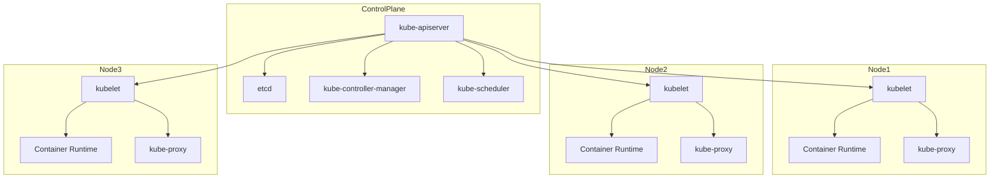

# Lesson 1: Kubernetes Architecture Overview

## 1. First-Principles Intuition & Invariants

Kubernetes, often referred to as K8s, is a powerful open-source container orchestration system designed to automate the deployment, scaling, and management of containerized applications. At its core, Kubernetes addresses the challenges of managing distributed systems by providing a declarative state management framework. This means that instead of specifying the exact steps to achieve a desired state, users define what the desired state looks like, and Kubernetes continuously reconciles the current state with this desired state through a series of level-triggered reconciliation loops.

The theoretical grounding of Kubernetes is deeply rooted in the principles of distributed systems and state machines. The system operates as a distributed state machine, where the desired state is represented by a set of declarative configurations stored in etcd, a highly available key-value store. The control plane components of Kubernetes are responsible for maintaining this state machine, ensuring that the actual state of the cluster matches the desired state specified by the user. This reconciliation process is continuous and ensures that the system remains resilient to failures and changes in the environment.

One of the key invariants in Kubernetes is the use of etcd as a consistent and reliable data store. Etcd is designed to handle concurrent access and updates, ensuring that the state of the cluster is always consistent across all nodes. The Raft consensus algorithm, which etcd employs, ensures that a quorum of nodes ($Q = \lfloor N/2 \rfloor + 1$) must agree on the state of the system before any changes are committed. This quorum-based approach provides strong consistency guarantees and ensures that the system can tolerate up to $N-1$ node failures without losing data or consistency.

Another critical invariant in Kubernetes is the use of Multi-Version Concurrency Control (MVCC) in etcd. MVCC allows multiple versions of the data to exist simultaneously, enabling efficient read and write operations without locking. Each transaction in etcd is assigned a unique monotonic revision number, which ensures that all reads and writes are consistent with the state of the system at a specific point in time. This mechanism is crucial for maintaining the integrity and consistency of the cluster state, even in the presence of concurrent updates.

## 2. Core Architecture & Mechanics

The architecture of Kubernetes is composed of two primary components: the control plane and the node components. The control plane is responsible for managing the overall state of the cluster, while the node components are responsible for running the actual workloads.

### Control Plane

The control plane consists of several key components, each with a specific role in maintaining the desired state of the cluster:

- **kube-apiserver**: The kube-apiserver is the central management component of the Kubernetes control plane. It exposes the Kubernetes API, which is the primary interface for interacting with the cluster. The kube-apiserver handles all requests to the API, including creating, updating, and deleting resources. It also serves as the entry point for all communication between the control plane and the node components.

- **etcd**: As mentioned earlier, etcd is the highly available key-value store that serves as the persistent storage for the cluster state. All configuration data, including the desired state of the cluster, is stored in etcd. The kube-apiserver interacts with etcd to read and write data, ensuring that the cluster state is always consistent.

- **kube-controller-manager**: The kube-controller-manager is responsible for running a set of controller processes that continuously monitor the state of the cluster and take corrective actions to ensure that the actual state matches the desired state. These controllers include the Node Controller, which monitors the health of nodes in the cluster, the Replication Controller, which ensures that the desired number of pod replicas are running, and the Endpoint Controller, which manages the network endpoints for services.

- **kube-scheduler**: The kube-scheduler is responsible for assigning pods to nodes in the cluster. It takes into account various factors, such as resource availability, node affinity, and taints and tolerations, to determine the optimal placement of pods. The scheduler ensures that workloads are distributed evenly across the cluster, maximizing resource utilization and minimizing latency.

### Node Components

The node components are responsible for running the actual workloads in the cluster. Each node in the cluster runs a set of components that work together to manage the pods and containers running on that node:

- **kubelet**: The kubelet is the primary node agent that communicates with the kube-apiserver to receive instructions on how to manage the pods running on the node. It is responsible for starting, stopping, and monitoring the containers in the pods, as well as reporting the status of the node and its pods back to the kube-apiserver.

- **kube-proxy**: The kube-proxy is responsible for managing network rules and load balancing for services in the cluster. It ensures that network traffic is routed to the correct pods based on the service definitions. The kube-proxy can operate in different modes, including iptables, IPVS, and userspace, each with its own advantages and trade-offs.

- **Container Runtime**: The container runtime is responsible for running the containers in the pods. Kubernetes supports multiple container runtimes, including Docker, containerd, and CRI-O. The container runtime is responsible for starting, stopping, and managing the containers, as well as providing the necessary resources, such as CPU, memory, and storage.

To illustrate the architecture of Kubernetes, we can use a Mermaid diagram:

In this diagram, the control plane components are shown on the left, and the node components are shown on the right. The kube-apiserver communicates with etcd to read and write the cluster state, and it also communicates with the kubelet on each node to manage the pods and containers running on that node. The kube-controller-manager and kube-scheduler are also part of the control plane and work together to maintain the desired state of the cluster.

## 3. High-Performance Optimization & Failure Modes

Kubernetes is designed to be highly performant and resilient, capable of managing large-scale clusters with thousands of nodes and pods. To achieve this, Kubernetes employs several optimization techniques and failure mitigation strategies.

### Concurrency and Resource Scaling

Kubernetes is designed to handle concurrent access and updates to the cluster state, ensuring that the system remains responsive and efficient even under heavy load. The use of etcd with MVCC and Raft consensus provides strong consistency guarantees and efficient read and write operations. The kube-apiserver is designed to handle a large number of concurrent requests, using a combination of caching, rate limiting, and request queuing to manage load.

Kubernetes also provides powerful resource scaling capabilities, allowing users to automatically scale the number of pods running in a deployment based on various metrics, such as CPU usage, memory usage, and custom metrics. The Horizontal Pod Autoscaler (HPA) is a built-in controller that continuously monitors the resource usage of pods and adjusts the number of replicas to maintain the desired level of performance.

### Boundary Edge Cases and Failure Mitigations

Kubernetes is designed to handle a wide range of boundary edge cases and failure modes, ensuring that the system remains resilient and reliable even in the presence of unexpected events. One of the key failure mitigation strategies in Kubernetes is the use of self-healing mechanisms, such as the Node Controller and the Replication Controller. These controllers continuously monitor the health of nodes and pods, taking corrective actions to ensure that the desired state of the cluster is maintained.

Kubernetes also provides several mechanisms for handling node failures, including node eviction and pod rescheduling. When a node fails, the Node Controller detects the failure and marks the node as unhealthy. The kube-scheduler then reschedules the pods running on the failed node to other nodes in the cluster, ensuring that the workloads are not disrupted. The kubelet on each node also periodically reports the status of the node and its pods to the kube-apiserver, allowing the control plane to detect and respond to failures quickly.

In addition to handling node failures, Kubernetes also provides mechanisms for handling other types of failures, such as pod failures and network partitions. The Replication Controller ensures that the desired number of pod replicas are running, automatically restarting failed pods and rescheduling them to other nodes if necessary. The kube-proxy provides network load balancing and failover, ensuring that network traffic is routed to the correct pods even in the presence of network partitions.

In conclusion, Kubernetes is a powerful and flexible container orchestration system that provides a robust framework for managing distributed systems. By understanding the core components and architecture of Kubernetes, including the control plane and node components, users can effectively deploy, scale, and manage containerized applications in a highly available and resilient manner. The use of etcd with MVCC and Raft consensus, combined with powerful resource scaling and failure mitigation strategies, ensures that Kubernetes can handle a wide range of workloads and environments, making it an ideal choice for modern cloud-native applications.
