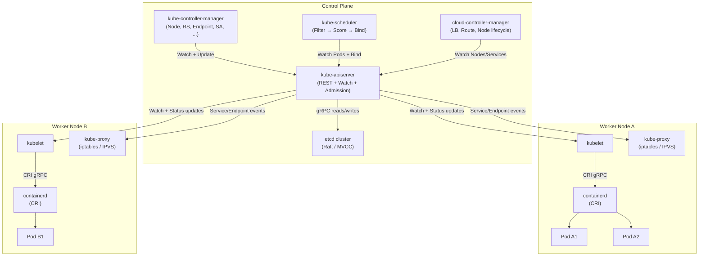
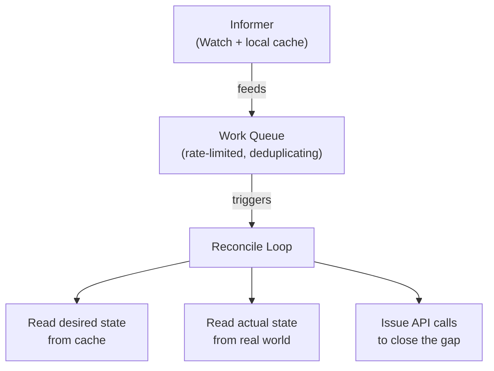
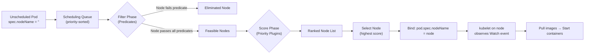
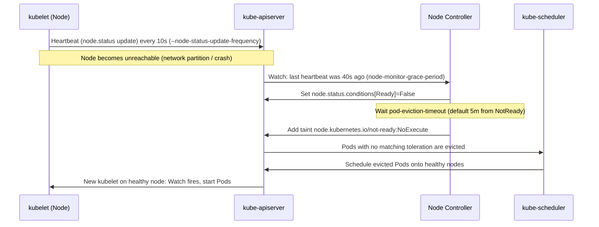
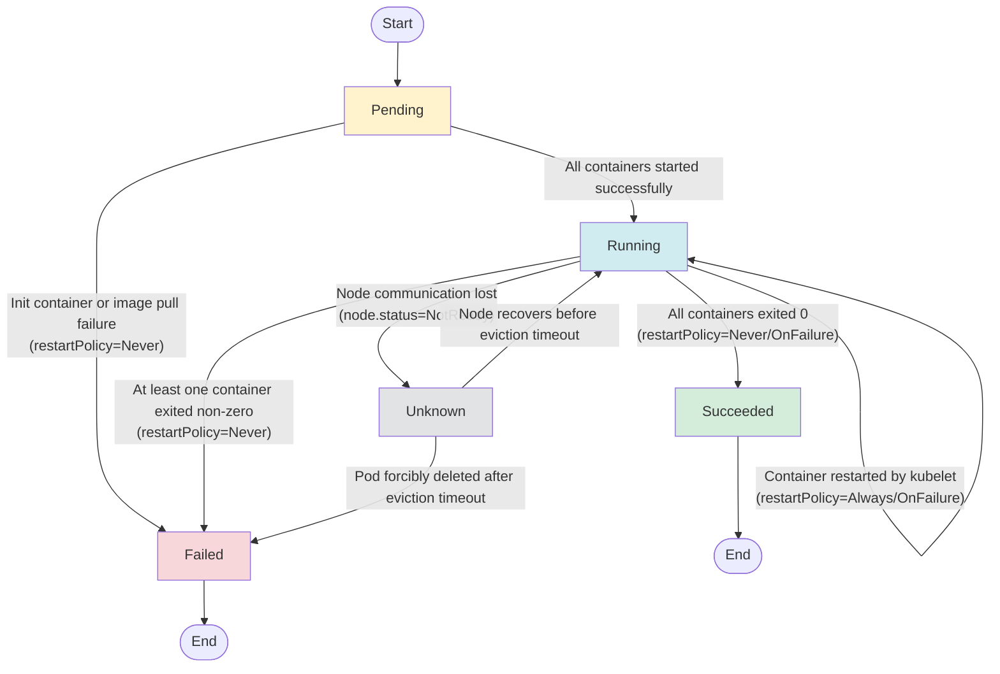

# Lesson 1: Kubernetes Architecture — A First-Principles Deep Dive

## 1. First-Principles Intuition & Invariants

Kubernetes solves a fundamental problem in distributed systems: how do you manage the lifecycle of thousands of ephemeral processes across a fleet of machines, tolerating partial failures, without requiring operators to micromanage individual transitions? The answer is **level-triggered reconciliation** over a linearizable state store.

Traditional imperative orchestration ("start container X on machine Y") couples the operator's intent to a specific execution path. If that path fails midway, the system is left in an undefined intermediate state. Kubernetes instead adopts a **declarative, edge-free model**: the operator writes a desired-state document, and a set of independent control loops continuously drive the actual state toward it. Each controller observes the world, compares it to the desired state, and emits the minimal set of actions required to close the gap. This is philosophically equivalent to a PID controller in control theory — the system self-corrects without requiring a central orchestrator to issue step-by-step instructions.

The entire scheme rests on three architectural invariants:

**Invariant 1 — Single Source of Truth in etcd.** No Kubernetes component stores authoritative cluster state locally. All state lives in etcd. This means any component can crash and restart without data loss, and any two controllers observing the same etcd snapshot will reach the same conclusions. etcd achieves this via the **Raft consensus algorithm**: writes are only committed once a quorum $Q = \lfloor N/2 \rfloor + 1$ of members acknowledge the entry in their write-ahead log. For a 3-member cluster, $Q = 2$, tolerating 1 failure. For a 5-member cluster, $Q = 3$, tolerating 2 failures. Critically, Raft guarantees **linearizability** — every read sees the most recently committed write, with no stale data ever returned to a client holding a valid lease.

**Invariant 2 — Multi-Version Concurrency Control (MVCC).** etcd never overwrites data in-place. Every mutation appends a new revision to an immutable log, keyed by a monotonically increasing 64-bit integer called the **global revision**. When the kube-apiserver writes a Pod object, etcd stores the new value at revision $r+1$ and retains revision $r$ until compaction. This has two critical consequences: (a) readers are never blocked by writers, since they always read a consistent snapshot at a known revision; (b) the kube-apiserver can open a **Watch** stream at a specific revision and receive a delta stream of changes — this is the mechanism underpinning all Kubernetes controllers. The Watch mechanism is not polling; it is a server-sent event stream over a persistent HTTP/2 or gRPC connection, consuming O(1) server resources per controller regardless of cluster size.

**Invariant 3 — Optimistic Concurrency via ResourceVersion.** Every Kubernetes API object carries a `metadata.resourceVersion` field, which is the etcd revision of the last write to that object. When a controller reads an object, modifies it in memory, and writes it back, the kube-apiserver issues a Compare-And-Swap (CAS) to etcd: "write this value only if the current revision is still $r$." If another controller has written concurrently, the CAS fails with a `409 Conflict`, and the writer must re-read and retry. This eliminates the need for distributed locks and makes the system naturally composable: controllers are independent, stateless processes that cannot corrupt each other's state through race conditions.

Together, these three invariants mean that the Kubernetes control plane is a **Byzantine-fault-tolerant, linearizable, event-sourced state machine** — robust properties that justify the complexity of the architecture.

---

## 2. Core Architecture & Mechanics

The Kubernetes cluster is divided into two planes: the **control plane**, which manages desired state, and the **data plane** (worker nodes), which runs actual workloads. These planes communicate exclusively through the kube-apiserver; no worker node component ever calls etcd directly.



### 2.1 kube-apiserver

The kube-apiserver is not a simple CRUD gateway. It is a **multi-stage request processing pipeline**:

1. **Authentication** — verifies the caller's identity via X.509 certificates, bearer tokens (OIDC, service account JWTs), or webhook authenticators.
2. **Authorization** — evaluates RBAC policies (or ABAC/Webhook) to determine whether the authenticated subject may perform the requested verb on the target resource.
3. **Admission Control** — a chain of mutating and validating webhooks, plus built-in plugins (e.g., `LimitRanger`, `ResourceQuota`, `PodSecurity`). Mutating webhooks run first and may modify the object; validating webhooks run last and may reject it. Any rejection short-circuits the chain.
4. **Validation & Defaulting** — the API server applies OpenAPI schema validation and fills in default values for omitted fields.
5. **etcd Persistence** — the final object is serialized (protobuf on the wire, stored as protobuf in etcd) and written via a CAS operation.
6. **Watch Notification** — etcd emits a Watch event; the kube-apiserver fans it out to all registered watchers (controllers, kubelets, kube-proxy).

The kube-apiserver is stateless and horizontally scalable. Multiple replicas can run behind a load balancer; they all share the same etcd backend. The API server caches a full copy of all objects in an in-memory store (`watchcache`) backed by its own Watch stream from etcd. List operations are served from this cache, dramatically reducing etcd read load on large clusters.

### 2.2 etcd

etcd stores all Kubernetes state under the `/registry/` prefix, organized by resource type and namespace:

```
/registry/pods/default/nginx-7d4b8c9f6-xk2p9
/registry/services/default/my-service
/registry/deployments/default/nginx
```

Each value is a protobuf-encoded Kubernetes object. etcd is not a general-purpose database — it is optimized for small objects (< 1.5 MB per value is the hard limit), low write throughput (thousands of writes per second, not millions), and strong consistency. Operators must monitor `etcd_mvcc_db_size_bytes` and schedule compaction (`--auto-compaction-mode=periodic`) to prevent the keyspace from growing unboundedly, which causes out-of-memory conditions and performance degradation.

A production etcd cluster for Kubernetes should:
- Run on dedicated nodes with NVMe SSDs (fsync latency directly impacts `p99` API server write latency).
- Use a 3- or 5-member cluster for HA; never use 2 or 4 members (even-numbered clusters have split-brain vulnerability under network partition).
- Enable TLS peer and client authentication.
- Take snapshots via `etcdctl snapshot save` on a schedule independent of the WAL-based recovery mechanism.

### 2.3 kube-controller-manager

The kube-controller-manager is a single binary that embeds dozens of independent control loops, each managing a specific resource type. The architectural pattern for every controller is identical:



The `Informer` abstraction is crucial to performance at scale. Rather than each controller opening its own Watch stream to etcd (which would create O(controllers × resources) load), all controllers share a single `SharedInformer` per resource type. The `SharedIndexInformer` maintains a local in-memory cache of all objects of its type, synchronized via a single Watch stream. Controllers query this cache for reads, hitting etcd only for writes. This reduces etcd load from O(N) to O(1) per controller type.

Key controllers and their semantics:

| Controller | Watches | Manages |
|---|---|---|
| ReplicaSet Controller | ReplicaSet, Pod | Ensures `spec.replicas` Pods exist with matching labels |
| Deployment Controller | Deployment, ReplicaSet | Manages rolling updates by creating new RSes and scaling down old ones |
| Node Controller | Node | Marks nodes `NotReady` after `node-monitor-grace-period` (default 40s); evicts pods after `pod-eviction-timeout` (default 5m) |
| EndpointSlice Controller | Service, Pod | Writes `EndpointSlice` objects mapping Service → healthy Pod IPs |
| StatefulSet Controller | StatefulSet, Pod | Manages ordered, sticky Pod identity and PVC binding |
| Job Controller | Job, Pod | Runs Pods to completion, tracks success/failure counts |

### 2.4 kube-scheduler

The scheduler is a specialized controller that watches for Pods with `spec.nodeName == ""` (unscheduled) and determines which node should run each Pod. The scheduling decision is a two-phase pipeline:

**Phase 1 — Filtering (Predicates).** The scheduler evaluates every node against a set of hard constraints. A node is eliminated if any predicate fails:
- `NodeResourcesFit` — does the node have sufficient allocatable CPU/memory?
- `NodeAffinity` — do the node's labels satisfy `spec.affinity.nodeAffinity` rules?
- `TaintToleration` — does the Pod tolerate all of the node's taints?
- `PodTopologySpread` — would placing the Pod here violate `topologySpreadConstraints`?
- `VolumeBinding` — are the Pod's PVCs satisfiable on this node?

**Phase 2 — Scoring (Priorities).** Each node that passes filtering receives a score from each scoring plugin (0–100). Plugins include `LeastAllocated` (prefer nodes with more free resources), `InterPodAffinity` (prefer nodes co-located with certain Pods), and `ImageLocality` (prefer nodes that already have the container image cached). Scores are summed with configurable weights. The highest-scoring node wins.

The scheduler then issues a **Bind** operation: a write to `pod.spec.nodeName`. This is the only write the scheduler makes. The kubelet on the target node observes this change via its Watch and begins pulling the container images and starting the containers.



### 2.5 kubelet

The kubelet is the node agent that bridges the Kubernetes API and the container runtime. Its reconciliation loop is:

1. Watch the kube-apiserver for Pods assigned to its node (`spec.nodeName == thisNode`).
2. For each Pod, compute the desired set of containers, volumes, and network namespaces.
3. Issue CRI (Container Runtime Interface) gRPC calls to the container runtime (e.g., containerd) to create/start/stop containers.
4. Mount volumes via the CSI (Container Storage Interface) plugin chain.
5. Configure the Pod's network namespace via the CNI (Container Network Interface) plugin (e.g., Cilium, Calico, Flannel).
6. Collect container metrics via the cAdvisor embedded library and expose them on `/metrics/cadvisor`.
7. Run liveness, readiness, and startup probes; update `pod.status.conditions` and report to the API server.

The kubelet's probe mechanism is worth understanding precisely because probe failures are a leading cause of unnecessary Pod restarts in production. A **liveness probe** failure causes the container to be killed and restarted (respecting `restartPolicy`). A **readiness probe** failure removes the Pod's IP from the Service's EndpointSlice, stopping new traffic from being routed to it, without killing the container. A **startup probe** gates both liveness and readiness probes until it succeeds, preventing premature restarts during slow initialization.

### 2.6 kube-proxy

kube-proxy is responsible for implementing the `Service` abstraction at the network level. When a Service is created with a ClusterIP, kube-proxy programs the kernel's packet-forwarding rules to DNAT (Destination Network Address Translation) traffic destined for the VIP to one of the backing Pod IPs.

kube-proxy operates in one of three modes:

- **iptables mode** (default on most distributions): installs `iptables` PREROUTING rules using random probability chains. Each Service gets a chain; the chain selects a backend at random using `--probability` matches. The limitation is that rule updates are O(N) — adding one endpoint requires rewriting the entire chain, which causes multi-second lock contention on clusters with tens of thousands of Services.
- **IPVS mode** (recommended for large clusters): uses the Linux kernel's IP Virtual Server module, which implements load balancing in a hash table inside the kernel. Rule updates are O(1). Supports richer load-balancing algorithms (round-robin, least-connection, source hashing). Requires the `ip_vs` kernel modules to be loaded.
- **nftables mode** (Kubernetes 1.29+, beta): replaces iptables with the modern nftables framework, addressing the O(N) rule-update problem without requiring IPVS.

---

## 3. The Reconciliation Loop: A Production-Grade Implementation Pattern

Understanding the reconciler pattern at the code level is essential for SRE engineers writing custom controllers or debugging controller behavior.

```go
// reconciler.go — production-grade controller reconcile loop using controller-runtime
package controller

import (
    "context"
    "fmt"
    "time"

    appsv1 "k8s.io/api/apps/v1"
    corev1 "k8s.io/api/core/v1"
    "k8s.io/apimachinery/pkg/api/errors"
    metav1 "k8s.io/apimachinery/pkg/apis/meta/v1"
    "k8s.io/apimachinery/pkg/runtime"
    ctrl "sigs.k8s.io/controller-runtime"
    "sigs.k8s.io/controller-runtime/pkg/client"
    "sigs.k8s.io/controller-runtime/pkg/log"
)

// MyAppReconciler reconciles MyApp custom resources.
// It demonstrates the standard pattern: read → compare → act → requeue.
type MyAppReconciler struct {
    client.Client
    Scheme *runtime.Scheme
}

// Reconcile is called by controller-runtime whenever a MyApp object changes,
// or when a requeue is requested. It must be idempotent — calling it multiple
// times with the same input must produce the same result.
func (r *MyAppReconciler) Reconcile(ctx context.Context, req ctrl.Request) (ctrl.Result, error) {
    logger := log.FromContext(ctx)

    // 1. FETCH the desired state from the API server cache (not etcd directly).
    //    errors.IsNotFound means the object was deleted; return without error
    //    to remove the item from the work queue permanently.
    var app MyApp // hypothetical CRD type
    if err := r.Get(ctx, req.NamespacedName, &app); err != nil {
        if errors.IsNotFound(err) {
            logger.Info("MyApp resource not found; likely deleted", "name", req.NamespacedName)
            return ctrl.Result{}, nil
        }
        // Transient API error — requeue with backoff.
        return ctrl.Result{}, fmt.Errorf("fetching MyApp: %w", err)
    }

    // 2. HANDLE DELETION via finalizers.
    //    Finalizers prevent the API server from garbage-collecting the object
    //    until all finalizers are removed.
    const finalizerName = "myapp.example.com/cleanup"
    if !app.DeletionTimestamp.IsZero() {
        if containsString(app.Finalizers, finalizerName) {
            if err := r.cleanupExternalResources(ctx, &app); err != nil {
                return ctrl.Result{}, err
            }
            // Remove finalizer — this unblocks garbage collection.
            app.Finalizers = removeString(app.Finalizers, finalizerName)
            if err := r.Update(ctx, &app); err != nil {
                return ctrl.Result{}, err
            }
        }
        return ctrl.Result{}, nil
    }

    // 3. ENSURE finalizer is registered for new objects.
    if !containsString(app.Finalizers, finalizerName) {
        app.Finalizers = append(app.Finalizers, finalizerName)
        if err := r.Update(ctx, &app); err != nil {
            return ctrl.Result{}, err
        }
    }

    // 4. RECONCILE the owned Deployment.
    //    Use CreateOrUpdate to handle both create and idempotent update atomically.
    deploy := r.desiredDeployment(&app)
    if err := ctrl.SetControllerReference(&app, deploy, r.Scheme); err != nil {
        return ctrl.Result{}, err
    }

    op, err := ctrl.CreateOrUpdate(ctx, r.Client, deploy, func() error {
        // This mutate function is called with the existing object (if any).
        // Merge desired spec into existing, preserving fields we don't own.
        deploy.Spec.Replicas = app.Spec.Replicas
        deploy.Spec.Template.Spec.Containers[0].Image = app.Spec.Image
        return nil
    })
    if err != nil {
        return ctrl.Result{}, fmt.Errorf("reconciling Deployment: %w", err)
    }
    logger.Info("Deployment reconciled", "operation", op)

    // 5. UPDATE STATUS using a dedicated status subresource call.
    //    Never update spec and status in the same call — the status subresource
    //    has its own RBAC and prevents accidental spec overwrites.
    app.Status.AvailableReplicas = deploy.Status.AvailableReplicas
    app.Status.ObservedGeneration = app.Generation
    if err := r.Status().Update(ctx, &app); err != nil {
        // Conflict is expected if the object was modified between our Get and now.
        // Requeue to pick up the latest version.
        if errors.IsConflict(err) {
            return ctrl.Result{Requeue: true}, nil
        }
        return ctrl.Result{}, fmt.Errorf("updating status: %w", err)
    }

    // 6. REQUEUE periodically to catch external drift not surfaced via Watch events.
    //    For example, manually-modified cloud resources outside Kubernetes.
    return ctrl.Result{RequeueAfter: 5 * time.Minute}, nil
}

func (r *MyAppReconciler) desiredDeployment(app *MyApp) *appsv1.Deployment {
    labels := map[string]string{"app": app.Name}
    return &appsv1.Deployment{
        ObjectMeta: metav1.ObjectMeta{
            Name:      app.Name,
            Namespace: app.Namespace,
        },
        Spec: appsv1.DeploymentSpec{
            Replicas: app.Spec.Replicas,
            Selector: &metav1.LabelSelector{MatchLabels: labels},
            Template: corev1.PodTemplateSpec{
                ObjectMeta: metav1.ObjectMeta{Labels: labels},
                Spec: corev1.PodSpec{
                    Containers: []corev1.Container{{
                        Name:  "app",
                        Image: app.Spec.Image,
                        // Always set resource requests/limits to enable the scheduler
                        // to make accurate bin-packing decisions.
                        Resources: corev1.ResourceRequirements{
                            Requests: corev1.ResourceList{
                                corev1.ResourceCPU:    resource.MustParse("100m"),
                                corev1.ResourceMemory: resource.MustParse("128Mi"),
                            },
                            Limits: corev1.ResourceList{
                                corev1.ResourceCPU:    resource.MustParse("500m"),
                                corev1.ResourceMemory: resource.MustParse("512Mi"),
                            },
                        },
                    }},
                },
            },
        },
    }
}

func (r *MyAppReconciler) cleanupExternalResources(ctx context.Context, app *MyApp) error {
    // Perform any out-of-cluster cleanup (e.g., delete cloud DNS records, S3 buckets).
    // This runs synchronously before the finalizer is removed.
    return nil
}

func containsString(slice []string, s string) bool {
    for _, item := range slice {
        if item == s {
            return true
        }
    }
    return false
}

func removeString(slice []string, s string) []string {
    result := make([]string, 0, len(slice))
    for _, item := range slice {
        if item != s {
            result = append(result, item)
        }
    }
    return result
}
```

---

## 4. High-Performance Optimization & Failure Modes

### 4.1 API Server Request Flow and Caching

At scale, the kube-apiserver's `watchcache` is the most important performance component in the control plane. All List operations (e.g., `kubectl get pods --all-namespaces`) are served from this in-memory cache, not from etcd. The cache is populated and kept consistent by a single reflector per resource type, which runs a Watch stream from etcd. Without the watchcache, a 5,000-node cluster with 50,000 pods would issue O(controller_count) concurrent List calls to etcd at startup — a known thundering-herd failure mode called "list storm" that can saturate etcd's memory and crash the control plane.

The `--watch-cache-sizes` flag allows operators to pre-size caches for high-cardinality resources (e.g., `pod#50000`) to avoid GC pressure from repeated cache rebuilds.

### 4.2 etcd Performance Tuning

The single most impactful etcd tuning parameter is `--heartbeat-interval` and `--election-timeout`. Defaults (100ms / 1000ms) are conservative and appropriate for clusters where etcd nodes communicate over a LAN with < 5ms RTT. The rule of thumb is:

- `--heartbeat-interval` = 5× round-trip time between etcd members
- `--election-timeout` = 10× heartbeat interval

Disk write latency (`wal_fsync_duration_seconds`) must be monitored obsessively. If `p99 fsync > 10ms` consistently, etcd will begin dropping leader heartbeats, triggering spurious leader elections, which pause all writes to Kubernetes for the duration of the election (typically 150–500ms). This manifests in production as intermittent API server timeouts affecting all controllers simultaneously.

```yaml
# prometheus-etcd-alerts.yaml — critical etcd SLOs
groups:
  - name: etcd.critical
    rules:
      - alert: EtcdHighFsyncLatency
        expr: |
          histogram_quantile(0.99,
            rate(etcd_disk_wal_fsync_duration_seconds_bucket[5m])
          ) > 0.01
        for: 5m
        labels:
          severity: critical
        annotations:
          summary: "etcd WAL fsync p99 > 10ms on {{ $labels.instance }}"
          description: >
            etcd WAL fsync latency at the 99th percentile is {{ $value | humanizeDuration }}.
            Values above 10ms risk leader election instability and API server write timeouts.

      - alert: EtcdLeaderElectionFrequent
        expr: increase(etcd_server_leader_changes_seen_total[1h]) > 3
        for: 0m
        labels:
          severity: warning
        annotations:
          summary: "Frequent etcd leader elections on {{ $labels.instance }}"

      - alert: EtcdDbSizeExceedsQuota
        expr: etcd_mvcc_db_total_size_in_bytes / etcd_server_quota_backend_bytes > 0.8
        for: 10m
        labels:
          severity: warning
        annotations:
          summary: "etcd DB exceeds 80% of quota on {{ $labels.instance }}"
```

### 4.3 Scheduler Throughput and Latency

The scheduler processes Pods sequentially from its priority queue by default. Each scheduling cycle invokes all filter and score plugins, which on a large cluster (5,000 nodes) can take 5–50ms per Pod. Under high Pod creation bursts, the scheduling queue depth grows and scheduling latency (`scheduler_scheduling_duration_seconds`) increases.

**Percent-of-nodes-to-score** (`--percentage-of-nodes-to-score`, default 50% for clusters > 100 nodes) is a critical knob: rather than scoring all feasible nodes, the scheduler samples a percentage and picks the best among them. This trades scheduling optimality for throughput. For most workloads, the difference in placement quality is negligible; the latency reduction is substantial.

**Gang scheduling** (via the `Coscheduling` plugin in the scheduler-plugins project) addresses the Pods-of-a-distributed-job problem: a Job requiring 100 GPU Pods will deadlock a cluster if 99 Pods are scheduled but the 100th cannot be placed due to resource fragmentation. Gang scheduling delays binding all Pods until the full quota can be satisfied atomically.

### 4.4 Node Failure Detection and Pod Eviction

The lifecycle of a failed node is governed by several time constants that SREs must understand to reason about recovery SLOs:



The default 5-minute eviction delay is intentional: network partitions are common, and evicting all Pods for a 30-second network blip causes unnecessary churn. For latency-sensitive workloads, the `tolerationSeconds` on the `node.kubernetes.io/not-ready:NoExecute` taint can be reduced at the namespace level:

```yaml
# Reduce eviction timeout for latency-sensitive pods to 30s
spec:
  tolerations:
    - key: "node.kubernetes.io/not-ready"
      operator: "Exists"
      effect: "NoExecute"
      tolerationSeconds: 30
    - key: "node.kubernetes.io/unreachable"
      operator: "Exists"
      effect: "NoExecute"
      tolerationSeconds: 30
```

### 4.5 Resource Requests, Limits, and QoS Classes

The kubelet classifies every Pod into one of three QoS classes, which determine eviction priority when the node is memory-pressured:

| QoS Class | Condition | Eviction Priority |
|---|---|---|
| **Guaranteed** | Every container has `requests == limits` for CPU and memory | Last to be evicted |
| **Burstable** | At least one container has requests ≠ limits, or only requests set | Evicted after BestEffort |
| **BestEffort** | No container has any requests or limits | First to be evicted |

The kernel OOM killer kills containers in BestEffort class first (highest `oom_score_adj`), then Burstable, never Guaranteed (unless the node's kernel memory itself is exhausted). CPU is different: CPU limits are enforced via CFS (Completely Fair Scheduler) bandwidth control — a container is throttled when it exhausts its CPU quota in the current period (default 100ms). CPU throttling does not appear in OOM events; it manifests as elevated `container_cpu_throttled_seconds_total` in cAdvisor metrics, a commonly missed latency culprit.

### 4.6 Control Plane Failure Modes Reference

| Failure | Symptom | Root Cause | Recovery |
|---|---|---|---|
| etcd quorum loss | All writes return 503; Watches stall | Fewer than $Q$ etcd members reachable | Restore member from snapshot; never restore a stale snapshot if any member is live |
| API server OOM | `kubectl` commands time out | Excessive List calls without pagination; large `watchcache` | Add `--watch-cache-sizes`; enforce `limit` on all List calls; horizontal scale API servers |
| Scheduler queue saturation | Pods stuck in `Pending` for minutes | Burst of Pod creation exceeding scheduler throughput | Increase `--percentage-of-nodes-to-score`; deploy parallel scheduler instances for different namespaces |
| Controller-manager leader loss | Resources temporarily not reconciled | kube-controller-manager leader lease expired | Automatic; leader election re-runs in < 15s. Investigate if elections are frequent (check `leader_election_master_status`) |
| etcd compaction stall | API server log shows `mvcc: required revision has been compacted` | Reflectors using stale `resourceVersion` | Controllers re-List automatically; tune `--auto-compaction-retention` to retain enough history |
| Node heartbeat flood | etcd write amplification under large clusters | Each kubelet writes full `node.status` every 10s | Kubernetes 1.18+ `NodeStatusMaxImages` and `NodeLease` reduce heartbeat size to a minimal Lease object update (not full status) |

---

## 5. The Pod Lifecycle: State Machine Semantics

A Pod is not a simple "running" or "stopped" entity — it is a state machine with well-defined phase transitions, and confusing these transitions is a frequent source of incorrect monitoring and alerting.



The `Unknown` phase is not a Kubernetes-managed state transition — it is a signal that the kubelet is unreachable and the API server cannot determine the actual state of the Pod. It does not mean the Pod's process has stopped; the container may still be running on the isolated node. This is the fundamental tension in distributed systems: you cannot distinguish a slow node from a crashed node. Kubernetes resolves this by time-boxing `Unknown` with the eviction timeout and accepting the risk of a brief period where the same logical service has two running instances (the old, isolated Pod and the newly scheduled replacement). Systems that require strict at-most-once semantics (e.g., distributed locks, database primaries) must implement their own fencing mechanisms; Kubernetes does not provide this guarantee at the Pod level.

---

## 6. Observability: The Four Golden Signals Applied to the Control Plane

SRE practice requires that every system be observable via its **latency**, **traffic**, **errors**, and **saturation** (the four golden signals from the Google SRE book). Applied to the Kubernetes control plane:

```python
# python script to query Prometheus for control plane SLIs
# Requires: pip install prometheus-api-client

from prometheus_api_client import PrometheusConnect
from datetime import datetime, timedelta

PROMETHEUS_URL = "http://prometheus.monitoring.svc:9090"
prom = PrometheusConnect(url=PROMETHEUS_URL, disable_ssl=True)

QUERIES = {
    # LATENCY: p99 of mutating API server requests (create/update/delete)
    "api_latency_p99_ms": """
        histogram_quantile(0.99,
          sum(rate(apiserver_request_duration_seconds_bucket{
            verb=~"POST|PUT|PATCH|DELETE"
          }[5m])) by (le)
        ) * 1000
    """,

    # TRAFFIC: total API server requests per second
    "api_rps": """
        sum(rate(apiserver_request_total[5m]))
    """,

    # ERRORS: 5xx error rate from the API server
    "api_error_rate": """
        sum(rate(apiserver_request_total{code=~"5.."}[5m]))
        /
        sum(rate(apiserver_request_total[5m]))
    """,

    # SATURATION: etcd DB usage as fraction of quota
    "etcd_db_saturation": """
        max(etcd_mvcc_db_total_size_in_bytes / etcd_server_quota_backend_bytes)
    """,

    # SATURATION: scheduler queue depth (pending pods)
    "scheduler_queue_depth": """
        scheduler_pending_pods{queue="active"}
        + scheduler_pending_pods{queue="backoff"}
        + scheduler_pending_pods{queue="unschedulable"}
    """,
}

now = datetime.now()
for name, query in QUERIES.items():
    result = prom.custom_query(query=query.strip())
    value = float(result[0]["value"][1]) if result else float("nan")
    print(f"{name:40s} = {value:.4f}")
```

A production SLO for the Kubernetes control plane might be expressed as:

- **API server write latency**: `p99 < 1s` measured over a 5-minute window, excluding `WATCH` verbs.
- **Scheduling latency**: `p99 < 10s` from Pod creation to `pod.spec.nodeName` being set.
- **etcd availability**: `> 99.9%` of `etcdctl endpoint health` checks succeed.
- **Controller convergence time**: After a Deployment `spec.replicas` change, 100% of target replicas are `Ready` within `2 × deployment.spec.minReadySeconds + 30s`.

These SLOs map directly to user-visible impact: a user creating a Deployment expects their Pods to be running within tens of seconds, not minutes. Control plane latency budgets must be sized to meet this expectation.
