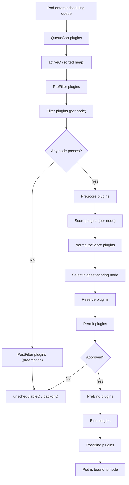
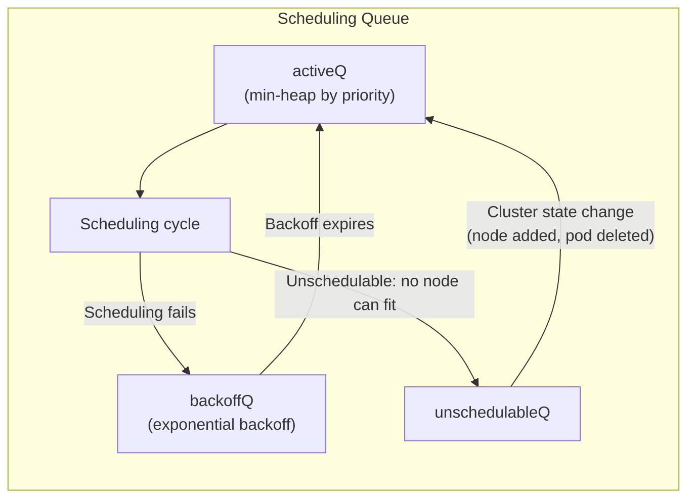
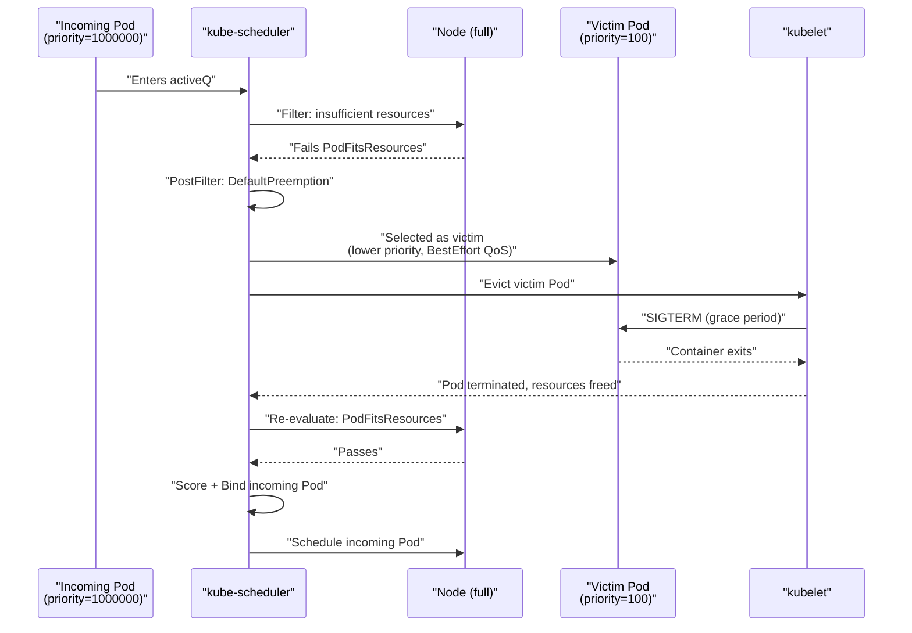

# Lesson 2: Kubernetes Scheduling and Resource Management

## 1. First-Principles Intuition & Invariants

Kubernetes scheduling is fundamentally a constrained optimization problem: given a set of workloads with heterogeneous resource demands and a set of nodes with heterogeneous resource capacities, find an assignment of workloads to nodes that satisfies all hard constraints while optimizing soft preferences. This maps to the classic bin-packing problem, which is NP-hard. Kubernetes does not attempt an optimal solution; it uses a greedy, two-phase heuristic (filter then score) that trades optimality for throughput.

### Declarative State and Level-Triggered Reconciliation

The control plane operates on a level-triggered rather than edge-triggered model. Instead of reacting to individual state-change events (edge-triggered), the controllers and scheduler periodically observe the full current state and compute the delta against the desired state. This means the system is inherently convergent: if a controller misses an event, the next reconciliation loop will still detect the discrepancy and act on it. The tradeoff is increased steady-state API server load, mitigated by informer caches and watch-based event delivery.

The scheduling loop itself is a specific instance of this pattern. The `kube-scheduler` watches for Pods with a `nodeName` of empty string (unscheduled), runs them through the scheduling framework, and writes the binding decision back to the API server. If the binding fails (race condition with another scheduler, node became unschedulable), the loop will retry on the next iteration.

### Resource Requests, Limits, and Cgroup Enforcement

Every container in a Pod can specify `resources.requests` and `resources.limits` for CPU and memory. These are not merely hints to the scheduler; they translate directly into cgroup v1/v2 parameters enforced by the Linux kernel on each node:

| Kubernetes Field | cgroup v1 Parameter | cgroup v2 Parameter | Unit |
|---|---|---|---|
| `requests.cpu` | `cpu.shares` | `cpu.weight` | weighted shares (1024 = 1 CPU) |
| `limits.cpu` | `cpu.cfs_quota_us` + `cpu.cfs_period_us` | `cpu.max` | microseconds per period |
| `requests.memory` | (no direct cgroup mapping, used for scheduling) | (same) | bytes |
| `limits.memory` | `memory.limit_in_bytes` | `memory.max` | bytes |

CPU requests use CFS shares, which are proportional weight mechanisms, not hard reservations. A container requesting 500m CPU gets `cpu.shares = 512`, meaning it is entitled to at least 50% of a CPU's time relative to other competing containers on the same node. Memory limits are hard: exceeding `memory.limit_in_bytes` triggers the OOM killer, which terminates the container process. The kubelet reports this as an `OOMKilled` exit code (137).

```yaml
# Production-grade Pod spec demonstrating resource management,
# QoS class implications, and scheduling constraints.
apiVersion: v1
kind: Pod
metadata:
  name: payment-service
  labels:
    app: payment
    tier: critical
spec:
  # PriorityClass ensures this Pod can preempt lower-priority workloads.
  priorityClassName: high-priority
  containers:
    - name: app
      image: registry.internal/payment-service:v2.4.1
      # Guaranteed QoS: requests MUST equal limits for ALL containers
      # and BOTH cpu and memory must be specified.
      resources:
        requests:
          cpu: "2"
          memory: "4Gi"
          ephemeral-storage: "1Gi"
        limits:
          cpu: "2"
          memory: "4Gi"
          ephemeral-storage: "2Gi"
      # Liveness/readiness probes ensure the kubelet can act on health.
      livenessProbe:
        httpGet:
          path: /health
          port: 8080
        initialDelaySeconds: 30
        periodSeconds: 10
        failureThreshold: 3
      # Security context reduces attack surface at the kernel level.
      securityContext:
        runAsNonRoot: true
        runAsUser: 10001
        allowPrivilegeEscalation: false
        readOnlyRootFilesystem: true
        capabilities:
          drop: ["ALL"]
      volumeMounts:
        - name: tmp
          mountPath: /tmp
  volumes:
    - name: tmp
      emptyDir: {}
  # Node affinity restricts scheduling to nodes with local SSDs.
  affinity:
    nodeAffinity:
      requiredDuringSchedulingIgnoredDuringExecution:
        nodeSelectorTerms:
          - matchExpressions:
              - key: node.kubernetes.io/instance-type
                operator: In
                values: ["c5.2xlarge", "m5.2xlarge"]
  # Topology spread distributes replicas across zones for HA.
  topologySpreadConstraints:
    - maxSkew: 1
      topologyKey: topology.kubernetes.io/zone
      whenUnsatisfiable: DoNotSchedule
      labelSelector:
        matchLabels:
          app: payment
  tolerations:
    - key: "dedicated"
      operator: "Equal"
      value: "payments"
      effect: "NoSchedule"
---
apiVersion: scheduling.k8s.io/v1
kind: PriorityClass
metadata:
  name: high-priority
value: 1000000
globalDefault: false
description: "Priority class for payment-critical workloads. Enables preemption of lower-priority pods."
```

### Quality of Service Classes

Kubernetes computes a QoS class for each Pod deterministically from its container specs. This is not user-configurable; it is derived. The QoS class determines eviction priority under node pressure (memory, disk) and interacts with the kubelet's eviction manager.

**Guaranteed**: Every container in the Pod must specify both CPU and memory requests AND limits, and for each container, `requests == limits` for both resources. If any container lacks any of these four values, or if any request does not equal its corresponding limit, the Pod is not Guaranteed. Guaranteed Pods have the lowest eviction priority and their containers get the highest cgroup OOM score adjustment (`oom_score_adj = -998`), making them the last to be killed by the kernel OOM killer.

**Burstable**: At least one container has a CPU or memory request, but the Pod does not meet Guaranteed criteria. These Pods can burst beyond their requests up to their limits (if set) when node resources are available. Under memory pressure, they are evicted after BestEffort Pods but before Guaranteed Pods.

**BestEffort**: No container specifies any CPU or memory request or limit. These Pods are the first to be evicted under node resource pressure. Their containers get `oom_score_adj = 1000`, making them primary OOM killer targets.

The kubelet's eviction manager uses these classes when the node approaches hard eviction thresholds. The eviction order is: BestEffort first, then Burstable pods exceeding their requests, then Guaranteed pods (only as a last resort under hard eviction).

### The Scheduling Framework (Kubernetes 1.19+)

Modern Kubernetes replaces the legacy predicate/priority model with a composable scheduling framework. The framework defines extension points, each of which can be implemented by one or more plugins. The framework executes plugins in a defined sequence:



The framework's extension points and their responsibilities:

| Extension Point | Purpose | Example Plugins |
|---|---|---|
| `QueueSort` | Order Pods in the scheduling queue by priority | `PrioritySort` |
| `PreFilter` | Precompute data needed for filtering; reject Pods early | `NodePorts`, `PodTopologySpread`, `VolumeRestrictions` |
| `Filter` | Exclude nodes that cannot run the Pod | `NodeUnschedulable`, `PodFitsResources`, `NodeAffinity`, `Toleration`, `VolumeBinding` |
| `PostFilter` | Handle scheduling failure; trigger preemption | `DefaultPreemption` |
| `PreScore` | Precompute data needed for scoring | `PodTopologySpread`, `InterPodAffinity` |
| `Score` | Rank remaining nodes | `NodeResourcesFit`, `ImageLocality`, `PodTopologySpread` |
| `NormalizeScore` | Normalize scores to [0, 100] range | `NodeResourcesFit` |
| `Reserve` | Reserve resources before binding (handles race conditions) | `VolumeBinding` |
| `Permit` | Allow async scheduling; gate Pod before binding | `Coscheduling`, `WaitForBinder` |
| `PreBind` | Pre-binding work (e.g., volume attachment) | `VolumeBinding` |
| `Bind` | Write the binding to the API server | `DefaultBinder` |
| `PostBind` | Cleanup after successful binding | (custom plugins) |

### Scheduling Queue Architecture

The scheduler maintains three internal queues:



Pods enter `activeQ` and are popped in priority order. If scheduling fails because no node passes filters, the Pod moves to `unschedulableQ`. If it fails due to transient conditions (resource contention that might resolve), it goes to `backoffQ` with exponential backoff starting at 1 second, capped at 10 seconds. When cluster state changes (a node is added, a Pod is deleted, a node label changes), the scheduler flushes `unschedulableQ` back to `activeQ` to retry.

## 2. Core Architecture & Mechanics

### Scheduler Internals: Cache and Snapshot

The `kube-scheduler` cannot make scheduling decisions by querying the API server on every cycle; that would overwhelm the API server at scale. Instead, it maintains two data structures:

**Scheduler Cache** (`internal/cache`): A long-lived, mutable store updated by informer watches. It maintains `NodeInfo` objects keyed by node name, each containing the node's capacity, allocatable resources, the set of Pods currently bound to it, and their resource requests. It also tracks assumed Pods: Pods that the scheduler has decided to bind but whose binding has not yet been confirmed by the API server. Assumed Pods are included in resource accounting to prevent over-commitment during the binding window.

**Snapshot** (`internal/snapshot`): An immutable, point-in-time copy of the cache taken at the start of each scheduling cycle. All filter and score plugins operate on this snapshot, not on the live cache. This ensures consistency: if a node's state changes mid-scheduling-cycle, the plugins still see a coherent view. The snapshot is optimized for read-heavy access patterns using a `Generation` counter to avoid unnecessary recomputation when the cache hasn't changed.

```go
// Simplified representation of the scheduler's internal scheduling cycle
// (adapted from k8s.io/kubernetes/pkg/scheduler/schedule_one.go)

func (sched *Scheduler) scheduleOne(ctx context.Context) {
    // 1. Pop highest-priority Pod from activeQ
    pod, err := sched.NextPod(logger)
    if err != nil {
        return
    }

    // 2. Take a consistent snapshot of cluster state
    state := framework.NewCycleState()
    snapshot := sched.Cache.Snapshot()

    // 3. Run PreFilter plugins (may reject the Pod outright)
    preFilterStatus := sched.Framework.RunPreFilterPlugins(ctx, state, pod)
    if !preFilterStatus.IsSuccess() {
        // Pod goes to unschedulableQ or backoffQ
        sched.handleSchedulingFailure(pod, preFilterStatus)
        return
    }

    // 4. Run Filter plugins against every node in the snapshot
    feasibleNodes, err := sched.findNodesThatFitPod(ctx, state, pod, snapshot)
    if len(feasibleNodes) == 0 {
        // 5. No node passed filters; run PostFilter (preemption)
        postFilterStatus := sched.Framework.RunPostFilterPlugins(ctx, state, pod, nil)
        sched.handleSchedulingFailure(pod, postFilterStatus)
        return
    }

    // 6. Run Score plugins on feasible nodes
    priorityList, err := sched.prioritizeNodes(ctx, state, pod, feasibleNodes)

    // 7. Select the highest-scoring node (with tie-breaking by node name)
    targetNode := selectHighestPriorityNode(priorityList)

    // 8. Run Reserve plugins (claim resources in cache)
    reserveStatus := sched.Framework.RunReservePlugins(ctx, state, pod, targetNode)
    if !reserveStatus.IsSuccess() {
        sched.handleSchedulingFailure(pod, reserveStatus)
        return
    }

    // 9. Assume the Pod in the cache (optimistic binding)
    sched.Cache.AssumePod(pod)

    // 10. Run PreBind (e.g., volume attachment) and Bind plugins
    bindStatus := sched.bind(ctx, state, pod, targetNode)
    if !bindStatus.IsSuccess() {
        // Forget the assumption; Pod returns to queue
        sched.Cache.ForgetPod(pod)
        sched.handleSchedulingFailure(pod, bindStatus)
        return
    }
}
```

### Resource Accounting and Allocatable

Each node reports two resource quantities: `capacity` (total physical resources) and `allocatable` (capacity minus system reservations). The kubelet computes allocatable as:

```text
allocatable = capacity - kube-reserved - system-reserved - eviction-threshold
```

Where `kube-reserved` and `system-reserved` are configured via kubelet flags (`--kube-reserved`, `--system-reserved`) and represent resources set aside for the kubelet itself and OS daemons respectively. The `--eviction-hard` threshold further reduces allocatable to leave a safety margin that triggers Pod eviction before the node exhausts resources.

The scheduler only considers `allocatable` when computing whether a node has room for a Pod. This prevents the kubelet and OS from starving under heavy workload density.

```yaml
# KubeletConfiguration demonstrating resource reservation
# (typically deployed via /etc/kubernetes/kubelet/config.yaml)
apiVersion: kubelet.config.k8s.io/v1beta1
kind: KubeletConfiguration
# Reserve resources for kubelet, container runtime, and system daemons
kubeReserved:
  cpu: "500m"
  memory: "1Gi"
  ephemeral-storage: "1Gi"
systemReserved:
  cpu: "500m"
  memory: "512Mi"
  ephemeral-storage: "500Mi"
# Hard eviction thresholds: kubelet evicts Pods when these are crossed
evictionHard:
  imagefs.available: "15%"
  memory.available: "100Mi"
  nodefs.available: "10%"
  nodefs.inodesFree: "5%"
# Soft eviction thresholds: kubelet evicts Pods gracefully
evictionSoft:
  memory.available: "200Mi"
evictionSoftGracePeriod:
  memory.available: "1m30s"
evictionMaxPodGracePeriod: 60
# CPU manager policy: static pinning for Guaranteed Pods
cpuManagerPolicy: static
reservedSystemCPUs: "0,1"
```

With `cpuManagerPolicy: static`, the kubelet pins whole-CPU Guaranteed Pod containers to specific physical cores using `cpuset.cpus` in the cgroup, bypassing CFS throttling entirely. This eliminates CPU scheduler jitter for latency-sensitive workloads. The `reservedSystemCPUs` directive removes CPUs 0 and 1 from the allocatable pool, reserving them exclusively for kubelet and system daemons.

### Preemption Mechanics

When no node passes the filter phase, the `DefaultPreemption` PostFilter plugin attempts to find nodes where evicting lower-priority Pods would free enough resources for the incoming Pod. The algorithm:

1. Filter the candidate node list to those where the incoming Pod would fit if some Pods were removed (this uses a "post-filter" node list, not the main filter pass).
2. For each candidate node, compute the minimum set of victim Pods to evict. Victims are selected by: lowest PriorityClass first, then by QoS class (BestEffort before Burstable before Guaranteed within the same priority), then by the ratio of resource usage to requests (Pods exceeding their requests are preferred victims).
3. Among candidate nodes, select the one requiring the fewest victim evictions. Tie-break by node name.
4. The scheduler writes the binding decision and the kubelet evicts the victims with a grace period.

Preemption does not occur immediately. After selecting victims, the scheduler waits for them to terminate (respecting `terminationGracePeriodSeconds`) before the incoming Pod is actually scheduled. This introduces latency, which is why preemption is a last resort.



### Extended Resources and Device Plugins

Beyond CPU, memory, and ephemeral-storage, Kubernetes supports Extended Resources: arbitrary integer quantities advertised by nodes. The most common use case is GPU scheduling (e.g., `nvidia.com/gpu`). Extended resources are advertised via the Device Plugin framework, where a per-node daemon registers resource capacity with the kubelet, which in turn reports it to the API server via node status.

Extended resources differ from native resources in several ways:
- They are always integer quantities (no fractional allocation).
- `limits` must equal `requests` (no overcommit).
- The scheduler does not score nodes based on extended resource availability by default.
- The Device Plugin handles allocation semantics (e.g., setting environment variables, mounting device files) through the `Allocate` gRPC call.

```go
// Device plugin gRPC service definition (k8s.io/kubelet/pkg/apis/deviceplugin/v1beta1)
// The kubelet calls Allocate when a Pod using the device is scheduled.

type DevicePluginServer interface {
    // GetDevicePluginOptions returns initialization options
    GetDevicePluginOptions(context.Context, *Empty) (*DevicePluginOptions, error)

    // ListAndWatch returns a stream of Device lists. The kubelet uses
    // these to update the node's extended resource capacity.
    ListAndWatch(*Empty, DevicePlugin_ListAndWatchServer) error

    // Allocate is called when a container requests the device.
    // Returns Envs, Mounts, Device specs, and annotations to inject.
    Allocate(context.Context, *AllocateRequest) (*AllocateResponse, error)

    // GetPreferredAllocation is optional; lets the plugin suggest
    // which devices to allocate for a container.
    GetPreferredAllocation(context.Context, *PreferredAllocationRequest) (*PreferredAllocationResponse, error)
}
```

## 3. High-Performance Optimization & Failure Modes

### Scheduling Throughput at Scale

The scheduler's time complexity is O(P x N x F) per scheduling cycle, where P is the number of Pods in the queue, N is the number of nodes, and F is the number of filter plugins. At large cluster sizes (5000+ nodes), evaluating every node for every Pod becomes a bottleneck.

The `percentageOfNodesToScore` parameter (default 50% for clusters under 100 nodes, dynamically scaled down for larger clusters) addresses this by terminating the filter phase early once enough feasible nodes are found. The scheduler stops filtering once it has found `min(maxNum, ceil(N * percentage))` feasible nodes, where `maxNum` defaults to 100. This trades scheduling quality (the optimal node might not be in the evaluated subset) for throughput. For clusters with 1000+ nodes, the scheduler may evaluate as few as 7% of nodes.

The scoring phase also uses parallelism. The scheduler evaluates all feasible nodes in parallel using a worker pool, with the number of workers configurable via `--scheduler-config` in the KubeSchedulerConfiguration API.

```yaml
# KubeSchedulerConfiguration demonstrating performance tuning
apiVersion: kubescheduler.config.k8s.io/v1
kind: KubeSchedulerConfiguration
profiles:
  - schedulerName: default-scheduler
    plugins:
      filter:
        enabled:
          - name: NodeUnschedulable
          - name: NodeName
          - name: TaintToleration
          - name: NodeAffinity
          - name: NodePorts
          - name: VolumeBinding
          - name: PodFitsResources
          - name: PodTopologySpread
          - name: NodeVolumeLimits
          - name: EphemeralStorage
      score:
        enabled:
          - name: NodeResourcesFit
            weight: 10
          - name: PodTopologySpread
            weight: 5
          - name: InterPodAffinity
            weight: 2
          - name: ImageLocality
            weight: 1
      # Disable plugins that are not needed to reduce overhead
      score:
        disabled:
          - name: NodeResourcesMostAllocated
# Evaluate at most this fraction of nodes during filtering
percentageOfNodesToScore: 50
# Parallelism for the scoring phase
parallelism: 16
```

### Failure Modes and Diagnostic Approaches

**Scheduling stuck in Pending**: The most common failure mode. The scheduler records a `FailedScheduling` event on the Pod with a specific reason. Common causes:

| Event Reason | Root Cause | Diagnostic |
|---|---|---|
| `0/8 nodes are available: 8 Insufficient cpu` | Sum of requests exceeds node allocatable | Check `kubectl describe node` for resource allocation; reduce requests or add nodes |
| `0/8 nodes are available: 8 node(s) had untolerated taint` | Taints block all nodes | `kubectl get nodes -o custom-columns=NAME:.metadata.name,TAINTS:.spec.taints` |
| `0/8 nodes are available: 8 node(s) didn't match Pod's node affinity` | Affinity rules exclude all nodes | Verify node labels match selector: `kubectl get nodes --show-labels` |
| `0/8 nodes are available: 8 pod has no available volumes` | PVC cannot bind (no matching PV, or WaitForFirstConsumer with topology mismatch) | `kubectl get pv,pvc` and check storage class topology |
| `0/8 nodes are available: 8 Insufficient nvidia.com/gpu` | GPU devices are all allocated | `kubectl describe node` shows GPU allocation |

**Binding failure race condition**: Two schedulers (or a custom controller) attempt to bind different Pods to the same node simultaneously. The scheduler uses optimistic concurrency: it assumes the Pod in its cache and issues a `POST /api/v1/namespaces/{ns}/pods/{name}/binding`. If the API server rejects the binding (because the node is no longer suitable, or another binding won), the scheduler calls `Cache.ForgetPod()` and the Pod returns to the scheduling queue. This is why running multiple `kube-scheduler` instances with the same `--scheduler-name` requires leader election.

**Cache desynchronization**: If the scheduler's informer cache falls behind the API server (network partition, watch reconnect), the scheduler may make decisions based on stale data. The scheduler handles this by re-listing all nodes and Pods when a watch reconnects, and by the snapshot mechanism ensuring intra-cycle consistency. However, if the cache is stale for an extended period, the scheduler may incorrectly reject feasible Pods or bind to overcommitted nodes. The `--leader-elect` mechanism ensures only one scheduler is active, reducing the window for this failure.

### The Descheduler: Post-Scheduling Optimization

The `kube-scheduler` makes greedy, one-shot decisions. It does not re-evaluate already-running Pods. The Descheduler (a separate component, not part of the core control plane) addresses this by evicting Pods whose placement has become suboptimal:

- **LowNodeUtilization**: Evicts Pods from overutilized nodes to rebalance load toward underutilized nodes. Configured with thresholds: below `targetThresholds`, a node is considered underutilized and a source for receiving evicted Pods; above `thresholds`, it is overutilized and a source of eviction.
- **DuplicatePods**: Evicts redundant Pod replicas (same ReplicaSet, same node).
- **PodAntiAffinity violations**: Evicts Pods that violate inter-Pod anti-affinity rules that were added after the Pod was scheduled.
- **NodeAffinity/TopologySpread**: Evicts Pods that no longer satisfy affinity or spread constraints due to node label changes.

The Descheduler does not perform rescheduling. It evicts Pods, and the controller (Deployment, StatefulSet) creates replacement Pods that the `kube-scheduler` places fresh. This separation of concerns is intentional: the scheduler is the single source of truth for placement decisions.

```yaml
# DeschedulerConfig with conservative eviction parameters
apiVersion: descheduler/v1alpha2
kind: DeschedulerConfiguration
profiles:
  - name: default
    pluginConfig:
      - name: LowNodeUtilization
        args:
          thresholds:
            cpu: 20
            memory: 20
            pods: 10
          targetThresholds:
            cpu: 50
            memory: 50
            pods: 50
          useDeviationThresholds: false
      - name: RemoveDuplicates
        args:
          excludeOwnerKinds:
            - "StatefulSet"
      - name: RemovePodsViolatingTopologySpreadConstraint
        args:
          namespaces:
            include:
              - production
    plugins:
      deschedule:
        enabled:
          - name: LowNodeUtilization
          - name: RemoveDuplicates
          - name: RemovePodsViolatingTopologySpreadConstraint
      balance:
        enabled:
          - name: LowNodeUtilization
# Rate limit evictions to avoid cascading disruption
maxNoOfPodsToEvictPerNode: 1
maxNoOfPodsToEvictPerNamespace: 5
evictFailedBarePods: false
evictLocalStoragePods: false
evictSystemCriticalPods: false
```

The `evictSystemCriticalPods: false` setting ensures the Descheduler never touches Guaranteed or high-priority Pods, which could destabilize the cluster. The `maxNoOfPodsToEvictPerNode` limit prevents the Descheduler from causing a thundering herd of rescheduling traffic.

### Resource Fragmentation and Bin-Packing

A common operational failure mode is resource fragmentation: nodes have enough total resources but they are fragmented across dimensions. A node with 4 CPU and 8Gi memory free cannot schedule a Pod requesting 6 CPU, even though the cluster has 20 CPU free total. The scheduler's `NodeResourcesFit` score plugin supports three scoring strategies:

- `MostAllocated`: Scores nodes higher when most of their resources are consumed. Minimizes fragmentation by packing Pods densely. Best for cost optimization on cloud providers where you pay per node.
- `LeastAllocated`: Scores nodes higher when more resources are free. Spreads Pods across nodes, leaving room for larger Pods. Best for clusters where you need to accommodate variable-size workloads.
- `RequestedToCapacity`: A hybrid that scores based on the ratio of requested to capacity, balancing packing and fragmentation.

```yaml
# NodeResourcesFit scoring strategy configuration
apiVersion: kubescheduler.config.k8s.io/v1
kind: KubeSchedulerConfiguration
profiles:
  - schedulerName: default-scheduler
    pluginConfig:
      - name: NodeResourcesFit
        args:
          scoringStrategy:
            type: RequestedToCapacity
            resources:
              - name: cpu
                weight: 1
              - name: memory
                weight: 1
              - name: nvidia.com/gpu
                weight: 3
```

The `RequestedToCapacity` strategy with GPU weighted at 3x ensures the scheduler prefers nodes that already have GPUs allocated, packing GPU workloads together and leaving GPU-free nodes available for non-GPU Pods. This is critical because GPUs cannot be fractionalized and wasting a 16GB GPU on a Pod using 1GB is expensive.

### Observability

The scheduler exposes Prometheus metrics via `--bind-address` (default `:10259`) with TLS:

| Metric | Type | Description |
|---|---|---|
| `scheduler_scheduling_attempt_duration_seconds` | histogram | End-to-end scheduling latency per Pod |
| `scheduler_framework_extension_point_duration_seconds` | histogram | Duration per framework extension point (filter, score, bind, etc.) |
| `scheduler_pod_scheduling_duration_seconds` | histogram | Time from Pod creation to first binding |
| `scheduler_e2e_scheduling_duration_seconds` | histogram | Total time from Pod add to scheduled (includes queue wait) |
| `scheduler_pending_pods` | gauge | Current count of Pods in each internal queue |
| `scheduler_schedule_attempts_total` | counter | Scheduling attempts by result (scheduled, unschedulable, error) |
| `scheduler_preemption_attempts_total` | counter | Number of preemption attempts |
| `scheduler_unschedulable_pods` | gauge | Pods in unschedulableQ by reason |

The `scheduler_framework_extension_point_duration_seconds` metric is particularly useful for identifying which plugin is slow. If the `VolumeBinding` filter plugin dominates latency, it indicates slow CSI volume operations, not a scheduler problem.

```promql
# Identify the slowest scheduling plugin by p99 latency
histogram_quantile(0.99,
  sum(rate(
    scheduler_framework_extension_point_duration_seconds_bucket[5m]
  )) by (le, extension_point)
)

# Scheduling failure rate by reason
sum(rate(scheduler_schedule_attempts_total{result!="scheduled"}[5m]))
  / sum(rate(scheduler_schedule_attempts_total[5m]))
  * 100

# Queue depth: detect backlog buildup
scheduler_pending_pods{queue="active"}
```

These metrics enable proactive detection of scheduling pathologies. A rising `unschedulableQ` depth with a stable `activeQ` indicates a systematic scheduling constraint (wrong taints, insufficient resources) rather than a throughput problem. A rising `backoffQ` depth with frequent `Insufficient cpu` events indicates cluster under-provisioning.
