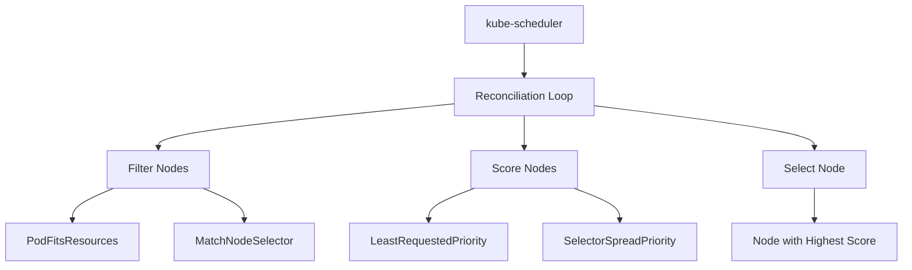

# Lesson 2: Kubernetes Scheduling and Resource Management

## 1. First-Principles Intuition & Invariants

Kubernetes, as a leading orchestration platform for containerized applications, embodies a sophisticated architecture designed to manage and scale applications across distributed clusters. At its core, Kubernetes must solve the problem of efficiently scheduling workloads onto available nodes while ensuring that resource constraints are respected and application requirements are met. This scheduling problem is inherently complex, involving the dynamic allocation of CPU, memory, storage, and network resources across a cluster of heterogeneous machines.

The theoretical grounding for Kubernetes scheduling is rooted in the principles of declarative state management and continuous reconciliation. Kubernetes operates on the premise that the desired state of the cluster is specified by the user through manifests, and the system continuously works to bring the actual state of the cluster into alignment with this desired state. This reconciliation process is a continuous, level-triggered loop that ensures the cluster remains stable and resilient in the face of changes and failures.

A key invariant in Kubernetes scheduling is the concept of resource requests and limits. Each container in a Kubernetes pod specifies the amount of CPU and memory it requires and the maximum amount it can consume. These requests and limits are critical for the scheduler to make informed decisions about where to place pods, ensuring that no node is overloaded and that all pods have the resources they need to run efficiently. The scheduler must also consider the availability of resources on each node, taking into account the current load and the resource requests of other pods already scheduled on the node.

Another invariant is the use of quality-of-service (QoS) classes to categorize pods based on their resource requirements and importance. Kubernetes defines three QoS classes: BestEffort, Burstable, and Guaranteed. BestEffort pods do not specify any resource requests or limits and are the first to be evicted during resource contention. Burstable pods specify resource requests but not limits, allowing them to burst beyond their requests if resources are available. Guaranteed pods specify both requests and limits, ensuring they receive the resources they need and do not exceed their limits. This categorization helps the scheduler prioritize resource allocation and eviction decisions.

The problem space of Kubernetes scheduling is further complicated by the need to handle a wide range of workloads with varying characteristics. Some workloads are CPU-intensive, while others are memory-intensive or require high network bandwidth. The scheduler must be able to understand the specific needs of each workload and allocate resources accordingly. Additionally, the scheduler must be able to handle dynamic changes in the cluster, such as the addition or removal of nodes, changes in resource availability, and the deployment of new workloads.

To address these challenges, Kubernetes employs a sophisticated scheduling algorithm that takes into account a wide range of factors, including resource requests and limits, QoS classes, node affinity and anti-affinity rules, taints and tolerations, and pod topology spread constraints. The scheduler uses a two-step process to make scheduling decisions. In the first step, the scheduler filters out nodes that do not meet the basic requirements of the pod, such as having sufficient resources and satisfying node affinity and anti-affinity rules. In the second step, the scheduler scores the remaining nodes based on a set of scoring criteria, such as resource availability, node affinity, and pod topology spread. The node with the highest score is selected as the target for the pod.

## 2. Core Architecture & Mechanics

The core architecture of Kubernetes scheduling is built around a set of internal data structures and algorithms that work together to make scheduling decisions. At the heart of the scheduling process is the `kube-scheduler` component, which is responsible for continuously monitoring the state of the cluster and making scheduling decisions for new pods.

The `kube-scheduler` operates on a continuous reconciliation loop, where it periodically checks the state of the cluster and makes scheduling decisions for any new pods that need to be scheduled. The scheduler uses a set of internal data structures to represent the state of the cluster, including the list of nodes, the list of pods, and the resource requests and limits of each pod. The scheduler also maintains a set of scoring criteria that are used to evaluate the suitability of each node for a given pod.

One of the key data structures used by the `kube-scheduler` is the `NodeInfo` object, which represents the state of a node in the cluster. The `NodeInfo` object contains information about the resources available on the node, such as CPU, memory, and storage, as well as the list of pods that are currently scheduled on the node. The `NodeInfo` object is used by the scheduler to filter out nodes that do not meet the basic requirements of the pod, such as having sufficient resources and satisfying node affinity and anti-affinity rules.

Another key data structure used by the `kube-scheduler` is the `PodInfo` object, which represents the state of a pod in the cluster. The `PodInfo` object contains information about the resource requests and limits of the pod, as well as any node affinity and anti-affinity rules specified by the user. The `PodInfo` object is used by the scheduler to evaluate the suitability of each node for the pod and to make scheduling decisions.

The scheduling algorithm used by the `kube-scheduler` is a two-step process that involves filtering and scoring. In the first step, the scheduler filters out nodes that do not meet the basic requirements of the pod, such as having sufficient resources and satisfying node affinity and anti-affinity rules. This filtering process is performed using a set of predicates, which are functions that evaluate whether a node meets a specific requirement. For example, the `PodFitsResources` predicate checks whether a node has sufficient resources to satisfy the resource requests of the pod, while the `MatchNodeSelector` predicate checks whether a node satisfies the node selector specified by the pod.

In the second step, the scheduler scores the remaining nodes based on a set of scoring criteria, such as resource availability, node affinity, and pod topology spread. The scoring process is performed using a set of priority functions, which are functions that assign a score to each node based on a specific criterion. For example, the `LeastRequestedPriority` function assigns a higher score to nodes with fewer resources in use, while the `SelectorSpreadPriority` function assigns a higher score to nodes that have fewer pods with the same labels.

The following Mermaid diagram illustrates the internal data structures and algorithms used by the `kube-scheduler` to make scheduling decisions:

In this diagram, the `kube-scheduler` continuously monitors the state of the cluster and makes scheduling decisions for new pods. The scheduler first filters out nodes that do not meet the basic requirements of the pod using a set of predicates, such as `PodFitsResources` and `MatchNodeSelector`. The scheduler then scores the remaining nodes based on a set of scoring criteria, such as `LeastRequestedPriority` and `SelectorSpreadPriority`. The node with the highest score is selected as the target for the pod.

## 3. High-Performance Optimization & Failure Modes

Kubernetes scheduling is a critical component of the Kubernetes architecture, and its performance and reliability are essential for the overall stability and efficiency of the cluster. To achieve high performance and reliability, the `kube-scheduler` employs a number of optimization techniques and failure modes.

One of the key optimizations used by the `kube-scheduler` is the use of a caching layer to store the state of the cluster. The caching layer allows the scheduler to quickly access the state of the cluster without having to query the API server, which can be a bottleneck in high-load scenarios. The caching layer is updated in real-time as the state of the cluster changes, ensuring that the scheduler always has the most up-to-date information.

Another optimization used by the `kube-scheduler` is the use of parallelism to improve the performance of the scheduling process. The scheduler uses a set of worker threads to perform the filtering and scoring of nodes in parallel, allowing it to handle a large number of pods and nodes efficiently. The number of worker threads can be configured by the user, allowing it to be tuned for the specific workload and cluster size.

The `kube-scheduler` also employs a number of failure modes to handle dynamic changes in the cluster and ensure the stability of the scheduling process. One of the key failure modes is the use of a backoff mechanism to handle scheduling failures. If the scheduler is unable to find a suitable node for a pod, it will back off and retry the scheduling process after a short delay. This backoff mechanism helps to prevent the scheduler from becoming overwhelmed by scheduling failures and ensures that the scheduling process remains stable.

Another failure mode used by the `kube-scheduler` is the use of a preemption mechanism to handle resource contention. If a node is overloaded and unable to satisfy the resource requests of a new pod, the scheduler may preempt one or more existing pods to free up resources. The preemption mechanism is designed to minimize the impact on the existing workloads and ensure that the new pod is scheduled as quickly as possible.

In addition to these optimizations and failure modes, the `kube-scheduler` also provides a number of configuration options that can be used to fine-tune the scheduling process for specific workloads and cluster configurations. For example, the scheduler can be configured to use different predicates and priority functions, allowing it to be tailored to the specific needs of the workload. The scheduler can also be configured to use different scheduling policies, such as first-fit or best-fit, to optimize the allocation of resources.

In conclusion, Kubernetes scheduling is a complex and sophisticated process that involves the dynamic allocation of resources across a cluster of heterogeneous machines. The `kube-scheduler` employs a set of internal data structures and algorithms to make scheduling decisions, and it uses a number of optimization techniques and failure modes to ensure high performance and reliability. By understanding the core architecture and mechanics of Kubernetes scheduling, as well as the high-performance optimizations and failure modes, senior software engineers, systems programmers, and domain architects can design and deploy Kubernetes clusters that are efficient, scalable, and resilient.
