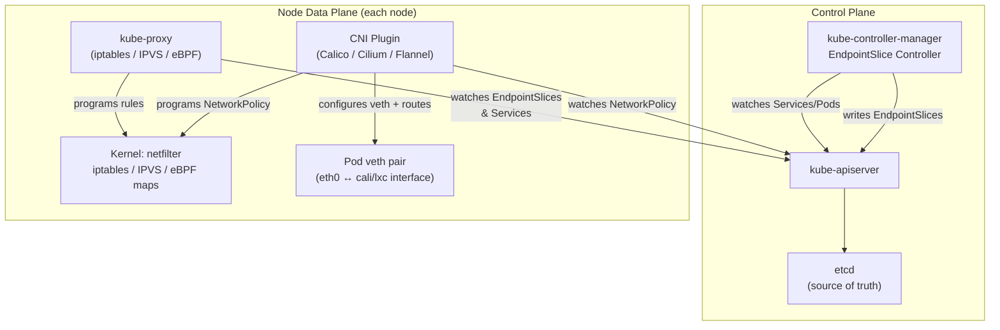
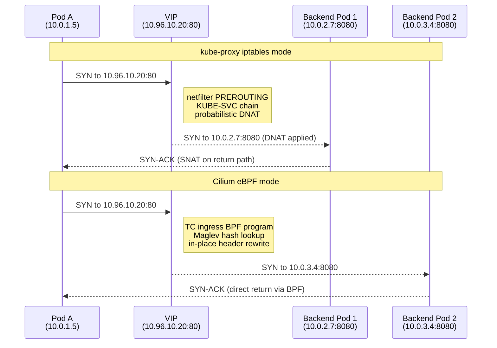
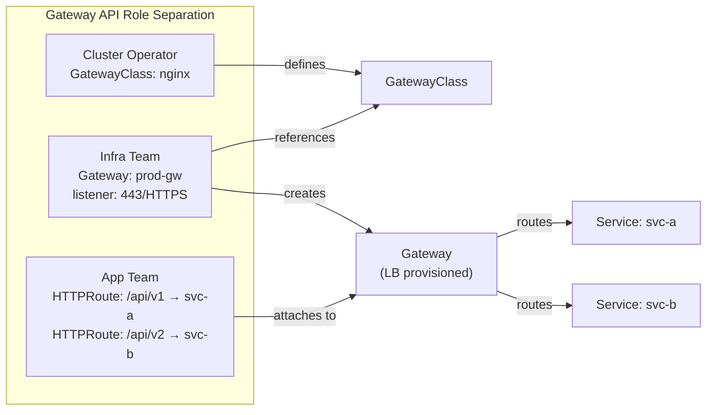
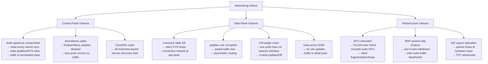
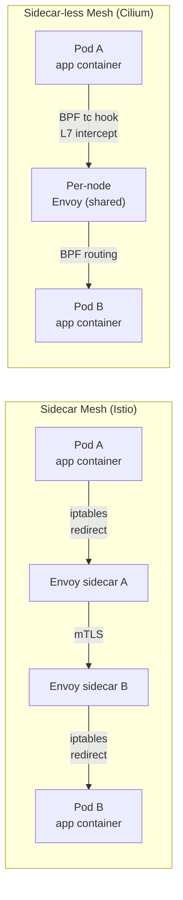

# Lesson 3: Kubernetes Networking

## 1. First-Principles Intuition & Invariants

Kubernetes networking solves a deceptively hard distributed systems problem: how do you provide stable, addressable communication endpoints for a set of ephemeral, dynamically scheduled workloads, across heterogeneous kernel versions and hardware topologies, without centralizing packet forwarding through a proxy that becomes a bottleneck?

The answer is a set of **non-negotiable networking invariants** baked into the Kubernetes network model specification. These are not implementation suggestions—they are correctness requirements that every conformant CNI plugin must satisfy.

**Invariant 1: Every pod gets a unique, routable, cluster-wide IP.**

No NAT is performed between pods on the same cluster. Pod A on node 1 can reach Pod B on node 2 using Pod B's IP directly. This flat-network model eliminates the port-mapping complexity of Docker's bridge networking and allows applications to reason about their own IP address without ambiguity. The implication is that the entire pod CIDR range must be routable across all nodes—whether via BGP (Calico), VXLAN overlay (Flannel), Geneve (OVN-Kubernetes), or eBPF-managed routing tables (Cilium).

**Invariant 2: Services decouple identity from location.**

A Service's ClusterIP (a virtual IP, or VIP) is permanently stable across the entire lifetime of that Service object, even as the backing pod set turns over completely. The VIP is not assigned to any network interface on any node—it exists solely as a destination in the kernel's routing and NAT subsystems. The mapping from VIP to live pod IPs is maintained in near-real-time by `kube-proxy` or its eBPF-based replacements (Cilium, kube-proxy replacement in Cilium, etc.).

**Invariant 3: Network policy enforcement is at the pod boundary, not the node boundary.**

Access control must be enforceable at the granularity of a single pod, based on label selectors, namespace, or CIDR ranges. This is architecturally significant: it means enforcement logic lives in per-pod network interface hooks (iptables chains, eBPF programs attached to `tc ingress/egress`), not in a centralized firewall. A CNI plugin that does not support `NetworkPolicy` (e.g., basic Flannel) simply ignores policy objects—there is no default enforcement.

These three invariants define the **contract** between the Kubernetes control plane and the network data plane. The control plane declares desired state through API objects (`Service`, `Endpoints`/`EndpointSlice`, `NetworkPolicy`). The data plane—composed of CNI plugins and `kube-proxy`—reconciles actual kernel state to match.



---

## 2. Core Architecture & Mechanics

### 2.1 The Container Network Interface (CNI)

CNI is a minimal specification (not a daemon, not a protocol) that defines a contract between a container runtime and a network plugin. When the kubelet creates a pod, it invokes the configured CNI plugin binary with a JSON payload describing the network namespace path, container ID, and desired network configuration. The plugin must:

1. Create a network interface inside the pod's network namespace (conventionally `eth0`).
2. Assign an IP address from the allocated pod CIDR for that node.
3. Add routes so that the pod can reach cluster-external destinations.
4. Return the assigned IP to the kubelet via stdout.

On pod deletion, the CNI `DEL` command is invoked to tear down the interface and return the IP to the pool.

The critical architectural decision each CNI plugin makes is **how pods on different nodes find each other**:

| Plugin | Mechanism | Encapsulation Overhead | BGP Peering Required |
|---|---|---|---|
| Flannel (VXLAN) | UDP-encapsulated L2 frames over L3 | ~50 bytes/packet | No |
| Calico (BGP) | Native L3 routing via BGP, no overlay | Zero | Yes (node-to-node or via route reflector) |
| Cilium (eBPF) | eBPF-redirected routing, optional VXLAN | Zero in native routing mode | Optional |
| OVN-Kubernetes | Geneve overlay, OVS datapath | ~50 bytes/packet | No |
| Weave | Encrypted mesh overlay | ~70 bytes/packet + crypto | No |

Calico's native routing mode is architecturally superior in environments where the underlying network can carry BGP (bare metal, most on-prem setups). Each node advertises its pod CIDR as a BGP route, and the router fabric handles forwarding. This eliminates overlay encap/decap entirely, reducing per-packet CPU cost and enabling full hardware offload.

### 2.2 The Pod Networking Datapath

When Pod A (`10.0.1.5`) on Node 1 sends a packet to Pod B (`10.0.2.7`) on Node 2, the kernel path is:

```
Pod A eth0 → veth pair → Node 1 root netns → routing decision →
  [Calico BGP native: direct IP forward to Node 2]
  [Flannel VXLAN: encap in UDP/8472, send to Node 2 VTEP]
→ Node 2 root netns → routing decision → veth pair → Pod B eth0
```

Calico assigns each pod a `/32` host route on the node, with the veth peer as the nexthop. The node's routing table looks like:

```
10.0.1.5/32 dev cali3f4a2b1  scope link
10.0.2.0/24 via 192.168.1.102 dev eth0 proto bird  # BGP-learned
```

The `cali*` interface is the host-side of the veth pair. Calico's `bird` daemon (or `gobgp` in newer deployments) maintains the BGP session. This is a genuinely zero-overhead forwarding path—identical to any routed IP network.

### 2.3 Service Routing: kube-proxy Internals

`kube-proxy` watches the API server for `Service` and `EndpointSlice` objects. When a service is created with a ClusterIP, kube-proxy programs the kernel to intercept packets destined for that VIP and DNAT them to a healthy pod backend.

#### iptables Mode

In iptables mode, kube-proxy creates chains in the `nat` table of netfilter. The structure is:

```
PREROUTING → KUBE-SERVICES
                └→ KUBE-SVC-<hash>  (matches clusterIP:port)
                        └→ KUBE-SEP-<hash1>  (33% probability → pod1)
                        └→ KUBE-SEP-<hash2>  (50% probability → pod2)
                        └→ KUBE-SEP-<hash3>  (100% probability → pod3)
                                └→ DNAT to podIP:targetPort
```

The probabilistic selection uses iptables `-m statistic --mode random --probability`. The fundamental problem: netfilter evaluates rules linearly. For a cluster with 10,000 services averaging 5 pods each, kube-proxy creates approximately 50,000 `KUBE-SEP-*` rules. A single packet traverses O(n) rules before matching. Rule updates (pod churn) require a full `iptables-restore` of the entire ruleset, which acquires a global `xtables` lock—blocking all other iptables operations on the node. At scale, this lock contention causes multi-second disruptions during deployments.

#### IPVS Mode

IPVS (IP Virtual Server, `net/netfilter/ipvs` in the kernel) uses a hash table keyed on `{protocol, vip, port}` to dispatch connections to backends in O(1). The kernel data structure is a doubly-linked list of `ip_vs_service` entries, each with a set of `ip_vs_dest` backend entries. Connection tracking is maintained in a separate hash table (`ip_vs_conn`), enabling persistent sessions.

```bash
# Inspect IPVS rules programmed by kube-proxy
ipvsadm -Ln

# Example output for a service:
# TCP  10.96.0.1:443 rr
#   -> 192.168.1.100:6443     Masq    1      0          0
#   -> 192.168.1.101:6443     Masq    1      0          0
```

Supported scheduling algorithms: round-robin (`rr`), weighted round-robin (`wrr`), least connections (`lc`), weighted least connections (`wlc`), shortest expected delay (`sed`), never queue (`nq`), source hash (`sh`). The default in kube-proxy is `rr`.

IPVS requires that the VIP be assigned to a dummy network interface (`kube-ipvs0`) on the node so that the kernel's input routing recognizes packets destined for the VIP as locally addressed, allowing IPVS to intercept them before they hit `FORWARD`.

#### eBPF Mode (Cilium kube-proxy Replacement)

Cilium's kube-proxy replacement attaches eBPF programs to the TC (Traffic Control) `ingress` hook of each pod's veth interface and to the `XDP` hook of the node's physical NIC. Service translation is performed by looking up the destination `{ip, port}` in a BPF hash map (`cilium_lb4_services_v2`) and rewriting the packet header:

```c
// Simplified BPF map lookup for service translation (from Cilium source)
struct lb4_key key = {
    .address = ip4->daddr,
    .dport   = tcp->dest,
    .proto   = IPPROTO_TCP,
};
struct lb4_service *svc = map_lookup_elem(&cilium_lb4_services_v2, &key);
if (svc) {
    // Select backend via Maglev consistent hashing
    struct lb4_backend *backend = select_backend(svc, skb);
    ip4->daddr = backend->address;
    tcp->dest  = backend->port;
    // Update checksums (or offload to hardware)
}
```

The key performance distinction: this executes entirely in the kernel's fast path, with no context switch to userspace, no netfilter traversal, no conntrack overhead (Cilium can optionally bypass conntrack for established flows using its own BPF connection tracking). Measured overhead at Facebook/Cloudflare-scale deployments shows eBPF service routing at **~2–5× lower latency** and **~40% lower CPU** compared to iptables for >1,000 services.

Cilium uses **Maglev consistent hashing** for backend selection—the same algorithm used by Google's Maglev load balancer. This provides connection persistence across backend set changes without stateful session affinity tables, because the hash of `{src_ip, src_port, dst_ip, dst_port, protocol}` deterministically maps to the same backend as long as it remains healthy.



### 2.4 EndpointSlice vs Endpoints

The original `Endpoints` API stores all pod IPs for a service in a single object. For a service with 1,000 pods, this is a single object that must be re-written in full on every pod change, triggering a watch event that all `kube-proxy` instances on all nodes must process. This creates O(n×m) write amplification—n pod changes × m nodes watching.

`EndpointSlice` (GA since Kubernetes 1.21) shards endpoint information into slices of at most 100 endpoints by default. A pod change modifies only the slice containing that pod. This reduces watch event payload size and node-side processing dramatically. For a 5,000-node cluster with a 500-pod service, a single pod update generates 1 EndpointSlice write instead of 1 Endpoints write, but the network bytes sent to 5,000 watching kube-proxy processes drops from ~500KB to ~5KB.

### 2.5 Ingress and Gateway API

An Ingress resource describes L7 routing rules; an Ingress Controller implements them. The controller runs a reconcile loop:

```
Watch(Ingress, Service, Secret) → diff desired vs actual → update proxy config → reload/hot-patch
```

NGINX Ingress Controller implements this via `nginx -s reload` (which causes a brief worker drain but no dropped connections due to `SO_REUSEPORT`). Envoy-based controllers (Contour, Istio's ingress gateway) use xDS (the Envoy discovery service protocol) to push incremental route configuration without any reload, achieving **zero-downtime reconfiguration**.

The **Gateway API** (promoted to GA in Kubernetes 1.28 for `Gateway` and `HTTPRoute`) supersedes Ingress with a role-oriented model:

- `GatewayClass`: cluster operator defines the controller implementation.
- `Gateway`: infrastructure team provisions a load balancer instance with listener config.
- `HTTPRoute` / `GRPCRoute` / `TCPRoute`: application team attaches routing rules.

This separation of concerns maps cleanly to real org boundaries and eliminates the annotation sprawl that plagued Ingress (every controller invented its own `nginx.ingress.kubernetes.io/*` annotations).



### 2.6 Network Policy Enforcement Architecture

The Kubernetes `NetworkPolicy` API defines allow-list semantics at L3/L4. Once any `NetworkPolicy` selects a pod, all traffic not explicitly permitted is denied. CNI plugins that do not implement `NetworkPolicy` (Flannel without an add-on) simply allow all traffic—the API objects are accepted but have no effect.

Calico enforces policy by programming iptables chains (`cali-pi-*`, `cali-po-*` for ingress/egress) or eBPF programs on each pod's veth interface. Cilium uses BPF programs attached at `tc` ingress/egress, with policy compiled into BPF bytecode and loaded per-endpoint.

A `NetworkPolicy` that isolates a database pod to only accept traffic from application pods in the same namespace:

```yaml
apiVersion: networking.k8s.io/v1
kind: NetworkPolicy
metadata:
  name: db-allow-app-only
  namespace: production
spec:
  podSelector:
    matchLabels:
      role: database
  policyTypes:
    - Ingress
    - Egress
  ingress:
    - from:
        - namespaceSelector:
            matchLabels:
              kubernetes.io/metadata.name: production
          podSelector:
            matchLabels:
              role: app
      ports:
        - protocol: TCP
          port: 5432
  egress:
    - ports:
        - protocol: UDP
          port: 53   # Allow DNS resolution
```

Note the `namespaceSelector` + `podSelector` as a single element in the `from` list—this is a logical AND (pod must match both). If they were separate list items, it would be OR. This distinction is a frequent source of misconfiguration.

For L7 policy (HTTP method, path, gRPC service name), Cilium's `CiliumNetworkPolicy` CRD extends the native API:

```yaml
apiVersion: "cilium.io/v2"
kind: CiliumNetworkPolicy
metadata:
  name: allow-get-only
spec:
  endpointSelector:
    matchLabels:
      role: api-server
  ingress:
    - fromEndpoints:
        - matchLabels:
            role: frontend
      toPorts:
        - ports:
            - port: "8080"
              protocol: TCP
          rules:
            http:
              - method: "GET"
                path: "/api/v1/.*"
```

This requires Cilium to act as a transparent HTTP proxy for matching flows, using its Envoy-based proxy (Cilium 1.14+), which adds minimal latency (~100µs) while providing cryptographically verified identity (via SPIFFE/X.509 or Cilium's own identity model).

---

## 3. High-Performance Optimization & Failure Modes

### 3.1 iptables Rule Explosion: Root Cause and Mitigation

The O(n) rule traversal problem in iptables mode is not merely a throughput issue—it is a **correctness risk**. The `xtables` lock serializes all iptables operations on a node. During a rolling deployment that creates and destroys 100 pods, `kube-proxy` calls `iptables-restore` once per sync cycle (default: 30s, but pod events trigger immediate resync). Each restore holds the lock for the entire ruleset rewrite duration. During this window, new connections to services may queue or be dropped.

Measured impact at scale (from Kubernetes community benchmarks):
- 5,000 services, 25,000 endpoints: iptables-restore takes ~11 seconds per node.
- During restore, conntrack table entries for existing connections are unaffected, but new SYNs destined for the VIP find no matching rule and are dropped by `KUBE-SERVICES`' default reject.

Mitigation options in order of increasing effectiveness:

1. **Tune `--iptables-sync-period`**: Increase to reduce churn, but this increases endpoint update latency.
2. **Switch to IPVS**: Eliminates the per-rule traversal. Rule updates are O(1) hash table insertions. Requires `ip_vs`, `ip_vs_rr`, `ip_vs_wrr`, `ip_vs_sh` kernel modules loaded.
3. **Replace kube-proxy with Cilium**: Eliminates kube-proxy entirely. All service routing via BPF maps with atomic updates.

```bash
# Check if IPVS kernel modules are loaded
lsmod | grep -E "^ip_vs"

# Enable IPVS mode in kube-proxy ConfigMap
kubectl edit configmap kube-proxy -n kube-system
# Set: mode: "ipvs"
# Set: ipvs.scheduler: "rr"

# Verify IPVS rules after change
kubectl -n kube-system rollout restart daemonset/kube-proxy
ipvsadm -Ln --stats
```

### 3.2 Connection Tracking Table Exhaustion

A failure mode specific to high-throughput clusters: the kernel's `nf_conntrack` table fills up. When the table is full, new connections are dropped at the kernel level with no application-visible error—the SYN is silently discarded.

```bash
# Check current conntrack table utilization
cat /proc/sys/net/netfilter/nf_conntrack_count
cat /proc/sys/net/netfilter/nf_conntrack_max

# Tune conntrack table size (requires root)
sysctl -w net.netfilter.nf_conntrack_max=1048576
sysctl -w net.netfilter.nf_conntrack_buckets=262144

# Persist in /etc/sysctl.d/99-conntrack.conf
echo "net.netfilter.nf_conntrack_max = 1048576" >> /etc/sysctl.d/99-conntrack.conf
echo "net.netfilter.nf_conntrack_buckets = 262144" >> /etc/sysctl.d/99-conntrack.conf
```

Each conntrack entry consumes approximately 288 bytes of kernel memory (on x86_64 with IPv4). 1M entries ≈ 288MB of unswappable kernel memory. This must be budgeted against available RAM alongside pod memory limits.

Cilium's kube-proxy replacement can bypass conntrack entirely for service traffic by maintaining its own BPF connection tracking table, which is faster and can be sized independently.

### 3.3 Network Policy Performance at Scale

When a Calico-managed cluster enforces NetworkPolicy via iptables, each pod's policy is compiled into a chain of iptables rules scoped to that pod's veth interface. For 1,000 pods with 10 policy rules each, this is 10,000 iptables rules across the node's chains. Policy updates (new pod, new policy) trigger a chain rebuild for affected pods.

Cilium's eBPF approach compiles each policy into BPF bytecode and loads it into the kernel as a program attached to the endpoint's `tc` hook. Policy updates are atomic map updates—no teardown and rebuild. Cilium benchmarks (published in Cilium blog, 2021) show:

- **10,000 endpoints**: Cilium policy update latency ~50ms vs Calico iptables ~8s.
- **Throughput at 10Gbps**: Cilium overhead ~3% CPU vs Calico iptables ~12% CPU.

### 3.4 DNS as a Failure Domain

CoreDNS is the cluster DNS provider and a **single logical failure point** for service discovery. Every `ClusterIP` service lookup (`my-service.my-namespace.svc.cluster.local`) flows through CoreDNS. Under high QPS, CoreDNS can become a bottleneck or fail, making all service-to-service communication via hostname fail—even though the underlying IP routing is healthy.

Mitigation layers:

1. **NodeLocal DNSCache** (Kubernetes add-on): Runs a DNS caching agent on each node as a DaemonSet. Pod DNS queries hit a node-local cache (listening on a link-local address `169.254.20.10`) before reaching CoreDNS. Reduces CoreDNS QPS by ~80–95% in typical workloads, eliminates conntrack-related UDP DNS race conditions.

2. **CoreDNS autoscaling**: Use `cluster-proportional-autoscaler` to scale CoreDNS replicas based on node count and core count.

3. **Negative caching and ndots tuning**: The default `ndots:5` in `/etc/resolv.conf` causes 5 search-domain lookups before an absolute name is tried. For external FQDNs, this generates 5× DNS queries. Tune `ndots:2` for services that primarily communicate externally.

```yaml
# Pod spec DNS config to reduce search domain churn
spec:
  dnsConfig:
    options:
      - name: ndots
        value: "2"
      - name: attempts
        value: "2"
      - name: timeout
        value: "1"
```

### 3.5 Failure Mode Taxonomy



### 3.6 MTU Misconfiguration: A Subtle but Severe Failure

MTU mismatches are among the hardest networking failures to diagnose in Kubernetes because they produce **intermittent, payload-size-dependent failures** rather than complete outages. A ping works; a large HTTP POST fails silently.

For VXLAN overlays (Flannel, Cilium in VXLAN mode), the outer Ethernet frame adds:
- VXLAN header: 8 bytes
- UDP header: 8 bytes
- IP header: 20 bytes
- Ethernet header: 14 bytes

Total overhead: **50 bytes**. If the underlying network MTU is 1500 bytes, the pod MTU must be set to **1450 bytes** to prevent fragmentation. If pods send 1500-byte frames (the default), the VXLAN encapsulation produces 1550-byte outer frames that exceed the NIC's MTU and are either fragmented (if `DF` bit unset) or silently dropped (if `DF` bit set, which is the case for most TCP stacks with path MTU discovery enabled).

```bash
# Check effective MTU on a pod's interface
kubectl exec -it <pod> -- ip link show eth0
# Look for: mtu 1450 (correct for VXLAN) or mtu 1500 (potential issue)

# Check if PMTUD is working end-to-end
# A "ICMP Frag Needed" message should be generated and not blocked
kubectl exec -it <pod> -- ping -M do -s 1450 <other-pod-ip>

# Check CNI-configured MTU in Flannel
kubectl -n kube-flannel get cm kube-flannel-cfg -o jsonpath='{.data.net-conf\.json}' | python3 -m json.tool
```

Modern CNI plugins (Cilium 1.11+, Calico 3.20+) auto-detect the underlying MTU and configure pod interfaces accordingly, but this requires the CNI plugin to have accurate visibility into the node's physical interface MTU.

### 3.7 Production-Grade Observability

Network observability in Kubernetes requires instrumentation at three layers: the application layer (service-level metrics), the kernel layer (packet-level telemetry), and the infrastructure layer (node NIC statistics).

**Prometheus metrics for kube-proxy (iptables mode):**

```promql
# Rate of iptables sync operations (high rate = churn, long duration = performance issue)
rate(kubeproxy_sync_proxy_rules_duration_seconds_sum[5m])
  / rate(kubeproxy_sync_proxy_rules_duration_seconds_count[5m])

# Number of service endpoint changes triggering a sync
rate(kubeproxy_sync_proxy_rules_last_queued_timestamp_seconds[5m])

# Conntrack table utilization (node-level, via node_exporter)
node_nf_conntrack_entries / node_nf_conntrack_entries_limit
```

**Cilium Hubble for flow-level observability:**

Hubble is Cilium's built-in network observability layer. It uses eBPF ring buffers to capture all network flows at the kernel level, with per-flow metadata including source/destination identity, policy verdict (allowed/denied), L7 protocol details, and latency.

```bash
# Install Hubble CLI
# Inspect flows for a specific pod
hubble observe --pod production/api-server --protocol tcp --port 5432 --follow

# Identify policy drops
hubble observe --verdict DROPPED --follow

# Example output:
# May 15 14:23:11.042: production/api-server:52341 -> production/db:5432
#   to-endpoint FORWARDED (TCP Flags: SYN)
# May 15 14:23:11.043: production/rogue-pod:48221 -> production/db:5432
#   to-endpoint DROPPED (TCP Flags: SYN) [policy-verdict: denied]
```

**eBPF-based latency tracing without Cilium:**

For clusters not running Cilium, `bpftrace` can instrument the kernel's TCP stack to measure per-connection latency:

```bpftrace
#!/usr/bin/env bpftrace
// Trace TCP connection latency (SYN to SYN-ACK) for connections to port 8080
kprobe:tcp_v4_connect
{
    @start[tid] = nsecs;
}

kretprobe:tcp_v4_connect
/ @start[tid] /
{
    $latency_us = (nsecs - @start[tid]) / 1000;
    @latency = hist($latency_us);
    delete(@start[tid]);
}

END { clear(@start); }
```

### 3.8 Practical Debugging Runbook

The following Go program demonstrates a minimal but complete service connectivity diagnostic tool that replicates the in-cluster network path:

```go
package main

import (
    "context"
    "fmt"
    "net"
    "net/http"
    "os"
    "time"
)

// DiagnoseService performs a layered network diagnostic for a Kubernetes service endpoint.
// It tests DNS resolution, TCP connectivity, and HTTP reachability, mirroring
// the network path a pod would take when calling the service.
func DiagnoseService(serviceName, namespace, port string) {
    fqdn := fmt.Sprintf("%s.%s.svc.cluster.local", serviceName, namespace)

    fmt.Printf("=== Kubernetes Service Diagnostic: %s/%s ===\n\n", namespace, serviceName)

    // Layer 1: DNS resolution (tests CoreDNS + ndots search path)
    fmt.Printf("[1] DNS Resolution: %s\n", fqdn)
    resolver := &net.Resolver{
        PreferGo: true,
        Dial: func(ctx context.Context, network, address string) (net.Conn, error) {
            d := net.Dialer{Timeout: 2 * time.Second}
            return d.DialContext(ctx, "udp", os.Getenv("NAMESERVER")+":53")
        },
    }
    ctx, cancel := context.WithTimeout(context.Background(), 5*time.Second)
    defer cancel()

    addrs, err := resolver.LookupHost(ctx, fqdn)
    if err != nil {
        fmt.Printf("    FAIL: DNS resolution failed: %v\n", err)
        fmt.Printf("    Check: CoreDNS pods running? ndots config correct?\n")
        return
    }
    fmt.Printf("    OK: Resolved to %v\n", addrs)

    // Layer 2: TCP connectivity (tests kube-proxy rules / eBPF service translation)
    target := net.JoinHostPort(addrs[0], port)
    fmt.Printf("\n[2] TCP Connectivity: %s\n", target)
    start := time.Now()
    conn, err := net.DialTimeout("tcp", target, 3*time.Second)
    elapsed := time.Since(start)
    if err != nil {
        fmt.Printf("    FAIL (%v): TCP connect failed: %v\n", elapsed, err)
        fmt.Printf("    Check: Service selector matches live pods? kube-proxy synced?\n")
        fmt.Printf("    Check: NetworkPolicy blocking ingress to target pod?\n")
        return
    }
    conn.Close()
    fmt.Printf("    OK: Connected in %v\n", elapsed)

    // Layer 3: HTTP reachability (tests application health)
    httpTarget := fmt.Sprintf("http://%s/healthz", target)
    fmt.Printf("\n[3] HTTP Health Check: GET %s\n", httpTarget)
    client := &http.Client{Timeout: 5 * time.Second}
    resp, err := client.Get(httpTarget)
    if err != nil {
        fmt.Printf("    FAIL: HTTP request failed: %v\n", err)
        fmt.Printf("    Check: Application serving on correct port? readinessProbe passing?\n")
        return
    }
    defer resp.Body.Close()
    fmt.Printf("    OK: HTTP %d\n", resp.StatusCode)
    fmt.Println("\n=== All layers healthy ===")
}

func main() {
    if len(os.Args) != 4 {
        fmt.Fprintf(os.Stderr, "Usage: %s <service-name> <namespace> <port>\n", os.Args[0])
        os.Exit(1)
    }
    DiagnoseService(os.Args[1], os.Args[2], os.Args[3])
}
```

---

## 4. The Service Mesh Layer

A service mesh (Istio, Linkerd, Cilium Service Mesh) adds a **sidecar proxy** (Envoy, linkerd2-proxy) or **per-node proxy** to every pod-to-pod communication path. It operates transparently via iptables redirect rules (injected by an init container or eBPF) that capture all outbound/inbound traffic and route it through the proxy.

The mesh provides capabilities impossible at the kube-proxy layer:
- **mTLS**: mutual TLS between every pair of pods, with certificate rotation managed by the mesh control plane (SPIFFE/SPIRE or Istio's istiod).
- **L7 load balancing**: Envoy can balance HTTP/2 streams across backends, not just TCP connections—critical for gRPC where connection-level load balancing distributes all streams to a single backend.
- **Retries and circuit breaking**: Declarative retry policies (`VirtualService` in Istio) with exponential backoff, and `DestinationRule`-defined circuit breakers (outlier detection based on consecutive 5xx counts).
- **Observability**: Distributed tracing (Zipkin/Jaeger-compatible span propagation), per-route latency histograms, error rate tracking—all without modifying application code.

The architectural cost is real: each service mesh proxy adds **~5–10ms of latency** per hop (measured at Istio 1.17 with Envoy sidecar) and **~50MB of memory** per sidecar for small services. The Cilium service mesh (eBPF + per-node Envoy) eliminates the sidecar entirely, reducing latency overhead to **~0.5ms** by keeping L7 processing in a shared per-node proxy rather than per-pod.



---

## 5. Summary: Architectural Decision Framework

Choosing the right combination of CNI plugin, proxy mode, and mesh layer is an infrastructure decision with multi-year consequences. The following framework distills the key trade-offs:

| Concern | iptables kube-proxy | IPVS kube-proxy | Cilium eBPF | Calico BGP (native) |
|---|---|---|---|---|
| Services < 1,000 | ✓ Adequate | ✓ Adequate | ✓ Optimal | ✓ Adequate |
| Services > 5,000 | ✗ Rule explosion | ✓ O(1) lookup | ✓ BPF map O(1) | N/A (routing layer) |
| NetworkPolicy | Via CNI add-on | Via CNI add-on | Native BPF, L7 capable | Native iptables/eBPF |
| Kernel requirement | ≥3.6 (all kernels) | ≥4.1 | ≥4.19 (5.10+ recommended) | ≥3.6 |
| Observability | Limited | Limited | Hubble flow telemetry | Limited |
| Overlay required | Depends on CNI | Depends on CNI | No (native routing) | No (BGP) |
| Operational complexity | Low | Medium | High | Medium |

The practical recommendation for greenfield clusters in 2024: **Cilium with native routing and kube-proxy replacement enabled**. The eBPF data plane eliminates the iptables scalability cliff, provides built-in L7 observability via Hubble, enables the kube-proxy replacement, and supports service mesh capabilities without sidecars. The operational complexity is higher than a vanilla CNI + kube-proxy setup, but the performance and observability returns justify it at any non-trivial scale (>50 nodes or >200 services).

For brownfield clusters on constrained kernels (RHEL 7, Ubuntu 18.04 LTS), Calico with IPVS mode kube-proxy is the pragmatic middle ground—native routing avoids overlay overhead, and IPVS avoids the iptables scalability wall, without requiring kernel 5.10+.
