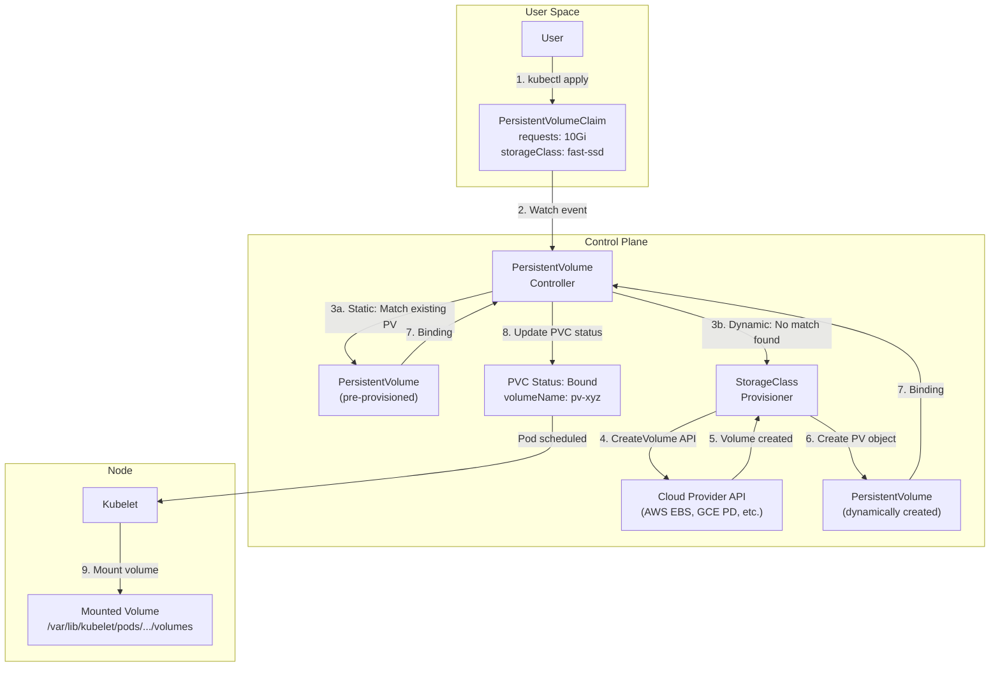
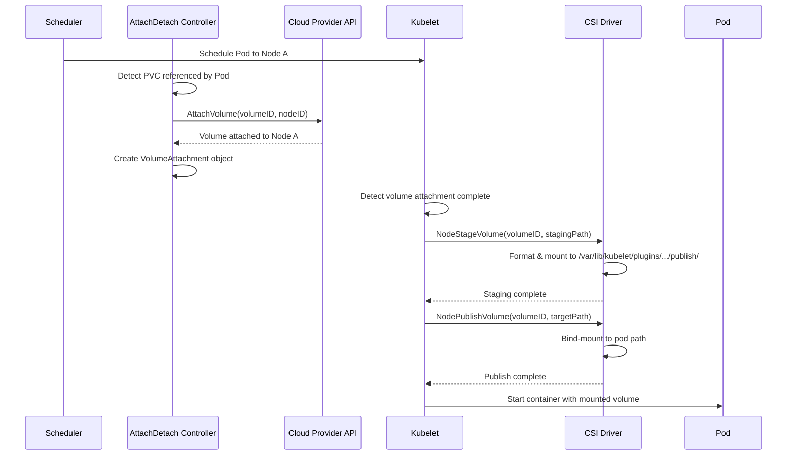
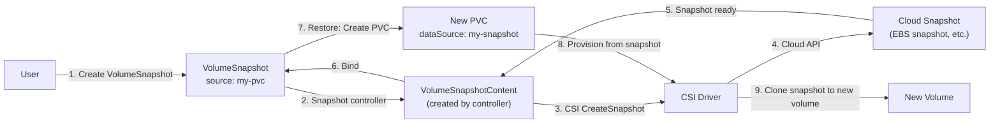

# Lesson 4: Kubernetes Storage Solutions

## 1. First-Principles: The Persistent Storage Contract in Distributed Systems

Storage in Kubernetes is fundamentally a problem of maintaining state consistency across ephemeral compute nodes. Kubernetes pods are designed to be stateless, disposable, and schedulable anywhere in the cluster. Persistent storage breaks this assumption by introducing a durable contract: data must survive pod restarts, rescheduling, and node failures.

The core challenge is reconciling two conflicting properties:
1. **Location independence**: Pods can be scheduled on any node based on resource availability and constraints.
2. **Storage locality**: Physical storage devices (block devices, network-attached storage) have fixed locations and performance characteristics tied to specific infrastructure.

This tension creates three fundamental invariants that govern all Kubernetes storage solutions:

**Invariant 1: Volume Lifecycle Independence**  
A persistent volume's lifecycle must be independent of any pod that consumes it. This decoupling allows volumes to outlive pods, enabling stateful applications to survive restarts without data loss. The PersistentVolume (PV) and PersistentVolumeClaim (PVC) abstraction enforces this separation: PVs represent provisioned storage resources, while PVCs represent consumption requests. The binding process creates a 1:1 relationship that persists until explicitly released.

**Invariant 2: Access Mode Consistency**  
Storage access modes define concurrency semantics that must match the underlying storage technology's capabilities:
- **ReadWriteOnce (RWO)**: Single node read-write access. Enforced by block storage devices (EBS, GCE Persistent Disk) that can only attach to one node at a time.
- **ReadOnlyMany (ROX)**: Multi-node read-only access. Requires storage that supports shared read semantics (NFS, object storage mounted read-only).
- **ReadWriteMany (RWX)**: Multi-node read-write access. Requires distributed filesystems (NFS, CephFS, GlusterFS) with concurrent write coordination.
- **ReadWriteOncePod (RWOP)**: Single pod read-write access, even stricter than RWO by preventing multiple pods on the same node from accessing the volume.

Violating access mode constraints leads to data corruption or undefined behavior. The admission controller rejects pod scheduling that would violate these constraints.

**Invariant 3: Reclaim Policy Determinism**  
When a PVC is deleted, the bound PV must follow a deterministic reclaim policy:
- **Retain**: Manual reclamation; PV remains with data intact until administrator intervention.
- **Delete**: Automatic deletion of both PV and underlying storage asset.
- **Recycle** (deprecated): Perform basic scrub (`rm -rf /volume/*`) before making available for new claims.

This policy is immutable after PV creation and defines the failure recovery contract.

## 2. Architecture: The Volume Provisioning Control Loop

The Kubernetes storage subsystem operates through three distinct control planes, each with specific responsibilities:

### 2.1 Static vs Dynamic Provisioning

**Static Provisioning** requires cluster administrators to pre-create PVs manually. When a PVC is created, the PersistentVolume controller searches for an available PV matching the claim's requirements (capacity, access mode, storage class). This search is a constrained bin-packing problem: find PV where `PV.capacity ≥ PVC.capacity ∧ PV.accessModes ⊇ PVC.accessModes ∧ PV.storageClass = PVC.storageClass`. If multiple PVs match, the controller selects the smallest sufficient PV to minimize waste.

**Dynamic Provisioning** uses StorageClass objects to define provisioner plugins that create PVs on-demand. When a PVC references a StorageClass, the provisioner plugin (running as a controller) receives the request and calls the underlying storage API (AWS EBS, GCE PD, Ceph, etc.) to allocate storage. The provisioner then creates the corresponding PV object, which the PersistentVolume controller binds to the PVC.



### 2.2 Volume Attachment and Mounting: The Two-Phase Protocol

Kubernetes separates volume operations into two phases to enable node-agnostic scheduling:

**Phase 1: Attachment (Node-Level)**  
The AttachDetach controller runs in the control plane and ensures volumes are attached to the correct node before pod startup. For cloud block storage (EBS, GCE PD), this involves calling the cloud API to attach the device to the VM. The controller creates a VolumeAttachment object to track attachment state. This phase is skipped for storage types that don't require explicit attachment (NFS, HostPath).

**Phase 2: Mounting (Pod-Level)**  
Once attached, the kubelet on the target node mounts the volume into the pod's filesystem namespace. The kubelet uses volume plugins (CSI drivers or in-tree volume plugins) to perform the mount operation. For block devices, this typically involves:
1. Format the device if unformatted (only on first use)
2. Mount to a global staging path: `/var/lib/kubelet/plugins/kubernetes.io/csi/volumeDevices/publish/<volume-id>`
3. Bind-mount to the pod-specific path: `/var/lib/kubelet/pods/<pod-id>/volumes/<volume-name>`



### 2.3 Container Storage Interface (CSI): The Plugin Architecture

CSI replaced the in-tree volume plugins with an out-of-tree extensibility model. CSI drivers are deployed as DaemonSets (node plugin) and StatefulSets (controller plugin) that expose gRPC services implementing the CSI specification.

The CSI specification defines three service interfaces:

**Identity Service**: Returns driver capabilities and health status.

**Controller Service**: Handles volume lifecycle operations (create, delete, attach, detach, snapshot). Runs in the control plane.

**Node Service**: Handles node-local operations (stage, unstage, publish, unpublish). Runs on each node via DaemonSet.

Critical CSI RPCs:

```go
// Controller Plugin
CreateVolume(name, capacityRange, volumeCapabilities, parameters) → VolumeInfo
DeleteVolume(volumeID) → {}
ControllerPublishVolume(volumeID, nodeID) → PublishContext
ControllerUnpublishVolume(volumeID, nodeID) → {}

// Node Plugin
NodeStageVolume(volumeID, stagingTargetPath, volumeCapability, publishContext) → {}
NodeUnstageVolume(volumeID, stagingTargetPath) → {}
NodePublishVolume(volumeID, targetPath, stagingTargetPath, volumeCapability, readOnly) → {}
NodeUnpublishVolume(volumeID, targetPath) → {}
```

The CSI driver's Controller service runs with elevated permissions to call cloud APIs, while the Node service runs with host-level privileges to mount filesystems. This separation follows the principle of least privilege.

## 3. StorageClass: The Resource Allocation Policy Engine

A StorageClass is not merely a label—it's a declarative policy that defines:
1. **Provisioner**: Which plugin creates the volumes (kubernetes.io/aws-ebs, csi.ceph.com, etc.)
2. **Parameters**: Provisioner-specific configuration (fsType, IOPS, replication factor)
3. **Reclaim Policy**: What happens to PVs when their PVCs are deleted
4. **Volume Binding Mode**: When to provision and bind volumes (Immediate vs WaitForFirstConsumer)
5. **Allowed Topologies**: Topology constraints for volume provisioning (zones, regions)

The **WaitForFirstConsumer** binding mode is critical for topology-aware scheduling. With Immediate binding, volumes are provisioned before pod scheduling, which can lead to pod scheduling failures if the volume and pod end up in incompatible topologies (e.g., volume in zone A, but pod scheduled to zone B where it cannot attach). WaitForFirstConsumer delays volume provisioning until the pod is scheduled, allowing the provisioner to create the volume in the same topology as the pod.

Example StorageClass demonstrating advanced features:

```yaml
apiVersion: storage.k8s.io/v1
kind: StorageClass
metadata:
  name: fast-ssd-retain
provisioner: ebs.csi.aws.com
parameters:
  type: gp3                    # General Purpose SSD v3
  iops: "16000"                # Provisioned IOPS
  throughput: "1000"           # MB/s
  encrypted: "true"            # EBS encryption at rest
  kmsKeyId: "arn:aws:kms:..."  # Custom KMS key
  fsType: ext4
reclaimPolicy: Retain          # Keep PV after PVC deletion for forensics
allowVolumeExpansion: true     # Enable online volume resizing
volumeBindingMode: WaitForFirstConsumer  # Topology-aware provisioning
allowedTopologies:
- matchLabelExpressions:
  - key: topology.kubernetes.io/zone
    values:
    - us-west-2a
    - us-west-2b
```

## 4. Performance Characteristics and Optimization

Storage performance in Kubernetes is governed by three layers:

### 4.1 Physical Storage Performance

The underlying storage medium determines baseline performance:

| Storage Type | IOPS | Throughput | Latency | Use Case |
|--------------|------|------------|---------|----------|
| Local NVMe SSD | 500k+ | 7+ GB/s | <100 μs | Databases, high-frequency trading |
| Cloud SSD (gp3, pd-ssd) | 16k | 1 GB/s | <1 ms | General-purpose stateful apps |
| Cloud HDD (st1, pd-standard) | 500 | 500 MB/s | 10-20 ms | Log aggregation, cold storage |
| Network FS (NFS, EFS) | 1k-10k | 100-500 MB/s | 1-10 ms | Shared read workloads |
| Distributed FS (Ceph, GlusterFS) | 10k-100k | 1-10 GB/s | 1-5 ms | Multi-attach RWX workloads |

### 4.2 Filesystem Overhead

Filesystem choice impacts performance:
- **ext4**: Mature, stable, good all-around performance. Default for most workloads.
- **XFS**: Better for large files and parallel I/O. Preferred for video/media processing.
- **Btrfs**: Copy-on-write with snapshots, compression. Higher CPU overhead.
- **NTFS**: Windows containers only.

Volume plugins default to ext4 unless overridden via StorageClass parameters.

### 4.3 Kubernetes Overhead

The two-phase mount process introduces latency:
- **Attachment latency**: Cloud API calls (AWS EBS attach: 5-15s, GCE PD: 10-30s)
- **Mount latency**: Filesystem checks, format on first use (1-10s)
- **Pod startup delay**: Volumes must be ready before containers start

**Optimization: Volume Preprovisioning**  
For latency-sensitive workloads, pre-create PVs and keep them in a pool. PVCs bind instantly to available PVs, eliminating provisioning time.

**Optimization: Local Persistent Volumes**  
For maximum performance, use local SSDs attached to nodes. Local volumes trade durability (data lost if node fails) for performance (no network hop, direct device access).

```yaml
apiVersion: v1
kind: PersistentVolume
metadata:
  name: local-pv-nvme-0
spec:
  capacity:
    storage: 375Gi
  volumeMode: Filesystem
  accessModes:
  - ReadWriteOnce
  persistentVolumeReclaimPolicy: Retain
  storageClassName: local-nvme
  local:
    path: /mnt/disks/nvme0n1
  nodeAffinity:
    required:
      nodeSelectorTerms:
      - matchExpressions:
        - key: kubernetes.io/hostname
          operator: In
          values:
          - node-1
```

The `nodeAffinity` is mandatory for local volumes—it pins the PV to a specific node. Pods using this PV will always schedule to that node.

**Optimization: I/O Scheduling and Throttling**  
Kubernetes does not implement I/O QoS directly. Use cgroups blkio controller or container runtime features:

```yaml
apiVersion: v1
kind: Pod
metadata:
  name: io-limited-pod
spec:
  containers:
  - name: app
    image: myapp:latest
    resources:
      limits:
        # Indirect I/O limit via CPU/memory constraints
        cpu: "2"
        memory: "4Gi"
```

For precise I/O limits, use device-mapper thin provisioning or storage-side QoS policies.

## 5. Failure Modes and Resilience Patterns

### 5.1 Volume Attachment Failures

**Failure**: Node fails while volume is attached. Cloud provider still considers volume attached to dead node.

**Detection**: AttachDetach controller detects node NotReady for >5 minutes (configurable via `--attach-detach-reconcile-sync-period`).

**Recovery**: 
1. Controller marks VolumeAttachment for force-detach
2. Calls cloud API to detach volume from dead node
3. Pod rescheduled to new node triggers reattachment

**Time to recovery**: 5-10 minutes (node grace period + detach API call + reattachment)

**Mitigation**: Use StatefulSets with `podManagementPolicy: Parallel` and low `terminationGracePeriodSeconds` for faster failover.

### 5.2 Filesystem Corruption

**Failure**: Kernel panic, power loss, or buggy driver causes filesystem corruption.

**Detection**: Mount fails with `mount: wrong fs type, bad option, bad superblock` or similar errors.

**Recovery**:
1. Manual intervention required
2. Run `fsck` on the volume (requires detaching from all pods)
3. If unrecoverable, restore from backup/snapshot

**Mitigation**:
- Use journaling filesystems (ext4, XFS)
- Enable crash-consistent snapshots via CSI VolumeSnapshot
- Run periodic filesystem checks during maintenance windows

### 5.3 Split-Brain in RWX Volumes

**Failure**: Network partition causes distributed filesystem to have multiple masters, leading to conflicting writes.

**Detection**: Application-level data inconsistency, filesystem lock conflicts.

**Recovery**: Depends on distributed FS quorum mechanism:
- **Ceph**: Requires majority of monitors to be reachable
- **GlusterFS**: Uses client-side quorum settings
- **NFS**: Single server, no split-brain (but single point of failure)

**Mitigation**:
- Deploy distributed FS with proper quorum (odd number of nodes ≥3)
- Use fencing mechanisms to prevent split-brain
- Monitor network health and partition events

### 5.4 Volume Expansion Failures

**Failure**: Online volume expansion requested but filesystem doesn't support online resize, or cloud API fails.

**Detection**: PVC remains in `Resizing` condition indefinitely.

**Recovery**:
1. Check CSI driver logs for errors
2. If filesystem doesn't support online resize (e.g., ext4 without resize2fs in-band), must unmount, resize, remount
3. If cloud API failed, retry manually or wait for controller retry

**Mitigation**:
- Use filesystems that support online resize (XFS, ext4 with kernel 3.16+)
- Test expansion in staging before production
- Monitor PVC `Conditions` for expansion status

```bash
# Check PVC expansion status
kubectl describe pvc my-pvc | grep -A 5 Conditions

# Example output showing successful expansion:
Conditions:
  Type                      Status  Reason                 Message
  ----                      ------  ------                 -------
  FileSystemResizePending   False   FileSystemResizeSuccess  File system resize successful
```

## 6. Volume Snapshots: Point-in-Time Copies

VolumeSnapshots provide crash-consistent backups of PVCs. The VolumeSnapshot API leverages CSI drivers' snapshot capabilities.

**Key objects**:
- **VolumeSnapshotClass**: Defines snapshot creation policy (similar to StorageClass)
- **VolumeSnapshot**: User request for a snapshot of a PVC
- **VolumeSnapshotContent**: Actual snapshot resource, bound to VolumeSnapshot

Snapshot workflow:



Example snapshot and restore:

```yaml
# Take a snapshot
apiVersion: snapshot.storage.k8s.io/v1
kind: VolumeSnapshot
metadata:
  name: db-snapshot-20240115
spec:
  volumeSnapshotClassName: csi-snapclass
  source:
    persistentVolumeClaimName: postgres-data

---
# Restore from snapshot
apiVersion: v1
kind: PersistentVolumeClaim
metadata:
  name: postgres-data-restored
spec:
  storageClassName: fast-ssd
  dataSource:
    name: db-snapshot-20240115
    kind: VolumeSnapshot
    apiGroup: snapshot.storage.k8s.io
  accessModes:
  - ReadWriteOnce
  resources:
    requests:
      storage: 100Gi
```

**Performance consideration**: Snapshot creation can cause brief I/O pauses (typically <1s) while the storage system creates a crash-consistent point-in-time copy. For databases, prefer application-consistent snapshots by quiescing writes before snapshotting.

## 7. Capacity Management and Overprovisioning

Kubernetes does not enforce storage quota at the node level—it's possible to overprovision PVCs beyond available physical storage. The scheduler considers volume topology constraints but not capacity exhaustion.

**Monitoring storage capacity**:

```bash
# Check PV usage (not available via native kubectl—requires metrics)
# Use node-exporter or kubelet metrics
curl -s http://localhost:10255/metrics | grep kubelet_volume_stats

# Example metrics:
# kubelet_volume_stats_capacity_bytes{namespace="default",persistentvolumeclaim="db-data"} 1.073741824e+11
# kubelet_volume_stats_used_bytes{namespace="default",persistentvolumeclaim="db-data"} 5.368709e+10
```

**ResourceQuota** can limit total PVC storage per namespace:

```yaml
apiVersion: v1
kind: ResourceQuota
metadata:
  name: storage-quota
  namespace: prod
spec:
  hard:
    requests.storage: "1Ti"                    # Total storage across all PVCs
    persistentvolumeclaims: "50"               # Max number of PVCs
    fast-ssd.storageclass.storage.k8s.io/requests.storage: "500Gi"  # Per-StorageClass limit
```

**LimitRange** can enforce per-PVC constraints:

```yaml
apiVersion: v1
kind: LimitRange
metadata:
  name: pvc-limits
  namespace: prod
spec:
  limits:
  - type: PersistentVolumeClaim
    max:
      storage: "100Gi"    # No single PVC larger than 100Gi
    min:
      storage: "1Gi"      # No PVC smaller than 1Gi
```

## 8. Security: Encryption, Access Control, and Secrets

### 8.1 Encryption at Rest

Most cloud providers support volume encryption via KMS:

```yaml
apiVersion: storage.k8s.io/v1
kind: StorageClass
metadata:
  name: encrypted-sc
provisioner: ebs.csi.aws.com
parameters:
  encrypted: "true"
  kmsKeyId: "arn:aws:kms:us-west-2:123456789012:key/abcd-1234"
```

For on-premises, use LUKS encryption via CSI driver or dm-crypt at the host level.

### 8.2 Volume Permissions and SELinux

Volumes mounted in pods inherit the pod's security context. Control access via `fsGroup` and `runAsUser`:

```yaml
apiVersion: v1
kind: Pod
metadata:
  name: secure-pod
spec:
  securityContext:
    fsGroup: 2000              # All volume files owned by group 2000
    fsGroupChangePolicy: "OnRootMismatch"  # Only chown if root doesn't match
    runAsUser: 1000            # Container runs as UID 1000
    runAsNonRoot: true
    seccompProfile:
      type: RuntimeDefault
  containers:
  - name: app
    image: myapp:latest
    volumeMounts:
    - name: data
      mountPath: /data
  volumes:
  - name: data
    persistentVolumeClaim:
      claimName: my-pvc
```

On SELinux-enabled systems, volumes are labeled with SELinux contexts. Use `seLinuxOptions` in the security context to override.

### 8.3 Secrets in Volumes

CSI drivers support passing secrets to provisioners for authentication:

```yaml
apiVersion: storage.k8s.io/v1
kind: StorageClass
metadata:
  name: ceph-rbd
provisioner: rbd.csi.ceph.com
parameters:
  clusterID: "rook-ceph"
  pool: "kubernetes"
  imageFeatures: "layering"
  csi.storage.k8s.io/provisioner-secret-name: "ceph-secret"
  csi.storage.k8s.io/provisioner-secret-namespace: "rook-ceph"
  csi.storage.k8s.io/controller-expand-secret-name: "ceph-secret"
  csi.storage.k8s.io/controller-expand-secret-namespace: "rook-ceph"
  csi.storage.k8s.io/node-stage-secret-name: "ceph-secret"
  csi.storage.k8s.io/node-stage-secret-namespace: "rook-ceph"
```

Secrets contain credentials (keys, passwords) that the CSI driver uses to authenticate with the storage backend. Rotate these secrets regularly via external secret management systems (e.g., Vault, AWS Secrets Manager).

## 9. Production Checklist

Before deploying persistent storage in production:

- [ ] **Validate StorageClass parameters**: Test provisioning, binding, and mounting with representative workloads
- [ ] **Set appropriate reclaim policies**: Use Retain for critical data, Delete for ephemeral workloads
- [ ] **Enable volume snapshots**: Configure VolumeSnapshotClass and test backup/restore procedures
- [ ] **Implement monitoring**: Track PVC usage, provisioning latency, mount failures
- [ ] **Configure resource quotas**: Prevent storage overprovisioning with ResourceQuota and LimitRange
- [ ] **Test failure scenarios**: Simulate node failures, volume corruption, zone outages
- [ ] **Document recovery procedures**: Runbooks for common failure modes (attachment stuck, filesystem corruption, etc.)
- [ ] **Enable encryption at rest**: Use cloud KMS or LUKS for sensitive data
- [ ] **Audit access controls**: Review PodSecurityPolicies (deprecated) or PodSecurityStandards and fsGroup settings
- [ ] **Plan for capacity growth**: Monitor storage usage trends and provision capacity ahead of demand
- [ ] **Benchmark performance**: Measure IOPS, throughput, and latency under production load
- [ ] **Version control StorageClasses**: Track changes to provisioning parameters in Git
- [ ] **Test volume expansion**: Validate online resize with production-like filesystems and data
- [ ] **Implement retention policies**: Automate snapshot deletion to control costs
- [ ] **Review CSI driver versions**: Keep drivers up-to-date for security patches and bug fixes

## 10. Further Reading and Reference Implementations

**Kubernetes Documentation**:
- [Persistent Volumes](https://kubernetes.io/docs/concepts/storage/persistent-volumes/)
- [Storage Classes](https://kubernetes.io/docs/concepts/storage/storage-classes/)
- [Volume Snapshots](https://kubernetes.io/docs/concepts/storage/volume-snapshots/)
- [CSI Specification](https://github.com/container-storage-interface/spec/blob/master/spec.md)

**CSI Drivers** (official and widely-deployed):
- AWS EBS CSI: https://github.com/kubernetes-sigs/aws-ebs-csi-driver
- GCE Persistent Disk CSI: https://github.com/kubernetes-sigs/gcp-compute-persistent-disk-csi-driver
- Ceph RBD CSI: https://github.com/ceph/ceph-csi
- NFS CSI: https://github.com/kubernetes-csi/csi-driver-nfs

**Distributed Storage Systems**:
- Rook (Ceph operator for Kubernetes): https://rook.io
- Longhorn (cloud-native distributed block storage): https://longhorn.io
- OpenEBS (containerized storage): https://openebs.io

**Performance Benchmarking**:
- fio: Flexible I/O tester for storage performance measurement
- dbench: Database-like I/O patterns for filesystem testing

This lesson provides the theoretical foundation and practical knowledge required to design, deploy, and operate production-grade persistent storage in Kubernetes. The next lesson will cover StatefulSets and stateful application patterns that leverage these storage primitives.
