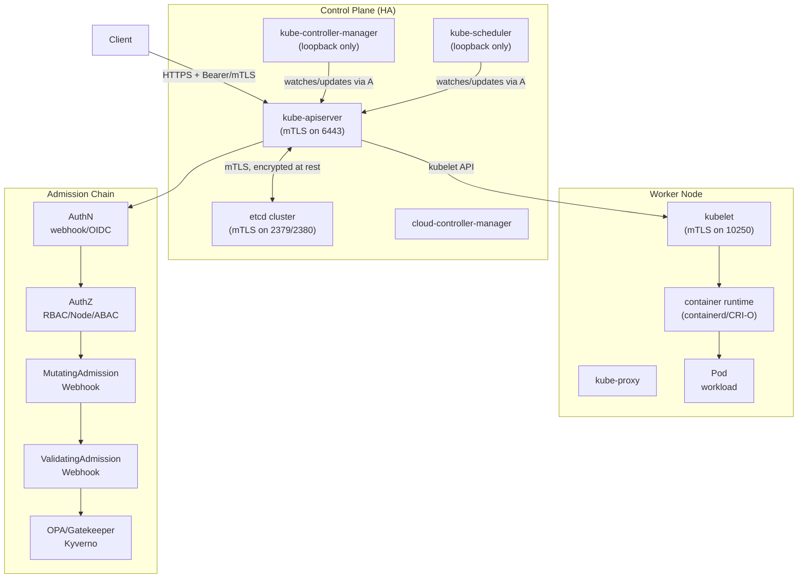
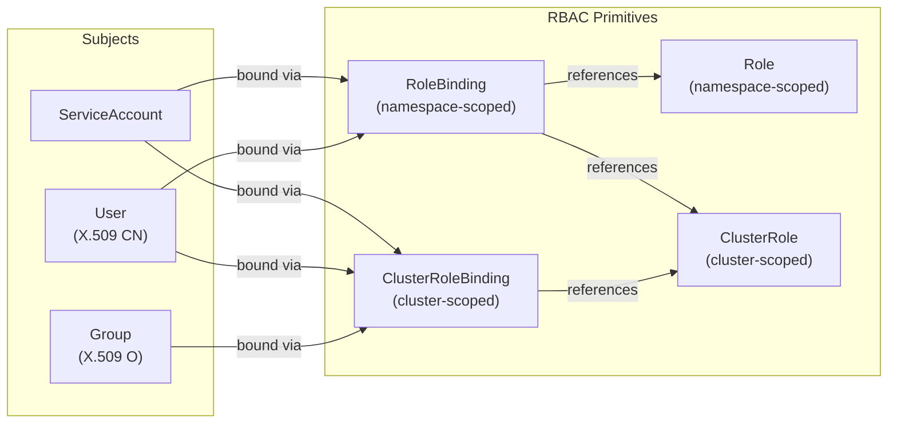
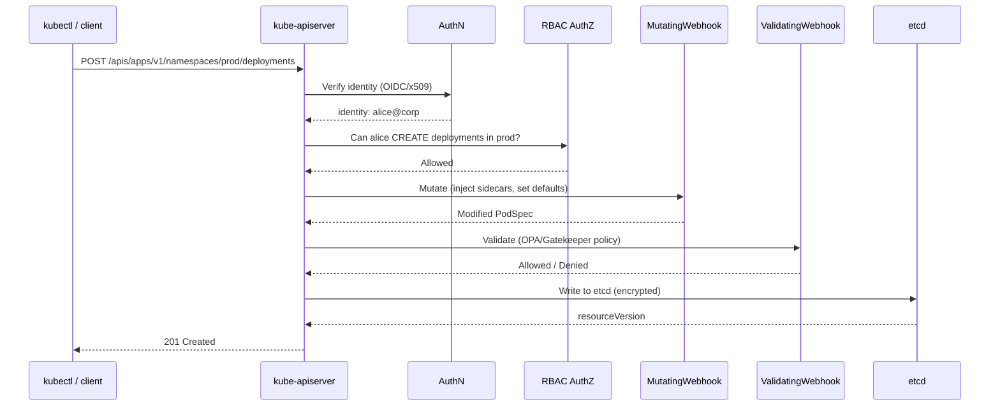
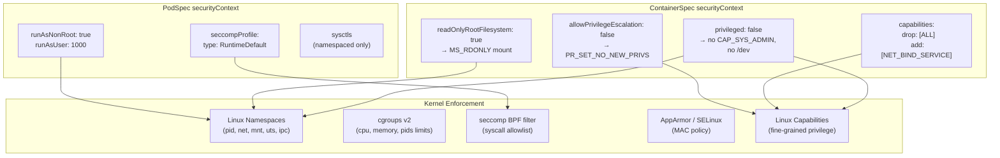
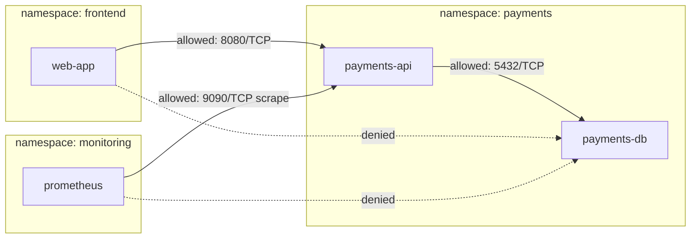
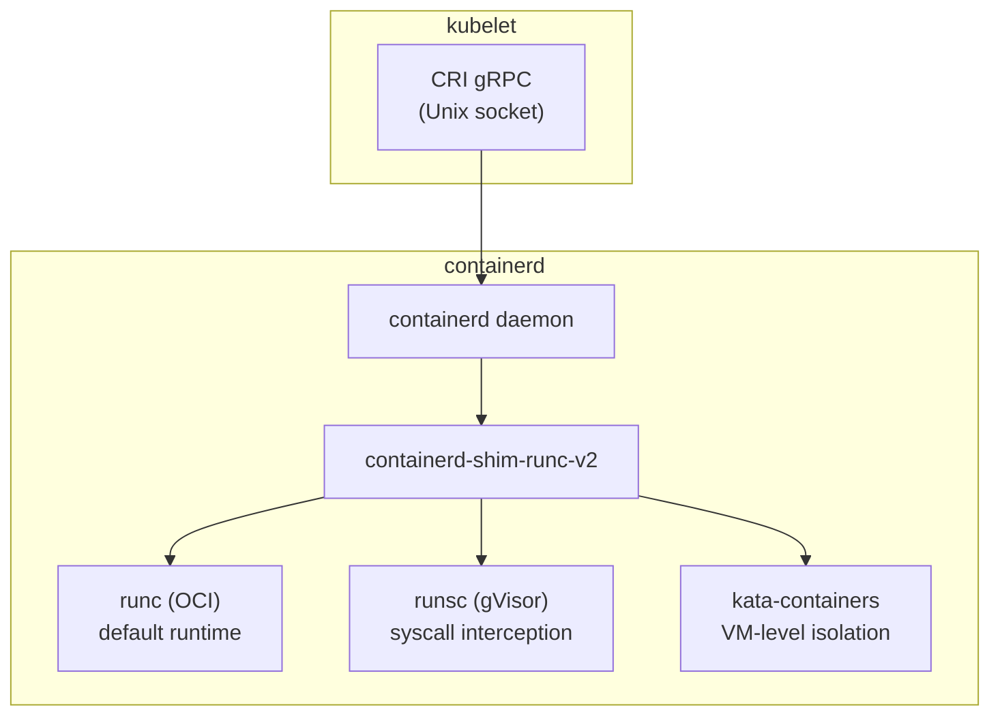
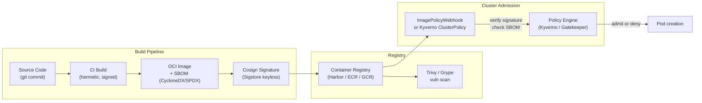
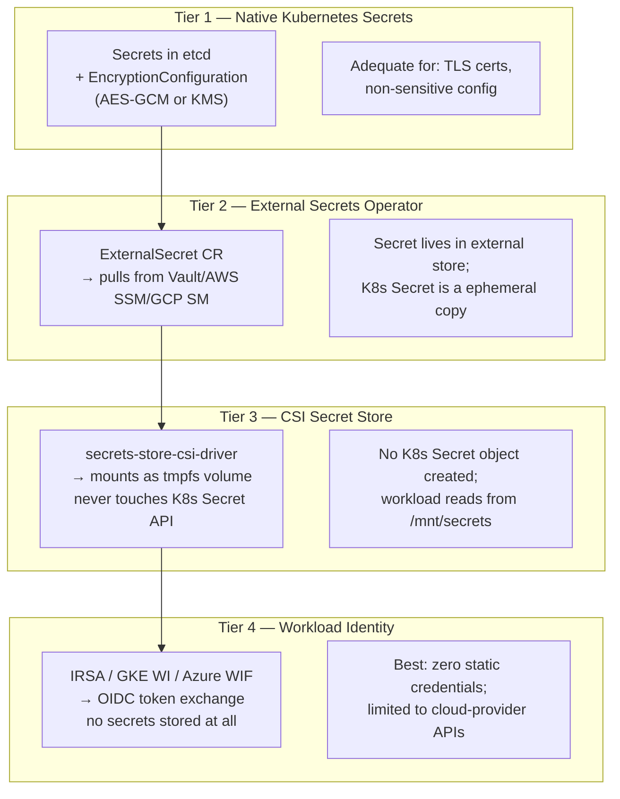
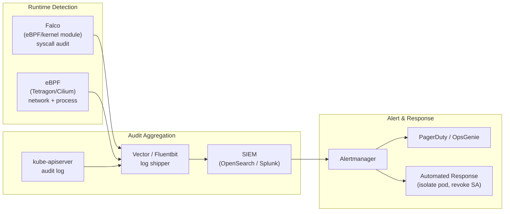

# Lesson 5: Kubernetes Security Best Practices

## 1. First-Principles Intuition & Invariants

Kubernetes is not a monolithic system — it is a distributed state machine that continuously reconciles declared intent against observed reality. Every security property of the platform derives from understanding this architecture at the kernel level. Threat modeling Kubernetes means tracing each control-plane decision: who can assert desired state, which component acts on it, and what kernel-level primitives enforce the boundary at runtime.

### The Three Foundational Invariants

**Invariant 1: The API server is the sole mutation gateway.** No component — kubelet, controller, scheduler — ever writes to etcd directly. All writes pass through the API server's admission chain, making that chain the natural chokepoint for every security control: authentication, authorization, mutation webhooks, and validating webhooks. A bypass of the API server (e.g., direct etcd access) collapses the entire security model instantaneously.

**Invariant 2: Identity is namespace-scoped, but privilege is not.** A `ClusterRole` bearing `*` verbs on `*` resources grants root-equivalent access to the entire cluster regardless of which namespace the bound subject lives in. RBAC roles are additive and non-hierarchical; there is no "deny" verb. Any misconfiguration grants permanent elevation because there is no ambient authority revocation at session time.

**Invariant 3: Container isolation is a kernel policy, not an OS boundary.** Containers share the host kernel. A pod with `privileged: true` and `hostPID: true` can enumerate every process on the node, attach to them with `ptrace`, and read memory from other workloads. The security boundary between containers is a composition of Linux namespaces, cgroups, seccomp profiles, and LSM policies (AppArmor/SELinux). Remove any layer and the boundary degrades.

### Threat Model Axes

```
                        Threat Surface Map
┌─────────────────────────────────────────────────────────────┐
│  External   │  API server auth bypass, ETCD exposure,       │
│  Attackers  │  ingress controller CVEs, image supply chain  │
├─────────────────────────────────────────────────────────────┤
│  Malicious  │  RBAC privilege escalation, SA token misuse,  │
│  Insider    │  admission bypass, node-level escape          │
├─────────────────────────────────────────────────────────────┤
│  Compromised│  Pod escape to node, lateral movement via     │
│  Workload   │  SA credentials, host path mount abuse        │
└─────────────────────────────────────────────────────────────┘
```

---

## 2. Core Architecture & Mechanics

### 2.1 Control Plane Component Security



**etcd is the blast radius.** etcd stores Secrets in base64-encoded plaintext unless `EncryptionConfiguration` is applied at the API server. A direct read of etcd bypasses RBAC entirely — an attacker with network access to port 2379 and the etcd client certificate can retrieve every Secret in the cluster. This is why etcd must be:

- Bound to a private interface, never `0.0.0.0`
- Protected by mutual TLS (client certs rotated via `kubeadm certs renew`)
- Encrypted at rest using `aescbc`, `aesgcm`, or a KMS provider

```yaml
# /etc/kubernetes/encryption-config.yaml
apiVersion: apiserver.config.k8s.io/v1
kind: EncryptionConfiguration
resources:
  - resources:
      - secrets
      - configmaps        # encrypt configmaps if they carry sensitive data
    providers:
      - kms:
          name: aws-kms
          endpoint: unix:///var/run/kmsplugin/socket.sock
          cachesize: 1000
          timeout: 3s
      - aescbc:
          keys:
            - name: key1
              secret: <base64-encoded-32-byte-key>   # fallback for KMS outage
      - identity: {}      # NEVER place identity first; that disables encryption
```

The `identity` provider must appear **last** — placing it first means all resources are stored unencrypted.

### 2.2 Raft Consensus and Its Security Implications

etcd uses the Raft consensus algorithm. A cluster of $N$ nodes requires a quorum of $Q = \lfloor N/2 \rfloor + 1$ to commit a write. For a 3-node cluster, $Q = 2$; for a 5-node cluster, $Q = 3$.

This has a direct security consequence: an adversary who can partition or disable $\lfloor N/2 \rfloor + 1$ nodes causes total write unavailability — no new Secrets can be created, no deployments can be scaled, no RBAC policies can be updated. This is a Denial-of-Service against the control plane achievable without code execution. Defense: use 5-node etcd clusters spread across 3+ availability zones and restrict network-level access via firewall/security groups.

### 2.3 RBAC Architecture — Where Misconfiguration Lives

Kubernetes RBAC is an additive DAG of subjects, verbs, and resources. It has no deny rules, no session-time revocation, and no row-level security. Understanding the escalation paths is essential.



**High-risk privilege escalation paths:**

| Dangerous Permission | Why It Grants Cluster Compromise |
|---|---|
| `verbs: ["create"]` on `pods` with no PSA/PSP | Can spawn `privileged: true` pod with `hostPID`, escape to node |
| `verbs: ["bind"]` on `clusterrolebindings` | Can bind `cluster-admin` to any subject |
| `verbs: ["escalate", "bind"]` on `roles` | Explicit escalation verbs; allows self-granting any role |
| `verbs: ["create"]` on `serviceaccounts/token` | Can mint arbitrary-lifetime tokens for any SA |
| `verbs: ["update", "patch"]` on `validatingwebhookconfigurations` | Can disable all admission controls |
| `verbs: ["*"]` on `secrets` | Can read all credentials, kubeconfig, service account tokens |

Audit your cluster with `kubectl auth can-i --list --as=system:serviceaccount:<ns>:<sa>` and tools like `rbac-police` or `kubectl-who-can`.

### 2.4 Admission Control Pipeline

The admission chain executes in strict order. Understanding this order is critical because a mutating webhook runs before validation — a webhook that injects a sidecar can introduce a privileged container that a later PSA policy would have blocked if the pod had been submitted as-is.



**Admission webhook failure modes:** Every webhook has a `failurePolicy: Fail | Ignore`. Setting `failurePolicy: Ignore` on a security-critical validating webhook means that if the webhook service is unavailable, all requests pass through unchecked. This is equivalent to no policy enforcement under degraded conditions. Use `failurePolicy: Fail` for security-critical webhooks and ensure the webhook service is highly available (minimum 3 replicas, PodDisruptionBudget, topology spread constraints).

### 2.5 Pod Security — Kernel-Level Mechanics

Pod security is enforced by composing Linux kernel primitives. Each `securityContext` field maps directly to a kernel call or capability.



**Production-hardened pod security context:**

```yaml
apiVersion: v1
kind: Pod
metadata:
  name: hardened-workload
  namespace: production
  annotations:
    # AppArmor profile loaded on each node by a DaemonSet
    container.apparmor.security.beta.kubernetes.io/app: localhost/restricted-profile
spec:
  automountServiceAccountToken: false   # explicit; most pods need no SA token
  securityContext:
    runAsNonRoot: true
    runAsUser: 65532                     # distroless nonroot UID
    runAsGroup: 65532
    fsGroup: 65532
    fsGroupChangePolicy: OnRootMismatch  # only chown if ownership differs (perf)
    seccompProfile:
      type: RuntimeDefault               # maps to containerd's default seccomp
    supplementalGroups: []
    sysctls: []                          # no privileged sysctls
  containers:
    - name: app
      image: gcr.io/distroless/static-debian12:nonroot@sha256:<digest>  # pinned digest
      securityContext:
        allowPrivilegeEscalation: false
        readOnlyRootFilesystem: true
        privileged: false
        capabilities:
          drop:
            - ALL
          add: []                        # add NET_BIND_SERVICE only if port <1024
      resources:
        requests:
          cpu: "100m"
          memory: "128Mi"
        limits:
          cpu: "500m"
          memory: "256Mi"               # always set; unbounded memory is a DoS
      volumeMounts:
        - name: tmp
          mountPath: /tmp               # writable tmpfs for scratch space
        - name: varlog
          mountPath: /var/log
  volumes:
    - name: tmp
      emptyDir:
        medium: Memory
        sizeLimit: 64Mi
    - name: varlog
      emptyDir:
        sizeLimit: 32Mi
  hostPID: false
  hostIPC: false
  hostNetwork: false
```

### 2.6 Pod Security Admission (PSA)

PSA replaced the deprecated PodSecurityPolicy (PSP) in Kubernetes 1.25. It enforces the [Pod Security Standards](https://kubernetes.io/docs/concepts/security/pod-security-standards/) at the namespace level via a built-in admission controller — no webhook required.

```yaml
# Label a namespace to enforce the restricted profile
apiVersion: v1
kind: Namespace
metadata:
  name: production
  labels:
    pod-security.kubernetes.io/enforce: restricted
    pod-security.kubernetes.io/enforce-version: v1.30
    pod-security.kubernetes.io/audit: restricted
    pod-security.kubernetes.io/audit-version: v1.30
    pod-security.kubernetes.io/warn: restricted
    pod-security.kubernetes.io/warn-version: v1.30
```

The three PSA levels map to concrete pod spec constraints:

| Level | Key Restrictions |
|---|---|
| **privileged** | No restrictions — equivalent to no PSA |
| **baseline** | No `hostPID/IPC/Network`, no `privileged`, no dangerous host paths |
| **restricted** | All baseline + `runAsNonRoot`, `allowPrivilegeEscalation: false`, `drop: ALL`, seccomp `RuntimeDefault` or custom |

PSA does not replace OPA/Gatekeeper or Kyverno for custom policies. PSA handles pod-level shape; policy engines handle organizational rules (image registries, label requirements, resource quotas, etc.).

### 2.7 Network Policies — Zero-Trust Microsegmentation

Kubernetes `NetworkPolicy` resources are enforced by the CNI plugin (Cilium, Calico, Antrea — but **not** Flannel, which ignores them). Without a NetworkPolicy, all pods can communicate with all other pods across all namespaces by default — a flat network that enables lateral movement after a single pod compromise.



```yaml
# Default deny all ingress AND egress in payments namespace
apiVersion: networking.k8s.io/v1
kind: NetworkPolicy
metadata:
  name: default-deny-all
  namespace: payments
spec:
  podSelector: {}       # selects all pods in namespace
  policyTypes:
    - Ingress
    - Egress
---
# Allow ingress to payments-api from web-app in frontend namespace
apiVersion: networking.k8s.io/v1
kind: NetworkPolicy
metadata:
  name: allow-frontend-to-payments-api
  namespace: payments
spec:
  podSelector:
    matchLabels:
      app: payments-api
  policyTypes:
    - Ingress
  ingress:
    - from:
        - namespaceSelector:
            matchLabels:
              kubernetes.io/metadata.name: frontend
          podSelector:
            matchLabels:
              app: web-app
      ports:
        - protocol: TCP
          port: 8080
---
# Allow payments-api egress only to payments-db and DNS
apiVersion: networking.k8s.io/v1
kind: NetworkPolicy
metadata:
  name: payments-api-egress
  namespace: payments
spec:
  podSelector:
    matchLabels:
      app: payments-api
  policyTypes:
    - Egress
  egress:
    - to:
        - podSelector:
            matchLabels:
              app: payments-db
      ports:
        - protocol: TCP
          port: 5432
    - to: []             # allow DNS egress
      ports:
        - protocol: UDP
          port: 53
        - protocol: TCP
          port: 53
```

A common mistake is omitting the DNS egress rule, which breaks all DNS lookups in the pod and manifests as intermittent connection failures that appear unrelated to network policy.

### 2.8 Service Account Token Mechanics

Pre-Kubernetes 1.21, service account tokens were long-lived JWTs mounted into every pod by default. These tokens had no expiration and no audience binding, meaning a leaked token was permanently valid for any API server in the cluster. From 1.21 onward, projected service account tokens are the default:

```yaml
# Kubernetes automatically projects this for pods; shown explicitly for clarity
volumes:
  - name: kube-api-access
    projected:
      sources:
        - serviceAccountToken:
            expirationSeconds: 3607      # rotated before expiry by kubelet
            path: token
            audience: https://kubernetes.default.svc  # audience-bound
        - configMap:
            name: kube-root-ca.crt
            items:
              - key: ca.crt
                path: ca.crt
        - downwardAPI:
            items:
              - path: namespace
                fieldRef:
                  fieldPath: metadata.namespace
```

**Workload Identity Federation (WIF)** is the production-grade alternative: pods receive short-lived OIDC tokens that cloud IAM systems (AWS STS, GCP Workload Identity, Azure AD Federated Identity) exchange for cloud-provider credentials — no long-lived credentials stored in Kubernetes Secrets at all.

---

## 3. High-Performance Optimization & Failure Modes

### 3.1 API Server Hardening Flags

The `kube-apiserver` binary exposes a large flag surface. The following flags are critical for security and are frequently misconfigured or missing in default installations:

```bash
kube-apiserver \
  # Disable anonymous authentication entirely
  --anonymous-auth=false \
  # Restrict access to only the OIDC provider and x509 bootstrapping
  --oidc-issuer-url=https://accounts.google.com \
  --oidc-client-id=kubernetes \
  --oidc-username-claim=email \
  --oidc-groups-claim=groups \
  # Enforce encryption config
  --encryption-provider-config=/etc/kubernetes/encryption-config.yaml \
  # Enable all admission plugins relevant to security
  --enable-admission-plugins=NodeRestriction,MutatingAdmissionWebhook,ValidatingAdmissionWebhook \
  # Disable admission plugins that weaken security
  --disable-admission-plugins=AlwaysAdmit \
  # Restrict kubelet API access to node-specific resources only
  --authorization-mode=Node,RBAC \
  # Audit logging — write all request/response bodies for sensitive resources
  --audit-log-path=/var/log/kube-audit/audit.log \
  --audit-log-maxage=30 \
  --audit-log-maxbackup=10 \
  --audit-log-maxsize=100 \
  --audit-policy-file=/etc/kubernetes/audit-policy.yaml \
  # Bind only to the control-plane network interface, not 0.0.0.0
  --bind-address=10.0.0.1 \
  # Disable profiling endpoints (pprof) — information leakage
  --profiling=false \
  # Disable service account token issuance if using WIF
  --service-account-issuer=https://oidc.example.com \
  --service-account-key-file=/etc/kubernetes/pki/sa.pub \
  --service-account-signing-key-file=/etc/kubernetes/pki/sa.key
```

### 3.2 Audit Policy

A minimal audit policy that captures security-relevant events without generating unmanageable volume:

```yaml
apiVersion: audit.k8s.io/v1
kind: Policy
omitStages:
  - RequestReceived           # noisy; omit pre-response stage
rules:
  # Log all secret/configmap access at RequestResponse level
  - level: RequestResponse
    resources:
      - group: ""
        resources: ["secrets", "configmaps"]
    verbs: ["get", "list", "watch", "create", "update", "patch", "delete"]

  # Log all RBAC mutations
  - level: RequestResponse
    resources:
      - group: "rbac.authorization.k8s.io"
        resources:
          - "clusterroles"
          - "clusterrolebindings"
          - "roles"
          - "rolebindings"

  # Log exec/attach/portforward — these are high-risk interactive operations
  - level: RequestResponse
    verbs: ["create"]
    resources:
      - group: ""
        resources: ["pods/exec", "pods/attach", "pods/portforward"]

  # Log all auth-related webhook calls
  - level: Metadata
    resources:
      - group: "authentication.k8s.io"
        resources: ["tokenreviews"]
      - group: "authorization.k8s.io"
        resources: ["subjectaccessreviews"]

  # Catch-all: metadata only for everything else (avoids full request body)
  - level: Metadata
    omitStages:
      - RequestReceived
```

### 3.3 kubelet Hardening

The kubelet exposes a powerful API on port 10250. An unauthenticated kubelet API (the historical default before 1.10) allows arbitrary pod execution, file read, and log access on any node — functionally equivalent to SSH root access. All clusters must enforce:

```yaml
# /var/lib/kubelet/config.yaml
apiVersion: kubelet.config.k8s.io/v1beta1
kind: KubeletConfiguration
authentication:
  anonymous:
    enabled: false              # never allow unauthenticated requests
  webhook:
    enabled: true               # delegate to API server for bearer tokens
  x509:
    clientCAFile: /etc/kubernetes/pki/ca.crt
authorization:
  mode: Webhook                 # API server authorizes all kubelet requests
eventRecordQPS: 50
protectKernelDefaults: true     # refuse to start if kernel params differ from defaults
readOnlyPort: 0                 # disable the unauthenticated read-only port 10255
serializeImagePulls: false      # allow parallel pulls; set true only if disk I/O bound
tlsCertFile: /var/lib/kubelet/pki/kubelet.crt
tlsPrivateKeyFile: /var/lib/kubelet/pki/kubelet.key
# Restrict sysctls to safe namespaced set
allowedUnsafeSysctls: []
containerLogMaxSize: "50Mi"
containerLogMaxFiles: 5
```

### 3.4 Container Runtime Security — OCI Runtime Comparison



Runtime classes allow per-workload isolation level selection:

```yaml
# Define gVisor runtime class
apiVersion: node.k8s.io/v1
kind: RuntimeClass
metadata:
  name: gvisor
handler: runsc             # matches containerd runtime handler name
scheduling:
  nodeClassSelector:
    matchLabels:
      sandbox: gvisor      # only schedule on nodes with gVisor installed
  tolerations:
    - key: sandbox
      operator: Equal
      value: gvisor
      effect: NoSchedule
overhead:
  podFixed:
    memory: "128Mi"        # gVisor has non-trivial memory overhead
    cpu: "50m"
---
# Use gVisor for untrusted workloads (e.g., user code execution)
apiVersion: v1
kind: Pod
metadata:
  name: untrusted-job
spec:
  runtimeClassName: gvisor
  containers:
    - name: sandbox
      image: python:3.12-slim@sha256:<digest>
```

gVisor (runsc) intercepts all Linux system calls via a user-space kernel written in Go, reducing the kernel attack surface. The tradeoff is ~10-30% CPU overhead and incompatibility with syscalls requiring direct hardware access (e.g., `io_uring`, some eBPF operations).

### 3.5 Supply Chain Security — Image Provenance

Container image supply chain attacks (SolarWinds, XZ Utils) are the fastest-growing vector for Kubernetes compromise. Defense requires cryptographic provenance at every stage.



```python
#!/usr/bin/env python3
"""
Verify a container image signature using cosign's transparency log
before admitting it into a cluster (called from an admission webhook).
Requires: sigstore[cosign] pip package (not an official PyPI package —
use subprocess to call the cosign binary in production).
"""
import subprocess
import json
import sys
from dataclasses import dataclass
from typing import Optional


@dataclass
class VerificationResult:
    verified: bool
    digest: Optional[str]
    subject: Optional[str]
    error: Optional[str]


def verify_image_signature(
    image_ref: str,
    expected_issuer: str = "https://token.actions.githubusercontent.com",
    expected_subject_prefix: str = "https://github.com/myorg/",
) -> VerificationResult:
    """
    Verify a container image using keyless Sigstore/cosign signatures.
    The image_ref must be digest-pinned (image@sha256:...) to prevent
    TOCTOU attacks between verification and admission.
    """
    if "@sha256:" not in image_ref:
        return VerificationResult(
            verified=False,
            digest=None,
            subject=None,
            error="Image reference must be digest-pinned (image@sha256:...)",
        )

    cmd = [
        "cosign", "verify",
        "--certificate-identity-regexp", f"^{expected_subject_prefix}",
        "--certificate-oidc-issuer", expected_issuer,
        "--output", "json",
        image_ref,
    ]

    try:
        result = subprocess.run(
            cmd,
            capture_output=True,
            text=True,
            timeout=30,
            check=True,
        )
        payload = json.loads(result.stdout)
        if not payload:
            return VerificationResult(
                verified=False, digest=None, subject=None,
                error="No signatures found"
            )

        # cosign returns a list of verified signatures
        sig = payload[0]
        cert = sig.get("optional", {})
        return VerificationResult(
            verified=True,
            digest=sig.get("critical", {}).get("image", {}).get("docker-manifest-digest"),
            subject=cert.get("Subject"),
            error=None,
        )
    except subprocess.CalledProcessError as e:
        return VerificationResult(
            verified=False, digest=None, subject=None,
            error=f"cosign verify failed: {e.stderr.strip()}"
        )
    except subprocess.TimeoutExpired:
        return VerificationResult(
            verified=False, digest=None, subject=None,
            error="cosign verify timed out — registry or Rekor unavailable"
        )


if __name__ == "__main__":
    image = sys.argv[1]
    result = verify_image_signature(image)
    if not result.verified:
        print(f"DENIED: {result.error}", file=sys.stderr)
        sys.exit(1)
    print(f"ADMITTED: digest={result.digest}, subject={result.subject}")
```

**Kyverno policy to enforce digest-pinned, signed images:**

```yaml
apiVersion: kyverno.io/v1
kind: ClusterPolicy
metadata:
  name: require-signed-images
spec:
  validationFailureAction: Enforce
  background: false
  rules:
    - name: check-image-signature
      match:
        any:
          - resources:
              kinds: ["Pod"]
              namespaces: ["production", "staging"]
      verifyImages:
        - imageReferences:
            - "registry.myorg.com/*"
          attestors:
            - count: 1
              entries:
                - keyless:
                    subject: "https://github.com/myorg/*"
                    issuer: "https://token.actions.githubusercontent.com"
                    rekor:
                      url: https://rekor.sigstore.dev
          mutateDigest: true        # rewrite image:tag → image@sha256:digest
          required: true
          verifyDigest: true
```

### 3.6 Secrets Management — The Right Hierarchy

Kubernetes Secrets are base64-encoded, not encrypted, in etcd unless `EncryptionConfiguration` is applied. Even with encryption, the API server decrypts secrets in-memory before returning them, meaning any workload with `get secrets` RBAC permission reads plaintext values. The production hierarchy for secrets management:



```yaml
# Tier 2: ExternalSecret pulling from AWS Secrets Manager
apiVersion: external-secrets.io/v1beta1
kind: ExternalSecret
metadata:
  name: db-credentials
  namespace: production
spec:
  refreshInterval: 1h                 # re-sync every hour
  secretStoreRef:
    name: aws-secrets-manager
    kind: ClusterSecretStore
  target:
    name: db-credentials              # K8s Secret name created by operator
    creationPolicy: Owner
    deletionPolicy: Retain            # keep K8s Secret if ExternalSecret is deleted
    template:
      engineVersion: v2
      type: Opaque
      data:
        DATABASE_URL: >-
          postgresql://{{ .username }}:{{ .password }}@{{ .host }}:5432/{{ .dbname }}
  data:
    - secretKey: username
      remoteRef:
        key: prod/db/credentials
        property: username
    - secretKey: password
      remoteRef:
        key: prod/db/credentials
        property: password
    - secretKey: host
      remoteRef:
        key: prod/db/credentials
        property: host
    - secretKey: dbname
      remoteRef:
        key: prod/db/credentials
        property: dbname
```

### 3.7 Failure Mode Catalog

Security misconfigurations manifest as specific, identifiable failure modes. The following table maps misconfiguration to blast radius and detection signal:

| Misconfiguration | Blast Radius | Detection Signal |
|---|---|---|
| `default-allow` NetworkPolicy (no policy) | Pod-to-pod lateral movement across all namespaces | Cilium Hubble: unexpected flow; Falco rule `outbound_traffic` |
| `automountServiceAccountToken: true` with broad SA RBAC | Pod compromise → API server privilege escalation | Audit log: SA token used from unexpected source IP |
| `hostPath: /` volume mount | Container breakout to full node filesystem | Falco: `container_with_sensitive_mount` |
| `privileged: true` or `CAP_SYS_ADMIN` | Full node compromise, cgroup/namespace escape | PSA `restricted` enforcement; Falco: `create_privileged_pod` |
| etcd port 2379 exposed to cluster network | Full cluster secret dump without authentication | Network scan; audit: direct etcd reads from unexpected clients |
| `failurePolicy: Ignore` on validating webhook | All workloads bypass security policy during webhook outage | Alertmanager: webhook error rate > 0 for 5 minutes |
| `--anonymous-auth=true` on kubelet | Arbitrary code execution on any node via REST API | 10250 TCP from internet; Falco: `anonymous_request_to_kubelet` |
| Wildcard RBAC (`verbs: ["*"]` on `resources: ["*"]`) | Cluster-admin equivalent for all bound subjects | `kubectl auth can-i --list` in CI; rbac-police scanner |

---

## 4. Observability, Detection & Response

Security controls are only as effective as the ability to detect their bypass. SRE-grade Kubernetes security requires a complete observability loop from kernel syscall through to incident alert.



**Falco rule for detecting credential theft:**

```yaml
# /etc/falco/rules.d/k8s-security.yaml
- rule: K8s Secret Read Outside Normal Pods
  desc: >
    Detect when a secret is read by a process other than expected
    secret management agents.
  condition: >
    ka.verb = "get" and
    ka.target.resource = "secrets" and
    not ka.user.name in (
      "system:serviceaccount:external-secrets:external-secrets",
      "system:serviceaccount:cert-manager:cert-manager"
    ) and
    not ka.user.name startswith "system:node:"
  output: >
    Secret read by unexpected principal
    (user=%ka.user.name secret=%ka.target.name
     ns=%ka.target.namespace src=%ka.sourceips)
  priority: WARNING
  source: k8s_audit
  tags: [k8s, secrets, compliance]

- rule: Privileged Pod Created
  desc: Detect creation of privileged pods
  condition: >
    ka.verb in ("create", "update", "patch") and
    ka.target.resource = "pods" and
    ka.req.pod.containers.privileged = true
  output: >
    Privileged pod created
    (user=%ka.user.name pod=%ka.target.name ns=%ka.target.namespace)
  priority: CRITICAL
  source: k8s_audit
  tags: [k8s, privileged, container-escape]

- rule: Terminal Shell in Container
  desc: Detect interactive shell spawned inside a container
  condition: >
    spawned_process and
    container and
    shell_procs and
    proc.tty != 0 and
    not proc.pname in (bash, sh, zsh)
  output: >
    Interactive shell in container
    (user=%user.name container=%container.name
     image=%container.image.repository cmd=%proc.cmdline)
  priority: WARNING
  source: syscall
  tags: [container, shell, interactive]
```

---

## 5. CIS Benchmark Controls Mapping

The CIS Kubernetes Benchmark (v1.9.0) maps directly to the controls described in this lesson. Use `kube-bench` to audit cluster conformance:

```bash
# Run kube-bench as a pod on the control-plane node
kubectl apply -f https://raw.githubusercontent.com/aquasecurity/kube-bench/main/job-master.yaml
kubectl logs job/kube-bench-master

# Programmatic output for CI integration
kube-bench run --targets master --json | \
  jq '.Controls[].tests[].results[] | select(.status == "FAIL") | {id: .test_number, text: .test_desc}'
```

| CIS Control | Section in This Lesson |
|---|---|
| 1.2.1 `--anonymous-auth=false` | §3.1 |
| 1.2.6 `--authorization-mode=Node,RBAC` | §3.1 |
| 1.2.19 `--audit-log-path` configured | §3.2 |
| 1.2.33 `--encryption-provider-config` | §2.1 |
| 2.1 etcd mTLS | §2.1 |
| 4.2.1 kubelet `--anonymous-auth=false` | §3.3 |
| 5.1.5 `automountServiceAccountToken: false` default | §2.8 |
| 5.2.2 `hostPID: false` | §2.5 |
| 5.3.2 NetworkPolicy default deny | §2.7 |
| 5.7.4 `default` namespace not used | RBAC hygiene |

---

## 6. Lab Exercises

### Exercise 1 — RBAC Privilege Escalation Audit

Deploy the following misconfigured RBAC and demonstrate the escalation path, then remediate:

```bash
# Apply the misconfigured RBAC
kubectl create serviceaccount attacker -n default
kubectl create clusterrolebinding attacker-admin \
  --clusterrole=cluster-admin \
  --serviceaccount=default:attacker

# Demonstrate the blast radius
kubectl auth can-i --list --as=system:serviceaccount:default:attacker

# Identify all ClusterRoleBindings with cluster-admin
kubectl get clusterrolebindings \
  -o json | jq -r '
    .items[] |
    select(.roleRef.name == "cluster-admin") |
    "\(.metadata.name): \(.subjects // [] | map("\(.kind)/\(.name)") | join(", "))"
  '

# Remediate: delete the binding, audit remaining
kubectl delete clusterrolebinding attacker-admin
```

### Exercise 2 — Enforce Network Policy Zero-Trust

```bash
# Verify flat network (before policy) — this should succeed
kubectl run attacker --image=alpine --restart=Never -- sleep 3600
kubectl exec attacker -- wget -qO- http://payments-api.payments.svc.cluster.local:8080/health

# Apply default-deny to payments namespace (from §2.7)
kubectl apply -f default-deny-all.yaml

# Verify lateral movement is now blocked
kubectl exec attacker -- wget -qO- --timeout=5 http://payments-api.payments.svc.cluster.local:8080/health
# Expected: wget: download timed out

# Apply allow policy and verify legitimate access works
kubectl apply -f allow-frontend-to-payments-api.yaml
```

### Exercise 3 — Detect Secret Exfiltration with Falco

```bash
# Install Falco with eBPF driver
helm repo add falcosecurity https://falcosecurity.github.io/charts
helm install falco falcosecurity/falco \
  --namespace falco --create-namespace \
  --set driver.kind=ebpf \
  --set falco.grpc.enabled=true \
  --set falco.grpc_output.enabled=true \
  --set-file falco.rules_file[0]=/etc/falco/rules.d/k8s-security.yaml

# Trigger the detection rule
kubectl run secret-reader --image=bitnami/kubectl:latest \
  --restart=Never \
  --serviceaccount=default \
  -- kubectl get secret db-credentials -n production -o json

# Observe Falco alert in logs
kubectl logs -n falco -l app.kubernetes.io/name=falco --tail=20 | grep "Secret read"
```

---

## Summary

Kubernetes security is a composition problem: no single control is sufficient, but each layer raises the cost of exploitation. The critical path from "pod is compromised" to "cluster is owned" runs through three chokepoints: the RBAC policy that governs the pod's service account, the network policy that governs its egress, and the node security context that governs its kernel access. Closing all three eliminates the most common lateral-movement and privilege-escalation paths. Every other control — image signing, audit logging, Falco rules, secrets management — reduces the probability and detectability of initial compromise and post-exploitation persistence.

The invariants in §1 are not abstract principles. They are verifiable, automatable properties: run `kube-bench`, apply PSA `restricted` to all production namespaces, enforce `default-deny` NetworkPolicy, pin all images to digests, and instrument the API server audit log. Each of these is a one-time investment that permanently raises the baseline security posture of the cluster.
