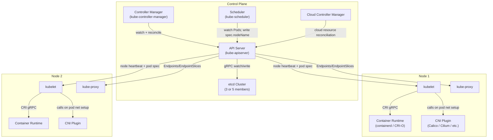
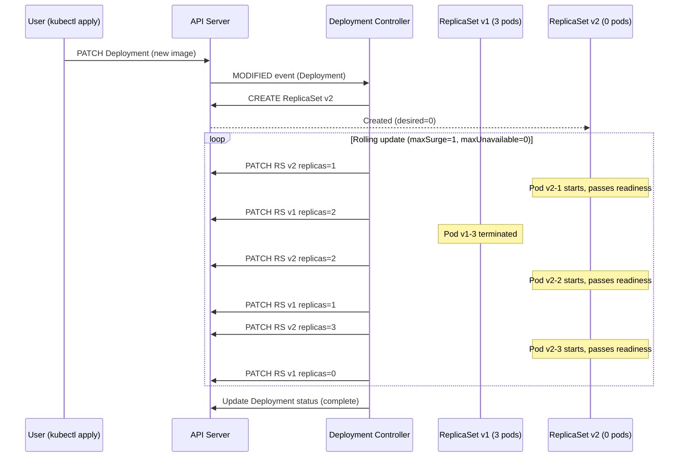
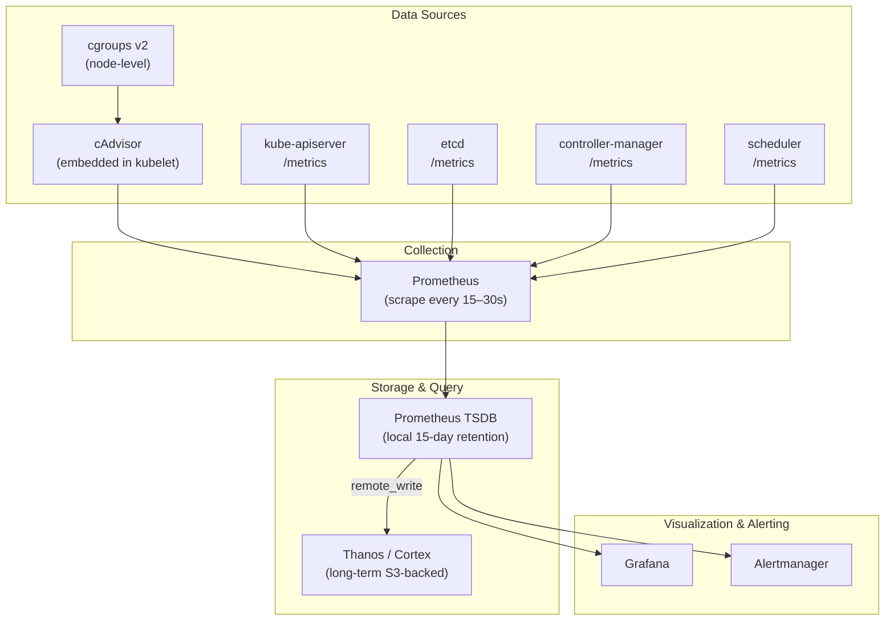

# Lesson 6: Kubernetes Operations and Maintenance

## 1. First-Principles Intuition & Invariants

Kubernetes (K8s) is a declarative control-plane operating system for distributed workloads. Its foundational abstraction is a **reconciliation loop**: every controller perpetually computes the delta between *desired state* (stored in etcd) and *observed state* (queried from the API server's informer cache), then emits the minimal set of API calls needed to close that gap. This architecture is not merely a design preference — it makes the system inherently self-healing and idempotent, properties that are non-negotiable in production environments where partial failures are the norm.

### The Distributed State Machine

The Kubernetes control plane is a deterministic state machine with a single write-ahead log: **etcd**. All state mutations flow through the API server, which serializes them into etcd using optimistic concurrency control. etcd implements the **Raft consensus algorithm**, which guarantees linearizability across a quorum of nodes. For a cluster of N etcd members, the write quorum is:

$$Q = \left\lfloor \frac{N}{2} \right\rfloor + 1$$

A 3-node etcd cluster tolerates one failure. A 5-node cluster tolerates two. Beyond 7 nodes, the latency cost of Raft leader confirmation becomes prohibitive relative to the marginal fault tolerance gained; production clusters almost universally run 3 or 5 etcd members.

**Multi-Version Concurrency Control (MVCC)** is the storage substrate beneath etcd's Raft log. Every write creates a new revision; older revisions remain queryable until compaction. Each key-value pair carries a monotonically increasing `resourceVersion` that the API server exposes on every Kubernetes object. Controllers use `resourceVersion` for optimistic locking: a `kubectl apply` that races against a concurrent mutation will return a `409 Conflict`, not silently overwrite the winning write. This prevents the "lost update" problem without requiring distributed locks. Compaction (triggered periodically via `--auto-compaction-retention`) purges historical revisions and reclaims disk; failing to compact an etcd cluster used for a busy Kubernetes workload is a common path to disk exhaustion and cluster destabilization.

### Watch Semantics and the Informer Pattern

Controllers do not poll the API server. They establish **long-lived HTTP/2 watch streams** against the API server, which multiplexes `ADDED`, `MODIFIED`, and `DELETED` events onto the connection. The API server translates etcd watch events (over gRPC) into these Kubernetes-typed events. If a watch connection drops, the client resumes with its last known `resourceVersion`; if that revision has been compacted away, the server returns an `HTTP 410 Gone`, forcing a full **relist** (a `GET` with `resourceVersion=0`).

The `client-go` informer framework wraps this into a `SharedIndexInformer`: a single watch per resource type per process, fanning out to multiple controllers via an in-memory thread-safe store. This architecture means 20 controllers watching `Pods` generate exactly one watch stream to the API server, not 20 — a critical scalability property at large cluster sizes.

### Linux Kernel Primitives: Namespaces and cgroups

Containers are not a kernel primitive; they are a composition of kernel mechanisms:

- **Namespaces** provide isolation: `pid` (process tree), `net` (network stack), `mnt` (filesystem mounts), `uts` (hostname), `ipc` (System V IPC and POSIX message queues), `user` (UID/GID remapping), and `cgroup` (cgroup root). A container's perceived isolation is entirely determined by which namespaces it shares with its peers.
- **cgroups v2** enforce resource accounting and limits. The critical controllers are `cpu` (enforces `cpu.max` = `quota/period`, corresponding to Kubernetes `cpu` limits), `memory` (enforces `memory.max`, corresponding to `memory` limits), and `blkio`/`io` (I/O throttling). When a container exceeds its `memory.max`, the kernel OOM killer terminates the cgroup's processes — the event visible in Kubernetes as `OOMKilled` in `kubectl describe pod`.
- **seccomp** filters the system call surface of a container using BPF programs. Kubernetes applies a default seccomp profile that blocks ~44 dangerous syscalls by default since v1.27.
- **Capabilities** fine-grain POSIX privilege. Running a container without `CAP_NET_RAW` prevents raw socket abuse while still allowing the process to bind privileged ports if the ambient capability set permits.

### The Pause Container (infra container)

Each Pod contains one `pause` container (image: `registry.k8s.io/pause:3.9`). Its source code is 50 lines of C: it creates a network namespace, optionally sets up PID namespace sharing, and then parks in `sigsuspend()` forever. Its sole purpose is to hold the network namespace and IPC namespace open for the lifetime of the Pod. When the application containers start, they join the pause container's `net` namespace via `nsenter`. This design means application containers can be restarted independently without tearing down the Pod's IP address — the network identity of a Pod is decoupled from the lifecycle of its application processes.

```c
// Simplified pause.c (actual source: kubernetes/build/pause/linux/pause.c)
#include <signal.h>
#include <stdio.h>
#include <stdlib.h>
#include <sys/types.h>
#include <sys/wait.h>
#include <unistd.h>

static void sigdown(int signo) {
    psignal(signo, "Shutting down, got signal");
    exit(0);
}

static void sigreap(int signo) {
    // Reap zombies: pause is PID 1 in the PID namespace and must
    // collect exit status of orphaned processes to prevent zombie accumulation.
    while (waitpid(-1, NULL, WNOHANG) > 0);
}

int main(void) {
    signal(SIGINT,  sigdown);
    signal(SIGTERM, sigdown);
    signal(SIGCHLD, sigreap);  // critical: PID 1 must reap children
    for (;;) pause();          // park; wake only on signal
    return 0;
}
```

---

## 2. Core Architecture & Mechanics



### API Server: Admission and Authorization Pipeline

Every mutating request to the API server traverses a strict pipeline before reaching etcd:

1. **Authentication**: validates the bearer token, client certificate, or webhook response. Maps the request to a user identity.
2. **Authorization**: evaluates RBAC `RoleBindings`/`ClusterRoleBindings` (or Node/ABAC/Webhook authorizers) against the user identity and the requested `{verb, resource, namespace}` tuple. Denial short-circuits immediately.
3. **Mutating Admission Webhooks**: external webhooks that may modify the object (e.g., injecting a sidecar container, appending labels, applying default values). Executed in registration order; any webhook can mutate the object.
4. **Object Schema Validation**: the resulting object is validated against the OpenAPI schema for the resource version.
5. **Validating Admission Webhooks**: external webhooks that may only approve or reject — no mutation permitted. Executed in parallel for latency efficiency.
6. **etcd write**: the final object is serialized (using protobuf for internal storage, not JSON), assigned a `resourceVersion`, and written.

The separation of mutating and validating phases is architecturally deliberate: a validator sees the final object after all mutations, so it can enforce invariants on the complete, post-mutation state rather than on potentially incomplete user input.

### etcd: Operational Reality

etcd is a CP system (in CAP terms): it prefers consistency over availability during partition. During a leader election (which follows a Raft quorum loss), the etcd cluster stops accepting writes for the duration of the election, typically 1–10 seconds. The API server queues or rejects write requests during this interval. This is not a bug — it is the correct behavior for a system whose correctness depends on linearizable writes.

Critical operational parameters:

| Parameter | Default | Production Recommendation |
|---|---|---|
| `--heartbeat-interval` | 100ms | 100–250ms on LAN |
| `--election-timeout` | 1000ms | 5× heartbeat minimum |
| `--quota-backend-bytes` | 2 GiB | 4–8 GiB for large clusters |
| `--auto-compaction-retention` | 0 (disabled) | `1h` (hourly) |
| `--snapshot-count` | 100,000 | 10,000 for high-churn clusters |

Disk I/O latency is the single most important hardware factor for etcd stability. The etcd project publishes that `wal_fsync_duration_seconds` p99 should remain below 10ms. NVMe SSDs are strongly preferred; network-attached storage (EBS `gp2`, NFS) is a known source of etcd instability due to I/O jitter. The `fio` benchmark for etcd disk suitability:

```bash
# Validate disk I/O suitability for etcd (run on the etcd data directory mount)
fio --rw=write --ioengine=sync --fdatasync=1 \
    --directory=/var/lib/etcd \
    --size=22m --bs=2300 \
    --name=etcd-disk-benchmark \
    --output-format=json | \
    python3 -c "
import json, sys
data = json.load(sys.stdin)
job = data['jobs'][0]
p99_fsync_ms = job['sync']['lat_ns']['percentile']['99.000000'] / 1e6
print(f'p99 fdatasync latency: {p99_fsync_ms:.2f}ms')
if p99_fsync_ms > 10:
    print('WARNING: Disk too slow for etcd. Expect leader elections under load.')
else:
    print('OK: Disk meets etcd latency requirements.')
"
```

### Scheduler: Filtering and Scoring

The scheduler's decision pipeline has two phases:

**Filtering** (formerly "Predicates"): eliminates nodes that cannot satisfy the Pod's hard requirements. Examples: `NodeResourcesFit` (sufficient CPU/memory), `NodeAffinity`, `PodAntiAffinity`, `TaintToleration`, `VolumeBinding` (PVC node affinity). A node failing any single filter is eliminated.

**Scoring** (formerly "Priorities"): ranks the remaining feasible nodes using a weighted sum of plugin scores, each in [0, 100]. Examples: `LeastAllocated` (prefer nodes with more free resources, spreading load), `NodeAffinity` (soft preference), `InterPodAffinity`, `ImageLocality` (prefer nodes that already have the container image cached). The node with the highest weighted score wins; ties are broken by round-robin to distribute equal-score candidates.

The scheduler is extensible via the **Scheduling Framework**: plugins implement well-defined extension points (`PreFilter`, `Filter`, `PostFilter`, `PreScore`, `Score`, `Reserve`, `Permit`, `PreBind`, `Bind`, `PostBind`). Custom schedulers are built by composing these plugins rather than forking the scheduler binary.

### kubelet: The Node Agent

The kubelet reconciles the set of Pods assigned to its node (`spec.nodeName == thisNode`) against the actual container state reported by the container runtime via the **Container Runtime Interface (CRI)**, a gRPC API defined in `k8s.io/cri-api`. The kubelet does not manipulate containers directly; it issues CRI calls (`RunPodSandbox`, `CreateContainer`, `StartContainer`, `StopContainer`, `RemovePodSandbox`) and the runtime (containerd, CRI-O) translates them into OCI `runc` invocations.

The kubelet's control loop:

```
syncLoop:
  for event in [podUpdates, fileWatcher, httpSource, livenessManager, readinessManager, ...]:
      syncPod(pod)

syncPod(pod):
  if pod.DeletionTimestamp != nil:
      terminatePod(pod)
      return
  ensureSandbox(pod)        // pause container + network namespace
  for container in pod.spec.containers:
      ensureContainer(container)   // start if not running
  updatePodStatus(pod)      // write back to API server
```

The kubelet also runs three probe types in parallel goroutines:
- **Liveness**: failure triggers container restart per `restartPolicy`.
- **Readiness**: failure removes the Pod's IP from the Service's EndpointSlice, stopping traffic without restarting the container.
- **Startup**: gates liveness/readiness probes until the container's slow-starting process has initialized; prevents premature restarts during initialization.

### kube-proxy and Service Networking

kube-proxy watches `Services` and `EndpointSlices` and programs the node's packet-forwarding rules. In `iptables` mode (the default), it creates `DNAT` rules in the `PREROUTING` and `OUTPUT` chains that rewrite the Service's ClusterIP to a randomly selected backend Pod IP. In `ipvs` mode, it uses the kernel's IP Virtual Server for O(1) connection dispatch instead of O(N) iptables rule traversal — critical at clusters with thousands of Services.

```
# iptables rule chain for a ClusterIP Service (simplified)
-A KUBE-SERVICES -d 10.96.0.1/32 -p tcp --dport 443 -j KUBE-SVC-<hash>
-A KUBE-SVC-<hash> -m statistic --mode random --probability 0.33 -j KUBE-SEP-<pod1>
-A KUBE-SVC-<hash> -m statistic --mode random --probability 0.50 -j KUBE-SEP-<pod2>
-A KUBE-SVC-<hash> -j KUBE-SEP-<pod3>
-A KUBE-SEP-<pod1> -p tcp -j DNAT --to-destination 192.168.1.10:8080
-A KUBE-SEP-<pod2> -p tcp -j DNAT --to-destination 192.168.1.11:8080
-A KUBE-SEP-<pod3> -p tcp -j DNAT --to-destination 192.168.1.12:8080
```

The fundamental limitation of kube-proxy's iptables implementation: every Service update requires a full rewrite of the entire iptables ruleset for that node (iptables is not incrementally patchable in kernels before 5.x `nftables`). At 10,000+ Services, this rewrite can take seconds and causes connection drops. The migration path is `--proxy-mode=ipvs` or replacing kube-proxy entirely with Cilium's eBPF dataplane.

---

## 3. Workload Management and Rolling Updates

### Deployment Rollout Mechanics

A `Deployment` controller manages a set of `ReplicaSets`. Each unique `pod template` hash maps to exactly one `ReplicaSet`. A rolling update creates a new `ReplicaSet` and simultaneously scales it up and the old one down, subject to two parameters:

- `maxUnavailable`: the maximum number (or percentage) of Pods that can be unavailable during the rollout. Setting this to `0` means the new ReplicaSet must have running Pods before any old ones are removed.
- `maxSurge`: the maximum number of Pods that can exist above the `replicas` count. Setting this to `0` prevents any additional Pod capacity during rollout.

The invariant maintained throughout the rollout:

$$\text{available replicas} \geq \text{replicas} - \text{maxUnavailable}$$
$$\text{total replicas} \leq \text{replicas} + \text{maxSurge}$$



A rollout stalls and the `Progressing` condition transitions to `False` if the deadline (`progressDeadlineSeconds`, default 600s) expires before completion. This triggers a `DeadlineExceeded` reason, which is the signal to alert on in production — it means pods are crashing, failing readiness, or the cluster is under-resourced.

### Horizontal Pod Autoscaler (HPA) Internals

The HPA controller queries the metrics API (`metrics.k8s.io` for resource metrics, `custom.metrics.k8s.io` for custom metrics) every 15 seconds (configurable via `--horizontal-pod-autoscaler-sync-period`). The desired replica count is computed as:

$$\text{desiredReplicas} = \left\lceil \text{currentReplicas} \times \frac{\text{currentMetricValue}}{\text{desiredMetricValue}} \right\rceil$$

Oscillation is prevented by a stabilization window: scale-down decisions are deferred for `stabilizationWindowSeconds` (default 300s) after the last scale-up event. Scale-up has no stabilization window by default — it reacts immediately to avoid capacity shortage.

```yaml
apiVersion: autoscaling/v2
kind: HorizontalPodAutoscaler
metadata:
  name: api-server-hpa
  namespace: production
spec:
  scaleTargetRef:
    apiVersion: apps/v1
    kind: Deployment
    name: api-server
  minReplicas: 3
  maxReplicas: 50
  metrics:
  - type: Resource
    resource:
      name: cpu
      target:
        type: Utilization
        averageUtilization: 70
  - type: Pods
    pods:
      metric:
        name: http_requests_per_second   # requires custom metrics adapter
      target:
        type: AverageValue
        averageValue: "1000"
  behavior:
    scaleUp:
      stabilizationWindowSeconds: 0     # react immediately to load spikes
      policies:
      - type: Percent
        value: 100
        periodSeconds: 60               # at most double every 60s
    scaleDown:
      stabilizationWindowSeconds: 300   # wait 5 min before scaling down
      policies:
      - type: Pods
        value: 2
        periodSeconds: 60               # remove at most 2 pods per minute
```

---

## 4. High-Performance Optimization and Failure Modes

### Resource Requests, Limits, and QoS Classes

Kubernetes assigns each Pod a **Quality of Service class** based on its resource declarations, which determines eviction priority under memory pressure:

| QoS Class | Condition | OOM Score Adjustment | Eviction Priority |
|---|---|---|---|
| `Guaranteed` | All containers have `requests == limits` for CPU and memory | -997 (last to be killed) | Lowest |
| `Burstable` | At least one container has a `request` or `limit` | Scaled between 2–999 | Medium |
| `BestEffort` | No container has any resource declaration | 1000 (first to be killed) | Highest |

The OOM score adjustment maps directly to the Linux kernel's `/proc/<pid>/oom_score_adj`. When the node's memory is exhausted, the OOM killer selects the process with the highest `oom_score` (which is `oom_score_adj` + a badness heuristic based on memory usage). `Guaranteed` pods receive `-997`, making them nearly immune to OOM eviction except by the kubelet's own eviction manager.

**CPU throttling** is a subtle and pervasive performance issue. CPU `limits` are enforced by the cgroup CFS scheduler using `cpu.cfs_quota_us` / `cpu.cfs_period_us`. If a container's quota is exhausted within a 100ms period, it is throttled for the remainder of that period even if the node has idle CPU. This manifests as p99 latency spikes that do not appear in CPU utilization metrics. The correct diagnostic is `container_cpu_cfs_throttled_seconds_total` in Prometheus. The mitigation strategies are: (a) remove CPU limits entirely for latency-sensitive workloads and rely on node-level resource guarantees, (b) set CPU requests equal to limits (`Guaranteed` QoS), or (c) use cgroups v2 with `cpu.weight`-based scheduling instead of hard quota throttling.

### Production-Grade Resource Configuration

```yaml
apiVersion: apps/v1
kind: Deployment
metadata:
  name: latency-sensitive-api
  namespace: production
spec:
  replicas: 5
  selector:
    matchLabels:
      app: latency-sensitive-api
  template:
    metadata:
      labels:
        app: latency-sensitive-api
    spec:
      # Ensure pods land on dedicated nodes to avoid noisy-neighbor effects
      affinity:
        nodeAffinity:
          requiredDuringSchedulingIgnoredDuringExecution:
            nodeSelectorTerms:
            - matchExpressions:
              - key: node-role.kubernetes.io/compute
                operator: In
                values: ["dedicated"]
        # Spread pods across failure domains
        podAntiAffinity:
          requiredDuringSchedulingIgnoredDuringExecution:
          - labelSelector:
              matchLabels:
                app: latency-sensitive-api
            topologyKey: topology.kubernetes.io/zone
      # Prevent multiple pods on the same physical node
      topologySpreadConstraints:
      - maxSkew: 1
        topologyKey: kubernetes.io/hostname
        whenUnsatisfiable: DoNotSchedule
        labelSelector:
          matchLabels:
            app: latency-sensitive-api
      containers:
      - name: api
        image: registry.example.com/api:v2.3.1@sha256:abc123...  # pin by digest
        ports:
        - containerPort: 8080
          protocol: TCP
        resources:
          requests:
            cpu: "2"
            memory: "4Gi"
          limits:
            # CPU limit intentionally omitted to prevent CFS throttling
            memory: "4Gi"   # requests == limits for memory => Guaranteed on memory axis
        readinessProbe:
          httpGet:
            path: /healthz/ready
            port: 8080
          initialDelaySeconds: 5
          periodSeconds: 5
          failureThreshold: 3
          successThreshold: 1
        livenessProbe:
          httpGet:
            path: /healthz/live
            port: 8080
          initialDelaySeconds: 15
          periodSeconds: 10
          failureThreshold: 3
        startupProbe:
          httpGet:
            path: /healthz/startup
            port: 8080
          failureThreshold: 30   # 30 × 10s = 5 min startup budget
          periodSeconds: 10
        # Graceful shutdown: drain in-flight requests before SIGKILL
        lifecycle:
          preStop:
            exec:
              command: ["/bin/sh", "-c", "sleep 5"]  # allow LB to deregister before quitting
        terminationMessagePolicy: FallbackToLogsOnError
      terminationGracePeriodSeconds: 60
      # Prevent disruption from node-level preemption
      priorityClassName: high-priority
```

### Common Failure Modes and Diagnostic Runbook

**Failure Mode 1: CrashLoopBackOff**

The kubelet applies an exponential backoff (10s → 20s → 40s → … → 300s max) to container restarts. The backoff resets after 10 minutes of successful running. `CrashLoopBackOff` does not indicate a Kubernetes problem — it indicates the application is exiting non-zero or being killed. The diagnostic sequence:

```bash
# 1. Inspect the exit code and reason
kubectl describe pod <pod-name> -n <namespace>
# Look for: Last State, Exit Code, Reason (OOMKilled vs Error)

# 2. Read logs from the previous (crashed) container instance
kubectl logs <pod-name> -n <namespace> --previous

# 3. If the container exits too fast for logs, override the entrypoint to keep it alive
kubectl debug <pod-name> -n <namespace> \
    --image=registry.example.com/api:v2.3.1 \
    --copy-to=debug-pod \
    -- /bin/sh

# 4. Check OOM events at node level (requires node access)
# dmesg will show the OOM kill with the process name and amount of memory
ssh <node-ip> "dmesg | grep -i 'oom\|kill' | tail -20"
```

**Failure Mode 2: Pending Pod (Unschedulable)**

```bash
# Inspect scheduling failure reason
kubectl describe pod <pod-name> -n <namespace>
# Events section: "0/5 nodes available: 2 Insufficient cpu, 3 node(s) had taint..."

# Check actual allocatable resources vs requested
kubectl get nodes -o custom-columns=\
"NAME:.metadata.name,\
ALLOC-CPU:.status.allocatable.cpu,\
ALLOC-MEM:.status.allocatable.memory"

# Identify which pods are consuming the most resources on a specific node
kubectl describe node <node-name> | grep -A 20 "Allocated resources"

# Check for taints preventing scheduling
kubectl get nodes -o json | \
    python3 -c "
import json, sys
nodes = json.load(sys.stdin)
for n in nodes['items']:
    taints = n['spec'].get('taints', [])
    if taints:
        print(n['metadata']['name'], taints)
"
```

**Failure Mode 3: Service Endpoint Not Reachable**

This failure has three distinct root causes with different diagnostics:

```bash
# 1. Verify the Service selector matches the Pod labels exactly
kubectl get svc <svc-name> -n <namespace> -o yaml | grep -A 5 selector
kubectl get pods -n <namespace> -l <selector-key>=<selector-value>

# 2. Verify EndpointSlices are populated
kubectl get endpointslices -n <namespace> -l kubernetes.io/service-name=<svc-name>
# If empty: pods exist but are not Ready (failed readinessProbe)

# 3. Check kube-proxy iptables rules on a node (iptables mode)
ssh <node-ip> "iptables -t nat -L KUBE-SERVICES -n | grep <cluster-ip>"

# 4. Test DNS resolution from within the cluster
kubectl run -it --rm dns-test \
    --image=gcr.io/google-containers/busybox:1.27 \
    --restart=Never \
    -- nslookup <svc-name>.<namespace>.svc.cluster.local

# 5. Test direct pod-to-pod connectivity bypassing the Service
kubectl exec -n <namespace> <source-pod> -- \
    curl -v --connect-timeout 5 http://<target-pod-ip>:<port>/
```

**Failure Mode 4: etcd Quorum Loss**

This is the most severe failure mode: the control plane stops accepting writes.

```bash
# Check etcd member health from within the cluster
kubectl -n kube-system exec etcd-<node-name> -- \
    etcdctl member list \
    --endpoints=https://127.0.0.1:2379 \
    --cacert=/etc/kubernetes/pki/etcd/ca.crt \
    --cert=/etc/kubernetes/pki/etcd/healthcheck-client.crt \
    --key=/etc/kubernetes/pki/etcd/healthcheck-client.key

# Check alarm state (NOSPACE alarm will prevent all writes)
kubectl -n kube-system exec etcd-<node-name> -- \
    etcdctl alarm list \
    --endpoints=https://127.0.0.1:2379 \
    --cacert=/etc/kubernetes/pki/etcd/ca.crt \
    --cert=/etc/kubernetes/pki/etcd/healthcheck-client.crt \
    --key=/etc/kubernetes/pki/etcd/healthcheck-client.key

# If NOSPACE alarm: compact, defrag, then disarm
# Step 1: get latest revision
REV=$(etcdctl endpoint status --write-out=fields | grep Revision | awk '{print $NF}')
# Step 2: compact to current revision
etcdctl compact $REV ...
# Step 3: defragment all members (do one at a time to avoid quorum loss)
etcdctl defrag --endpoints=https://<member-ip>:2379 ...
# Step 4: disarm alarm
etcdctl alarm disarm ...
```

### Network Performance: CNI Plugin Architecture

```mermaid
graph LR
    subgraph sub_pod_a__node_1 ["Pod A (Node 1)"]
        APP_A["App Container\nveth0: 192.168.1.10"]
    end

    subgraph sub_node_1_kernel ["Node 1 Kernel"]
        VETH_A["veth pair\n(host end: cali1234)"]
        BRIDGE_A["Linux Bridge\nor eBPF hook"]
        ETH0_A["eth0: 10.0.1.1"]
    end

    subgraph sub_underlay_network ["Underlay Network"]
        ROUTER["Physical Router\nor VXLAN Overlay"]
    end

    subgraph sub_node_2_kernel ["Node 2 Kernel"]
        ETH0_B["eth0: 10.0.2.1"]
        BRIDGE_B["Linux Bridge\nor eBPF hook"]
        VETH_B["veth pair\n(host end: cali5678)"]
    end

    subgraph sub_pod_b__node_2 ["Pod B (Node 2)"]
        APP_B["App Container\nveth0: 192.168.2.20"]
    end

    APP_A -->|"L2 frame"| VETH_A
    VETH_A --> BRIDGE_A
    BRIDGE_A -->|"routed or encapsulated"| ETH0_A
    ETH0_A --> ROUTER
    ROUTER --> ETH0_B
    ETH0_B --> BRIDGE_B
    BRIDGE_B --> VETH_B
    VETH_B --> APP_B
```



CNI plugins divide into two architectural families:

**Overlay (encapsulation)**: VXLAN or IP-in-IP tunnels encapsulate Pod traffic in the node's underlay network frames. No underlay routing changes are needed. Flannel (VXLAN mode), Calico (VXLAN mode), and Weave operate this way. Overhead: 50 bytes of VXLAN header per packet, reducing effective MTU to 1450 for a 1500-byte Ethernet network. Failing to set `--cluster-cidr` MTU correctly causes silent packet fragmentation and throughput collapse.

**Underlay (BGP routing)**: Calico (BGP mode) and Cilium (native routing) advertise Pod CIDR routes directly into the underlay routing fabric using BGP or the cloud provider's routing API. No encapsulation overhead. Requires that the underlay network can carry the Pod CIDR routes — not always possible in cloud environments without VPC route injection.

**Cilium / eBPF**: replaces kube-proxy and the CNI veth/bridge path with eBPF programs attached at the TC (Traffic Control) hook of each veth. This eliminates the iptables traversal and the in-kernel bridge entirely. At 100,000+ connections per second, the latency difference between iptables kube-proxy and Cilium eBPF is measurable in microseconds per packet.

---

## 5. Observability: Metrics, Logging, and Tracing

### The Kubernetes Metrics Pipeline



The critical Kubernetes metrics to monitor in production:

```promql
# API server request latency (p99) by verb and resource
histogram_quantile(0.99,
  sum(rate(apiserver_request_duration_seconds_bucket{
    job="kube-apiserver"
  }[5m])) by (le, verb, resource)
)

# etcd write latency p99 — alert if > 100ms
histogram_quantile(0.99,
  rate(etcd_disk_backend_commit_duration_seconds_bucket[5m])
)

# Controller work queue depth — alert if growing unbounded
sum(workqueue_depth{job="kube-controller-manager"}) by (name)

# CPU throttling ratio per container — alert if > 25%
sum(rate(container_cpu_cfs_throttled_seconds_total[5m])) by (pod, container, namespace)
  /
sum(rate(container_cpu_cfs_periods_total[5m])) by (pod, container, namespace)

# Pod restart rate — alert if > 0.1/min for a stable deployment
rate(kube_pod_container_status_restarts_total[5m]) * 60

# Scheduler scheduling latency p99
histogram_quantile(0.99,
  rate(scheduler_scheduling_attempt_duration_seconds_bucket{result="scheduled"}[5m])
)

# etcd DB size approaching quota (alert at 80%)
etcd_mvcc_db_total_size_in_bytes / (8 * 1024 * 1024 * 1024)
```

### Structured Logging and Distributed Tracing

Production Kubernetes clusters generate structured JSON logs at every layer. The recommended pipeline is **node-level log collection** (DaemonSet-deployed Fluentd or Fluent Bit) shipping to a centralized backend (OpenSearch, Loki, Splunk). Log collection via sidecar containers is wasteful: it doubles the disk I/O and the container count.

For distributed tracing across microservices, the OpenTelemetry SDK instruments application code to emit spans. The Kubernetes API server itself emits traces since v1.22 (via `--tracing-config-file`), which allows correlating user request latency with underlying etcd operations.

```python
# Production-grade structured logging in a Python Kubernetes operator
import logging
import json
import sys
from datetime import datetime, timezone
from kubernetes import client, watch, config

class StructuredLogger(logging.LoggerAdapter):
    """Logger adapter that emits JSON for log aggregation systems."""
    def process(self, msg, kwargs):
        extra = kwargs.get("extra", {})
        record = {
            "timestamp": datetime.now(timezone.utc).isoformat(),
            "level": kwargs.get("level", "INFO"),
            "message": msg,
            "component": "my-operator",
            **extra
        }
        return json.dumps(record), kwargs

logger = StructuredLogger(logging.getLogger(__name__), {})

def watch_deployments(namespace: str) -> None:
    """Watch Deployment events and reconcile continuously."""
    config.load_incluster_config()   # uses ServiceAccount token at runtime
    apps_v1 = client.AppsV1Api()
    w = watch.Watch()

    for event in w.stream(
        apps_v1.list_namespaced_deployment,
        namespace=namespace,
        timeout_seconds=0,   # indefinite watch; reconnects on 410 Gone
    ):
        event_type = event["type"]
        deploy = event["object"]
        name = deploy.metadata.name
        generation = deploy.metadata.generation
        observed_gen = deploy.status.observed_generation

        logger.info(
            "Reconciling deployment",
            extra={
                "event_type": event_type,
                "deployment": name,
                "namespace": namespace,
                "generation": generation,
                "observed_generation": observed_gen,
                "resource_version": deploy.metadata.resource_version,
            }
        )

        if generation != observed_gen:
            logger.warning(
                "Deployment controller lag detected",
                extra={
                    "deployment": name,
                    "lag_generations": generation - (observed_gen or 0),
                }
            )
```

---

## 6. Security Hardening

### Pod Security Standards

Kubernetes v1.25 deprecated PodSecurityPolicy in favor of **Pod Security Standards (PSS)**, enforced at the namespace level by the built-in admission controller. Three levels are defined:

- **Privileged**: no restrictions. Appropriate for system namespaces (`kube-system`) where node-level access is required.
- **Baseline**: prevents the most obviously dangerous configurations (host namespaces, privileged containers, hostPath mounts of sensitive paths). Appropriate for general workloads.
- **Restricted**: follows Pod hardening best practices (no privilege escalation, dropped `ALL` capabilities, non-root user, read-only root filesystem, seccomp profile required). Appropriate for untrusted or multi-tenant workloads.

```yaml
# Enforce restricted PSS on a namespace
apiVersion: v1
kind: Namespace
metadata:
  name: production
  labels:
    # Enforce: reject non-compliant pods
    pod-security.kubernetes.io/enforce: restricted
    pod-security.kubernetes.io/enforce-version: v1.28
    # Audit: log policy violations without rejecting
    pod-security.kubernetes.io/audit: restricted
    pod-security.kubernetes.io/audit-version: v1.28
    # Warn: surface warnings to kubectl users
    pod-security.kubernetes.io/warn: restricted
    pod-security.kubernetes.io/warn-version: v1.28
```

```yaml
# A Pod spec compliant with the 'restricted' PSS
apiVersion: v1
kind: Pod
metadata:
  name: restricted-compliant-pod
  namespace: production
spec:
  securityContext:
    runAsNonRoot: true
    runAsUser: 10001
    runAsGroup: 10001
    fsGroup: 10001
    seccompProfile:
      type: RuntimeDefault   # required by restricted PSS
  containers:
  - name: app
    image: registry.example.com/app:v1.0.0@sha256:deadbeef...
    securityContext:
      allowPrivilegeEscalation: false
      readOnlyRootFilesystem: true
      capabilities:
        drop: ["ALL"]   # drop all Linux capabilities
    volumeMounts:
    - name: tmp
      mountPath: /tmp           # writable scratch space since rootfs is read-only
    - name: cache
      mountPath: /var/cache/app
  volumes:
  - name: tmp
    emptyDir: {}
  - name: cache
    emptyDir: {}
```

### RBAC Least-Privilege Design

```yaml
# A well-scoped ServiceAccount for a Deployment controller operator
apiVersion: v1
kind: ServiceAccount
metadata:
  name: deployment-operator
  namespace: operators
  annotations:
    # For cloud IAM federation (AWS IRSA, GCP Workload Identity)
    eks.amazonaws.com/role-arn: arn:aws:iam::123456789:role/deployment-operator
---
apiVersion: rbac.authorization.k8s.io/v1
kind: ClusterRole
metadata:
  name: deployment-operator
rules:
# Read Deployments across all namespaces
- apiGroups: ["apps"]
  resources: ["deployments"]
  verbs: ["get", "list", "watch", "update", "patch"]
# Read ReplicaSets (needed to track rollout progress)
- apiGroups: ["apps"]
  resources: ["replicasets"]
  verbs: ["get", "list", "watch"]
# Write events for observability
- apiGroups: [""]
  resources: ["events"]
  verbs: ["create", "patch"]
# Explicitly deny everything not listed (RBAC is additive, but document intent)
---
apiVersion: rbac.authorization.k8s.io/v1
kind: ClusterRoleBinding
metadata:
  name: deployment-operator
roleRef:
  apiGroup: rbac.authorization.k8s.io
  kind: ClusterRole
  name: deployment-operator
subjects:
- kind: ServiceAccount
  name: deployment-operator
  namespace: operators
```

### Network Policies

By default, all Pods in a Kubernetes cluster can communicate with all other Pods. Network policies are only enforced if the CNI plugin supports them (Calico, Cilium, Weave Net — but not Flannel without an overlay). A missing default-deny policy is a common lateral movement vector.

```yaml
# Default deny-all ingress and egress for a namespace
apiVersion: networking.k8s.io/v1
kind: NetworkPolicy
metadata:
  name: default-deny-all
  namespace: production
spec:
  podSelector: {}      # applies to ALL pods in namespace
  policyTypes:
  - Ingress
  - Egress
---
# Allow ingress only from the ingress controller namespace
apiVersion: networking.k8s.io/v1
kind: NetworkPolicy
metadata:
  name: allow-ingress-controller
  namespace: production
spec:
  podSelector:
    matchLabels:
      app: api-server
  policyTypes:
  - Ingress
  ingress:
  - from:
    - namespaceSelector:
        matchLabels:
          kubernetes.io/metadata.name: ingress-nginx
    ports:
    - protocol: TCP
      port: 8080
---
# Allow egress to DNS and internal services only
apiVersion: networking.k8s.io/v1
kind: NetworkPolicy
metadata:
  name: allow-egress-dns-and-db
  namespace: production
spec:
  podSelector:
    matchLabels:
      app: api-server
  policyTypes:
  - Egress
  egress:
  # CoreDNS
  - ports:
    - protocol: UDP
      port: 53
    - protocol: TCP
      port: 53
  # PostgreSQL in same namespace
  - to:
    - podSelector:
        matchLabels:
          app: postgres
    ports:
    - protocol: TCP
      port: 5432
```

---

## 7. Cluster Maintenance Operations

### Node Drain and Cordon

Draining a node evicts all Pods gracefully, respecting `PodDisruptionBudgets` (PDBs) and `terminationGracePeriodSeconds`. The correct maintenance sequence:

```bash
# 1. Cordon: mark node unschedulable (no new pods will land here)
kubectl cordon <node-name>

# 2. Drain: evict all pods (except DaemonSet pods, which are undrainable by design)
kubectl drain <node-name> \
    --ignore-daemonsets \             # skip DaemonSet-managed pods (expected)
    --delete-emptydir-data \          # allow eviction of pods using emptyDir volumes
    --grace-period=120 \              # override pod terminationGracePeriodSeconds
    --timeout=5m                      # fail if drain takes more than 5 minutes

# 3. Perform maintenance (OS patching, kernel upgrade, hardware replacement)
# ...

# 4. Uncordon: re-enable scheduling on the node
kubectl uncordon <node-name>
```

If `kubectl drain` hangs, it is because a PDB is blocking eviction (the eviction would bring available replicas below `minAvailable`). This is the PDB working correctly — the resolution is to understand *which* PDB is blocking and whether the workload has sufficient replicas elsewhere.

```bash
# Identify PDB violations blocking drain
kubectl get pdb -A
# If minAvailable=1 and only 1 replica exists, drain is correctly blocked.
# Resolution: scale the deployment up first, then drain.
kubectl scale deployment <name> -n <namespace> --replicas=3
```

### PodDisruptionBudget Design

```yaml
apiVersion: policy/v1
kind: PodDisruptionBudget
metadata:
  name: api-server-pdb
  namespace: production
spec:
  # Either minAvailable or maxUnavailable, not both.
  # minAvailable: "50%" means at least 50% of pods must be running during disruption.
  # maxUnavailable: 1 means at most 1 pod can be unavailable at a time.
  minAvailable: "50%"
  selector:
    matchLabels:
      app: api-server
  # unhealthyPodEvictionPolicy (k8s >= 1.26):
  # AlwaysAllow: allow eviction even if the pod is already unhealthy.
  # This prevents a single unhealthy pod from blocking all maintenance.
  unhealthyPodEvictionPolicy: AlwaysAllow
```

A PDB with `minAvailable: 1` on a Deployment with `replicas: 1` makes the node undrained — this is a surprisingly common misconfiguration that blocks cluster upgrades. Always ensure `replicas > minAvailable` for PDB-protected workloads.

### Cluster Upgrade Strategy

Kubernetes guarantees N-2 version skew between `kube-apiserver` and `kubelet`. A cluster on v1.28 can have nodes running v1.26, v1.27, or v1.28 — but not v1.25. The upgrade sequence for a managed control plane (EKS, GKE, AKS):

```
1. Upgrade control plane (API server, controller-manager, scheduler, etcd)
   → managed via cloud provider CLI or Cluster API
   → verify: kubectl version --short

2. Upgrade node groups (one node group at a time, one node at a time within a group)
   → cordon, drain, upgrade kubelet/kube-proxy, uncordon
   → or use managed node group rolling update

3. Update cluster add-ons (CoreDNS, kube-proxy, CNI plugin, CSI drivers)
   → these must match the target Kubernetes version range
```

For self-managed clusters, `kubeadm upgrade` automates steps 1 and partially 2:

```bash
# On the first control plane node:
kubeadm upgrade plan v1.29.0          # dry-run: shows what will be upgraded
kubeadm upgrade apply v1.29.0         # applies control plane upgrade

# Then on each worker node:
kubectl drain <node> --ignore-daemonsets --delete-emptydir-data
ssh <node> "apt-get install -y kubelet=1.29.0-00 kubectl=1.29.0-00 && \
            systemctl daemon-reload && systemctl restart kubelet"
kubectl uncordon <node>
```

---

## 8. Summary: Kubernetes Operational Mental Model

Kubernetes operational competence requires internalizing a small set of invariants and their implications:

The control plane is eventually consistent. The API server never directly commands a node; it updates desired state in etcd and controllers converge toward it asynchronously. This means that immediately after a `kubectl apply`, the actual state may not match the desired state — convergence takes seconds to minutes depending on probe intervals, image pull time, and scheduler latency.

The kubelet is authoritative for the node. If the kubelet disagrees with the API server about a Pod's desired state, the kubelet wins for local container operations. The API server's view of Pod status is a report from the kubelet, not ground truth.

Resource requests drive scheduling; resource limits drive enforcement. A Pod's `requests` are what the scheduler uses to place the Pod. A Pod can consume more than its `requests` up to its `limits` (or beyond on a `BestEffort` node). The practical implication: a cluster can be "fully scheduled" (sum of requests equals node allocatable capacity) while nodes are actually underutilized, because workloads are running below their request levels.

etcd is the single point of serialization. All writes are serialized through etcd. API server horizontal scaling improves read throughput (via the informer cache) and admission pipeline parallelism, but write throughput is bounded by etcd's fsync latency × write quorum round-trip.

Network policy is opt-in, not opt-out. Pods are fully reachable by default. Hardening requires explicit NetworkPolicy objects and a CNI plugin that enforces them — two independent requirements that are both frequently missed.

Understanding these five invariants resolves the majority of Kubernetes operational questions from first principles, without requiring memorization of specific symptoms or remediation steps.
