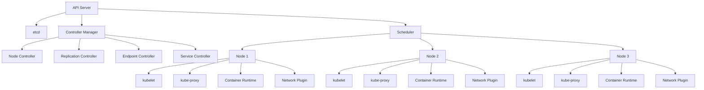

# Lesson 6: Kubernetes Operations and Maintenance

## 1. First-Principles Intuition & Invariants

Kubernetes, often referred to as K8s, is a powerful open-source platform designed for automating deployment, scaling, and operations of containerized applications. At its core, Kubernetes operates as a declarative state machine, continuously reconciling the desired state of a cluster with its actual state. This reconciliation process is driven by a series of controllers that monitor the cluster's state and take corrective actions to ensure that the desired state is achieved. The desired state is defined through a set of resources, such as Pods, Deployments, Services, and ConfigMaps, which are expressed in YAML or JSON format.

The heart of Kubernetes lies in its etcd distributed key-value store, which serves as the single source of truth for the cluster's state. Etcd is a critical component of Kubernetes, providing a reliable and consistent data store that is used by all controllers to store and retrieve configuration data. Etcd employs the Raft consensus algorithm to ensure that the data is replicated across multiple nodes, providing fault tolerance and high availability. The Raft algorithm operates with a quorum of nodes, where $Q = \lfloor N/2 \rfloor + 1$, ensuring that a majority of nodes must agree on a change before it is committed to the store. This quorum mechanism is crucial for maintaining consistency and preventing data loss in the event of node failures.

Multi-Version Concurrency Control (MVCC) is another key feature of etcd, enabling it to handle concurrent updates to the data store. MVCC maintains a monotonic revision number for each change, allowing clients to read the state of the store at any point in time. This feature is particularly useful for debugging and auditing purposes, as it provides a complete history of changes to the cluster's state.

Kubernetes also leverages Linux container runtimes, such as containerd or CRI-O, to manage the lifecycle of containers. These runtimes are responsible for creating, starting, and stopping containers, as well as managing their resource allocation and isolation. Containers are isolated from each other using Linux namespaces, which provide a mechanism for isolating the process tree, network interfaces, and other system resources. Additionally, cgroups are used to enforce resource limits, such as CPU and memory usage, ensuring that containers do not consume excessive resources and impact the performance of other workloads.

The infra/pause container is a critical component of Kubernetes, serving as a shared network namespace for all containers in a Pod. This container is responsible for setting up the network interfaces and IP addresses for the Pod, allowing the other containers to communicate with each other and with external services. The pause container is lightweight and does not run any application code, but it plays a vital role in the networking and isolation of containers within a Pod.

## 2. Core Architecture & Mechanics

The architecture of Kubernetes is built around a set of core components that work together to manage the lifecycle of containerized applications. The control plane is responsible for managing the cluster's state and scheduling workloads across the nodes. The control plane consists of several key components, including the API server, etcd, controller manager, and scheduler.

The API server is the primary entry point for all interactions with the Kubernetes cluster. It exposes a RESTful API that allows clients to create, update, and delete resources. The API server is responsible for validating and authorizing requests, as well as maintaining the consistency of the cluster's state. It communicates with etcd to store and retrieve configuration data, and it interacts with the controller manager and scheduler to manage the lifecycle of resources.

The controller manager is responsible for running a set of controllers that monitor the cluster's state and take corrective actions to ensure that the desired state is achieved. These controllers include the Node Controller, Replication Controller, Endpoint Controller, and Service Controller, among others. Each controller is responsible for a specific aspect of the cluster's state, such as ensuring that the correct number of replicas of a Deployment are running or that the endpoints for a Service are up-to-date.

The scheduler is responsible for assigning workloads to nodes in the cluster. It takes into account a variety of factors, such as resource availability, node labels, and affinity rules, to determine the optimal placement of workloads. The scheduler uses a set of algorithms and heuristics to make these decisions, ensuring that workloads are distributed evenly across the nodes and that resource constraints are respected.

The node components are responsible for running the workloads assigned to them by the scheduler. Each node runs a set of key components, including the kubelet, kube-proxy, container runtime, and network plugin. The kubelet is responsible for managing the lifecycle of containers on the node, ensuring that they are started, stopped, and monitored as needed. The kube-proxy is responsible for setting up network rules and load balancing for Services, allowing them to be accessed by clients.

The following diagram illustrates the core architecture of Kubernetes, highlighting the key components and their interactions:

## 3. High-Performance Optimization & Failure Modes

Kubernetes is designed to handle large-scale, high-performance workloads, but achieving optimal performance requires careful tuning and optimization. One of the key factors in Kubernetes performance is resource allocation and scheduling. The scheduler is responsible for assigning workloads to nodes, taking into account resource availability, node labels, and affinity rules. To optimize performance, it is important to configure the scheduler with appropriate resource requests and limits, as well as to use affinity and anti-affinity rules to ensure that workloads are distributed evenly across the nodes.

Another important factor in Kubernetes performance is network latency and throughput. Kubernetes uses a set of network plugins, such as Calico or Flannel, to provide network connectivity for Pods. These plugins are responsible for setting up network interfaces and IP addresses for Pods, as well as for configuring network policies and load balancing. To optimize network performance, it is important to choose a network plugin that is well-suited to the workload and to configure it with appropriate settings, such as MTU size and IP address allocation.

Kubernetes also provides a set of tools and features for monitoring and logging, which are essential for troubleshooting and maintaining the cluster. The Kubernetes dashboard provides a web-based interface for monitoring the cluster's state and resources, allowing administrators to view metrics and logs for individual Pods and Services. Additionally, Kubernetes integrates with a variety of logging and monitoring tools, such as Prometheus, Grafana, and ELK Stack, allowing administrators to collect and analyze metrics and logs from the cluster.

Troubleshooting Kubernetes clusters can be challenging, as there are many moving parts and components that can fail or misbehave. One common issue is resource contention, where workloads consume excessive resources and impact the performance of other workloads. To troubleshoot resource contention, it is important to use tools such as `kubectl top` and `kubectl describe` to monitor resource usage and identify workloads that are consuming excessive resources.

Another common issue is network connectivity problems, where Pods are unable to communicate with each other or with external services. To troubleshoot network connectivity problems, it is important to use tools such as `kubectl exec` and `kubectl logs` to inspect the network configuration and logs for individual Pods. Additionally, it is important to use network diagnostic tools, such as `ping` and `traceroute`, to identify network issues and determine the root cause.

In addition to these operational tasks, Kubernetes provides a set of features and best practices for maintaining the cluster's health and reliability. One important feature is rolling updates, which allow administrators to update workloads without downtime. Rolling updates are achieved by gradually replacing old replicas with new replicas, ensuring that the workload remains available throughout the update process. Another important feature is self-healing, which allows Kubernetes to automatically recover from failures and maintain the desired state of the cluster. Self-healing is achieved through a set of controllers that monitor the cluster's state and take corrective actions to ensure that the desired state is achieved.

In conclusion, Kubernetes is a powerful platform for automating the deployment, scaling, and operations of containerized applications. Its core architecture is built around a set of controllers and components that work together to manage the cluster's state and schedule workloads across the nodes. To achieve optimal performance and reliability, it is important to configure the scheduler with appropriate resource requests and limits, optimize network performance, and use monitoring and logging tools to troubleshoot and maintain the cluster. By understanding the underlying architecture and mechanics of Kubernetes, administrators can effectively manage and maintain their clusters, ensuring that they are reliable, scalable, and performant.
