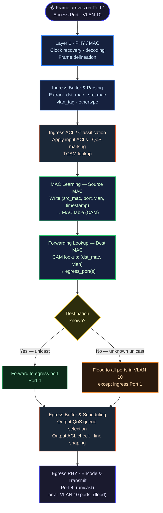

# Lesson 1: Switching Fundamentals

## 1. First-Principles Intuition & Invariants

Every Ethernet switch in existence, from a five-port consumer desk unit to a 64-terabit-per-second data center chassis, solves one problem: delivering a framed electrical signal from the interface where it arrived to the interface where it needs to go, without copying it everywhere else. The history of how we arrived at that deceptively simple mandate is worth understanding because it defines every invariant the switch enforces.

The earliest Ethernet networks were literally a single shared coaxial cable. Every transceiver tapped into the same physical medium, and the protocol—Carrier Sense Multiple Access with Collision Detection, or CSMA/CD—governed access to it. A station wanting to transmit first listened for silence on the wire. If the wire was idle, it began sending. If another station started transmitting at nearly the same instant, the electrical signals collided, both stations detected the corruption, stopped, waited a random backoff interval, and tried again. This scheme scaled to a few dozen stations on a 10 Mbps segment before collisions consumed a disproportionate share of the bandwidth and effective throughput collapsed. The entire shared segment was one **collision domain**: any two stations transmitting simultaneously could interfere with each other.

The introduction of the multi-port repeater hub did not change this fundamental architecture. A hub is a Layer 1 device; it takes whatever electrical signal arrives on one port, regenerates it, and retransmits it on every other port. It has no concept of frames, addresses, or forwarding decisions. It simply amplifies and fans out bits. Connecting a hub to another hub extended the collision domain further, and the CSMA/CD backoff algorithms strained under the growing population of contending stations. The network had grown beyond the physics of shared media.

The bridge was the conceptual breakthrough. Rather than blindly repeating signals, a bridge reads incoming frames, inspects the destination MAC address encoded in the frame header, and forwards the frame only to the port that leads to that destination. If the bridge does not yet know which port leads to the destination, it sends the frame everywhere except the port it came in on—a process called flooding. Crucially, the bridge also records the source MAC address of every frame it sees, associating it with the ingress port. Over time, the bridge builds a table of which MAC address lives behind which port, and flooding becomes unnecessary for known destinations. Each bridge port became its own collision domain because the bridge would not forward a frame onto a port unless that frame's destination was known to be reachable through that port or the destination was unknown. The modern switch is simply a bridge with many ports, implemented in hardware that can make forwarding decisions at line rate.

These mechanics impose a set of invariants that govern all Layer 2 switching, and every configuration, troubleshooting procedure, and optimization technique you will ever apply is a consequence of them.

A switch operates on Ethernet frames, not IP packets. The destination and source MAC addresses in the 14-byte Ethernet header are the only fields the basic forwarding pipeline reads. The switch never inspects IP headers, TCP ports, or application-layer data for the purpose of moving a frame from ingress to egress. It is a Layer 2 device by definition, and its entire intelligence is built on 48-bit hardware addresses and 12-bit VLAN tags.

A switch learns passively. There is no protocol, no handshake, and no registration mechanism for a host to announce its MAC address to the switch. The switch simply watches traffic flow and records what it observes. If a host never transmits, the switch never learns its MAC address, and any frame destined for that host will be flooded indefinitely. Learning is a side effect of forwarding, not a separate function.

A switch treats broadcast differently from unicast. A frame with destination address `FF:FF:FF:FF:FF:FF` is forwarded to every port in the same VLAN, without exception. Broadcast is the mechanism by which a host can reach an unknown peer: ARP requests, DHCP discoveries, and NetBIOS name queries all rely on the switch to fan a broadcast out to every station. The scope of that fan-out is the **broadcast domain**, and a VLAN defines its boundary. Every port in VLAN 10 shares one broadcast domain; every port in VLAN 20 shares another.

Each switch port is its own collision domain. In full-duplex mode—the default on every modern switch port—there is no contention for the medium at all. The transmitter and receiver on a given link operate independently, and CSMA/CD is effectively disabled. Collisions are a relic of half-duplex hubs and are not a factor in any properly configured modern switched network.

MAC address table entries are not permanent. Every entry has an age timer—300 seconds by default on Cisco, Linux bridge, and Open vSwitch implementations alike—and if the switch does not see a frame from that source MAC within the aging period, it removes the entry. If the host reappears on a different port due to a cable move, a VM migration, or a wireless roaming event, the switch learns the new location on the next incoming frame and updates the table. Stale entries would prevent reachability after topological changes, so aging is mandatory.

## 2. Core Architecture & Mechanics

The internal architecture of a switch can be understood as two cooperating planes: the data plane, which moves frames at wire speed in hardware, and the control plane, which runs software that manages the data plane's configuration and handles exceptional traffic. Understanding where each frame is processed and why is the foundation for every diagnostic decision you will make in production.

### The Frame Processing Pipeline

When a frame arrives on a switch port, it traverses a deterministic sequence of operations. The following diagram traces that path for a frame entering Port 1 of a VLAN 10 access port, destined for a MAC address already learned on Port 4:



The first stage is physical-layer reception. The port's PHY chip recovers the clock from the incoming signal, decodes the line encoding (64b/66b for 10G+, PAM4 for 25G/50G/100G/400G), and passes the resulting bitstream to the MAC layer for frame delineation. The switch identifies frame boundaries using the preamble and start-of-frame delimiter, then strips those fields and hands the raw frame—destination MAC, source MAC, optional 802.1Q VLAN tag, ethertype, payload, and FCS—to the ingress parsing block.

Ingress parsing is where the switch extracts the fields it needs for every subsequent decision. The destination MAC is read from bytes 0–5 of the frame. The source MAC is read from bytes 6–11. If the ethertype is 0x8100, bytes 12–13 contain the 802.1Q tag: a 3-bit priority code point (PCP), a 1-bit drop-eligible indicator (DEI), and a 12-bit VLAN identifier (VID). The parser builds a compact key from these fields, and this key drives every lookup that follows.

MAC learning happens immediately after parsing. The switch takes the source MAC address, the ingress port, and the VLAN ID, and writes or updates an entry in the MAC address table. On a hardware switch, this table is implemented in Content-Addressable Memory (CAM)—a specialized memory structure that performs a parallel exact-match lookup across all entries in a single clock cycle. The lookup key is (MAC address, VLAN ID), and the stored value is (egress port, timestamp). The timestamp drives aging: a background process sweeps the table periodically and removes entries whose age exceeds the configured limit.

Forwarding lookup uses the same CAM with a different key: (destination MAC, VLAN ID). If the lookup returns a hit, the switch knows the egress port. If it returns a miss, the destination is unknown, and the switch floods the frame to every port in the same VLAN except the ingress port. Broadcast addresses always miss in the unicast CAM, so they are always flooded. Multicast addresses are handled either by a separate multicast forwarding table (populated by IGMP snooping) or, if snooping is disabled, by flooding to all VLAN ports.

The distinction between CAM and TCAM is critical for understanding why switches behave the way they do under load. CAM performs exact-match lookups: every bit of the key must match. This is perfect for MAC address tables, where the full 48-bit address plus 12-bit VLAN must match precisely. TCAM performs ternary lookups: each bit position in the key can match 0, 1, or "don't care" (X). This wildcard capability is what allows ACLs to match on address ranges, port ranges, and protocol masks. TCAM is more expensive in silicon area and power than CAM, which is why switches have far more CAM capacity than TCAM capacity. A typical data center switch might have 288,000 CAM entries for MAC addresses but only 4,000–8,000 TCAM entries for ACLs.

### Forwarding Modes: Store-and-Forward vs. Cut-Through

The decision of when to begin transmitting a frame on the egress port defines the switch's forwarding mode. Store-and-forward switching, the default on virtually all modern managed switches, receives the entire frame into a buffer, verifies the frame check sequence (FCS), and only then performs the forwarding lookup and begins egress transmission. If the FCS is invalid, the frame is discarded. This guarantees that corrupted frames never propagate through the network, at the cost of a latency penalty equal to the frame's serialization time. For a 1500-byte frame on a 10G link, that serialization delay is approximately 1.2 microseconds—negligible in most contexts but measurable in ultra-low-latency trading environments.

Cut-through switching begins egress transmission as soon as the forwarding lookup completes, which happens after only the first 6–14 bytes of the frame (destination MAC, optionally the VLAN tag) have been received. The switch does not wait for the FCS. This reduces forwarding latency to the time it takes to parse the header and perform the CAM lookup, often under 500 nanoseconds. The trade-off is that corrupted frames are forwarded; the switch has no way to know the frame is bad until the FCS arrives at the end, by which point the beginning of the frame is already on the egress wire. Cut-through switches typically maintain a per-port error counter and will dynamically fall back to store-and-forward on a port whose error rate exceeds a threshold, a mode sometimes called "adaptive cut-through" or "fragment-free."

On a Cisco Nexus 3000 or 9000 series switch, you can verify the forwarding mode per port:

```
N9K# show interface Ethernet1/1 | include "Forwarding mode"
  Forwarding mode: store-and-forward
```

On Arista platforms, cut-through is enabled by default on supported models and reported in the interface counters:

```
Arista# show interfaces Ethernet1 counters
...
Ethernet1:
  Forwarding mode: cut-through
  Latency optimization: enabled
```

### The MAC Address Table in Practice

On a Cisco switch running IOS or NX-OS, the MAC address table is inspected with the `show mac address-table` command. The output reveals the structure of the CAM directly:

```
SW1# show mac address-table
          Mac Address Table
-------------------------------------------

Vlan    Mac Address       Type      Ports
----    -----------       --------  -----
  10    aaaa.bbbb.0001    DYNAMIC   Gi0/1
  10    aaaa.bbbb.0002    DYNAMIC   Gi0/2
  10    aaaa.bbbb.0003    DYNAMIC   Gi0/3
  10    aaaa.bbbb.0004    DYNAMIC   Gi0/4
  20    aaaa.bbbb.0010    DYNAMIC   Gi0/5
  20    aaaa.bbbb.0011    DYNAMIC   Gi0/6
  10    0180.c200.0000    STATIC    CPU
  10    ffff.ffff.ffff    STATIC    CPU

Total Mac Addresses for this criterion: 8
```

The `DYNAMIC` entries are learned from traffic and will age out after 300 seconds of inactivity. The `STATIC` entries are built into the switch: `0180.c200.0000` is the STP bridge protocol data unit multicast address, which must always be directed to the CPU for control-plane processing. `ffff.ffff.ffff` is the broadcast address, which is always flooded. You can filter the table by VLAN, by MAC, or by port to narrow your diagnostic scope:

```
SW1# show mac address-table vlan 10
SW1# show mac address-table address aaaa.bbbb.0001
SW1# show mac address-table interface GigabitEthernet0/1
```

The aging timer is configurable. Lowering it makes the table more responsive to topology changes but increases flooding for briefly silent hosts. Raising it reduces flooding overhead but delays convergence when a host moves ports:

```
SW1(config)# mac address-table aging-time 600
```

On a Linux bridge—the software switch that underpins Kubernetes CNI plugins, KVM/QEMU networking, and many container runtimes—the equivalent command is `bridge fdb show`:

```
# bridge fdb show
33:33:00:00:00:01 dev eth0 master br0
01:80:c2:00:00:0e dev eth0 master br0
aa:bb:cc:00:00:01 dev veth-a1 master br0 vlan 10
aa:bb:cc:00:00:02 dev veth-a2 master br0 vlan 10
aa:bb:cc:00:00:03 dev veth-a3 master br0 vlan 10
```

The Linux bridge maintains the forwarding database (FDB) in a kernel hash table keyed on (MAC, VLAN, bridge). Each entry records the device (port) through which the MAC was learned. The aging timer is controlled by the `gc_stale_time` sysfs parameter, defaulting to 300 seconds:

```
# ip -d link show br0
# cat /sys/class/net/br0/bridge/gc_stale_time
300
```

Open vSwitch, which powers many production Kubernetes and OpenStack deployments, maintains its own FDB and exposes it through `ovs-appctl`:

```
# ovs-appctl fdb/show br0
port  VLAN  MAC                Age
  1      10  aa:bb:cc:00:00:01  127
  2      10  aa:bb:cc:00:00:02   89
  3      10  aa:bb:cc:00:00:03   42
```

The flow-based forwarding model in OVS is richer than a simple MAC table. The OpenFlow pipeline allows match-action rules that can forward based on any combination of L2–L4 fields, and the `ovs-ofctl dump-flows` command shows the active flow entries:

```
# ovs-ofctl dump-flows br0
 cookie=0x0, duration=342.1s, table=0, n_packets=18472, n_bytes=2787421,
   priority=1,in_port=1,dl_vlan=10 actions=output:2
 cookie=0x0, duration=342.1s, table=0, n_packets=0, n_bytes=0,
   priority=0 actions=NORMAL
```

The `NORMAL` action delegates to the switch's internal MAC learning and forwarding logic—the same CAM-based pipeline described above. The explicit flow rule for port 1 with VLAN 10 overrides NORMAL for traffic matching that pattern, demonstrating how software-defined switches can inject precise forwarding overrides into the data path.

### Collision Domains vs. Broadcast Domains

The distinction between collision domains and broadcast domains is the most consequential architectural concept in switched network design, and it is worth grounding in concrete topology.

```
  ┌───────────────────────────────────────────────────────────┐
  │                    SWITCH (SW1)                            │
  │                                                            │
  │  Port 1    Port 2    Port 3    Port 4    Port 5    Port 6 │
  │    │         │         │         │         │         │    │
  └────┼─────────┼─────────┼─────────┼─────────┼─────────┼────┘
       │         │         │         │         │         │
    ┌──┴──┐  ┌──┴──┐  ┌──┴──┐  ┌──┴──┐  ┌──┴──┐  ┌──┴──┐
    │ PC A │  │ PC B │  │ PC C │  │ PC D │  │ PC E │  │ PC F │
    │VLAN10│  │VLAN10│  │VLAN10│  │VLAN10│  │VLAN20│  │VLAN20│
    └──────┘  └──────┘  └──────┘  └──────┘  └──────┘  └──────┘

    ├─────── Collision Domains ──────────────────────────────┤
    │  Each port = 1 collision domain. 6 ports = 6 domains.  │
    │  No collisions possible in full-duplex.                  │
    └─────────────────────────────────────────────────────────┘

    ├─────── Broadcast Domains ───────────────────────────────┤
    │  VLAN 10 (Ports 1-4): 1 broadcast domain                 │
    │  VLAN 20 (Ports 5-6): 1 broadcast domain                 │
    │  Broadcasts in VLAN 10 never reach VLAN 20.              │
    └─────────────────────────────────────────────────────────┘
```

Every switch port is its own collision domain. In full-duplex operation, there are no collisions because the transmit and receive paths are physically separate circuits. The collision domain boundary is the switch port itself. The hub, by contrast, was a single collision domain spanning all its ports; replacing a hub with a switch eliminated collisions and multiplied aggregate bandwidth by the number of active ports.

The broadcast domain is bounded by the VLAN. When PC A sends a broadcast (an ARP request, for example), the switch floods it to ports 2, 3, and 4—every other port in VLAN 10—but not to ports 5 and 6, which belong to VLAN 20. A router or a Layer 3 switch is required to move traffic between VLAN 10 and VLAN 20, because the switch itself has no mechanism for inter-VLAN forwarding at Layer 2. The broadcast domain is the set of ports that will receive a broadcast from any member, and the VLAN defines that set.

This separation has direct operational consequences. A broadcast storm in VLAN 10—a forwarding loop causing broadcasts to circulate endlessly—will not affect VLAN 20. But within VLAN 10, every host on every port will receive every broadcast frame, and every host's CPU will be interrupted to process it. In a VLAN with 500 hosts all running DHCP, ARP, and mDNS, broadcast traffic can consume measurable bandwidth and CPU cycles. The practical guideline is to keep broadcast domains to a few hundred hosts at most; data center designs often use /24 subnets (254 hosts) or smaller per VLAN to bound the broadcast overhead.

## 3. High-Performance Optimization & Failure Modes

A switch that is learning, forwarding, and aging correctly is invisible to its users—until it is not. The failure modes of Layer 2 switching are subtle because the switch's normal operation is transparent, and the symptoms of a problem often appear on hosts rather than on the switch itself. The following analysis covers the production failure modes that account for the overwhelming majority of Layer 2 outages and the diagnostic procedures that identify them.

### MAC Table Exhaustion and MAC Flooding Attacks

The MAC address table has a finite size. Enterprise switches typically support 32,000 to 128,000 MAC entries per VLAN or globally, depending on the ASIC and line-card architecture. When the table is full, the switch cannot learn new source MAC addresses. Frames from new sources are still forwarded (the switch does not drop them), but the switch stops creating new CAM entries. This means frames destined for those new sources will be flooded as unknown unicast to every port in the VLAN, because the switch has no choice but to treat them as unknown.

The MAC flooding attack exploits this limitation deliberately. An attacker generates frames with thousands of unique random source MAC addresses, rapidly filling the CAM table. Once the table is saturated, all subsequent frames—legitimate or not—are flooded to every port in the VLAN. The attacker can then capture traffic on their port that was never intended for them, turning the switch into a hub. Port security mitigates this by limiting the number of MAC addresses learned per port:

```
SW1(config)# interface GigabitEthernet0/1
SW1(config-if)# switchport mode access
SW1(config-if)# switchport access vlan 10
SW1(config-if)# switchport port-security
SW1(config-if)# switchport port-security maximum 2
SW1(config-if)# switchport port-security violation restrict
SW1(config-if)# switchport port-security mac-address sticky
```

The `sticky` keyword causes the switch to dynamically learn and persist the first two MAC addresses seen on the port, then refuse to learn any more. The `restrict` violation mode drops frames from unauthorized MACs but keeps the port up and logs the violations. The `shutdown` mode err-disables the port entirely, which is more secure but requires manual or automated recovery.

On a Linux bridge, the equivalent protection is the ` ageing_time` and per-port MAC limit through `bridge link`:

```
# bridge link set dev veth-a1 learning on
# echo 100 > /sys/class/net/br0/bridge/group_fwd_mask
```

For Open vSwitch in production, MAC limiting is configured per-port through OpenFlow rules or the OVSDB:

```
# ovs-vsctl set interface veth-a1 options:mac_limit=2
```

### MAC Flapping

When a single MAC address is learned on two different ports in rapid succession, the switch updates the CAM entry each time it sees a frame from that MAC. The entry bounces between port A and port B, and frames destined for that MAC are forwarded to whichever port was most recently active. This condition is called MAC flapping, and it produces intermittent connectivity, packet loss, and duplicated frames.

The most common cause is a physical Layer 2 loop. Switch A forwards a broadcast to Switch B, which forwards it back to Switch A, which forwards it to Switch B again. The same frame circulates indefinitely, and the source MAC is learned on alternating ports with each loop iteration. Spanning Tree Protocol (STP) or its faster successor Rapid Spanning Tree Protocol (RSTP) is the standard mitigation: it blocks redundant paths to break loops while maintaining a path to every segment. Every switch port in a production network should have STP enabled, even if the topology appears loop-free, because a single misconfigured cable can create a loop.

```
SW1# show spanning-tree vlan 10
VLAN0010
  Spanning tree enabled protocol rstp
  Root ID    Priority    32768
             Address     aaaa.bbbb.0001
             Cost        0
             Port        1 (GigabitEthernet0/1)
             Hello Time  2 sec  Max Age 20 sec  Forward Delay 15 sec

  Bridge ID  Priority    32768
             Address     aaaa.bbbb.0002
             Hello Time  2 sec  Max Age 20 sec  Forward Delay 15 sec
             Aging Time  300 sec

Interface   Role Sts Cost    Prio.Nbr Type
----------- ---- --- ------- -------- ----
Gi0/1       Root FWD 4       128.1    P2p
Gi0/2       Altn BLK 4       128.2    P2p
Gi0/3       Desg FWD 4       128.3    P2p
Gi0/4       Desg FWD 4       128.4    P2p
```

The `Altn BLK` state on Gi0/2 indicates that RSTP has identified a redundant path and placed it in blocking state. If the root port fails, RSTP will transition Gi0/2 to forwarding in under a second, compared to STP's 30–50 second convergence. In modern data center fabrics, RSTP is often replaced by technologies like Cisco's FabricPath, Arista's MP-BGP EVPN with VXLAN, or standardized TRILL, all of which use Layer 3 routing protocols rather than STP to build loop-free topologies and eliminate the convergence delay entirely.

On Linux bridges and OVS, STP is controlled at the bridge level:

```
# ip link set br0 type bridge stp_state 1
# ip -d link show br0
bridge br0 state UP mode DEFAULT
    bridge_id 8000.aa:bb:cc:00:00:01
    designated_root 8000.aa:bb:cc:00:00:01
    root_port 0
    ...
    stp_state 1
```

```
# ovs-vsctl set bridge br0 stp_enable=true
# ovs-vsctl get bridge br0 stp_enable
true
```

MAC flapping can also occur without a loop. A virtual machine migrating between two hypervisors connected to different switch ports will cause its MAC to appear on a new port. NIC teaming with an active-active configuration (as opposed to active-standby) can cause the same MAC to be sourced from two uplinks simultaneously. In both cases, the switch's behavior is correct—updating the CAM entry to the most recent port—but if the migration or teaming driver sends traffic from both ports concurrently, the entry will flap.

Modern troubleshooting workflows distinguish between structural loops and operational MAC flapping through correlation analysis. A true loop produces symmetric bidirectional traffic on the affected links, exponentially increasing broadcast domain load, and triggers STP topology changes or port err-disable actions. MAC flapping without loops shows asymmetric unidirectional traffic patterns, CAM table updates concentrated on specific MACs rather than wholesale table flushing, and correlation with hypervisor migration events (`vMotion`, `Live Migration`) or NIC teaming state changes visible in syslog. Tools like `show mac address-table notification` track flap events per-MAC, while `show spanning-tree inconsistentports` isolates loop-guard violations. In environments where STP is disabled or bypassed—such as VXLAN overlays with MP-BGP EVPN control planes, or Linux bridges with `bridge-stp off`—loop prevention shifts entirely to control-plane route advertisement withdrawal and data-plane TTL expiration. Operators must recognize that disabling STP without deploying a routing-based fabric reintroduces the original Ethernet vulnerability: a single accidental cross-connect or misconfigured LAG creates an undetectable forwarding loop that saturates all links in the broadcast domain within seconds.

The definitive test for loop presence is not MAC flapping itself but the presence of the switch's own BPDUs or packets with its own source MAC returning on ports where they should not appear. Cisco IOS provides `debug spanning-tree bpdu` and `show logging` to detect received BPDUs on unexpected ports; Linux bridges expose this through `bridge monitor fdb` and `tcpdump -i <port> ether proto 0x88cc or ether proto 0x0026`. When diagnosing instability, the correct sequence is: verify STP topology and port states first, capture MAC table snapshots over time (`show mac address-table | redirect`), correlate flap timestamps with infrastructure events (VM migrations, link flaps, configuration changes), and only then consider disabling STP if an alternative loop-prevention mechanism—MLAG with ISC, BGP-based EVPN, or TRILL—has been validated. The boundary between acceptable transient flapping (VM migration, sub-second NIC failover) and pathological instability (persistent oscillation, broadcast amplification) is determined by flap frequency: legitimate operational events produce discrete MAC moves with minutes or hours between occurrences, while loops and misconfigurations cause continuous sub-second oscillations observable through incrementing flap counters and correlated link saturation.

## Summary & Verification Matrix

| Invariant / Mechanism | Governing Rule | Diagnostic Criterion | Verification Command |
|---|---|---|---|
| **Spanning Tree Port States** | Blocking → Listening → Learning → Forwarding (STP: 30–50s; RSTP: < 1s) | Root port is shortest path to root bridge; designated port is shortest path from segment to root; alternate ports block | `show spanning-tree [vlan X]` (Cisco/Arista), `brctl showstp <bridge>` (Linux) |
| **MAC Learning & Aging** | Source MAC learned on ingress port; aged out after inactivity timer (default 300s); destination lookup occurs per-frame | CAM table size limits (4K–128K entries); valid entries show single port per MAC unless MLAG/vPC | `show mac address-table [dynamic]`, `bridge fdb show`, `ovs-appctl fdb/show <bridge>` |
| **Broadcast Domain Scope** | All ports in same VLAN receive broadcasts; VLANs isolate L2 domains; trunk ports carry tagged frames for multiple VLANs | VLAN mismatches cause silent blackholing; native VLAN mismatches cause double-tagging attacks | `show vlan brief`, `show interfaces trunk`, `bridge vlan show`, `ovs-vsctl list port` |
| **Loop Prevention (STP/RSTP)** | Single active path between any two bridges; BPDUs elect root bridge (lowest priority+MAC); redundant paths blocked until topology change | Loop detected by own BPDUs/MAC returning; MAC flapping without loop shows unidirectional traffic and VM/NIC correlation | `show spanning-tree inconsistentports`, `debug spanning-tree bpdu`, `bridge monitor fdb`, `show mac address-table notification` |
| **Forwarding Behavior** | Unknown unicast flooded like broadcast until learned; unicast sent only to known port; broadcast/multicast sent to all ports in VLAN except source | Asymmetric routing or blackholing indicates CAM desync, VLAN mismatch, or incorrect trunk config | `show mac address-table | include <MAC>`, `tcpdump -i <port> -e`, packet capture on suspect ports |
| **Frame Handling Edge Cases** | Frames exceeding MTU dropped (unless jumbo frames enabled); untagged frames on trunk assigned to native VLAN; pause frames (802.3x) stop transmission temporarily | MTU mismatches cause silent drops of large frames; pause frame storms indicate flow control misconfiguration | `show interfaces [counters errors]`, `ethtool -S <interface>`, `ip -s link show`, `ovs-vsctl get interface <port> statistics` |
