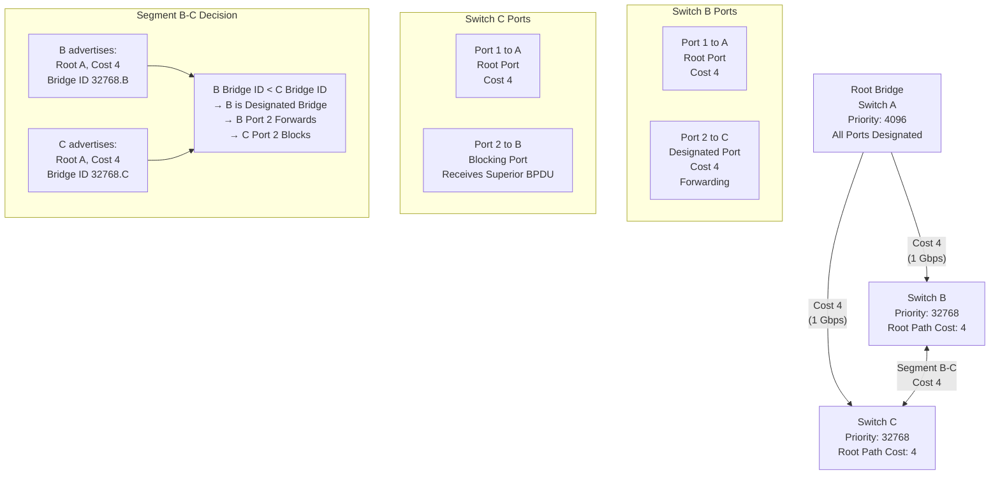

# Lesson 2: Spanning Tree Protocol, VLANs, Trunking

## 1. First-Principles Intuition & Invariants

Ethernet's original design philosophy centered on a simple broadcast medium where any station could transmit frames onto a shared collision domain. This simplicity powered early local area networks but carried an architectural constraint: the network topology must form a strict tree structure with no cycles. When Ethernet segments are interconnected through bridges or switches to form a larger Layer 2 domain, accidental or intentional loops create catastrophic failure modes. A single redundant link between two switches, intended to provide fault tolerance, transforms the network into a positive feedback system where broadcast frames circulate endlessly, each traversal spawning additional copies at every switch port. Within seconds, this broadcast storm saturates all available bandwidth, triggers exponential MAC address table thrashing as switches observe the same source address arriving from multiple ports, and renders the network unusable.

The fundamental tension in switched network design lies between the operational requirement for redundant physical paths—necessary to survive link or switch failures—and Ethernet's inability to natively handle loops. Unlike routed Layer 3 networks where TTL fields provide intrinsic loop protection and routing protocols compute loop-free paths through explicit graph algorithms, Ethernet frames carry no hop count and switches forward based solely on destination MAC lookups with no global topology awareness. The Spanning Tree Protocol, standardized as IEEE 802.1D in 1990 and evolved through Rapid Spanning Tree (802.1w) and Multiple Spanning Tree (802.1s), solves this problem by imposing a distributed algorithm that automatically discovers the physical topology, elects a logical root, and disables specific ports to mathematically guarantee a loop-free active topology while maintaining redundant physical links in a blocking state ready for failover.

At its core, spanning tree operates as a distributed graph algorithm executing across autonomous switching nodes that communicate through Bridge Protocol Data Units. Each switch possesses only local information about its directly connected neighbors, yet through repeated BPDU exchanges, the network collectively converges on a shared view of a single spanning tree rooted at one designated switch. The algorithm's correctness relies on three cascading elections: first, all switches agree on a single root bridge based on the lowest bridge identifier; second, each non-root switch identifies its single best path to the root, designating one port as its root port; third, for each network segment, switches elect one designated bridge responsible for forwarding traffic onto that segment. All other ports connecting to that segment enter a blocking state, physically capable of forwarding but logically disabled to prevent loops.

The bridge identifier that determines root election combines a 16-bit priority value with the switch's 48-bit MAC address to form a 64-bit composite key, ensuring global uniqueness while allowing administrative override through priority tuning. The lowest bridge ID becomes root, but "lowest" here refers to numerical comparison where a priority of 32768 with MAC 00:1A:2B:3C:4D:5E defeats priority 32768 with MAC 00:1A:2B:3C:4D:5F, and priority 4096 with any MAC defeats priority 32768 with any MAC. This determinism ensures the election converges to a single outcome rather than oscillating, but it also means that without manual intervention, root election depends on arbitrary MAC address assignment—typically the oldest switch or the one with the lowest burned-in address becomes root, which rarely aligns with optimal network design.

Path cost calculation drives the subsequent root port and designated port elections through an accumulated metric representing the expense of reaching the root bridge. Each link carries an interface cost inversely proportional to its bandwidth: 10 Gbps Ethernet receives a cost of 2, 1 Gbps costs 4, 100 Mbps costs 19, and legacy 10 Mbps links cost 100 under the modern 32-bit cost standard. When a switch receives BPDUs advertising root reachability, it compares the advertised root path cost plus the receiving interface's local cost to determine which path offers the lowest total cost to root. Ties break first by comparing the advertising bridge ID, then the advertising port ID, then the receiving port ID, establishing a deterministic total ordering that prevents ambiguity even in symmetric topologies.

Port state transitions enforce the algorithm's safety invariant that no port forwards traffic until the topology has stabilized. A port progresses through five states: blocking (receives BPDUs only), listening (participates in elections but doesn't learn MAC addresses or forward data), learning (builds MAC table but doesn't forward), forwarding (full operation), and disabled (administratively down). The original 802.1D standard imposed fixed timers totaling 30 to 50 seconds for a port to transition from blocking to forwarding, a delay necessary to ensure that all switches have received updated topology information before new paths activate. This conservative timer-based approach prevents transient loops during convergence but creates painful service disruptions when links fail or recover, motivating the rapid spanning tree enhancements that reduce convergence time to subsecond intervals through explicit handshakes rather than passive timers.

Virtual LANs emerged from a distinct architectural challenge in flat Layer 2 networks: broadcast domain scale. A single VLAN represents an isolated broadcast domain where broadcast, multicast, and unknown unicast frames flood only to ports belonging to that VLAN, with no Layer 2 connectivity to ports in other VLANs. This segmentation serves multiple purposes. Security isolation prevents traffic from one department's VLAN from being sniffed by another department's devices. Broadcast containment limits the scope of ARP storms, DHCP discoveries, and other multicast protocols to relevant subsets of the network rather than every connected device. Administrative flexibility allows logical network boundaries that differ from physical switch boundaries, so a single physical switch can host multiple isolated networks while geographically distributed ports on different switches can belong to the same VLAN.

The VLAN identifier, a 12-bit field standardized in IEEE 802.1Q, allows 4096 distinct VLAN numbers (0-4095), though VLANs 0 and 4095 are reserved and VLAN 1 serves as the default native VLAN on most platforms. Each switch maintains per-VLAN state: separate MAC address tables where the same MAC address might appear in multiple VLANs with different port associations, per-VLAN spanning tree instances in traditional 802.1D or shared spanning tree instances in MSTP, and per-VLAN forwarding rules. When a frame arrives on an access port—a port configured to belong to a single VLAN—the switch internally tags the frame with that VLAN ID, performs forwarding decisions within that VLAN's namespace, and strips the tag before egressing if the destination port is also an access port in the same VLAN.

Trunk ports operationalize inter-switch VLAN transport by carrying traffic for multiple VLANs over a single physical link using 802.1Q encapsulation. The 802.1Q tag inserts 4 bytes into the Ethernet frame between the source MAC address and the EtherType/Length field, containing a 3-bit priority field, a 1-bit canonical format indicator, and the 12-bit VLAN ID. This tag insertion occurs before frame transmission on the trunk and is stripped after reception on the trunk but before delivery to the destination access port, making the tagging transparent to end devices. A trunk's allowed VLAN list determines which VLANs can traverse that link, providing administrative control over traffic segregation. The native VLAN, traditionally VLAN 1, carries untagged frames on the trunk to maintain backward compatibility with non-802.1Q devices, though this creates a security vector for VLAN hopping attacks if not carefully managed.

Inter-VLAN routing represents the deliberate relaxation of VLAN isolation through a Layer 3 gateway that receives traffic from one VLAN and routes it to another, typically implemented in a multilayer switch or router with subinterfaces. Each VLAN maps to a distinct IP subnet, and the routing device maintains an IP interface in each subnet, serving as the default gateway for hosts in that VLAN. This router-on-a-stick or switched virtual interface (SVI) architecture allows centralized policy enforcement: access control lists filter inter-VLAN traffic at the routing boundary, providing security controls that don't exist in pure Layer 2 forwarding. The routing device performs full Layer 3 processing including longest-prefix match lookups, TTL decrementation, and ARP resolution for the next-hop VLAN, rewriting both Layer 2 and Layer 3 headers as the packet crosses the VLAN boundary.

## 2. Core Architecture & Mechanics

Spanning tree's BPDU structure carries the topology information required for distributed election. Each BPDU, transmitted as a multicast frame to destination MAC 01:80:C2:00:00:00 with EtherType 0x0026, contains the sending switch's bridge ID, the root bridge ID as currently understood by the sender, the accumulated root path cost from sender to root, and port identifiers for both the sending port and the designated port for that segment. Upon receiving a BPDU, a switch compares the received root bridge ID against its current view. If the received BPDU advertises a numerically lower root bridge ID, the switch updates its view, recalculates all port roles, and immediately propagates updated BPDUs out all designated ports to inform downstream neighbors of the topology change. If the received BPDU advertises the same root but with a lower path cost, the receiving switch updates its root port selection if this new path is superior to its current root path.

The root bridge originates configuration BPDUs every hello time interval, typically 2 seconds, advertising itself as root with a path cost of zero. Non-root switches do not generate their own configuration BPDUs independently; instead, they receive BPDUs on their root port, update the path cost by adding the root port's local cost, and relay the modified BPDU out all designated ports. This message relay pattern creates a BPDU wavefront propagating outward from the root through the spanning tree, with each switch's designated ports serving as the tree edges. Ports in blocking state receive BPDUs but never send them, preventing blocked links from participating in the forwarding topology while still monitoring for topology changes.

Port role determination follows a strict precedence hierarchy. The root bridge has all ports in designated role since it is the tree root. Every non-root switch identifies exactly one root port: the port offering the lowest cost path to root, breaking ties first by lowest advertising bridge ID, then lowest advertising port ID, then lowest receiving port ID. For each network segment, the switch with the lowest root path cost to that segment becomes the designated bridge, and its port on that segment becomes the designated port. All other ports on that segment that are neither root nor designated enter blocking state. A key insight: each segment has exactly one designated port (or zero if no switches connect to it), ensuring no loops, while each non-root switch has exactly one root port, ensuring connectivity.



Topology change notification (TCN) handles MAC address table coherence during network transitions. When a switch detects that a previously forwarding port has transitioned to blocking or a previously blocking port has transitioned to forwarding, it must assume that MAC address locations learned through the old topology may now be stale. The detecting switch sends TCN BPDUs upstream toward the root, and the root responds by setting the topology change flag in configuration BPDUs sent downstream. Switches receiving BPDUs with the topology change flag set reduce their MAC address aging time from the default 300 seconds to the forward delay (typically 15 seconds), causing faster relearning of MAC locations through the new topology. This aging acceleration trades increased unknown unicast flooding during convergence for faster restoration of optimized forwarding.

Rapid Spanning Tree Protocol (RSTP), codified in 802.1w and backward compatible with 802.1D, accelerates convergence through explicit handshakes and new port roles. RSTP introduces the alternate port role, representing a backup path to the root that can immediately transition to forwarding if the current root port fails, and the backup port role, representing a redundant connection to the same segment as a designated port. Rather than relying on timers, RSTP uses proposal-agreement handshakes: when a switch's root port receives a superior BPDU and transitions to forwarding, it sends proposals on all designated ports asking downstream switches to synchronize; downstream switches respond with agreements after ensuring their own designated ports are synchronized. This recursive synchronization propagates down the tree, allowing the entire topology to converge in twice the hello time plus link propagation delays, typically under 6 seconds.

```text
RSTP Port States (Simplified from 802.1D's Five States):
  Discarding: Combines Blocking, Listening, Disabled
  Learning: Builds MAC table, doesn't forward data
  Forwarding: Full operation

RSTP Port Roles:
  Root: Best path toward root bridge
  Designated: Forwarding toward downstream switches
  Alternate: Backup path to root (can immediately replace root port)
  Backup: Redundant connection to same segment as designated port
  Disabled: Administratively down or physically disconnected
```

Multiple Spanning Tree Protocol (MSTP), defined in 802.1s, addresses spanning tree's limitation in VLAN-rich environments where running independent spanning tree instances per VLAN (Per-VLAN Spanning Tree Plus, PVST+) creates unsustainable control plane overhead. MSTP allows multiple VLANs to map to a smaller number of spanning tree instances, with each instance computing an independent topology. An MST region consists of all switches configured with identical region names, revision numbers, and VLAN-to-instance mappings. Within a region, Internal Spanning Tree (IST) computes the topology, while Common Spanning Tree (CST) provides inter-region connectivity. This hierarchical approach scales to thousands of VLANs while limiting spanning tree complexity to a manageable number of instances—often just two or three per region.

VLAN configuration on Cisco IOS syntax demonstrates the practical mechanics:

```text
! Create VLANs in global configuration
vlan 10
  name Engineering
vlan 20
  name Marketing
vlan 30
  name Management

! Configure access port (single VLAN)
interface GigabitEthernet0/1
  switchport mode access
  switchport access vlan 10
  spanning-tree portfast
  spanning-tree bpduguard enable

! Configure trunk port (multiple VLANs)
interface GigabitEthernet0/24
  switchport mode trunk
  switchport trunk encapsulation dot1q
  switchport trunk native vlan 999
  switchport trunk allowed vlan 10,20,30
  spanning-tree guard root
```

The switchport mode access command configures a port to belong to a single VLAN, automatically tagging ingress traffic with that VLAN ID and stripping tags on egress. PortFast allows the port to bypass listening and learning states and immediately transition to forwarding when connected to an end device, reducing DHCP timeout issues and user-visible delays. BPDU Guard protects against accidental loops by disabling any PortFast port that receives a BPDU, preventing unauthorized switches from joining the network.

Trunk configuration specifies 802.1Q encapsulation, sets a non-default native VLAN (999 in this example, avoiding the default VLAN 1 for security), and restricts allowed VLANs to only those in use. The spanning-tree guard root command prevents the port from becoming root port, protecting against accidental root bridge election if a switch with lower priority connects to this port—crucial for maintaining designed root placement when connecting untrusted or temporary devices.

Inter-VLAN routing on a multilayer switch using Switched Virtual Interfaces:

```text
! Enable IP routing
ip routing

! Create SVIs for each VLAN
interface Vlan10
  description Engineering Gateway
  ip address 10.10.10.1 255.255.255.0
  no shutdown

interface Vlan20
  description Marketing Gateway
  ip address 10.10.20.1 255.255.255.0
  no shutdown

interface Vlan30
  description Management Gateway
  ip address 10.10.30.1 255.255.255.0
  no shutdown

! Apply access control between VLANs
ip access-list extended INTER_VLAN_POLICY
  permit tcp 10.10.10.0 0.0.0.255 10.10.20.0 0.0.0.255 eq 80
  permit tcp 10.10.10.0 0.0.0.255 10.10.20.0 0.0.0.255 eq 443
  deny ip 10.10.10.0 0.0.0.255 10.10.20.0 0.0.0.255
  permit ip any any

interface Vlan20
  ip access-group INTER_VLAN_POLICY in
```

Each SVI represents a Layer 3 interface in a specific VLAN, with the switch performing hardware-accelerated routing between VLANs using ASIC-based forwarding tables. The access list enforces policy that Engineering (VLAN 10) can only access Marketing (VLAN 20) on HTTP/HTTPS ports, blocking all other inter-VLAN traffic while permitting intra-VLAN communication and traffic to other VLANs. This policy applies in the ingress direction on VLAN 20's SVI, filtering traffic as it enters the VLAN after being routed from VLAN 10.

Dynamic Trunking Protocol (DTP) automatically negotiates trunk formation between Cisco switches but introduces security vulnerabilities through switch spoofing attacks where an attacker forces a trunk to form and gains access to all VLANs. Production environments should disable DTP:

```text
interface GigabitEthernet0/24
  switchport mode trunk
  switchport nonegotiate
```

The nonegotiate command disables DTP, requiring manual trunk configuration on both sides of the link, eliminating the attack vector where an attacker sends DTP frames to convince the switch to form a trunk.

## 3. High-Performance Optimization & Failure Modes

Root bridge placement fundamentally determines spanning tree topology and, consequently, traffic flow patterns. The root bridge should be the topological center of the network with the highest aggregate bandwidth to all other switches. Placing the root at a network edge or on a low-capacity switch creates suboptimal paths where traffic must traverse multiple hops when direct paths exist. Enterprise networks typically deploy two switches as primary and secondary root candidates through manual priority configuration:

```text
! Primary root bridge
spanning-tree vlan 1-4094 priority 4096

! Secondary root bridge (activates if primary fails)
spanning-tree vlan 1-4094 priority 8192
```

Priority values must be multiples of 4096 due to the priority field's 4-bit granularity. Setting the primary root to 4096 and secondary to 8192 ensures that unless a switch is manually configured with a lower priority, these two devices will serve as primary and secondary root, with the secondary immediately assuming root role if the primary fails without requiring topology recomputation across the entire network.

Per-VLAN root placement allows load distribution in PVST+ environments where different VLANs use different root bridges to balance traffic across redundant links:

```text
! Core Switch A: Root for VLANs 1-50
spanning-tree vlan 1-50 priority 4096
spanning-tree vlan 51-100 priority 8192

! Core Switch B: Root for VLANs 51-100
spanning-tree vlan 1-50 priority 8192
spanning-tree vlan 51-100 priority 4096
```

This configuration causes half the VLANs to prefer Switch A as root while the other half prefer Switch B, actively forwarding traffic on both uplinks simultaneously rather than blocking one entirely. The tradeoff is increased spanning tree overhead—each VLAN runs an independent protocol instance—but this is acceptable in smaller deployments where link utilization matters more than control plane efficiency.

PortFast and BPDU Guard acceleration mitigate convergence delays on access ports connecting end devices. Without PortFast, a workstation port requires 30 seconds to transition from blocking through listening and learning to forwarding, causing DHCP timeouts and user complaints. PortFast bypasses these states, immediately forwarding upon link up, but this creates a loop risk if a switch is accidentally connected to a PortFast port. BPDU Guard detects this misconfiguration by shutting down any PortFast port that receives a BPDU, forcing manual intervention to re-enable the port:

```text
! Global PortFast and BPDU Guard
spanning-tree portfast default
spanning-tree portfast bpduguard default

! Alternatively, per-interface
interface range GigabitEthernet0/1-23
  switchport mode access
  spanning-tree portfast
  spanning-tree bpduguard enable
```

The global commands apply to all access ports, streamlining configuration, but require careful attention to ensure trunk ports are explicitly excluded through interface-level overrides or by verifying that trunk ports never inherit the global PortFast setting.

Root Guard prevents unauthorized root bridge election on specific ports. When enabled on a designated port, Root Guard monitors received BPDUs for superior root claims. If a BPDU arrives advertising a better root bridge ID, Root Guard transitions the port to root-inconsistent state, effectively blocking it until the superior BPDUs cease:

```text
interface GigabitEthernet0/24
  spanning-tree guard root
```

This mechanism protects the core network from rogue switches or misconfigurations in branch offices where a lower-priority switch might accidentally become root, pulling traffic away from the designed topology. Root Guard is typically deployed on ports facing distribution or access layers, never on uplinks toward the intended root since those ports must be allowed to receive superior BPDUs from the legitimate root.

Loop Guard addresses unidirectional link failures where a port stops receiving BPDUs but the physical link remains up. Traditional spanning tree interprets the absence of BPDUs as evidence that the port should become designated—a correct conclusion if the neighboring switch has failed, but disastrous if the link is merely unidirectional since this creates a loop. Loop Guard places a port in loop-inconsistent state if BPDUs stop arriving when expected:

```text
! Global Loop Guard on all ports
spanning-tree loopguard default

! Per-interface
interface GigabitEthernet0/24
  spanning-tree guard loop
```

Loop Guard and Root Guard are mutually exclusive on a given port since they respond to different failure modes. Best practice deploys Root Guard on designated ports facing downstream and Loop Guard on root and alternate ports facing upstream.

VLAN hopping attacks exploit trunk misconfigurations to inject traffic into unauthorized VLANs through two primary techniques. Double-tagging pushes two 802.1Q tags onto a frame, with the outer tag matching the native VLAN of the attacker's switch port. When the frame traverses the first trunk, the native VLAN tag is stripped since native VLAN traffic travels untagged, exposing the inner tag. The next switch interprets the inner tag as the frame's VLAN, forwarding it into a VLAN the attacker should not access. Mitigation requires ensuring the native VLAN is unused:

```text
! Change native VLAN away from default
interface GigabitEthernet0/24
  switchport trunk native vlan 999

! Create VLAN 999 but assign no ports to it
vlan 999
  name Native_VLAN_Unused
```

Switch spoofing convinces an access port to become a trunk through DTP negotiation, granting the attacker access to all VLANs. Disabling DTP eliminates this vector:

```text
! Disable DTP on all access ports
interface range GigabitEthernet0/1-23
  switchport mode access
  switchport nonegotiate
```

Private VLANs (PVLANs) segment a primary VLAN into isolated, community, and promiscuous sub-VLANs, allowing multiple customers to share a VLAN number space while preventing inter-customer communication at Layer 2. An isolated port can communicate only with promiscuous ports (typically gateways or servers), never with other isolated ports. Community ports can communicate with each other within their community and with promiscuous ports but not with other communities or isolated ports. This architecture is common in hosting environments where many customers connect to the same Layer 3 gateway but must not sniff each other's traffic:

```text
! Primary VLAN
vlan 100
  private-vlan primary
  private-vlan association 101,102,103

! Isolated VLAN
vlan 101
  private-vlan isolated

! Community VLANs
vlan 102
  private-vlan community
vlan 103
  private-vlan community

! Promiscuous port (gateway)
interface GigabitEthernet0/1
  switchport mode private-vlan promiscuous
  switchport private-vlan mapping 100 101-103

! Isolated port (customer A)
interface GigabitEthernet0/10
  switchport mode private-vlan host
  switchport private-vlan host-association 100 101

! Community port (customer B group 1)
interface GigabitEthernet0/11
  switchport mode private-vlan host
  switchport private-vlan host-association 100 102
```

Spanning tree scalability limitations emerge in large networks where thousands of VLANs each run independent spanning tree instances. PVST+ transmits a BPDU per VLAN per hello interval (default 2 seconds), consuming CPU and bandwidth. A switch with 1000 VLANs generates 500 BPDUs per second, a manageable load on modern hardware but problematic on legacy platforms or in networks with tens of thousands of VLANs. MSTP reduces this overhead by mapping many VLANs to a few MST instances, typically scaling to 65 instances per region with hundreds or thousands of VLANs per instance.

Rapid convergence under RSTP depends on proper tuning of proposal-agreement timers and link-type configuration. RSTP assumes point-to-point links (full-duplex connections between two switches) transition faster than shared media (half-duplex or hub-connected segments). Modern networks are almost exclusively point-to-point, but RSTP may auto-detect half-duplex links as shared, slowing convergence:

```text
interface GigabitEthernet0/24
  spanning-tree link-type point-to-point
```

Explicitly setting link-type to point-to-point ensures rapid transition mechanics activate. The hello timer should generally remain at 2 seconds, as overly aggressive values (1 second or below) increase CPU load without meaningful convergence improvement. The forward delay and max age timers are automatically derived from the hello timer in RSTP, unlike 802.1D where they must be manually tuned.

Monitoring spanning tree topology requires correlating BPDU statistics, port state transitions, and root bridge stability. Key verification commands on Cisco IOS:

```text
! Display spanning tree summary per VLAN
show spanning-tree vlan 10

! Identify root bridge and port roles
show spanning-tree root

! Check for topology changes
show spanning-tree summary

! Verify PortFast and guard configurations
show spanning-tree interface GigabitEthernet0/1 detail

! Display BPDU transmission and reception counters
show spanning-tree interface GigabitEthernet0/24 statistics
```

A stable network shows zero or very few topology changes per hour. Frequent topology changes indicate flapping links, STP misconfigurations, or loops. Root bridge identity should match the intended primary root; unexpected root elections suggest misconfigured priorities or the introduction of an unauthorized switch. Port role distribution should align with the designed topology: root ports point toward core, designated ports face access layer, and blocking ports exist on redundant links.

STP inconsistency troubleshooting isolates the failure domain through systematic topology verification. If a switch cannot reach the root bridge, check the root port's BPDU reception counters—if zero, the upstream link or upstream switch has failed. If BPDUs are received but the port remains in blocking, compare the received root bridge ID and path cost against the current root—a mismatch indicates a split-brain condition where different network segments believe different roots exist, typically caused by unidirectional link failures or ACLs inadvertently filtering BPDUs. If all ports show blocking or discarding, the switch may have isolated itself due to Guard features triggering or a catastrophic configuration error.

VLAN troubleshooting starts with verifying end-to-end VLAN consistency. A workstation cannot communicate with another workstation in the same VLAN if the intervening trunk does not carry that VLAN:

```text
! Verify VLAN exists on all switches
show vlan id 10

! Check trunk allowed VLAN list
show interfaces GigabitEthernet0/24 switchport
```

If the VLAN is missing from the allowed list on any trunk in the path, traffic is blackholed. The native VLAN mismatch causes similar symptoms: if two ends of a trunk have different native VLANs, untagged traffic on one side is interpreted as belonging to a different VLAN on the other side, breaking connectivity for the native VLAN and potentially creating security vulnerabilities.

Inter-VLAN routing failures isolate through traceroute and routing table verification. If hosts in different VLANs cannot communicate despite correct SVI configuration, check that the SVIs are operationally up (show ip interface brief), IP routing is enabled globally (ip routing), and no ACLs block inter-VLAN traffic. If the SVI is up but not reachable, verify that at least one port in the VLAN is forwarding; an SVI goes down if no active ports exist in its VLAN. If routing works intermittently, check for asymmetric routing caused by multiple Layer 3 devices in the same VLAN with different routing configurations.

Production networks often deploy spanning tree alongside link aggregation (EtherChannel/LACP) to combine redundancy and bandwidth. An EtherChannel bundles multiple physical links into a single logical link, appearing as a single spanning tree port. This allows active use of all bundled links rather than blocking redundant paths, sidestepping spanning tree's limitation of using only one path per segment. However, misconfigured EtherChannels create loops if the bundle fails to form correctly while the physical links remain up, causing each physical link to independently participate in spanning tree and potentially forwarding in a loop topology. Guard against this by enabling port suspension on inconsistency:

```text
interface Port-channel1
  switchport mode trunk
  switchport trunk allowed vlan 10,20,30

interface range GigabitEthernet0/23-24
  channel-group 1 mode active
  spanning-tree guard loop
```

The channel-group with LACP mode active forms the EtherChannel, and Loop Guard on the physical interfaces provides additional safety by detecting if one link fails to receive BPDUs while others do, indicating a partial EtherChannel failure that could create a loop.
