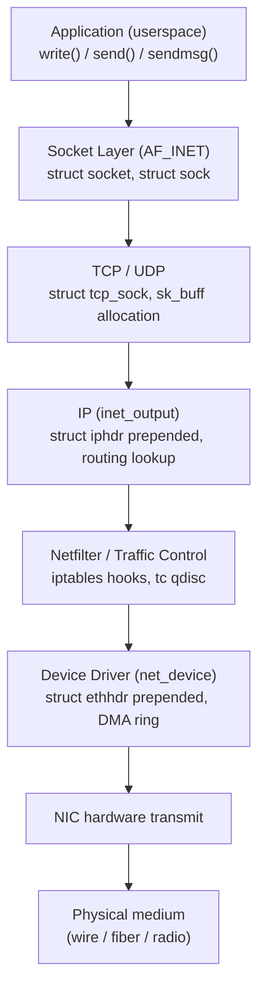

# Lesson 1: Network Stack Fundamentals

## 1. First-Principles Intuition & Invariants

The history of networked computing is, at its core, a history of decomposition. When ARPANET researchers in the late 1960s and early 1970s confronted the problem of connecting heterogeneous machines across unreliable physical links, they were not simply solving a wiring problem. They were solving a *composition* problem: how do you build a system where a process on one machine can communicate with a process on another machine, regardless of the hardware, operating system, or physical medium separating them? The answer they arrived at — and the answer that still governs every TCP/IP packet traversing the internet today — was layered abstraction.

Layered abstraction is not merely an organizational convenience. It is a formal engineering principle with specific invariants. Each layer in a network stack provides a well-defined service to the layer above it and consumes a well-defined service from the layer below it. Critically, each layer is *opaque* to the layers beyond its immediate neighbors: IP does not know whether it is running over Ethernet, fiber, or a 56k modem, and TCP does not know whether the IP datagrams carrying its segments are being routed through three hops or thirty. This opacity is load-bearing. It allows the physical substrate to change without breaking transport semantics, and it allows application protocols to evolve without requiring kernel modifications.

The OSI model, standardized by ISO in 1984, formalizes this decomposition into seven layers. From bottom to top: Physical, Data Link, Network, Transport, Session, Presentation, and Application. While the OSI model is a useful pedagogical scaffold, practitioners must internalize immediately that the TCP/IP stack, which is what actually runs in every Linux kernel, every BSD derivative, and every cloud infrastructure platform, does not map cleanly onto those seven layers. TCP/IP collapses them into four: Link, Internet, Transport, and Application. The Session and Presentation layers effectively disappear — their concerns are either handled by the application or simply absent. This collapse is not an oversight; it reflects the design philosophy of the original Internet Protocol Suite, which pushed complexity to the edges and kept the network core minimal.

The fundamental invariant governing the entire stack is the *end-to-end principle*, articulated by Saltzer, Reed, and Clark in their 1984 paper. The network should do only what the network must do: route packets from one address to another. Everything else — reliability, ordering, flow control, error correction — is the responsibility of the endpoints. This is why IP is a best-effort, connectionless datagram protocol. It makes no guarantees. It does not retransmit lost packets, does not reorder arrivals, and does not inform the sender of congestion. TCP, running at the endpoints, provides all of those properties on top of IP's bare delivery primitive. This division of responsibility is not a limitation; it is what makes the internet scalable to global scope.

Before examining the layers mechanically, engineers must fix one more invariant firmly in mind: *encapsulation*. Each layer wraps the payload handed to it by the layer above by prepending a header (and sometimes appending a trailer) that carries the control information that layer needs to perform its function. The result is a nested structure, like envelopes inside envelopes. A four-byte application message might ultimately travel inside a 54-byte TCP segment, inside a 74-byte IP datagram, inside a 128-byte Ethernet frame, inside a 136-byte physical signal. At the receiving end, each layer strips its own envelope and passes the contents up. This process — encapsulation on the transmit path and decapsulation on the receive path — happens for every single packet, billions of times per second in a modern data center.

---

## 2. Core Architecture & Mechanics

### The Layer Stack and Encapsulation Model

To understand what actually happens when a process calls `send()`, it helps to trace a packet through the kernel's network stack from top to bottom, examining the data structures and transformations at each stage.



The kernel's central data structure for this entire journey is the `sk_buff` — the socket buffer, defined in `<linux/skbuff.h>`. Every packet in the Linux network stack is represented as an `sk_buff`. It is not merely a byte array; it is a complex control structure containing a pointer to the actual packet data (`sk_buff->data`), pointers to the head and tail of the allocated buffer, metadata about which protocol owns it, timestamps, checksums, and a linked-list pointer for queue management. Understanding `sk_buff` layout is prerequisite to understanding every performance characteristic of the Linux network stack.

```c
// Simplified sk_buff layout (linux/skbuff.h)
struct sk_buff {
    struct sk_buff      *next;
    struct sk_buff      *prev;
    struct sock         *sk;          // owning socket
    ktime_t              tstamp;      // receive/transmit timestamp
    struct net_device   *dev;         // network device
    unsigned char       *head;        // start of allocated buffer
    unsigned char       *data;        // start of current layer's payload
    unsigned char       *tail;        // end of data
    unsigned char       *end;         // end of allocated buffer
    unsigned int         len;         // length of actual data
    __u16                protocol;    // L3 protocol (ETH_P_IP, etc.)
    // ... many more fields omitted for clarity
};
```

As the packet descends the stack, each layer *reserves space* at the head of the buffer and writes its header into that reserved space by calling `skb_push()`. This design means no memory copying occurs between layers — the same allocation is reused throughout the transmit path, with each layer merely adjusting the `data` pointer. This is a critical performance property.

### The Link Layer: Ethernet Framing

At the bottom of the software stack, the Link layer is responsible for framing packets for transmission on a specific physical medium. For the vast majority of cloud infrastructure, this means Ethernet, governed by IEEE 802.3. An Ethernet frame has this structure:

```text
 0                   1                   2                   3
 0 1 2 3 4 5 6 7 8 9 0 1 2 3 4 5 6 7 8 9 0 1 2 3 4 5 6 7 8 9 0 1
├─────────────────────────────────────────────────────────────────┤
│                   Destination MAC (6 bytes)                     │
├─────────────────────────────────────────────────────────────────┤
│                   Source MAC (6 bytes)                          │
├───────────────────────────────┬─────────────────────────────────┤
│        EtherType (2 bytes)    │   Payload (46–1500 bytes)       │
├───────────────────────────────┴─────────────────────────────────┤
│                   Frame Check Sequence (4 bytes, CRC32)         │
└─────────────────────────────────────────────────────────────────┘
```

The EtherType field is the demultiplexing key: `0x0800` signals IPv4, `0x86DD` signals IPv6, and `0x0806` signals ARP. The Frame Check Sequence is a CRC-32 checksum computed over the entire frame, appended by the transmitting NIC hardware and verified by the receiving NIC. Frames failing the FCS check are silently dropped — no notification is sent up the stack. This is a concrete manifestation of the best-effort principle propagating all the way down to Layer 2.

The maximum Ethernet payload is 1500 bytes by default, a limit established in the original 10 Mbps Ethernet specification and inherited through every generation since. This is the *Maximum Transmission Unit* (MTU) for Ethernet, and it is the most consequential single constant in everyday TCP/IP engineering. When an IP datagram exceeds the MTU of the outgoing interface, it must be either fragmented (split across multiple frames) or dropped with an ICMP "Fragmentation Needed" response. Modern TCP stacks avoid this by performing *Path MTU Discovery* (PMTUD), probing the minimum MTU across the entire path before sending large segments.

### The Internet Layer: IP Datagram Structure

IP is the narrow waist of the internet's hourglass architecture. Every transport protocol sits above it; every link-layer technology sits below it. Its job is exactly one thing: forward a datagram from a source address to a destination address, one hop at a time, based solely on the destination IP address.

```text
 0                   1                   2                   3
 0 1 2 3 4 5 6 7 8 9 0 1 2 3 4 5 6 7 8 9 0 1 2 3 4 5 6 7 8 9 0 1
├───────┬───────┬───────────────┬───────────────────────────────┤
│Version│  IHL  │      TOS      │          Total Length          │
├───────┴───────┼───────────────┼─────┬─────────────────────────┤
│          Identification       │Flags│    Fragment Offset       │
├───────────────┬───────────────┼─────┴─────────────────────────┤
│      TTL      │   Protocol    │         Header Checksum        │
├───────────────┴───────────────┴───────────────────────────────┤
│                       Source IP Address                        │
├───────────────────────────────────────────────────────────────┤
│                    Destination IP Address                      │
├───────────────────────────────────────────────────────────────┤
│                    Options (if IHL > 5)                        │
└───────────────────────────────────────────────────────────────┘
```

Several fields in this header deserve special attention from infrastructure engineers. The *Protocol* field (8 bits) performs the same demultiplexing function as EtherType one layer up: `6` means TCP, `17` means UDP, `1` means ICMP. The *TTL* (Time to Live) field is a hop counter decremented by each router; when it reaches zero, the router drops the packet and sends an ICMP Time Exceeded message to the source. This is the mechanism `traceroute` exploits — it sends packets with TTL values starting at 1, 2, 3, incrementing until the destination is reached, and collects the ICMP Time Exceeded replies to map each hop.

The *Fragment Offset* and *Flags* fields manage IP fragmentation. The Don't Fragment (DF) bit, when set, instructs routers never to fragment the datagram. If the datagram is too large for the next-hop MTU and the DF bit is set, the router drops it and sends ICMP Type 3 Code 4 (Fragmentation Needed) back to the source. This ICMP response is the signal PMTUD relies upon, which means that any firewall or middlebox that drops ICMP will silently break PMTUD and cause mysterious TCP connection hangs for large payloads — a failure mode that remains common in enterprise networks and is often diagnosed only after significant investigation.

### The Transport Layer: TCP Segment Anatomy

TCP transforms IP's unreliable, unordered datagram service into a reliable, ordered, full-duplex byte stream. It achieves this through a combination of sequence numbers, acknowledgments, retransmission timers, flow control via a receive window, and congestion control. The TCP header is correspondingly more complex than IP's.

```text
 0                   1                   2                   3
 0 1 2 3 4 5 6 7 8 9 0 1 2 3 4 5 6 7 8 9 0 1 2 3 4 5 6 7 8 9 0 1
├───────────────────────────────┬───────────────────────────────┤
│          Source Port          │        Destination Port       │
├───────────────────────────────┴───────────────────────────────┤
│                        Sequence Number                        │
├───────────────────────────────────────────────────────────────┤
│                     Acknowledgment Number                     │
├───────┬───────────────────────┬───────────────────────────────┤
│  DO   │       Reserved        │           Control Bits        │
├───────┴───────────────────────┴───────────────────────────────┤
│            Window Size        │           Checksum            │
├───────────────────────────────┴───────────────────────────────┤
│          Urgent Pointer       │      Options (variable)       │
└───────────────────────────────────────────────────────────────┘
```

The *Sequence Number* identifies the byte offset of the first byte in the segment's payload within the overall byte stream. The *Acknowledgment Number* identifies the next byte the receiver expects, implicitly acknowledging all bytes with sequence numbers below it. Together, these two fields implement cumulative acknowledgment and allow the receiver to detect missing segments and the sender to detect packet loss.

The *Window Size* field is TCP's flow control mechanism. The receiver advertises how many bytes of buffer space it has available, expressed as a 16-bit value. The sender must not have more than this many unacknowledged bytes outstanding at any moment. Because 16 bits caps the window at 65,535 bytes, the TCP Window Scale option (RFC 7323) extends this to a 30-bit value, enabling windows up to 1 GB. Without window scaling, the maximum throughput on a 10ms RTT link is `65535 bytes / 0.01s = 6.5 Mbps` — deeply inadequate for modern networks. This is why `net.ipv4.tcp_window_scaling` must be enabled on every Linux host, which it is by default since kernel 2.2, but infrastructure engineers should verify it explicitly on custom-built or containerized environments.

TCP connection establishment follows the three-way handshake. The client sends a SYN segment with its Initial Sequence Number (ISN), randomly chosen to prevent sequence number hijacking. The server responds with SYN-ACK, acknowledging the client's ISN and advertising its own. The client completes the exchange with ACK. Only after this three-way exchange has completed is the connection considered established. The connection teardown is a four-way exchange: each side independently sends FIN and receives ACK. The TIME_WAIT state, which persists for 2×MSL (Maximum Segment Lifetime, typically 60 seconds) after the final ACK, exists to prevent delayed duplicates from a previous connection instance from corrupting a new one using the same four-tuple — a subtle invariant with large practical consequences for high-throughput servers cycling through many short-lived connections.

### Full Encapsulation Stack: End-to-End View

When a process writes 100 bytes to a TCP socket, the data traverses every layer, accumulating headers. A concrete example illustrates the total overhead:

```text
Application Data:         100 bytes
+ TCP Header:              20 bytes  (minimum, no options)
= TCP Segment:            120 bytes
+ IP Header:               20 bytes  (minimum, no options)
= IP Datagram:            140 bytes
+ Ethernet Header:         14 bytes  (dst MAC + src MAC + EtherType)
+ Ethernet FCS:             4 bytes
= Ethernet Frame:         158 bytes  transmitted on wire
```

The 58 bytes of header overhead for 100 bytes of payload represents a 58% overhead ratio. For a 1-byte payload (think SSH keepalives or interactive terminal sessions), the overhead is 5,700%. This is why protocols like QUIC, running over UDP, invest heavily in header compression, and why TCP's Nagle algorithm coalesces small writes — it buffers outgoing data until a full segment can be sent or an ACK arrives, trading latency for throughput efficiency. Nagle is controlled via `TCP_NODELAY` socket option and is a frequent source of latency surprises in interactive or latency-sensitive applications when it is inadvertently left enabled.

---

## 3. High-Performance Optimization & Failure Modes

### Diagnosing the Stack with Production Tools

Production network debugging in infrastructure engineering relies on a core toolchain. The following workflows cover the most common diagnostic scenarios a kernel engineer or systems programmer will encounter.

Capturing and inspecting raw packet structure on a live host uses `tcpdump`. The command below captures TCP traffic on port 443, writes the full packet bytes to a file for offline analysis with Wireshark, and limits capture to 10,000 packets to prevent disk exhaustion:

```bash
tcpdump -i eth0 -s 0 -w /tmp/capture.pcap \
        'tcp port 443' -c 10000
```

To inspect the TCP handshake timing and flag sequence inline without writing a file:

```bash
tcpdump -i eth0 -nn -tt 'tcp and host 10.0.1.5 and port 8080'
```

The `-nn` flag disables DNS and service name resolution, which eliminates DNS lookup latency that can distort timestamps. The `-tt` flag prints absolute Unix epoch timestamps with microsecond precision, enabling you to measure handshake RTT directly from the capture output.

For socket-level state inspection, `ss` (socket statistics) is the successor to `netstat` and reads directly from the kernel's internal socket tables via netlink, making it dramatically faster on systems with tens of thousands of open connections:

```bash
# Show
```
