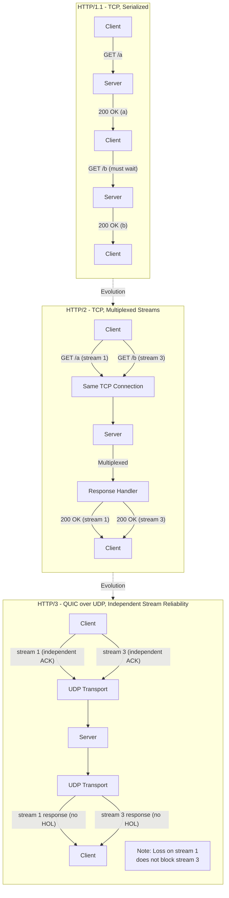
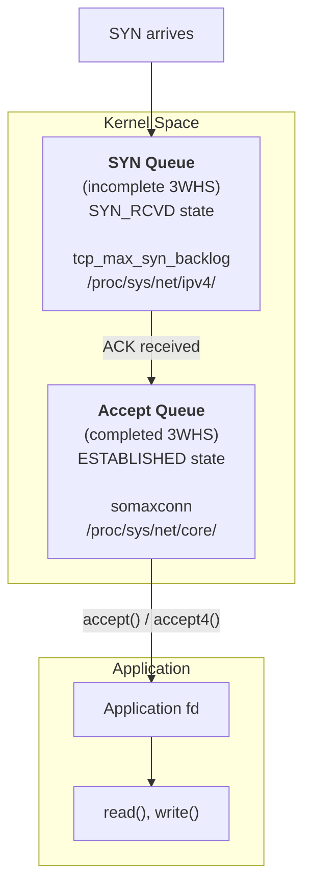
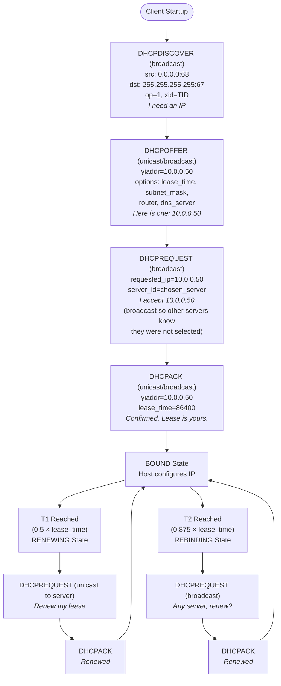

# Lesson 4: Application Protocols Integration

## 1. First-Principles Intuition & Invariants

The application layer is where the internet's architectural philosophy crystallizes into observable behavior. When we examine DNS, HTTP, and DHCP through the lens of infrastructure engineering, we are not merely studying three protocols; we are studying three distinct engineering responses to the same fundamental question: how should intelligence be distributed between the network core and the communicating endpoints? The answer, articulated in RFC 3439 and grounded in the end-to-end principle first formalized by Saltzer, Reed, and Clark in 1984, is that the network should provide a minimal, general-purpose delivery service, and that application-specific intelligence—reliability, ordering, security, session management—should live at the endpoints. This is not a philosophical preference; it is a structural invariant that governs how every application protocol we will examine actually works.

The TCP/IP stack forms an hourglass. At the narrow waist sits IP, a connectionless, best-effort packet delivery service that makes no guarantees about delivery, ordering, or integrity. Above that waist, transport protocols TCP and UDP provide two different grades of service: TCP adds reliability, ordered delivery, and flow and congestion control through state machines, sequence numbers, and acknowledgment timers; UDP provides nothing beyond what IP already offers, exposing the raw datagram boundary to the application. Below the waist, every conceivable link-layer technology—Ethernet, Wi-Fi, PPP, carrier pigeons—converges into a uniform IP interface. This narrow-waist architecture is what allows DNS to run over UDP, HTTP to run over TCP, and a new protocol like QUIC to run over UDP and still participate in the same internet. The waist is the interoperability contract; everything above it is application engineering.

The choice of transport is the first and most consequential design decision any application protocol makes, and it follows directly from the protocol's semantics. DNS queries are small (typically under 512 bytes), idempotent, and single-round-trip. If a response is lost, the resolver simply retransmits. There is no connection state to maintain, no handshake overhead, and no kernel-level state machine consuming file descriptors and memory. UDP is the natural fit: one packet in, one packet out, the application handles retransmission with a simple timer. HTTP, by contrast, transfers arbitrarily large payloads with semantics that assume ordered, complete delivery. A web page arriving with missing or reordered chunks is useless. TCP's byte-stream abstraction, three-way handshake, and cumulative acknowledgments solve this at the transport layer so the application never sees packet boundaries. DHCP occupies a third category: it must operate before the host has an IP address, which means it cannot use TCP (which requires an established connection between two known endpoints) and must instead use UDP broadcast, sending packets to 255.255.255.255 on port 67 from a client that has no source IP address. Each protocol's transport choice is not arbitrary; it is mechanically determined by the protocol's operational context.

The socket API, introduced in 4.2BSD in 1983, is the interface through which user-space applications access the kernel's networking stack. A socket is a file descriptor backed by a kernel object containing send and receive buffers, protocol state, and a reference to the underlying transport. When an application calls `send()`, data is copied from user-space into the kernel send buffer; TCP then segments that data into MSS-sized chunks, wraps each in an IP packet, and hands them to the link layer. When data arrives at the network interface, the kernel's interrupt handler places frames into a per-CPU backlog queue, IP reassembles them, TCP processes acknowledgments and delivers in-order bytes to the socket receive buffer, and `recv()` copies them back to user-space. Every application protocol we discuss operates through this boundary. Understanding the socket API at the syscall level—`socket()`, `bind()`, `listen()`, `accept()`, `connect()`, `send()`, `recv()`, `close()`—is prerequisite to understanding how application protocols actually interact with the TCP/IP stack in production systems.

## 2. Core Architecture & Mechanics

### DNS: The Distributed Naming System

DNS is a hierarchical, eventually-consistent, distributed database whose entries map human-readable names to structured records. The namespace is a tree: the root zone delegates to top-level domains (`.com`, `.org`, `.net`), which delegate to second-level domains (`example.com`), which can further delegate subdomains. Each zone is served by one or more authoritative name servers. Resolution is a recursive walk down this tree: a stub resolver on a client machine sends a query to a configured recursive resolver (typically run by an ISP or a service like 8.8.8.8), which then iteratively queries the root, TLD, and authoritative servers until it receives an answer or an NXDOMAIN.

The DNS wire format is a single UDP datagram (or TCP segment for responses exceeding 512 bytes, with EDNS0 extension) containing a 12-byte header followed by question, answer, authority, and additional sections. The header carries a 16-bit transaction ID for matching responses to queries, flags indicating query vs. response, recursion desired/available, and a response code. Resource records follow a consistent format: name, type, class, TTL, RDLENGTH, and RDATA. Names are encoded as a sequence of length-prefixed labels terminated by a zero byte, and DNS name compression allows repeated suffixes to be replaced by 2-byte pointers to earlier offsets in the message, reducing wire size at the cost of parsing complexity.

```
DNS Message Layout (RFC 1035, Section 4.1)

+--+--+--+--+--+--+--+--+--+--+--+--+--+--+--+--+
|              Transaction ID (16)              |  Header
+--+--+--+--+--+--+--+--+--+--+--+--+--+--+--+--+
|QR| Opcode |AA|TC|RD|RA| Z  | RCODE | Flags     |
+--+--+--+--+--+--+--+--+--+--+--+--+--+--+--+--+
|            QDCOUNT (16)  Question count        |
+--+--+--+--+--+--+--+--+--+--+--+--+--+--+--+--+
|            ANCOUNT (16)  Answer count          |
+--+--+--+--+--+--+--+--+--+--+--+--+--+--+--+--+
|            NSCOUNT (16)  Authority count       |
+--+--+--+--+--+--+--+--+--+--+--+--+--+--+--+--+
|            ARCOUNT (16)  Additional count      |
+--+--+--+--+--+--+--+--+--+--+--+--+--+--+--+--+
|               Question Section                 |
+--+--+--+--+--+--+--+--+--+--+--+--+--+--+--+--+
|               Answer Section                   |
+--+--+--+--+--+--+--+--+--+--+--+--+--+--+--+--+
|               Authority Section               |
+--+--+--+--+--+--+--+--+--+--+--+--+--+--+--+--+
|              Additional Section                |
+--+--+--+--+--+--+--+--+--+--+--+--+--+--+--+--+

Resource Record Format:
+--+--+--+--+--+--+--+--+--+--+--+--+--+--+--+--+
|                  NAME (variable)              |
+--+--+--+--+--+--+--+--+--+--+--+--+--+--+--+--+
|                  TYPE (16)                     |
+--+--+--+--+--+--+--+--+--+--+--+--+--+--+--+--+
|                  CLASS (16)                    |
+--+--+--+--+--+--+--+--+--+--+--+--+--+--+--+--+
|                   TTL (32)                     |
+--+--+--+--+--+--+--+--+--+--+--+--+--+--+--+--+
|               RDLENGTH (16)                    |
+--+--+--+--+--+--+--+--+--+--+--+--+--+--+--+--+
|               RDATA (RDLENGTH)                  |
+--+--+--+--+--+--+--+--+--+--+--+--+--+--+--+--+
```

The following C program constructs a raw DNS query, sends it via UDP to a recursive resolver, parses the response, and extracts the first A record. It is a complete, compilable tool that demonstrates the wire format directly, without relying on libc's `getaddrinfo()` or any resolver library:

```c
/* dns_resolve.c -- Raw DNS A-record resolver over UDP
 * Build: gcc -O2 -Wall -o dns_resolve dns_resolve.c
 * Usage: ./dns_resolve example.com [resolver_ip]
 */
#include <stdio.h>
#include <stdlib.h>
#include <string.h>
#include <stdint.h>
#include <unistd.h>
#include <time.h>
#include <errno.h>
#include <sys/socket.h>
#include <netinet/in.h>
#include <arpa/inet.h>

#define DNS_PORT     53
#define DNS_BUF_SIZE 512
#define DNS_HDR_SIZE 12

/* DNS flags: QR=0 (query), Opcode=0 (standard), RD=1 (recursion desired) */
#define DNS_QFLAGS   0x0100

/* DNS resource record types */
#define DNS_TYPE_A     1
#define DNS_TYPE_NS    2
#define DNS_TYPE_CNAME 5
#define DNS_TYPE_MX    15
#define DNS_TYPE_AAAA  28

/* DNS opcodes */
#define DNS_RCODE_OK   0
#define DNS_RCODE_NXDOMAIN 3

struct dns_header {
    uint16_t id;
    uint16_t flags;
    uint16_t qdcount;
    uint16_t ancount;
    uint16_t nscount;
    uint16_t arcount;
};

static uint16_t dns_txid(void) {
    /* Generate a pseudo-random transaction ID */
    return (uint16_t)(time(NULL) ^ getpid());
}

/* Encode a dot-separated hostname into DNS wire format.
 * Each label is prefixed by a single byte length.
 * The sequence is terminated by a zero-length label.
 * Returns the number of bytes written, or 0 on error. */
static size_t dns_encode_name(const char *name, uint8_t *buf, size_t buflen) {
    size_t offset = 0;
    const char *dot = name;

    while (dot && *dot) {
        const char *next = strchr(dot, '.');
        size_t labellen = next ? (size_t)(next - dot) : strlen(dot);

        if (labellen == 0 || labellen > 63 || offset + 1 + labellen >= buflen)
            return 0;

        buf[offset++] = (uint8_t)labellen;
        memcpy(buf + offset, dot, labellen);
        offset += labellen;

        dot = next ? next + 1 : NULL;
    }

    buf[offset++] = 0;  /* root terminator */
    return offset;
}

/* Skip a DNS name in the wire format, handling compression pointers.
 * Returns the offset past the name, or 0 on malformed data. */
static size_t dns_skip_name(const uint8_t *buf, size_t offset, size_t buflen) {
    while (offset < buflen) {
        uint8_t len = buf[offset];

        if (len == 0) {
            return offset + 1;
        }

        if ((len & 0xC0) == 0xC0) {
            /* Compression pointer: 2 bytes total */
            return offset + 2;
        }

        /* Regular label: 1 byte length + label data */
        offset += 1 + len;
    }

    return 0;  /* malformed */
}

/* Build a complete DNS query message for the given hostname.
 * Returns the total message length, or 0 on error. */
static size_t dns_build_query(const char *hostname, uint8_t *buf, size_t buflen) {
    if (buflen < DNS_HDR_SIZE + 256)
        return 0;

    struct dns_header *hdr = (struct dns_header *)buf;
    memset(hdr, 0, DNS_HDR_SIZE);

    hdr->id      = htons(dns_txid());
    hdr->flags    = htons(DNS_QFLAGS);
    hdr->qdcount  = htons(1);
    hdr->ancount  = 0;
    hdr->nscount  = 0;
    hdr->arcount  = 0;

    size_t offset = DNS_HDR_SIZE;
    size_t namelen = dns_encode_name(hostname, buf + offset, buflen - offset - 4);

    if (namelen == 0)
        return 0;

    offset += namelen;

    /* QTYPE = A (1), QCLASS = IN (1) */
    uint16_t qtype  = htons(DNS_TYPE_A);
    uint16_t qclass = htons(1);
    memcpy(buf + offset, &qtype, 2);
    offset += 2;
    memcpy(buf + offset, &qclass, 2);
    offset += 2;

    return offset;
}

/* Parse a DNS response and extract the first A record from the answer section.
 * Returns 0 on success, -1 on failure or no A record found. */
static int dns_parse_response(const uint8_t *buf, size_t len, struct in_addr *addr) {
    if (len < DNS_HDR_SIZE)
        return -1;

    const struct dns_header *hdr = (const struct dns_header *)buf;
    uint16_t flags    = ntohs(hdr->flags);
    uint16_t rcode    = flags & 0x000F;
    uint16_t qdcount  = ntohs(hdr->qdcount);
    uint16_t ancount = ntohs(hdr->ancount);

    if (rcode == DNS_RCODE_NXDOMAIN) {
        fprintf(stderr, "NXDOMAIN: name does not exist\n");
        return -1;
    }
    if (rcode != DNS_RCODE_OK) {
        fprintf(stderr, "DNS error: rcode=%u\n", rcode);
        return -1;
    }
    if (ancount == 0)
        return -1;

    size_t offset = DNS_HDR_SIZE;

    /* Skip the question section */
    for (uint16_t i = 0; i < qdcount; i++) {
        offset = dns_skip_name(buf, offset, len);
        if (offset == 0 || offset + 4 > len)
            return -1;
        offset += 4;  /* QTYPE + QCLASS */
    }

    /* Walk the answer section looking for an A record */
    for (uint16_t i = 0; i < ancount; i++) {
        offset = dns_skip_name(buf, offset, len);
        if (offset == 0 || offset + 10 > len)
            return -1;

        uint16_t rtype;
        uint16_t rdlength;
        memcpy(&rtype, buf + offset, 2);
        rtype = ntohs(rtype);
        /* Skip TYPE(2) + CLASS(2) + TTL(4) */
        memcpy(&rdlength, buf + offset + 8, 2);
        rdlength = ntohs(rdlength);
        offset += 10;

        if (rtype == DNS_TYPE_A && rdlength == 4 && offset + 4 <= len) {
            memcpy(&addr->s_addr, buf + offset, 4);
            return 0;
        }

        offset += rdlength;
    }

    return -1;
}

int main(int argc, char *argv[]) {
    if (argc < 2 || argc > 3) {
        fprintf(stderr, "Usage: %s <hostname> [resolver_ip]\n", argv[0]);
        fprintf(stderr, "Default resolver: 8.8.8.8\n");
        return 1;
    }

    const char *resolver_ip = (argc == 3) ? argv[2] : "8.8.8.8";
    const char *hostname = argv[1];

    int sockfd = socket(AF_INET, SOCK_DGRAM, 0);
    if (sockfd < 0) {
        perror("socket");
        return 1;
    }

    /* 5-second receive timeout to implement retransmission logic */
    struct timeval tv = { .tv_sec = 5, .tv_usec = 0 };
    setsockopt(sockfd, SOL_SOCKET, SO_RCVTIMEO, &tv, sizeof(tv));

    struct sockaddr_in resolver;
    memset(&resolver, 0, sizeof(resolver));
    resolver.sin_family = AF_INET;
    resolver.sin_port   = htons(DNS_PORT);
    if (inet_pton(AF_INET, resolver_ip, &resolver.sin_addr) <= 0) {
        fprintf(stderr, "Invalid resolver IP: %s\n", resolver_ip);
        close(sockfd);
        return 1;
    }

    uint8_t query[DNS_BUF_SIZE];
    size_t qlen = dns_build_query(hostname, query, sizeof(query));
    if (qlen == 0) {
        fprintf(stderr, "Failed to encode DNS query for %s\n", hostname);
        close(sockfd);
        return 1;
    }

    ssize_t sent = sendto(sockfd, query, qlen, 0,
                          (struct sockaddr *)&resolver, sizeof(resolver));
    if (sent < 0) {
        perror("sendto");
        close(sockfd);
        return 1;
    }

    uint8_t response[DNS_BUF_SIZE];
    struct sockaddr_in from;
    socklen_t fromlen = sizeof(from);

    ssize_t rcvd = recvfrom(sockfd, response, sizeof(response), 0,
                            (struct sockaddr *)&from, &fromlen);
    if (rcvd < 0) {
        if (errno == EAGAIN || errno == EWOULDBLOCK)
            fprintf(stderr, "DNS query timed out\n");
        else
            perror("recvfrom");
        close(sockfd);
        return 1;
    }

    struct in_addr addr;
    if (dns_parse_response(response, (size_t)rcvd, &addr) == 0) {
        char ipstr[INET_ADDRSTRLEN];
        inet_ntop(AF_INET, &addr, ipstr, sizeof(ipstr));
        printf("%s has address %s\n", hostname, ipstr);
    } else {
        fprintf(stderr, "No A record found for %s\n", hostname);
        close(sockfd);
        return 1;
    }

    close(sockfd);
    return 0;
}
```

The DNS resolution flow, from stub resolver through recursive resolver to authoritative servers, follows a strictly iterative descent through the namespace hierarchy. A recursive resolver caches results according to each record's TTL, which reduces upstream query volume and tolerates transient authoritative server unavailability. The resolver must also follow CNAME chains (a CNAME record aliases one name to another, requiring a fresh lookup) and respect zone delegation boundaries (NS records pointing to child zone servers). In production infrastructure, DNS is the first point of failure for every connection: if resolution fails or times out, no TCP connection can be established, and the application sees an opaque "connection failed" error.

### HTTP: The Dominant Request-Response Protocol

HTTP is a stateless, request-response application protocol layered over TCP. Its semantics are defined in RFC 9110 (HTTP semantics) and RFC 9112 (HTTP/1.1 messaging), with HTTP/2 in RFC 9113 and HTTP/3 in RFC 9114. The core abstraction is the exchange of messages: a client sends a request consisting of a method, a target URI, headers, and an optional body; the server responds with a status code, headers, and an optional body. The statelessness means each request is independent; servers do not maintain per-client session state (cookies and server-side sessions are application-layer conventions bolted on top, not HTTP protocol state).

HTTP/1.1 introduced persistent connections (keep-alive) by default, allowing multiple requests and responses to be sent over a single TCP connection without the overhead of repeated three-way handshakes. However, HTTP/1.1 enforces strict serialization on a single connection: the client must wait for a full response before sending the next request (pipelining was specified but widely disabled due to head-of-line blocking and was effectively abandoned). HTTP/2 solved this by introducing a binary framing layer that multiplexes multiple concurrent streams over a single TCP connection, each stream carrying an independent request-response pair. HTTP/3 further solved TCP-level head-of-line blocking by moving to QUIC, a UDP-based transport that implements its own stream-level reliability, so a lost packet on one stream does not stall independent streams sharing the same connection.



The following program is a complete, compilable HTTP/1.1 server using Linux `epoll` with edge-triggered I/O. It demonstrates the socket lifecycle from `socket()` through `listen()`, `accept()`, and `recv()`/`send()`, with proper non-blocking I/O and connection management. This is the production pattern used by high-performance web servers (nginx, h2o) scaled down to its essentials:

```c
/* http_epoll.c -- Single-threaded HTTP/1.1 server using epoll edge-triggered I/O
 * Build: gcc -O2 -Wall -o http_epoll http_epoll.c
 * Usage: ./http_epoll [port]    (default port 8080)
 * Test:  curl http://localhost:8080/
 */
#define _GNU_SOURCE
#include <stdio.h>
#include <stdlib.h>
#include <string.h>
#include <stdint.h>
#include <unistd.h>
#include <errno.h>
#include <fcntl.h>
#include <signal.h>
#include <sys/socket.h>
#include <sys/epoll.h>
#include <netinet/in.h>
#include <netinet/tcp.h>
#include <arpa/inet.h>

#define MAX_EVENTS   128
#define READ_BUF_SZ  8192
#define BACKLOG      512

static volatile sig_atomic_t running = 1;

static void sighandler(int sig) {
    (void)sig;
    running = 0;
}

static const char *http_response =
    "HTTP/1.1 200 OK\r\n"
    "Content-Type: text/plain; charset=utf-8\r\n"
    "Content-Length: 20\r\n"
    "Connection: close\r\n"
    "\r\n"
    "Hello from epoll!\r\n";

static void set_nonblocking(int fd) {
    int flags = fcntl(fd, F_GETFL, 0);
    if (flags < 0) {
        perror("fcntl F_GETFL");
        return;
    }
    fcntl(fd, F_SETFL, flags | O_NONBLOCK);
}

int main(int argc, char *argv[]) {
    int port = (argc > 1) ? atoi(argv[1]) : 8080;

    signal(SIGINT, sighandler);
    signal(SIGPIPE, SIG_IGN);

    /* Step 1: Create the listening socket */
    int listenfd = socket(AF_INET, SOCK_STREAM, 0);
    if (listenfd < 0) {
        perror("socket");
        return 1;
    }

    /* SO_REUSEADDR allows rebinding to the same port after restart,
     * avoiding the TIME_WAIT 2*MSL delay (typically 60 seconds on Linux). */
    int optval = 1;
    setsockopt(listenfd, SOL_SOCKET, SO_REUSEADDR, &optval, sizeof(optval));

    struct sockaddr_in addr;
    memset(&addr, 0, sizeof(addr));
    addr.sin_family = AF_INET;
    addr.sin_port   = htons((uint16_t)port);
    addr.sin_addr.s_addr = INADDR_ANY;

    if (bind(listenfd, (struct sockaddr *)&addr, sizeof(addr)) < 0) {
        perror("bind");
        close(listenfd);
        return 1;
    }

    /* listen() transitions the socket to PASSIVE state.
     * The backlog parameter caps the accept queue (completed 3WHS connections
     * waiting for accept()). On Linux, see /proc/sys/net/core/somaxconn
     * and tcp_max_syn_backlog for the SYN queue. */
    if (listen(listenfd, BACKLOG) < 0) {
        perror("listen");
        close(listenfd);
        return 1;
    }

    set_nonblocking(listenfd);

    printf("Listening on 0.0.0.0:%d (pid %d)\n", port, getpid());
    printf("Press Ctrl-C to stop.\n");

    /* Step 2: Create the epoll instance */
    int epfd = epoll_create1(0);
    if (epfd < 0) {
        perror("epoll_create1");
        close(listenfd);
        return 1;
    }

    struct epoll_event ev;
    ev.events = EPOLLIN | EPOLLET;  /* edge-triggered */
    ev.data.fd = listenfd;
    if (epoll_ctl(epfd, EPOLL_CTL_ADD, listenfd, &ev) < 0) {
        perror("epoll_ctl listenfd");
        close(epfd);
        close(listenfd);
        return 1;
    }

    struct epoll_event events[MAX_EVENTS];

    /* Step 3: Event loop */
    while (running) {
        int nready = epoll_wait(epfd, events, MAX_EVENTS, 1000);
        if (nready < 0) {
            if (errno == EINTR)
                continue;
            perror("epoll_wait");
            break;
        }

        for (int i = 0; i < nready; i++) {
            int fd = events[i].data.fd;

            if (fd == listenfd) {
                /* Edge-triggered: drain all pending connections */
                for (;;) {
                    int connfd = accept4(listenfd, NULL, NULL, SOCK_NONBLOCK);
                    if (connfd < 0) {
                        if (errno == EAGAIN || errno == EWOULDBLOCK)
                            break;  /* no more pending connections */
                        perror("accept4");
                        break;
                    }

                    /* TCP_NODELAY disables Nagle's algorithm. For HTTP,
                     * we send a complete response in one write() call,
                     * so Nagle's delay (up to 40ms waiting to coalesce
                     * small segments) adds latency with no benefit. */
                    int one = 1;
                    setsockopt(connfd, IPPROTO_TCP, TCP_NODELAY, &one, sizeof(one));

                    struct epoll_event cev;
                    cev.events = EPOLLIN | EPOLLET;
                    cev.data.fd = connfd;
                    epoll_ctl(epfd, EPOLL_CTL_ADD, connfd, &cev);
                }
            } else {
                /* Client socket: edge-triggered read must drain all data */
                char buf[READ_BUF_SZ];
                int done = 0;

                for (;;) {
                    ssize_t n = read(fd, buf, sizeof(buf));
                    if (n > 0) {
                        /* Check for end of HTTP request headers */
                        if (strstr(buf, "\r\n\r\n")) {
                            /* Send response. In production, this would be
                             * a non-blocking write loop checking for EAGAIN
                             * and registering for EPOLLOUT if the send
                             * buffer is full. For this example, the response
                             * is small enough to fit in one send. */
                            ssize_t total = (ssize_t)strlen(http_response);
                            ssize_t written = 0;
                            while (written < total) {
                                ssize_t w = write(fd, http_response + written,
                                                  total - written);
                                if (w < 0) {
                                    if (errno == EAGAIN || errno == EWOULDBLOCK)
                                        break;  /* would block; ideally re-queue */
                                    perror("write");
                                    break;
                                }
                                written += w;
                            }
                            done = 1;
                            break;
                        }
                        continue;
                    }

                    if (n == 0) {
                        /* Client closed connection */
                        done = 1;
                        break;
                    }

                    if (errno == EAGAIN || errno == EWOULDBLOCK)
                        break;  /* no more data available */

                    /* EINTR or other error */
                    done = 1;
                    break;
                }

                if (done) {
                    epoll_ctl(epfd, EPOLL_CTL_DEL, fd, NULL);
                    close(fd);
                }
            }
        }
    }

    printf("\nShutting down.\n");
    close(epfd);
    close(listenfd);
    return 0;
}
```

The socket lifecycle for a TCP connection in the Linux kernel involves two distinct queues. The SYN queue (`tcp_max_syn_backlog`, default 2048) holds connections that have received a SYN but not yet completed the three-way handshake. The accept queue (`somaxconn`, default 4096 on modern kernels) holds connections that have completed the handshake and are waiting for `accept()` to return them to the application. When the accept queue is full, the kernel drops incoming SYN-ACKs (or sends RST depending on `tcp_abort_on_overflow`), and the client experiences connection timeouts. These queue depths are not abstractions; they are the direct cause of connection failures under load spikes in production web servers.



### DHCP: Bootstrapping Network Identity

DHCP (RFC 2131, RFC 2132) solves a bootstrapping problem that the TCP/IP stack creates for itself: a host needs an IP address to participate in IP communication, but it has no IP address before it starts communicating. The protocol resolves this chicken-and-egg problem by using UDP broadcast (source 0.0.0.0:68, destination 255.255.255.255:67) to discover a DHCP server willing to assign an address. The exchange follows a four-step sequence known as DORA: Discover, Offer, Request, Acknowledge.



The client begins in the INIT state with no IP address. It broadcasts a DHCPDISCOVER containing its MAC address and a transaction ID (XID). Any DHCP server receiving this may respond with a DHCPOFFER proposing an IP address (in the `yiaddr` field), a lease time, and configuration options (subnet mask, default gateway, DNS servers). The client selects one offer and broadcasts a DHCPREQUEST that includes the server identifier of the chosen server (the broadcast ensures non-selected servers can release their reserved addresses). The selected server responds with a DHCPACK confirming the lease, at which point the client performs ARP probe to detect address conflicts and then configures its interface. The lease has two timers: T1 (50% of lease time) triggers renewal with the same server via unicast; T2 (87.5% of lease time) triggers rebinding via broadcast to any server. If both timers expire without renewal, the client must release the address and restart the DORA cycle.

The following program constructs a complete DHCPDISCOVER packet and sends it via UDP broadcast. It demonstrates the BOOTP/DHCP wire format, option encoding, and the use of raw UDP broadcast before the client has an IP address:

```c
/* dhcp_discover.c -- Send a DHCPDISCOVER packet via UDP broadcast
 * Build: gcc -O2 -Wall -o dhcp_discover dhcp_discover.c
 * Usage: sudo ./dhcp_discover <mac_addr_hex>
 *   e.g.: sudo ./dhcp_discover aa:bb:cc:dd:ee:ff
 * Requires root for SO_BROADCAST and binding to port 68.
 */
#include <stdio.h>
#include <stdlib.h>
#include <string.h>
#include <stdint.h>
#include <unistd.h>
#include <errno.h>
#include <time.h>
#include <sys/socket.h>
#include <netinet/in.h>
#include <arpa/inet.h>

#define DHCP_SERVER_PORT 67
#define DHCP_CLIENT_PORT 68

/* DHCP message types (RFC 2132, Section 9.6) */
#define DHCP_MSG_DISCOVER 1
#define DHCP_MSG_OFFER    2
#define DHCP_MSG_REQUEST  3
#define DHCP_MSG_ACK      5

/* DHCP options (RFC 2132) */
#define DHCP_OPT_PAD         0
#define DHCP_OPT_SUBNET_MASK 1
#define DHCP_OPT_ROUTER      3
#define DHCP_OPT_DNS_SERVER  6
#define DHCP_OPT_DOMAIN_NAME 15
#define DHCP_OPT_REQ_IP     50
#define DHCP_OPT_LEASE_TIME 51
#define DHCP_OPT_MSG_TYPE   53
#define DHCP_OPT_SERVER_ID  54
#define DHCP_OPT_PARAM_LIST 55
#define DHCP_OPT_END       255

/* DHCP magic cookie (RFC 1497) */
#define DHCP_MAGIC 0x63825363

/* BOOTP/DHCP packet structure (RFC 2131, Section 2) */
struct dhcp_packet {
    uint8_t  op;          /* BOOTREQUEST=1, BOOTREPLY=2 */
    uint8_t  htype;       /* hardware type: 1=Ethernet */
    uint8_t  hlen;         /* hardware address length: 6 for MAC */
    uint8_t  hops;        /* relay agent hop count */
    uint32_t xid;         /* transaction ID */
    uint16_t secs;        /* seconds since client boot */
    uint16_t flags;       /* 0x8000 = broadcast */
    uint32_t ciaddr;      /* client IP (renewal/rebinding) */
    uint32_t yiaddr;      /* "your" IP (server-assigned) */
    uint32_t siaddr;      /* next server IP (TFTP) */
    uint32_t giaddr;      /* relay agent IP */
    uint8_t  chaddr[16];  /* client hardware address */
    uint8_t  sname[64];   /* server host name */
    uint8_t  file[128];   /* boot file name */
    uint32_t magic;       /* DHCP magic cookie */
    uint8_t  options[312];/* DHCP options (variable) */
};

static uint32_t generate_xid(void) {
    /* XID must be consistent across DORA exchange */
    srand((unsigned int)(time(NULL) ^ getpid()));
    return ((uint32_t)rand() << 16) | (uint32_t)rand();
}

static int parse_mac(const char *str, uint8_t mac[6]) {
    unsigned int v[6];
    int n = sscanf(str, "%x:%x:%x:%x:%x:%x",
                   &v[0], &v[1], &v[2], &v[3], &v[4], &v[5]);
    if (n != 6) {
        /* Try dash-separated format */
        n = sscanf(str, "%x-%x-%x-%x-%x-%x",
                   &v[0], &v[1], &v[2], &v[3], &v[4], &v[5]);
    }
    if (n != 6)
        return -1;
    for (int i = 0; i < 6; i++) {
        if (v[i] > 0xFF)
            return -1;
        mac[i] = (uint8_t)v[i];
    }
    return 0;
}

static size_t build_dhcp_discover(struct dhcp_packet *pkt,
                                   uint32_t xid,
                                   const uint8_t mac[6]) {
    memset(pkt, 0, sizeof(*pkt));

    pkt->op    = 1;    /* BOOTREQUEST */
    pkt->htype = 1;    /* Ethernet */
    pkt->hlen  = 6;    /* MAC length */
    pkt->hops  = 0;
    pkt->xid   = htonl(xid);
    pkt->secs  = htons(0);
    pkt->flags = htons(0x8000);  /* BROADCAST flag */

    /* ciaddr, yiaddr, siaddr, giaddr = 0 (no address yet) */
    memcpy(pkt->chaddr, mac, 6);
    /* sname and file are zeroed */

    /* Magic cookie */
    pkt->magic = htonl(DHCP_MAGIC);

    /* Build options starting at offset 0 in options[] */
    size_t off = 0;

    /* Option 53: DHCP Message Type = DISCOVER */
    pkt->options[off++] = DHCP_OPT_MSG_TYPE;
    pkt->options[off++] = 1;
    pkt->options[off++] = DHCP_MSG_DISCOVER;

    /* Option 55: Parameter Request List
     * Request the options we want the server to include in its offer. */
    pkt->options[off++] = DHCP_OPT_PARAM_LIST;
    pkt->options[off++] = 5;  /* length of following list */
    pkt->options[off++] = DHCP_OPT_SUBNET_MASK;
    pkt->options[off++] = DHCP_OPT_ROUTER;
    pkt->options[off++] = DHCP_OPT_DNS_SERVER;
    pkt->options[off++] = DHCP_OPT_DOMAIN_NAME;
    pkt->options[off++] = 28; /* broadcast address */

    /* End option */
    pkt->options[off++] = DHCP_OPT_END;

    /* Total packet size: BOOTP header + magic cookie + options used */
    size_t bootp_hdr = offsetof(struct dhcp_packet, options);
    return bootp_hdr + off;
}

int main(int argc, char *argv[]) {
    if (argc != 2) {
        fprintf(stderr, "Usage: %s <mac_addr>\n", argv[0]);
        fprintf(stderr, "  e.g.: %s aa:bb:cc:dd:ee:ff\n", argv[0]);
        return 1;
    }

    uint8_t mac[6];
    if (parse_mac(argv[1], mac) < 0) {
        fprintf(stderr, "Invalid MAC address: %s\n", argv[1]);
        fprintf(stderr, "Expected format: aa:bb:cc:dd:ee:ff\n");
        return 1;
    }

    /* Create a UDP socket */
    int sockfd = socket(AF_INET, SOCK_DGRAM, 0);
    if (sockfd < 0) {
        perror("socket");
        return 1;
    }

    /* Enable broadcast permission */
    int broadcast_enable = 1;
    if (setsockopt(sockfd, SOL_SOCKET, SO_BROADCAST,
                   &broadcast_enable, sizeof(broadcast_enable)) < 0) {
        perror("setsockopt SO_BROADCAST");
        close(sockfd);
        return 1;
    }

    /* Set 5-second receive timeout */
    struct timeval tv = { .tv_sec = 5, .tv_usec = 0 };
    setsockopt(sockfd, SOL_SOCKET, SO_RCVTIMEO, &tv, sizeof(tv));

    /* Bind to client port 68 with source IP 0.0.0.0
     * The client uses 0.0.0.0 because it has no IP address yet.
     * This requires CAP_NET_RAW or root privileges. */
    struct sockaddr_in bind_addr;
    memset(&bind_addr, 0, sizeof(bind_addr));
    bind_addr.sin_family = AF_INET;
    bind_addr.sin_port   = htons(DHCP_CLIENT_PORT);
    bind_addr.sin_addr.s_addr = INADDR_ANY;

    if (bind(sockfd, (struct sockaddr *)&bind_addr, sizeof(bind_addr)) < 0) {
        perror("bind (port 68 requires root)");
        close(sockfd);
        return 1;
    }

    /* Build and send DHCPDISCOVER */
    uint32_t xid = generate_xid();
    struct dhcp_packet pkt;
    size_t pktlen = build_dhcp_discover(&pkt, xid, mac);

    struct sockaddr_in dest;
    memset(&dest, 0, sizeof(dest));
    dest.sin_family = AF_INET;
    dest.sin_port   = htons(DHCP_SERVER_PORT);
    dest.sin_addr.s_addr = INADDR_BROADCAST;  /* 255.255.255.255 */

    printf("Sending DHCPDISCOVER (xid=0x%08x) from %02x:%02x:%02x:%02x:%02x:%02x\n",
           xid, mac[0], mac[1], mac[2], mac[3], mac[4], mac[7]);
    printf("  dst: 255.255.255.255:%d\n", DHCP_SERVER_PORT);

    ssize_t sent = sendto(sockfd, &pkt, pktlen, 0,
                          (struct sockaddr *)&dest, sizeof(dest));
    if (sent < 0) {
        perror("sendto");
        close(sockfd);
        return 1;
    }

    printf("Sent %zd bytes. Waiting for DHCPOFFER...\n", sent);

    /* Attempt to receive a DHCPOFFER response */
    struct dhcp_packet resp;
    struct sockaddr_in from;
    socklen_t fromlen = sizeof(from);

    ssize_t rcvd = recvfrom(sockfd, &resp, sizeof(resp), 0,
                            (struct sockaddr *)&from, &fromlen);
    if (rcvd < 0) {
        if (errno == EAGAIN || errno == EWOULDBLOCK)
            fprintf(stderr, "Timed out waiting for DHCPOFFER\n");
        else
            perror("recvfrom");
        close(sockfd);
        return 1;
    }

    printf("Received %zd bytes from %s:%d\n",
           rcvd, inet_ntoa(from.sin_addr), ntohs(from.sin_port));

    if (ntohl(resp.magic) != DHCP_MAGIC) {
        fprintf(stderr, "Invalid DHCP magic cookie\n");
        close(sockfd);
        return 1;
    }

    if (ntohl(resp.xid) != xid) {
        fprintf(stderr, "XID mismatch (expected 0x%08x, got 0x%08x)\n",
                xid, ntohl(resp.xid));
        close(sockfd);
        return 1;
    }

    /* Extract offered IP from yiaddr */
    struct in_addr offered_ip;
    offered_ip.s_addr = resp.yiaddr;
    printf("Offered IP: %s\n", inet_ntoa(offered_ip));

    /* Walk options to find message type, lease time, subnet mask */
    size_t off = 0;
    while (off < sizeof(resp.options) - 2) {
        uint8_t opt_code = resp.options[off++];
        if (opt_code == DHCP_OPT_END || opt_code == DHCP_OPT_PAD)
            break;

        uint8_t opt_len = resp.options[off++];
        if (off + opt_len > sizeof(resp.options))
            break;

        switch (opt_code) {
        case DHCP_OPT_MSG_TYPE:
            printf("  Message type: %u", resp.options[off]);
            switch (resp.options[off]) {
            case DHCP_MSG_OFFER: printf(" (OFFER)"); break;
            case DHCP_MSG_ACK:   printf(" (ACK)");   break;
            default:             printf(" (other)");  break;
            }
            printf("\n");
            break;
        case DHCP_OPT_LEASE_TIME: {
            uint32_t lease;
            memcpy(&lease, resp.options + off, 4);
            lease = ntohl(lease);
            printf("  Lease time: %u seconds (%.1f hours)\n",
                   lease, lease / 3600.0);
            break;
        }
        case DHCP_OPT_SUBNET_MASK: {
            struct in_addr mask;
            memcpy(&mask, resp.options + off, 4);
            printf("  Subnet mask: %s\n", inet_ntoa(mask));
            break;
        }
        case DHCP_OPT_ROUTER: {
            struct in_addr gw;
            memcpy(&gw, resp.options + off, 4);
            printf("  Default gateway: %s\n", inet_ntoa(gw));
            break;
        }
        case DHCP_OPT_DNS_SERVER: {
            struct in_addr dns;
            memcpy(&dns, resp.options + off, 4);
            printf("  DNS server: %s\n", inet_ntoa(dns));
            break;
        }
        default:
            break;
        }

        off += opt_len;
    }

    close(sockfd);
    return 0;
}
```

### Socket Programming: The Kernel-Userspace Boundary

The socket API is the single point of integration between application protocols and the TCP/IP stack. Every DNS query, every HTTP request, every DHCP exchange passes through the same set of syscalls. The socket is a file descriptor backed by a kernel `struct socket` that references a `struct sock` containing the transport state machine. For TCP, this state machine implements the connection lifecycle (CLOSED, SYN_SENT, SYN_RCVD, ESTABLISHED, FIN_WAIT_1, FIN_WAIT_2, CLOSE_WAIT, LAST_ACK, TIME_WAIT, CLOSING) and the congestion control algorithm (Cubic on modern Linux by default, with BBR available since 4.9).

The `accept()` call deserves particular attention for infrastructure engineers. When a TCP connection completes the three-way handshake, the kernel creates a new `struct sock` in ESTABLISHED state and places it on the accept queue. The `accept()` syscall removes the head of this queue, allocates a new file descriptor, and returns it to the application. If the application is single-threaded and slow to call `accept()`, the queue fills up, and new connections are dropped silently. The `SO_REUSEPORT` socket option (Linux 3.9+) solves this for multi-process servers by allowing multiple processes to bind to the same port; the kernel distributes incoming connections across them using a hash of the source IP and port, providing load balancing at the kernel level without inter-process coordination.

## 3. High-Performance Optimization & Failure Modes

### DNS Resolution Optimization and Failure Modes

DNS resolution is the first bottleneck in any connection path. A TCP connection to `example.com` cannot begin until `example.com` is resolved to an IP address, and if the resolver is slow or unreachable, the entire request latency is dominated by DNS. In production infrastructure, three optimization strategies are effective.

First, the system resolver cache (managed by `nscd`, `systemd-resolved`, or the application itself via `getaddrinfo()`) eliminates repeated queries for the same name. The cache key is the tuple (name, type, class), and entries expire when their TTL elapses. Negative caching (RFC 2308) caches NXDOMAIN responses for a configurable minimum TTL, which prevents repeated lookups for names that definitively do not exist. The `nxdomain` responses include a `SOA` record in the authority section whose minimum TTL field specifies how long to cache the negative result. On Linux, `systemd-resolved` exposes cache statistics:

```bash
# View resolver cache statistics
resolvectl statistics

# Flush
```
