# Lesson 2: State Management Mechanics

## 1. First-Principles Intuition & Invariants

Terraform operates as a declarative infrastructure provisioning engine that translates human-authored configuration files into concrete API calls against cloud providers, hypervisors, and service endpoints. At the heart of this translation mechanism lies the state file, a serialized JSON document that functions as Terraform's persistent memory of the physical infrastructure topology it has created, modified, or destroyed across prior invocations. Without state, Terraform would possess no mechanism to correlate declared resources in configuration files with actual provisioned resources in the target environment, rendering it incapable of performing differential updates, dependency-aware destruction, or drift detection.

The state file embodies a snapshot of infrastructure truth at a specific moment in time, recording not merely the existence of resources but their complete attribute graphs, inter-resource dependency edges, provider metadata, and lineage history. This snapshot forms the foundation of Terraform's reconciliation algorithm, which computes the minimal set of create, update, and delete operations required to migrate the current physical state toward the desired configuration state expressed in HCL or JSON manifests. The reconciliation process operates as a directed acyclic graph traversal where nodes represent resources and edges encode dependency relationships, with Terraform walking this graph in topologically sorted order to ensure parent resources exist before children and children are destroyed before parents.

State management introduces distributed systems challenges that mirror those encountered in database replication and consensus protocols. Multiple operators or automated pipelines may attempt concurrent modifications to the same infrastructure, creating race conditions where two Terraform processes read identical initial state, compute conflicting change sets, and attempt simultaneous application of divergent plans. Without coordination, the latter process would overwrite changes made by the former, leading to state corruption, orphaned resources, or catastrophic deletion of production infrastructure. Terraform addresses this through locking protocols that acquire exclusive write access to the state file during plan computation and resource application, using backend-specific primitives such as DynamoDB conditional writes, Consul sessions with TTL heartbeats, or PostgreSQL advisory locks.

Drift detection emerges as a fundamental operational challenge because Terraform models infrastructure through a control plane abstraction layer, yet the physical reality beneath that abstraction may change through out-of-band modifications made via web consoles, direct API calls, automated scaling policies, or manual emergency interventions. The state file records what Terraform believes exists, but this belief may diverge from actual cloud provider state due to external mutations, eventual consistency delays, or transient API failures during prior apply operations. Terraform's refresh mechanism queries the current state of all tracked resources through provider APIs, reconciles these responses against the state file, and updates the stored attributes to reflect observed reality. This refresh operation precedes every plan computation, ensuring that the differential calculation operates against current rather than stale data.

The architectural invariants governing state management derive from fundamental constraints in distributed infrastructure provisioning. First, state must be serializable and deterministically reconstructible from provider APIs to enable recovery from state file loss or corruption through targeted import operations. Second, state mutations must be atomic at the transaction boundary defined by a single apply invocation, preventing partial updates that leave infrastructure in inconsistent intermediate states. Third, state versioning must preserve sufficient lineage metadata to support rollback operations, forensic analysis of infrastructure evolution, and debugging of complex multi-operator modification histories. Fourth, state storage backends must provide strong consistency guarantees for read-modify-write cycles, as eventual consistency would permit concurrent processes to observe stale state snapshots and compute conflicting change sets.

Remote backend architecture separates state storage from the Terraform CLI execution context, centralizing the state file in a durable, highly available storage system with built-in locking primitives and access control policies. This architectural pattern transforms Terraform from a single-operator desktop tool into a collaborative platform suitable for production infrastructure management across distributed teams and automated CI/CD pipelines. Remote backends leverage storage systems optimized for small-object transactional workloads with strong consistency models: Amazon S3 with DynamoDB locking, Azure Blob Storage with lease-based exclusivity, Google Cloud Storage with object generation preconditions, or HashiCorp Consul with its native KV store and session management. Each backend implements a standardized interface contract defined by the Terraform state manager abstraction, exposing methods for state retrieval, persistence, locking acquisition, lock release, and lock status queries.

The state file itself encodes a complex object graph using JSON serialization, with top-level fields capturing Terraform version metadata, configuration lineage identifiers, resource instance collections, output value bindings, and backend configuration snapshots. Each resource instance record contains the provider-specific attribute map returned during creation or the most recent refresh, dependency edge lists referencing other resources by unique address paths, taint markers indicating corruption requiring forced replacement, and deposed instance metadata tracking resources scheduled for deletion but not yet destroyed due to transient failures. This rich metadata enables Terraform to reconstruct the full dependency graph without reparsing configuration files, compute accurate change previews without querying provider APIs for every resource, and maintain referential integrity across complex multi-module compositions.

Locking protocols implement a lease-based mutual exclusion pattern where a Terraform process must successfully acquire a named lock before reading state, computing a plan, or applying changes. The lock acquisition operation writes a lock information payload containing the operator identity, process identifier, timestamp, and optional operation metadata to a backend-specific coordination primitive. Subsequent lock acquisition attempts by other processes detect the existing lock, retrieve its metadata, and either block waiting for release or fail immediately depending on CLI flags and timeout configurations. Lock implementations must handle failure modes including process crashes that prevent graceful lock release, requiring TTL-based expiration or manual administrative override through forced lock breaking commands. The lock granularity typically operates at the workspace level, serializing all operations against a single state file but permitting concurrent operations across independent workspaces managing disjoint infrastructure scopes.

## 2. Core Architecture & Mechanics

The state file structure follows a versioned schema that has evolved across Terraform releases, with the current lineage version encoded in the `version` integer field at the document root. This version field enables Terraform to detect state files produced by newer CLI versions and abort operations rather than risk corrupting state through incompatible schema interpretations. The `terraform_version` string field records the exact semantic version of the Terraform binary that last modified the state, providing forensic metadata useful for debugging behavioral changes across version upgrades and ensuring operator awareness of potential compatibility constraints.

```
{
  "version": 4,
  "terraform_version": "1.6.5",
  "serial": 42,
  "lineage": "a7f3c8b1-4e2d-4c9f-b8a3-1d5e6f7a8b9c",
  "outputs": {},
  "resources": [],
  "check_results": null
}
```

The `serial` field implements a monotonically increasing integer counter that increments with each state mutation, functioning as a logical clock for detecting concurrent modification conflicts. When a Terraform process reads state, computes a plan, and attempts to persist the updated state after applying changes, it validates that the current serial number matches the value observed during the initial read. A mismatch indicates another process has modified state concurrently, triggering an error that aborts the operation and prevents the loss of intermediate changes. This optimistic concurrency control pattern trades some operational overhead for correctness guarantees, requiring operators to retry conflicting operations but ensuring that state updates are never silently discarded.

The `lineage` field contains a UUID generated when Terraform initializes a new state file, remaining constant across all subsequent mutations within that state's evolutionary history. Lineage identifiers enable detection of catastrophic operator errors such as accidentally copying a state file from one workspace to another or initializing a backend with the wrong configuration path. When Terraform observes a lineage mismatch between local state and remote backend state, it refuses to proceed with potentially destructive operations, forcing explicit operator acknowledgment through workspace reset or state migration commands. This safety mechanism prevents scenarios where an operator unknowingly applies infrastructure changes intended for a development environment against production systems.

Resource instances populate the `resources` array as heterogeneous objects encoding provider type, resource name, instance key for count or for_each expansions, current mode distinguishing managed resources from data sources, and the complete attribute map representing observed cloud provider state. Each resource object contains a `dependencies` array listing the fully qualified addresses of other resources that must exist before this resource can be created, derived from explicit `depends_on` declarations and implicit references within resource attribute expressions. Terraform traverses these dependency edges during plan and apply operations, constructing a directed acyclic graph where topological sort order determines the sequencing of API calls to cloud providers.

```json
{
  "mode": "managed",
  "type": "aws_instance",
  "name": "web_server",
  "provider": "provider[\"registry.terraform.io/hashicorp/aws\"]",
  "instances": [
    {
      "schema_version": 1,
      "attributes": {
        "id": "i-0abcd1234efgh5678",
        "ami": "ami-0c55b159cbfafe1f0",
        "instance_type": "t3.medium",
        "vpc_security_group_ids": ["sg-0123456789abcdef0"],
        "subnet_id": "subnet-0abcdef1234567890",
        "private_ip": "10.0.1.47",
        "public_ip": "54.123.45.67",
        "tags": {
          "Name": "production-web-01",
          "Environment": "production"
        }
      },
      "dependencies": [
        "aws_security_group.web_sg",
        "aws_subnet.private_subnet"
      ],
      "create_before_destroy": false
    }
  ]
}
```

Provider metadata encodes the fully qualified provider source address including registry namespace, provider type, and version constraints. This metadata ensures that state refresh and resource updates utilize the identical provider plugin version that originally created the resource, preventing subtle behavioral changes or attribute schema incompatibilities that could arise from provider version drift. When Terraform loads a state file, it validates that all required providers are installed with compatible versions, downloading missing plugins or raising errors for version constraint violations before any infrastructure operations commence.

The locking protocol operates through backend-specific implementations that expose a uniform interface to the Terraform core execution engine. For the S3 backend with DynamoDB locking, Terraform constructs a lock table name from configuration parameters and attempts to write a lock record using a conditional PutItem operation that fails if a record with the same partition key already exists. The lock record payload contains a JSON-serialized structure with fields for `ID` capturing a unique operation identifier, `Operation` describing the current action such as `OperationTypeApply` or `OperationTypePlan`, `Info` embedding a human-readable description, `Who` recording the operator's username and hostname, `Version` noting the Terraform CLI version, `Created` timestamping lock acquisition, and `Path` identifying the state file location.

```json
{
  "ID": "a1b2c3d4-e5f6-7890-abcd-ef1234567890",
  "Operation": "OperationTypeApply",
  "Info": "terraform apply",
  "Who": "alice@workstation-01",
  "Version": "1.6.5",
  "Created": "2024-01-15T14:32:17.123456Z",
  "Path": "infrastructure/production/terraform.tfstate"
}
```

The lock acquisition flow implements retry logic with exponential backoff when a lock is already held, polling the DynamoDB table at increasing intervals up to a maximum timeout threshold. If the lock acquisition operation exceeds the configured timeout without success, Terraform retrieves the current lock metadata and presents it to the operator, displaying who holds the lock, when it was acquired, and what operation is in progress. This transparency enables operators to make informed decisions about whether to wait for the lock holder to complete, coordinate out-of-band to request lock release, or administratively break the lock through force-unlock commands in emergency scenarios. Lock breaking must be exercised with extreme caution, as forcibly releasing a lock while another process holds it creates the exact race condition the locking protocol exists to prevent, potentially resulting in state corruption or infrastructure inconsistencies.

Drift detection mechanics begin with the refresh phase that precedes plan computation, during which Terraform iterates through every resource instance recorded in state and invokes the provider's Read operation to query current attributes from the cloud platform. The provider plugin translates this abstract Read request into platform-specific API calls, such as `DescribeInstances` for AWS EC2 resources, `GET /subscriptions/{subscriptionId}/resourceGroups/{resourceGroupName}/providers/Microsoft.Compute/virtualMachines/{vmName}` for Azure virtual machines, or `projects.zones.instances.get` for Google Compute Engine instances. The provider normalizes the API response into Terraform's standardized attribute schema and returns the current state to the core execution engine.

Terraform compares the provider-returned attributes against the attributes stored in the state file, detecting three categories of divergence. First, attributes may have changed values due to external modifications such as instance type resizes, security group rule additions, or tag updates performed through management consoles or third-party automation tools. Second, resources recorded in state may no longer exist in the provider's inventory, indicated by HTTP 404 responses or equivalent error codes signaling deletion. Third, resources may exist but in unexpected states such as stopped instances when state expects running, failed deployment status instead of succeeded, or suspended billing states triggering provider-side resource hibernation. Each category of drift triggers distinct reconciliation behaviors encoded in Terraform's planning algorithm.

For modified attributes, Terraform determines whether the divergence represents an acceptable external change or a deviation requiring correction back to the configured state. This determination depends on resource lifecycle meta-arguments and attribute sensitivity flags. Resources configured with `lifecycle { ignore_changes = [...] }` directives tolerate specific attribute drift, updating state to reflect observed reality without generating plan changes. Resources without such directives treat all attribute divergence as requiring correction, emitting plan operations that will revert the resource to declared configuration values. Sensitive attributes undergo special handling where Terraform masks their values in CLI output while still performing drift detection and state updates internally, balancing security considerations against operational transparency.

For deleted resources, Terraform marks the instances as absent in the refreshed state copy and generates plan entries showing resource recreation. The planning algorithm consults dependency graphs to determine whether dependent resources must also be recreated due to referential integrity constraints. If a VPC subnet referenced by multiple EC2 instances is deleted externally, Terraform's plan will indicate recreation of the subnet followed by replacement of all dependent instances to restore referential consistency. This cascading recreation logic ensures that the final infrastructure topology maintains all dependency relationships encoded in the configuration's resource reference expressions.

The reconciliation strategy Terraform employs operates as a three-phase state machine spanning refresh, plan, and apply operations. During refresh, Terraform synchronizes its internal state representation with observed provider reality, updating the state file to reflect current attribute values and resource existence. This phase operates as a read-only observation cycle that never mutates infrastructure, only Terraform's persistent memory of infrastructure state. The resulting refreshed state provides the foundation for accurate plan computation, ensuring that the differential calculation incorporates recent external changes rather than operating against potentially stale snapshots.

During plan computation, Terraform constructs a resource dependency graph by parsing configuration files to extract resource definitions, data source queries, output value expressions, and variable bindings. Each resource declaration maps to one or more graph nodes depending on count or for_each meta-arguments, with edges connecting nodes based on resource reference expressions appearing in attribute values. Terraform traverses this graph comparing desired configuration against refreshed state, classifying each resource into one of five disposition categories: create for new resources, read for data sources, update for resources with attribute changes, delete for resources removed from configuration, and no-op for resources matching configuration. Resources requiring replacement due to immutable attribute changes appear as paired delete and create operations with ordering constraints ensuring the creation precedes deletion for normal resources or deletion precedes creation when `create_before_destroy` lifecycle rules apply.

The apply phase executes the planned operations by walking the dependency graph in topological order, invoking provider plugin methods for Create, Read, Update, and Delete operations. Each operation returns success or failure with provider-specific error details. Terraform records successful operations immediately in state, incrementing the serial number and persisting the updated state to the backend after each resource modification. This incremental state update pattern ensures that partial apply failures leave the state file accurately reflecting which resources were successfully modified and which remain in their prior configuration, enabling operators to diagnose failures, correct underlying issues, and retry apply operations without redundantly recreating already-provisioned resources.

Remote backend architecture introduces additional layers to the state access protocol, interposing network round-trips and authentication challenges between Terraform CLI execution and state storage systems. The backend initialization phase resolves configuration parameters such as S3 bucket names and DynamoDB table names from backend blocks in Terraform configuration files or from environment variables for credentials and region settings. Terraform validates that the specified backend storage exists and is accessible, performing a probe request to retrieve current state or confirming that no state exists yet for initial workspace creation. Backend implementations leverage platform-native authentication mechanisms including AWS IAM roles, Azure Managed Service Identities, Google Cloud service account keys, or API tokens for HashiCorp Consul and Terraform Cloud.

```hcl
terraform {
  backend "s3" {
    bucket         = "acme-corp-terraform-state"
    key            = "production/networking/vpc.tfstate"
    region         = "us-west-2"
    encrypt        = true
    dynamodb_table = "terraform-state-lock"
    
    kms_key_id     = "arn:aws:kms:us-west-2:123456789012:key/a1b2c3d4-e5f6-7890-abcd-ef1234567890"
    
    assume_role {
      role_arn     = "arn:aws:iam::123456789012:role/TerraformStateAccess"
      session_name = "terraform-backend-session"
    }
  }
}
```

The S3 backend configuration demonstrates encryption at rest through the `encrypt` parameter that enables AES-256 server-side encryption for state files, with optional KMS key specification for envelope encryption providing additional access control through cryptographic key policies. The `dynamodb_table` parameter designates the coordination table for distributed locking, with Terraform expecting a table schema containing a string partition key named `LockID` and no sort key. The assume role configuration enables cross-account state access patterns where Terraform executes in one AWS account but stores state in a centralized audit or governance account, with IAM role assumption providing temporary credentials scoped to minimal required permissions for state read, write, and lock operations.

State locking granularity typically operates at the state file level rather than individual resource level, meaning that any operation against a workspace state file acquires an exclusive lock preventing all concurrent operations regardless of whether those operations would touch the same resources. This coarse-grained locking strategy simplifies implementation and avoids deadlock scenarios that would arise from complex multi-resource locking protocols, trading some parallelism for operational simplicity and correctness guarantees. High-traffic environments managing large infrastructure estates work around this limitation through workspace decomposition, partitioning infrastructure into multiple independent state files governing disjoint resource scopes that can be modified concurrently without lock contention.

Backend migration operations enable transitions between local and remote backends or between different remote backend types, carrying state files and lineage metadata across storage systems. The migration protocol begins when Terraform detects a backend configuration change and prompts the operator to confirm migration intent. Upon confirmation, Terraform reads the complete state from the source backend, validates its integrity through checksum verification, releases any locks held on the source, acquires a lock on the destination backend, writes the state to the destination with lineage preserved and serial number intact, and optionally destroys the source state file if the operator requests cleanup. This transactional migration pattern ensures that state is never orphaned or duplicated during backend transitions, maintaining the single-source-of-truth property critical to Terraform's operational model.

```mermaid
flowchart TD
    CLI["**Operator Invokes CLI**
    terraform plan / terraform apply"]

    INIT["**Backend Initialization**
    • Parse backend{} block from configuration
    • Resolve credentials (IAM, env vars, credential files)
    • Validate backend connectivity (S3 bucket exists, etc.)"]

    LOCK_ACQ["**Lock Acquisition**
    • Write lock record to DynamoDB / Consul / Backend primitive
    • Retry with exponential backoff on conflict
    • Fail if timeout exceeded — display current lock holder info"]

    STATE_FETCH["**State Retrieval**
    • Fetch tfstate JSON from S3 / GCS / Azure Blob
    • Validate version, lineage, serial number
    • Decrypt if encryption enabled (KMS envelope decryption)"]

    REFRESH["**Refresh Phase**
    • For each resource in state:
      · Invoke provider Read() API
      · Compare returned attributes vs. state attributes
      · Detect drift (modified, deleted, state changes)
    • Update in-memory state with observed reality"]

    PLAN["**Plan Phase**
    • Parse configuration files into resource graph
    • Compare desired config vs. refreshed state
    • Compute resource dispositions:
      create | update | delete | replace | no-op
    • Topologically sort dependency graph
    • Generate human-readable plan output"]

    APPLY["**Apply Phase**
    • Walk dependency graph in topological order
    • For each operation:
      · Invoke provider Create / Update / Delete
      · On success: update state, increment serial
      · Persist state to backend (atomic write with serial check)
      · On failure: halt, leave state reflecting partial success"]

    LOCK_REL["**Lock Release**
    • Delete lock record from DynamoDB / Consul
    • On crash/timeout: lock expires via TTL or requires force-unlock"]

    CLI       --> INIT
    INIT      --> LOCK_ACQ
    LOCK_ACQ  --> STATE_FETCH
    STATE_FETCH --> REFRESH
    REFRESH   --> PLAN
    PLAN      --> APPLY
    APPLY     --> LOCK_REL

    style CLI        fill:#1a1a2e,stroke:#4f8ef7,color:#e0e0e0
    style INIT       fill:#16213e,stroke:#4f8ef7,color:#e0e0e0
    style LOCK_ACQ   fill:#16213e,stroke:#f7a24f,color:#e0e0e0
    style STATE_FETCH fill:#16213e,stroke:#4f8ef7,color:#e0e0e0
    style REFRESH    fill:#16213e,stroke:#4fcdf7,color:#e0e0e0
    style PLAN       fill:#16213e,stroke:#4fcdf7,color:#e0e0e0
    style APPLY      fill:#16213e,stroke:#4ff7a2,color:#e0e0e0
    style LOCK_REL   fill:#16213e,stroke:#f7a24f,color:#e0e0e0
```



Workspace isolation extends state management to support multiple independent infrastructure instances derived from identical configuration codebases, enabling development, staging, and production environment separation without configuration duplication. Each workspace maintains its own distinct state file, variable value overrides, and backend storage path. The `terraform workspace select` command switches the CLI context to operate against a specific workspace's state, with all subsequent plan and apply operations scoped to that workspace's resource inventory. Backend implementations store workspace state files using distinct keys or paths, such as `env:/dev/terraform.tfstate` and `env:/prod/terraform.tfstate` for S3 backends, ensuring complete state isolation across workspaces.

State file encryption addresses security requirements for infrastructure configurations containing sensitive data such as database passwords, API keys, TLS private keys, or internal network topology details. Provider plugins mark certain resource attributes as sensitive through schema metadata, signaling Terraform to redact values in CLI output and state inspection commands. However, the state file stored in backend systems contains these sensitive values in plaintext JSON unless backend-level encryption is configured. S3 backends enable server-side encryption through the `encrypt` parameter, with optional KMS integration providing cryptographic access controls where decryption requires specific IAM permissions. Organizations implementing defense-in-depth security architectures layer state encryption with backend access controls, audit logging, and secret injection patterns that minimize sensitive data persistence in state files.

## 3. High-Performance Optimization & Failure Modes

State file size grows linearly with resource count, with each managed resource contributing several kilobytes of JSON-encoded attribute data, dependency metadata, and provider schema information. Infrastructure estates spanning thousands of resources generate state files reaching tens of megabytes, creating performance challenges during state retrieval, serialization, and backend transmission. Large state files increase the duration of refresh operations as Terraform must iterate through extensive resource inventories querying provider APIs, with refresh times scaling roughly linearly with resource count subject to provider API rate limiting and network latency. Organizations managing complex infrastructure topologies optimize state performance through strategic workspace decomposition, partitioning monolithic state files into domain-specific or environment-specific segments that can be modified independently.

Workspace decomposition strategies align state boundaries with organizational ownership models, infrastructure lifecycle patterns, and deployment cadences. A typical pattern separates foundational networking infrastructure including VPCs, subnets, and transit gateways into a dedicated workspace updated infrequently through deliberate change control processes, while application-layer resources such as compute instances, load balancers, and auto-scaling groups reside in separate workspaces updated more frequently through automated CI/CD pipelines. This separation limits the blast radius of individual Terraform operations, reducing the risk that an errant configuration change in application resources triggers unintended modifications to critical network infrastructure. Cross-workspace resource references leverage remote state data sources that query the state file of another workspace and expose its output values for reference in dependent configurations.

```hcl
data "terraform_remote_state" "networking" {
  backend = "s3"
  
  config = {
    bucket = "acme-corp-terraform-state"
    key    = "production/networking/vpc.tfstate"
    region = "us-west-2"
  }
}

resource "aws_instance" "application_server" {
  ami           = "ami-0c55b159cbfafe1f0"
  instance_type = "t3.medium"
  
  subnet_id              = data.terraform_remote_state.networking.outputs.private_subnet_ids[0]
  vpc_security_group_ids = [data.terraform_remote_state.networking.outputs.application_security_group_id]
  
  tags = {
    Name        = "app-server-01"
    Environment = "production"
  }
}
```

The remote state data source pattern enables loose coupling between workspace boundaries while preserving referential integrity through explicit output value contracts. The networking workspace exposes subnet identifiers and security group references through output blocks, establishing a stable interface that application workspaces consume without direct access to internal networking resource state. This architectural pattern mirrors microservices API design principles, where internal implementation details remain encapsulated behind well-defined interfaces that evolve through versioned contracts rather than ad-hoc cross-service data access.

Concurrency scaling challenges emerge in organizations operating multiple CI/CD pipelines that trigger Terraform operations against shared state files. Even with distributed locking preventing simultaneous modification, sequential lock acquisition creates queuing delays where pipeline execution times grow proportionally to the number of concurrent deployment requests. Teams experiencing lock contention optimize through temporal sharding, scheduling automated infrastructure operations during staggered time windows that distribute load and minimize queue depth. Aggressive workspace decomposition further alleviates contention by ensuring that most deployment pipelines operate against independent state files with no locking conflicts.

Lock timeout configuration balances responsiveness against operational safety, requiring careful tuning based on typical operation duration and organizational coordination capabilities. Setting lock timeouts too low results in frequent acquisition failures when legitimate long-running apply operations exceed the threshold, forcing operators to manually retry with increased timeout values. Setting timeouts too high delays detection of abandoned locks held by crashed processes or forgotten terminal sessions, unnecessarily blocking other operators from proceeding. Production environments typically configure lock timeouts in the range of ten to thirty minutes, sufficient for most apply operations to complete while limiting the impact of process failures to an acceptable duration.

Forced lock breaking provides an emergency recovery mechanism when locks are held by terminated processes or when coordination failures prevent normal lock release. The `terraform force-unlock` command accepts a lock identifier and administratively deletes the lock record from the backend coordination primitive, enabling subsequent operations to acquire the lock and proceed. This command must be exercised with extreme caution and only after verifying that no Terraform process is actively executing against the affected state file. Prematurely breaking a lock while another process holds it creates race conditions that can corrupt state, orphan resources, or trigger unintended infrastructure modifications. Organizations implement operational runbooks documenting the verification steps required before forced unlock execution, including checking process tables on known Terraform execution hosts, reviewing CI/CD pipeline status dashboards, and coordinating through team communication channels.

State file corruption scenarios arise from software bugs in Terraform core or provider plugins, filesystem failures on hosts using local backends, or interrupted backend writes due to network partitions. Terraform validates state file integrity through JSON schema validation during every state load operation, rejecting malformed state with detailed error messages identifying the corrupted structure. Organizations implement state backup strategies to enable recovery from corruption events, with backup patterns varying by backend type. S3 backends leverage versioning features that retain historical state file versions, enabling rollback to prior working state through S3 object version restoration. Terraform Cloud and Terraform Enterprise provide native state versioning with web UI controls for viewing state history and selecting restore points.

```bash
# Enable S3 bucket versioning for state file protection
aws s3api put-bucket-versioning \
  --bucket acme-corp-terraform-state \
  --versioning-configuration Status=Enabled

# List historical versions of a state file
aws s3api list-object-versions \
  --bucket acme-corp-terraform-state \
  --prefix production/networking/vpc.tfstate

# Restore a previous version by copying version ID to current
aws s3api copy-object \
  --copy-source acme-corp-terraform-state/production/networking/vpc.tfstate?versionId=VID_EXAMPLE \
  --bucket acme-corp-terraform-state \
  --key production/networking/vpc.tfstate
```

Drift reconciliation strategies diverge based on organizational philosophy regarding infrastructure mutability and change management processes. Some organizations adopt strict infrastructure immutability policies where all changes flow through Terraform configuration updates, treating external drift as policy violations requiring immediate remediation back to declared state. These environments configure monitoring systems to execute `terraform plan` at regular intervals, alerting when drift is detected and automatically triggering apply operations to restore compliance. Other organizations embrace hybrid models where certain attributes such as instance scaling parameters or feature flags may be modified through external control planes, with Terraform configured to ignore changes on these attributes through `lifecycle` blocks while enforcing control over structural properties.

The `prevent_destroy` lifecycle meta-argument provides a safety mechanism protecting critical resources from accidental deletion through Terraform operations. Resources marked with `prevent_destroy = true` trigger CLI errors if any plan attempts deletion, requiring operators to explicitly remove the lifecycle flag before proceeding with destructive changes. This pattern suits resources with high replacement costs such as stateful databases, DNS zones with extensive record sets, or storage buckets containing production data archives. The protection operates at the Terraform planning layer rather than the provider API layer, meaning that external deletion through cloud consoles or direct API calls bypasses the safeguard.

```hcl
resource "aws_db_instance" "production_database" {
  identifier     = "production-postgres-primary"
  engine         = "postgres"
  engine_version = "15.4"
  instance_class = "db.r6g.2xlarge"
  
  allocated_storage     = 1000
  storage_type          = "gp3"
  storage_encrypted     = true
  kms_key_id            = aws_kms_key.database_encryption.arn
  
  db_name  = "production"
  username = "dbadmin"
  password = random_password.db_password.result
  
  backup_retention_period = 30
  backup_window          = "03:00-04:00"
  maintenance_window     = "sun:04:00-sun:05:00"
  
  lifecycle {
    prevent_destroy = true
    ignore_changes  = [password]
  }
}
```

State import operations enable bringing existing infrastructure under Terraform management without recreating resources, addressing scenarios where infrastructure was provisioned manually or through other tooling before Terraform adoption. The `terraform import` command accepts a resource address and provider-specific resource identifier, invoking the provider's Read operation to query current resource state and recording the results in the state file. Import operations require that the corresponding resource configuration already exists in Terraform files, as import only populates state without generating configuration. Operators must manually author configuration blocks matching the imported resource attributes, typically through an iterative process of running `terraform plan` after import, observing attribute differences, and adjusting configuration until the plan shows no changes.

Bulk import scenarios involving hundreds or thousands of resources benefit from automated tooling that enumerates cloud provider inventories and generates both import commands and corresponding configuration boilerplate. Third-party tools such as Terraformer and various cloud-specific import utilities query provider APIs for resource lists, generate import scripts, and scaffold initial configuration files that require human review and refinement. These tools accelerate the brownfield infrastructure migration process, reducing the manual effort required to achieve full Terraform coverage of existing resource estates.

State file performance optimization through caching strategies operates at the Terraform CLI level, where local filesystem caches persist state snapshots and reduce backend query frequency during interactive workflow sessions. The `-refresh=false` flag disables state refresh operations during plan computation, instructing Terraform to operate against the current in-memory state without querying provider APIs. This optimization dramatically accelerates plan execution for large infrastructures but introduces risk that plans reflect stale data, making it suitable only for scenarios where operators have high confidence that no external drift has occurred since the last refresh. Interactive development workflows leverage refresh suppression for rapid iteration cycles, while production CI/CD pipelines always enable refresh to ensure accurate change detection.

Targeted operation flags constrain Terraform's scope to specific resources or modules, reducing operation duration and blast radius for surgical infrastructure changes. The `-target` flag accepts resource addresses limiting plan and apply operations to specified resources and their dependencies, enabling focused updates without computing plans for the entire infrastructure estate. Targeted operations sacrifice Terraform's holistic dependency analysis, creating risk that changes to targeted resources invalidate assumptions elsewhere in the infrastructure graph. Organizations restrict targeted operation usage to emergency repairs and time-sensitive deployments, requiring full-scope operations for routine infrastructure maintenance.

State locking failure modes include deadlock scenarios where multiple operators acquire locks in different orders across multiple workspaces with circular dependencies, lock starvation where high-priority operations perpetually defer low-priority ones, and lock leakage where processes crash without releasing locks. Terraform's workspace-level locking granularity prevents deadlock by design since each operation acquires at most one lock, but organizations implementing custom orchestration layers that coordinate multi-workspace operations must carefully sequence lock acquisition to avoid circular wait conditions. Lock starvation manifests primarily in high-contention environments where automated pipelines continuously acquire locks, starving interactive operator sessions. Priority queuing mechanisms in backend systems or organizational policies reserving maintenance windows for interactive access mitigate starvation risks.

Backend failure scenarios including network partitions, authentication token expiration, and regional cloud provider outages trigger Terraform error handling logic that preserves state consistency. Terraform treats backend write failures as fatal errors that abort apply operations, preventing scenarios where infrastructure modifications complete but state updates fail, leaving Terraform's memory divergent from physical reality. Operations that successfully acquire locks but encounter backend failures during state persistence leave locks held until manual cleanup or TTL expiration, requiring administrative intervention to restore operational capability. Organizations implement monitoring for lock age thresholds, alerting when locks are held beyond expected operation durations and triggering incident response procedures to investigate potential backend failures or crashed Terraform processes.
