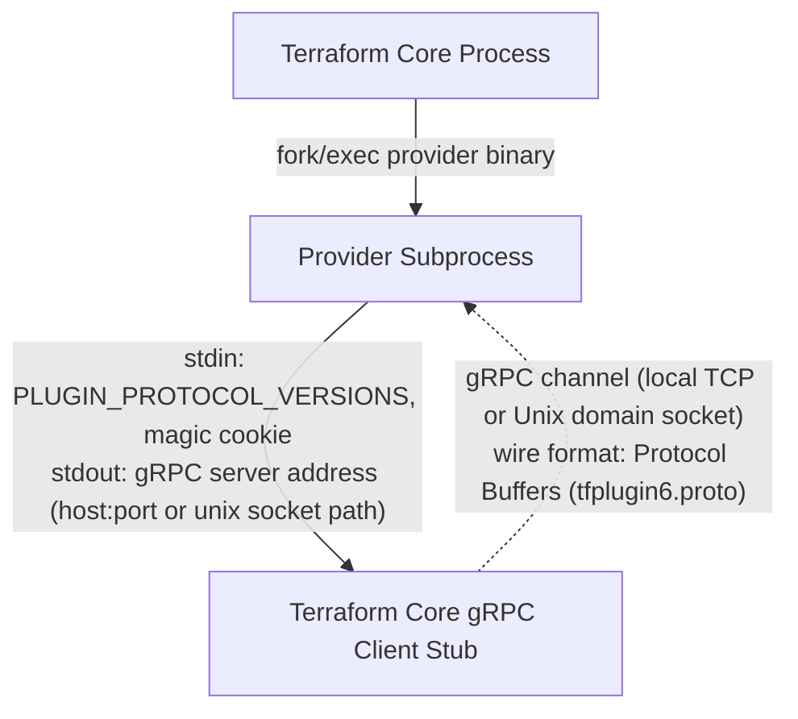
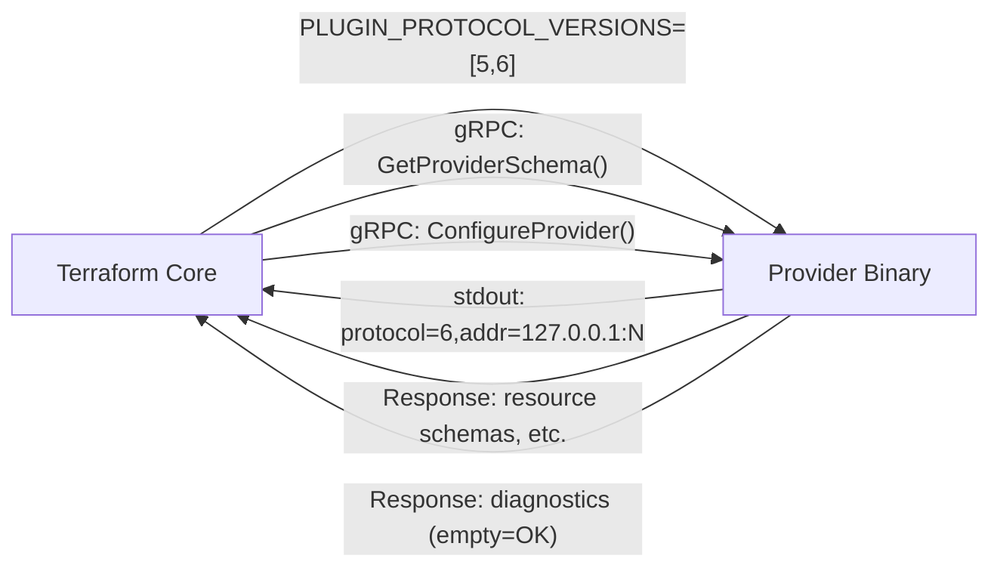

# Lesson 3: Provider Plugin Architecture

## 1. First-Principles Intuition & Invariants

Terraform's power does not live in its core binary. The core binary is, in a deliberate architectural sense, nearly empty of cloud knowledge. It knows how to parse HCL, build a dependency graph, sequence operations, and manage state. Everything else — the understanding that an `aws_instance` is an EC2 virtual machine, that creating it requires a POST to `https://ec2.amazonaws.com` with a particular XML body, and that deleting it requires a different call with a different signature — lives entirely in a provider plugin. This separation is not merely a packaging convenience. It encodes a fundamental architectural invariant: the lifecycle engine and the API translation layer must be independently versioned, independently distributed, and communicate through a stable, versioned contract. Without that invariant, every cloud API change would require a new Terraform release, and the ecosystem of hundreds of providers would collapse under the weight of a single monolithic binary.

To understand why the architecture evolved this way, it helps to trace its history. Prior to Terraform 0.13, providers were distributed alongside the Terraform binary itself, embedded as compiled-in packages within the same Go module. The boundary between core and provider was a package-level boundary in Go, not a process boundary. This meant that upgrading a provider required upgrading the entire Terraform binary, that providers from the community could not be distributed independently, and that a panic in a provider plugin would crash the core process entirely. HashiCorp resolved all three problems simultaneously by moving to an out-of-process architecture built on gRPC, mediated by the `go-plugin` library. Each provider runs as a separate OS process. The Terraform core binary spawns it, negotiates a protocol version over stdin/stdout, and then communicates with it over a local Unix domain socket or TCP loopback connection using Protocol Buffers as the wire format. A provider crash is now a contained subprocess failure, not a core crash.

The contract between Terraform core and a provider is defined by the **Provider Protocol**, currently at version 6 (proto6) for most modern providers, with version 5 (proto5) remaining in widespread use. The protocol is defined formally in a `.proto` file — specifically `tfplugin6.proto` — maintained in the `terraform-plugin-go` repository. This protobuf schema is the ground truth. It defines every RPC that core can invoke on a provider, every message shape that crosses the boundary, and every field that participates in the schema negotiation and CRUD lifecycle. When a provider author writes a provider using the high-level `terraform-plugin-framework`, they are writing against an SDK that ultimately serializes their intent into these protobuf messages. Understanding the protobuf contract is therefore the bedrock on which everything else rests.

The central invariant of the provider architecture is the **schema-driven contract**. Before Terraform core can plan or apply any resource, it must ask the provider to describe its own schema: what resource types it supports, what attributes each type carries, their types, their computed vs. required vs. optional status, their sensitivity, and their nesting structure. Core uses this schema to validate configuration, to build diffs, and to interpret state. The schema is not documentation — it is executable metadata that drives the planning engine. This means that schema design is a first-class engineering concern, not an afterthought. A poorly designed schema that marks a field as `Computed: true` when it should be `Required: true`, or that uses a flat `TypeString` for a field that is semantically a JSON object, will produce incorrect diffs, phantom plan changes on every apply, and state corruption that is very difficult to recover from.

The second invariant is **idempotency at the CRUD boundary**. Every Create, Read, Update, and Delete operation that a provider implements must be safe to call in the face of partial failure. If a Create call succeeds at the upstream API but the response never reaches Terraform (a network partition, a process kill), Terraform will retry. The provider's Create implementation must therefore be written so that re-invoking it does not create a duplicate resource — or, if it does, the provider must include reconciliation logic to detect the orphan. The Read operation is the linchpin here: it is the mechanism by which Terraform refreshes its understanding of real-world state before planning, and it must faithfully translate the upstream API's response back into Terraform's attribute representation without loss or distortion.

## 2. Core Architecture & Mechanics

### The Plugin Launch and Handshake Protocol

When you run `terraform init`, the CLI resolves provider requirements from your configuration, downloads provider binaries from the registry into `.terraform/providers/`, and writes a lock file (`.terraform.lock.hcl`) recording the exact version and SHA256 hash of each downloaded binary. The lock file is a security boundary: on subsequent runs, Terraform verifies the hash before execution, preventing silent binary substitution attacks.

When `terraform plan` or `terraform apply` runs, Terraform core launches each required provider binary as a child process. The launch sequence follows a precise handshake defined by `go-plugin`. The core process sets the environment variable `PLUGIN_PROTOCOL_VERSIONS` to the set of protocol versions it supports and writes a JSON-encoded `ReattachConfig` structure to the subprocess's stdin. The provider process reads this, starts a gRPC server on a randomly selected local port or Unix socket, and writes the server's address back to its stdout in a specific format that `go-plugin` parses. After this handshake, the core process holds a gRPC client stub connected to the provider's server and all subsequent communication is RPC over that connection.



The magic cookie is a critical detail: it is a hardcoded environment variable (`TF_PLUGIN_MAGIC_COOKIE`) that the provider binary checks at startup. If the variable is absent or incorrect, the provider refuses to start and prints an error message explaining that it is a Terraform plugin and cannot be run directly. This prevents accidental direct execution of provider binaries by operators who might confuse them with standalone CLI tools.

### The Provider Protocol (tfplugin6.proto)

The protobuf service definition for a provider under Protocol 6 exposes a set of RPC methods that Terraform core calls in a defined sequence. The most important methods, from an architectural standpoint, are `GetProviderSchema`, `ConfigureProvider`, `ReadResource`, `PlanResourceChange`, and `ApplyResourceChange`. Understanding what each one does and what invariants it must maintain is the foundation of provider engineering.

`GetProviderSchema` is the first RPC Terraform calls. The provider returns a `GetProviderSchema.Response` message containing a map of resource type names to their `Schema` descriptors, a map of data source type names to their `Schema` descriptors, and the schema for the provider block itself (the top-level configuration block where you specify API credentials, regions, and other provider-wide settings). Each `Schema` descriptor contains a `Block`, which is a recursive structure of `Attribute` and nested `Block` elements. Each `Attribute` carries a `cty.Type` encoded as a JSON-serialized type constraint — the `cty` type system is the internal representation Terraform uses for all values, supporting primitives (`string`, `number`, `bool`), collections (`list`, `map`, `set`), and structural types (`object`, `tuple`).

`ConfigureProvider` is called once after schema negotiation. It delivers the evaluated provider block configuration — credentials, endpoints, timeouts — to the provider, which uses it to construct and cache the authenticated API client that all subsequent resource operations will use. This is where you would initialize an AWS SDK session, a Kubernetes client-go config, or an authenticated HTTP client for a custom API.

`PlanResourceChange` is where Terraform's declarative model becomes concrete. Core calls this RPC with three values: the prior state (what Terraform last recorded about this resource), the proposed new state (what the configuration says the resource should look like after merging computed defaults from prior state), and the provider's configuration. The provider's implementation examines these values and returns a planned state — the definitive prediction of what the resource will look like after apply. If the provider needs to signal that an attribute's final value cannot be known until apply time (because it depends on the upstream API assigning an ID, for instance), it marks those attributes as unknown using a special `cty.DynamicVal` sentinel. Core uses these unknowns to propagate dependencies through the graph and to display the familiar `(known after apply)` annotations in plan output.

`ApplyResourceChange` is called during apply with the prior state and the planned state from the previous `PlanResourceChange` call. The provider must actually perform the create, update, or delete operation against the upstream API and return the resulting new state. This new state must be a fully-resolved, concrete value with no unknowns remaining, because Terraform will write it directly to the state file. If the apply operation returns an error, Terraform writes the partial state (whatever the provider returned before the error) to the state file and marks the resource as tainted, ensuring the next plan will force a replacement.

### Resource Schema Definitions and the cty Type System

The `cty` (Computed Types) library is the internal language of Terraform values. Every attribute in a resource schema has a `cty.Type`, and every value flowing through the provider protocol is a `cty.Value`. Understanding this type system at the mechanical level is non-negotiable for building correct providers.

The primitive types — `cty.String`, `cty.Number`, `cty.Bool` — are straightforward. The collection types introduce important semantic distinctions. A `cty.List` is an ordered sequence of values of a uniform element type, indexed by integer position. A `cty.Set` is an unordered collection of values of a uniform element type, deduplicated by value equality. A `cty.Map` is a collection of string-keyed values of a uniform element type. A `cty.Object` is a structural type where each attribute has a name and a potentially distinct type — it corresponds to a nested `Block` with known attribute names. The choice between these types has direct consequences for plan behavior: switching a list of objects to a set of objects changes how Terraform tracks identity across creates and deletes (by index vs. by value hash), and getting this wrong causes spurious diffs where elements appear to be destroyed and recreated whenever their order changes in the API response.

The `Attribute` descriptor inside a schema block carries several flags that govern planning behavior. `Required` means the user must provide a value and no default is implied. `Optional` means the user may omit it. `Computed` means the provider will determine the value and the user may not set it. The combination `Optional: true, Computed: true` is the most powerful and most dangerous combination: it means the user may provide a value, but if they don't, the provider will fill it in, and once filled in, Terraform will preserve it across plans unless the user explicitly overrides it. This is used for things like `ami` defaults or `availability_zone` selections that an AWS resource might pick automatically. If you mark a field `Computed: true` without `Optional: true` for a field that should be user-settable, users will find that their configured values are silently ignored after the first apply.

The `Sensitive` flag on an attribute instructs Terraform to redact its value in plan and apply output and to mark it as sensitive in state. Terraform state is not encrypted at rest by default in the open-source CLI — sensitive flag is a display-time redaction, not a storage-time encryption. This is a critical operational distinction: you must still use remote state backends with appropriate access controls for secrets.

```mermaid
flowchart TD
    FLAGS["Schema Attribute Flags\nPlanning Behavior Matrix"]

    subgraph required ["Required Only"]
        R_CS["Config Settable: Yes"]
        R_PF["Provider Fills Default: No"]
        R_PS["Preserved in State: From config"]
    end

    subgraph optional ["Optional Only"]
        O_CS["Config Settable: Yes"]
        O_PF["Provider Fills Default: No"]
        O_PS["Preserved in State: From config or null"]
    end

    subgraph computed ["Computed Only"]
        C_CS["Config Settable: No"]
        C_PF["Provider Fills Default: Yes"]
        C_PS["Preserved in State: From provider"]
    end

    subgraph optional_computed ["Optional + Computed"]
        OC_CS["Config Settable: Yes"]
        OC_PF["Provider Fills Default: Yes (if omitted)"]
        OC_PS["Preserved in State: From provider if omitted"]
    end

    FLAGS --> required
    FLAGS --> optional
    FLAGS --> computed
    FLAGS --> optional_computed

    R_CS --> R_PF --> R_PS
    O_CS --> O_PF --> O_PS
    C_CS --> C_PF --> C_PS
    OC_CS --> OC_PF --> OC_PS
```



### Building a Provider from Scratch: The terraform-plugin-framework

The `terraform-plugin-framework` Go library is the current-generation, HashiCorp-recommended SDK for building Protocol 6 providers. It replaces the older `terraform-plugin-sdk/v2`, which wrapped Protocol 5. The framework uses Go generics and interface-based composition to map provider concepts directly to Go types, and it handles all protobuf serialization internally.

A minimal but complete provider that manages a hypothetical "deployment" resource against a custom REST API demonstrates the full plugin architecture end-to-end. This provider will manage a resource that creates, reads, updates, and deletes a deployment record in a JSON API running on `localhost:8080`.

The provider's entry point, `main.go`, is straightforward:

```go
package main

import (
	"context"
	"log"

	"github.com/hashicorp/terraform-plugin-framework/providerserver"
	"github.com/example/terraform-provider-deployapi/internal/provider"
)

func main() {
	opts := providerserver.ServeOpts{
		Address: "registry.terraform.io/example/deployapi",
	}
	err := providerserver.Serve(context.Background(), provider.New(), opts)
	if err != nil {
		log.Fatal(err)
	}
}
```

`providerserver.Serve` is the `go-plugin` harness: it performs the stdin/stdout handshake, starts the gRPC server, and blocks until Terraform core disconnects. The `Address` field is the registry address that must match the `required_providers` block in user configurations.

The provider struct implements the `provider.Provider` interface, which requires `Metadata`, `Schema`, `Configure`, and `Resources` methods:

```go
package provider

import (
	"context"
	"net/http"

	"github.com/hashicorp/terraform-plugin-framework/datasource"
	"github.com/hashicorp/terraform-plugin-framework/provider"
	"github.com/hashicorp/terraform-plugin-framework/provider/schema"
	"github.com/hashicorp/terraform-plugin-framework/resource"
	"github.com/hashicorp/terraform-plugin-framework/types"
)

type DeployAPIProvider struct {
	client *http.Client
	apiURL string
}

type DeployAPIProviderModel struct {
	APIURL types.String `tfsdk:"api_url"`
}

func New() func() provider.Provider {
	return func() provider.Provider {
		return &DeployAPIProvider{}
	}
}

func (p *DeployAPIProvider) Metadata(_ context.Context, _ provider.MetadataRequest, resp *provider.MetadataResponse) {
	resp.TypeName = "deployapi"
	resp.Version = "1.0.0"
}

func (p *DeployAPIProvider) Schema(_ context.Context, _ provider.SchemaRequest, resp *provider.SchemaResponse) {
	resp.Schema = schema.Schema{
		Description: "Manages deployments via the Deploy API.",
		Attributes: map[string]schema.Attribute{
			"api_url": schema.StringAttribute{
				Required:    true,
				Description: "Base URL of the Deploy API, e.g. http://localhost:8080.",
			},
		},
	}
}

func (p *DeployAPIProvider) Configure(ctx context.Context, req provider.ConfigureRequest, resp *provider.ConfigureResponse) {
	var config DeployAPIProviderModel
	diags := req.Config.Get(ctx, &config)
	resp.Diagnostics.Append(diags...)
	if resp.Diagnostics.HasError() {
		return
	}
	p.apiURL = config.APIURL.ValueString()
	p.client = &http.Client{}
	resp.DataSourceData = p
	resp.ResourceData = p
}

func (p *DeployAPIProvider) Resources(_ context.Context) []func() resource.Resource {
	return []func() resource.Resource{
		NewDeploymentResource,
	}
}

func (p *DeployAPIProvider) DataSources(_ context.Context) []func() datasource.DataSource {
	return []func() datasource.DataSource{}
}
```

The `Configure` method stores the initialized `*http.Client` and API base URL on the provider struct. The framework then passes this provider struct as `ResourceData` to each resource via the `Configure` method on the resource itself, giving the resource access to the authenticated client without global state.

The deployment resource is where the CRUD mapping becomes concrete. The full resource implementation shows how each provider protocol RPC maps to a Go method:

```go
package provider

import (
	"bytes"
	"context"
	"encoding/json"
	"fmt"
	"io"
	"net/http"

	"github.com/hashicorp/terraform-plugin-framework/resource"
	"github.com/hashicorp/terraform-plugin-framework/resource/schema"
	"github.com/hashicorp/terraform-plugin-framework/resource/schema/planmodifier"
	"github.com/hashicorp/terraform-plugin-framework/resource/schema/stringplanmodifier"
	"github.com/hashicorp/terraform-plugin-framework/types"
)

type DeploymentResource struct {
	client *http.Client
	apiURL string
}

type DeploymentResourceModel struct {
	ID        types.String `tfsdk:"id"`
	Name      types.String `tfsdk:"name"`
	Image     types.String `tfsdk:"image"`
	Replicas  types.Int64  `tfsdk:"replicas"`
	Namespace types.String `tfsdk:"namespace"`
}

type deploymentAPIPayload struct {
	Name      string `json:"name"`
	Image     string `json:"image"`
	Replicas  int64  `json:"replicas"`
	Namespace string `json:"namespace"`
}

type deploymentAPIResponse struct {
	ID        string `json:"id"`
	Name      string `json:"name"`
	Image     string `json:"image"`
	Replicas  int64  `json:"replicas"`
	Namespace string `json:"namespace"`
}

func NewDeploymentResource() resource.Resource {
	return &DeploymentResource{}
}

func (r *DeploymentResource) Metadata(_ context.Context, req resource.MetadataRequest, resp *resource.MetadataResponse) {
	resp.TypeName = req.ProviderTypeName + "_deployment"
}

func (r *DeploymentResource) Schema(_ context.Context, _ resource.SchemaRequest, resp *resource.SchemaResponse) {
	resp.Schema = schema.Schema{
		Description: "Manages a deployment in the Deploy API.",
		Attributes: map[string]schema.Attribute{
			"id": schema.StringAttribute{
				Computed:    true,
				Description: "Server-assigned unique identifier for the deployment.",
				PlanModifiers: []planmodifier.String{
					stringplanmodifier.UseStateForUnknown(),
				},
			},
			"name": schema.StringAttribute{
				Required:    true,
				Description: "Name of the deployment.",
				PlanModifiers: []planmodifier.String{
					stringplanmodifier.RequiresReplace(),
				},
			},
			"image": schema.StringAttribute{
				Required:    true,
				Description: "Container image to deploy, including tag.",
			},
			"replicas": schema.Int64Attribute{
				Required:    true,
				Description: "Desired replica count.",
			},
			"namespace": schema.StringAttribute{
				Required:    true,
				Description: "Target namespace for the deployment.",
				PlanModifiers: []planmodifier.String{
					stringplanmodifier.RequiresReplace(),
				},
			},
		},
	}
}

func (r *DeploymentResource) Configure(_ context.Context, req resource.ConfigureRequest, resp *resource.ConfigureResponse) {
	if req.ProviderData == nil {
		return
	}
	p, ok := req.ProviderData.(*DeployAPIProvider)
	if !ok {
		resp.Diagnostics.AddError("Unexpected Provider Data Type",
			fmt.Sprintf("Expected *DeployAPIProvider, got %T", req.ProviderData))
		return
	}
	r.client = p.client
	r.apiURL = p.apiURL
}

func (r *DeploymentResource) Create(ctx context.Context, req resource.CreateRequest, resp *resource.CreateResponse) {
	var plan DeploymentResourceModel
	diags := req.Plan.Get(ctx, &plan)
	resp.Diagnostics.Append(diags...)
	if resp.Diagnostics.HasError() {
		return
	}

	payload := deploymentAPIPayload{
		Name:      plan.Name.ValueString(),
		Image:     plan.Image.ValueString(),
		Replicas:  plan.Replicas.ValueInt64(),
		Namespace: plan.Namespace.ValueString(),
	}
	body, err := json.Marshal(payload)
	if err != nil {
		resp.Diagnostics.AddError("Serialization Error", fmt.Sprintf("Failed to marshal request: %s", err))
		return
	}

	httpResp, err := r.client.Post(r.apiURL+"/deployments", "application/json", bytes.NewReader(body))
	if err != nil {
		resp.Diagnostics.AddError("API Request Error", fmt.Sprintf("POST /deployments failed: %s", err))
		return
	}
	defer httpResp.Body.Close()

	if httpResp.StatusCode != http.StatusCreated {
		rawBody, _ := io.ReadAll(httpResp.Body)
		resp.Diagnostics.AddError("API Error",
			fmt.Sprintf("POST /deployments returned HTTP %d: %s", httpResp.StatusCode, string(rawBody)))
		return
	}

	var apiResp deploymentAPIResponse
	if err := json.NewDecoder(httpResp.Body).Decode(&apiResp); err != nil {
		resp.Diagnostics.AddError("Response Decode Error", fmt.Sprintf("Failed to decode API response: %s", err))
		return
	}

	plan.ID = types.StringValue(apiResp.ID)
	plan.Name = types.StringValue(apiResp.Name)
	plan.Image = types.StringValue(apiResp.Image)
	plan.Replicas = types.Int64Value(apiResp.Replicas)
	plan.Namespace = types.StringValue(apiResp.Namespace)

	diags = resp.State.Set(ctx, &plan)
	resp.Diagnostics.Append(diags...)
}

func (r *DeploymentResource) Read(ctx context.Context, req resource.ReadRequest, resp *resource.ReadResponse) {
	var state DeploymentResourceModel
	diags := req.State.Get(ctx, &state)
	resp.Diagnostics.Append(diags...)
	if resp.Diagnostics.HasError() {
		return
	}

	httpResp, err := r.client.Get(r.apiURL + "/deployments/" + state.ID.ValueString())
	if err != nil {
		resp.Diagnostics.AddError("API Request Error", fmt.Sprintf("GET /deployments/%s failed: %s", state.ID.ValueString(), err))
		return
	}
	defer httpResp.Body.Close()

	if httpResp.StatusCode == http.StatusNotFound {
		resp.State.RemoveResource(ctx)
		return
	}
	if httpResp.StatusCode != http.StatusOK {
		rawBody, _ := io.ReadAll(httpResp.Body)
		resp.Diagnostics.AddError("API Error",
			fmt.Sprintf("GET /deployments/%s returned HTTP %d: %s", state.ID.ValueString(), httpResp.StatusCode, string(rawBody)))
		return
	}

	var apiResp deploymentAPIResponse
	if err := json.NewDecoder(httpResp.Body).Decode(&apiResp); err != nil {
		resp.Diagnostics.AddError("Response Decode Error", fmt.Sprintf("Failed to decode API response: %s", err))
		return
	}

	state.Name = types.StringValue(apiResp.Name)
	state.Image = types.StringValue(apiResp.Image)
	state.Replicas = types.Int64Value(apiResp.Replicas)
	state.Namespace = types.StringValue(apiResp.Namespace)

	diags = resp.State.Set(ctx, &state)
	resp.Diagnostics.Append(diags...)
}

func (r *DeploymentResource) Update(ctx context.Context, req resource.UpdateRequest, resp *resource.UpdateResponse) {
	var plan DeploymentResourceModel
	diags := req.Plan.Get(ctx, &plan)
	resp.Diagnostics.Append(diags...)

	var state DeploymentResourceModel
	diags = req.State.Get(ctx, &state)
	resp.Diagnostics.Append(diags...)

	if resp.Diagnostics.HasError() {
		return
	}

	plan.ID = state.ID

	payload := deploymentAPIPayload{
		Name:      plan.Name.ValueString(),
		Image:     plan.Image.ValueString(),
		Replicas:  plan.Replicas.ValueInt64(),
		Namespace: plan.Namespace.ValueString(),
	}
	body, err := json.Marshal(payload)
	if err != nil {
		resp.Diagnostics.AddError("Serialization Error", fmt.Sprintf("Failed to marshal request: %s", err))
		return
	}

	httpReq, err := http.NewRequestWithContext(ctx, http.MethodPut,
		r.apiURL+"/deployments/"+state.ID.ValueString(),
		bytes.NewReader(body))
	if err != nil {
		resp.Diagnostics.AddError("Request Construction Error", fmt.Sprintf("Failed to build PUT request: %s", err))
		return
	}
	httpReq.Header.Set("Content-Type", "application/json")

	httpResp, err := r.client.Do(httpReq)
	if err != nil {
		resp.Diagnostics.AddError("API Request Error", fmt.Sprintf("PUT /deployments/%s failed: %s", state.ID.ValueString(), err))
		return
	}
	defer httpResp.Body.Close()

	if httpResp.StatusCode != http.StatusOK {
		rawBody, _ := io.ReadAll(httpResp.Body)
		resp.Diagnostics.AddError("API Error",
			fmt.Sprintf("PUT /deployments/%s returned HTTP %d: %s", state.ID.ValueString(), httpResp.StatusCode, string(rawBody)))
		return
	}

	var apiResp deploymentAPIResponse
	if err := json.NewDecoder(httpResp.Body).Decode(&apiResp); err != nil {
		resp.Diagnostics.AddError("Response Decode Error", fmt.Sprintf("Failed to decode API response: %s", err))
		return
	}

	plan.Image = types.StringValue(apiResp.Image)
	plan.Replicas = types.Int64Value(apiResp.Replicas)

	diags = resp.State.Set(ctx, &plan)
	resp.Diagnostics.Append(diags...)
}

func (r *DeploymentResource) Delete(ctx context.Context, req resource.DeleteRequest, resp *resource.DeleteResponse) {
	var state DeploymentResourceModel
	diags := req.State.Get(ctx, &state)
	resp.Diagnostics.Append(diags...)
	if resp.Diagnostics.HasError() {
		return
	}

	httpReq, err := http.NewRequestWithContext(ctx, http.MethodDelete,
		r.apiURL+"/deployments/"+state.ID.ValueString(), nil)
	if err != nil {
		resp.Diagnostics.AddError("Request Construction Error", fmt.Sprintf("Failed to build DELETE request: %s", err))
		return
	}

	httpResp, err := r.client.Do(httpReq)
	if err != nil {
		resp.Diagnostics.AddError("API Request Error", fmt.Sprintf("DELETE /deployments/%s failed: %s", state.ID.ValueString(), err))
		return
	}
	defer httpResp.Body.Close()

	if httpResp.StatusCode != http.StatusNoContent && httpResp.StatusCode != http.StatusNotFound {
		rawBody, _ := io.ReadAll(httpResp.Body)
		resp.Diagnostics.AddError("API Error",
			fmt.Sprintf("DELETE /deployments/%s returned HTTP %d: %s", state.ID.ValueString(), httpResp.StatusCode, string(rawBody)))
		return
	}
}
```

Several design decisions in this implementation deserve close examination. The `id` attribute carries a `UseStateForUnknown()` plan modifier, which instructs Terraform that once `id` has a value in state, it should be preserved as-is during plan — it doesn't become unknown again on subsequent plans. Without this modifier, every plan would show `id = (known after apply)` even for existing resources, which is both confusing and prevents `id` from being used as an input to other resources in the same plan. The `name` and `namespace` attributes carry `RequiresReplace()`, encoding the domain knowledge that these fields are immutable in the upstream API — if either changes, Terraform must destroy the old resource and create a new one rather than attempting an in-place update.

The Read method's handling of HTTP 404 is particularly important. When the upstream API reports that a resource no longer exists, the correct behavior is `resp.State.RemoveResource(ctx)`, which removes the resource from state entirely. On the next plan, Terraform will then show this resource as needing to be created. This is the correct reconciliation path for out-of-band deletions — resources deleted directly in the API console rather than through Terraform.

### Protocol Version Negotiation and the Version Constraint Graph

Provider versioning in Terraform operates at two levels that are frequently conflated. The first is the **provider version** — the semantic version of the provider binary itself, specified in `required_providers` blocks and constrained in the lock file. The second is the **plugin protocol version** — the version of the gRPC/protobuf contract between core and the plugin.

```hcl
terraform {
  required_providers {
    deployapi = {
      source  = "registry.terraform.io/example/deployapi"
      version = "~> 1.0"
    }
  }
  required_version = ">= 1.5.0"
}
```

The `~> 1.0` constraint uses the pessimistic constraint operator, which allows patch and minor upgrades within the `1.x` series but prevents jumping to `2.0`. This matters enormously for large provider migrations: a provider that changes from protocol 5 to protocol 6 may also bump its major version, and operators using `~>` constraints are protected from automatic adoption.

Protocol version negotiation happens during the subprocess handshake. Terraform core announces the protocol versions it supports (currently `[5, 6]`). The provider binary announces which versions it implements. Core selects the highest mutually supported version. If there is no overlap — for instance, a very old provider binary that only speaks protocol 4 running against a modern Terraform core that dropped protocol 4 support — the handshake fails and Terraform prints an explicit incompatibility error. This is why the `.terraform.lock.hcl` file is so important to commit to version control: it prevents an operator from inadvertently upgrading a provider to a version that speaks a protocol the installed Terraform binary no longer supports, or vice versa.



## 3. High-Performance Optimization & Failure Modes

### Schema Design Pathologies and Their Consequences

The most common and consequential class of provider defects is schema design pathologies — decisions made during schema definition that produce correct behavior in the happy path but generate persistent phantom diffs, unnecessary replacements, or state corruption in production use.

The phantom diff pathology arises most frequently from the `Optional + Computed` combination applied to attributes whose upstream API normalizes or reformats the value. Consider a hypothetical `tags` attribute where the upstream API normalizes all tag keys to lowercase. A user configures `tags = { Env = "prod" }`. The provider creates the resource, the API stores `env = "prod"`, and the Read method returns `env = "prod"` back to Terraform. On the next plan, Terraform compares the configuration (`Env = "prod"`) against the state (`env = "prod"`) and reports a diff, even though no real change is needed. The correct resolution is to implement a `PlanModifier` or `StateUpgrader` that normalizes the value in Terraform's representation to match the API's normalization. The alternative is a `CustomizeDiff` function (in the older SDK) or a framework plan modifier that suppresses the diff when the values are semantically equivalent.

The unnecessary replacement pathology occurs when `RequiresReplace()` is applied to attributes that the upstream API actually supports updating in-place. This generates unnecessary resource destruction cycles in production, which for critical infrastructure like databases, load balancers, or IAM roles can be catastrophic. Before applying `RequiresReplace()` to any attribute, verify by reading the upstream API's documentation and, if possible, by testing against the actual API whether a mutation of that attribute triggers a resource replacement at the API level or merely a configuration update.

The state drift amplification pathology occurs when the provider's Read method loses information. If the upstream API returns a field in its GET response that the provider's Read method does not write back to state — perhaps because the field was added to the API after the provider was written — that field's value in state becomes stale. On the next plan, Terraform reports a diff even though the user has not changed their configuration, because the stale state disagrees with the new computed value. This is the operational argument for defensive, exhaustive Read implementations: always read and persist every attribute that the schema defines, even if you believe it won't change.

### Parallelism, Rate Limiting, and Provider-Side Concurrency

Terraform core executes independent resource operations in parallel, with the degree of parallelism controlled by the `-parallelism` flag (default: 10). Each parallel operation invokes an RPC on the provider. The provider's gRPC server handles these RPCs in separate goroutines. This means that if you are running 10 parallel creates against an upstream API that enforces a rate limit of 100 requests per second, and each create requires 5 API calls, you can easily exceed the rate limit and receive HTTP 429 responses.

The correct architecture for provider-side rate limiting is an exponential backoff retry loop with jitter, implemented at the HTTP client level and shared across all resource operations. Using the `hashicorp/go-retryablehttp` library or a manually configured `http.Transport` with retry middleware is the production pattern. The backoff logic must be careful to retry on 429 and 503 responses but not on 4xx client errors like 400 (Bad Request) or 404 (Not Found), which indicate a programming error or a legitimately missing resource rather than a transient API availability issue.

A subtler concurrency challenge arises from provider-side resource dependencies that Terraform's graph does not model. If creating two `deployapi_deployment` resources both write to the same namespace configuration record via a side-effecting API call, running them in parallel will produce a race condition at the API level even though Terraform's dependency graph correctly models them as independent. The solution is explicit `depends_on` metadata in the user's configuration or, better, a redesigned API that makes namespace configuration a first-class resource with its own create/read/update/delete lifecycle, allowing Terraform's graph engine to serialize the operations correctly.

### Provider Testing: The Acceptance Test Framework

Provider acceptance tests are the definitive validation that the CRUD mapping is correct. The `terraform-plugin-testing` library provides a framework that launches a real Terraform binary against a real provider binary (compiled from your code) and executes actual plan/apply/destroy cycles against a real or locally mocked API. Unlike unit tests, acceptance tests validate the full protocol path: schema negotiation, state serialization, plan modifier behavior, and idempotency.

```go
package provider_test

import (
	"testing"

	"github.com/hashicorp/terraform-plugin-testing/helper/resource"
)

func TestAccDeploymentResource_basic(t *testing.T) {
	resource.Test(t, resource.TestCase{
		ProtoV6ProviderFactories: testAccProtoV6ProviderFactories,
		Steps: []resource.TestStep{
			{
				Config: `
provider "deployapi" {
  api_url = "http://localhost:8080"
}

resource "deployapi_deployment" "test" {
  name      = "acc-test-deploy"
  image     = "nginx:1.25"
  replicas  = 2
  namespace = "staging"
}
`,
				Check: resource.ComposeAggregateTestCheckFunc(
					resource.TestCheckResourceAttrSet("deployapi_deployment.test", "id"),
					resource.TestCheckResourceAttr("deployapi_deployment.test", "name", "acc-test-deploy"),
					resource.TestCheckResourceAttr("deployapi_deployment.test", "replicas", "2"),
				),
			},
			{
				Config: `
provider "deployapi" {
  api_url = "http://localhost:8080"
}

resource "deployapi_deployment" "test" {
  name      = "acc-test-deploy"
  image     = "nginx:1.26"
  replicas  = 3
  namespace = "staging"
}
`,
				Check: resource.ComposeAggregateTestCheckFunc(
					resource.TestCheckResourceAttr("deployapi_deployment.test", "image", "nginx:1.26"),
					resource.TestCheckResourceAttr("deployapi_deployment.test", "replicas", "3"),
				),
			},
			{
				ResourceName:      "deployapi_deployment.test",
				ImportState:       true,
				ImportStateVerify: true,
			},
		},
	})
}
```

This test executes three sequential Terraform operations: an initial create, an in-place update (changing the image and replica count), and an import verification. The `ImportStateVerify` step is particularly valuable because it validates that the Read method reconstructs state faithfully from just the resource ID — a property that is essential for the `terraform import` command to work correctly, and that is frequently broken in providers where the Read method omits attributes that are not visible in the API's GET response but were known at creation time.

The import path requires implementing the `ImportState` method on the resource. For simple resources where the import identifier is the resource ID, the framework provides a one-line implementation:

```go
func (r *DeploymentResource) ImportState(ctx context.Context, req resource.ImportStateRequest, resp *resource.ImportStateResponse) {
	resource.ImportStatePassthroughID(ctx, path.Root("id"), req, resp)
}
```

For resources where the import identifier is composite — a resource that is scoped to both a namespace and a name, for instance — `ImportState` must parse the import identifier string, populate the relevant state attributes, and return a partial state that the subsequent `Read` call will complete.

### Versioning Constraints and Provider Upgrade Paths

Semantic versioning for Terraform providers carries specific meanings beyond the conventional `MAJOR.MINOR.PATCH` semantics. A patch release must be backwards compatible in every dimension: same schema, same state serialization, same behavior. A minor release may add new resources, new attributes, and new data sources, but must not remove or rename existing ones. A major release may make breaking changes to the schema, but must provide state migration logic via `StateUpgraders` that transforms state written by older provider versions into the format the new version expects.

State upgraders are defined on the resource and are keyed by schema version — an integer that the provider stores in the state file alongside the resource's attribute values. When Terraform loads state written by an older provider version and the current provider reports a higher schema version for that resource type, it invokes the state upgrader chain in sequence, transforming the state from version 0 to version 1 to version 2 and so on until it reaches the current version. Each upgrader receives the raw state as a `map[string]interface{}` and returns a transformed `map[string]interface{}`, giving the provider author full control over renaming fields, changing types, splitting attributes, or merging them.

```go
func (r *DeploymentResource) UpgradeState(ctx context.Context) map[int64]resource.StateUpgrader {
	return map[int64]resource.StateUpgrader{
		0: {
			PriorSchema: &schema.Schema{
				Attributes: map[string]schema.Attribute{
					"id":    schema.StringAttribute{Computed: true},
					"name":  schema.StringAttribute{Required: true},
					"image": schema.StringAttribute{Required: true},
					// replicas was stored as a string in v0
					"replicas":  schema.StringAttribute{Required: true},
					"namespace": schema.StringAttribute{Required: true},
				},
			},
			StateUpgrader: func(ctx context.Context, req resource.UpgradeStateRequest, resp *resource.UpgradeStateResponse) {
				type stateV0 struct {
					ID        types.String `tfsdk:"id"`
					Name      types.String `tfsdk:"name"`
					Image     types.String `tfsdk:"image"`
					Replicas  types.String `tfsdk:"replicas"`
					Namespace types.String `tfsdk:"namespace"`
				}
				var priorState stateV0
				diags := req.State.Get(ctx, &priorState)
				resp.Diagnostics.Append(diags...)
				if resp.Diagnostics.HasError() {
					return
				}

				var replicaCount int64
				fmt.Sscanf(priorState.Replicas.ValueString(), "%d", &replicaCount)

				upgradedState := DeploymentResourceModel{
					ID:        priorState.ID,
					Name:      priorState.Name,
					Image:     priorState.Image,
					Replicas:  types.Int64Value(replicaCount),
					Namespace: priorState.Namespace,
				}

				diags = resp.State.Set(ctx, &upgradedState)
				resp.Diagnostics.Append(diags...)
			},
		},
	}
}
```

This upgrader handles the migration from a hypothetical v0 schema where `replicas` was stored as a string to the current v1 schema where it is stored as an integer — a type change that would otherwise corrupt state on upgrade. The `PriorSchema` field is required: the framework uses it to deserialize the old state format before passing it to the upgrader function. Without it, the framework cannot read the old-format state and the upgrade fails.

The discipline required to build production-grade Terraform providers is, in many ways, the same discipline required to build any long-lived distributed system API: explicit contracts, versioned schemas, idempotent operations, and careful attention to what happens during partial failure. The provider architecture makes these concerns unavoidable by encoding them directly in the protocol. The gRPC interface is not merely a transport choice — it is a design statement that the boundary between infrastructure intent and infrastructure reality must be explicit, versioned, and verifiable at the wire level.
