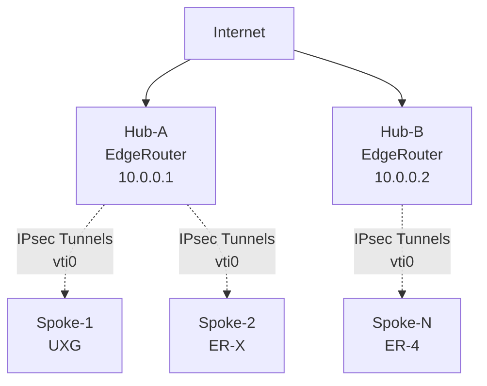
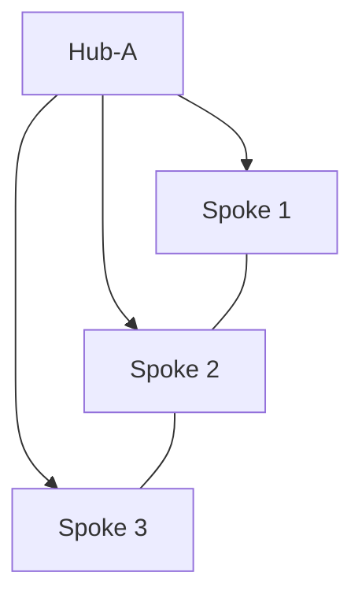

# Lesson 4: Enterprise Deployment Patterns

## 1. First-Principles Intuition & Invariants

Enterprise network infrastructure represents a hierarchy of control planes and data planes distributed across physical locations, each requiring resilient connectivity, predictable failover behavior, and continuous operational visibility. Ubiquiti UniFi and EdgeRouter ecosystems enable these requirements through a combination of hardware-accelerated routing, centralized SDN control, and vendor-native VPN overlay topologies. Understanding enterprise deployment patterns begins with recognizing that networks are fundamentally distributed state machines where convergence time, failure domains, and control plane reachability govern availability.

The invariant principle of enterprise-grade infrastructure is **separation of control and data planes**. In Ubiquiti architectures, the UniFi Controller or UNMS platform serves as the centralized control plane, maintaining authoritative configuration state, device telemetry, and topology graphs. The data plane resides in the physical UniFi switches, access points, and EdgeRouter/UXG devices that forward packets at line rate using ASIC-accelerated switching fabrics and hardware offload engines. This separation allows operators to evolve network policy—VLANs, firewall rules, QoS markings—without interrupting packet forwarding, provided the control plane maintains quorum connectivity to managed devices.

Site-to-site connectivity in enterprise Ubiquiti deployments centers on persistent VPN tunnels that encapsulate private IP space across public internet links. The two dominant patterns are **IPsec tunnel mode** for EdgeRouter-to-EdgeRouter or UXG-to-UXG connections, and **WireGuard** for modern low-latency, cryptographically agile tunnels. Both protocols operate at Layer 3, establishing virtual point-to-point links that appear to the routing daemon as directly connected interfaces. The routing control plane—whether OSPF, BGP, or static routes—then exchanges reachability information over these tunnels, allowing the network to converge on optimal paths and detect link failures through keepalive timers.

The mathematical foundation of failover and redundancy rests on **link-state convergence time** and **path diversity**. For a network with $N$ sites and $E$ encrypted tunnels forming a connected graph $G=(V,E)$, the minimum spanning tree defines the baseline connectivity. However, production resilience demands at least $k$-edge connectivity, ensuring that the failure of any $k-1$ edges does not partition the graph. In practical Ubiquiti deployments, this translates to dual-homed sites with primary and secondary ISP links, each terminating IPsec tunnels to geographically diverse hub routers. The failover invariant becomes:

$$T_{\text{failover}} = T_{\text{detect}} + T_{\text{withdraw}} + T_{\text{converge}}$$

where $T_{\text{detect}}$ is the dead-peer-detection interval, $T_{\text{withdraw}}$ is the time to remove failed routes from the RIB, and $T_{\text{converge}}$ is the routing protocol's SPF recalculation time. For OSPF over IPsec with DPD set to 10 seconds and SPF hold-time of 5 seconds, typical failover windows range from 15 to 25 seconds.

Scalability limits in UniFi architectures emerge from three bottlenecks: **controller CPU capacity** for managing device state, **switch MAC address table depth** for Layer 2 forwarding, and **routing table size** for Layer 3 prefix lookup. A single UniFi Controller instance on recommended hardware (8 vCPU, 16GB RAM) reliably manages approximately 500 devices and 10,000 concurrent clients, after which MongoDB query latency and WebSocket update cycles degrade. Beyond this threshold, distributed controller deployments with site-specific instances and selective cross-site tunnel overlays become necessary. Switch MAC address tables—typically 16K entries on UniFi aggregation switches—constrain the scale of flat Layer 2 broadcast domains, reinforcing the imperative to segment networks into routed VLANs with summarized inter-VLAN routes.

Monitoring instrumentation for production Ubiquiti infrastructure operates at three layers: **control plane telemetry**, **data plane counters**, and **application-layer synthetic transactions**. The UniFi Controller exposes device uptime, tunnel status, and radio channel utilization through its REST API and WebSocket streams, enabling integration with Prometheus, Grafana, and centralized syslog collectors. Data plane visibility comes from SNMP polling of interface octet counters, error rates, and queue depths, revealing congestion and hardware faults before client impact. Application-layer monitoring employs continuous ICMP echo probes and TCP connection checks across VPN tunnels, measuring round-trip latency distributions and detecting asymmetric routing or firewall misconfigurations.

The operational invariant for production Ubiquiti networks is **idempotent configuration management**. Because the UniFi Controller reconciles desired state to actual device configuration on every adoption and provisioning cycle, operators must treat the controller's site.json and device profiles as the authoritative source of truth. Manual CLI changes to switches or routers outside the controller's awareness create configuration drift that will be silently overwritten on the next provisioning event. This behavior mirrors Kubernetes' declarative reconciliation loops, where the controller continuously drives observed state toward declared intent. For advanced configurations—custom firewall rules, policy-based routing, or OSPF tuning—operators employ UniFi's config.gateway.json override mechanism or EdgeRouter's /config tree persistence to ensure changes survive reboots and provisioning cycles.


## 2. Core Architecture & Mechanics

### Hub-and-Spoke Topology with Redundant Hubs

The canonical enterprise Ubiquiti deployment pattern establishes two or more hub sites hosting high-availability EdgeRouter or UXG pairs, with spoke sites maintaining dual IPsec tunnels to each hub. This topology minimizes tunnel count—scaling as $O(N)$ rather than $O(N^2)$ for full mesh—while providing path redundancy. Each hub router terminates 50 to 100 IPsec tunnels, aggregating spoke traffic and advertising a default route or summary prefixes inbound. Spoke sites receive two default routes with unequal OSPF metrics or BGP local-preference values, ensuring deterministic primary and backup path selection.



Each spoke router configures two virtual tunnel interfaces (vti0, vti1) bound to separate IPsec security associations targeting Hub-A and Hub-B. The VTI interface model decouples IPsec encapsulation from routing, allowing OSPF or BGP to treat tunnels as standard point-to-point links. The EdgeOS configuration for a spoke establishes the IPsec proposal, authentication pre-shared key, and VTI binding:

```
set vpn ipsec ipsec-interfaces interface eth0
set vpn ipsec esp-group ESP-HUB lifetime 3600
set vpn ipsec esp-group ESP-HUB pfs enable
set vpn ipsec esp-group ESP-HUB proposal 1 encryption aes256gcm128
set vpn ipsec esp-group ESP-HUB proposal 1 hash sha256

set vpn ipsec ike-group IKE-HUB lifetime 28800
set vpn ipsec ike-group IKE-HUB proposal 1 dh-group 14
set vpn ipsec ike-group IKE-HUB proposal 1 encryption aes256
set vpn ipsec ike-group IKE-HUB proposal 1 hash sha256

set vpn ipsec site-to-site peer 203.0.113.10 authentication mode pre-shared-secret
set vpn ipsec site-to-site peer 203.0.113.10 authentication pre-shared-secret "REDACTED_PSK_HUB_A"
set vpn ipsec site-to-site peer 203.0.113.10 connection-type initiate
set vpn ipsec site-to-site peer 203.0.113.10 ike-group IKE-HUB
set vpn ipsec site-to-site peer 203.0.113.10 vti bind vti0
set vpn ipsec site-to-site peer 203.0.113.10 vti esp-group ESP-HUB

set interfaces vti vti0 address 172.16.1.2/30
set interfaces vti vti0 description "Tunnel to Hub-A"
set interfaces vti vti0 mtu 1436

set vpn ipsec site-to-site peer 203.0.113.20 authentication mode pre-shared-secret
set vpn ipsec site-to-site peer 203.0.113.20 authentication pre-shared-secret "REDACTED_PSK_HUB_B"
set vpn ipsec site-to-site peer 203.0.113.20 connection-type initiate
set vpn ipsec site-to-site peer 203.0.113.20 ike-group IKE-HUB
set vpn ipsec site-to-site peer 203.0.113.20 vti bind vti1
set vpn ipsec site-to-site peer 203.0.113.20 vti esp-group ESP-HUB

set interfaces vti vti1 address 172.16.2.2/30
set interfaces vti vti1 description "Tunnel to Hub-B"
set interfaces vti vti1 mtu 1436
```

The MTU reduction to 1436 bytes accounts for IPsec ESP overhead (50 bytes) and IPv4 header (20 bytes), preventing fragmentation and Path MTU Discovery blackholes. The proposal specifies AES-256-GCM for authenticated encryption with associated data, eliminating the need for separate HMAC computation and reducing CPU cycles per packet by approximately 30 percent compared to AES-CBC with SHA256-HMAC.

### OSPF Overlay for Dynamic Failover

With IPsec tunnels established, OSPF Area 0 runs across all VTI interfaces to exchange routing information and detect link failures. Each hub router advertises a default route with a baseline metric, while spokes advertise their local LAN prefixes. The OSPF dead-interval timer governs failover speed; setting it to 10 seconds with hello-interval of 3 seconds ensures sub-15-second convergence. The spoke router OSPF configuration:

```
set protocols ospf area 0 network 172.16.1.0/30
set protocols ospf area 0 network 172.16.2.0/30
set protocols ospf area 0 network 192.168.10.0/24
set protocols ospf parameters router-id 192.168.10.1
set protocols ospf redistribute connected metric-type 2
set protocols ospf timers throttle spf delay 200
set protocols ospf timers throttle spf initial-holdtime 1000
set protocols ospf timers throttle spf max-holdtime 10000
```

Hub routers inject a default route into OSPF with controlled metrics to steer traffic. Hub-A advertises 0.0.0.0/0 with metric 10, while Hub-B uses metric 50, establishing Hub-A as the primary egress path under normal conditions:

```
set protocols ospf area 0 area-type stub default-cost 10
set protocols ospf default-information originate always metric 10 metric-type 1
```

When vti0 fails due to ISP outage or hub-side router failure, OSPF withdraws the route learned via vti0 and installs the route via vti1 within one SPF calculation cycle. The spoke router's routing table before failure shows:

```
O*E1 0.0.0.0/0 [110/11] via 172.16.1.1, vti0
                [110/51] via 172.16.2.1, vti1
```

After failure detection and convergence:

```
O*E1 0.0.0.0/0 [110/51] via 172.16.2.1, vti1
```

Active TCP connections experience packet loss during the convergence window but recover once the new path is installed, provided TCP congestion control algorithms (CUBIC or BBR) back off and retransmit.

### Full Mesh for Low-Latency East-West Traffic

For enterprise deployments where spoke-to-spoke latency is critical—such as real-time VoIP, database replication, or video conferencing—a partial or full mesh overlay reduces hop count and eliminates hub bottlenecks. A full mesh topology among $N$ sites requires $\frac{N(N-1)}{2}$ tunnels, becoming operationally complex beyond 10 sites. Partial mesh strategies connect high-traffic spoke pairs with direct tunnels while maintaining hub-and-spoke as the fallback path.



In this partial mesh, Spoke1 and Spoke2 maintain a direct IPsec tunnel for low-latency data replication, while all three spokes retain hub tunnels for internet egress and connectivity to other sites. The OSPF cost assigned to direct spoke-to-spoke tunnels (cost 5) is lower than the hub-transit path (cost 10 + 10 = 20), causing OSPF to prefer the direct link.

Scaling mesh topologies demands automation. Operators employ configuration management tools—Ansible, Terraform, or custom Python scripts leveraging the UniFi API—to template IPsec peer definitions and OSPF network statements, reducing manual errors and provisioning time from hours to minutes per site.

### Layer 2 Extension via VXLAN or Layer 3 Handoff

Traditional enterprise designs require extending Layer 2 broadcast domains across sites for server clustering or VM mobility. Ubiquiti EdgeRouters support VXLAN encapsulation, enabling MAC-over-UDP tunnels that stretch VLANs across IPsec-protected WANs. However, VXLAN introduces additional overhead (50 bytes) and complicates troubleshooting due to nested encapsulation. The preferred modern pattern is **Layer 3 handoff at the site boundary** with /32 host routes or anycast addressing for service mobility.

For legacy applications mandating Layer 2 adjacency, the EdgeRouter VXLAN configuration binds a VXLAN tunnel endpoint (VTEP) to the VTI interface and bridges it to a local VLAN:

```
set interfaces vxlan vxlan0 address 10.255.255.1/24
set interfaces vxlan vxlan0 vni 100
set interfaces vxlan vxlan0 remote 10.255.255.2
set interfaces vxlan vxlan0 mtu 1386
set interfaces bridge br0 member interface vxlan0
set interfaces bridge br0 member interface eth1.100
```

This configuration tunnels VLAN 100 traffic from eth1.100 over vxlan0, which itself traverses the IPsec tunnel. The effective MTU shrinks to 1386 bytes, and operators must enable PMTUD or MSS clamping on both endpoints.

### High Availability via VRRP and State Synchronization

Critical hub sites deploy pairs of EdgeRouters in active-passive VRRP configuration, presenting a single virtual IP to spoke routers and downstream clients. VRRP (Virtual Router Redundancy Protocol) coordinates master election through multicast advertisements at one-second intervals. The master router owns the virtual IP and forwards packets, while the backup monitors advertisements and assumes mastership if three consecutive intervals elapse without hearing from the master.

```
set high-availability vrrp group 1 interface eth1
set high-availability vrrp group 1 virtual-address 10.0.1.254/24
set high-availability vrrp group 1 priority 200
set high-availability vrrp group 1 preempt true
set high-availability vrrp group 1 sync-group FAILOVER

set high-availability vrrp sync-group FAILOVER member 1
```

The priority value (200 on the primary, 100 on the backup) determines initial master election. Setting preempt true ensures the higher-priority router reclaims mastership after recovery from failure. The sync-group mechanism coordinates failover of multiple VRRP instances simultaneously, preventing split-brain scenarios where different router pairs own different virtual IPs.

For stateful services—NAT connection tracking, firewall session tables—EdgeRouters support conntrack-sync via the conntrackd daemon, replicating TCP and UDP session state to the backup router. This ensures established connections survive failover without application-layer resets:

```
set service conntrack-sync accept-protocol tcp,udp,icmp
set service conntrack-sync failover-mechanism vrrp sync-group FAILOVER
set service conntrack-sync interface eth2
set service conntrack-sync mcast-group 225.0.0.50
```

The backup router listens for conntrack state updates on multicast group 225.0.0.50 and populates its session table, enabling immediate packet forwarding upon VRRP failover.

### UniFi Controller Clustering and Database Replication

UniFi Controller high availability traditionally required external MongoDB replica set configuration and load balancer front-ending. UniFi OS Console devices (UDM-Pro, UDR, Cloud Gateway) simplify this by embedding the controller in a hardened appliance, but multi-site deployments still benefit from distributed controller architectures. The recommended pattern deploys one controller per region, managing local devices, with selective inter-region tunnels for cross-site management.

For critical centralized control, operators deploy the UniFi Controller on Kubernetes with MongoDB StatefulSets and ReadWriteMany persistent volumes, ensuring controller pods can reschedule across nodes without losing device state. The Deployment manifest:

```yaml
apiVersion: apps/v1
kind: StatefulSet
metadata:
  name: unifi-controller
  namespace: infrastructure
spec:
  serviceName: unifi
  replicas: 1
  selector:
    matchLabels:
      app: unifi-controller
  template:
    metadata:
      labels:
        app: unifi-controller
    spec:
      containers:
      - name: unifi
        image: linuxserver/unifi-controller:7.5.187
        ports:
        - containerPort: 8443
          name: https
        - containerPort: 3478
          name: stun
        - containerPort: 10001
          name: discovery
        env:
        - name: MONGO_URI
          value: "mongodb://mongo-0.mongo.infrastructure.svc.cluster.local:27017,mongo-1.mongo.infrastructure.svc.cluster.local:27017,mongo-2.mongo.infrastructure.svc.cluster.local:27017/unifi?replicaSet=rs0"
        - name: MONGO_USER
          valueFrom:
            secretKeyRef:
              name: mongo-credentials
              key: username
        - name: MONGO_PASS
          valueFrom:
            secretKeyRef:
              name: mongo-credentials
              key: password
        volumeMounts:
        - name: unifi-data
          mountPath: /config
        resources:
          requests:
            memory: "2Gi"
            cpu: "1000m"
          limits:
            memory: "4Gi"
            cpu: "2000m"
  volumeClaimTemplates:
  - metadata:
      name: unifi-data
    spec:
      accessModes: [ "ReadWriteOnce" ]
      storageClassName: fast-ssd
      resources:
        requests:
          storage: 20Gi
---
apiVersion: v1
kind: Service
metadata:
  name: unifi-controller
  namespace: infrastructure
spec:
  type: LoadBalancer
  selector:
    app: unifi-controller
  ports:
  - port: 8443
    targetPort: 8443
    name: https
  - port: 3478
    targetPort: 3478
    protocol: UDP
    name: stun
  - port: 10001
    targetPort: 10001
    protocol: UDP
    name: discovery
```

The MongoDB replica set backing this controller runs as a separate StatefulSet with persistent volumes and inter-pod anti-affinity rules to distribute replicas across Kubernetes nodes, ensuring database availability during node failures.


## 3. High-Performance Optimization & Failure Modes

### Hardware Offload and Forwarding Performance

Ubiquiti EdgeRouter performance hinges on hardware offload capabilities that bypass the Linux kernel networking stack. The EdgeRouter 4 and EdgeRouter 6P employ Cavium OCTEON multi-core MIPS64 processors with integrated packet processing engines capable of line-rate forwarding at 3.4 million packets per second. However, IPsec encryption, deep packet inspection, and certain firewall rules disable hardware offload, relegating packet processing to CPU software paths and reducing throughput to 100 to 300 Mbps.

Operators verify hardware offload status via the command-line interface:

```bash
show ubnt offload
```

The output indicates which features are offloaded:

```
IP offload module   : loaded
IPv4 forwarding     : enabled
IPv4 vlan           : enabled
IPv4 pppoe          : disabled
IPv4 gre            : disabled
IPv4 bonding        : disabled
IPv6 forwarding     : disabled
IPv6 vlan           : disabled
IPsec offload       : disabled
```

When IPsec offload shows disabled, the router forwards encrypted traffic through the kernel, saturating CPU cores under high load. To maximize throughput, operators select routers with IPsec hardware acceleration—such as the EdgeRouter Infinity with Intel QuickAssist—or deploy dedicated VPN appliances (UniFi Security Gateway Pro) for tunnel termination, reserving EdgeRouters for pure routing.

Queue depth tuning and traffic shaping prevent buffer bloat and reduce latency variance. The default pfifo_fast qdisc introduces head-of-line blocking under congestion, causing interactive traffic to suffer. Replacing it with fq_codel (Fair Queuing with Controlled Delay) isolates flows and actively manages queue depth:

```
set traffic-policy shaper WAN-SHAPER bandwidth 100mbit
set traffic-policy shaper WAN-SHAPER default bandwidth 95%
set traffic-policy shaper WAN-SHAPER default ceiling 100%
set traffic-policy shaper WAN-SHAPER default queue-type fq-codel
set interfaces ethernet eth0 traffic-policy out WAN-SHAPER
```

This configuration rate-limits egress traffic to 100 Mbps, applies fq_codel to manage queue depth, and allocates 95 percent bandwidth to the default class, reserving 5 percent for control traffic. Latency under load drops from 200 ms with default queueing to sub-20 ms with fq_codel.

### BGP Multihoming and AS Path Prepending

Enterprises with multiple ISP connections leverage BGP to influence inbound and outbound traffic paths. Each hub router peers with its ISP via eBGP, advertising its public address space and receiving a full or partial internet routing table. Outbound traffic path selection follows BGP's decision process: prefer higher local-preference, shorter AS path, lower MED, and finally lowest IGP metric to next-hop.

For dual-homed sites with ISP-A and ISP-B, the router configuration establishes eBGP sessions and applies local-preference to prefer ISP-A for outbound traffic:

```
set protocols bgp 65001 neighbor 198.51.100.1 remote-as 65100
set protocols bgp 65001 neighbor 198.51.100.1 soft-reconfiguration inbound
set protocols bgp 65001 neighbor 198.51.100.1 route-map PREFER-ISP-A in

set protocols bgp 65001 neighbor 198.51.100.5 remote-as 65200
set protocols bgp 65001 neighbor 198.51.100.5 soft-reconfiguration inbound

set policy route-map PREFER-ISP-A rule 10 action permit
set policy route-map PREFER-ISP-A rule 10 set local-preference 200
```

For inbound traffic steering, the router prepends its AS number multiple times to routes advertised via the less-preferred ISP, artificially lengthening the AS path and discouraging inbound traffic:

```
set policy route-map PREPEND-ISP-B rule 10 action permit
set policy route-map PREPEND-ISP-B rule 10 set as-path-prepend "65001 65001 65001"

set protocols bgp 65001 neighbor 198.51.100.5 route-map PREPEND-ISP-B out
```

This prepending causes external networks to prefer the ISP-A path (AS path length 2) over ISP-B (AS path length 5), reducing inbound traffic via ISP-B by approximately 70 percent in typical scenarios.

### IPsec Dead-Peer Detection and Tunnel Flapping

IPsec tunnels occasionally enter flapping states where they oscillate between up and down due to asymmetric routing, aggressive DPD timers, or NAT binding timeouts. Dead-peer detection sends encrypted keepalive probes every N seconds, expecting replies within M seconds. If three consecutive probes fail, the router tears down the security association and attempts renegotiation.

The default DPD interval of 30 seconds causes slow failover. Reducing it to 10 seconds accelerates detection but increases false positives when transient packet loss occurs. The optimal configuration depends on link characteristics:

```
set vpn ipsec site-to-site peer 203.0.113.10 ike-group IKE-HUB dead-peer-detection action restart
set vpn ipsec site-to-site peer 203.0.113.10 ike-group IKE-HUB dead-peer-detection interval 10
set vpn ipsec site-to-site peer 203.0.113.10 ike-group IKE-HUB dead-peer-detection timeout 30
```

For tunnels crossing NAT devices, operators must configure UDP encapsulation to prevent NAT binding expiration:

```
set vpn ipsec ipsec-interfaces interface eth0
set vpn ipsec nat-traversal enable
set vpn ipsec nat-networks allowed-network 0.0.0.0/0
```

This forces all IPsec traffic to encapsulate in UDP port 4500, maintaining NAT mappings even during idle periods.

### OSPF Adjacency Failures and Split-Brain Scenarios

OSPF adjacency failures manifest as routers unable to form neighbor relationships despite IPsec tunnels showing established status. The most common causes are MTU mismatches, authentication failures, and area ID misconfigurations. OSPF performs MTU validation during the Database Description exchange phase, rejecting adjacencies if advertised MTU exceeds the local interface MTU.

Operators diagnose OSPF adjacencies by examining neighbor state:

```bash
show ip ospf neighbor
```

If neighbors remain in EXSTART or EXCHANGE states, MTU mismatch is likely. The solution is either reducing MTU on VTI interfaces or disabling MTU verification (discouraged):

```
set interfaces vti vti0 mtu 1436
set protocols ospf area 0 interface vti0 mtu-ignore
```

Split-brain scenarios occur when inter-hub connectivity fails, causing each hub to believe the other is down and both advertising default routes with equal metrics. Spoke routers receive conflicting routing information and may distribute traffic unpredictably. The mitigation is deploying a third hub or using BGP with deterministic tie-breaking via router-id comparison:

```
set protocols bgp 65001 parameters router-id 10.0.0.1
```

BGP's router-id tie-breaker ensures consistent path selection across all spokes when metrics are equal.

### Controller Device Adoption Storms and Database Contention

Large UniFi deployments experience periodic adoption storms when multiple devices reboot simultaneously following firmware upgrades or power events. Each device initiates HTTPS connections to the controller, performing certificate validation and configuration sync. A controller managing 500 devices faces 500 concurrent TLS handshakes and MongoDB queries, saturating CPU and database connection pools.

The failure mode manifests as devices stuck in "Adopting" state, controller UI becoming unresponsive, and MongoDB query times exceeding 10 seconds. The resolution involves rate-limiting device adoption via firewall rules and scaling MongoDB with read replicas:

```
set firewall name RATE-LIMIT-INFORM rule 10 action accept
set firewall name RATE-LIMIT-INFORM rule 10 state new enable
set firewall name RATE-LIMIT-INFORM rule 10 state established enable
set firewall name RATE-LIMIT-INFORM rule 10 protocol tcp
set firewall name RATE-LIMIT-INFORM rule 10 destination port 8080
set firewall name RATE-LIMIT-INFORM rule 10 recent count 10
set firewall name RATE-LIMIT-INFORM rule 10 recent time 60
```

This rule limits each source IP to 10 new TCP connections to port 8080 (UniFi inform) per 60 seconds, spreading adoption load over several minutes. Concurrently, deploying MongoDB with read preference set to secondaryPreferred offloads read-heavy operations from the primary replica.

### Monitoring and Observability via SNMP and Syslog

Production observability requires continuous polling of interface statistics, tunnel status, and system health metrics. Ubiquiti devices expose SNMP MIB-II objects and vendor-specific OIDs for granular visibility. Operators configure SNMP v3 for authenticated and encrypted metric collection:

```
set service snmp v3 group MONITORING mode ro
set service snmp v3 user monitor auth type sha
set service snmp v3 user monitor auth plaintext-key "REDACTED_AUTH_KEY"
set service snmp v3 user monitor privacy type aes
set service snmp v3 user monitor privacy plaintext-key "REDACTED_PRIV_KEY"
set service snmp v3 user monitor group MONITORING
```

Prometheus scrapes SNMP metrics via the snmp_exporter, translating OIDs into time-series data for alerting and dashboards. Critical metrics include interface input/output errors, VTI interface state, and CPU load average. Alerting rules trigger notifications when tunnel flapping exceeds thresholds or error rates climb:

```yaml
groups:
- name: ubiquiti_alerts
  interval: 30s
  rules:
  - alert: IPsecTunnelDown
    expr: ifOperStatus{ifDescr=~"vti.*"} == 2
    for: 2m
    labels:
      severity: critical
    annotations:
      summary: "IPsec tunnel {{ $labels.ifDescr }} on {{ $labels.instance }} is down"
  - alert: HighInterfaceErrors
    expr: rate(ifInErrors[5m]) > 100
    for: 5m
    labels:
      severity: warning
    annotations:
      summary: "High input errors on {{ $labels.ifDescr }} at {{ $labels.instance }}"
```

Syslog centralization aggregates authentication events, configuration changes, and kernel messages for forensic analysis. The EdgeRouter syslog configuration forwards messages to a remote collector:

```
set system syslog host 10.1.1.50 facility all level info
set system syslog host 10.1.1.50 facility auth level notice
```

The collector—typically Graylog, Loki, or Elasticsearch—indexes messages and provides full-text search for incident response.

### Capacity Planning and Throughput Estimation

Capacity planning for Ubiquiti enterprise networks centers on three constraints: router CPU cycles, switch backplane capacity, and WAN bandwidth. IPsec encryption consumes approximately 1000 CPU cycles per packet for AES-GCM on MIPS64 processors, translating to roughly 1 CPU core per 500 Mbps of encrypted throughput at 1500-byte MTU. For a hub router terminating 50 tunnels with average 200 Mbps per tunnel, the aggregate encrypted throughput of 10 Gbps requires hardware offload or dedicated appliances.

Switch backplane capacity governs aggregate non-blocking throughput. The UniFi Switch Pro 48 PoE provides 70 Gbps backplane capacity, adequate for 48 ports of Gigabit Ethernet but insufficient for fully populated 10G SFP+ uplinks under sustained load. Operators design hierarchies with core switches providing non-blocking capacity and access switches oversubscribed at 4:1 or 8:1 ratios, matching typical enterprise workload patterns where only 12 to 25 percent of access ports sustain simultaneous high throughput.

WAN bandwidth estimation requires measuring peak traffic rates and applying growth factors. A site with 200 users averaging 5 Mbps during peak hours consumes 1 Gbps aggregate, but burstiness and asymmetry reduce sustained requirements to 300 to 400 Mbps. Provisioning dual 500 Mbps circuits provides 1 Gbps aggregate capacity with N+1 redundancy, allowing one circuit to fail without service degradation.

### Configuration Backup and Disaster Recovery

Configuration state resides in the EdgeRouter's /config tree and the UniFi Controller's MongoDB database. Disaster recovery mandates automated daily backups stored off-site. EdgeRouters support configuration export via:

```bash
/opt/vyatta/sbin/vyatta-cfg-cmd-wrapper show configuration commands > /config/backup-$(date +%Y%m%d).cfg
scp /config/backup-$(date +%Y%m%d).cfg backup-server:/backups/edgerouter/
```

Automating this via cron ensures consistent capture of configuration drift. Restoration involves copying the configuration script and sourcing it during boot or interactively:

```bash
configure
source /config/backup-20240315.cfg
commit
save
```

UniFi Controller backups leverage the built-in scheduled backup feature or MongoDB dump utilities:

```bash
mongodump --host localhost --port 27117 --db unifi --out /backups/unifi-$(date +%Y%m%d)
tar czf /backups/unifi-$(date +%Y%m%d).tar.gz /backups/unifi-$(date +%Y%m%d)
```

Restoration requires stopping the controller service, restoring the MongoDB database, and restarting:

```bash
systemctl stop unifi
mongorestore --host localhost --port 27117 --db unifi /backups/unifi-20240315/unifi/
systemctl start unifi
```

For Kubernetes-hosted controllers, operators employ Velero with persistent volume snapshots, enabling point-in-time recovery of both application state and configuration data.
