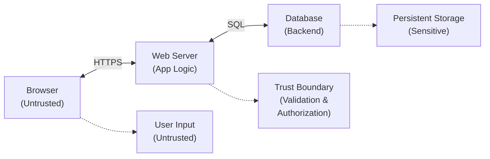
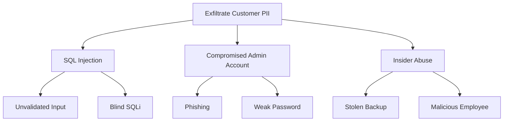

# Lesson 1: Threat Models in Application Context

## 1. First-Principles Intuition & Invariants

At the heart of application security lies a deceptively simple question: what are we protecting, from whom, and at what cost? Every security decision—whether architectural, operational, or cryptographic—rests upon the answer to this foundational inquiry. A threat model is not a checklist of vulnerabilities nor a catalog of attack techniques; it is a systematic framework for reasoning about adversarial behavior, asset valuation, and the economic and technical trade-offs inherent in defense. Without a rigorously constructed threat model, security engineering devolves into an undirected application of mitigations, a reactive posture that chases symptoms rather than addressing root causes.

The discipline of threat modeling emerged from military and intelligence contexts, where asset classification, adversary capability assessment, and operational security were matters of national survival. In the software domain, these principles translate into a formal methodology for decomposing an application into its constituent attack surfaces, enumerating the classes of adversaries with motive and capability to exploit those surfaces, and prioritizing defensive investments according to risk magnitude. The threat model serves as the contract between security architects and the broader engineering organization: it defines the adversarial assumptions under which the system is designed to remain secure, and it explicitly acknowledges the threats that fall outside the defense envelope.

The fundamental invariant of threat modeling is that **security is not absolute but contextual**. A mobile banking application and an internal developer dashboard share almost no threat model, despite potentially sharing the same technology stack. The banking app faces sophisticated, financially motivated adversaries with access to device compromise capabilities, social engineering resources, and the patience to mount multi-stage attacks. The internal dashboard may operate within a zero-trust network perimeter, where the primary threats are insider abuse, privilege escalation from compromised credentials, and lateral movement following initial access. Designing both systems with identical security controls represents a catastrophic misallocation of engineering resources: the banking app may be under-protected against credential stuffing and device takeover, while the internal dashboard incurs unnecessary latency and complexity from cryptographic operations irrelevant to its threat landscape.

Attack surface taxonomy provides the structural foundation for threat modeling. An attack surface is any interface through which an adversary can inject malicious input, observe sensitive state, or influence system behavior. In modern web applications, the attack surface comprises HTTP endpoints, WebSocket connections, file upload handlers, database query interfaces, authentication and session management subsystems, third-party API integrations, client-side JavaScript execution contexts, and the myriad transitive dependencies introduced through package managers. Each of these surfaces presents distinct classes of vulnerabilities: injection flaws arise where untrusted input flows into interpreters; broken authentication stems from flawed state management; insecure deserialization emerges from trusting serialized object graphs; and server-side request forgery exploits the ambient authority of backend network contexts.

Beyond the technical attack surface lies the human and operational surface. Social engineering targets the psychological vulnerabilities of users and administrators, exploiting cognitive biases, authority gradients, and trust relationships to bypass technical controls entirely. Phishing campaigns impersonate legitimate entities to harvest credentials. Business Email Compromise leverages compromised executive accounts to authorize fraudulent financial transactions. Insider threats, whether malicious or negligent, operate with legitimate access credentials and deep institutional knowledge, circumventing perimeter defenses by definition. Supply chain attacks compromise upstream dependencies, injecting malicious code into trusted build artifacts that propagate downstream to thousands of dependent applications. The SolarWinds breach exemplified this attack class: adversaries compromised the build pipeline of a widely deployed monitoring tool, embedding a backdoor that granted persistent access to thousands of victim networks.

Threat actor motivations provide the economic and behavioral context that shapes attack patterns. Nation-state actors pursue strategic intelligence, intellectual property theft, and pre-positioning for future kinetic or cyber operations. Their operational tempo is patient, their budgets are functionally unlimited, and their legal constraints are minimal. Advanced Persistent Threat groups maintain persistent access for months or years, employing custom malware, zero-day exploits, and sophisticated anti-forensics techniques. Organized cybercrime syndicates optimize for financial return, targeting payment systems, cryptocurrency exchanges, and ransomware-vulnerable enterprises. Their tooling is increasingly commoditized, with Ransomware-as-a-Service platforms lowering the barrier to entry and enabling affiliate networks to scale attacks across industries. Hacktivists pursue ideological or political objectives, favoring high-visibility defacements, data leaks, and denial-of-service campaigns. Script kiddies and opportunistic attackers exploit known vulnerabilities in unpatched systems, seeking low-hanging fruit rather than investing in reconnaissance or capability development.

Risk assessment frameworks translate threat model abstractions into quantitative or semi-quantitative metrics that guide resource allocation. The STRIDE methodology, developed at Microsoft, categorizes threats into six classes: Spoofing identity, Tampering with data, Repudiation of actions, Information disclosure, Denial of service, and Elevation of privilege. Each STRIDE category maps to specific security properties—authentication, integrity, non-repudiation, confidentiality, availability, and authorization—and guides the selection of appropriate countermeasures. DREAD, a complementary framework, scores threats along five dimensions: Damage potential, Reproducibility, Exploitability, Affected users, and Discoverability. The aggregate DREAD score provides a heuristic for vulnerability prioritization, though its subjective nature and tendency toward over-scoring has led many organizations to adopt more rigorous approaches.

The Common Vulnerability Scoring System (CVSS) provides a standardized vulnerability severity metric, decomposing risk into Base, Temporal, and Environmental score groups. The Base score captures the intrinsic characteristics of a vulnerability: the attack vector (network, adjacent, local, or physical), attack complexity, privileges required, user interaction, and the impact to confidentiality, integrity, and availability. Temporal metrics account for exploit maturity, remediation availability, and report confidence. Environmental metrics adjust the score based on organizational context, such as the criticality of affected systems and the effectiveness of compensating controls. A critical CVSS score does not automatically mandate immediate patching; a network-accessible remote code execution vulnerability in an internet-facing application server demands urgent remediation, while the same vulnerability in an air-gapped development environment may be deprioritized in favor of more pressing risks.

The security requirements hierarchy mirrors Maslow's pyramid, establishing the foundational properties upon which higher-level assurances depend. At the base lies **memory safety**: the guarantee that software cannot violate spatial or temporal memory bounds, preventing buffer overflows, use-after-free, and double-free vulnerabilities. Languages like Rust enforce memory safety through compile-time borrow checking and lifetime analysis, eliminating entire classes of exploitable conditions. C and C++ provide no such guarantees, relying instead on programmer discipline, static analysis, and runtime mitigations like Address Space Layout Randomization (ASLR), stack canaries, and shadow stacks. The absence of memory safety has driven decades of exploitation, from the Morris Worm's buffer overflow to modern return-oriented programming and heap feng shui techniques.

Above memory safety lies **type safety**: the assurance that operations respect the semantic contracts of data types, preventing type confusion vulnerabilities where an attacker reinterprets a data structure to violate access control or integrity assumptions. JavaScript's dynamic typing and implicit coercion have spawned countless vulnerabilities where developer assumptions about type stability prove incorrect under adversarial input. TypeScript provides static type checking at compile time, catching type errors before deployment, though the runtime remains JavaScript with all its inherited flexibility and hazard.

**Authentication** establishes identity, answering the question "who is making this request?" Strong authentication relies on multiple factors: something you know (password or PIN), something you have (hardware token or mobile device), or something you are (biometric characteristic). Multi-factor authentication (MFA) dramatically raises the bar for account takeover, forcing adversaries to compromise multiple independent channels. However, implementation flaws abound: SMS-based second factors are vulnerable to SIM-swapping attacks, TOTP tokens can be phished through real-time reverse-proxy frameworks like Evilginx, and biometric systems face presentation attacks using synthetic fingerprints or photographs.

**Authorization** governs access control, determining what an authenticated principal is permitted to do. The principle of least privilege dictates that each component, user, and service should possess the minimum authority necessary to fulfill its function. Role-Based Access Control (RBAC) assigns permissions to roles rather than individuals, simplifying administration at the cost of granularity. Attribute-Based Access Control (ABAC) evaluates policies against attributes of the subject, resource, action, and environmental context, enabling fine-grained, dynamic access decisions. Broken Object Level Authorization (BOLA), also known as Insecure Direct Object Reference (IDOR), remains a pervasive vulnerability class where applications fail to verify that the authenticated user has authority over the requested resource, allowing horizontal privilege escalation across user boundaries.

**Integrity** ensures that data and code have not been tampered with, whether in transit, at rest, or during execution. Cryptographic hash functions like SHA-256 produce fixed-size digests that change unpredictably with any input modification, enabling tamper detection. Message Authentication Codes (MACs) combine hashing with a secret key, providing both integrity and authenticity. Digital signatures extend this concept using asymmetric cryptography, where a private key signs a message and the corresponding public key verifies the signature. Code signing applies digital signatures to executables and libraries, establishing a chain of trust from the software publisher to the end user. However, integrity mechanisms are only as strong as the key management infrastructure that protects signing keys and validation trust anchors.

**Confidentiality** protects sensitive data from unauthorized disclosure. Encryption transforms plaintext into ciphertext using a cryptographic algorithm and a secret key, such that an adversary without the key cannot efficiently recover the plaintext. Symmetric encryption algorithms like AES-GCM provide high performance and authenticated encryption, combining confidentiality and integrity in a single operation. Asymmetric encryption using RSA or elliptic curve cryptography enables secure key exchange and data encryption without prior shared secrets. Transport Layer Security (TLS) combines asymmetric and symmetric cryptography to establish confidential, authenticated channels over untrusted networks. Yet confidentiality guarantees are fragile: side-channel attacks exploit timing variations, power consumption, electromagnetic emanation, or cache access patterns to infer secret values without breaking the underlying cryptographic primitive.

**Availability** ensures that legitimate users can access services and data when needed. Denial-of-service attacks exhaust computational, memory, network, or storage resources, rendering systems unavailable to legitimate traffic. Distributed Denial-of-Service (DDoS) attacks leverage botnets of compromised devices to amplify attack volume, overwhelming target infrastructure. Application-layer attacks exploit algorithmic complexity vulnerabilities, such as hash collision attacks against unkeyed hash tables or regular expression denial-of-service (ReDoS) through catastrophic backtracking. Rate limiting, resource quotas, computational puzzles, and traffic scrubbing at Content Delivery Network (CDN) edges provide defense in depth, though sophisticated attackers adapt by targeting application-specific bottlenecks that circumvent generic mitigations.

The security requirements hierarchy is not a ladder to be climbed sequentially but a lattice of interdependent properties. Integrity without confidentiality leaks sensitive data even as it prevents tampering. Availability without authentication enables resource exhaustion by unauthenticated adversaries. Authorization without proper authentication is meaningless, granting or denying access to unverified identities. A robust threat model recognizes these dependencies and ensures that security controls form a coherent defensive architecture rather than a patchwork of isolated mechanisms.

## 2. Core Architecture & Mechanics

The operational mechanics of threat modeling begin with asset identification and classification. An asset is anything of value to the organization or its users: customer personally identifiable information (PII), payment card data, intellectual property, authentication credentials, cryptographic keys, session tokens, API secrets, source code, system configurations, and operational telemetry. Assets vary in sensitivity and business impact; the exposure of a user's email address carries different consequences than the exposure of their Social Security Number or the signing key for software updates. Data classification schemes, such as Public, Internal, Confidential, and Restricted, provide a vocabulary for reasoning about asset sensitivity and guide the application of appropriate controls.

Asset flow analysis traces the lifecycle of sensitive data through the application architecture. Data enters the system through user input, third-party APIs, or database queries. It flows through validation, business logic, transformation, and storage subsystems before being rendered to users or transmitted to external services. At each stage, the data's security requirements may change: a plaintext password must be hashed before storage, a credit card number must be encrypted in transit and at rest, and query results must be filtered according to the requesting user's authorization context. Data flow diagrams (DFDs) provide a visual representation of these paths, identifying trust boundaries where data crosses from trusted to untrusted contexts or vice versa.

Trust boundaries delineate the zones where security assumptions change. The boundary between the browser and the web server is a trust boundary because the client-side execution environment is fully under adversarial control; any data originating from the client must be treated as untrusted and subjected to rigorous validation. The boundary between the web server and the database is also a trust boundary when the web server is potentially compromised, but in many architectures, both components reside within the same trust zone, protected by network segmentation and authentication at the perimeter. Identifying trust boundaries clarifies where input validation, authentication, authorization, and encryption are required.

Attack tree analysis provides a hierarchical decomposition of adversarial objectives and the techniques available to achieve them. The root of the tree represents the attacker's ultimate goal, such as "exfiltrate customer database" or "execute arbitrary code on production server." Child nodes enumerate the intermediate steps or alternative paths to reach that goal. Leaf nodes represent atomic attack techniques, such as "exploit SQL injection in search parameter" or "brute-force administrative credentials." Each node can be annotated with difficulty estimates, required resources, and the defensive controls that mitigate that path. Attack trees expose the logical structure of threats, revealing bottleneck defenses that, if strengthened, collapse entire branches of the attack tree.

The STRIDE-per-element methodology applies the STRIDE threat categories systematically to each component in the data flow diagram. External entities, such as users or third-party services, may be spoofed if authentication is absent or weak. Data flows across trust boundaries are subject to tampering if integrity protections like TLS or message authentication are missing. Processes that perform sensitive operations may be repudiated if audit logging is insufficient. Data stores containing sensitive information face information disclosure risks if encryption at rest or access controls are inadequate. All components face denial-of-service threats from resource exhaustion. Processes running with elevated privileges are targets for elevation of privilege attacks through injection flaws, deserialization vulnerabilities, or privilege escalation exploits.

For each identified threat, the framework demands a defensive response: accept the risk if the likelihood and impact are sufficiently low, mitigate the threat through technical or procedural controls, transfer the risk through insurance or contractual obligations, or eliminate the threat by removing the vulnerable functionality. Accepting risk is not negligence if the decision is informed and documented; a low-traffic internal tool may rationally accept the risk of brute-force login attacks rather than implementing multi-factor authentication, provided the potential damage is bounded and acceptable to stakeholders. Mitigation is the most common response, implementing input validation to prevent injection attacks, enforcing authentication to prevent spoofing, and applying rate limiting to reduce denial-of-service impact. Risk transfer through cyber insurance shifts the financial burden of certain incidents but does not reduce the probability or technical impact of an attack. Risk elimination removes attack surface entirely, such as disabling unused API endpoints or restricting administrative interfaces to internal networks.

The Trike methodology emphasizes stakeholder-defined acceptable risk rather than enumerating threats. Stakeholders articulate which actors should have which permissions over which assets, constructing an access control matrix that serves as the security specification. The threat model then identifies deviations from this specification—scenarios where an unauthorized actor could gain access or where access controls are insufficiently enforced. Trike explicitly acknowledges that security is a business decision, not a purely technical one; the organization's risk appetite determines the acceptable trade-offs between security, functionality, and cost.

PASTA (Process for Attack Simulation and Threat Analysis) integrates threat modeling with business impact analysis and vulnerability assessment. The methodology unfolds across seven stages: define business objectives, define the technical scope, decompose the application, analyze threats, identify vulnerabilities, enumerate attacks, and perform risk and impact analysis. PASTA emphasizes attacker-centric thinking, simulating adversarial workflows to identify the most likely and impactful attack paths. By grounding threat analysis in business objectives, PASTA ensures that security investments align with organizational priorities, protecting the assets and functions that matter most to the enterprise.

Adversary emulation frameworks, such as MITRE ATT&CK, catalog real-world adversary tactics, techniques, and procedures (TTPs) observed across incidents and campaigns. The ATT&CK matrix organizes TTPs into tactical categories such as Initial Access, Execution, Persistence, Privilege Escalation, Defense Evasion, Credential Access, Discovery, Lateral Movement, Collection, Command and Control, Exfiltration, and Impact. Each technique is documented with examples, detection heuristics, and mitigation guidance. Threat models informed by ATT&CK align defensive priorities with observed adversary behavior, focusing on the techniques most commonly employed in successful intrusions. Purple team exercises combine offensive red team simulations with defensive blue team monitoring, validating detection and response capabilities against realistic attack scenarios.

Quantitative risk assessment translates threat model abstractions into financial metrics through frameworks like Factor Analysis of Information Risk (FAIR). FAIR decomposes risk into Loss Event Frequency (how often an attack succeeds) and Loss Magnitude (the impact when it does). Loss Event Frequency is the product of Threat Event Frequency (how often adversaries attempt the attack) and Vulnerability (the probability that an attempt succeeds given current controls). Loss Magnitude aggregates primary losses (direct costs such as data recovery and notification) and secondary losses (indirect costs such as reputation damage and regulatory fines). By expressing risk in monetary terms, FAIR enables cost-benefit analysis of security controls, comparing the Annualized Loss Expectancy (ALE) of a threat against the cost of mitigation. A control that costs more to implement than the expected annual loss it prevents is economically irrational, though non-financial factors like regulatory compliance and brand reputation may justify the investment.

Threat intelligence feeds enrich threat models with real-time adversary indicators, campaign trends, and emerging vulnerabilities. Commercial and open-source threat intelligence platforms aggregate data from honeypots, malware analysis sandboxes, dark web monitoring, vulnerability disclosures, and incident reports. Indicators of Compromise (IOCs) such as malicious IP addresses, domain names, file hashes, and behavioral signatures enable proactive blocking and detection. Threat intelligence must be contextualized; generic IOC feeds produce alert fatigue if applied indiscriminately. Effective intelligence integration tailors feeds to the organization's threat model, prioritizing adversaries and techniques relevant to the asset profile and attack surface.

## 3. High-Performance Optimization & Failure Modes

Threat modeling is not a one-time artifact produced during initial design but a continuous discipline that evolves with the application. Agile development practices demand incremental threat modeling integrated into sprint planning and user story definition. Security user stories capture adversarial scenarios alongside functional requirements, ensuring that defensive controls are architected from inception rather than retrofitted post-deployment. Threat model review gates in the CI/CD pipeline enforce that significant architectural changes trigger updated threat analysis, preventing security drift as the application evolves.

Automation accelerates threat modeling for complex, rapidly changing systems. Threat modeling tools parse architecture diagrams, Infrastructure-as-Code manifests, and API specifications to generate data flow diagrams and enumerate generic threats. Microsoft Threat Modeling Tool, OWASP Threat Dragon, and IriusRisk provide graphical interfaces for constructing DFDs and applying STRIDE analysis. These tools lower the barrier to entry, enabling developers without deep security expertise to perform baseline threat modeling. However, automation cannot replace expert judgment; generated threat models require validation and refinement by security architects who understand the nuances of the application domain and the sophistication of relevant adversaries.

False negatives plague threat modeling when analysis overlooks attack vectors or misjudges adversary capability. Supply chain attacks exemplify this failure mode; many organizations' threat models historically focused on direct attacks against their own infrastructure, neglecting the risk that adversaries would compromise upstream dependencies. The 2020 SolarWinds breach forced a wholesale reevaluation of supply chain trust assumptions. Similarly, cloud-native architectures introduce attack surfaces that legacy threat models did not anticipate: Instance Metadata Service (IMDS) exploitation, misconfigured S3 bucket policies, overly permissive IAM roles, and lateral movement through service meshes. Threat models must adapt to architectural shifts, incorporating new attack classes as they emerge.

False positives arise when threat models identify risks that are not exploitable under realistic adversarial constraints. Threat modeling workshops with limited domain expertise often enumerate dozens of theoretical threats without distinguishing high-likelihood, high-impact scenarios from low-priority edge cases. The result is a sprawling backlog of security tasks that dilutes focus and exhausts resources. Effective threat modeling requires ruthless prioritization, focusing on the threats that adversaries with means and motive are likely to exploit. A vulnerability reachable only from a physically secured internal network, requiring multiple layers of prior compromise and intimate knowledge of the application's internals, deserves lower priority than a remotely exploitable SQL injection on a public-facing search form.

Adversary capability estimation is inherently uncertain and biased by historical incident data. Threat models typically assume that adversaries will employ known techniques documented in frameworks like ATT&CK, but sophisticated nation-state actors invest in novel zero-day exploits and custom tooling that evades public knowledge until deployed. Conservative threat modeling adopts a "assume breach" mindset, designing defenses that limit the blast radius of compromise even when perimeter controls fail. Network segmentation partitions the environment into zones with restricted inter-zone communication, limiting lateral movement. Microsegmentation at the workload level enforces zero-trust principles, requiring explicit authentication and authorization for every service-to-service interaction. Least privilege reduces the authority available to compromised components, bounding the damage an attacker can inflict from a single foothold.

Performance and security trade-offs permeate application architecture. Strong cryptographic algorithms impose computational overhead, increasing latency and reducing throughput. Multi-factor authentication adds friction to the user experience, potentially harming conversion rates for customer-facing applications. Input validation and output encoding introduce processing delays and complexity. Security-conscious engineering balances these trade-offs by investing defensive resources where the risk is highest and accepting calculated risks where the threat model does not justify maximal controls. High-value transactions may demand step-up authentication with additional verification, while low-risk operations proceed with baseline credentials. Sensitive API endpoints may enforce aggressive rate limiting, while public content delivery accepts higher request volumes.

Failure to align threat models with operational realities creates brittle defenses that collapse under attack. A threat model assuming perfect patch hygiene is invalidated if operational constraints delay patching for months. A model assuming strong endpoint security is undermined if employees use personal devices or work from compromised networks. A model assuming that administrative access is tightly controlled fails if legacy VPN credentials proliferate unchecked. Effective threat modeling incorporates operational constraints explicitly, designing defenses robust to the messy reality of production environments: heterogeneous device fleets, inconsistent patching, shadow IT, credential sprawl, and configuration drift.

The feedback loop between threat modeling and incident response is critical for model refinement. Post-incident reviews validate threat model assumptions, identifying gaps where adversaries exploited unforeseen paths or techniques the model underestimated. Conversely, threat models guide incident response playbooks, predefining the likely attack paths and appropriate containment strategies for each identified threat. Organizations that treat threat modeling as a living artifact, continuously updated with lessons from incidents, penetration tests, and adversary intelligence, build resilience through iterative improvement. Those that treat it as a checkbox compliance exercise produce documents that gather dust while the real adversaries innovate around static defenses.

The ultimate measure of a threat model's effectiveness is not the comprehensiveness of its threat enumeration but the alignment of defensive investments with actual adversarial behavior. A lean threat model that accurately predicts the top five attack paths and successfully mitigates them is vastly superior to an encyclopedic model that diffuses resources across a hundred theoretical threats. The discipline of threat modeling is the discipline of strategic thinking under uncertainty: making informed bets about adversary actions, allocating finite resources to maximize defensive leverage, and adapting continuously as both the application and the threat landscape evolve. Without this foundation, application security remains an ad-hoc collection of best practices applied without coherent purpose. With it, security engineering becomes a rational, evidence-based discipline grounded in the reality of adversarial conflict.
