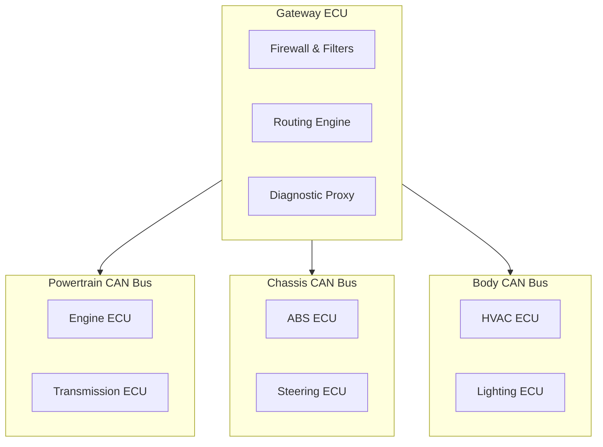

# Lesson 1: Vehicle Network Architectures, Protocol Security Properties, Attack Surface Taxonomy

## 1. First-Principles Intuition & Invariants

Modern automotive systems represent a deeply interconnected network of computational nodes—Electronic Control Units (ECUs)—that collectively orchestrate the safe and functional operation of a vehicle. These ECUs range from safety-critical components like the Engine Control Unit (ECU) and Anti-lock Braking System (ABS) to convenience subsystems managing infotainment, climate control, and telematics. Unlike traditional IT networks designed with security as a foundational concern, automotive networks evolved from isolated, analog control systems into complex digital architectures under relentless pressure to minimize cost, weight, and latency. This evolutionary constraint fundamentally shaped the security posture of in-vehicle communication protocols: authentication, encryption, and access control were systematically deprioritized in favor of deterministic real-time performance and bill-of-materials economy.

The security implications of this design philosophy are stark. Controller Area Network (CAN), the dominant protocol in vehicles since the 1980s, operates as a broadcast medium with no inherent authentication mechanism. Every message transmitted by any ECU is visible to all other nodes on the bus. More critically, any compromised ECU can transmit arbitrary messages impersonating any other node, with no cryptographic proof of origin. This trust model—or rather, the absence of one—assumes that physical access to the vehicle network is a sufficient security boundary. Yet this assumption has been systematically invalidated by the proliferation of wireless attack surfaces: Bluetooth-enabled infotainment systems, cellular telematics units, over-the-air update channels, and even tire pressure monitoring sensors have all served as remote entry points for adversaries to bridge from external networks into the vehicle's internal CAN bus.

Understanding automotive cybersecurity demands a first-principles analysis of why these protocols lack authentication, how their physical and logical topologies create exploitable trust boundaries, and what mechanical properties of the communication medium itself can be weaponized. The attack surface taxonomy we construct in this lesson emerges from three foundational invariants: the broadcast nature of legacy protocols, the absence of message authentication, and the architectural reliance on gateway ECUs to enforce domain isolation between network segments of differing criticality.

The first invariant—broadcast communication—stems from the multi-master, carrier-sense multiple access with arbitration on message priority (CSMA/CR) paradigm that CAN employs. When an ECU has data to transmit, it waits for the bus to become idle, then begins transmission. If multiple nodes attempt to transmit simultaneously, bitwise arbitration on the message identifier (CAN ID) resolves contention: the node transmitting the lowest numerical identifier (highest priority) wins bus access, while all others back off and retry. This arbitration mechanism is deterministic and fast, enabling sub-millisecond latency for high-priority messages like emergency braking commands. However, every frame transmitted is received by every node on the bus. There is no concept of unicast addressing or switched forwarding as found in Ethernet networks. This broadcast property means that a compromised infotainment ECU, which may have legitimate access to the CAN bus to display vehicle speed, can passively eavesdrop on all other traffic—including safety-critical messages from the steering ECU or powertrain controller.

The second invariant—absence of authentication—is even more consequential. A CAN frame consists of a start-of-frame bit, an 11-bit (standard) or 29-bit (extended) identifier, a 0–8 byte data payload, a 15-bit cyclic redundancy check (CRC), and acknowledgment/end-of-frame bits. Nowhere in this frame structure is there a signature, message authentication code (MAC), or counter to verify the sender's identity or detect replay attacks. The CRC provides only error detection for bit-level corruption during transmission; it does not protect against malicious message injection. An attacker who has compromised any ECU on the bus—or who has physical access via the OBD-II diagnostic port—can transmit frames with arbitrary identifiers and payloads. The receiving ECUs have no mechanism to distinguish between a legitimate command from the brake controller and a spoofed command from a compromised telematics unit.

The third invariant—gateway-based domain segmentation—represents the primary architectural mitigation for this hostile trust environment. Modern vehicles partition their networks into multiple CAN buses (or mixed protocol domains) segregated by criticality: a powertrain CAN bus for engine and transmission, a chassis CAN bus for steering and braking, a body CAN bus for doors and windows, and an infotainment CAN bus for user-facing systems. A central gateway ECU mediates communication between these domains, selectively forwarding messages based on a whitelist of allowed CAN identifiers and filtering out unauthorized traffic. This segmentation limits the blast radius of a compromised infotainment system: even if an attacker gains code execution on the head unit, they cannot directly transmit steering or braking commands unless they also compromise the gateway or exploit a misconfigured routing policy.

However, gateway isolation is not a panacea. It creates a single point of failure and introduces complexity in routing policy enforcement. Legitimate inter-domain communication—such as forwarding vehicle speed from the powertrain bus to the instrument cluster on the body bus—requires the gateway to bridge messages across trust boundaries. Each such forwarding rule expands the attack surface. Researchers have repeatedly demonstrated that seemingly benign diagnostic messages or firmware update commands, when forwarded through the gateway, can be leveraged to escalate privileges or inject payloads into higher-criticality domains.

Physical layer vulnerabilities further compound these protocol-level weaknesses. CAN operates as a differential signaling protocol over a two-wire twisted pair (CAN_H and CAN_L), transmitting dominant (0) and recessive (1) bits by driving voltage differentials between the two conductors. A dominant bit overrides a recessive bit during arbitration, enabling the bitwise priority resolution mechanism. But this electrical characteristic also enables denial-of-service attacks: an attacker with physical access can inject dominant bits continuously, holding the bus in a perpetual dominant state and preventing all legitimate communication. Such "bus-off" attacks can disable safety-critical systems like airbags or electronic stability control. Even without physical access, sophisticated adversaries have demonstrated remote bus manipulation by exploiting vulnerabilities in ECUs with both CAN and wireless interfaces, using the compromised node as a bridge to inject electrical faults.

Beyond CAN, modern vehicles increasingly deploy higher-bandwidth protocols to accommodate sensor fusion, high-definition mapping, and advanced driver assistance systems (ADAS). Automotive Ethernet—typically running 100BASE-T1 or 1000BASE-T1 over unshielded twisted pair—provides switched, full-duplex communication with Quality of Service (QoS) guarantees, supporting data rates orders of magnitude higher than CAN's 1 Mbps maximum. FlexRay, a deterministic time-triggered protocol, offers dual-channel redundancy and guaranteed message delivery for safety-critical applications, though its adoption remains limited to high-end vehicles. CAN-FD (Flexible Data-rate) extends classical CAN by increasing the payload size to 64 bytes and the data phase bit rate to 5 Mbps while maintaining backward compatibility during the arbitration phase.

Each of these protocols introduces distinct security properties and attack surfaces. Automotive Ethernet brings the full complexity of IP networking into the vehicle: TCP/IP stacks, ARP spoofing, VLAN hopping, and all the traditional network penetration techniques become applicable. FlexRay's time-triggered architecture provides stronger guarantees against timing-based injection attacks, but its static scheduling means that configuration vulnerabilities—such as overly permissive slot allocations—become critical. CAN-FD's higher throughput enables more sophisticated attacks, such as high-rate message flooding to exploit race conditions in receiving ECUs.

The attack surface taxonomy we develop in this lesson organizes these vulnerabilities into four primary categories: message injection and spoofing attacks that exploit the lack of authentication, eavesdropping and traffic analysis enabled by broadcast topologies, denial-of-service attacks targeting physical or protocol-layer properties, and gateway bypass techniques that circumvent domain isolation. Each category is grounded in the mechanical properties of the protocol and the physical constraints of the communication medium. Understanding this taxonomy requires moving beyond abstract threat models to examine the precise bit patterns, electrical signals, and state machine transitions that adversaries manipulate to compromise vehicle networks.

## 2. Core Architecture & Mechanics

To dissect the attack surface of automotive networks, we must first establish a precise mechanical model of how messages propagate through the vehicle's communication fabric. We begin with the classical CAN bus, tracing a single frame from its origination in a transmitting ECU through the physical layer signaling, arbitration, reception, and processing by target nodes. This detailed examination reveals the exact points at which an adversary can intercept, modify, or inject malicious traffic.

A CAN frame originates when an application layer process within an ECU generates a message to be transmitted. For instance, the Engine Control Unit may determine that the current engine RPM (5200) must be broadcast to the instrument cluster for display and to the transmission control unit for shift logic. The ECU's CAN controller—typically a dedicated microcontroller peripheral or integrated IP block—constructs a frame with the following structure:

```text
Start of Frame (SOF): 1 dominant bit
Identifier (CAN ID): 11 bits (standard) or 29 bits (extended)
Remote Transmission Request (RTR): 1 bit (0 for data frame)
Control Field: 6 bits (data length code + reserved)
Data Field: 0–8 bytes (0–64 bytes in CAN-FD)
CRC Field: 15 bits (21 bits in CAN-FD)
ACK Slot: 1 bit (transmitter sends recessive, receivers override with dominant)
End of Frame (EOF): 7 recessive bits
```

For our RPM message, the identifier might be `0x201`, the RTR bit is 0 (data frame), the data length code specifies 2 bytes, and the payload contains `0x1450` (5200 in hexadecimal). The CAN controller computes a 15-bit CRC over the SOF, identifier, control field, and data field, appends it to the frame, and serializes the bit sequence to the physical layer transceiver.

The transceiver translates logical bit values into electrical signals on the CAN_H and CAN_L differential pair. A dominant bit (0) drives CAN_H to approximately 3.5V and CAN_L to 1.5V, creating a differential voltage of +2V. A recessive bit (1) allows both lines to float to a common-mode voltage of approximately 2.5V, with a differential of 0V. All transceivers on the bus monitor the differential voltage: if any node transmits a dominant bit while others are transmitting recessive bits, the dominant state propagates to all nodes, overriding the recessive signals. This wired-AND property enables the arbitration mechanism.

When multiple ECUs attempt to transmit simultaneously, each monitors the bus after transmitting each bit. If a node transmits a recessive bit (1) but observes a dominant bit (0) on the bus, it immediately ceases transmission and enters a receive state. Since the CAN identifier is transmitted first, the message with the lowest numerical ID (numerically lowest bit pattern, meaning more dominant bits early in the identifier) wins arbitration. In our example, if the engine ECU transmits a frame with ID `0x201` while a lower-priority ECU (e.g., climate control with ID `0x305`) simultaneously transmits, the engine's message wins because the first differing bit (bit 8 of the identifier) is 0 for `0x201` and 1 for `0x305`.

Once a frame wins arbitration and is transmitted without error, all nodes on the bus receive it. Each ECU's CAN controller compares the received identifier against a hardware acceptance filter—a configurable mask and match register that determines which messages the controller will process. If the identifier passes the filter, the controller copies the frame's data payload to a receive buffer and generates an interrupt to the application processor. The application software then reads the payload from the buffer and acts on it. Critically, there is no step in this process where the receiver verifies the sender's identity or checks a cryptographic signature. The identifier is merely a priority label and a semantic tag indicating the message's content type; it carries no assurance about the originating ECU.

This architecture creates a trivial injection attack primitive. An adversary who has gained code execution on any ECU can directly program that node's CAN controller to transmit arbitrary frames. The attacker constructs a frame with the target identifier (e.g., `0x201` for engine RPM), fills the data payload with the desired malicious value (e.g., `0xFFFF` to indicate an invalid RPM and potentially trigger a fault state), and writes the frame to the transmit buffer. The CAN controller handles arbitration and serialization automatically. From the perspective of receiving ECUs, this spoofed frame is indistinguishable from a legitimate transmission.

Even without compromising an ECU, physical access to the CAN bus enables identical attacks. The OBD-II diagnostic port, mandated in all vehicles sold in the United States since 1996, provides direct electrical access to at least one of the vehicle's CAN buses—typically the powertrain CAN. An attacker can connect a CAN adapter (such as a Kvaser Leaf, PEAK PCAN-USB, or even a low-cost MCP2515-based Arduino shield) to the OBD-II port and transmit arbitrary frames. Aftermarket tools like the CANalyzer, SavvyCAN, or open-source utilities such as `can-utils` on Linux make this trivial.

To demonstrate the mechanical simplicity of message injection, consider the following workflow using `can-utils` on a Linux system with a SocketCAN-compatible adapter connected to the vehicle's CAN bus:

```bash
# Bring up the CAN interface at 500 kbps (typical CAN bus speed)
sudo ip link set can0 type can bitrate 500000
sudo ip link set up can0

# Monitor all CAN traffic to identify legitimate message patterns
candump can0

# Observe a legitimate RPM message, e.g.:
# can0  201   [2]  14 50

# Inject a spoofed RPM message indicating 7000 RPM (0x1B58)
cansend can0 201#1B58

# Inject a continuous stream of spoofed messages at 100 Hz
while true; do cansend can0 201#1B58; usleep 10000; done
```

This injection can cause the instrument cluster to display an incorrect RPM value, potentially misleading the driver. More critically, if the transmission control ECU relies on this RPM value for shift logic and lacks independent validation (e.g., cross-checking against throttle position or wheel speed), the spoofed message could cause erratic shifting behavior. The attack's impact depends on the semantic meaning of the target identifier and the presence or absence of sanity checks in the receiving ECU's application logic.

Beyond simple injection, adversaries can leverage the arbitration mechanism itself to manipulate bus traffic. Recall that dominant bits override recessive bits during arbitration. An attacker can exploit this property to selectively corrupt or suppress legitimate messages. For example, if the attacker knows that a safety-critical message with identifier `0x100` is periodically transmitted, they can inject a frame with identifier `0x100` and payload `0x0000000000000000` (all zeros) at the exact moment the legitimate transmitter begins sending. If the attacker's transmission begins slightly earlier or if the attacker can precisely time their injection, they can force the legitimate transmitter to lose arbitration and retry later—effectively introducing latency into safety-critical communication. At high injection rates, this becomes a denial-of-service attack.

A more sophisticated variant of this attack exploits the CRC and acknowledgment mechanism. After a frame's CRC field, the transmitter sends a recessive bit in the ACK slot, and any receiver that successfully received the frame responds by transmitting a dominant bit, acknowledging reception. If no receiver acknowledges the frame (because they detected a CRC error or did not receive the frame at all), the transmitter increments an error counter and retries. After a certain threshold of transmission errors, the CAN controller enters a "bus-off" state and ceases transmission, effectively isolating the node. An attacker can deliberately transmit malformed frames with invalid CRCs to force legitimate nodes into error states, or they can inject dominant bits during the ACK slot to suppress acknowledgments, causing transmitters to unnecessarily retransmit and consume bus bandwidth.

These physical-layer attacks extend to the differential signaling mechanism itself. The CAN bus termination resistors—typically 120 ohms at each end of the bus to match the characteristic impedance of the twisted pair and prevent reflections—can be shorted or removed to degrade signal integrity, inducing bit errors. An attacker with physical access can inject voltage transients onto the CAN_H or CAN_L lines, causing all nodes to detect errors and increment their error counters, potentially driving critical ECUs into bus-off states. Such attacks do not require compromising any ECU's firmware; they exploit the electrical properties of the shared medium.

Modern vehicles mitigate these risks through network segmentation, partitioning the vehicle into multiple isolated CAN buses. A typical architecture might include:



The gateway ECU serves as a controlled bridge between these domains, enforcing a routing policy that specifies which CAN identifiers may traverse from one bus to another. For instance, the gateway might allow vehicle speed (identifier `0x210` from the powertrain bus) to be forwarded to the instrument cluster on the body bus, but it blocks all other powertrain messages from crossing this boundary. Similarly, diagnostic requests from the OBD-II port—which typically connects to the body or infotainment bus—are filtered or proxied through the gateway, preventing direct access to safety-critical buses.

This segmentation strategy relies on the gateway to act as a trusted enforcement point. The gateway's routing table is typically configured during manufacturing and may be updated via authenticated firmware updates. However, this architecture introduces several attack vectors. First, if the gateway's routing policy is misconfigured—for example, if an overly permissive wildcard rule allows unintended identifiers to cross domains—an attacker who compromises a low-criticality ECU can send malicious messages to high-criticality buses. Second, the gateway itself becomes a high-value target: if an adversary gains code execution on the gateway ECU, they can arbitrarily modify routing rules, disable filters, or directly inject messages onto any connected bus. Third, legitimate diagnostic or firmware update protocols often require cross-domain communication, creating sanctioned pathways that attackers can abuse.

Gateway bypass techniques exploit these sanctioned pathways. Unified Diagnostic Services (UDS), standardized in ISO 14229, defines a request-response protocol for diagnostic operations over CAN. A diagnostic tester sends a request message (identifier `0x7DF` or a specific functional address) with a service identifier (e.g., `0x10` for diagnostic session control, `0x27` for security access, `0x34` for request download) and parameters. The target ECU responds with a message containing the service identifier plus `0x40` (e.g., `0x50` for a session control response). The gateway typically forwards these diagnostic messages across domains to allow technician tools to access all ECUs.

An attacker can leverage UDS to escalate privileges or inject malicious payloads. For example, the security access service (`0x27`) implements a challenge-response authentication mechanism to unlock protected diagnostic functions. If the cryptographic seed and key algorithm is weak or reverse-engineered—as has been the case in numerous production vehicles—the attacker can authenticate to an ECU and gain access to services like firmware reprogramming (`0x34`/`0x36`/`0x37`) or memory writes (`0x3D`). Once authenticated, the attacker can overwrite the ECU's firmware with a malicious image that includes backdoors or removes security checks. Since this reprogramming occurs over legitimate diagnostic channels, the gateway's routing policy permits it.

FlexRay networks introduce different architectural properties that alter the attack surface. FlexRay operates as a time-triggered, dual-channel protocol designed for safety-critical applications requiring deterministic latency and fault tolerance. Communication is organized into repeating cycles, each divided into a static segment and a dynamic segment. In the static segment, time slots are pre-allocated to specific ECUs, and each node transmits its message in its designated slot. In the dynamic segment, nodes compete for slots using a priority-based mini-slotting mechanism. This architecture provides strong guarantees against timing-based injection attacks: an attacker cannot arbitrarily inject a message into another node's static slot because all nodes synchronize their transmit schedules based on a global time base derived from the FlexRay protocol's clock synchronization algorithm.

However, FlexRay's complexity introduces configuration vulnerabilities. The schedule—which slots are allocated to which nodes and for which message identifiers—is statically configured during vehicle design and stored in each ECU's FlexRay controller. If this configuration is overly permissive (e.g., allocating unused slots that can be exploited, or allowing multiple nodes to transmit in the same slot), an attacker who compromises an ECU can exploit these misconfigurations. Additionally, FlexRay's dual-channel redundancy means that a message transmitted on both channels provides fault tolerance, but an attacker with access to both channels can inject consistent malicious messages that pass the redundancy checks.

Automotive Ethernet, increasingly deployed for camera and sensor data in ADAS, brings the full IP stack into the vehicle. Switches replace the broadcast topology of CAN, enabling unicast communication and VLAN-based isolation. However, this also introduces traditional network attack vectors. ARP spoofing allows an attacker to intercept traffic between two ECUs by claiming to be the MAC address of the target. VLAN hopping exploits misconfigurations in switch port settings to cross isolation boundaries. TCP/IP vulnerabilities—stack overflows, sequence number prediction, SYN floods—become applicable. The SOME/IP (Scalable service-Oriented MiddlewarE over IP) protocol, widely used for service discovery and RPC over automotive Ethernet, has been found to lack authentication in many implementations, allowing an attacker to impersonate services or inject malicious responses.

Wireless interfaces—Bluetooth, Wi-Fi, cellular, V2X—create remote entry points into the vehicle network. A Bluetooth vulnerability in the infotainment system can allow an attacker to gain code execution without physical access. Once inside the infotainment ECU, the attacker pivots to the vehicle's internal CAN buses through the gateway. Cellular telematics units, which provide features like remote start and stolen vehicle tracking, communicate with backend servers over the internet. If the telematics unit does not properly authenticate commands from the server, an attacker who compromises the server can send malicious commands to the vehicle. V2X (Vehicle-to-Everything) communication, used for cooperative awareness messages between vehicles, broadcasts safety-critical information like position and velocity over wireless channels, where an attacker can inject spoofed messages to mislead other vehicles.

Physical layer attacks extend to these wireless interfaces as well. GPS spoofing uses a software-defined radio to transmit fake satellite signals, causing the vehicle's navigation system to believe it is in a different location. This can mislead autonomous driving systems or defeat geofencing controls. Wi-Fi deauthentication frames can disrupt the vehicle's connectivity to over-the-air update servers. Cellular jamming can prevent telematics communication, denying remote diagnostic or safety features.

The layered attack surface of a modern vehicle thus spans physical access points (OBD-II, Ethernet ports), wireless entry vectors (Bluetooth, cellular, V2X), protocol-level weaknesses (lack of CAN authentication, UDS vulnerabilities, SOME/IP flaws), and architectural misconfigurations (gateway routing errors, excessive diagnostic privileges). Each layer presents distinct opportunities for exploitation, and the interaction between layers creates composite attack chains: an initial compromise via a wireless vulnerability escalates through gateway traversal to inject messages on safety-critical buses.

## 3. High-Performance Optimization & Failure Modes

Defending automotive networks requires a layered strategy that addresses both protocol-level weaknesses and architectural vulnerabilities. The primary challenge is retrofitting security into a system designed without it, while preserving the real-time performance guarantees that safety-critical functions depend on. We examine three categories of defensive mechanisms: message authentication and intrusion detection, gateway hardening and policy enforcement, and physical layer protections. Each mechanism must be evaluated not only for its security efficacy but also for its impact on latency, throughput, and fault tolerance.

Message authentication schemes for CAN aim to retrofit cryptographic integrity and origin verification onto a protocol that provides neither. The most mature approach is CAN Authentication (CANauth), which appends a truncated message authentication code (MAC) to the data payload. For a standard CAN frame with 8 bytes of payload, 4 bytes might be allocated to the MAC, leaving only 4 bytes for application data. The MAC is computed over the CAN identifier, data length code, application data, and a frame counter using a shared secret key and a keyed-hash algorithm like HMAC-SHA256 (truncated to 32 bits). Receiving ECUs recompute the MAC and compare it to the received value; mismatches indicate spoofing or corruption and trigger message rejection.

This approach faces several performance challenges. First, HMAC computation is computationally expensive for resource-constrained microcontrollers typical in automotive ECUs. A powertrain ECU might transmit engine RPM every 10 milliseconds; computing a MAC for each transmission introduces latency and processor load. Asymmetric cryptography (e.g., ECDSA signatures) is even more expensive and infeasible for high-rate messages. Second, the MAC payload overhead reduces the available data bandwidth. For messages that already use the full 8-byte payload, extending to CAN-FD (64 bytes) becomes necessary, but CAN-FD is not universally deployed and requires hardware upgrades. Third, key management becomes a critical vulnerability: all ECUs sharing a bus must possess the same symmetric key, and if any ECU is compromised, the key is exposed, undermining the entire authentication scheme. Asymmetric keys avoid this problem but at prohibitive computational cost.

Practical deployments have adopted hybrid approaches. High-criticality messages—such as steering commands or brake actuator signals—receive full authentication with the performance overhead deemed acceptable. Lower-criticality messages remain unauthenticated to preserve bandwidth and latency. Frame counters or timestamps are included in the MAC computation to prevent replay attacks, where an attacker captures and retransmits a valid authenticated message. The counter must be stored in non-volatile memory and incremented atomically to survive power cycles and prevent counter reuse.

Intrusion detection systems (IDS) for CAN operate by monitoring bus traffic for anomalies indicative of attacks. Statistical IDS approaches model the normal frequency, identifier distribution, and data value ranges of legitimate traffic, then flag deviations. For instance, if the engine RPM identifier `0x201` normally appears every 10 milliseconds with values between 600 and 7000 RPM, an IDS can detect a spoofing attack that floods the bus with `0x201` messages at 1-millisecond intervals or with values outside the expected range. Specification-based IDS approaches encode the vehicle's communication matrix—a manufacturer-provided document listing all legitimate CAN identifiers, their expected transmission rates, and the ECUs authorized to send them—and flag any message that violates these rules.

However, IDS alone cannot prevent attacks; they only detect and alert. Response actions—such as disconnecting a compromised ECU or filtering malicious messages—require integration with gateway enforcement mechanisms. False positives are a persistent challenge: benign anomalies (e.g., a legitimate firmware update that changes message rates, or a diagnostic session that introduces new identifiers) can trigger alerts, and tuning IDS rules to balance sensitivity and specificity is difficult. Machine learning-based IDS have been proposed to learn normal behavior from data, but they suffer from adversarial examples and require extensive training data covering all operational modes (startup, driving, diagnostics, etc.).

Gateway hardening focuses on securing the enforcement point that mediates cross-domain communication. The gateway's routing table must be stored in protected memory, readable only by the gateway's firmware and not modifiable by external diagnostic commands. Secure boot mechanisms ensure that the gateway's firmware has not been tampered with: the bootloader verifies a cryptographic signature on the firmware image before executing it, and the signature is validated using a public key burned into one-time-programmable fuses or stored in a hardware security module (HSM). Any firmware update must be signed by the manufacturer's private key, and unsigned or improperly signed images are rejected.

Runtime filtering in the gateway employs both stateless and stateful rules. Stateless rules specify allowed identifier-to-identifier mappings: identifier `0x210` (vehicle speed) from the powertrain bus may be forwarded to the body bus, while all other powertrain identifiers are blocked. Stateful rules track the context of ongoing sessions: if a diagnostic session has been established with a specific ECU, subsequent diagnostic messages are allowed until the session terminates. This prevents an attacker from blindly sending diagnostic commands without first authenticating through the proper session establishment sequence.

Advanced gateways implement rate limiting to prevent message flooding attacks. If the gateway detects that a single identifier is being transmitted at an abnormally high rate, it can throttle or drop excess frames, preserving bus bandwidth for legitimate traffic. Priority-based filtering ensures that high-criticality messages (e.g., brake commands) are never dropped, even under heavy load. However, determining appropriate rate limits requires precise knowledge of each message's normal transmission behavior, and overly restrictive limits can introduce false negatives that discard legitimate traffic during bursts.

Physical layer protections address electrical manipulation attacks. Bus monitoring hardware can detect abnormal dominant/recessive ratios or voltage transients indicative of bus-off attacks or signal injection. Intrusion-tolerant CAN transceivers, developed for aerospace and military applications, incorporate tamper detection and fail-operational circuitry: if tampering is detected, the transceiver can isolate the compromised segment or switch to a redundant bus. These components are significantly more expensive than standard automotive-grade transceivers and are not widely deployed in consumer vehicles.

Termination resistor monitoring circuits can detect when resistors are shorted or removed, indicating physical tampering. Some research prototypes employ powerline communication over the CAN bus's power supply rails to transmit cryptographic challenges, enabling nodes to authenticate each other through a side channel separate from the CAN data bus. However, these approaches add complexity and cost, and they have not yet seen production adoption.

Diagnostic protocol security requires hardening UDS implementations to prevent abuse. Security access challenges must use strong cryptographic algorithms with sufficient entropy: a 32-bit seed with a proprietary or weak key derivation function can be brute-forced. Migrating to standardized algorithms like AES or SHA-256 improves resistance but increases computational load. Access control policies must restrict which diagnostic services are available over which interfaces: firmware reprogramming should only be permitted from a physically connected diagnostic tool, not from a remote telematics connection. Session timeouts ensure that an authenticated diagnostic session expires after a period of inactivity, limiting the window for exploitation.

OBD-II port security is a persistent weak point. While the port is necessary for regulatory compliance and service technician access, it provides unrestricted physical access to at least one vehicle CAN bus. Some aftermarket security products physically lock the OBD-II port, requiring a key to access it. Software-based mitigations include gateway rules that limit which CAN identifiers are accessible via the OBD-II port and require authentication for sensitive commands. However, these mitigations are inconsistently applied across manufacturers.

Automotive Ethernet security leverages mature IT security practices. 802.1X port-based network access control authenticates devices before allowing them onto the network. MACsec (IEEE 802.1AE) provides hop-by-hop encryption and authentication at the data link layer, ensuring that messages cannot be eavesdropped or tampered with as they traverse the Ethernet fabric. IPsec can secure end-to-end communication between ECUs, though key distribution and certificate management introduce operational complexity. TLS secures SOME/IP communication, authenticating service providers and clients and encrypting RPC payloads. However, these protocols add latency and processing overhead, and their configuration must be carefully tuned to avoid introducing performance bottlenecks in latency-sensitive camera or lidar data streams.

Wireless interface security demands rigorous hardening of every remotely accessible component. Bluetooth stacks must be patched against known vulnerabilities like BlueBorne, and pairing should require user confirmation or out-of-band authentication to prevent unauthorized connections. Wi-Fi access points should enforce WPA3 encryption and disable WPS to prevent brute-force attacks. Cellular telematics units must authenticate commands from backend servers using mutual TLS or token-based schemes, and they should implement rate limiting to prevent command injection floods. V2X messages can employ digital signatures under the IEEE 1609.2 standard, which defines a public key infrastructure for vehicle-to-vehicle communication, though signature verification latency must be minimized to meet the sub-100-millisecond constraints of collision avoidance applications.

Over-the-air (OTA) update security is paramount, as compromised update mechanisms can serve as a persistent backdoor. Update packages must be signed by the manufacturer's private key and verified by the vehicle's ECUs before installation. Rollback protection ensures that an attacker cannot downgrade firmware to a vulnerable version: the firmware includes a version counter that must be monotonically increasing, and the bootloader refuses to install images with version numbers less than or equal to the current version. Secure storage of update signing keys requires hardware security modules or trusted execution environments to prevent key extraction even if the backend infrastructure is compromised.

Failure mode analysis must consider both attack-induced failures and the impact of defensive mechanisms on legitimate operation. A denial-of-service attack that drives critical ECUs into bus-off states can disable safety systems, but overly aggressive IDS rules can also cause false positives that inadvertently disrupt communication. Gateway filtering errors can block legitimate diagnostic access, stranding a vehicle at a repair facility. Authentication failures due to clock drift or key corruption can prevent ECUs from communicating, requiring manual intervention. Designing resilient automotive networks thus demands careful balancing: security mechanisms must be robust against sophisticated adversaries while degrading gracefully under benign failures and preserving the real-time guarantees that safety-critical systems require.

Testing and validation of these defensive mechanisms involves both benchtop simulation and real-vehicle testing. Hardware-in-the-loop (HIL) testbeds emulate vehicle networks and allow researchers to inject attack traffic without risking damage to actual vehicles. Fuzzing tools generate malformed or malicious CAN frames to discover vulnerabilities in ECU implementations. Penetration testing teams, employing the same tools and techniques as adversaries, attempt to compromise vehicles and document exploitable weaknesses. However, the proprietary nature of automotive networks—with limited public documentation and vendor-specific protocols—makes third-party security research challenging. Regulatory frameworks like UN R155 and ISO/SAE 21434 are beginning to mandate cybersecurity risk management throughout the vehicle lifecycle, but enforcement and verification remain inconsistent across jurisdictions.

The path forward for automotive cybersecurity lies in holistic architectural change: transitioning from broadcast, unauthenticated legacy protocols to authenticated, encrypted, and segmented network designs. Automotive Ethernet with MACsec and IPsec provides a foundation for this transition, but migration is costly and slow due to the long development cycles and regulatory certification requirements in the automotive industry. In the interim, defense-in-depth strategies—combining message authentication, intrusion detection, gateway hardening, and physical security—provide layered resilience against the multi-faceted attack surface that modern vehicles present. Understanding this attack surface in depth, from the electrical properties of differential signaling to the cryptographic properties of authentication schemes, equips researchers and engineers to build more secure vehicles and to identify and exploit weaknesses in existing systems. This lesson provides the foundational taxonomy and mechanical understanding necessary for that work.
