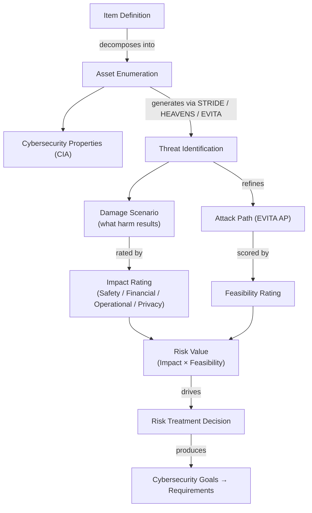

# Lesson 3: Threat Modeling Methodologies, TARA Processes, ISO 21434 Risk Assessment

## 1. First-Principles Intuition & Invariants

Modern vehicles are, without exaggeration, the most hostile deployment environment for a security engineer to reason about. A single platform integrates dozens of Electronic Control Units communicating over shared bus architectures, radio frequency interfaces spanning Bluetooth, Wi-Fi, cellular, and V2X, firmware update channels, telematics gateways, and—increasingly—cloud-synchronized feature delivery pipelines. Each of these layers carries trust boundaries. Each trust boundary is a potential attack surface. The engineering problem is not identifying that surfaces exist; it is building a systematic method to reason about which surfaces matter, what an adversary can do with them, and how much engineering investment is warranted in response. That systematic method is threat modeling, and in the automotive domain it has matured into a discipline with its own standards, scoring frameworks, and regulatory mandates.

The intuitive starting point is the same one Bruce Schneier articulated for general security decades ago: security is not a product, it is a process. For automotive systems, that process is now codified in ISO/SAE 21434:2021, which defines the engineering lifecycle for road vehicle cybersecurity from concept phase through decommissioning. The standard's core analytical instrument is the Threat Analysis and Risk Assessment, universally referred to as TARA. A TARA is not a checklist or a one-time audit. It is a living analytical artifact that must be updated whenever the threat landscape, vehicle architecture, or operational environment changes in a material way. Understanding why this is true requires understanding what a TARA actually computes.

At its most fundamental level, a TARA answers one question: given this asset and this adversary, what is the product of the probability of a successful attack and the magnitude of harm if that attack succeeds? This is the classical risk equation, $\text{Risk} = \text{Likelihood} \times \text{Impact}$, but both terms require domain-specific decomposition before they carry actionable meaning. Likelihood is not simply a historical frequency; in automotive security it is modeled as *attack feasibility*, a composite of elapsed time, specialist expertise required, knowledge of the target, window of opportunity, and equipment cost. Impact is not a single scalar; it decomposes into safety consequences (injury and loss of life), financial consequences, operational consequences, and privacy violations, each calibrated against different severity scales. The TARA machinery exists to make this decomposition rigorous, repeatable, and auditable.

Before the scoring machinery can operate, the analyst must resolve a more fundamental problem: what are we protecting? The answer in ISO 21434 terminology is the *asset*. An asset is any vehicle component, function, data item, or communication channel whose compromise could lead to harm. Assets are almost never obvious from a surface reading of the system architecture. A naive analyst might list "the ECU firmware" as an asset, but the actual security-relevant property is not the firmware file itself—it is the *cybersecurity property* that the firmware is authentic, unmodified, and executes with integrity. ISO 21434 formalizes this by requiring that every asset be associated with one or more cybersecurity properties drawn from the classic CIA triad: Confidentiality, Integrity, and Availability. The loss of a specific property on a specific asset is what the threat models actually target, and this precision is what separates an automotive TARA from a generic IT risk assessment.

The invariants that underpin the entire discipline follow directly from this structure. First, threat identification must be taxonomy-driven, not ad hoc, because human intuition systematically misses threat categories under time pressure. Second, impact and feasibility must be scored using calibrated, documented scales, not qualitative adjectives, because risk treatment decisions require defensible numerical inputs. Third, every identified risk must result in an explicit treatment decision—accept, avoid, reduce, or transfer—because an unaddressed identified risk is not a gap in the analysis, it is a liability. Fourth, the output of the TARA must feed directly into the derivation of cybersecurity goals, which then decompose into concrete, testable cybersecurity requirements. This derivation chain, from threat to goal to requirement, is the spine of the entire ISO 21434 engineering process, and breaking it at any joint produces a vehicle that is analyzed but not secured.

---

## 2. Core Architecture & Mechanics

### Asset Identification and the Item Definition

The TARA process begins formally with the *item definition*, which is ISO 21434's term for the boundary-drawing exercise that establishes what system is being analyzed. An item is a system or combination of systems that implements a function at the vehicle level. For example, the Over-the-Air (OTA) software update system is an item. The Central Gateway ECU is an item. The Advanced Driver Assistance System (ADAS) domain controller is an item. The boundary of the item determines which interfaces are internal (and therefore trusted by the analysis) and which are external (and therefore require adversarial modeling). Getting the boundary wrong is the most common early failure in a TARA, because an overly narrow boundary causes the analyst to miss attack paths that cross ECU boundaries, while an overly broad boundary produces an intractably large asset list.

Once the item boundary is established, the analyst enumerates assets through a structured decomposition of item functions and their associated data flows. Consider the OTA update system as a worked example. The item implements the following high-level functions: secure download of update packages from a backend server, cryptographic verification of package signatures, staged installation to a secondary flash partition, and an atomic switchover mechanism that updates the boot configuration only after verification succeeds. Each function involves data, channels, and computing resources that carry security-relevant properties.

The update package binary carries Integrity (it must not be modified) and Authenticity (it must originate from the authorized OEM backend). The backend server's TLS certificate chain carries Integrity and Authenticity. The cryptographic keys used for signature verification—typically stored in a Hardware Security Module (HSM) or Secure Element on the ECU—carry Confidentiality and Integrity. The flash partition that holds the staged update image carries Integrity. The boot configuration register (or secure boot flags in the microcontroller's OTP memory) carries Integrity and Availability. The telematics channel itself carries Integrity, Availability, and potentially Confidentiality if update metadata reveals vehicle configuration details.

Each of these assets, identified by function decomposition and data flow analysis, becomes a row in the asset table. The asset table is the foundational artifact from which all subsequent threat identification, impact rating, and feasibility scoring derive. Without a complete asset table, the TARA is structurally unsound.

### Threat Taxonomies: STRIDE, HEAVENS, and EVITA

With assets identified, the analyst requires a taxonomy to systematically generate threats against each asset's security properties. Three taxonomies dominate automotive practice, each originating from a different research tradition and carrying different strengths.

**STRIDE** was developed by Microsoft for general software systems and has been extensively adapted for automotive use. The acronym encodes six threat categories: Spoofing, Tampering, Repudiation, Information Disclosure, Denial of Service, and Elevation of Privilege. STRIDE is typically applied by traversing each element of a Data Flow Diagram (DFD) and asking, for each element, which STRIDE categories apply. A process node on a DFD (representing firmware executing on an ECU) is susceptible to Tampering (code modification), Elevation of Privilege (a compromised component gaining access to privileged CAN messages), and Repudiation (absence of audit logs allowing an attacker to cover their tracks). A data store (representing a calibration data partition in flash) is susceptible to Tampering and Information Disclosure. A data flow arrow (representing a CAN frame on a shared bus) is susceptible to Spoofing (frame injection with a forged source identifier), Tampering (frame modification), and Denial of Service (bus flooding to prevent legitimate frames from reaching their arbitration slot).

The strength of STRIDE in automotive contexts is its mapping to concrete attack primitives that engineers and security testers already recognize. When the taxonomy generates a Spoofing threat against a CAN frame, the engineer immediately understands this maps to a CAN injection attack—a technique with well-documented tooling and demonstrated exploitability in real vehicles. The limitation of STRIDE is that it was designed for networked software and does not natively account for physical access threats, which are significant in automotive contexts where an attacker may have unbounded access to the OBD-II port or can physically remove and re-flash an ECU.

**HEAVENS** (HEAling Vulnerabilities to ENhance Software Security and Safety) was developed specifically for automotive embedded systems through a collaboration between BMW, Volvo, and academic partners under EU research funding. HEAVENS distinguishes itself from STRIDE by embedding both a threat model and a risk rating methodology in a single framework. The threat catalog is organized around *attack paths* rather than abstract threat categories, and the framework explicitly models the relationship between safety (ISO 26262) and security, recognizing that a cybersecurity attack on a safety-critical function is categorically more severe than one that only affects non-safety functionality.

HEAVENS introduces two scoring dimensions: *Security Level* and *Impact Level*. Security Level (SL) is a measure of attack feasibility derived from the attacker's required access type (remote vs. local vs. physical), required expertise, and available tools. Impact Level (IL) captures consequences across four sub-domains: Safety (using the ASIL taxonomy from ISO 26262), Financial, Operational, and Privacy. Each sub-domain is rated on a 0–4 scale, and the worst-case sub-domain score determines the overall IL. The Risk Level is then computed as $\text{RL} = \text{SL} \times \text{IL}$, which yields a matrix from which treatment decisions can be read. The critical insight HEAVENS introduces for practitioners is that safety-domain impacts must be evaluated using the same ASIL (Automotive Safety Integrity Level) machinery that the ISO 26262 safety engineers use, creating a formal bridge between the safety and security engineering disciplines that STRIDE alone cannot provide.

**EVITA** (E-safety Vehicle Intrusion proTected Applications) was a European research project that produced both a threat analysis methodology and a hardware security architecture for automotive networks. The EVITA threat analysis methodology is the most comprehensive of the three for in-vehicle network security, as it was derived from an exhaustive study of vehicle communication architectures, attack scenarios against realistic automotive systems, and an asset classification scheme that covers vehicle-level assets (functions), system-level assets (ECUs and their attributes), and communication-level assets (messages and channels). The EVITA methodology's attack feasibility rating uses a five-factor scoring system derived directly from Common Criteria's Attack Potential metric: Elapsed Time, Expertise, Knowledge of TOE (Target of Evaluation), Window of Opportunity, and Equipment. Each factor is assigned a numerical score, and the factors sum to an aggregate Attack Potential value, which maps to a feasibility category (High, Enhanced-Basic, Basic, Negligible). This granularity makes EVITA's feasibility scoring far more defensible in regulatory and certification contexts than the simpler scales used in HEAVENS.

In practice, most OEM TARA processes use a hybrid approach. STRIDE provides the DFD-based threat generation discipline. EVITA provides the Attack Potential scoring rubric for feasibility. HEAVENS provides the safety-security impact bridge. ISO 21434 itself does not mandate any specific taxonomy; instead, it mandates that the organization's methodology be documented, applied consistently, and capable of producing outputs that satisfy the standard's informational requirements for damage scenarios, impact ratings, attack paths, attack feasibility ratings, and risk values.

### The TARA Data Model

The relationships between TARA artifacts are best understood as a directed graph. Assets feed threat identification. Threats reference damage scenarios. Damage scenarios carry impact ratings. Threats are refined into attack paths, which carry feasibility ratings. The combination of impact and feasibility yields the risk value. Risk values trigger treatment decisions. Treatment decisions generate cybersecurity goals. Goals decompose into cybersecurity requirements. The following diagram represents this structural flow:

### Attack Feasibility Scoring in Practice

ISO 21434 Annex E provides an Attack Feasibility Rating methodology based on the EVITA Attack Potential framework. The standard defines four feasibility rating levels (High, Medium, Low, Very Low), where "High" means the attack is easy to execute and "Very Low" means it is infeasible for all practical adversaries. The practitioner computes feasibility by scoring five factors independently, then summing the factor scores into an aggregate Attack Potential value.

The Elapsed Time factor scores how long an adversary must work to realize the attack. A period of less than one week scores 0; between one week and one month scores 1; between one and three months scores 2; between three and six months scores 3; and more than six months scores 4. The Expertise factor scores the technical knowledge required. Layperson knowledge scores 0; proficient knowledge (competent in relevant disciplines without specialization) scores 3; expert knowledge scores 6; and multiple-expert knowledge (requiring deep expertise across two or more distinct fields simultaneously, such as automotive networking and cryptographic implementation analysis) scores 8. The Knowledge of Target factor scores how much specific information about the target system the attacker must possess before the attack is viable. Public information scores 0; restricted information (available to suppliers or testers under NDA) scores 3; confidential information (internal OEM knowledge) scores 7; and strictly confidential information (key material or silicon-level secrets) scores 11. The Window of Opportunity factor scores the accessibility of the attack surface. Unlimited access scores 0; easy access (a few hours during a service visit) scores 1; moderate access scores 4; and difficult access (requires covert physical implant over extended time) scores 10. The Equipment factor scores the cost and availability of required tools. Standard equipment scores 0; specialized equipment available without restrictions scores 4; bespoke equipment requiring custom development scores 7; and multiple bespoke equipment types scores 9.

A vehicle's standard OBD-II diagnostic interface, for example, might score an aggregate Attack Potential of 2 for a CAN injection attack: Elapsed Time 0 (under one week with available tooling such as a CANalyzer or SocketCAN setup), Expertise 0 (documented in public research and CTF writeups), Knowledge of Target 0 (CAN IDs for major OEMs are publicly cataloged), Window of Opportunity 1 (requires brief physical access), Equipment 1 (a USB-to-CAN adapter costs under $50). An aggregate of 4 maps to a High feasibility rating. This tells the TARA author that any damage scenario reachable via OBD-II with unauthenticated CAN injection is exposed to a broadly capable adversary population, not merely a nation-state actor, and must be treated accordingly.

Contrast this with an attack that requires extracting a private signing key from an HSM embedded in a Gateway ECU. Elapsed Time might score 4 (more than six months for side-channel or fault injection campaigns), Expertise 6 (hardware security expertise in power analysis and electromagnetic fault injection), Knowledge of Target 7 (requires knowledge of the HSM's internal architecture from confidential documentation), Window of Opportunity 4 (requires prolonged laboratory access), Equipment 7 (requires specialized power analysis equipment such as a ChipWhisperer or custom EM probe array plus oscilloscope). The aggregate of 28 maps to a Very Low feasibility rating, meaning the residual risk after deploying an HSM is acceptable to most OEMs even without additional compensating controls—a treatment decision the scoring directly supports.

### Impact Rating Calibration

ISO 21434 defines impact across four categories, each rated on a scale from Negligible (0) to Severe (3). The overall impact rating for a damage scenario is the maximum across all four categories, ensuring that a scenario with severe safety impact is never masked by negligible financial impact.

Safety impact is rated using the probability and severity of physical harm. A Negligible safety impact means no injuries. A Moderate impact means light and moderate injuries to some number of occupants. A Major impact means severe and life-threatening injuries. A Severe impact means fatalities, particularly scenarios affecting multiple road users. Critically, the analyst must reason about *hazardous scenarios* that the cybersecurity attack could trigger, using the same functional safety analysis techniques mandated by ISO 26262 for safety analysis. If a threat targets the ADAS domain controller and could cause unintended braking at highway speed, the safety analyst and the security analyst must work together to establish whether that leads to a Major or Severe impact, because the distinction between ASIL B and ASIL D-level treatment has enormous engineering cost implications.

Financial impact covers direct economic damage including vehicle damage, recall costs, regulatory fines, and litigation. Privacy impact is calibrated against the number of data subjects affected, the sensitivity of the exposed data (location history, biometric data, and personal driving behavior are rated more severely than vehicle identification numbers), and the jurisdiction's regulatory exposure under GDPR or equivalent frameworks. Operational impact covers vehicle availability, mission completeness for commercial fleet applications, and loss of access to vehicle services.

The critical calibration discipline that separates expert TARA authors from novices is ensuring that damage scenarios are grounded in *realistic* harm chains, not worst-case theoretical chains that could never occur in practice given other system architecture constraints. An analyst who rates every scenario as Severe produces a TARA that cannot prioritize engineering investment, because everything demands maximum treatment. An analyst who systematically underestimates safety impacts because they lack ISO 26262 background produces a TARA that leaves the most dangerous attack surfaces undertreated. The correct calibration requires genuine cross-functional collaboration between security engineers, safety engineers, and system architects—which is precisely why ISO 21434 mandates that the TARA be produced and reviewed by a team, not an individual.

### Risk Treatment Decisions

Once every threat has an associated damage scenario, impact rating, attack feasibility rating, and computed risk value, the TARA must resolve each risk through one of four treatment options. Risk reduction means implementing a cybersecurity control that reduces the attack feasibility, the impact, or both—the most common treatment for medium and high risk values. Risk avoidance means redesigning the architecture to eliminate the asset or attack surface entirely—expensive but sometimes the right answer when a feature's risk profile is structurally unacceptable. Risk transfer means shifting liability to another party through contractual mechanisms, insurance, or responsibility boundaries in the supply chain—acceptable for low-residual risks where the OEM cannot technically eliminate the exposure. Risk acceptance means documenting that the residual risk is below the organization's risk acceptance threshold and explicitly accepting it—valid only for Very Low or Low risk values after all reasonable controls are in place, and requires documented sign-off.

Risk acceptance in automotive security carries a dimension that does not appear in IT risk management: regulatory liability. UNECE WP.29 Regulation 155 (R155), which became mandatory for new vehicle type approvals in the European Union in July 2022, requires OEMs to demonstrate that identified cybersecurity risks have been systematically managed and that accepted residual risks are explicitly justified. An OEM that accepts a High-feasibility, Severe-impact risk without documented justification is not merely making a poor engineering decision; it is creating a regulatory compliance failure that can block vehicle type approval. This regulatory dimension makes the risk treatment decision a business-critical artifact, not merely a technical one.

### Cybersecurity Goal Derivation and Requirement Engineering

The output of the risk treatment decisions is not a set of abstract controls—it is a set of *cybersecurity goals*, each of which directly traces back to one or more risks that treatment-by-reduction must address. A cybersecurity goal is a high-level security objective expressed in terms of vehicle functions and security properties, written at a level of abstraction that is architecture-independent but technologically grounded.

A concrete example: a TARA for the OTA update system identifies a Tampering threat against the update package with a High feasibility rating (the update channel is accessible via the cellular modem) and a Severe impact (a malicious update could compromise safety-critical ADAS firmware). The risk value is high, and risk reduction is selected. The cybersecurity goal derived from this risk treatment decision might read: "The OTA Update System shall ensure that only update packages cryptographically authenticated by the OEM's root signing key can be installed on any ECU." This goal is architecture-independent—it does not yet specify whether ECDSA or RSA is used, whether verification occurs on the telematics unit or on each ECU individually, or what the key management lifecycle looks like. Those decisions happen at the next level.

Cybersecurity goals then decompose into *cybersecurity requirements*, which are architecture-aware, implementable, and testable. From the goal above, a practitioner would derive requirements such as: "The Gateway ECU shall verify the PKCS#7 signature of each update package using the OEM root CA certificate stored in the HSM before forwarding the package to any domain ECU." And: "The Gateway ECU shall reject any update package whose signature verification fails and shall log the rejection event to the secure audit trail with the timestamp, package identifier, and failure reason." And: "The OEM root CA private key shall be stored in an HSM with a minimum security certification of FIPS 140-2 Level 3 or equivalent, and shall never be accessible to software executing outside the HSM security boundary."

Each requirement is traceable upward to its goal, the goal is traceable to its risk treatment decision, and the treatment decision is traceable to the specific threat and damage scenario in the TARA. This traceability chain is not bureaucratic overhead—it is the evidence structure that allows a regulatory auditor, a Tier 1 supplier integrating the ECU, and a penetration tester designing a validation campaign to all understand why each security control exists and what property it protects. When the traceability chain is intact, adding a new feature to the system triggers a targeted TARA update: which assets are affected, which threats are introduced, and which existing goals and requirements need revision. When the chain is broken or absent, the security analysis and the implementation drift apart silently, and the vehicle is eventually deployed with a security architecture that no longer reflects its own threat model.

---

## 3. High-Performance Optimization & Failure Modes

### Scaling the TARA Across a Complex Vehicle Program

A vehicle program of realistic complexity might involve 70 to 150 ECUs supplied by dozens of Tier 1 and Tier 2 vendors, three to five distinct communication domains (powertrain, body/comfort, ADAS/automated driving, infotainment/connectivity, chassis), and multiple external interface types. Running a single monolithic TARA against a vehicle of this scale is not feasible. The analysis would take years, its output would be impossible to maintain, and no single team would have the domain knowledge to reason accurately about every sub-system. The architectural solution mandated by ISO 21434's supply chain provisions (Clause 15) is a *hierarchical TARA decomposition*.

The OEM performs a vehicle-level TARA that focuses on item-level assets and cross-domain attack paths. This vehicle-level TARA identifies cybersecurity goals at the item boundary and allocates those goals as cybersecurity requirements to Tier 1 suppliers. Each Tier 1 supplier then performs a component-level TARA for their system, taking the allocated requirements as constraints and producing their own goal-to-requirement chain for sub-components, which may then be allocated further to Tier 2 silicon or software vendors. The result is a TARA tree that mirrors the supply chain structure of the vehicle.

The critical failure mode in this decomposition is *requirement boundary mismatch*. The OEM allocates a goal to a Tier 1 that reads "The domain controller shall authenticate all incoming diagnostic requests before granting elevated access." The Tier 1 interprets this as requiring authentication of UDS (Unified Diagnostic Services) session escalation commands. But the OEM's threat model included not just UDS sessions but also proprietary calibration protocol messages that the Tier 1's TARA did not independently model, because the Tier 1 was not aware that the calibration protocol carried privileged write access to safety-relevant parameters. The gap is not visible in either TARA in isolation; it only appears at integration. Preventing this requires the OEM to include interface-level threat scenarios in the allocated requirements, explicitly naming the attack paths that motivate each requirement, so the Tier 1 TARA author can determine whether their component is in scope for those paths.

### TARA Tooling and Automation

Manual TARA execution in spreadsheets is the industry norm at many organizations, but it introduces version control failures, traceability gaps, and inconsistent scoring that compound as the program scales. The practitioner-grade approach uses dedicated TARA tooling that enforces the data model relationships described in Section 2. Tools such as Ansys medini analyze, PTC Integrity Modeler with cybersecurity extensions, and Vector AutoSAR's cybersecurity modules all provide structured asset-threat-requirement traceability with automated risk matrix computation and change impact analysis.

The key capability a tool must provide is *impact propagation*. When an asset's classification changes—say, a navigation system is determined to also carry safety-relevant lane-centering calibration data that was previously not modeled—the tool should flag every threat and damage scenario that references that asset for re-evaluation, rather than requiring the analyst to manually trace which parts of the TARA are invalidated. Without automated impact propagation, TARA maintenance becomes the bottleneck on the security engineering cycle, and teams begin skipping updates to avoid the labor cost, which produces the worst possible outcome: a stale TARA that provides false assurance.

### Failure Mode: Safety-Security Interaction Analysis Gaps

The most consequential failure mode in automotive TARA practice is insufficient integration between the safety and security analysis disciplines. ISO 26262 and ISO 21434 were developed independently and use different vocabulary, different analysis methodologies (FMEA/FTA for safety versus attack trees/DFDs for security), and different organizational owners within most OEMs. The result is that safety analysis frequently models a component's failure behavior under the assumption that the component operates within its specification, while security analysis models the component's behavior when an adversary can inject arbitrary inputs. These two perspectives must intersect at the point of *hazardous event analysis*.

Consider an Electronic Power Steering (EPS) system. The safety FMEA models the failure mode "unintended torque application" and assigns it ASIL D based on severity (high-speed loss of control), exposure (continuous while driving), and controllability (driver has limited time to respond). The security TARA models the threat "attacker injects fraudulent steering torque commands via CAN" and assigns an impact rating. The safety engineer and security engineer must jointly verify that the security damage scenario "EPS executes fraudulent torque command" corresponds to the same hazardous event as the safety failure mode "unintended torque application," and that the system architecture's response to both—whether a safety monitor, a secure gateway, or a physical torque limiter—is effective against both causes. If the safety mitigation is a software torque monitor running on the same microcontroller that processes CAN frames, then a security attack that compromises the CAN frame processing stack may simultaneously disable the safety monitor, defeating the assumed architectural safety measure. This interaction is invisible if the safety and security analyses run in separate silos.

ISO 21434 addresses this through its requirement for a *Safety-Security Interface Analysis* (SSIA) during the concept phase, documented as part of the item's cybersecurity concept. In practice, executing the SSIA well requires the security engineer to have genuine working knowledge of ISO 26262's architectural constraint methodology, specifically the concept of the Dependent Failure Analysis (DFA) and the safety mechanism classification. Conversely, the safety engineer needs to understand that an adversary is a qualitatively different threat model than a hardware fault: a hardware fault is statistically independent of the system's response to that fault, but an adversary actively adapts to the system's defenses. This epistemological difference between safety and security risk models is the deepest invariant in automotive security engineering, and mastering it is what distinguishes a practitioner who can produce certification-grade TARA artifacts from one who merely fills in the cells of a risk matrix.

### Penetration Test Scope Derivation from TARA Outputs

A TARA is ultimately validated by adversarial testing, and the highest-value use of a completed TARA from an offensive security perspective is as a systematic scope definition for a vehicle penetration test campaign. The attack paths documented in the TARA, particularly those with High or Medium feasibility ratings against High or Severe impact damage scenarios, directly define the test cases that a penetration tester must attempt to realize.

For each attack path in the TARA, the penetration test plan specifies the access type required (remote via cellular, local via Wi-Fi or Bluetooth, physical via OBD-II, or hardware-level via JTAG or fault injection), the target ECU and interface, the specific security property under test, and the expected outcome under a successful cybersecurity control implementation. A TARA attack path that documents "attacker with remote network access sends malformed UDS packets to the Gateway ECU to trigger a stack buffer overflow in the diagnostic session manager" translates directly into a fuzzing campaign targeting the Gateway ECU's UDS stack using tools like Scapy's automotive extensions, Bosch's CANoe diagnostic fuzzer configurations, or a custom ISO-TP fuzzer running over a hardware-in-the-loop test bench. The feasibility factors that the TARA scored—elapsed time, expertise, equipment—become the penetration tester's resource allocation guide: if the TARA scored this attack as requiring bespoke equipment, the penetration test should include a hardware security lab engagement with fault injection capability, not just a software fuzzing campaign.

This closed loop between TARA authorship and penetration test execution is the most operationally powerful workflow in automotive security practice. It prevents both under-testing (missing attack surfaces that the TARA identified as high-risk) and over-testing (spending expensive penetration test time on attack surfaces that the TARA scored as infeasible without compensating for changed conditions). It also creates the evidentiary record that R155 and ISO 21434 demand: each identified risk has a corresponding test result that either confirms the control is effective or escalates to a re-treatment decision. A TARA that has been systematically validated by penetration testing is not merely a compliance document—it is engineering evidence that the vehicle's security architecture performs as designed against a realistic adversary.
