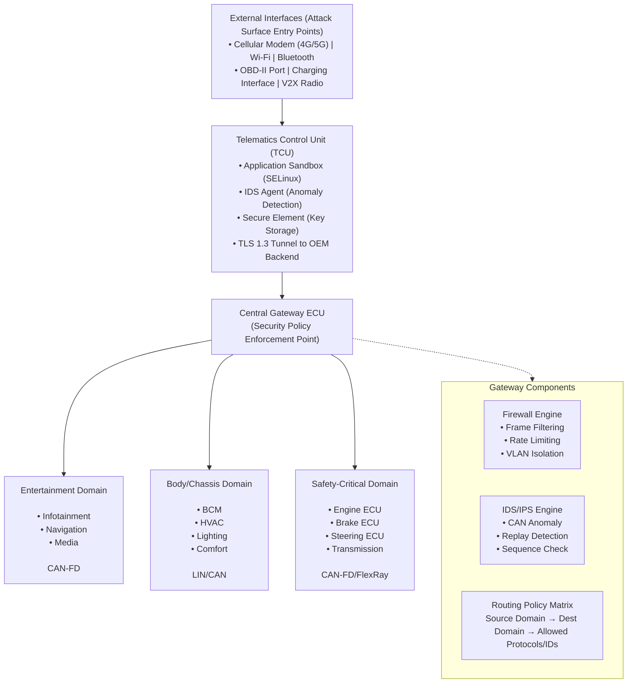

# Lesson 5: Regulatory Frameworks, UN R155/R156 Compliance, Homologation Requirements

## 1. First-Principles Intuition & Invariants

The automotive industry operates under a regulatory paradox: vehicles are among the most safety-critical consumer products, yet for decades they evolved without mandatory cybersecurity oversight. A modern connected vehicle exposes over seventy electronic control units communicating across CAN, LIN, FlexRay, and Ethernet backbones, each representing a potential attack surface. The industry's pivot toward software-defined vehicles—where over-the-air updates can modify drivetrain behavior, braking logic, and steering assistance—transformed cybersecurity from a peripheral concern into a homologation prerequisite. The United Nations Economic Commission for Europe, through its World Forum for Harmonization of Vehicle Regulations (WP.29), codified this transformation into binding international law through UN Regulations 155 and 156.

UN Regulation 155 establishes the Cyber Security Management System (CSMS) framework, mandating that vehicle manufacturers demonstrate ongoing organizational capability to identify, assess, and mitigate cybersecurity threats across the entire vehicle lifecycle. This is not a static certification milestone but a continuous operational obligation. The regulation anchors on a risk-based methodology rooted in ISO/SAE 21434, demanding that manufacturers maintain living threat models, conduct penetration testing against attack trees, implement defense-in-depth architectures, and establish incident response mechanisms capable of coordinating with national Computer Security Incident Response Teams (CSIRTs). The regulation explicitly rejects security through obscurity, requiring manufacturers to document their cryptographic key hierarchies, secure boot chains, and hardware security module integrations in Type Approval documentation reviewed by homologation authorities.

UN Regulation 156 complements R155 by governing Software Update Management Systems (SUMS). Where R155 focuses on designing secure systems, R156 addresses the operational challenge of maintaining security posture post-production. Every over-the-air update represents both a security patch delivery mechanism and a potential attack vector. The regulation mandates cryptographic authenticity verification, rollback protection, atomic update semantics, and secure storage of update metadata. Manufacturers must prove that their update infrastructure can distinguish between legitimate firmware signed by their Hardware Security Module infrastructure and malicious payloads injected by adversaries exploiting compromised backend servers or man-in-the-middle attacks on vehicle-to-cloud communication channels.

The regulatory framework operates on several foundational invariants that shape compliance engineering. First, the principle of security by design demands that cybersecurity requirements integrate into the vehicle architecture from initial concept through decommissioning. Unlike retrofitted security controls, this approach embeds threat modeling into functional safety analyses, ensuring that every ECU interface, diagnostic port, and wireless stack undergoes attack surface enumeration before hardware validation. Second, the defense-in-depth invariant requires layered controls where the compromise of any single component—a telematics control unit, infotainment system, or gateway ECU—cannot cascade into safety-critical domain infiltration. This manifests in network segmentation architectures where firewalls isolate entertainment domains from powertrain controllers, cryptographic attestation prevents unauthorized ECU firmware execution, and intrusion detection systems monitor CAN traffic for anomalous frame injection patterns.

Third, the continuous monitoring invariant transforms cybersecurity from a pre-production gate into an operational discipline. Manufacturers must establish Security Operations Centers capable of ingesting vulnerability intelligence from public databases like NIST's National Vulnerability Database, commercial threat feeds, and coordinated disclosure programs. When a researcher discovers a remote code execution vulnerability in a cellular modem chipset deployed across three million vehicles, the CSMS must trigger an incident response workflow that assesses exploitability, develops mitigation strategies, and coordinates disclosure with Type Approval Authorities within the regulation's prescribed timelines. Fourth, the traceability invariant requires that every cybersecurity decision—from threat severity scoring to penetration test findings to incident response actions—generate auditable artifacts that homologation authorities can inspect during surveillance audits years after initial type approval.

The homologation process itself represents a state machine with defined transitions and approval gates. A manufacturer seeking to introduce a new vehicle model or apply a major software update to an existing fleet must submit Type Approval documentation demonstrating CSMS and SUMS compliance. The approval authority—whether Germany's Kraftfahrt-Bundesamt (KBA), the UK's Vehicle Certification Agency (VCA), or Japan's Ministry of Land, Infrastructure, Transport and Tourism—reviews the submission against annexes detailing required evidence. For R155, this includes the CSMS certificate issued by an independent auditor, threat analysis and risk assessment reports covering all identified attack paths, penetration test results validating defense effectiveness, and organizational process documentation proving capability to manage vulnerabilities post-production. For R156, the authority examines update authenticity mechanisms, verification that updates cannot introduce safety regressions, and evidence of secure backend infrastructure protecting signing keys.

The regulatory text explicitly acknowledges that perfect security is unattainable and instead requires manufacturers to demonstrate reasonable and proportionate risk management. This risk-based approach forces practitioners to make quantifiable security engineering tradeoffs. When a telematics unit running a Linux-based operating system requires a security patch, the manufacturer must balance rapid deployment against validation testing to prevent bricking vehicles in the field. The regulation's proportionality principle allows manufacturers to defer non-critical updates to scheduled maintenance windows while mandating immediate action for actively exploited vulnerabilities affecting safety-critical functions. This nuanced approach recognizes that automotive systems operate in constrained environments where update bandwidth may be limited, vehicle downtime carries economic cost, and premature updates risk introducing functional regressions that compromise reliability.

The global harmonization objective underlying WP.29 regulations creates both opportunities and complexities for multinational manufacturers. Vehicles type-approved under UN regulations gain market access across contracting parties—currently including the European Union, Japan, South Korea, Australia, and over fifty other nations—without redundant national certifications. However, this harmonization remains incomplete. The United States, operating under the National Highway Traffic Safety Administration's Federal Motor Vehicle Safety Standards framework, does not recognize UN type approvals, creating parallel compliance obligations. China's GB standards incorporate cybersecurity requirements influenced by but not identical to UN regulations, demanding separate homologation processes. These jurisdictional variations force global manufacturers to maintain compliance matrices mapping regulatory requirements across markets, often implementing superset architectures that satisfy the most stringent requirements across all target regions.

The enforcement model embedded in R155 and R156 diverges from traditional automotive safety regulations by imposing post-production surveillance obligations. Manufacturers cannot treat type approval as a terminal milestone but must continuously demonstrate compliance through periodic audits where authorities review incident logs, vulnerability management records, and penetration test results. When a manufacturer fails to report a serious cybersecurity incident—defined as an attack successfully compromising safety-critical functions or exfiltrating sensitive personal data—within the regulation's prescribed timeframe, authorities possess escalating enforcement powers ranging from corrective action mandates to type approval revocation. This enforcement mechanism creates strong incentives for organizations to invest in the monitoring infrastructure, forensic capabilities, and coordinated disclosure processes that transform cybersecurity from a compliance checkbox into operational reality.

## 2. Core Architecture & Mechanics

The Cyber Security Management System architecture mandated by UN R155 operates as a closed-loop control system continuously ingesting threat intelligence, assessing risk, implementing controls, and validating effectiveness through testing and monitoring. At the organizational level, the CSMS requires a dedicated cybersecurity unit with defined responsibilities, escalation paths, and executive sponsorship. This unit maintains the central threat model repository—a living database documenting every identified attack path from remote entry points through network boundaries into safety-critical domains. Each threat entry captures attack vectors, required attacker capabilities, affected assets, potential impacts, and implemented mitigations. The threat model evolves as new vulnerabilities emerge, vehicle architectures change, and attack techniques advance, driving continuous risk reassessment.

The risk assessment methodology prescribed by ISO/SAE 21434 and enforced by R155 operates on a structured taxonomy of assets, threats, and controls. Assets encompass both digital artifacts—cryptographic keys, firmware images, diagnostic protocols, personal data—and physical components like ECUs, network buses, and external interfaces. Each asset undergoes damage scenario analysis where the security team enumerates the consequences of confidentiality breaches, integrity violations, and availability disruptions. For a powertrain controller, integrity violations could allow an attacker to modify fuel injection timing or disable emissions controls, creating both safety hazards and regulatory violations. For a telematics unit storing navigation history, confidentiality breaches expose personal location data subject to GDPR and privacy regulations.

Threat identification follows the STRIDE methodology adapted for automotive contexts: Spoofing attacks against CAN bus identifiers lacking authentication, Tampering with firmware stored in unprotected flash memory, Repudiation of diagnostic actions lacking audit trails, Information Disclosure through unencrypted wireless protocols, Denial of Service via CAN frame flooding, and Elevation of Privilege exploiting bootloader vulnerabilities. Each identified threat receives a risk rating combining impact severity with attack feasibility. Impact assessment considers both safety consequences—mapped to ASIL levels from ISO 26262—and privacy implications under data protection regulations. Feasibility analysis evaluates attacker motivation, required resources, necessary physical access, exploit complexity, and detection likelihood.

The CSMS documentation structure required for Type Approval follows a hierarchical evidence model. At the apex, the CSMS certificate issued by an accredited Conformity Assessment Body attests that the manufacturer's organizational processes, governance structures, and technical capabilities meet R155 requirements. Supporting this certificate, the manufacturer submits the Cybersecurity Assessment Report detailing how specific vehicle models implement security controls. This report maps each identified threat to implemented countermeasures, providing traceability from attack scenarios through architectural defenses to validation evidence. For a threat involving remote code execution in a cellular modem, the assessment would document network segmentation isolating the modem from safety-critical buses, application sandboxing limiting exploit impact, intrusion detection monitoring for anomalous behavior, and penetration test results confirming defense effectiveness.

The technical architecture implementing CSMS requirements manifests in layered network topologies that partition vehicle systems into security domains. A representative architecture establishes at least three primary zones: the entertainment and comfort domain handling infotainment, navigation, and connectivity; the body and chassis domain managing door locks, climate control, and lighting; and the safety-critical domain encompassing powertrain, braking, and steering. Gateway ECUs enforce security policies at domain boundaries, filtering CAN frames based on whitelisted identifiers, rate-limiting diagnostic requests, and terminating unauthorized protocol sessions. Modern implementations replace traditional CAN gateways with Ethernet switches running firewall rulesets that inspect packet headers, enforce VLAN isolation, and implement MAC address authentication.

Cryptographic architecture forms the foundation of secure boot, firmware authentication, and communication protection required by R155. Each ECU contains a Hardware Security Module—either a discrete Trusted Platform Module, an embedded Secure Element, or a dedicated cryptographic coprocessor—storing the device's unique private key and the manufacturer's root certificate. During boot, the hardware security module verifies the bootloader's digital signature before transferring execution, the bootloader verifies the operating system, and the operating system verifies application binaries, creating a chain of trust rooted in immutable ROM code. This secure boot chain prevents attackers from persistently installing malicious firmware even if they temporarily exploit a runtime vulnerability. The cryptographic hierarchy extends to inter-ECU communication through protocols like Secure Onboard Communication (SecOC) that append Message Authentication Codes to CAN frames, allowing receivers to cryptographically verify sender identity and message integrity.

Software Update Management System architecture under UN R156 implements a secure pipeline from OEM backend infrastructure through wireless delivery channels into vehicle flash memory. The backend signing infrastructure operates in an air-gapped environment where Hardware Security Modules generate digital signatures over firmware images using keys protected by multi-party authorization ceremonies requiring multiple executives to authenticate. Update packages encapsulate not just firmware binaries but metadata specifying target ECU identifiers, dependency relationships, rollback version constraints, and installation instructions. This metadata undergoes the same cryptographic signing as the firmware payload, preventing attackers from pairing legitimate binaries with malicious installation scripts that execute with elevated privileges during the update process.

The vehicle-side update verification workflow implements defense-in-depth validation before committing changes to persistent storage. Upon receiving an update package, the telematics unit first validates the package signature against the manufacturer's root certificate stored in tamper-resistant memory. This cryptographic verification ensures authenticity—confirming the update originated from the manufacturer—and integrity—guaranteeing no modification occurred during transmission. Next, the gateway ECU checks that the update's target ECU identifier matches an installed component and that the version number exceeds the current firmware revision, preventing downgrade attacks that reinstall vulnerable older versions. Before installation, the ECU performs a dual-bank verification where the new firmware loads into inactive memory while the system continues running the current version, allowing functional testing before making the update permanent.

```mermaid
flowchart TD
    subgraph OEM["OEM Backend Infrastructure"]
        A1["Firmware Build → Binary Hash Computation"]
        A2["Multi-Party Authorization (N-of-M Key Ceremony)"]
        A3["HSM Signs Hash with Root Private Key"]
        A4["Package Assembly:<br/>{FW Binary, Metadata, Signature}"]
        A5["Package Metadata:<br/>• Target ECU ID<br/>• Version (Major.Minor.Patch)<br/>• Dependencies<br/>• Rollback Counter<br/>• Install Script<br/>• Expiration Timestamp"]
        
        A1 --> A2
        A2 --> A3
        A3 --> A4
        A4 --> A5
    end
    
    subgraph TCU["Vehicle Telematics Control Unit"]
        B1["TLS Session to OEM Backend<br/>(Mutual Authentication)"]
        B2["Download Encrypted Update Package"]
        B3["Decrypt with Session Key"]
        B4["Verify Digital Signature<br/>Against Root Cert"]
        B5{"Signature Valid?"}
        B6["Drop Package,<br/>Log Incident"]
        B7["Check Expiration Timestamp"]
        B8["Parse Metadata,<br/>Identify Target ECU"]
        
        B1 --> B2
        B2 --> B3
        B3 --> B4
        B4 --> B5
        B5 -->|Invalid| B6
        B5 -->|Valid| B7
        B7 --> B8
    end
    
    subgraph GW["Central Gateway ECU"]
        C1["Verify TCU Authorized<br/>to Initiate Update"]
        C2["Check Target ECU Exists<br/>in Vehicle Configuration"]
        C3["Validate Version Rollback Constraint:<br/>New_Rollback_Counter > Current_Rollback_Counter"]
        C4["Check Dependency Tree<br/>(Other ECUs Ready?)"]
        C5["Route Package to<br/>Target ECU Domain"]
        
        C1 --> C2
        C2 --> C3
        C3 --> C4
        C4 --> C5
    end
    
    subgraph ECU["Target ECU (e.g., Engine Control Unit)"]
        D1["Write New Firmware<br/>to Inactive Bank"]
        D2["Verify Hash Matches<br/>Signed Metadata"]
        D3["Execute Self-Test in Sandbox<br/>(No Commit)"]
        D4{"Tests Pass?"}
        D5["Atomically Swap Boot Pointer<br/>to New Bank"]
        D6["Increment Rollback Counter<br/>in Secure Storage"]
        D7["Keep Boot Pointer on Active Bank"]
        D8["Report Failure to Gateway,<br/>Log Incident"]
        D9["Post-Reboot Validation:<br/>New FW Boots, Runs Extended Diagnostics"]
        D10{"Firmware Stable?"}
        D11["Mark Update Committed"]
        D12["Auto-Rollback to Previous Bank"]
        
        D1 --> D2
        D2 --> D3
        D3 --> D4
        D4 -->|Pass| D5
        D4 -->|Fail| D7
        D5 --> D6
        D6 --> D9
        D7 --> D8
        D9 --> D10
        D10 -->|Stable| D11
        D10 -->|Crashes| D12
    end
    
    A5 -->|"TLS 1.3<br/>(Certificate Pinning)"| B1
    B8 -->|"Internal Vehicle Network"| C1
    C5 --> D1
```

Post-production monitoring obligations under R155 require manufacturers to establish Security Operations Center capabilities that continuously ingest and triage threat intelligence. This operational architecture integrates multiple data streams: vulnerability disclosures from public databases like CVE and ICS-CERT advisories, threat intelligence feeds from commercial providers tracking automotive-specific exploit campaigns, coordinated disclosures from security researchers, and telemetry from deployed vehicle fleets. Modern implementations deploy intrusion detection agents within vehicles that monitor for anomalous CAN traffic patterns, unexpected diagnostic protocol usage, and cryptographic verification failures, transmitting sanitized alerts to backend analytics platforms. The SOC triages these signals using automated correlation engines that distinguish benign anomalies—like repair shops using legitimate diagnostic tools—from potential security incidents requiring human investigation.

Incident response workflows mandated by R155 follow a structured escalation model with defined severity levels and response timelines. When a security researcher submits a vulnerability report through the manufacturer's coordinated disclosure program, the CSMS team must acknowledge receipt within forty-eight hours and complete initial impact assessment within five business days. Critical vulnerabilities affecting safety-critical functions trigger immediate escalation to executive leadership and regulatory notification within the prescribed timeframe—typically seventy-two hours after confirming exploitability. The incident response process generates extensive audit trails documenting the vulnerability description, affected vehicle populations, risk assessment rationale, mitigation strategies, and communication with Type Approval Authorities. These records undergo periodic review during surveillance audits where authorities verify that manufacturers maintain capability to respond effectively to evolving threats.

The Type Approval documentation submitted to homologation authorities contains both technical evidence and organizational attestations. Technical evidence includes penetration test reports demonstrating that red teams could not achieve unauthorized access to safety-critical domains despite employing state-of-the-art exploitation techniques. These reports document tested attack vectors—remote exploitation of infotainment vulnerabilities, physical access attacks via OBD-II, proximity-based wireless attacks against keyless entry—along with defense mechanisms that prevented successful compromise. Organizational evidence includes process documentation describing how the CSMS team conducts threat modeling workshops, manages vulnerability disclosures, coordinates software updates, and maintains skills through continuous training. The approval authority reviews this documentation against R155 annexes, issuing the Type Approval certificate only after confirming that both technical controls and organizational processes meet regulatory requirements.

## 3. High-Performance Optimization & Failure Modes

The operational efficiency of a Cyber Security Management System depends critically on automation infrastructure that scales across hundreds of ECU variants, thousands of software components, and millions of deployed vehicles. Manual threat modeling rapidly becomes infractile as vehicle architectures grow more complex, driving manufacturers to invest in toolchains that auto-generate attack trees from system architecture models. These tools parse AUTOSAR and SystemWeaver models extracting ECU connectivity, communication matrices, and access control policies, then algorithmically enumerate attack paths using graph traversal algorithms. The output—a comprehensive threat database—feeds into risk assessment workflows where security engineers review auto-generated threats, adjust impact ratings based on domain expertise, and document mitigation strategies. This semi-automated approach allows small security teams to maintain threat models for entire vehicle platforms that would otherwise require prohibitive manual effort.

Vulnerability management at fleet scale demands sophisticated patch prioritization algorithms that balance security risk against operational constraints. When a critical vulnerability emerges in a widely deployed cellular modem chipset, the manufacturer faces competing pressures: deploying the patch immediately minimizes exposure window but risks insufficient testing causing functional regressions; deferring the patch until the next planned maintenance window provides thorough validation but extends the period when vehicles remain vulnerable. The optimization problem involves scoring vulnerabilities using CVSS metrics augmented with automotive-specific factors—whether the vulnerability requires physical access, whether exploitation affects safety functions, whether proof-of-concept exploits exist in the wild—then solving a constraint satisfaction problem that schedules updates to maximize risk reduction while respecting bandwidth limits, regional regulatory requirements, and customer experience considerations.

The cryptographic performance constraints of resource-constrained ECUs create optimization tradeoffs in secure communication protocol design. A body control module running a single-core 32-bit microcontroller at 80 MHz cannot sustain the computational overhead of TLS for every inter-ECU message without introducing unacceptable latency. Security architects address this through protocol layering where time-critical safety messages use lightweight Message Authentication Codes computed via hardware-accelerated AES-CMAC, while less frequent diagnostic and configuration messages employ full TLS sessions. The MAC approach provides authentication and integrity with microsecond-scale overhead, allowing real-time CAN traffic to meet the ten-millisecond deadlines required by active safety systems. Key management for these MACs leverages hierarchical derivation where each ECU stores a master secret provisioned during manufacturing, then derives session keys through HKDF applying standardized context strings that prevent key reuse across different communication contexts.

Software update bandwidth optimization becomes critical when deploying patches to millions of vehicles over cellular networks where data transmission costs money and consumes customer bandwidth. Delta update techniques reduce payload size by computing binary diffs between current and target firmware versions, transmitting only changed bytes rather than complete images. Advanced implementations employ block-level deduplication that identifies common code segments shared across ECU variants, downloading shared blocks once and distributing them internally across multiple ECUs. Compression algorithms like LZMA achieve 70-80% size reduction on typical automotive firmware, but decompression overhead on ECU processors can extend installation time from minutes to hours, creating windows where vehicles remain in partially updated states vulnerable to power loss interruptions. The engineering tradeoff involves balancing transmission cost savings against installation time risk, often leading to hybrid approaches where critical safety updates deploy uncompressed for rapid installation while less urgent patches employ maximum compression.

Failure mode analysis of the Type Approval process itself reveals several practical challenges that delay homologation and increase compliance costs. Documentation requirements across different approval authorities exhibit subtle variations that force manufacturers to maintain jurisdiction-specific documentation sets. The European Union's approval process emphasizes organizational CSMS maturity, requiring detailed evidence of continuous improvement processes and security culture metrics. Japanese authorities place greater emphasis on technical penetration testing results and cryptographic architecture validation. These variations force global manufacturers to engage separate auditing firms for different markets, multiplying compliance overhead. Harmonization efforts through the WP.29 working groups aim to standardize evidence requirements, but practical implementation varies as national authorities interpret regulations through local legal frameworks and cultural norms around risk tolerance.

The incident reporting obligation creates operational tension between regulatory compliance and competitive confidentiality. When a manufacturer discovers a vulnerability through internal security testing, R155 requires assessment and reporting to authorities within prescribed timelines, but public disclosure could alert malicious actors to exploit the vulnerability before patches deploy. The regulation permits confidential reporting to Type Approval Authorities while manufacturers develop and distribute fixes, but coordination across multiple jurisdictions—each with different disclosure rules—creates complex choreography. European authorities may require detailed technical disclosure, US regulations under TREAD Act emphasize consumer notification, and Chinese authorities mandate reporting through multiple parallel channels including the Ministry of Industry and Information Technology and the Cyberspace Administration. Manufacturers must navigate these overlapping requirements while preventing premature public disclosure that could trigger coordinated attacks against vulnerable vehicle populations.

The forensic investigation capability required for incident response faces fundamental constraints in automotive environments where telemetry bandwidth limits, privacy regulations restrict data collection, and vehicle ownership complicates access permissions. When a security incident occurs, investigators require detailed logs of diagnostic sessions, CAN traffic captures, and system state snapshots to reconstruct attack sequences. However, continuously recording this data volume would overwhelm vehicle storage and cellular uplink bandwidth. Practical implementations employ selective logging triggered by anomaly detection thresholds—recording full detail only when intrusion detection agents flag suspicious activity—combined with periodic upload of aggregated statistics that provide fleet-wide visibility without violating individual privacy. This approach creates blind spots where sophisticated attackers who avoid triggering detection thresholds can operate without generating forensic evidence, forcing investigators to rely on statistical inference across fleet populations to identify attack campaigns.

The continuous compliance model imposed by R155 surveillance audits creates operational overhead that scales with vehicle platform complexity. Authorities conduct periodic audits where they review vulnerability management records, penetration test results, incident response logs, and security training documentation from the preceding period. Preparing for these audits requires maintaining comprehensive audit trails that document every security-relevant decision—why a particular vulnerability received low priority rating, why a software update schedule changed, why a penetration test scope excluded certain attack vectors. Organizations optimize audit preparation through continuous compliance platforms that automatically aggregate evidence from disparate systems: vulnerability scanners, ticketing systems, version control repositories, training management systems. These platforms maintain always-current compliance dashboards that reduce audit preparation from weeks of manual document gathering to days of focused review with auditors.

The technical debt accumulation in legacy vehicle platforms creates long-term compliance challenges as regulations evolve and threat landscapes shift. Vehicles type-approved under initial R155 implementation in 2022 remain in service for fifteen years, but regulatory expectations advance as new attack techniques emerge and cryptographic algorithms age. Manufacturers face the difficult calculus of whether to invest in retrofitting legacy platforms with enhanced security controls—costly and potentially impossible due to hardware constraints—or accept that older vehicles will not meet current best practices. The regulation's proportionality principle provides flexibility by allowing manufacturers to demonstrate that controls appropriate at the time of type approval remain reasonable even as standards evolve, but authorities increasingly expect proactive security improvements delivered through software updates rather than static compliance to outdated baselines.

The intersection of cybersecurity regulations with functional safety requirements under ISO 26262 creates complex dependency chains that complicate both initial compliance and ongoing operations. A software update that patches a cybersecurity vulnerability must not introduce functional safety regressions that violate ASIL requirements. Validation processes must therefore combine security testing—verifying the patch actually mitigates the vulnerability and does not introduce new attack vectors—with safety testing—confirming all safety-critical functions continue meeting timing constraints, fault tolerance requirements, and failure mode behaviors. This dual validation extends update deployment timelines, creating windows where vehicles remain vulnerable to known exploits while awaiting safety validation completion. Optimizing this process requires early integration of security and safety teams during architecture design, ensuring that security controls do not interfere with safety mechanisms and that safety validation test suites include scenarios covering security patch deployment.

The global regulatory divergence creates strategic decisions for manufacturers about market entry timing and compliance investment allocation. A manufacturer developing a new electric vehicle platform must choose whether to design for the most stringent requirements—satisfying all markets but potentially over-engineering for regions with lighter regulation—or develop modular architectures with market-specific security features. The modular approach optimizes costs but increases complexity as engineers must maintain separate hardware and software variants, validate that regional differences do not introduce vulnerabilities, and manage the supply chain logistics of shipping different ECU configurations to different markets. The engineering tradeoff involves balancing compliance costs, product complexity, and time-to-market across the manufacturer's strategic prioritization of different regional markets.
