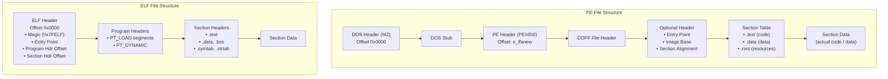

# Lesson 1: Infection Mechanisms, Replication Strategies, Self-Modification

## 1. First-Principles Intuition & Invariants

Computer viruses occupy a peculiar intersection of software engineering, binary manipulation, and adversarial design. At their essence, viruses are self-propagating code fragments that embed themselves within host executables, subverting the normal control flow of programs to replicate across storage media and memory space. Unlike network worms that exploit remote vulnerabilities or trojans that masquerade as legitimate applications, viruses fundamentally require a host binary to carry their payload, parasitically altering the executable format while preserving enough of the original program functionality to avoid immediate detection.

The theoretical foundation of self-replicating programs traces back to John von Neumann's 1949 lectures on cellular automata and self-reproducing machines. Von Neumann rigorously proved that a Turing-complete system could contain a program capable of reading its own description and producing an identical copy, establishing the mathematical inevitability of self-replicating code. Fred Cohen formalized this in 1984 by defining a computer virus as a program that can "infect" other programs by modifying them to include a possibly evolved copy of itself. This definition captures the essential characteristic: viral code must achieve code injection into a host, preserve or restore host functionality to remain covert, and implement a replication strategy that triggers under specific conditions.

The invariants governing viral behavior emerge from the constraints of executable file formats and operating system loaders. Every executable format—whether Portable Executable (PE) on Windows, Executable and Linkable Format (ELF) on Unix systems, or Mach-O on macOS—defines a contract between the file's on-disk structure and the operating system's program loader. These formats contain headers specifying entry points, section boundaries, import tables, relocation records, and digital signatures. A virus must manipulate these structures to redirect execution flow to viral code while maintaining the integrity checks and structural invariants that the loader expects. Violation of format constraints results in loader rejection, immediate detection, or program crashes that expose the infection.

Code injection techniques exploit the fact that executable formats distinguish between code sections, data sections, and metadata, but the CPU itself makes no such distinction—it simply fetches and executes bytes from memory addresses dictated by the instruction pointer. A virus leverages this semantic gap by inserting executable code into regions the format declares as code or by transforming data sections into executable regions through permission manipulation. The Windows PE format segregates sections with characteristic names like `.text` for code, `.data` for initialized variables, and `.rsrc` for resources, each carrying permission flags for read, write, and execute access. ELF uses similar segmentation with `PT_LOAD` program headers defining memory mappings and section headers providing symbolic debugging information. A sophisticated virus analyzes these structures to identify injection sites that minimize file size growth, avoid checksum failures, and preserve the host program's operational semantics.

Entry point manipulation forms the second critical invariant. The entry point defined in an executable's headers directs the loader to the first instruction executed when the program launches. For PE files, this address resides in the optional header's `AddressOfEntryPoint` field, typically pointing to compiler-generated initialization code that sets up the C runtime environment before calling `main`. ELF files encode the entry point in the ELF header's `e_entry` field, usually targeting `_start` in statically linked binaries or the dynamic linker in shared-library executables. A virus must either overwrite this entry point to redirect initial execution to viral code or insert trampolines—small instruction sequences—that branch to viral logic before jumping back to the original entry point. The challenge lies in preserving return semantics: if the virus fails to restore CPU state, stack alignment, or register values, the host program will exhibit anomalous behavior that triggers user suspicion or automated detection heuristics.

Polymorphic engines introduce controlled mutation to evade signature-based detection systems. Traditional antivirus software maintained databases of byte-pattern signatures extracted from known viruses, scanning files for exact or fuzzy matches against these fingerprints. Polymorphism defeats this approach by encrypting the viral payload with a variable key and prepending a decryption stub that reconstructs the original code at runtime. Each infection cycle generates a new encryption key and mutates the decryption routine through instruction substitution, register swapping, junk instruction insertion, and control flow obfuscation. The invariant code—the actual viral logic—remains constant, but its encrypted representation and decryption preamble differ across infections, rendering signature matching infeasible without sophisticated emulation-based analysis.

Metamorphic transformation represents the apex of viral self-modification, abandoning fixed invariants entirely in favor of semantic equivalence. A metamorphic virus rewrites its own instruction sequence for each replication, transforming the assembly-level representation while preserving computational behavior. Techniques include instruction substitution (replacing `ADD EAX, EBX` with `MOV ECX, EAX; ADD ECX, EBX; MOV EAX, ECX`), register renaming, subroutine reordering, dead code insertion, opaque predicates (conditionals whose outcomes are statically determined but difficult to analyze), and code transposition (reordering independent instruction blocks with compensating jumps). Unlike polymorphism, metamorphism contains no fixed decryption loop or encrypted payload; the entire virus body transforms at each generation, demanding that antivirus engines perform deep semantic analysis or behavioral emulation to recognize the threat.

Infection vectors span multiple abstraction layers, from direct binary patching of disk files to runtime memory injection in executing processes. File infectors modify executables stored on disk, targeting PE or ELF binaries in system directories, user application folders, or removable media. Boot sector viruses predate modern operating systems, embedding themselves in the Master Boot Record (MBR) or Volume Boot Record (VBR) to gain execution before the operating system kernel loads, achieving persistence and kernel-mode privilege. Macro viruses exploit scripting languages embedded in document formats, such as Visual Basic for Applications (VBA) in Microsoft Office files, leveraging the auto-execution capabilities of macros to propagate through email attachments and shared documents. Modern threats increasingly target scripting interpreters, exploiting the trust boundaries between native code and interpreted environments to inject malicious payloads into JavaScript engines, Python runtimes, or PowerShell sessions.

The fundamental trade-off in viral design balances stealth against functionality. Aggressive replication strategies that infect every accessible binary maximize propagation speed but generate anomalous disk I/O patterns, file timestamp modifications, and size changes that trigger integrity monitoring systems. Conservative strategies that infect selectively or remain dormant until specific trigger conditions reduce detection risk but slow propagation. Similarly, payload complexity trades capability against footprint: sophisticated viruses carrying keyloggers, network backdoors, or cryptographic ransomware payloads occupy more disk space and memory, increasing the probability of detection through heuristic analysis or memory scanning.

The arms race between virus authors and defense researchers drives continuous innovation in both infection techniques and detection methodologies. Modern operating systems deploy code-signing enforcement, requiring that executables carry cryptographic signatures from trusted authorities, which blocks unsigned or tampered binaries from executing. Address Space Layout Randomization (ASLR) randomizes the base addresses of executables, libraries, and heap allocations, frustrating return-oriented programming (ROP) attacks and hardening the environment against memory-based exploitation. Control Flow Guard (CFG) and Intel Control-flow Enforcement Technology (CET) enforce control-flow integrity, validating indirect call and jump targets against compiler-generated metadata to prevent execution redirection. Despite these mitigations, viruses persist by exploiting implementation gaps, abusing legitimate system features, and adapting to platform-specific constraints.

## 2. Core Architecture & Mechanics

The architecture of a file-infecting virus decomposes into four functional stages: target selection, infection vector execution, payload injection, and host restoration. Each stage requires precise manipulation of binary structures and careful preservation of loader expectations to achieve reliable replication without exposing the infection to casual inspection or automated scanning.

Target selection begins with filesystem enumeration to identify candidate executables. A sophisticated virus walks directory trees, filters files by extension (`.exe`, `.dll`, `.so`, `.out`), and validates file headers to confirm executable format. For PE files, the virus reads the first two bytes to verify the `MZ` signature (0x4D5A), then follows the `e_lfanew` offset at byte 0x3C to locate the PE header marked by the `PE\0\0` signature (0x50450000). ELF files begin with the four-byte magic number `\x7FELF` (0x7F454C46), followed by class, endianness, and version fields. Validating these signatures prevents the virus from corrupting non-executable files or attempting to infect already-infected binaries, which would waste resources and potentially destabilize the infected host.



Infection vector execution determines how viral code integrates into the host binary. The cavity method searches for unused space within existing sections, exploiting alignment padding or gaps between sections. PE files align sections to boundaries defined by `SectionAlignment` (typically 4KB for memory) and `FileAlignment` (typically 512 bytes for disk), creating slack space when section data doesn't fill alignment blocks. A virus scans section headers for regions where `VirtualSize` exceeds `SizeOfRawData`, indicating zero-padded memory that won't be paged from disk, or searches for inter-section gaps where file offset plus raw size of one section falls short of the next section's file offset. Injecting into cavities preserves the section count and avoids expanding the file size, reducing the footprint of infection.

The appending method adds a new section to the section table, incrementing the `NumberOfSections` field in the COFF header and writing a new section header entry. The virus crafts a section header specifying a unique name (often masquerading as legitimate sections like `.reloc` or `.data2`), sets the `VirtualAddress` to follow the last existing section's address plus aligned size, assigns executable and readable characteristics (0x60000020), and calculates `PointerToRawData` as the current file size aligned to `FileAlignment`. The viral payload appends to the file's end, and the section header's `SizeOfRawData` and `VirtualSize` reflect the payload length. This method increases file size proportionally to the payload, a change detectable through filesystem metadata but straightforward to implement and compatible with most loaders.

Entry point redirection completes the infection by modifying the `AddressOfEntryPoint` in the PE optional header or `e_entry` in the ELF header to target the injected viral code. The virus must preserve the original entry point value to enable host restoration after viral execution. A common technique stores the original entry point within the viral code section, either as an immediate operand in a jump instruction or in a dedicated data structure. When the operating system launches the infected binary, the loader maps sections into memory according to `VirtualAddress` offsets, applies relocations if the preferred `ImageBase` is unavailable, resolves import dependencies, and transfers control to the modified entry point, thus executing viral code before any host logic runs.

The viral body itself follows a canonical structure consisting of a preservation block, replication engine, payload execution, and restoration trampoline. The preservation block saves CPU state by pushing general-purpose registers, segment selectors, and flags onto the stack, ensuring that host code receives the expected initial state. The replication engine enumerates potential targets, reads and parses their executable headers, selects an injection method, writes the viral code into the target, and updates the target's entry point. The payload execution stage triggers the virus's intended behavior, whether benign (displaying a message), destructive (corrupting files), or exploitative (establishing network backdoors). The restoration trampoline pops saved registers, adjusts the stack pointer to its original alignment, and executes an indirect jump to the preserved original entry point, seamlessly transferring control to the host program's initialization code.

Polymorphic engines layer encryption over this architecture, replacing the plaintext viral body with encrypted bytes and prepending a decryption stub. The decryption stub comprises an initialization sequence (loading the encrypted data address and length into registers), a decryption loop (XORing encrypted bytes with a key or applying a stream cipher), and a transition instruction (jumping to the decrypted code). The encryption key and algorithm vary across infections, generated through pseudo-random number generators seeded by system state such as timestamps, process IDs, or file hashes. The decryption stub itself must mutate to avoid becoming a signature; mutation engines apply instruction substitution, register renaming, and junk insertion. For example, a decryption loop that loads, XORs, and stores bytes can permute the choice of registers (EAX vs. EBX), the loop counter direction (increment vs. decrement), and the XOR instruction encoding (immediate vs. register operand).

```c
// Simplified polymorphic decryption stub pseudocode
// (actual implementation varies registers, offsets, and instruction encodings)

uint8_t encrypted_body[BODY_SIZE];
uint8_t key = generate_random_key();

// Encryption phase (during replication)
for (int i = 0; i < BODY_SIZE; i++) {
    encrypted_body[i] = viral_body[i] ^ key;
}

// Decryption stub (prepended to encrypted body)
void decrypt_stub() {
    uint8_t *code = encrypted_body;
    uint8_t decrypt_key = key;  // embedded in stub as immediate
    for (int i = 0; i < BODY_SIZE; i++) {
        code[i] ^= decrypt_key;
    }
    // Jump to decrypted viral body
    ((void(*)())code)();
}
```

Metamorphic engines transcend encryption by disassembling the viral code into an intermediate representation, applying semantic-preserving transformations, and reassembling into a new instruction sequence. A metamorphic virus embeds a disassembler that parses its own machine code into a control flow graph (CFG) of basic blocks—sequences of instructions with no internal branches. Each basic block undergoes transformation through instruction substitution tables that replace opcodes with functionally equivalent sequences. For instance, `MOV EAX, 5` transforms into `XOR EAX, EAX; ADD EAX, 5` or `PUSH 5; POP EAX`, altering the byte sequence while preserving register state. Register allocation permutes register assignments across basic blocks, requiring the engine to track register liveness and data dependencies. Dead code insertion splices non-functional instructions (NOP, MOV EAX, EAX) and opaque predicates (conditional jumps whose target is statically determined) into basic blocks, expanding code size and complicating pattern matching without affecting execution semantics.

Code transposition reorders basic blocks and inserts compensating jumps to maintain control flow. The metamorphic engine constructs a topological sort of the CFG, permutes blocks that have no sequential dependency, and patches branch targets to reflect the new layout. Subroutine inlining and outlining further obfuscate structure: inlining expands function calls into their definitions, eliminating call/return pairs, while outlining extracts instruction sequences into new subroutines, increasing the call graph complexity. The reassembly phase encodes the transformed CFG back into machine code, resolving jump offsets and updating any position-dependent addressing. The resulting binary preserves the computational semantics of the original virus but exhibits a completely distinct instruction sequence, defeating signature-based detection and complicating static analysis.

```text
Metamorphic Transformation Pipeline:

Original Code:
  MOV  EAX, [EBX]       ; Load value
  ADD  EAX, 10          ; Add constant
  MOV  [ECX], EAX       ; Store result
  RET

Disassemble → Basic Blocks:
  BB1: MOV EAX, [EBX]
       ADD EAX, 10
       MOV [ECX], EAX
  BB2: RET

Transform:
  - Instruction substitution: ADD → SUB with negated constant
  - Register renaming: EAX → EDX
  - Dead code insertion: NOP sled
  - Reorder blocks with JMP

Transformed Code:
  JMP  L1
  NOP                   ; Dead code
  NOP
L1:
  MOV  EDX, [EBX]       ; Renamed register
  SUB  EDX, -10         ; Equivalent to ADD EDX, 10
  NOP                   ; Junk instruction
  MOV  [ECX], EDX
  RET
```

## 3. High-Performance Optimization & Failure Modes

Optimizing viral replication requires balancing infection speed against detection risk and resource consumption. Naive replication strategies that iterate over all accessible files generate excessive disk I/O, trigger filesystem monitoring heuristics, and modify timestamps that integrity checkers flag. High-performance viruses employ selective infection policies, targeting high-value executables (system utilities, frequently launched applications) and limiting infection rates to avoid statistical anomalies. Time-based throttling introduces random delays between infection attempts, and conditional replication logic checks for existing infections by embedding marker bytes or computing file hashes to avoid redundant processing.

File locking and concurrent access present significant failure modes. When a virus attempts to infect an executable currently loaded into memory or opened by another process, the operating system denies write access, causing the infection attempt to fail silently or throw an exception that must be handled to prevent crashes. Robust viruses check file access permissions before attempting infection, use shared read locks to test availability, and gracefully skip locked targets. On Unix systems, the virus must respect execute permissions and setuid bits, as modifying these attributes may trigger audit logs or security monitoring. On Windows, the virus contends with opportunistic locking (oplocks) and file system transactions (TxF), which complicate concurrent writes.

Code signing enforcement imposes strict mitigation boundaries on modern operating systems. Windows enforces kernel-mode driver signatures, and User Account Control (UAC) prompts users before executing unsigned binaries with elevated privileges. macOS Gatekeeper blocks unsigned applications downloaded from the internet unless the user explicitly overrides the warning, and System Integrity Protection (SIP) prevents modification of system binaries even with root privileges. Linux distributions increasingly adopt Secure Boot and Integrity Measurement Architecture (IMA) policies that verify binary signatures against trusted keyrings. Viruses adapt by targeting user-space executables without embedded signatures, exploiting trust boundaries where signed loaders execute unsigned scripts or plugins, or leveraging stolen or compromised code-signing certificates.

Address Space Layout Randomization (ASLR) complicates payload execution by randomizing the base addresses of executables, shared libraries, heap, and stack regions. A virus injecting position-dependent code—hardcoded addresses or absolute jumps—finds its payload misaligned at runtime, causing segmentation faults or invalid memory access. Position-independent code (PIC) solves this through relative addressing, using instruction-pointer-relative offsets for data access and procedure calls. In x86-64, the `LEA` instruction with `RIP`-relative addressing loads addresses relative to the current instruction pointer, and `CALL` instructions use relative offsets. The virus embeds position-independent shellcode that resolves library imports dynamically by parsing the Process Environment Block (PEB) on Windows or the Auxiliary Vector on Linux, walking export tables to locate API functions, and computing addresses at runtime.

Polymorphic engine performance hinges on the entropy and speed of the mutation algorithm. Weak pseudo-random number generators (PRNGs) that seed from predictable state (low-resolution timestamps) produce correlated keys across infections, enabling cryptanalysis to recover the mutation scheme. Cryptographically secure PRNGs (CSPRNGs) like AES-CTR or ChaCha20 provide high entropy but impose computational overhead. Viruses balance entropy quality against replication speed by using lightweight PRNGs seeded from multiple entropy sources: high-resolution performance counters, thread IDs, stack addresses, and file metadata. The decryption stub must execute efficiently to minimize host launch latency; complex decryption loops or memory-intensive operations delay program startup, alerting users to anomalous behavior.

Metamorphic complexity scales exponentially with transformation depth, demanding sophisticated compiler infrastructure within the virus. Full disassembly and reassembly require opcode tables spanning multiple instruction set extensions (SSE, AVX), accurate length disassembly to parse variable-length x86 instructions, and handling of instruction prefixes (REX, VEX). Register allocation necessitates liveness analysis and interference graph construction, computationally expensive algorithms that slow replication. Practical metamorphic engines constrain transformation scope, applying mutations to a subset of basic blocks, limiting instruction substitution depth, and caching transformation results to amortize disassembly costs across multiple infections.

Failure modes in metamorphic engines include semantic drift and register corruption. Instruction substitution that incorrectly models side effects (flag modifications, implicit register uses) breaks equivalence, causing the transformed code to compute incorrect results. For example, replacing `INC EAX` with `ADD EAX, 1` appears equivalent, but `INC` does not modify the carry flag (CF), while `ADD` does, potentially breaking subsequent arithmetic that depends on CF state. Register renaming that fails to track inter-procedural dependencies corrupts calling conventions, violating the ABI contract where specific registers carry return values (EAX/RAX) or preserve callee-saved state (EBX, RBP). Debugging metamorphic engines requires extensive testing with diverse host binaries, fuzzing transformation rules against compiler-generated code, and validating transformed output through symbolic execution or differential testing.

Detection evasion extends beyond polymorphism and metamorphism to encompass environmental awareness and anti-analysis techniques. Viruses detect sandbox and virtual machine environments by querying CPU features (hypervisor bit in CPUID), checking for VM-specific artifacts (VMware tools, VirtualBox drivers), and measuring timing discrepancies that indicate emulation overhead. Upon detecting analysis environments, the virus aborts execution or executes benign decoy logic, concealing malicious behavior from automated scanners. Trigger conditions tied to calendar dates, user activity patterns, or network connectivity delay payload activation until the virus escapes initial screening, a strategy reminiscent of logic bombs.

Integrity monitoring systems (Tripwire, AIDE) compute cryptographic hashes of critical binaries and alert administrators to unauthorized modifications. Viruses counter this through race conditions, infecting binaries immediately after hash computation and before the next scheduled scan, or by targeting executables excluded from monitoring policies. Whitelisting approaches that enumerate approved binaries and block all others shift the burden to the virus, which must either modify the whitelist database (requiring elevated privileges) or exclusively infect whitelisted executables, constraining replication vectors.

The ethical and legal dimensions surrounding virus research impose constraints on practical experimentation. Possessing, distributing, or deploying viruses violates anti-hacking statutes in most jurisdictions, including the Computer Fraud and Abuse Act (CFAA) in the United States and the Computer Misuse Act in the United Kingdom. Security researchers operate within sandboxed laboratory environments, using isolated virtual machines, air-gapped networks, and controlled test datasets to study viral mechanisms without risking propagation to production systems. Responsible disclosure frameworks guide researchers to report vulnerabilities to vendors and coordinate public disclosure timelines, balancing transparency against exploitation risk.

Modern endpoint detection and response (EDR) platforms deploy behavioral heuristics that monitor API call sequences, registry modifications, network connections, and memory allocations to identify viral behavior independent of signature matching. Viruses exhibiting characteristic patterns—enumerating executable files, modifying PE headers, writing to foreign process memory—trigger alerts even when individual actions appear benign. Machine learning classifiers trained on telemetry from millions of endpoints generalize beyond known samples, flagging anomalous binary structures or execution traces as potential threats. This evolutionary pressure drives viral innovation toward stealthier techniques: in-memory-only payloads that never touch disk, living-off-the-land strategies that abuse legitimate system utilities (PowerShell, WMI), and fileless attacks that persist through registry autorun keys or scheduled tasks rather than infecting executables.

The persistence mechanisms viruses employ to survive reboots and re-infection cycles further illustrate the trade-off between stealth and resilience. Boot sector viruses achieve persistence by executing before the operating system loads, but UEFI Secure Boot cryptographically validates boot components, blocking unsigned MBR modifications. Viruses targeting user-space executables rely on the host program being launched regularly, risking dormancy if users uninstall or cease using infected applications. Registry autorun keys (HKCU\Software\Microsoft\Windows\CurrentVersion\Run) and systemd service units provide automatic execution but leave forensic artifacts that incident responders easily discover. Advanced Persistent Threat (APT) campaigns favor multi-stage implants: an initial dropper infects a common utility, deploying a secondary payload that establishes covert command-and-control channels and loads additional modules on demand, distributing the attack surface across multiple binaries and reducing the footprint of any single component.

Ultimately, the study of viral infection mechanisms, replication strategies, and self-modification techniques illuminates the adversarial dynamics between attackers and defenders, revealing both the technical ingenuity of malware authors and the systemic mitigations that constrain their effectiveness. For hardware security researchers, understanding binary manipulation deepens insight into executable format vulnerabilities and loader trust assumptions. Embedded engineers gain perspective on constrained-environment threats where resource limits and deterministic execution models alter replication strategies. Offensive security practitioners synthesize these techniques into penetration testing methodologies, simulating adversarial tradecraft to validate organizational defenses and harden production systems against real-world exploitation.
