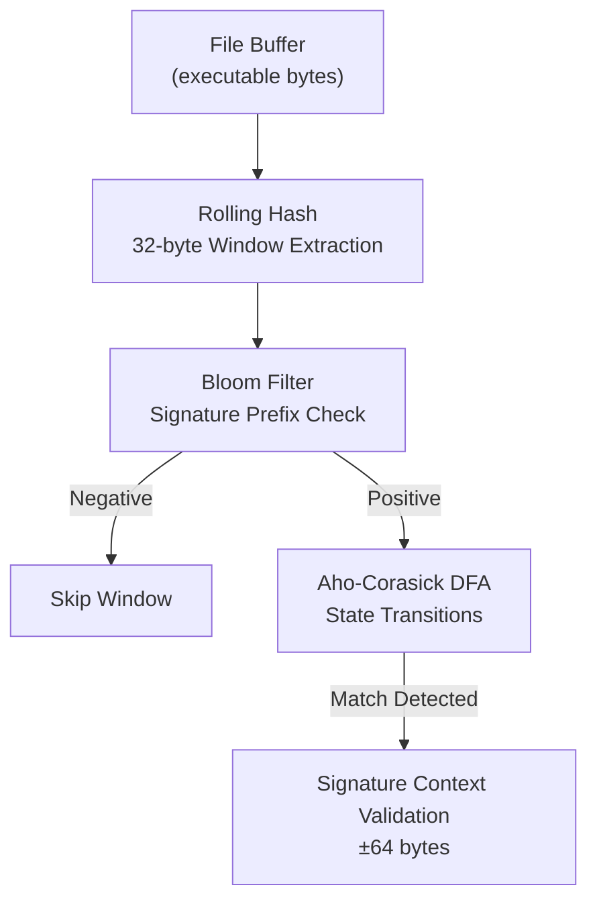
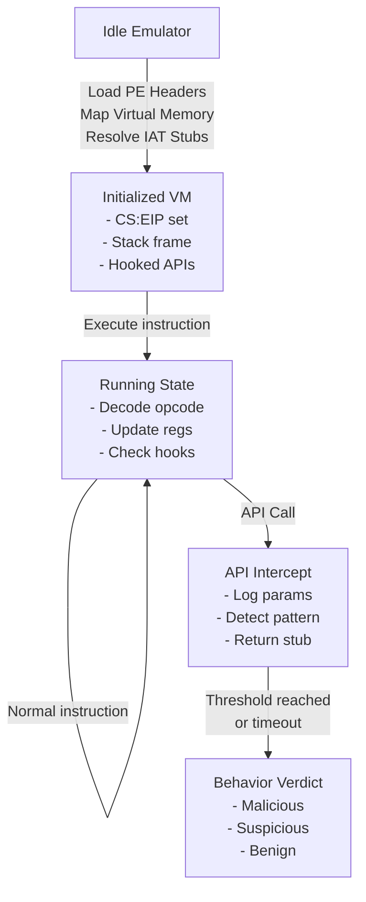

# Lesson 3: Detection Theory, Signature Analysis, Heuristic Engines

## 1. First-Principles Intuition & Invariants

The computational problem of malware detection reduces to a fundamental classification task operating under severe adversarial constraints. Unlike conventional pattern recognition domains where the input distribution remains stationary, malware detection confronts an intelligent, adaptive adversary who observes defensive countermeasures and engineers evasion strategies in response. This adversarial co-evolution establishes the core paradox of anti-virus engineering: any deterministic detection rule, once deployed, becomes observable to attackers and therefore vulnerable to circumvention through carefully crafted polymorphism or metamorphism.

The earliest anti-virus systems operated on a deceptively simple premise borrowed from biological virology. Just as medical diagnostics identify pathogens through unique protein markers or genetic sequences, early virus scanners searched executable files for byte-level signatures—fixed sequences of machine code instructions characteristic of known malware families. This signature-based approach achieved remarkable success in the 1980s and early 1990s when malware authors distributed static binaries through floppy disk exchanges and bulletin board systems. The detection invariant was straightforward: if a file contained byte sequence `S` at any offset, and `S` uniquely identified malicious code, then the file was infected. Signature databases grew linearly with malware variants, and scanning reduced to efficient multi-pattern string matching across file system objects.

However, this detection model collapsed under two simultaneous pressures. First, malware authors adopted encryption and polymorphic mutation engines that transformed viral payloads while preserving semantic behavior. A polymorphic virus generates a unique encryption envelope for each infection instance, rendering traditional byte signatures useless—no two infected files share identical byte patterns beyond short decryption stubs. Second, the explosive growth of software complexity and Internet connectivity produced malware proliferation rates that overwhelmed signature-based maintenance. By the late 1990s, anti-virus vendors confronted thousands of new samples daily, and the lag between malware release and signature deployment created expanding vulnerability windows.

Modern detection theory therefore operates on multiple parallel tracks, each with distinct invariants and failure modes. Static signature matching persists as the first-tier filter, optimized for speed and zero false positives on known threats. Heuristic engines introduce probabilistic inference, sacrificing perfect accuracy for generalization across malware families through behavioral pattern recognition. Emulation-based dynamic analysis executes suspicious code in controlled sandbox environments, observing runtime behavior to identify malicious intent that static analysis cannot resolve. Machine learning classifiers attempt to extract high-dimensional feature representations that remain invariant under polymorphic transformation while distinguishing malicious from benign distributions.

The theoretical foundation rests on three detection invariants that constrain all practical systems. The **signature completeness invariant** states that for any detection rule set `R`, there exists a malware variant `m` such that `m` evades all rules in `R` while preserving malicious functionality. No finite rule set achieves perfect coverage because malware authors can always compose new transformations. The **false positive bound invariant** establishes that as detection sensitivity increases to catch marginal threats, false positive rates grow super-linearly because benign software exhibits increasingly diverse behavior at distribution tails. Production anti-virus systems typically target false positive rates below 0.01% to maintain user trust, constraining achievable detection rates. The **computational budget invariant** limits analysis depth: scanners must process files in milliseconds to avoid disrupting user workflows, yet thorough behavioral analysis requires seconds or minutes of emulation time, creating an unavoidable accuracy-performance tradeoff.

Understanding these invariants reveals why anti-virus engineering constitutes an arms race rather than a solved problem. Each defensive innovation—whether cryptographic hashing, control flow graph extraction, or neural network classification—ultimately reduces to a computable function that attackers can characterize and evade. The defender's advantage lies not in algorithmic superiority but in economic and operational factors: the cost and complexity of evasion, the scale of deployment, and the speed of response to emerging threats.

## 2. Core Architecture & Mechanics

Contemporary anti-virus engines implement a multi-stage detection pipeline that progressively filters file system objects through escalating analysis complexity. The architecture balances detection thoroughness against computational cost by applying cheap tests first and reserving expensive emulation for suspicious files that survive initial screening. Understanding this pipeline architecture requires dissecting each stage's internal mechanics, data structures, and algorithmic foundations.

### Static Signature Extraction and Database Construction

Static signature generation begins with malware corpus analysis, where researchers extract byte sequences that uniquely identify malicious code without triggering false positives on benign software. The extraction process confronts an immediate tension: signatures must be long enough to ensure uniqueness across the global file system namespace (typically 10^18+ files) yet short enough to tolerate minor variants introduced by recompilation or packing. In practice, signature lengths range from 16 to 64 bytes, chosen through statistical analysis of byte sequence prevalence in both malware and benign corpora.

The signature database itself employs hierarchical indexing structures optimized for multi-pattern matching across gigabyte-scale files in millisecond timeframes. Early systems used the Aho-Corasick algorithm, which constructs a finite automaton recognizing all signatures simultaneously through a failure function that enables efficient backtracking. The automaton transitions through states as it scans the input byte stream, emitting matches when reaching terminal states corresponding to complete signatures. For a database containing `n` signatures with maximum length `m`, Aho-Corasick achieves `O(m + z)` matching complexity where `z` is the number of matches found, compared to naive sequential search requiring `O(n * m)` operations per byte.

Modern engines augment Aho-Corasick with Bloom filters and hash-based indexing to eliminate impossible signature candidates before automaton traversal. The scanner first computes rolling hashes over fixed-width windows (e.g., 32-byte blocks) and queries a Bloom filter representing the hash space of all signature prefixes. A negative Bloom filter response guarantees no signature match exists in that window, allowing the scanner to skip forward without examining intermediate bytes. This optimization reduces expected-case scanning complexity by orders of magnitude when signature density is low.



Signature context validation introduces wildcards and positional constraints that tolerate minor code variations. A wildcard signature might specify `E8 ?? ?? ?? ?? 68 [4-byte address] FF 15 [API import]` to match a call instruction followed by a push and indirect call, where the exact offsets and addresses vary across infections but the instruction sequence pattern remains invariant. The pattern matching engine tracks wildcard ranges and validates that matched bytes fall within specified bounds or reference valid memory addresses in the executable's import address table.

However, signature databases face fundamental scalability limits. As malware samples proliferate, signature sets grow unbounded while maintaining exact matches becomes increasingly brittle against code mutation. A single byte modification—changing an XOR key, adjusting a stack offset, or swapping equivalent instruction encodings—invalidates the signature entirely. This brittleness drives the necessity for heuristic and behavioral detection layers.

### Heuristic Engine Design and Rule-Based Inference

Heuristic detection abandons exact byte matching in favor of probabilistic inference over behavioral and structural anomalies. Rather than identifying known malware through signatures, heuristics flag files that exhibit suspicious characteristics rarely seen in legitimate software. The detection logic operates on features extracted from static analysis—API import tables, section headers, entropy measurements, code structure patterns—and evaluates Boolean or weighted scoring rules that aggregate evidence toward a maliciousness probability.

The rule-based architecture typically implements a two-tier scoring system. Low-level feature extractors compute atomic properties such as whether the executable imports VirtualAlloc (memory manipulation), whether it contains high-entropy sections (indicative of encryption), whether entry point code jumps outside the main code section (suggestive of packed or obfuscated code), or whether string tables contain suspicious keywords like "keylogger" or "ransom." Each feature contributes a weighted score based on its predictive value established through training corpus analysis. High-level inference rules combine feature scores through logical expressions, triggering detection when aggregate suspicion exceeds a threshold.

Consider a canonical heuristic rule for detecting packer usage. Legitimate software rarely exhibits the combination of extremely high entropy in the primary code section (suggesting compression or encryption), minimal import table entries (because actual API dependencies are hidden until runtime unpacking), and an entry point that immediately jumps to a different section (the unpacking stub). Each individual characteristic appears in some benign contexts—high entropy occurs in compressed installers, minimal imports in tiny utilities, cross-section jumps in legitimate bootloaders—but their conjunction strongly correlates with packing, a technique predominantly used by malware to evade signature detection.

```
Heuristic Scoring Example (Pseudo-Logic):

FEATURES:
  entropy_code_section = shannon_entropy(bytes[.text])
  import_count = len(IAT_entries)
  entry_point_section = section_containing(PE_header.AddressOfEntryPoint)
  first_instruction_target = decode_instruction(entry_point).jump_target

ATOMIC SCORES:
  score_high_entropy = (entropy_code_section > 7.5) ? 30 : 0
  score_minimal_imports = (import_count < 5) ? 25 : 0
  score_cross_section_entry = (first_instruction_target.section != entry_point_section) ? 20 : 0
  score_suspicious_imports = contains_any(IAT_entries, ["VirtualProtect", "WriteProcessMemory"]) ? 15 : 0

AGGREGATE:
  total_score = sum(score_high_entropy, score_minimal_imports, 
                    score_cross_section_entry, score_suspicious_imports)

DECISION:
  if total_score >= 60:
    flag_as_suspicious(HEURISTIC_PACKER)
```

The scoring threshold represents a tunable parameter balancing detection rate against false positive rate. Conservative thresholds (e.g., requiring 80+ points) minimize false positives but miss sophisticated malware that carefully limits suspicious characteristics. Aggressive thresholds (e.g., 40+ points) catch more threats but generate user-impacting false alarms on legitimate edge-case software. Production systems dynamically adjust thresholds based on deployment context—enterprise environments tolerate higher false positive rates in exchange for comprehensive detection, while consumer products prioritize user experience.

Heuristic engines also implement temporal and contextual reasoning. A file downloaded from a freshly registered domain exhibits higher prior suspicion than one from an established software vendor. An executable attempting to write to system directories during initial execution suggests dropper behavior. A document file containing embedded macros that spawn PowerShell subprocesses follows a pattern characteristic of macro-based downloaders. These context-aware rules require the anti-virus engine to maintain state across multiple observations and correlate file system events with network activity, process creation, and registry modifications.

The fundamental limitation of rule-based heuristics is their hand-crafted, brittle nature. Security researchers manually define rules based on observed malware characteristics, but attackers adapt by studying heuristic triggers and engineering malware that avoids specific feature combinations. A malware author might intentionally include legitimate-looking imports, pad code sections with null bytes to reduce entropy, or structure unpacking stubs to avoid obvious cross-section jumps. Each heuristic rule becomes a constraint in the adversarial optimization problem that attackers solve through trial and error against commercial anti-virus products.

### Emulation-Based Dynamic Analysis and Sandboxing

When static signatures and heuristics fail to resolve a file's intent, dynamic analysis executes the code in a controlled sandbox environment to observe runtime behavior. Emulation-based scanning runs suspicious code inside a virtual machine or CPU emulator that intercepts system calls, memory accesses, and control flow, allowing the scanner to detect malicious actions that only manifest during execution.

The emulation engine implements a lightweight virtual machine that simulates the target operating system environment sufficient for malware to execute and reveal behavior. For Windows PE executables, the emulator provides a minimal Windows API surface including memory allocation (VirtualAlloc, VirtualFree), process manipulation (CreateProcess, WriteProcessMemory), registry access (RegOpenKey, RegSetValue), and file operations (CreateFile, WriteFile). Rather than implementing full Windows NT kernel semantics, the emulator provides stub implementations that record API invocations and their parameters while returning success codes that encourage malware to continue execution.

The emulation architecture operates in three phases: initialization, execution, and behavior classification. During initialization, the emulator loads the suspicious executable into a virtual address space, parsing PE headers to resolve import tables and set up the initial stack frame. The instruction pointer begins at the executable's declared entry point, and the emulator starts single-stepping through x86/x64 instructions, updating virtual CPU registers and memory state after each operation.



API interception occurs when the emulated instruction pointer reaches an import address table entry or when call instructions target known system DLL base addresses. The emulator maintains a hook table mapping API function addresses to instrumentation handlers. When malware calls VirtualProtect to change memory page permissions—a common precursor to self-modifying code or shellcode injection—the hook handler logs the target address, size, and requested protection flags. When CreateProcess spawns a child process, the handler records the command line and determines whether the malware attempts to inject code into the new process address space through subsequent WriteProcessMemory calls.

Behavioral detection operates on patterns observable through API call sequences. A canonical malicious pattern involves allocating executable memory (VirtualAlloc with PAGE_EXECUTE_READWRITE), writing shellcode bytes to that region (memcpy or direct mov instructions), and transferring control via a function pointer (call eax or jmp ecx). Legitimate software rarely executes dynamically generated code outside of JIT compilers, interpreters, or debuggers, making this pattern a strong maliciousness indicator. Another characteristic sequence involves enumerating running processes (CreateToolhelp32Snapshot, Process32First/Next), searching for security product names (string comparison against "avast", "kaspersky", "defender"), and conditionally modifying behavior when detectors are present.

The emulation engine must balance execution depth against analysis timeout. Malware employs delay tactics—sleep loops, unnecessary computation, or environment checks—to exhaust emulator time budgets before revealing malicious payloads. Sophisticated samples detect emulation through timing attacks (RDTSC instruction measurements revealing unrealistic instruction-per-cycle ratios), inconsistent environment artifacts (missing registry keys, absent user files, predictable memory addresses), or CPU feature checks (querying CPUID for hypervisor bits). To counter these evasions, modern emulators implement transparent execution modes that faithfully reproduce real hardware timing characteristics and populate sandbox environments with realistic file system and registry artifacts.

Emulation imposes severe computational costs. A thorough behavioral analysis requiring 30 seconds of emulated execution time cannot scale to scan every file accessed during routine system operation. Practical deployments therefore reserve emulation for files flagged as suspicious by signature or heuristic filters, or for on-demand user-initiated scans where latency is acceptable. Cloud-based sandbox systems offload emulation to remote infrastructure, submitting suspicious files to centralized analysis farms equipped with specialized hardware acceleration and large-scale compute resources.

### Machine Learning Classification and Feature Engineering

Machine learning approaches reframe malware detection as a supervised classification problem, training statistical models to distinguish malicious from benign samples based on feature representations extracted from executable files. Unlike hand-crafted heuristic rules, ML classifiers learn decision boundaries directly from labeled training data, potentially discovering subtle correlations that human analysts overlook and adapting to new malware variants through periodic retraining.

The feature engineering pipeline transforms raw executable bytes into fixed-dimensional numerical vectors suitable for classifier input. For PE executables, feature extraction might compute a 5000-dimensional vector encoding import API frequencies (768 features for each Windows API function present/absent), section characteristics (entropy, size, virtual address for each section), header metadata (timestamp, linker version, subsystem type), string table statistics (counts of suspicious keywords grouped by category), and control flow properties (basic block count, cyclomatic complexity, function call graph density). Each feature undergoes normalization to unit variance, and feature selection algorithms identify the most discriminative subset to reduce dimensionality and improve generalization.

Classical ML approaches employ random forests or gradient-boosted decision trees (GBDT), which partition feature space through recursive binary splits optimized to maximize information gain or minimize Gini impurity. A trained random forest consists of an ensemble of decorrelated decision trees, each trained on bootstrap samples of the training data and considering random feature subsets at each split. At inference time, the forest aggregates individual tree predictions through majority voting, producing a posterior probability estimate for the malicious class. Random forests achieve robust performance on malware classification because they naturally handle high-dimensional sparse features, tolerate noisy labels, and provide interpretable feature importance rankings.

Deep learning models, particularly convolutional neural networks (CNNs) applied to raw byte sequences, attempt to learn hierarchical feature representations automatically without manual engineering. A byte-level CNN treats the executable as a one-dimensional signal, applying convolutional filters that scan for local byte patterns analogous to n-grams. Early convolutional layers detect low-level motifs like instruction opcodes or API call preambles, while deeper layers combine these motifs into higher-level semantic patterns representing behaviors like process injection or persistence mechanism installation. The final fully connected layers map learned representations to malicious/benign class scores via softmax activation.

Training deep models for malware classification confronts severe data imbalance and concept drift challenges. Benign software vastly outnumbers malware in operational deployments, creating class imbalance ratios exceeding 1000:1 that bias naive models toward predicting "benign" to minimize training loss. Techniques like weighted loss functions, synthetic minority oversampling, or focal loss help rebalance classifier attention, but achieving acceptable false positive rates (below 0.01%) while maintaining high detection rates (above 95%) remains difficult. Furthermore, malware evolves rapidly—yesterday's training data distribution does not match tomorrow's test distribution—requiring continuous retraining cycles and online learning strategies.

The adversarial evasion problem fundamentally limits ML classifier robustness. Attackers can probe classifiers by submitting variants and observing classification scores, gradually perturbing malware samples until they evade detection. Unlike image classification domains where adversarial perturbations must preserve visual semantics, malware authors can freely modify instruction sequences, reorder functions, insert dead code, or obfuscate control flow provided the malicious behavior remains intact. Defending against such adaptive attacks requires adversarial training—augmenting the training set with adversarial examples generated through gradient-based perturbation—but this escalates the arms race rather than solving it definitively.

## 3. High-Performance Optimization & Failure Modes

Deploying malware detection systems at Internet scale requires architectural optimizations that maintain throughput and latency guarantees while processing terabytes of content daily. Performance engineering focuses on three critical paths: signature scanning throughput, emulation resource allocation, and classifier inference latency. Each path presents distinct bottlenecks and optimization opportunities that production anti-virus engines must carefully tune.

### Signature Scanning Throughput Optimization

Signature-based scanning represents the performance-critical path in anti-virus engines because it executes on every file access, download, or email attachment. Achieving gigabit-per-second scan rates on commodity hardware requires algorithmic optimization, cache-friendly data structures, and careful attention to memory access patterns.

The primary bottleneck in signature scanning is memory latency rather than computational throughput. Aho-Corasick automata transition tables, which map current state and input byte to next state, exhibit poor spatial locality when signature counts exceed L3 cache capacity. A scanner processing a 100MB executable with 100,000 signatures may experience cache miss rates exceeding 50%, causing the CPU to stall awaiting DRAM fetches rather than performing useful computation. Modern engines mitigate this through compressed automata representations that pack transition tables into cache-aligned blocks, reducing memory footprint at the cost of modest decompression overhead.

Parallelization offers substantial throughput gains because signature scanning exhibits embarrassing data parallelism—non-overlapping file chunks can be scanned independently by separate CPU cores. However, naive parallelization fails because signatures may span chunk boundaries. A signature beginning near the end of chunk `N` might complete in chunk `N+1`, and independent processing misses the match. Proper parallel scanning implements overlapping boundaries: each chunk extends into the next by the maximum signature length (typically 64-256 bytes), and the scanner deduplicates matches found in overlap regions through coordinate-based filtering.

SIMD vectorization accelerates Bloom filter queries and hash computations. Modern x86 CPUs provide AVX2 and AVX-512 instructions that operate on 256-bit or 512-bit registers, enabling parallel comparison of rolling hash outputs against Bloom filter bit arrays. A vectorized Bloom filter probe computes eight hash functions simultaneously, performs parallel bitwise AND operations across filter words, and reduces results through SIMD horizontal OR instructions, checking Bloom membership in a handful of CPU cycles.

```c
// Vectorized Bloom filter probe (AVX2 pseudocode)
__m256i hash_values = _mm256_loadu_si256((__m256i*)hashes); // 8 x 32-bit hashes
__m256i bit_positions = _mm256_and_si256(hash_values, mask); // Modulo filter size
__m256i filter_words = _mm256_i32gather_epi32(bloom_filter, bit_positions, 4);
__m256i test_bits = _mm256_sllv_epi32(ones, bit_positions);
__m256i results = _mm256_and_si256(filter_words, test_bits);
int match_mask = _mm256_movemask_epi8(_mm256_cmpeq_epi32(results, test_bits));
if (match_mask == 0xFFFFFFFF) {
    // All hash bits set - potential signature match, proceed to Aho-Corasick
}
```

Production engines also implement tiered scanning strategies that apply fast, coarse-grained filters before expensive fine-grained analysis. The first-pass scan uses a reduced signature set containing only the most prevalent malware families, achieving line-rate performance. Files passing the first tier undergo secondary scanning with the full signature database and heuristic rules. Cloud-connected engines defer computationally expensive analysis to remote servers, uploading file hashes (not contents) to check against global signature databases updated in near-real-time.

### Emulation Resource Allocation and Timeout Policies

Emulation-based dynamic analysis consumes orders of magnitude more resources than signature scanning, creating a strict resource budget that limits how many samples can be analyzed simultaneously and how long each analysis may run. Resource allocation policies balance detection thoroughness against system responsiveness, adapting strategies based on system load and file priority.

Emulator timeout policies must account for malware delay tactics. Simple fixed timeouts (e.g., terminate after 30 seconds) allow malware to wait out the analysis window through long sleep loops before executing payloads. Sophisticated emulation engines implement execution-based timeouts rather than wall-clock timeouts, terminating after a fixed instruction count (e.g., 100 million instructions) or API call count (e.g., 10,000 calls) regardless of elapsed time. This prevents sleep-based evasion but requires the emulator to fast-forward through tight delay loops efficiently.

CPU emulation introduces 10-100x slowdown compared to native execution due to instruction decoding, register shadowing, and API interception overhead. Reducing this overhead requires just-in-time compilation techniques that translate hot emulation paths into native machine code. A hybrid emulator operates in interpretation mode initially, profiling basic block execution frequencies. When a basic block executes repeatedly (detected via counter thresholds), the emulator JIT-compiles the block into optimized native code that directly updates virtual machine state, bypassing interpretation overhead for hot paths while maintaining full instrumentation at API boundaries and control flow transfers.

Memory management in emulation environments requires careful isolation to prevent sandbox escapes. Malware samples deliberately attempt to crash the emulator, corrupt its internal state, or detect emulation artifacts through side-channel observations. Robust emulators operate each analysis session in separate OS-level process contexts with strict resource limits (cgroups on Linux, job objects on Windows) and minimal privileges. Inter-process communication between the emulator supervisor and analysis workers occurs through memory-mapped buffers with length-checked serialization protocols, preventing malformed API parameters from corrupting the supervisor.

Batching and prioritization optimize emulator utilization. A central scheduler maintains a priority queue of pending analysis tasks, prioritizing samples based on suspicion scores from prior heuristic stages, source reputation, and system-wide detection rate statistics. High-priority samples (unknown files from untrusted sources with suspicious characteristics) receive immediate emulation with extended timeouts, while low-priority samples (common installers matching known-good hashes) bypass emulation entirely. This adaptive allocation ensures that computational resources focus on the highest-risk unknowns rather than wasting cycles on obvious benign files.

### Classifier Inference Latency and Model Deployment

Machine learning classifiers introduce inference latency that must remain bounded to avoid disrupting real-time file access. Production deployments target sub-100ms inference times, requiring model architectures and inference engines optimized for speed rather than maximum accuracy.

Model quantization reduces inference latency by converting floating-point weights to 8-bit or 16-bit fixed-point representations. Quantized models require 4-8x less memory bandwidth and enable SIMD vectorization of integer arithmetic operations. Post-training quantization techniques calibrate quantization scales by running inference on representative samples, measuring activation ranges, and selecting fixed-point representations that minimize quantization error. For random forest models, quantization can reduce inference time by 3-5x with negligible accuracy degradation because tree splits involve simple threshold comparisons rather than complex floating-point arithmetic.

Feature extraction represents a significant latency component, particularly for deep learning models operating on raw executable bytes. Caching feature vectors for previously scanned files avoids redundant computation when files are accessed repeatedly. The feature cache keys on cryptographic hashes (SHA-256) of file contents, storing feature vectors in a least-recently-used (LRU) cache with size limits based on available memory. Cache hit rates exceeding 70% are typical in production deployments because users access the same executables repeatedly (system DLLs, productivity applications, web browser components).

Inference parallelism exploits the independent nature of classification decisions. A multi-threaded inference engine maintains a pool of worker threads, each with a private copy of model weights to avoid synchronization overhead. Incoming files are dispatched to available workers through lock-free queues, and classification results are aggregated asynchronously. For deep learning models, GPU acceleration provides substantial throughput gains—a single NVIDIA T4 GPU can process 1000+ samples per second using batched inference, compared to 50-100 samples per second on CPU.

Production classifiers implement ensemble voting to reduce false positive rates. Rather than relying on a single model, the system deploys multiple models trained on different feature sets, data samples, or algorithms (e.g., one random forest, one gradient boosting model, one neural network). Detection triggers only when a majority of models vote "malicious," trading lower individual model recall for higher aggregate precision. Ensemble diversity also provides robustness against adversarial evasion—an attacker optimizing against one model may not evade all ensemble members simultaneously.

### Failure Mode Analysis and Adversarial Robustness

Understanding detection system failure modes is critical for designing robust defenses and setting realistic user expectations. Anti-virus engines fail through false negatives (missed detections) and false positives (incorrect alarms), each with distinct operational impacts and root causes.

False negatives occur when malware evades all detection layers through sophisticated obfuscation, packing, or behavioral mimicry. Polymorphic malware defeats signature matching by generating unique byte sequences per infection while preserving functional behavior. Metamorphic engines go further, rewriting entire code bodies through instruction substitution, register reassignment, and control flow flattening, producing semantically equivalent but syntactically distinct variants. Detecting such mutations requires semantic analysis that extracts invariant behavioral properties—API call sequences, memory access patterns, network communication protocols—that remain consistent despite syntactic transformation.

Packer-based evasion remains highly effective because emulation engines cannot afford deep execution traces required to reach second-stage payloads. Multi-stage malware deploys droppers that perform environment checks, wait for specific triggers (time delays, user interaction, network connectivity), or verify absence of analysis artifacts before downloading encrypted payloads from remote servers. By the time malicious behavior manifests, the emulator has timed out or the malware has detected sandbox indicators and aborted execution. Defenders counter through patient emulation with extended timeouts, but this exacerbates the resource allocation problem and introduces user-visible latency.

False positives damage user trust and operational credibility more severely than false negatives because users directly observe the impact—blocked legitimate applications, quarantined system files, interrupted workflows. False positives arise from overly aggressive heuristic rules that trigger on rare but benign software behaviors, or from ML models that overfit to training data noise and generalize poorly. Legitimate software sometimes exhibits characteristics superficially similar to malware: game software uses kernel drivers for anti-cheat protection, system utilities modify boot sectors, compression tools generate high-entropy data streams, and developer toolchains spawn dynamic code generation processes.

Minimizing false positives requires continuous validation against large benign corpora and rapid response mechanisms for user-reported false alarms. Production engines maintain allowlists of known-good file hashes, trusted code signing certificates, and vendor-specific exceptions. When a new false positive emerges, centralized telemetry systems identify affected files through hash clustering, and signature updates push corrections within hours. However, this reactive approach creates windows where false positives disrupt users, motivating investment in proactive validation infrastructure that simulates scans against millions of benign files before deploying detection updates.

Adversarial robustness—the system's resilience against intelligent attackers deliberately crafting evasions—represents the ultimate failure mode challenge. Unlike natural false negatives from benign concept drift, adversarial evasion results from attackers reverse-engineering detection logic and engineering precisely tailored counters. When ML classifiers are deployed, attackers probe them with mutated samples, observe classification scores, and apply gradient-based optimization to minimize detection probability while preserving malicious functionality. Defenses include adversarial training (hardening models on attacker-generated examples), ensemble diversity (forcing attackers to evade multiple independent models), and deception (deploying honeypot detectors that lure attackers into revealing their evasion techniques).

The fundamental asymmetry favoring attackers—they need only find one evasion path while defenders must block all paths—means perfect detection remains theoretically unachievable. Practical anti-virus engineering therefore focuses on raising attacker costs, reducing exploitation windows through rapid detection updates, and layering multiple independent detection mechanisms so that evading all layers simultaneously requires prohibitive effort. Detection systems operate as economic deterrents rather than absolute barriers, succeeding when the cost of evasion exceeds the expected value of successful attack.
