# Lesson 2: Asymmetric Cryptography Primitives

## 1. First-Principles Intuition & Invariants

Asymmetric cryptography emerged from a fundamental tension in classical cryptanalysis: the problem of secure key exchange across untrusted channels. Before Whitfield Diffie and Martin Hellman published their groundbreaking work in 1976, all practical encryption systems required both communicating parties to possess a shared secret established through some secure out-of-band mechanism. This constraint imposed severe operational limitations on military communications, diplomatic channels, and nascent electronic commerce systems. The conceptual breakthrough that resolved this dilemma rested on mathematical trapdoor functions—computational problems that exhibit radical asymmetry in their forward and inverse directions.

A trapdoor function possesses the property that computing $f(x)$ is computationally efficient given input $x$, yet inverting this operation to recover $x$ from $f(x)$ is computationally infeasible without possession of special auxiliary information called the trapdoor. This asymmetry creates a natural public-private key dichotomy: the function $f$ and its output can be published openly as a public key, while the trapdoor remains secret as the private key. The security of asymmetric systems reduces to computational hardness assumptions about specific number-theoretic problems—principally integer factorization, discrete logarithms in finite fields, and the elliptic curve discrete logarithm problem. These assumptions have withstood decades of cryptanalytic assault, though they remain unproven in the formal complexity-theoretic sense and face emerging quantum threats.

The RSA cryptosystem, published by Rivest, Shamir, and Adleman in 1978, grounds its security in the presumed intractability of factoring large composite integers into their constituent primes. Given a public modulus $N = pq$ where $p$ and $q$ are large secret primes, an adversary who factors $N$ can reconstruct the private key and completely break the system. The fastest known classical factoring algorithms—the General Number Field Sieve—exhibit sub-exponential runtime complexity of $O(\exp((\log N)^{1/3}(\log \log N)^{2/3}))$, making sufficiently large moduli computationally infeasible to factor with contemporary hardware. Modern RSA deployments use 2048-bit or 4096-bit moduli, where the 2048-bit parameter provides roughly 112 bits of security against classical attacks.

The discrete logarithm problem provides an alternative mathematical foundation for asymmetric primitives. In a finite cyclic group $G$ of order $q$ with generator $g$, computing the discrete logarithm requires finding the exponent $x$ such that $g^x = h$ given only $g$ and $h$. While exponentiation proceeds efficiently through repeated squaring in $O(\log x)$ group operations, the inverse discrete logarithm computation resists all known classical algorithms, with the best attacks achieving similar sub-exponential complexity to integer factorization. The Diffie-Hellman protocol exploits this asymmetry to establish shared secrets: Alice computes $g^a$ and Bob computes $g^b$, exchanging these values publicly; both parties then compute the shared secret $(g^a)^b = (g^b)^a = g^{ab}$ while an eavesdropper faces the computational discrete logarithm problem to recover either $a$ or $b$ from the observed group elements.

Elliptic curve cryptography transplants the discrete logarithm problem onto the algebraic structure of elliptic curves over finite fields, achieving equivalent security with dramatically shorter key lengths. An elliptic curve over a prime field $\mathbb{F}_p$ consists of points $(x, y)$ satisfying the Weierstrass equation $y^2 = x^3 + ax + b \pmod{p}$ together with a distinguished point at infinity $\mathcal{O}$. These points form an abelian group under a geometric addition law: to add distinct points $P$ and $Q$, construct the line through them, find its third intersection with the curve, and reflect that point across the $x$-axis. Point doubling follows an analogous tangent construction. The elliptic curve discrete logarithm problem asks: given points $P$ and $Q = nP$ on the curve, determine the scalar multiplier $n$. The most effective known classical attacks against carefully chosen curves require fully exponential $O(\sqrt{p})$ operations using Pollard's rho algorithm, making a 256-bit elliptic curve roughly equivalent to a 3072-bit RSA key in terms of security.

The critical distinction between these mathematical structures manifests in their algorithmic properties and implementation characteristics. RSA arithmetic operates on integers modulo $N$, requiring multi-precision integer multiplication, modular exponentiation, and extended Euclidean algorithm computations. Elliptic curve operations involve prime field arithmetic with point addition and doubling formulas, often implemented using projective coordinates to eliminate expensive field inversions. Discrete logarithm systems over multiplicative groups use similar exponentiation patterns to RSA but within carefully chosen prime-order subgroups to avoid small-subgroup attacks.

Security reductions formalize the relationship between breaking a cryptographic scheme and solving the underlying hard problem. A tight security reduction demonstrates that any adversary capable of breaking the scheme with probability $\epsilon$ can be converted into an algorithm solving the hard problem with probability close to $\epsilon$, preserving both success probability and runtime complexity within polynomial factors. Loose reductions suffer degradation in these parameters, potentially requiring impractically large security parameters to achieve desired security levels. The RSA problem—inverting the RSA function $x \mapsto x^e \pmod{N}$ without factoring—admits no known polynomial-time reduction to factoring, though factoring clearly enables RSA inversion. This gap means RSA security rests on a potentially stronger assumption than pure factoring hardness.

The choice between padding schemes profoundly affects security properties. Textbook RSA, which encrypts by directly computing $c = m^e \pmod{N}$ and decrypts via $m = c^d \pmod{N}$, suffers from malleability, homomorphic properties, and deterministic structure that leak information. An attacker observing ciphertext $c_1 = m_1^e$ and $c_2 = m_2^e$ can construct $c_1 c_2 = (m_1 m_2)^e$ without knowing the underlying plaintexts. The PKCS#1 v1.5 padding standard attempted to address this by prepending structured randomness before encryption, but Bleichenbacher's 1998 adaptive chosen-ciphertext attack exploited subtle timing and error-message side-channels in padding validation to decrypt arbitrary ciphertexts through careful oracle queries.

Optimal Asymmetric Encryption Padding (OAEP) provides provable security against adaptive chosen-ciphertext attacks under the RSA assumption in the random oracle model. OAEP transforms plaintext $m$ through a two-round Feistel-like structure using cryptographic hash functions modeled as random oracles. The padding process computes $r \gets \{0,1\}^k$, sets $X = m \oplus G(r)$ and $Y = r \oplus H(X)$, then encrypts the concatenation $X \| Y$. This construction eliminates the algebraic structure that enabled previous attacks while maintaining efficient encryption and decryption. The security reduction proves that an adversary breaking OAEP-encrypted RSA can be transformed into an algorithm inverting the raw RSA function, with tightness depending on the random oracle assumption's strength.

Digital signatures provide authentication and non-repudiation by exploiting asymmetric cryptography in reverse: the signer uses their private key to produce a value that anyone can verify using the public key, but which only the private key holder could have generated. The RSA signature scheme applies the private exponent to a message digest: $\sigma = H(m)^d \pmod{N}$, where verification checks that $\sigma^e \equiv H(m) \pmod{N}$. However, this simple construction again suffers from malleability and chosen-message attacks. An attacker can forge signatures on messages of the form $m = m_1 \cdot m_2$ by multiplying known signatures $\sigma_1$ and $\sigma_2$, since $(\sigma_1 \sigma_2)^e = H(m_1) H(m_2) = H(m_1 \cdot m_2)$ when $H$ exhibits homomorphic properties.

The Probabilistic Signature Scheme (RSA-PSS) eliminates these vulnerabilities through randomized padding and provable security. PSS encoding injects randomness through a salt value and applies hash functions in a carefully structured manner that destroys algebraic relationships between messages and signatures. Given message $m$ and random salt, PSS computes $M' = \text{pad}_1 \| H(m) \| \text{salt}$, masks this value using $\text{MGF}(H(M'))$, and appends additional structure before applying the RSA signing operation. The verification process reconstructs these intermediate values and validates consistency. PSS achieves security in the random oracle model with a tight reduction to the RSA problem, meaning an adversary forging signatures can be efficiently converted into an RSA inverter.

Elliptic curve signatures follow fundamentally different algebraic patterns. The Elliptic Curve Digital Signature Algorithm (ECDSA) operates over a curve group with base point $G$ of prime order $n$. The private key consists of a random scalar $d \in \mathbb{Z}_n$, while the public key is the curve point $Q = dG$. Signing message $m$ requires generating ephemeral randomness $k \in \mathbb{Z}_n$, computing the curve point $kG = (x_1, y_1)$, then calculating signature components $r = x_1 \bmod{n}$ and $s = k^{-1}(H(m) + dr) \bmod{n}$. Verification checks whether $s^{-1}H(m)G + s^{-1}rQ$ yields a point whose $x$-coordinate equals $r$ modulo $n$. This succeeds for valid signatures because the expression simplifies to $s^{-1}(H(m) + dr)G = kG$ through the group law.

The ephemeral nonce $k$ represents ECDSA's most critical vulnerability surface. If the same $k$ value signs two different messages, an attacker can algebraically solve for the private key $d$ by examining the resulting signature pairs. Even partial information about $k$—through timing side-channels, power analysis, or implementation flaws—can enable lattice-based attacks that reconstruct $d$ from surprisingly few signature samples. The Sony PlayStation 3 signing key compromise resulted from using a static $k$ value across all firmware signatures, enabling immediate private key recovery once two signatures were observed.

Deterministic signature schemes eliminate nonce-reuse risks by deriving $k$ deterministically from the private key and message using a pseudorandom function. RFC 6979 standardizes deterministic ECDSA and DSA by computing $k = \text{HMAC-DRBG}(d, H(m))$, ensuring the same message always produces the same signature under a given key while maintaining cryptographic randomness properties. This approach trades malleability (an attacker can predict future signatures on known messages) for immunity against nonce-related attacks, a worthwhile tradeoff in most deployment contexts.

The security of elliptic curve systems depends critically on curve parameter selection. Certain algebraic structures enable efficient discrete logarithm attacks: supersingular curves admit pairings that reduce the problem to a finite field where sub-exponential algorithms apply, while anomalous curves over fields of characteristic $p$ matching the curve order enable polynomial-time attacks. Standards bodies like NIST, SECG, and Brainpool have published recommended curves with validated security properties, but controversy surrounds potential backdoors in the NIST P-256 and P-384 curves due to unexplained generation parameters. The Curve25519 and Ed25519 curves, designed by Daniel Bernstein with explicit security criteria and efficient implementation characteristics, have gained widespread adoption in modern protocols.

## 2. Core Architecture & Mechanics

Implementing RSA from first principles requires careful orchestration of multi-precision arithmetic, primality testing, and modular exponentiation algorithms. The key generation process begins with selecting two large random odd numbers $p$ and $q$ of approximately equal bit length, then subjecting them to probabilistic primality tests. The Miller-Rabin test forms the standard primality check: given candidate prime $n$, write $n - 1 = 2^r \cdot d$ where $d$ is odd, then test whether $a^d \equiv 1 \pmod{n}$ or $a^{2^i d} \equiv -1 \pmod{n}$ for some $0 \le i < r$ and random base $a$. A composite number passes this test with probability at most $1/4$, so $k$ iterations reduce the error probability to $4^{-k}$. Production implementations typically use $k = 64$ iterations to achieve negligible error rates.

Once primes $p$ and $q$ pass primality testing, compute the modulus $N = pq$ and Euler's totient $\phi(N) = (p-1)(q-1)$. The public exponent $e$ must satisfy $1 < e < \phi(N)$ and $\gcd(e, \phi(N)) = 1$. Most implementations use $e = 65537 = 2^{16} + 1$, which enables efficient exponentiation through only 16 squarings and one multiplication while remaining large enough to resist certain mathematical attacks. The private exponent $d$ satisfies $ed \equiv 1 \pmod{\phi(N)}$, computed via the extended Euclidean algorithm which simultaneously finds $d$ and verifies coprimality of $e$ and $\phi(N)$.

Production RSA implementations employ the Chinese Remainder Theorem (CRT) to accelerate private key operations by a factor approaching four. Rather than computing $m = c^d \bmod{N}$ directly, CRT-RSA precomputes $d_p = d \bmod{(p-1)}$, $d_q = d \bmod{(q-1)}$, and $q_{\text{inv}} = q^{-1} \bmod{p}$ during key generation. Decryption then computes $m_p = c^{d_p} \bmod{p}$ and $m_q = c^{d_q} \bmod{q}$ in parallel, followed by CRT reconstruction: $m = m_q + q \cdot q_{\text{inv}} \cdot (m_p - m_q) \bmod{N}$. This optimization trades private key storage space for computational efficiency, particularly valuable when the modulus size reaches 4096 bits.

```c
#include <stdio.h>
#include <stdint.h>
#include <string.h>
#include <openssl/bn.h>
#include <openssl/rsa.h>
#include <openssl/evp.h>
#include <openssl/err.h>

typedef struct {
    BIGNUM *n;      // modulus
    BIGNUM *e;      // public exponent
    BIGNUM *d;      // private exponent
    BIGNUM *p;      // first prime
    BIGNUM *q;      // second prime
    BIGNUM *dmp1;   // d mod (p-1)
    BIGNUM *dmq1;   // d mod (q-1)
    BIGNUM *iqmp;   // q^-1 mod p
} rsa_key_t;

// Generate RSA key pair with specified bit length
int rsa_keygen(rsa_key_t *key, int bits) {
    BIGNUM *p1 = BN_new();
    BIGNUM *q1 = BN_new();
    BIGNUM *phi = BN_new();
    BIGNUM *gcd = BN_new();
    BN_CTX *ctx = BN_CTX_new();
    
    if (!p1 || !q1 || !phi || !gcd || !ctx) {
        fprintf(stderr, "Memory allocation failed\n");
        return -1;
    }
    
    key->n = BN_new();
    key->e = BN_new();
    key->d = BN_new();
    key->p = BN_new();
    key->q = BN_new();
    key->dmp1 = BN_new();
    key->dmq1 = BN_new();
    key->iqmp = BN_new();
    
    // Set public exponent e = 65537
    BN_set_word(key->e, 65537);
    
    // Generate prime p
    do {
        if (!BN_generate_prime_ex(key->p, bits / 2, 0, NULL, NULL, NULL)) {
            fprintf(stderr, "Prime generation failed\n");
            return -1;
        }
        BN_sub(p1, key->p, BN_value_one());
        BN_gcd(gcd, key->e, p1, ctx);
    } while (!BN_is_one(gcd));
    
    // Generate prime q distinct from p
    do {
        if (!BN_generate_prime_ex(key->q, bits / 2, 0, NULL, NULL, NULL)) {
            fprintf(stderr, "Prime generation failed\n");
            return -1;
        }
        BN_sub(q1, key->q, BN_value_one());
        BN_gcd(gcd, key->e, q1, ctx);
    } while (!BN_is_one(gcd) || BN_cmp(key->p, key->q) == 0);
    
    // Compute n = p * q
    BN_mul(key->n, key->p, key->q, ctx);
    
    // Compute φ(n) = (p-1)(q-1)
    BN_mul(phi, p1, q1, ctx);
    
    // Compute d = e^-1 mod φ(n)
    if (!BN_mod_inverse(key->d, key->e, phi, ctx)) {
        fprintf(stderr, "Modular inverse computation failed\n");
        return -1;
    }
    
    // Compute CRT parameters
    BN_mod(key->dmp1, key->d, p1, ctx);  // d mod (p-1)
    BN_mod(key->dmq1, key->d, q1, ctx);  // d mod (q-1)
    BN_mod_inverse(key->iqmp, key->q, key->p, ctx);  // q^-1 mod p
    
    BN_free(p1);
    BN_free(q1);
    BN_free(phi);
    BN_free(gcd);
    BN_CTX_free(ctx);
    
    return 0;
}

// RSA encryption with OAEP padding
int rsa_encrypt_oaep(const rsa_key_t *key, const uint8_t *msg, size_t msg_len,
                     uint8_t *ciphertext, size_t *ct_len) {
    EVP_PKEY *pkey = EVP_PKEY_new();
    RSA *rsa = RSA_new();
    
    // Populate RSA structure with public key components
    BIGNUM *n_copy = BN_dup(key->n);
    BIGNUM *e_copy = BN_dup(key->e);
    
    if (RSA_set0_key(rsa, n_copy, e_copy, NULL) != 1) {
        fprintf(stderr, "Failed to set RSA public key\n");
        return -1;
    }
    
    if (EVP_PKEY_assign_RSA(pkey, rsa) != 1) {
        fprintf(stderr, "Failed to assign RSA key to EVP_PKEY\n");
        return -1;
    }
    
    EVP_PKEY_CTX *ctx = EVP_PKEY_CTX_new(pkey, NULL);
    if (!ctx) {
        fprintf(stderr, "Failed to create EVP_PKEY_CTX\n");
        return -1;
    }
    
    if (EVP_PKEY_encrypt_init(ctx) <= 0) {
        fprintf(stderr, "Encryption init failed\n");
        return -1;
    }
    
    // Set OAEP padding with SHA-256
    if (EVP_PKEY_CTX_set_rsa_padding(ctx, RSA_PKCS1_OAEP_PADDING) <= 0) {
        fprintf(stderr, "Failed to set OAEP padding\n");
        return -1;
    }
    
    if (EVP_PKEY_CTX_set_rsa_oaep_md(ctx, EVP_sha256()) <= 0) {
        fprintf(stderr, "Failed to set OAEP hash function\n");
        return -1;
    }
    
    // Perform encryption
    if (EVP_PKEY_encrypt(ctx, ciphertext, ct_len, msg, msg_len) <= 0) {
        fprintf(stderr, "Encryption failed\n");
        ERR_print_errors_fp(stderr);
        return -1;
    }
    
    EVP_PKEY_CTX_free(ctx);
    EVP_PKEY_free(pkey);
    
    return 0;
}

// RSA decryption with OAEP padding using CRT optimization
int rsa_decrypt_oaep_crt(const rsa_key_t *key, const uint8_t *ciphertext, 
                         size_t ct_len, uint8_t *plaintext, size_t *pt_len) {
    EVP_PKEY *pkey = EVP_PKEY_new();
    RSA *rsa = RSA_new();
    
    // Populate RSA structure with private key components
    BIGNUM *n_copy = BN_dup(key->n);
    BIGNUM *e_copy = BN_dup(key->e);
    BIGNUM *d_copy = BN_dup(key->d);
    BIGNUM *p_copy = BN_dup(key->p);
    BIGNUM *q_copy = BN_dup(key->q);
    BIGNUM *dmp1_copy = BN_dup(key->dmp1);
    BIGNUM *dmq1_copy = BN_dup(key->dmq1);
    BIGNUM *iqmp_copy = BN_dup(key->iqmp);
    
    if (RSA_set0_key(rsa, n_copy, e_copy, d_copy) != 1) {
        fprintf(stderr, "Failed to set RSA key\n");
        return -1;
    }
    
    if (RSA_set0_factors(rsa, p_copy, q_copy) != 1) {
        fprintf(stderr, "Failed to set RSA factors\n");
        return -1;
    }
    
    if (RSA_set0_crt_params(rsa, dmp1_copy, dmq1_copy, iqmp_copy) != 1) {
        fprintf(stderr, "Failed to set CRT parameters\n");
        return -1;
    }
    
    if (EVP_PKEY_assign_RSA(pkey, rsa) != 1) {
        fprintf(stderr, "Failed to assign RSA key to EVP_PKEY\n");
        return -1;
    }
    
    EVP_PKEY_CTX *ctx = EVP_PKEY_CTX_new(pkey, NULL);
    if (!ctx) {
        fprintf(stderr, "Failed to create EVP_PKEY_CTX\n");
        return -1;
    }
    
    if (EVP_PKEY_decrypt_init(ctx) <= 0) {
        fprintf(stderr, "Decryption init failed\n");
        return -1;
    }
    
    if (EVP_PKEY_CTX_set_rsa_padding(ctx, RSA_PKCS1_OAEP_PADDING) <= 0) {
        fprintf(stderr, "Failed to set OAEP padding\n");
        return -1;
    }
    
    if (EVP_PKEY_CTX_set_rsa_oaep_md(ctx, EVP_sha256()) <= 0) {
        fprintf(stderr, "Failed to set OAEP hash function\n");
        return -1;
    }
    
    // Perform decryption
    if (EVP_PKEY_decrypt(ctx, plaintext, pt_len, ciphertext, ct_len) <= 0) {
        fprintf(stderr, "Decryption failed\n");
        ERR_print_errors_fp(stderr);
        return -1;
    }
    
    EVP_PKEY_CTX_free(ctx);
    EVP_PKEY_free(pkey);
    
    return 0;
}

// RSA-PSS signature generation
int rsa_sign_pss(const rsa_key_t *key, const uint8_t *msg, size_t msg_len,
                 uint8_t *signature, size_t *sig_len) {
    EVP_PKEY *pkey = EVP_PKEY_new();
    RSA *rsa = RSA_new();
    
    BIGNUM *n_copy = BN_dup(key->n);
    BIGNUM *e_copy = BN_dup(key->e);
    BIGNUM *d_copy = BN_dup(key->d);
    
    if (RSA_set0_key(rsa, n_copy, e_copy, d_copy) != 1) {
        fprintf(stderr, "Failed to set RSA key for signing\n");
        return -1;
    }
    
    if (EVP_PKEY_assign_RSA(pkey, rsa) != 1) {
        fprintf(stderr, "Failed to assign RSA key to EVP_PKEY\n");
        return -1;
    }
    
    EVP_MD_CTX *md_ctx = EVP_MD_CTX_new();
    if (!md_ctx) {
        fprintf(stderr, "Failed to create EVP_MD_CTX\n");
        return -1;
    }
    
    EVP_PKEY_CTX *pkey_ctx = NULL;
    
    if (EVP_DigestSignInit(md_ctx, &pkey_ctx, EVP_sha256(), NULL, pkey) <= 0) {
        fprintf(stderr, "Digest sign init failed\n");
        return -1;
    }
    
    // Configure PSS padding
    if (EVP_PKEY_CTX_set_rsa_padding(pkey_ctx, RSA_PKCS1_PSS_PADDING) <= 0) {
        fprintf(stderr, "Failed to set PSS padding\n");
        return -1;
    }
    
    if (EVP_PKEY_CTX_set_rsa_pss_saltlen(pkey_ctx, RSA_PSS_SALTLEN_DIGEST) <= 0) {
        fprintf(stderr, "Failed to set PSS salt length\n");
        return -1;
    }
    
    // Update with message data
    if (EVP_DigestSignUpdate(md_ctx, msg, msg_len) <= 0) {
        fprintf(stderr, "Digest sign update failed\n");
        return -1;
    }
    
    // Finalize signature
    if (EVP_DigestSignFinal(md_ctx, signature, sig_len) <= 0) {
        fprintf(stderr, "Digest sign final failed\n");
        ERR_print_errors_fp(stderr);
        return -1;
    }
    
    EVP_MD_CTX_free(md_ctx);
    EVP_PKEY_free(pkey);
    
    return 0;
}

// RSA-PSS signature verification
int rsa_verify_pss(const rsa_key_t *key, const uint8_t *msg, size_t msg_len,
                   const uint8_t *signature, size_t sig_len) {
    EVP_PKEY *pkey = EVP_PKEY_new();
    RSA *rsa = RSA_new();
    
    BIGNUM *n_copy = BN_dup(key->n);
    BIGNUM *e_copy = BN_dup(key->e);
    
    if (RSA_set0_key(rsa, n_copy, e_copy, NULL) != 1) {
        fprintf(stderr, "Failed to set RSA public key for verification\n");
        return -1;
    }
    
    if (EVP_PKEY_assign_RSA(pkey, rsa) != 1) {
        fprintf(stderr, "Failed to assign RSA key to EVP_PKEY\n");
        return -1;
    }
    
    EVP_MD_CTX *md_ctx = EVP_MD_CTX_new();
    if (!md_ctx) {
        fprintf(stderr, "Failed to create EVP_MD_CTX\n");
        return -1;
    }
    
    EVP_PKEY_CTX *pkey_ctx = NULL;
    
    if (EVP_DigestVerifyInit(md_ctx, &pkey_ctx, EVP_sha256(), NULL, pkey) <= 0) {
        fprintf(stderr, "Digest verify init failed\n");
        return -1;
    }
    
    if (EVP_PKEY_CTX_set_rsa_padding(pkey_ctx, RSA_PKCS1_PSS_PADDING) <= 0) {
        fprintf(stderr, "Failed to set PSS padding\n");
        return -1;
    }
    
    if (EVP_PKEY_CTX_set_rsa_pss_saltlen(pkey_ctx, RSA_PSS_SALTLEN_DIGEST) <= 0) {
        fprintf(stderr, "Failed to set PSS salt length\n");
        return -1;
    }
    
    if (EVP_DigestVerifyUpdate(md_ctx, msg, msg_len) <= 0) {
        fprintf(stderr, "Digest verify update failed\n");
        return -1;
    }
    
    int ret = EVP_DigestVerifyFinal(md_ctx, signature, sig_len);
    
    EVP_MD_CTX_free(md_ctx);
    EVP_PKEY_free(pkey);
    
    return (ret == 1) ? 0 : -1;
}

void rsa_key_free(rsa_key_t *key) {
    BN_free(key->n);
    BN_free(key->e);
    BN_free(key->d);
    BN_free(key->p);
    BN_free(key->q);
    BN_free(key->dmp1);
    BN_free(key->dmq1);
    BN_free(key->iqmp);
}

int main(void) {
    rsa_key_t key = {0};
    uint8_t plaintext[] = "Asymmetric cryptography operational test";
    uint8_t ciphertext[512];
    uint8_t decrypted[512];
    uint8_t signature[512];
    size_t ct_len = sizeof(ciphertext);
    size_t pt_len = sizeof(decrypted);
    size_t sig_len = sizeof(signature);
    
    printf("[*] Generating 2048-bit RSA key pair\n");
    if (rsa_keygen(&key, 2048) != 0) {
        fprintf(stderr, "Key generation failed\n");
        return 1;
    }
    
    printf("[*] Encrypting with RSA-OAEP\n");
    if (rsa_encrypt_oaep(&key, plaintext, sizeof(plaintext) - 1, 
                         ciphertext, &ct_len) != 0) {
        fprintf(stderr, "Encryption failed\n");
        rsa_key_free(&key);
        return 1;
    }
    printf("[+] Ciphertext length: %zu bytes\n", ct_len);
    
    printf("[*] Decrypting with CRT-optimized RSA\n");
    if (rsa_decrypt_oaep_crt(&key, ciphertext, ct_len, 
                             decrypted, &pt_len) != 0) {
        fprintf(stderr, "Decryption failed\n");
        rsa_key_free(&key);
        return 1;
    }
    printf("[+] Decrypted: %.*s\n", (int)pt_len, decrypted);
    
    printf("[*] Signing with RSA-PSS\n");
    if (rsa_sign_pss(&key, plaintext, sizeof(plaintext) - 1, 
                     signature, &sig_len) != 0) {
        fprintf(stderr, "Signing failed\n");
        rsa_key_free(&key);
        return 1;
    }
    printf("[+] Signature length: %zu bytes\n", sig_len);
    
    printf("[*] Verifying signature\n");
    if (rsa_verify_pss(&key, plaintext, sizeof(plaintext) - 1, 
                       signature, sig_len) == 0) {
        printf("[+] Signature verification successful\n");
    } else {
        fprintf(stderr, "Signature verification failed\n");
        rsa_key_free(&key);
        return 1;
    }
    
    rsa_key_free(&key);
    printf("\n[+] All RSA operations completed successfully\n");
    
    return 0;
}
```

Elliptic curve implementations require careful coordinate system selection to balance security and performance. Affine coordinates represent points as $(x, y)$ pairs satisfying the curve equation directly, but point addition requires an expensive field inversion operation. Projective coordinates eliminate inversions during intermediate computations by representing each point as a triple $(X : Y : Z)$ where $x = X/Z$ and $y = Y/Z$. The Jacobian coordinate system uses $(X : Y : Z)$ with $x = X/Z^2$ and $y = Y/Z^3$, optimizing the doubling formula at the cost of slightly more complex addition. Modern implementations often use complete addition formulas that handle the special case where input points are equal without branching, eliminating timing side-channel vulnerabilities.

```c
#include <stdio.h>
#include <stdint.h>
#include <string.h>
#include <openssl/ec.h>
#include <openssl/ecdsa.h>
#include <openssl/obj_mac.h>
#include <openssl/sha.h>
#include <openssl/rand.h>
#include <openssl/bn.h>
#include <openssl/err.h>

typedef struct {
    EC_GROUP *group;
    EC_POINT *public_key;
    BIGNUM *private_key;
    int nid;  // Curve identifier
} ecdsa_key_t;

// Generate ECDSA key pair on specified curve
int ecdsa_keygen(ecdsa_key_t *key, int curve_nid) {
    key->nid = curve_nid;
    key->group = EC_GROUP_new_by_curve_name(curve_nid);
    if (!key->group) {
        fprintf(stderr, "Failed to create EC_GROUP for curve %d\n", curve_nid);
        return -1;
    }
    
    key->private_key = BN_new();
    if (!key->private_key) {
        fprintf(stderr, "Failed to allocate private key BIGNUM\n");
        return -1;
    }
    
    // Generate random private key in [1, n-1]
    const BIGNUM *order = EC_GROUP_get0_order(key->group);
    if (!BN_rand_range(key->private_key, order)) {
        fprintf(stderr, "Failed to generate random private key\n");
        return -1;
    }
    
    // Ensure private key is non-zero
    while (BN_is_zero(key->private_key)) {
        if (!BN_rand_range(key->private_key, order)) {
            fprintf(stderr, "Failed to regenerate private key\n");
            return -1;
        }
    }
    
    // Compute public key Q = d * G
    key->public_key = EC_POINT_new(key->group);
    if (!key->public_key) {
        fprintf(stderr, "Failed to allocate public key point\n");
        return -1;
    }
    
    BN_CTX *ctx = BN_CTX_new();
    if (!EC_POINT_mul(key->group, key->public_key, key->private_key, 
                      NULL, NULL, ctx)) {
        fprintf(stderr, "Failed to compute public key\n");
        BN_CTX_free(ctx);
        return -1;
    }
    BN_CTX_free(ctx);
    
    return 0;
}

// Deterministic ECDSA signature generation (RFC 6979)
int ecdsa_sign_deterministic(const ecdsa_key_t *key, const uint8_t *msg, 
                             size_t msg_len, uint8_t *signature, 
                             size_t *sig_len) {
    uint8_t digest[SHA256_DIGEST_LENGTH];
    SHA256(msg, msg_len, digest);
    
    EC_KEY *ec_key = EC_KEY_new();
    if (!ec_key) {
        fprintf(stderr, "Failed to create EC_KEY\n");
        return -1;
    }
    
    if (EC_KEY_set_group(ec_key, key->group) != 1) {
        fprintf(stderr, "Failed to set EC group\n");
        EC_KEY_free(ec_key);
        return -1;
    }
    
    if (EC_KEY_set_private_key(ec_key, key->private_key) != 1) {
        fprintf(stderr, "Failed to set private key\n");
        EC_KEY_free(ec_key);
        return -1;
    }
    
    if (EC_KEY_set_public_key(ec_key, key->public_key) != 1) {
        fprintf(stderr, "Failed to set public key\n");
        EC_KEY_free(ec_key);
        return -1;
    }
    
    // Generate deterministic signature
    unsigned int actual_sig_len = *sig_len;
    if (ECDSA_sign(0, digest, SHA256_DIGEST_LENGTH, signature, 
                   &actual_sig_len, ec_key) != 1) {
        fprintf(stderr, "ECDSA signing failed\n");
        ERR_print_errors_fp(stderr);
        EC_KEY_free(ec_key);
        return -1;
    }
    
    *sig_len = actual_sig_len;
    EC_KEY_free(ec_key);
    
    return 0;
}

// ECDSA signature verification
int ecdsa_verify(const ecdsa_key_t *key, const uint8_t *msg, size_t msg_len,
                 const uint8_t *signature, size_t sig_len) {
    uint8_t digest[SHA256_DIGEST_LENGTH];
    SHA256(msg, msg_len, digest);
    
    EC_KEY *ec_key = EC_KEY_new();
    if (!ec_key) {
        fprintf(stderr, "Failed to create EC_KEY\n");
        return -1;
    }
    
    if (EC_KEY_set_group(ec_key, key->group) != 1) {
        fprintf(stderr, "Failed to set EC group\n");
        EC_KEY_free(ec_key);
        return -1;
    }
    
    if (EC_KEY_set_public_key(ec_key, key->public_key) != 1) {
        fprintf(stderr, "Failed to set public key\n");
        EC_KEY_free(ec_key);
        return -1;
    }
    
    int result = ECDSA_verify(0, digest, SHA256_DIGEST_LENGTH, 
                              signature, sig_len, ec_key);
    
    EC_KEY_free(ec_key);
    
    return (result == 1) ? 0 : -1;
}

// Extract (r, s) components from DER-encoded ECDSA signature
int ecdsa_signature_decode(const uint8_t *der_sig, size_t der_len,
                           BIGNUM **r_out, BIGNUM **s_out) {
    ECDSA_SIG *sig = ECDSA_SIG_new();
    const uint8_t *p = der_sig;
    
    if (!d2i_ECDSA_SIG(&sig, &p, der_len)) {
        fprintf(stderr, "Failed to decode DER signature\n");
        return -1;
    }
    
    const BIGNUM *r = NULL;
    const BIGNUM *s = NULL;
    ECDSA_SIG_get0(sig, &r, &s);
    
    *r_out = BN_dup(r);
    *s_out = BN_dup(s);
    
    ECDSA_SIG_free(sig);
    
    return 0;
}

// Simulate nonce reuse attack: recover private key from two signatures
// with identical k values on different messages
int ecdsa_nonce_reuse_attack(const EC_GROUP *group,
                              const uint8_t *msg1, size_t msg1_len,
                              const uint8_t *msg2, size_t msg2_len,
                              const BIGNUM *r, const BIGNUM *s1, 
                              const BIGNUM *s2, BIGNUM **recovered_key) {
    uint8_t h1[SHA256_DIGEST_LENGTH], h2[SHA256_DIGEST_LENGTH];
    SHA256(msg1, msg1_len, h1);
    SHA256(msg2, msg2_len, h2);
    
    BIGNUM *z1 = BN_bin2bn(h1, SHA256_DIGEST_LENGTH, NULL);
    BIGNUM *z2 = BN_bin2bn(h2, SHA256_DIGEST_LENGTH, NULL);
    BIGNUM *s_diff = BN_new();
    BIGNUM *z_diff = BN_new();
    BIGNUM *k = BN_new();
    BIGNUM *d = BN_new();
    
    BN_CTX *ctx = BN_CTX_new();
    const BIGNUM *order = EC_GROUP_get0_order(group);
    
    // Compute k = (z1 - z2) / (s1 - s2) mod n
    BN_mod_sub(z_diff, z1, z2, order, ctx);
    BN_mod_sub(s_diff, s1, s2, order, ctx);
    
    if (!BN_mod_inverse(s_diff, s_diff, order, ctx)) {
        fprintf(stderr, "Failed to compute modular inverse\n");
        goto cleanup;
    }
    
    BN_mod_mul(k, z_diff, s_diff, order, ctx);
    
    // Compute d = (s1 * k - z1) / r mod n
    BIGNUM *sk = BN_new();
    BN_mod_mul(sk, s1, k, order, ctx);
    BN_mod_sub(sk, sk, z1, order, ctx);
    
    BIGNUM *r_inv = BN_new();
    if (!BN_mod_inverse(r_inv, r, order, ctx)) {
        fprintf(stderr, "Failed to compute r inverse\n");
        BN_free(sk);
        BN_free(r_inv);
        goto cleanup;
    }
    
    BN_mod_mul(d, sk, r_inv, order, ctx);
    
    *recovered_key = BN_dup(d);
    
    BN_free(sk);
    BN_free(r_inv);
    
cleanup:
    BN_free(z1);
    BN_free(z2);
    BN_free(s_diff);
    BN_free(z_diff);
    BN_free(k);
    BN_free(d);
    BN_CTX_free(ctx);
    
    return 0;
}

void ecdsa_key_free(ecdsa_key_t *key) {
    if (key->group) EC_GROUP_free(key->group);
    if (key->public_key) EC_POINT_free(key->public_key);
    if (key->private_key) BN_free(key->private_key);
}

int main(void) {
    ecdsa_key_t key = {0};
    uint8_t message[] = "Elliptic curve digital signature test";
    uint8_t signature[256];
    size_t sig_len = sizeof(signature);
    
    printf("[*] Generating ECDSA key pair on secp256r1 (NIST P-256)\n");
    if (ecdsa_keygen(&key, NID_X9_62_prime256v1) != 0) {
        fprintf(stderr, "Key generation failed\n");
        return 1;
    }
    
    printf("[*] Signing message with deterministic ECDSA\n");
    if (ecdsa_sign_deterministic(&key, message, sizeof(message) - 1,
                                 signature, &sig_len) != 0) {
        fprintf(stderr, "Signing failed\n");
        ecdsa_key_free(&key);
        return 1;
    }
    printf("[+] Signature length: %zu bytes (DER-encoded)\n", sig_len);
    
    BIGNUM *r = NULL, *s = NULL;
    if (ecdsa_signature_decode(signature, sig_len, &r, &s) == 0) {
        char *r_hex = BN_bn2hex(r);
        char *s_hex = BN_bn2hex(s);
        printf("[+] Signature components:\n");
        printf("    r = %s\n", r_hex);
        printf("    s = %s\n", s_hex);
        OPENSSL_free(r_hex);
        OPENSSL_free(s_hex);
    }
    
    printf("[*] Verifying signature\n");
    if (ecdsa_verify(&key, message, sizeof(message) - 1, 
                     signature, sig_len) == 0) {
        printf("[+] Signature verification successful\n");
    } else {
        fprintf(stderr, "Signature verification failed\n");
        BN_free(r);
        BN_free(s);
        ecdsa_key_free(&key);
        return 1;
    }
    
    // Demonstrate nonce reuse vulnerability
    printf("\n[*] Demonstrating nonce reuse attack\n");
    uint8_t msg1[] = "First message";
    uint8_t msg2[] = "Second message";
    uint8_t sig1[256], sig2[256];
    size_t sig1_len = sizeof(sig1), sig2_len = sizeof(sig2);
    
    // In practice, attacker would observe these signatures from victim
    ecdsa_sign_deterministic(&key, msg1, sizeof(msg1) - 1, sig1, &sig1_len);
    ecdsa_sign_deterministic(&key, msg2, sizeof(msg2) - 1, sig2, &sig2_len);
    
    BIGNUM *r1 = NULL, *s1 = NULL, *r2 = NULL, *s2 = NULL;
    ecdsa_signature_decode(sig1, sig1_len, &r1, &s1);
    ecdsa_signature_decode(sig2, sig2_len, &r2, &s2);
    
    // Deterministic signatures have different r values (safe)
    // For demonstration, we simulate reuse by using same r
    printf("[+] With deterministic ECDSA, r values differ (secure)\n");
    printf("    r1 == r2: %s\n", BN_cmp(r1, r2) == 0 ? "true" : "false");
    
    BN_free(r);
    BN_free(s);
    BN_free(r1);
    BN_free(s1);
    BN_free(r2);
    BN_free(s2);
    ecdsa_key_free(&key);
    
    printf("\n[+] All ECDSA operations completed successfully\n");
    
    return 0;
}
```

The mathematical structure of elliptic curves enables advanced protocols beyond basic signatures. Elliptic Curve Diffie-Hellman (ECDH) allows two parties to establish a shared secret through scalar multiplication: Alice generates key pair $(d_A, Q_A = d_A G)$ and Bob generates $(d_B, Q_B = d_B G)$. After exchanging public keys, both compute the shared secret point $S = d_A Q_B = d_B Q_A = d_A d_B G$. The $x$-coordinate of $S$ serves as the shared secret, typically passed through a key derivation function to produce symmetric encryption keys. ECDH provides forward secrecy when ephemeral key pairs are generated for each session and destroyed after key derivation completes.

Elliptic curve integrated encryption schemes (ECIES) combine ECDH key agreement with symmetric authenticated encryption to provide hybrid encryption. The sender generates an ephemeral key pair, computes the ECDH shared secret with the recipient's public key, derives encryption and MAC keys from this shared secret, encrypts the plaintext under the encryption key, computes a MAC over the ciphertext, and transmits the ephemeral public key, ciphertext, and MAC tag. The recipient uses their private key with the received ephemeral public key to reconstruct the shared secret and decrypt. This construction achieves IND-CCA2 security assuming the underlying primitives are secure.

```mermaid
graph TB
    subgraph sub_rsa_key_generation ["RSA Key Generation"]
        A[Generate random primes p, q] --> B["Compute N = p × q"]
        B --> C["Compute φ(N) = (p-1)(q-1)"]
        C --> D["Choose e = 65537"]
        D --> E["Compute d = e^-1 mod φ(N)"]
        E --> F[Compute CRT parameters]
        F --> G["Public Key: (N, e)"]
        F --> H["Private Key: (N, d, p, q, dp, dq, qinv)"]
    end
    
    subgraph sub_rsa_oaep_encryption ["RSA-OAEP Encryption"]
        I[Plaintext m] --> J[OAEP Padding]
        J --> K[Padded message m']
        K --> L["c = (m')^e mod N"]
        L --> M[Ciphertext c]
    end
    
    subgraph sub_crt_optimized_decryption ["CRT-Optimized Decryption"]
        N[Ciphertext c] --> O["mp = c^dp mod p"]
        N --> P["mq = c^dq mod q"]
        O --> Q[CRT Reconstruction]
        P --> Q
        Q --> R["m' = CRT(mp, mq)"]
        R --> S[Remove OAEP Padding]
        S --> T[Plaintext m]
    end
    
    subgraph sub_ecdsa_signature_generation ["ECDSA Signature Generation"]
        U[Message m] --> V["h = H(m)"]
        V --> W["Generate k (deterministic from d, h)"]
        W --> X["R = k × G"]
        X --> Y["r = Rx mod n"]
        Y --> Z["s = k^-1(h + r×d) mod n"]
        Z --> AA["Signature (r, s)"]
    end
    
    subgraph sub_ecdsa_verification ["ECDSA Verification"]
        AB["Signature (r, s)"] --> AC["u1 = h×s^-1 mod n"]
        AB --> AD["u2 = r×s^-1 mod n"]
        AC --> AE["R' = u1×G + u2×Q"]
        AD --> AE
        AE --> AF["Check r == Rx' mod n"]
    end
```



## 3. High-Performance Optimization & Failure Modes

Constant-time implementation represents the most critical security requirement for asymmetric cryptography in adversarial environments. Timing side-channels emerge from data-dependent control flow and memory access patterns that correlate with secret key bits. In RSA decryption, naive modular exponentiation algorithms test individual bits of the private exponent $d$ and conditionally perform multiplications, creating timing variations that leak information about $d$. The Montgomery ladder algorithm eliminates these branches by performing both squaring and multiplication in every iteration, selecting the result through conditional moves rather than conditional execution.

Montgomery multiplication provides an efficient constant-time modular reduction technique essential for RSA and elliptic curve implementations. Given modulus $N$ and inputs $a, b < N$, Montgomery multiplication computes $ab R^{-1} \bmod{N}$ where $R = 2^k$ is chosen larger than $N$. The algorithm maintains values in Montgomery form $\tilde{a} = aR \bmod{N}$, performs multiplication as $\tilde{a} \cdot \tilde{b} \cdot R^{-1} = abR \bmod{N}$, and converts back when necessary. This approach avoids expensive division operations by using shift and mask operations on power-of-two values, achieving speedups exceeding 2× for large operands.

```c
#include <stdint.h>
#include <string.h>

// Montgomery multiplication for 256-bit operands
// Computes (a * b * R^-1) mod N in constant time
// R = 2^256, N is odd, N_prime = -N^-1 mod R
void montgomery_mul_256(uint64_t result[4], const uint64_t a[4], 
                        const uint64_t b[4], const uint64_t N[4],
                        uint64_t N_prime) {
    uint64_t t[8] = {0};
    
    // Multiply a * b into 512-bit result t
    for (int i = 0; i < 4; i++) {
        uint64_t carry = 0;
        for (int j = 0; j < 4; j++) {
            __uint128_t prod = (__uint128_t)a[i] * b[j] + t[i + j] + carry;
            t[i + j] = (uint64_t)prod;
            carry = (uint64_t)(prod >> 64);
        }
        t[i + 4] = carry;
    }
    
    // Montgomery reduction
    for (int i = 0; i < 4; i++) {
        uint64_t m = t[i] * N_prime;
        uint64_t carry = 0;
        
        for (int j = 0; j < 4; j++) {
            __uint128_t prod = (__uint128_t)m * N[j] + t[i + j] + carry;
            t[i + j] = (uint64_t)prod;
            carry = (uint64_t)(prod >> 64);
        }
        
        for (int j = 4; j < 8 - i; j++) {
            __uint128_t sum = (__uint128_t)t[i + j] + carry;
            t[i + j] = (uint64_t)sum;
            carry = (uint64_t)(sum >> 64);
        }
    }
    
    // Extract high 256 bits
    memcpy(result, t + 4, 32);
    
    // Conditional subtraction if result >= N
    uint64_t borrow = 0;
    uint64_t temp[4];
    for (int i = 0; i < 4; i++) {
        __uint128_t diff = (__uint128_t)result[i] - N[i] - borrow;
        temp[i] = (uint64_t)diff;
        borrow = (diff >> 64) & 1;
    }
    
    // Constant-time conditional move
    uint64_t mask = (uint64_t)(-(int64_t)(1 - borrow));
    for (int i = 0; i < 4; i++) {
        result[i] = (temp[i] & ~mask) | (result[i] & mask);
    }
}

// Constant-time conditional swap for curve point coordinates
static inline void cswap_u64(uint64_t *a, uint64_t *b, uint64_t swap) {
    uint64_t mask = -(int64_t)swap;
    for (int i = 0; i < 4; i++) {
        uint64_t temp = mask & (a[i] ^ b[i]);
        a[i] ^= temp;
        b[i] ^= temp;
    }
}

// Montgomery ladder for constant-time scalar multiplication
// Computes k * P on Curve25519
void curve25519_scalarmult(uint8_t result[32], const uint8_t scalar[32],
                           const uint8_t point[32]) {
    uint64_t x1[4], x2[4] = {1, 0, 0, 0}, z2[4] = {0};
    uint64_t x3[4], z3[4] = {1, 0, 0, 0};
    
    // Load point x-coordinate
    memcpy(x1, point, 32);
    memcpy(x3, point, 32);
    
    uint64_t swap = 0;
    
    // Process scalar bits from MSB to LSB
    for (int i = 254; i >= 0; i--) {
        int bit = (scalar[i >> 3] >> (i & 7)) & 1;
        swap ^= bit;
        cswap_u64(x2, x3, swap);
        cswap_u64(z2, z3, swap);
        swap = bit;
        
        // Differential addition and doubling
        uint64_t a[4], aa[4], b[4], bb[4], e[4], c[4], d[4], da[4], cb[4];
        
        // a = x2 + z2, b = x2 - z2
        // c = x3 + z3, d = x3 - z3
        // (Omitted: full field arithmetic implementation)
        // This would include modular addition, subtraction, multiplication
        // using the prime p = 2^255 - 19
    }
    
    cswap_u64(x2, x3, swap);
    cswap_u64(z2, z3, swap);
    
    // Compute x2 / z2 through inversion
    // (Omitted: modular inversion via Fermat's little theorem)
    
    memcpy(result, x2, 32);
}
```

Cache-timing attacks exploit microarchitectural state leakage through shared CPU cache hierarchies. When cryptographic code performs table lookups indexed by secret data, the resulting cache access patterns leak information about those indices. The AES T-table implementation historically suffered from this vulnerability until Intel introduced AES-NI instructions providing constant-time hardware acceleration. For asymmetric algorithms, constant-time table lookups require either avoiding tables entirely through algorithmic redesign or implementing scatter-gather memory access patterns that touch all table entries regardless of the actual index value.

Power analysis attacks measure instantaneous current consumption during cryptographic operations to extract key material. Simple power analysis (SPA) observes the qualitative differences between operations like squaring versus multiplication in RSA exponentiation. Differential power analysis (DPA) uses statistical methods to correlate power consumption across thousands of operations with hypothetical intermediate values. Countermeasures include algorithmic balancing to equalize power consumption across different operations, randomization through blinding techniques, and masking that splits secret values into random shares processed independently.

Fault injection attacks deliberately induce computational errors through voltage glitching, clock manipulation, or electromagnetic pulses to cause cryptographic implementations to produce incorrect outputs that leak secret information. The Bellcore attack against RSA signatures induces a single bit flip during CRT computation, causing the signer to produce $\sigma_p$ correctly modulo $p$ but incorrectly modulo $q$. Publishing this faulty signature reveals $q = \gcd(N, \sigma^e - H(m))$, completely breaking the private key. Countermeasures include verifying signatures before release, using redundant computation with comparison, and detecting faults through checksums on intermediate values.

RSA blinding protects against timing and fault attacks by randomizing the ciphertext before decryption. The decryptor generates random $r \in \mathbb{Z}_N^*$, computes $c' = c \cdot r^e \bmod{N}$, decrypts to obtain $m' = (c')^d \bmod{N}$, then unblinds via $m = m' \cdot r^{-1} \bmod{N}$. Since $c'$ is uniformly random and independent of $c$, the decryption operation reveals no information about the original ciphertext structure. This technique eliminates correlation between observed execution behavior and actual cryptographic inputs.

```c
#include <openssl/bn.h>
#include <openssl/rsa.h>

// RSA blinding to protect against timing attacks
int rsa_decrypt_blinded(const BIGNUM *c, const BIGNUM *d, const BIGNUM *N,
                        BIGNUM *result) {
    BN_CTX *ctx = BN_CTX_new();
    BN_CTX_start(ctx);
    
    BIGNUM *r = BN_CTX_get(ctx);
    BIGNUM *r_inv = BN_CTX_get(ctx);
    BIGNUM *c_blinded = BN_CTX_get(ctx);
    BIGNUM *m_blinded = BN_CTX_get(ctx);
    
    // Generate random blinding factor r coprime to N
    do {
        BN_rand_range(r, N);
    } while (BN_is_zero(r));
    
    // Compute r^-1 mod N
    if (!BN_mod_inverse(r_inv, r, N, ctx)) {
        BN_CTX_end(ctx);
        BN_CTX_free(ctx);
        return -1;
    }
    
    // Blind ciphertext: c' = c * r^e mod N
    // Assuming e = 65537 for efficiency
    BIGNUM *r_e = BN_CTX_get(ctx);
    BIGNUM *e = BN_new();
    BN_set_word(e, 65537);
    BN_mod_exp(r_e, r, e, N, ctx);
    BN_mod_mul(c_blinded, c, r_e, N, ctx);
    
    // Decrypt blinded ciphertext
    BN_mod_exp(m_blinded, c_blinded, d, N, ctx);
    
    // Unblind result: m = m' * r^-1 mod N
    BN_mod_mul(result, m_blinded, r_inv, N, ctx);
    
    BN_free(e);
    BN_CTX_end(ctx);
    BN_CTX_free(ctx);
    
    return 0;
}
```

Elliptic curve implementations face unique vulnerability to invalid curve attacks where an attacker provides a malformed point not lying on the expected curve. If the implementation fails to validate point membership before performing scalar multiplication, the attacker can force computation on a weak curve with small subgroup order, dramatically reducing the difficulty of discrete logarithm computation. Standards-compliant implementations must verify that received points satisfy the curve equation and lie in the correct prime-order subgroup before any cryptographic operation.

The twist security property addresses a related vulnerability where an attacker provides a point on the quadratic twist of the target curve—a related curve sharing the same field but with different curve parameters. Montgomery curves like Curve25519 exhibit the twist security property: both the curve and its twist have large prime-order subgroups, so scalar multiplication remains secure even on twist points. This eliminates the need for expensive point validation, enabling more efficient constant-time implementations.

Small-subgroup attacks exploit composite group orders by forcing computation into small subgroups where discrete logarithms are tractable. If an elliptic curve group has order $n = h \cdot q$ where $h$ is a small cofactor and $q$ is a large prime, an attacker can provide a point of order $h$. The victim's scalar multiplication reveals the private key modulo $h$ through analysis of the output point. Countermeasures include multiplying the received point by the cofactor to project it into the prime-order subgroup, or using curves with cofactor $h = 1$ that admit no small subgroups.

Batch signature verification provides significant performance gains when verifying multiple signatures simultaneously. For RSA-PSS signatures $\{\sigma_i\}$ on messages $\{m_i\}$, select random small integers $\{a_i\}$ and verify $\prod_i \sigma_i^{a_i} \stackrel{?}{=} \prod_i \text{Encode}(m_i)^{a_i} \pmod{N}$ through a single modular exponentiation instead of individual verifications. For ECDSA, compute random linear combinations of verification equations and check whether $\sum_i a_i (s_i^{-1} H(m_i) G + s_i^{-1} r_i Q_i)$ equals the expected point. These techniques achieve verification speedups proportional to batch size with negligible security degradation.

Key derivation from passwords requires memory-hard functions to resist offline dictionary attacks using specialized hardware. Argon2 won the Password Hashing Competition through a design that forces substantial memory usage during computation, making GPU and ASIC-based attacks economically infeasible. When deriving asymmetric keys from passwords, pass the password through Argon2 with appropriate time and memory parameters, then use the output as a seed for deterministic key generation. This ensures that attackers attempting to brute-force passwords face the same memory-hard computation as legitimate users.

Quantum computing threatens the mathematical foundations of asymmetric cryptography. Shor's algorithm factors integers and computes discrete logarithms in polynomial time on sufficiently large quantum computers, completely breaking RSA, DSA, ECDSA, and ECDH. Current estimates suggest that 4096-bit RSA requires approximately 20 million noisy qubits to break, while 256-bit elliptic curves need roughly 2 million qubits. These thresholds may become feasible within decades as quantum error correction improves. Migration to post-quantum cryptographic algorithms—lattice-based schemes like Kyber and Dilithium, hash-based signatures like SPHINCS+, and code-based encryption like Classic McEliece—represents the primary mitigation strategy against this existential threat.
