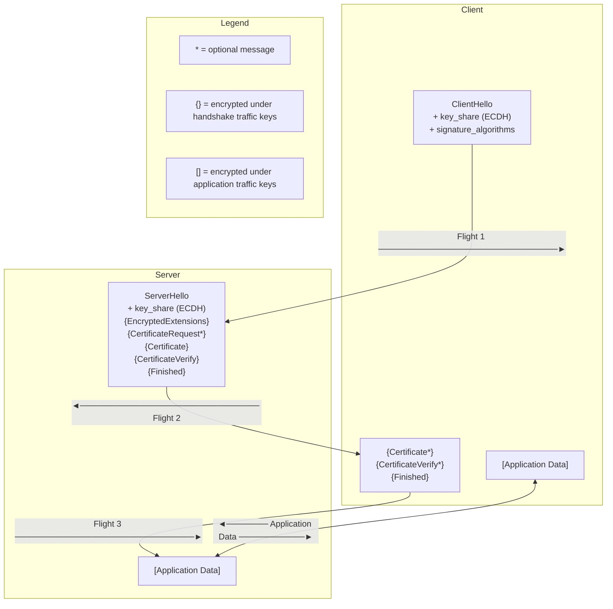

# Lesson 4: Cryptographic Protocol Systems

## 1. First-Principles Intuition & Invariants

Cryptographic primitives—block ciphers, hash functions, asymmetric encryption—exist as isolated mathematical operations until they are composed into protocols. A protocol transforms these primitives into a distributed system with state machines, message ordering constraints, and threat models that span network adversaries, compromised endpoints, and time-based attacks. The fundamental challenge in protocol design is not mathematical hardness but rather the engineering of trust bootstrapping, forward secrecy, and authenticated key establishment across hostile communication channels.

The canonical problem that motivates modern cryptographic protocols is the key distribution dilemma: two parties who have never communicated must establish a shared secret over a public network monitored by an adversary with arbitrary computational resources and full read/write access to all transmitted data. Classical symmetric cryptography assumed pre-shared keys distributed through secure out-of-band channels, but this approach collapses at internet scale where billions of previously unknown endpoints must establish ephemeral sessions without prior coordination.

Whitfield Diffie and Martin Hellman resolved this paradox in 1976 by inverting the relationship between public and private information. Their key exchange protocol exploits the asymmetry between exponentiation and discrete logarithm computation in finite cyclic groups. Given a generator $g$ of a group of prime order $q$ and a secret exponent $a$, computing $g^a \bmod p$ requires $O(\log a)$ multiplications via square-and-multiply algorithms, yet recovering $a$ from $g^a$ demands $O(\sqrt{q})$ group operations under the best known attacks. This computational gap—polynomial forward operation versus subexponential inverse—creates a one-way trapdoor that enables public key cryptography.

The Diffie-Hellman protocol proceeds through a three-phase dance. Alice generates a random secret $a$ from $\mathbb{Z}_q$ and publishes $A = g^a \bmod p$. Bob independently generates secret $b$ and publishes $B = g^b \bmod p$. Both parties can now compute the shared secret $K = g^{ab} \bmod p$ because Alice computes $B^a = (g^b)^a$ while Bob computes $A^b = (g^a)^b$, and by commutativity of exponentiation these values are identical. An eavesdropper observing $(g, p, A, B)$ faces the computational Diffie-Hellman problem: given $(g, g^a, g^b)$, compute $g^{ab}$ without knowing $a$ or $b$. While this problem is no harder than the discrete logarithm problem, no polynomial-time reduction exists in the reverse direction, and certain elliptic curve groups appear to exhibit a larger hardness gap.

The transition from finite field Diffie-Hellman to elliptic curve variants (ECDH) represents an optimization in group structure rather than protocol mechanics. Elliptic curves defined over finite fields $\mathbb{F}_p$ or $\mathbb{F}_{2^m}$ provide cyclic groups where the discrete logarithm problem resists index calculus attacks that plague multiplicative groups of finite fields. The best known attacks against elliptic curve discrete logarithms remain generic algorithms like Pollard's rho with $O(\sqrt{n})$ complexity, whereas finite field discrete logarithms succumb to subexponential index calculus methods. This asymmetry permits 256-bit ECDH to achieve security equivalent to 3072-bit finite field DH, reducing key transmission overhead by a factor of twelve and accelerating scalar multiplication operations through efficient elliptic curve point arithmetic.

Modern protocol analysis decomposes security into threat model invariants expressed through game-based reduction proofs. The authenticated key exchange (AKE) security model captures an adversary's capabilities through queries to an oracle representing honest protocol participants. The adversary may initiate sessions, deliver messages out of order, inject arbitrary packets, corrupt long-term keys of selected parties, and reveal session keys after establishment. A protocol achieves AKE security if no polynomial-time adversary can distinguish a challenge session key from a random bitstring with non-negligible advantage, even after adaptively corrupting parties and revealing related session keys. This model formalizes intuitive properties like forward secrecy (compromise of long-term keys does not reveal past session keys) and key compromise impersonation resistance (stealing Alice's long-term key does not allow impersonation of Bob to Alice).

The cascade of protocol refinements from Diffie-Hellman to Station-to-Station to authenticated ECDH to TLS 1.3 represents the progressive hardening of threat models. Bare Diffie-Hellman provides no authentication; an active adversary can perform man-in-the-middle attacks by conducting independent key exchanges with Alice and Bob while relaying encrypted traffic. The Station-to-Station protocol binds ephemeral keys to long-term identities by signing the concatenation $(g^a, g^b)$ with each party's private signature key, but this introduces signature malleability vulnerabilities if the signature scheme lacks strong unforgeability properties. SIGMA (SIGn-and-MAc) variants add message authentication codes over the entire handshake transcript to prevent subtle identity misbinding attacks where an adversary convinces Alice she established a key with Bob while Bob believes he established the key with the adversary.

Post-quantum cryptography introduces fundamental shifts in both group structure and threat model assumptions. Shor's algorithm demonstrates that quantum computers can solve discrete logarithm and integer factorization problems in polynomial time using quantum Fourier transforms, completely breaking the hardness assumptions underlying Diffie-Hellman, ECDH, and RSA. The NIST post-quantum standardization process converged on lattice-based, hash-based, and code-based constructions that resist known quantum attacks. CRYSTALS-Kyber, the selected post-quantum key encapsulation mechanism (KEM), replaces the computational Diffie-Hellman problem with the learning-with-errors (LWE) problem: distinguishing noisy linear combinations of secret lattice points from uniform random values. Unlike Diffie-Hellman's symmetric exchange, Kyber follows an asymmetric encapsulation pattern where Bob generates a public key encoding a lattice instance, Alice encapsulates a random session key by adding controlled noise to lattice samples, and Bob decapsulates by exploiting his private key's ability to remove the noise and recover Alice's session key.

The transition from classical to post-quantum protocols demands careful hybrid constructions during the migration period. A protocol that combines ECDH and Kyber through concatenated key derivation achieves "defense in depth" security: the composed key exchange remains secure if either the elliptic curve discrete logarithm problem or the lattice LWE problem resists all attacks. This hybrid approach mitigates catastrophic failures from broken security assumptions, cryptanalytic breakthroughs, or implementation side-channels. The engineering challenge lies in maintaining performance and minimizing handshake latency while transmitting significantly larger post-quantum public keys and ciphertexts—Kyber-768 requires 1088 bytes for the public key and 1184 bytes for the ciphertext, compared to 32 bytes for a Curve25519 public key.

## 2. Core Architecture & Mechanics

The Transport Layer Security protocol constructs authenticated encrypted channels by composing key exchange mechanisms, digital signatures, symmetric ciphers, and message authentication codes into a carefully choreographed handshake state machine. TLS 1.3, standardized in RFC 8446, represents a comprehensive redesign that eliminates legacy cipher suites, enforces forward secrecy, reduces round-trip latency, and simplifies the state space to eliminate decades of subtle vulnerabilities.

The TLS 1.3 handshake proceeds through a two-flight exchange minimizing connection establishment latency. The client's initial ClientHello message contains protocol version, supported cipher suites, a random nonce, and crucially, ephemeral key shares for anticipated key exchange algorithms. By speculatively computing ECDH key shares for common curves like X25519 or P-256, the client enables single round-trip handshake completion. The server responds with ServerHello selecting the cipher suite and key share, followed immediately by encrypted handshake messages containing the server certificate, certificate verification signature, and Finished MAC. This aggressive pipelining reduces handshake latency from two round trips in TLS 1.2 to a single round trip in TLS 1.3, critical for mobile networks where round-trip times often exceed 100 milliseconds.

The handshake's cryptographic architecture layers multiple keys derived from a central secret schedule. Upon receiving the server's key share, both parties compute the ECDH shared secret and feed it into the HKDF key derivation function along with the handshake transcript hash. HKDF implements extract-then-expand: first applying HMAC-based extraction to concentrate entropy from the shared secret into a pseudorandom key, then expanding that key into multiple derived secrets using distinct labels and context strings. The key schedule generates independent keys for client-to-server and server-to-client traffic encryption, handshake message authentication, and resumption secrets for future session tickets. This hierarchical derivation ensures that compromise of application traffic keys does not reveal handshake authentication keys, and that session ticket secrets remain isolated from the primary handshake.

Certificate validation forms the trust anchor binding cryptographic keys to real-world identities. An X.509 certificate encodes a subject identity, public key, validity period, and digital signature from a Certificate Authority. The certificate chain establishes transitive trust: the server presents its leaf certificate signed by an intermediate CA, which itself holds a certificate signed by a root CA whose public key exists in the client's pre-distributed trust store. Validation proceeds bottom-up through the chain, verifying each signature using the public key from the parent certificate, checking validity periods, and confirming that each certificate's key usage extensions authorize signing subordinate certificates.

The trust model's weak point lies in the certificate authority infrastructure itself. The client implicitly trusts hundreds of root CAs whose private keys represent single points of catastrophic failure. Compromise of any root CA enables an attacker to issue fraudulent certificates for arbitrary domains that validate correctly in all clients. Certificate Transparency addresses this vulnerability by requiring CAs to append certificates to append-only cryptographic logs before issuance. Monitors continuously audit these logs, detecting mis-issued certificates when domain owners observe certificates they did not request. The protocol embeds Signed Certificate Timestamps (SCTs) in certificates or TLS extensions, proving log inclusion and enabling clients to reject certificates lacking transparency evidence.

Forward secrecy derives from the ephemeral nature of Diffie-Hellman exponents. Traditional RSA key exchange encrypts a random pre-master secret under the server's long-term RSA public key, creating a catastrophic failure mode: if an adversary records encrypted sessions and later compromises the RSA private key, they can decrypt all historical traffic. TLS 1.3 mandates ephemeral ECDH where the server generates a fresh private key for each session and discards it immediately after deriving the session keys. Even if an attacker compromises the server's long-term signature key used to authenticate the handshake, they cannot retroactively compute session keys because the ephemeral ECDH secrets no longer exist. This property—that past session security survives future key compromise—represents a fundamental invariant in modern protocol design.

Session resumption optimizes repeat connections through pre-shared key (PSK) modes. After completing a full handshake, the server issues a session ticket containing an encrypted resumption secret. On subsequent connections, the client presents this ticket in ClientHello, and both parties derive session keys from the resumption secret without performing public key operations. This optimization eliminates certificate transmission and signature verification, reducing handshake computation and bandwidth. The security analysis differs subtly from ephemeral ECDH: compromise of the server's ticket encryption key allows an attacker to decrypt the resumption secret and compute all session keys for connections using that ticket, violating forward secrecy for resumed sessions. TLS 1.3 mitigates this by requiring servers to mix ephemeral ECDH into PSK handshakes, maintaining forward secrecy even for resumed connections.

The implementation of TLS state machines demands paranoid input validation and constant-time cryptographic operations. Padding oracle attacks exploit timing side-channels in CBC mode ciphertext decryption where the server's response time leaks whether padding validation succeeded. An attacker iteratively modifies ciphertext bytes while measuring response times, using the padding validity oracle to decrypt arbitrary ciphertexts byte-by-byte without knowing the encryption key. Modern TLS implementations use authenticated encryption with associated data (AEAD) modes like AES-GCM or ChaCha20-Poly1305 that provide combined encryption and authentication, eliminating padding entirely. All cryptographic operations must execute in constant time relative to secret values: scalar multiplication, modular exponentiation, MAC verification, and ciphertext decryption must not exhibit data-dependent timing variations or memory access patterns that leak key material through microarchitectural side-channels.

The integration of TLS into application architectures follows several deployment patterns. Terminating TLS at load balancers or reverse proxies decrypts traffic at the network edge, enabling layer-7 routing, content inspection, and DDoS mitigation, but concentrates trust in the proxy's private key and creates an internal plaintext network segment. End-to-end encryption pushes TLS termination to application servers, maintaining confidentiality through the entire path but complicating load balancing which must operate at layer 4 without inspecting encrypted application data. Mutual TLS (mTLS) extends certificate authentication to clients, requiring both parties to present certificates during the handshake. This pattern suits microservice architectures where services authenticate each other using short-lived certificates issued by an internal CA, implementing zero-trust security models that assume network segments may be compromised.

The transition to post-quantum TLS requires hybrid key exchange where both classical ECDH and post-quantum KEM operations occur in parallel, concatenating the resulting shared secrets before key derivation. The protocol negotiation mechanism extends cipher suite identifiers to indicate hybrid combinations like `TLS_AES_128_GCM_SHA256` with `X25519Kyber768Draft00`. The implementation challenge centers on the larger post-quantum public keys and ciphertexts that must fit within single network packets to avoid fragmentation. A Kyber-768 key exchange adds approximately 2.2 KB to the handshake compared to 32 bytes for X25519, potentially pushing ClientHello messages beyond typical MTU limits and triggering IP fragmentation that degrades performance and enables fragmentation-based denial-of-service attacks. Careful protocol engineering compresses handshake messages, fragments at the TLS record layer rather than IP layer, and implements selective hybrid support where resource-constrained clients may fall back to classical key exchange.

## 3. High-Performance Optimization & Failure Modes

Cryptographic protocol performance decomposes into computational overhead, latency amplification, and caching strategies. The dominant computational cost in TLS handshakes stems from asymmetric operations: RSA signature verification requires approximately 1 million CPU cycles for 2048-bit keys, while ECDSA verification on P-256 demands roughly 400,000 cycles, and X25519 scalar multiplication completes in 150,000 cycles. A server handling 100,000 new connections per second would consume 15 billion cycles solely for ephemeral key exchange, saturating a 10 GHz processor core. Real-world deployments exploit hardware acceleration through AES-NI instructions for symmetric encryption, Intel SHA extensions for hash computation, and dedicated cryptographic coprocessors that offload public key operations to specialized silicon implementing Montgomery multiplication and Barrett reduction for modular arithmetic.

Session resumption fundamentally alters the performance profile by replacing public key cryptography with symmetric operations. A resumed TLS 1.3 handshake using PSK mode eliminates certificate transmission, signature generation, signature verification, and ECDH scalar multiplication, reducing server CPU consumption by two orders of magnitude and cutting handshake latency from 100 milliseconds to 10 milliseconds on transcontinental links. The engineering challenge lies in maintaining a session cache that scales to millions of concurrent connections while enforcing session ticket expiration and key rotation. Modern implementations use hierarchical ticket encryption where multiple servers share ticket encryption keys distributed through a secure control plane, enabling any server in a cluster to decrypt tickets issued by any peer without centralized session state.

Certificate chain validation represents a latency multiplier that protocol designers often underestimate. Validating a three-certificate chain requires verifying three RSA or ECDSA signatures, fetching intermediate certificates if the server omits them, checking certificate revocation status through OCSP queries, and parsing certificate extensions. OCSP queries introduce network round trips to the CA's revocation responder, adding 50-500 milliseconds of latency and creating a dependency on third-party infrastructure. OCSP stapling mitigates this by having servers periodically fetch signed revocation status and include it in the TLS handshake, but this requires coordination between the TLS server and certificate management system. Certificate Transparency log verification adds further latency as clients must validate SCT signatures from multiple log operators. Production systems balance security and performance by caching validation results, implementing soft-fail for OCSP timeouts, and pre-verifying certificate chains during configuration reload rather than per-connection.

The failure mode analysis for cryptographic protocols spans protocol attacks, implementation vulnerabilities, and operational misconfigurations. Downgrade attacks exploit protocol version negotiation to force clients into using weak legacy cipher suites. The FREAK attack discovered that many TLS implementations accepted "export-grade" 512-bit RSA keys, a relic of 1990s-era US export restrictions, allowing attackers to factor the weak keys and decrypt traffic. The Logjam attack similarly targeted 512-bit Diffie-Hellman groups. TLS 1.3 eliminates these attack surfaces by removing support for static RSA key exchange, export cipher suites, CBC mode ciphers, compression, and renegotiation. The protocol enforces downgrade protection through a special sentinel value in ServerHello.random that allows clients to detect when an attacker manipulates protocol version fields.

Timing side-channels remain the most persistent implementation vulnerability class. The Lucky Thirteen attack against TLS 1.2 CBC mode exploited subtle timing differences in MAC-then-encrypt processing, allowing attackers to decrypt HTTPS cookies through millions of carefully crafted requests. The ROBOT attack (Return Of Bleichenbacher's Oracle Threat) demonstrated that RSA padding validation timing leaked information allowing decryption of RSA-encrypted pre-master secrets. Constant-time implementation requires obsessive attention to control flow and memory access patterns: conditional branches must be eliminated through arithmetic masking, table lookups must access all entries regardless of the actual index, and comparison operations must examine all bytes even after detecting a mismatch. Modern cryptographic libraries like BearSSL and AWS libcrypto achieve constant-time guarantees through careful assembly implementation and formal verification of side-channel resistance properties.

Certificate validation failures create numerous attack vectors when implementations deviate from strict RFC compliance. The null-prefix attack embedded null bytes in certificate subject names to trick validators that terminated string comparison at the null character, allowing certificates for `evil.com\0legitimate.com` to impersonate `legitimate.com`. The BasicConstraints attack exploited validators that failed to check the CA:TRUE extension, accepting end-entity certificates as intermediate CAs and enabling attackers to issue arbitrary fraudulent certificates. Name constraint violations occur when validators do not enforce the nameConstraints extension that limits which domains a CA may certify. Production systems require defense in depth: strict parsing that rejects malformed certificates, explicit checks for all critical extensions, and integration testing against deliberately malformed certificate test suites.

The operational security of deployed TLS systems depends critically on private key protection and rotation procedures. Private keys must never exist in plaintext outside of hardware security modules (HSMs) or trusted execution environments. The signing and decryption operations must occur inside tamper-resistant hardware that enforces access controls and audit logging. Key rotation procedures must account for certificate transparency log append-only properties: revoking a compromised certificate does not remove it from logs, so incident response requires issuing new certificates with fresh keys and distribating revocation information through CRLs and OCSP. The blast radius of CA compromise scales with the CA's position in the trust hierarchy: root CA compromise requires out-of-band trust store updates across all clients, intermediate CA compromise requires CRL/OCSP revocation distribution, and leaf certificate compromise affects only a single service.

The integration of post-quantum cryptography introduces new performance and security tradeoffs. Kyber key generation and encapsulation execute in microseconds on modern processors, comparable to X25519 ECDH, but the larger ciphertexts consume bandwidth and increase packet loss probability on lossy networks. The lattice-based construction exhibits different side-channel characteristics: implementations must defend against chosen-ciphertext attacks through Fujisaki-Okamoto transforms that introduce additional hash operations and decapsulation validity checks. The operational challenge centers on hybrid cipher suite deployment where clients and servers must negotiate common support for both classical and post-quantum algorithms without fragmenting the deployed cipher suite space. Migration strategies employ gradual rollout where post-quantum support begins as experimental, transitions to hybrid-only for security-critical connections, and eventually deprecates classical-only modes once ecosystem support reaches critical mass.

Threat modeling for protocol systems requires analyzing attacker capabilities across multiple layers. A passive network adversary observes all transmitted data but cannot modify packets; cryptographic confidentiality defends against this adversary through semantic security guarantees. An active network adversary can inject, modify, and drop packets; authenticated encryption and message authentication codes prevent undetected tampering. A compromised endpoint attacker controls one participant's system state; forward secrecy limits the temporal damage window, and mutual authentication prevents the compromised party from impersonating others. A quantum adversary with large-scale fault-tolerant quantum computers breaks classical public key cryptography; post-quantum algorithms provide the sole defense. The security architecture must compose defenses to maintain invariants across these threat tiers, recognizing that real-world attackers often begin with limited capabilities and escalate through vulnerability chaining.
