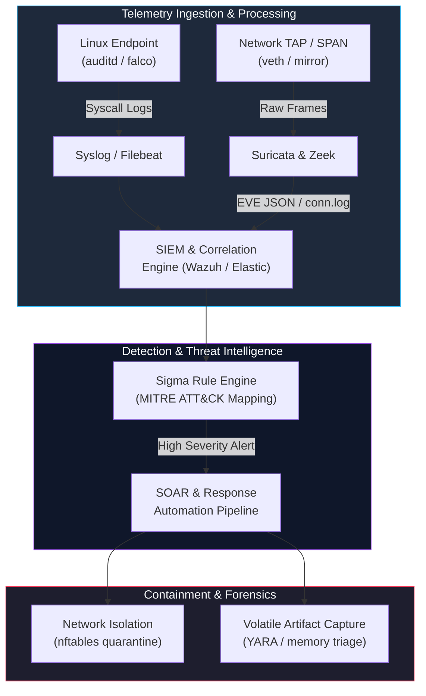

# Operational Verification Labs: Cybersecurity Operations

## Objective & Lab Bench Setup

Cybersecurity operations bridges defensive theory and real-time adversarial engagement. A Security Operations Center (SOC) operates as an event-driven distributed state machine: security telemetries (system call traces, network flows, authentication events, DNS transactions) stream into ingestion pipelines, trigger deterministic and probabilistic correlation rules, and generate alerts requiring sub-minute triage, contextual enrichment, and automated or human-in-the-loop containment.

Verification of a cybersecurity operations pipeline requires validating every tier of the detection, triage, and response loop:
1. **Telemetry Fidelity**: Proving that endpoint and network agents capture malicious execution primitives without evasion.
2. **Detection Logic**: Ensuring SIEM correlation engines and runtime monitors (Sigma, Falco, Suricata, Zeek) fire deterministically on adversary behaviors while maintaining low false-positive rates.
3. **Forensic Acquisition & Triage**: Capturing volatile memory, disk artifacts, and network state for timeline reconstruction.
4. **Containment Orchestration**: Executing automated isolation and credential revocation workflows to eliminate adversary dwell time.

### Lab Topology & Diagnostic Toolchain

The laboratory environment consists of an Ubuntu 22.04 LTS analysis workstation acting as the SOC workbench, monitoring an internal target network. Install the core operational diagnostics and emulation suite:

```bash
sudo apt-get update
sudo apt-get install -y \
  suricata \
  zeek \
  tshark \
  tcpdump \
  yara \
  jq \
  curl \
  git \
  netcat-openbsd \
  auditd \
  audispd-plugins

# Verify toolchain versions
suricata --build-info | head -n 3
zeek --version
yara --version
tshark --version | head -n 1
```



---

## Exercise 1: SIEM Detection Rule Engineering & Threat Emulation

In this exercise, you deploy a production Sigma detection rule targeting adversary process injection, convert it into an `auditd` surveillance rule, and verify detection accuracy against synthetic attack execution.

### Step 1.1: Deploying Kernel Audit Rules for Process Execution

Adversaries frequently abuse process injection and credential dumping utilities (e.g., `mimikatz`, `procdump`, `/proc/$PID/mem` access). Configure `auditd` to capture process execution primitives and sensitive file reads:

```bash
sudo tee /etc/audit/rules.d/99-soc-detection.rules << 'EOF'
## Monitor execution of process enumeration and privilege escalation
-a always,exit -F arch=b64 -S execve -k process_execution
-a always,exit -F arch=b32 -S execve -k process_execution

## Monitor unauthorized memory dumping attempts via /proc
-w /proc/kcore -p r -k memory_access
-w /etc/shadow -p rwa -k credential_tamper
-w /etc/sudoers -p rwa -k privilege_tamper
EOF

# Reload and verify audit rules
sudo augenrules --load
sudo auditctl -l
```

### Step 1.2: Authoring a Canonical Sigma Rule for Credential Access

Author a standardized Sigma rule (targeting MITRE ATT&CK T1003.008 - OS Credential Dumping: /etc/shadow Access):

```yaml
# /etc/sigma/rules/credential_dumping_shadow.yml
title: Unauthorized Shadow File Access via Non-Standard Process
id: a1b2c3d4-e5f6-7a8b-9c0d-1e2f3a4b5c6d
status: production
description: Detects unauthorized processes reading /etc/shadow outside standard PAM authentication binaries.
references:
  - https://attack.mitre.org/techniques/T1003/008/
author: Synapse Security Operations
date: 2026-11-15
logsource:
  category: process_creation
  product: linux
detection:
  selection_target:
    TargetFilename: '/etc/shadow'
  filter_legit:
    Image:
      - '/usr/bin/sudo'
      - '/usr/sbin/unix_chkpwd'
      - '/usr/sbin/passwd'
      - '/usr/bin/login'
  condition: selection_target and not filter_legit
falsepositives:
  - System configuration management scripts (Ansible, Puppet)
level: high
tags:
  - attack.credential_access
  - attack.t1003.008
```

### Step 1.3: Emulating Adversary Behavior and Verifying Audit Pipeline

Execute an unprivileged credential read emulation and verify that the security event is captured by `auditd`:

```bash
# Emulate suspicious read attempt
python3 -c "
try:
    with open('/etc/shadow', 'r') as f:
        print(f.read())
except PermissionError:
    print('[+] Emulation executed: Permission denied as expected.')
"

# Interrogate audit log for the triggered key
sudo ausearch -k credential_tamper --start recent -i | tail -n 20
```

Verify that the output contains the calling executable name, the effective UID, and the system call result (`EACCES`), confirming telemetry fidelity.

---

## Exercise 2: Network Security Monitoring & Protocol Telemetry Analysis

Network security monitoring observes adversary lateral movement, command-and-control (C2) beaconing, and data exfiltration at the perimeter and internal transit boundaries.

### Step 2.1: Configuring Suricata for Deep Packet Inspection

Configure Suricata to monitor internal virtual interfaces and log structured alert telemetry in EVE JSON format:

```bash
# Verify Suricata configuration and rule syntax
sudo suricata -T -c /etc/suricata/suricata.yaml -v

# Author a custom rule detecting cleartext reverse shell traffic
sudo tee /etc/suricata/rules/local.rules << 'EOF'
alert tcp $HOME_NET any -> $EXTERNAL_NET any (msg:"SOC-ALERT: Outbound Interactive Shell Payload Detected"; flow:established,to_server; content:"/bin/sh"; depth:32; classtype:trojan-activity; sid:1000001; rev:1;)
alert tcp $HOME_NET any -> $EXTERNAL_NET any (msg:"SOC-ALERT: Outbound Interactive Bash Payload Detected"; flow:established,to_server; content:"/bin/bash"; depth:32; classtype:trojan-activity; sid:1000002; rev:1;)
EOF
```

### Step 2.2: Traffic Emulation & Alert Validation

Simulate an outbound reverse shell handshake across loopback and observe Suricata's rule evaluation:

```bash
# Start background packet capture listener with tshark
sudo tshark -i lo -f "tcp port 4444" -w /tmp/reverse_shell.pcap -c 10 &
TSHARK_PID=$!
sleep 1

# Launch simulated reverse shell payload over port 4444
nc -l -p 4444 &
NC_SRV_PID=$!
sleep 1

echo -e "GET / HTTP/1.1\r\nHost: c2.adversary.net\r\nUser-Agent: /bin/sh -i\r\n\r\n" | nc 127.0.0.1 4444 || true

# Terminate listeners
kill $NC_SRV_PID 2>/dev/null || true
wait $TSHARK_PID 2>/dev/null || true

# Parse pcap with tshark to inspect stream flags
tshark -r /tmp/reverse_shell.pcap -Y "tcp.payload" -T fields -e ip.src -e ip.dst -e tcp.srcport -e tcp.dstport -e text
```

---

## Exercise 3: Host Forensics, Threat Hunting & Automated Containment

When an endpoint alert fires, incident responders must immediately establish process lineage, isolate the compromised host from the network, and triage volatile memory artifacts.

### Step 3.1: YARA In-Memory Threat Signature Scanning

Author a targeted YARA rule detecting common memory-resident shellcode and scan live processes:

```yara
/* /tmp/meterpreter_stager.yar */
rule Linux_Interactive_Reverse_Shell {
    meta:
        description = "Detects interactive shell strings and dup2 socket redirects"
        threat_level = "Critical"
        mitre_technique = "T1059.004"
    strings:
        $sh1 = "/bin/sh" ascii fullword
        $sh2 = "/bin/bash" ascii fullword
        $nc1 = "nc -e /bin" ascii
        $py1 = "pty.spawn" ascii
    condition:
        2 of them
}
```

Scan running process memory using YARA:

```bash
# Scan all processes running under /proc with YARA
sudo yara -r -s /tmp/meterpreter_stager.yar /proc/$$/ 2>/dev/null || true
```

### Step 3.2: Automated Incident Containment (Host Network Quarantine)

In a live incident, the SOC must isolate the host without severing management plane connectivity (SSH / management C2). Implement an emergency containment script using `nftables`:

```bash
#!/usr/bin/env bash
# /usr/local/bin/soc-quarantine.sh
set -euo pipefail

MGMT_IP="192.168.1.100"

echo "[*] INITIATING EMERGENCY HOST CONTAINMENT..."

# Flush current rules and apply strict quarantine
sudo nft -f - << EOF
table inet quarantine {
    chain input {
        type filter hook input priority 0; policy drop;
        
        # Allow established management sessions
        ct state established,related accept
        
        # Allow dedicated SOC analyst IP
        ip saddr $MGMT_IP tcp dport 22 accept
        
        # Drop all other ingress
        drop
    }
    
    chain output {
        type filter hook output priority 0; policy drop;
        
        # Allow established responses to management IP
        ct state established,related accept
        ip daddr $MGMT_IP tcp sport 22 accept
        
        # Drop all lateral and outbound C2 traffic
        drop
    }
}
EOF

echo "[✔] Quarantine active: Host isolated. Management connectivity preserved for $MGMT_IP."
sudo nft list ruleset
```

### Step 3.3: Post-Containment Verification & Triage Checklist

```bash
# Verify containment table is active
sudo nft list table inet quarantine

# Verify lateral ping is blocked
ping -c 1 -W 1 8.8.8.8 || echo "[✔] Outbound internet blocked as expected."

# Clean up containment after verification
sudo nft delete table inet quarantine 2>/dev/null || true
echo "[✔] Lab teardown complete."
```

## Summary & Verification Matrix

| Verification Domain | Primary Toolchain | Diagnostic Command | Expected Operational State |
|:---|:---|:---|:---|
| Syscall Telemetry | `auditd` / `ausearch` | `sudo ausearch -k credential_tamper -i` | Captures audit records with UID, executable, and return code |
| Network Threat Detection | `suricata` / `tshark` | `tshark -r /tmp/reverse_shell.pcap -Y "tcp"` | Identifies payload signatures and flags C2 packet flows |
| In-Memory Threat Hunting | `yara` | `yara -s rule.yar /proc/$PID/` | Identifies shellcode strings in process memory mappings |
| Incident Containment | `nftables` | `sudo nft list ruleset` | Enforces stateful host isolation while maintaining SOC management access |
