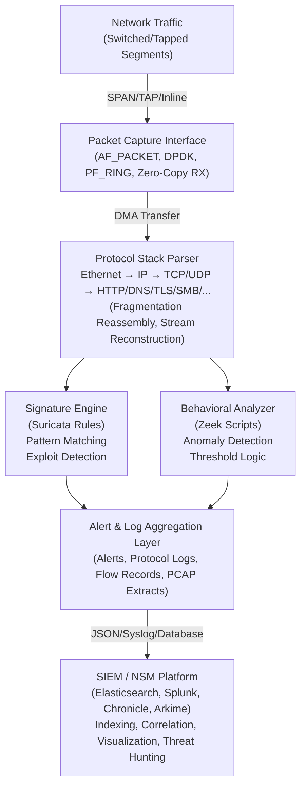

# Lesson 3: Network Security Monitoring, Traffic Analysis, Packet Forensics

## 1. First-Principles Intuition & Invariants

Network security monitoring rests on a deceptively simple premise: every malicious action against a networked system must traverse the wire at some point, leaving behind protocol-level artifacts that encode the attacker's intent, tooling, and operational tradecraft. Unlike endpoint detection, which observes the consequences of compromise after malware has already executed in process memory, network monitoring captures the communication channels themselves—the command-and-control callbacks, the lateral movement attempts, the data exfiltration streams—at the moment they traverse the network fabric. This temporal advantage transforms the network from a passive transport medium into an active sensor plane, where every TCP handshake, every DNS query, every TLS ClientHello, and every HTTP header carries forensic metadata that, when aggregated and correlated across time, reveals adversarial patterns invisible to isolated endpoint telemetry.

The invariant that anchors all network security monitoring is the fundamental asymmetry between legitimate traffic and adversarial traffic. Legitimate applications exhibit predictable protocol state machines: web browsers follow RFC 9110 HTTP semantics, SSH clients adhere to RFC 4253 key exchange sequences, and DNS resolvers respect the query-response transaction model defined in RFC 1035. Adversarial traffic, by contrast, must deviate from these norms to achieve its objectives. A port scan generates half-open TCP connections that never complete the three-way handshake. A command-and-control beacon using DNS tunneling produces query names with anomalously high entropy, incompatible with legitimate domain name distributions. An SQL injection attack injects protocol metacharacters into HTTP POST bodies, violating the semantic contract between client and server. These deviations are not implementation bugs but rather necessary violations of protocol invariants, forced upon the attacker by the fundamental tension between stealth and functionality.

The challenge, then, is not merely to capture packets but to reconstruct the semantic intent encoded within them. A packet capture file is not a list of discrete events but rather a partial observation of a distributed state machine executing across multiple network nodes. When a monitoring sensor observes a TCP SYN packet, it witnesses the initiation of a connection attempt, but the semantic meaning of that attempt—whether it represents a legitimate service request, a reconnaissance probe, or the first stage of an exploit delivery—remains latent until subsequent packets arrive to complete the handshake, deliver application-layer payloads, and exhibit behavioral patterns consistent with one interpretation or another. This semantic reconstruction problem is compounded by the stateless nature of IP routing: packets may arrive out of order, traverse asymmetric paths, or be fragmented by intermediate routers, forcing the monitoring system to maintain stateful reassembly buffers and connection tracking tables that mirror the protocol state machines operating at the endpoints.

Modern network security monitoring has evolved from simple signature matching—where byte patterns in packet payloads trigger alerts—toward protocol-aware behavioral analysis, where the monitoring system parses and validates the syntactic structure of application-layer protocols, tracks the evolution of connection states over time, and correlates flows across multiple sessions to detect multi-stage attack campaigns. This evolution reflects a deeper understanding of the adversarial landscape: skilled attackers do not rely on static exploit payloads that signature engines can trivially detect but instead weaponize legitimate protocol features—DNS for command-and-control tunneling, HTTP for data exfiltration disguised as web traffic, TLS for encryption that blinds deep packet inspection—forcing defenders to shift from payload inspection to metadata analysis, where the timing, volume, and sequencing of network events encode adversarial intent even when the payload content itself is encrypted or obfuscated.

The placement of monitoring sensors within the network topology fundamentally shapes the visibility and fidelity of the telemetry they produce. A sensor positioned at the network perimeter, where traffic enters and exits the organizational boundary, observes all external communication but sees only aggregated flows between internal hosts and the internet, lacking visibility into lateral movement within the internal network. A sensor deployed at the core switch of a data center VLAN, by contrast, captures east-west traffic between internal servers, exposing lateral movement and privilege escalation attempts that never touch the perimeter, but it may be blind to encrypted traffic terminating at application load balancers before reaching the sensor. This topology-dependent visibility creates a fundamental tradeoff: perimeter sensors maximize coverage of internet-facing threats but provide coarse-grained internal visibility, while internal sensors offer fine-grained observation of intra-network activity but require distributed deployment and centralized aggregation to achieve comprehensive coverage. The optimal monitoring architecture, therefore, is not a single sensor but a hierarchical sensor fabric, where perimeter sensors provide high-level threat intelligence, internal sensors capture detailed behavioral telemetry, and a centralized correlation engine reconstructs the global attack narrative from these distributed observations.

The packet itself—the atomic unit of network monitoring—encodes a layered structure that mirrors the OSI and TCP/IP protocol stacks. At the lowest layer, the Ethernet frame carries MAC addresses that identify the physical network interface cards exchanging the data, along with an EtherType field that indicates whether the payload is an IPv4 packet, an IPv6 packet, or a VLAN-tagged frame. One layer up, the IP header specifies source and destination IP addresses, the IP protocol number that indicates whether the payload is TCP, UDP, ICMP, or an encapsulated protocol, and fragmentation metadata that allows reassembly of packets split across multiple frames. The transport layer header—TCP or UDP—adds port numbers that demultiplex application streams and, in the case of TCP, sequence numbers and acknowledgment numbers that enable reliable, ordered delivery. Finally, the application layer payload carries the protocol-specific data: HTTP requests and responses, DNS queries and replies, TLS handshake messages, or custom application protocols. Each layer introduces its own opportunities for anomaly detection: an IP header with an abnormally small TTL may indicate a network scan originating from a nearby compromised host, a TCP SYN packet with unusual flag combinations may represent an OS fingerprinting probe, and an HTTP User-Agent string that deviates from known browser distributions may reveal a malware implant masquerading as legitimate traffic.

The temporal dimension of network traffic introduces additional forensic richness. A single packet is an instantaneous snapshot, but a flow—the aggregated sequence of packets sharing the same five-tuple of source IP, destination IP, source port, destination port, and protocol—captures the lifecycle of a network conversation from initiation through data transfer to termination. Flow records, such as those produced by NetFlow or IPFIX exporters, distill packet streams into summary statistics: byte counts, packet counts, start and end timestamps, and TCP flags observed during the connection. These flow records enable long-term trend analysis at scale, where high-volume data exfiltration appears as an unusually large byte count, a slow-and-low command-and-control beacon manifests as periodic flows with small payloads and regular timing intervals, and a lateral movement campaign emerges as an explosion of new flow records between previously non-communicating internal hosts. Flow analysis trades the high-fidelity visibility of full packet capture for the scalability required to monitor high-throughput networks, where storing every packet is economically infeasible but retaining flow metadata for weeks or months enables retrospective threat hunting and incident response investigations.

The cryptographic protocols that dominate modern internet traffic—TLS for web and API communication, SSH for remote administration, IPsec for VPN tunnels—present a fundamental challenge to payload-based inspection. When application-layer data is encrypted, the monitoring sensor observes only the protocol handshake, during which the client and server negotiate cipher suites and exchange key material, and the subsequent encrypted application data, which is opaque to any observer lacking the session keys. This encryption forces defenders to shift their analytical focus from payload content to metadata: the TLS ClientHello message reveals the client's supported cipher suites and extensions, the Server Certificate carries the server's identity and public key, and the volume and timing of encrypted data flows still encode behavioral patterns. A data exfiltration event, for instance, generates an asymmetric flow where the client sends far more data to the server than it receives in response, a pattern detectable even when the payload is encrypted. Similarly, a command-and-control beacon using TLS generates periodic connections with small, predictable payload sizes, a timing signature that persists despite encryption. The defensive value of TLS metadata has driven the development of specialized inspection techniques such as TLS fingerprinting, where the specific combination of cipher suites, extensions, and elliptic curves in the ClientHello uniquely identifies the client software, enabling detection of malware implants even when they use legitimate certificates and encryption.

## 2. Core Architecture & Mechanics

The architecture of a network intrusion detection system begins with the physical capture of packets from the wire. In a switched network environment, where switches forward frames only to the destination MAC address rather than broadcasting them to all ports as hubs once did, the monitoring sensor must be strategically positioned to observe traffic. The most common deployment pattern is a switch port analyzer (SPAN) or mirror port configuration, where the switch copies all traffic from one or more source ports or VLANs to a dedicated monitor port to which the sensor is connected. This mirroring is unidirectional: the sensor receives copies of packets but cannot inject traffic back into the network, preventing the monitoring system from becoming an attack vector itself. Alternatively, in high-security environments, a network tap—a passive optical or electrical device—physically splits the signal traveling across the wire, sending one copy to the destination and another to the sensor without introducing additional latency or failure modes. Inline deployments, where the sensor sits directly in the data path and forwards traffic between two network segments, enable intrusion prevention system (IPS) functionality, where the sensor can drop or modify malicious packets in real-time, but this active posture introduces the risk that a sensor failure or performance bottleneck could disrupt legitimate traffic, a tradeoff that must be carefully evaluated against the operational requirements of the network.

Once packets arrive at the sensor's network interface, the operating system's kernel receives them through the network interface card's device driver, which uses direct memory access (DMA) to transfer packet buffers from the NIC's ring buffer into kernel memory without involving the CPU. The kernel's network stack then begins parsing the packet headers, but for high-performance monitoring, bypassing the standard network stack is essential. General-purpose operating systems are optimized for interactive workloads and socket-based application communication, not for capturing and processing millions of packets per second. The monitoring sensor therefore employs specialized packet capture frameworks that provide direct userspace access to packet buffers, eliminating context switches and kernel processing overhead. On Linux, the AF_PACKET socket with the PACKET_MMAP option maps the kernel's packet ring buffer directly into userspace memory, allowing the monitoring application to read packets with zero-copy semantics. Higher-performance deployments use DPDK (Data Plane Development Kit), which bypasses the kernel entirely by implementing a poll-mode driver that continuously checks the NIC's receive queues for new packets, achieving multi-million packet-per-second throughput by dedicating entire CPU cores to packet processing and leveraging huge pages to reduce TLB misses during memory-intensive operations.

The raw packet stream arriving at the sensor must be parsed and decoded layer by layer, reconstructing the protocol stack from Ethernet frames up through application-layer messages. This parsing is not a simple sequential traversal but rather a stateful process that must handle variable-length headers, optional fields, and encapsulation. An Ethernet frame may carry a VLAN tag, in which case the EtherType field is 0x8100 and the actual payload type follows the VLAN header. An IPv4 header has a variable-length Options field controlled by the header length field, requiring dynamic parsing logic. TCP segments may arrive out of order or be fragmented at the IP layer, necessitating reassembly buffers that hold partial data until the complete sequence is available. The parser must also handle malformed or adversarially crafted packets: an IP header with an invalid checksum, a TCP segment with contradictory flags, or an HTTP request with a Content-Length that does not match the actual body size. These malformations are not merely errors to be discarded but potential indicators of evasion attempts or exploit payloads designed to trigger vulnerabilities in careless parsers, and the monitoring system must log them as anomalies while avoiding crashes or resource exhaustion.

Protocol parsing feeds into session tracking, where the monitoring system maintains a flow table that records the state of every active connection. For TCP, this state machine mirrors the kernel's connection tracking: the sensor observes a SYN packet and creates a new entry in the flow table with a state of SYN_SENT, then observes the SYN-ACK response and transitions to SYN_RECEIVED, then observes the ACK and transitions to ESTABLISHED. Each subsequent packet in the flow updates sequence and acknowledgment numbers, allowing the sensor to detect retransmissions, out-of-order delivery, and window scaling behavior. When the connection terminates, either through a FIN-FIN-ACK sequence or a RST packet, the sensor marks the flow as closed and eventually evicts it from the table to reclaim memory. For UDP, which is stateless at the transport layer, the sensor must infer connection semantics from application-layer behavior: a DNS query and response sharing the same transaction ID constitute a single logical flow, even though UDP itself provides no connection tracking. This flow-level state is essential for behavioral analysis: a port scan generates hundreds of flows that each last only milliseconds, while a legitimate web session generates a single long-lived HTTPS flow with bidirectional data transfer, patterns that are invisible when examining individual packets in isolation.

Signature-based detection, the foundational technique in intrusion detection systems, operates by comparing packet payloads or flow metadata against a database of known attack patterns. A signature is a byte pattern, regular expression, or protocol-specific pattern that uniquely identifies a particular exploit, malware sample, or malicious behavior. For example, a signature might match the byte sequence `\x90\x90\x90\x90\xcc\xc3` in a TCP payload, corresponding to a NOP sled followed by an INT3 instruction in x86 shellcode, or it might match the HTTP request line `GET /admin/../../etc/passwd HTTP/1.1`, which represents a path traversal attempt. Signature engines use optimized string matching algorithms such as Aho-Corasick, which preprocesses the signature database into a finite automaton that can simultaneously search for thousands of patterns in a single pass over the packet payload, achieving throughput compatible with multi-gigabit networks. However, signatures suffer from a fundamental limitation: they detect only known attacks. An attacker who modifies a single byte in an exploit payload, encodes a command-and-control protocol in a novel way, or uses a zero-day vulnerability for which no signature exists will evade signature-based detection entirely. This limitation has driven the development of anomaly-based and behavioral detection techniques, which establish baselines of normal traffic and flag deviations as suspicious, but these techniques introduce their own challenges: high false-positive rates, computational complexity, and the difficulty of defining "normal" in dynamic environments where legitimate traffic patterns evolve over time.

Zeek, formerly known as Bro, represents a protocol-aware monitoring architecture that goes beyond signature matching to provide deep semantic analysis of network protocols. Rather than operating on raw packet payloads, Zeek parses application-layer protocols into structured logs that capture protocol-specific events: HTTP transactions, DNS queries, SSL/TLS handshakes, SMB file transfers, and dozens of other protocols. Each protocol analyzer is a state machine that tracks the lifecycle of protocol messages, validates syntactic correctness, and extracts metadata into structured records. For instance, the HTTP analyzer produces a log entry for each HTTP request-response pair, recording the timestamp, source and destination addresses, HTTP method, URI, status code, User-Agent string, content length, and MIME type. These logs are not mere packet dumps but rather semantic abstractions that encode the meaning of network traffic in terms that defenders can reason about: "Which internal hosts connected to this known-bad domain?" becomes a simple query against the DNS log, and "Which users downloaded executable files from the internet?" translates to a filter on the HTTP log where the MIME type is `application/x-msdownload` and the destination address is internal.

Zeek's scripting language enables custom detection logic that operates on these protocol-level abstractions. A Zeek script can define a threshold on the number of failed SSH login attempts from a single source IP, triggering an alert when the threshold is exceeded. Another script can track the set of DNS domains queried by each internal host, flagging hosts that query an unusually large number of unique domains—a behavioral indicator of domain generation algorithm (DGA) activity used by malware to locate command-and-control servers despite domain takedowns and blacklisting. Zeek scripts can also implement stateful correlation across multiple protocols: a script might monitor for an HTTP download of an executable file followed by a DNS query to a suspicious domain within a short time window, a pattern consistent with a drive-by download leading to command-and-control callback. This protocol-aware, stateful, and scriptable architecture allows Zeek to encode threat intelligence and detection heuristics as code rather than as brittle signature patterns, adapting to evolving adversarial tactics without requiring constant signature updates.

Suricata, an alternative to Zeek with a complementary design philosophy, combines signature-based detection with protocol parsing and built-in support for intrusion prevention. Suricata's rule language descends from Snort, the pioneering open-source IDS, but extends it with multi-threading, GPU acceleration for pattern matching, and Lua scripting for complex detection logic. A Suricata rule specifies a protocol (TCP, UDP, HTTP, TLS), a traffic direction (source to destination or bidirectional), source and destination IP ranges and ports, and a set of detection keywords that match packet or flow characteristics. For example, a rule might specify `alert http any any -> any any (msg:"SQL Injection Attempt"; flow:to_server,established; content:"SELECT"; http_uri; content:"UNION"; http_uri; sid:1000001;)`, which triggers an alert when an HTTP request contains both "SELECT" and "UNION" in the URI, a classic SQL injection pattern. Suricata's protocol parsers decode HTTP, TLS, DNS, SMB, and other protocols into structured fields, allowing rules to match on specific HTTP headers, TLS cipher suites, or DNS query types rather than searching for byte patterns in arbitrary payload offsets.

The integration of packet capture, protocol parsing, signature matching, and behavioral analysis produces a high-dimensional telemetry stream that must be aggregated, correlated, and stored for analysis. A typical enterprise deployment generates gigabytes of network metadata per day: Zeek logs, Suricata alerts, NetFlow records, and raw packet captures for high-value traffic. This telemetry feeds into a security information and event management (SIEM) platform or a specialized network security monitoring (NSM) platform, which indexes the data, correlates events across time and space, and provides query interfaces for threat hunting and incident response. The correlation engine might, for instance, observe a Suricata alert for a suspicious HTTP request, query the Zeek HTTP log for the full transaction details, retrieve the NetFlow record for the associated flow to determine data volumes, and fetch the raw packet capture to inspect the payload manually. This multi-resolution telemetry—from high-level alerts down to individual bytes on the wire—enables analysts to navigate from coarse-grained detection to fine-grained forensic investigation without losing context.

The following diagram illustrates the data flow through a network security monitoring architecture, from packet capture through protocol parsing and signature matching to log aggregation and alert generation:

## 3. High-Performance Optimization & Failure Modes

The performance ceiling of network security monitoring is dictated not by signature database size or detection complexity but by the rate at which packets arrive at the sensor and the speed at which the system can parse, analyze, and log them. A 10-gigabit Ethernet link can theoretically deliver 14.88 million packets per second when saturated with minimum-sized 64-byte frames, a rate that exceeds the processing capacity of general-purpose packet capture stacks. Dropped packets—the failure mode where the kernel or application cannot keep pace with the arrival rate and discards incoming frames—create blind spots in monitoring coverage, and skilled attackers can exploit these blind spots by flooding the network with high packet rates to overwhelm the sensor, a technique known as sensor evasion. Achieving zero packet loss at line rate requires careful tuning of every layer in the capture pipeline: the NIC's ring buffer sizes, the kernel's socket buffer limits, the CPU affinity of packet processing threads, and the memory allocation patterns of the monitoring application.

Modern NICs provide hardware offload features that reduce the CPU burden of packet processing. Receive-side scaling (RSS) distributes incoming packets across multiple hardware queues based on a hash of the packet's five-tuple, allowing different CPU cores to process packets in parallel without contention. Large receive offload (LRO) coalesces multiple TCP segments received in quick succession into a single large buffer before passing it to the kernel, reducing per-packet overhead at the cost of increased latency. Checksum offload delegates the verification of IP and TCP checksums to the NIC hardware, freeing the CPU from this arithmetic. However, these offloads can interfere with intrusion detection: LRO merges packets together, obscuring the original packet boundaries that signatures might depend on, and checksum offload prevents the monitoring system from detecting packets with invalid checksums, which could indicate either transmission errors or malicious crafting. High-fidelity monitoring therefore disables these offloads, accepting the performance cost in exchange for complete visibility into the original packet stream as transmitted on the wire.

CPU cache locality is critical for packet processing performance. Each packet must be parsed from Ethernet header through IP header to transport header to application payload, a sequential access pattern that benefits from cache line prefetching. However, if the flow table grows too large to fit in cache, every flow lookup incurs a cache miss and main memory access, adding hundreds of CPU cycles to per-packet processing time. The monitoring system must therefore evict stale flows aggressively, using timeouts that balance memory consumption against the risk of losing state for long-lived connections. A typical configuration might expire TCP flows that have not seen a packet in 5 minutes and UDP flows after 30 seconds, but these timeouts must be tuned to the specific traffic patterns of the monitored network. Flow eviction is not merely a performance optimization but also a correctness requirement: an attacker conducting a SYN flood generates millions of half-open connections that will never complete, and if the sensor allocates flow state for each one, it will exhaust memory and crash, achieving the attacker's denial-of-service objective against the monitoring system itself.

Signature matching scales poorly with signature database size when implemented naively as sequential comparisons. A database of 10,000 signatures would require 10,000 string comparisons per packet, a computational cost incompatible with multi-gigabit throughput. Optimized signature engines therefore employ multi-pattern matching algorithms such as Aho-Corasick or Hyperscan, which construct a deterministic finite automaton that processes each byte of the packet payload exactly once while simultaneously searching for all patterns. Hyperscan, developed by Intel and now open-source, uses SIMD instructions to process multiple bytes in parallel and employs sophisticated state compression techniques that reduce memory footprint, but it still imposes a CPU cost proportional to the packet payload size. Encrypted traffic presents an additional challenge: when the payload is opaque, signature matching is futile, and the monitoring system must shift to metadata-based detection, sacrificing the high-confidence signal of payload-based signatures for the noisier signal of behavioral anomalies.

Log volume and storage costs present a distinct scaling challenge. A busy network segment can generate hundreds of gigabytes of Zeek logs per day, and regulatory or forensic requirements may mandate retention for months or years. Full packet capture is even more demanding: a 10-gigabit link saturated at 50% utilization produces 5 gigabits per second or approximately 54 terabytes per day. Few organizations can afford to store full packet captures at this scale, so the monitoring system must implement selective capture policies: capture all traffic to and from high-value assets, capture only the first N bytes of each flow to preserve protocol headers while discarding bulk data transfer, or capture traffic only when an alert is triggered, preserving forensic evidence for confirmed incidents while discarding benign traffic. These tradeoffs introduce their own risks: a capture policy that retains only HTTP headers will miss malware payloads delivered in HTTP POST bodies, and a triggered capture that activates only after an alert will fail to capture the initial reconnaissance and exploitation stages that preceded the alert, limiting the forensic value of the capture.

Encrypted traffic analysis has evolved sophisticated techniques to extract signal from metadata despite payload encryption. TLS fingerprinting, as implemented in the JA3 algorithm, computes a hash over the ordered sequence of cipher suites, extensions, and elliptic curves in the TLS ClientHello message, producing a fingerprint that uniquely identifies the client software. Legitimate browsers produce a small set of JA3 fingerprints that correspond to major versions of Chrome, Firefox, and Safari, while malware implants, penetration testing tools, and custom exploit frameworks produce distinct fingerprints that rarely appear in normal traffic. The monitoring system can therefore flag connections with unusual JA3 fingerprints as suspicious, even when the encrypted payload is inaccessible. Certificate analysis provides another metadata source: the Subject, Issuer, and validity period of the server's X.509 certificate encode information about the server's identity, and certificates issued by free, automated certificate authorities such as Let's Encrypt are disproportionately used by phishing sites and command-and-control infrastructure because they eliminate the cost and identity verification required by commercial CAs. However, these heuristics are fragile: legitimate applications increasingly use automated certificate issuance, and sophisticated attackers can trivially modify their TLS client libraries to mimic browser fingerprints, forcing a cat-and-mouse game where defenders must continuously refine their heuristics to keep pace with adversarial adaptation.

Flow-based anomaly detection relies on establishing baselines of normal traffic patterns and flagging deviations, but defining "normal" in a heterogeneous enterprise network is fundamentally difficult. A database server that typically receives queries from a handful of application servers will generate a stable set of flows with predictable source IPs, but if legitimate traffic patterns change—a new application is deployed, a server is migrated to a different subnet, or a spike in user activity drives unusual load patterns—the monitoring system will generate false positives that overwhelm analysts. Machine learning techniques, such as clustering algorithms that group flows by behavioral similarity or time-series models that predict expected traffic volume, can reduce false positives by adapting to evolving baselines, but they introduce opacity: when a model flags an anomaly, the analyst must reverse-engineer why the model made that decision, a process that is often more difficult than manually investigating the traffic. The optimal approach combines machine learning for triage—ranking alerts by suspiciousness to prioritize analyst attention—with human-interpretable detection logic for high-confidence alerts, ensuring that the most critical threats are never buried under a pile of low-fidelity anomalies.

Protocol anomaly detection targets violations of protocol state machines and semantic constraints. An HTTP request with a Content-Length header that does not match the actual body size violates RFC 9110 and may indicate an HTTP smuggling attack designed to desynchronize the front-end proxy and back-end server. A DNS response with the QR bit set to query rather than response is syntactically invalid and likely represents either a misconfigured server or an attacker attempting to inject forged DNS responses. A TCP packet with both SYN and FIN flags set simultaneously violates the TCP state machine and is often used in network reconnaissance to fingerprint the target's operating system based on how it responds to malformed packets. Detecting these anomalies requires protocol-aware parsers that validate not just the byte-level structure of packets but the semantic constraints of the protocols they implement. However, protocol implementations in the wild are notoriously non-compliant with RFCs, and what appears to be a violation may in fact be widely deployed behavior that has become de facto standard despite lacking formal specification. The monitoring system must therefore balance strictness—rejecting any deviation from the RFC—with pragmatism—tolerating common violations while flagging truly unusual anomalies.

The operational workflow of network security monitoring alternates between reactive alert investigation and proactive threat hunting. Reactive investigation begins when the monitoring system generates an alert: a Suricata rule matched a signature, a Zeek script detected a behavioral anomaly, or a flow analysis threshold was exceeded. The analyst's task is to determine whether the alert represents a true positive—an actual compromise or attack attempt—or a false positive caused by benign traffic that happened to match the detection logic. This investigation requires pivoting across multiple data sources: the alert itself provides an initial timestamp and source/destination addresses, the Zeek logs provide protocol-level context about what the connection was doing, the flow records show whether the connection was part of a larger pattern of activity, and the raw packet capture provides definitive evidence of what was transmitted. If the alert is confirmed as malicious, the analyst escalates to incident response: isolate the compromised host, collect forensic evidence, determine the scope of the breach, and remediate the vulnerability that enabled the attack.

Proactive threat hunting inverts this workflow: rather than waiting for alerts, the analyst formulates hypotheses about adversarial behavior and queries the telemetry to find evidence supporting or refuting those hypotheses. For instance, an analyst might hypothesize that an attacker has established persistence through a scheduled task that beacons to a command-and-control server every hour. To test this hypothesis, the analyst queries the flow records for periodic connections—flows that occur at regular intervals with consistent source and destination addresses—filters for connections to external IP addresses not associated with known legitimate services, and investigates the protocol-level behavior of the flagged connections. If the connections use HTTP with unusual User-Agent strings and carry small payloads in POST requests, the hypothesis gains support, and the analyst can pivot to endpoint telemetry to confirm the presence of the scheduled task. Threat hunting is inherently exploratory and requires deep knowledge of both adversarial tradecraft and the normal operational patterns of the monitored environment, making it a high-skill activity that complements but does not replace automated detection.

The integration of network monitoring with threat intelligence feeds transforms raw telemetry into contextualized risk indicators. A network connection to an IP address is merely a data point, but a connection to an IP address known to host a Cobalt Strike command-and-control server is an immediate incident. Threat intelligence platforms aggregate indicators of compromise (IOCs) from commercial threat intelligence vendors, open-source feeds such as the Emerging Threats ruleset, and internal sources such as incident response investigations, then cross-reference these IOCs against network telemetry in near real-time. However, threat intelligence suffers from high false-positive rates due to infrastructure reuse: an IP address that hosted a phishing site six months ago may now host a legitimate website after the domain was taken down and re-registered by a new owner, and flagging all connections to that IP as malicious will generate spurious alerts. Effective threat intelligence integration therefore requires not just IOC matching but temporal correlation—checking whether the IOC was active at the time of the connection—and reputation scoring—aggregating signals from multiple sources to distinguish high-confidence indicators from noisy ones.

The ultimate failure mode of network security monitoring is not technical but organizational: the deluge of alerts and logs overwhelms the analyst team, leading to alert fatigue where analysts stop investigating alerts thoroughly, or triage bottlenecks where high-priority incidents languish in the queue because the team lacks bandwidth to investigate them. Mitigating this failure mode requires a combination of technical and procedural measures. On the technical side, tuning detection logic to reduce false positives, implementing tiered alert severity levels to prioritize the most critical threats, and automating low-level investigations through orchestration platforms that execute playbooks in response to common alert types all reduce the cognitive burden on analysts. On the procedural side, defining clear escalation paths, rotating analysts through different monitoring responsibilities to prevent burnout, and conducting regular retrospectives to refine detection logic based on lessons learned from past incidents build a sustainable monitoring operation. Network security monitoring is not a passive surveillance system but an active human-machine collaboration where technology provides the sensor plane and computational power, and humans provide the judgment, intuition, and adaptability required to distinguish signal from noise in an adversarial environment where attackers continuously evolve their tactics to evade detection.
