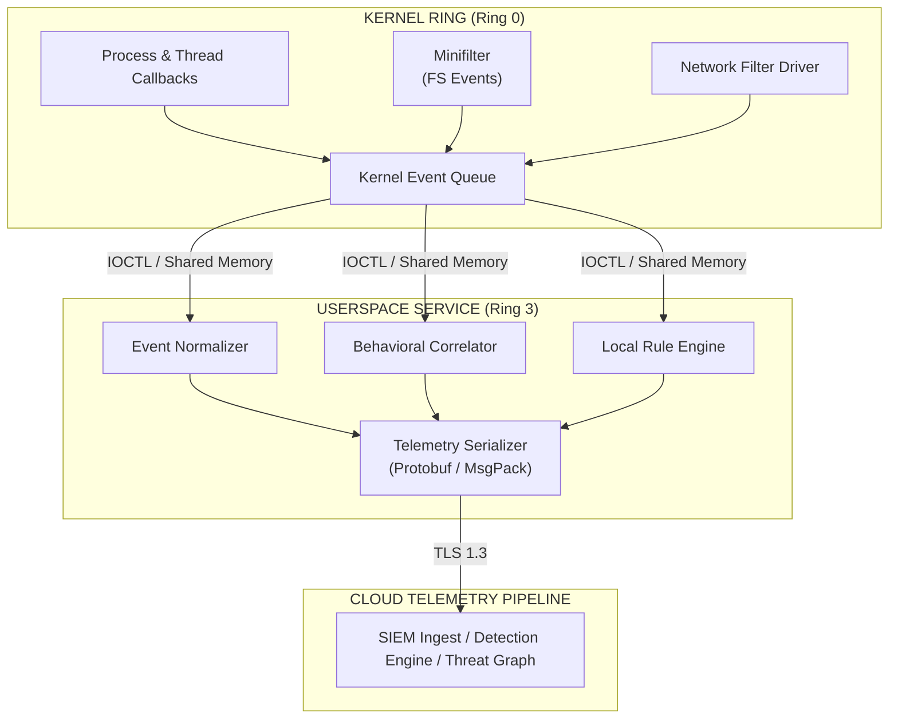
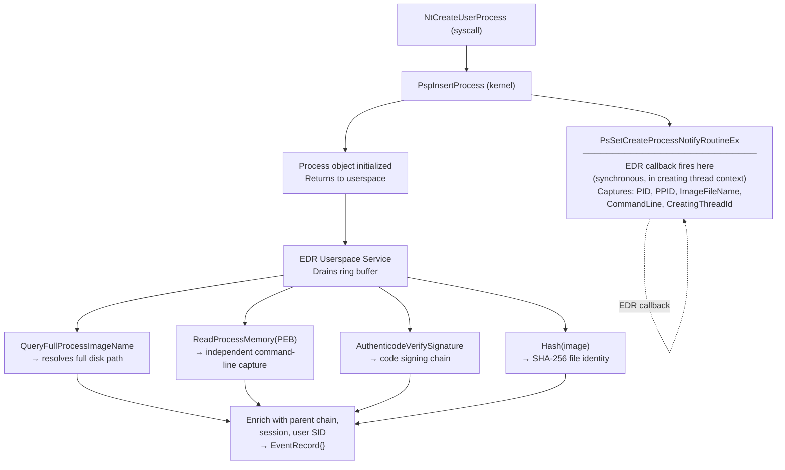

# Lesson 4: Endpoint Detection Response, Host-Based Monitoring, Forensic Artifacts

## 1. First-Principles Intuition & Invariants

Every modern endpoint is a crime scene in waiting. The operating system, over the course of its runtime, writes an unbroken diary of its own activity: processes born and killed, files opened and overwritten, registry keys mutated, network sockets bound and torn down, memory regions allocated with executable permissions. The discipline of Endpoint Detection and Response exists because perimeter defenses — firewalls, gateway proxies, signature-based antivirus — fundamentally cannot observe this diary. They see packets and file hashes; EDR sees execution graphs, behavioral chains, and the causal relationships between events that make an attack distinguishable from legitimate work.

The invariant that underpins everything in this lesson is *telemetry completeness*. An attacker who operates entirely within the gaps of a sensor's visibility is invisible by definition. The engineering challenge of EDR is therefore not primarily one of detection logic, but one of sensor coverage: ensuring that every observable artifact of attacker behavior — a suspicious parent-child process relationship, an LSASS memory read, a DLL loaded from a user-writable path, a scheduled task written without a corresponding installer — is captured at the kernel level before userspace has any opportunity to suppress or falsify it.

Understanding why this requires kernel-level hooking demands a brief descent into how Windows (the dominant enterprise endpoint) mediates system calls. Every meaningful action a process takes — allocating memory, spawning a child, reading a file — passes through the Windows NT executive via the system call interface. The kernel exposes a mechanism called the *Windows Kernel Notification Routines*, a set of callback registration points that allow drivers to subscribe to events: `PsSetCreateProcessNotifyRoutineEx` for process creation, `PsSetCreateThreadNotifyRoutine` for thread creation, `PsSetLoadImageNotifyRoutine` for image (DLL/EXE) load events, and the minifilter driver framework (`FltRegisterFilter`) for filesystem I/O interception. These are the substrate on which every serious EDR kernel sensor is built. Because these callbacks fire inside the kernel before execution returns to userspace, a userspace-only attacker cannot suppress them — doing so would require a kernel exploit to patch or unregister the callbacks, which is itself a catastrophically detectable event under a correctly instrumented system.

The other foundational invariant is *behavioral semantics over syntactic signatures*. Signature-based detection matches bytes: a known shellcode stub, an import hash, a YARA rule against file content. Behavioral detection matches what a process *does*: a Microsoft Office child process writing a PE to `%APPDATA%` and then executing it via `cmd.exe` is anomalous regardless of the bytes involved. The practical consequence for the security engineer is that evasion against signature-based detection (packing, obfuscating, polymorphism) does not automatically defeat behavioral detection, because the attacker's *intent* — the sequence of OS interactions required to achieve their objective — leaves a structurally consistent artifact signature that cannot be trivially polymorphed.

Lateral movement presents a special case. When an attacker pivots from a beachhead to an adjacent host using legitimate credentials and built-in tools — a technique broadly called Living off the Land (LotL) — the individual events on each host look entirely normal in isolation. What makes them detectable is the *graph structure* of the behavior across time and hosts: `winrm` connections arriving from a workstation that has never before initiated administrative traffic, `net use` commands followed within seconds by binary execution on a remote share, service installations correlated across multiple machines in a short time window. This is why modern EDR platforms augment host-level telemetry with cross-host behavioral analytics, and why the forensic investigator must be comfortable reasoning about both the per-host artifact record and the network-wide execution graph simultaneously.

---

## 2. Core Architecture & Mechanics

### EDR Agent Architecture

A production EDR agent is a layered system spanning kernel space, a userspace service, and a cloud telemetry pipeline. Its architecture can be understood as three concentric rings of observation, each with different access, fidelity, and performance cost.



The kernel ring is the agent's most privileged and most critical component. Its principal job is not detection — detection logic running in the kernel introduces unacceptable stability risk — but *collection and minimal filtering*. Each registered callback fires synchronously in the context of the thread that triggered the event. The callback must therefore be as lean as possible: it reads the relevant data from the kernel data structures, enqueues a fixed-size event record into a lock-free ring buffer in shared memory, and returns. Any heavyweight processing — string parsing, rule evaluation, graph lookups — happens in the userspace service, which drains the ring buffer from a dedicated high-priority thread.

The userspace service receives raw kernel events and enriches them into normalized event records. Process creation events, for instance, arrive from the kernel with a PID, a parent PID, and an `EPROCESS` pointer snapshot; the service correlates these against an in-memory process tree, resolves the full image path via `QueryFullProcessImageName`, captures the command-line from the process PEB, computes the image hash, and checks the authenticode signature chain. Only after this enrichment does the event enter the behavioral correlator, which maintains a sliding window of recent events per process and per session, evaluating detection logic expressed as stateful rules (effectively a finite automaton over the event stream).

### Process Telemetry in Depth

The richest single telemetry source in Windows host forensics is the *process creation event*. The kernel fires `PsSetCreateProcessNotifyRoutineEx` with an `PS_CREATE_NOTIFY_INFO` structure that contains the parent process ID, the image file name (as a kernel `UNICODE_STRING`), and critically a `CommandLine` field populated from the process's RTL_USER_PROCESS_PARAMETERS. This command line is the single most abused field in Windows forensics: attackers routinely spoof it, truncate it, or use Unicode homoglyphs to defeat substring matching. A robust EDR therefore validates the command line against the actual process arguments visible in the PEB, and also captures the *process creation flags* from `NtCreateUserProcess`, which reveal whether the process was created suspended (a strong indicator of process injection staging).

The chain of custody from process creation to full telemetry record looks like this:



A fully enriched process telemetry record therefore carries not just what executed, but *who* spawned it, *from what parent*, with *what privilege level*, and whether the binary on disk at the time of execution carried a valid Microsoft or vendor Authenticode signature. The absence of a valid signature for a process masquerading as a Windows component is one of the highest-fidelity detection signals in the entire EDR corpus.

### Registry and File System Forensics

The Windows Registry is a hierarchical, transactional database that serves as the single most important persistence substrate on the platform. Its physical representation on disk is the *hive file* — `SYSTEM`, `SOFTWARE`, `SAM`, `SECURITY`, `NTUSER.DAT` — each of which is a binary file structured as a tree of *cells* (the basic unit of allocation within a hive). The hive format is not archived by most practitioners, but understanding it is essential for forensic recovery: deleted registry keys leave behind *orphaned cells* that remain in the slack space of the hive until the hive is compacted (a process Windows calls *registry defragmentation*, triggered infrequently and non-deterministically). Tools like `RegRipper` and Eric Zimmermann's `RegistryExplorer` parse raw hive bytes and can recover these orphaned cells, surfacing persistence mechanisms that an attacker believed they had removed.

The persistence mechanisms accessible through the Registry are numerous and well-documented, yet remain perpetually effective because defenders too often focus on monitoring only the canonical `Run`/`RunOnce` keys while attackers use a long tail of less-monitored locations. The table below is not exhaustive but covers the locations that appear most frequently in incident response engagements.

| Registry Path | Trigger | Notes |
|---|---|---|
| `HKCU\Software\Microsoft\Windows\CurrentVersion\Run` | User logon | Per-user, low privilege required |
| `HKLM\SOFTWARE\Microsoft\Windows\CurrentVersion\Run` | All logons | Requires admin |
| `HKLM\SYSTEM\CurrentControlSet\Services` | Boot/demand | Service-based persistence |
| `HKLM\SOFTWARE\Microsoft\Windows NT\CurrentVersion\Winlogon` → `Userinit`, `Shell` | Winlogon | Hijacks shell initialization |
| `HKCU\SOFTWARE\Classes\*\shell\open\command` | File open | COM/shell handler hijack |
| `HKLM\SOFTWARE\Microsoft\Windows NT\CurrentVersion\Image File Execution Options` | Process launch | Debugger hijacking (IFEO) |
| `HKLM\SYSTEM\CurrentControlSet\Control\Session Manager\AppCertDlls` | Process create | DLL injection on every new process |
| `HKCU\SOFTWARE\Classes\CLSID` | COM activation | COM object hijacking |

The file system forensics picture is equally rich. NTFS, the standard Windows file system, implements a *journal* — the `$UsnJrnl` (Update Sequence Number Journal) in the `$Extend` metadata directory — that records every file create, modify, delete, and rename operation with microsecond timestamps. The USN journal is a circular log; entries are overwritten after the volume exceeds the configured journal size, typically 32 MB, which on a busy system may represent only hours of history. This makes rapid triage critical: in the first hours after detecting a compromise, a forensicator should immediately image the USN journal before it rotates, as it will contain the exact sequence of file operations the attacker performed, including the creation and deletion of staging tools they believed they had cleaned up.

The `$MFT` (Master File Table) is an equally critical artifact. Every file and directory on an NTFS volume has a 1 KB record in the MFT. Each record contains the file's standard information attributes (creation, modification, MFT-modified, and last-access timestamps — the so-called MACB times), the file name attribute (with its own independent set of MACB times), and either inline data (for small files, stored directly in the MFT record as a *resident attribute*) or data run pointers for larger files. The forensic value of the MFT's separate `$FILE_NAME` timestamp set is that it is significantly harder for userspace tooling to manipulate: the `$STANDARD_INFORMATION` timestamps can be altered with a single `SetFileTime` API call, and timestomping tools routinely do so, but the `$FILE_NAME` timestamps are updated only by the kernel's directory-notification machinery and cannot be altered through the documented Win32 API. A discrepancy between the two timestamp sets is a reliable indicator of timestomping.

Parsing the raw MFT with a tool like `MFTECmd.exe` from Eric Zimmermann's toolkit produces a CSV with one row per file, exposing both timestamp sets and allowing timeline reconstruction even when the attacker has attempted to falsify timestamps.

```text
MFTECmd.exe -f "\\.\C:" --csv C:\output --csvf mft_output.csv
```

### Memory Forensics and Process Injection

Memory forensics occupies a privileged position in the host artifact hierarchy because it captures attacker state that never touches disk: injected shellcode, in-memory-only implants, decrypted configuration blobs, and live credential material. The Volatility Framework (version 3 for modern OS symbol support) is the standard tool for offline memory analysis, operating against either a full physical memory image (acquired via WinPmem or a hardware-based imager) or a virtual machine snapshot.

The core workflow for memory forensics against a suspected injected process begins with enumerating all running processes and their mapped memory regions, then identifying regions that are executable but not backed by a file on disk — the hallmark of injected shellcode or a reflectively loaded DLL.

```python
# Volatility 3: enumerate processes and find suspicious VAD (Virtual Address Descriptor) entries
# Run against a full memory image: memory.raw

python3 vol.py -f memory.raw windows.pstree.PsTree
python3 vol.py -f memory.raw windows.vadinfo.VadInfo --pid 1234
python3 vol.py -f memory.raw windows.malfind.Malfind
```

The `malfind` plugin implements exactly the heuristic described above: it walks the Virtual Address Descriptor tree for each process (the kernel's red-black tree of `MMVAD` nodes that describes every mapped region), identifies regions marked `PAGE_EXECUTE_READWRITE` or `PAGE_EXECUTE_WRITECOPY` whose VAD node has no associated file object (meaning the region was allocated with `NtAllocateVirtualMemory` and written directly, not mapped from a PE), and dumps the first 64 bytes of each such region as hex alongside a disassembly preview. This output will, in a process-injection scenario, show the characteristic bytes of a staged shellcode loader or a reflective DLL header (`MZ` / `4D 5A` with a valid PE header offset at byte 0x3C).

The three primary process injection patterns each leave a distinguishable artifact signature in memory:

Classic `VirtualAllocEx` / `WriteProcessMemory` / `CreateRemoteThread` injection leaves a foreign thread (visible in the target process's thread list) whose start address points into an MZ-PE-less executable region. The `windows.cmdline.CmdLine` and `windows.dlllist.DllList` plugins will show the host process's normal module list without the injected code, confirming it was written directly rather than loaded through the PE loader.

Reflective DLL injection, as implemented in Stephen Fewer's seminal technique, loads a full PE image into memory without using `LoadLibrary`. The injected DLL contains a bootstrap function (`ReflectiveLoader`) that manually resolves its own imports, processes its relocation table, and registers itself in memory — but deliberately omits itself from the `InMemoryOrderModuleList` in the PEB's `LDR_DATA` structure. Memory forensics exposes this by cross-referencing the results of `windows.dlllist` (which walks the PEB LDR list) against `windows.vadinfo` (which walks the kernel VAD tree): any executable region visible in the VAD tree but absent from the PEB module list is a reflectively loaded image.

Process Hollowing (a.k.a. RunPE) creates a legitimate process in suspended state, unmaps its original image with `NtUnmapViewOfSection`, writes a replacement PE into the vacated virtual address range, and resumes the thread. The artifact signature here is a process whose image path on disk does not match the PE header bytes at its base address in memory — a discrepancy that `windows.dlllist` or a manual comparison of the on-disk binary hash against a memory dump of the base image will immediately expose.

```python
# Dump the memory-resident image of a suspicious process for offline PE analysis
python3 vol.py -f memory.raw windows.dumpfiles.DumpFiles --pid 1234

# Compare the in-memory PE against the on-disk binary
sha256sum svchost.exe.0x7ff8a0000000.img
sha256sum C:\Windows\System32\svchost.exe
# A hash mismatch is definitive evidence of process hollowing or image tampering
```

### Lateral Movement Detection

Lateral movement in a Windows enterprise environment most commonly leverages one of four transport mechanisms: SMB (remote service installation, remote share execution), WMI (`Win32_Process.Create` over DCOM), WinRM (`Invoke-Command`, PsExec-style), or RDP. Each leaves a characteristic artifact trail across both the source and destination host.

On the *source host*, the EDR will record the creation of a network socket to port 445, 135, 5985, or 3389, correlated against the process making the connection. When `services.exe` on the source host has never previously connected to port 445 on a lateral target, and that connection is immediately followed by the creation of a service on the remote host, the behavioral correlation is unambiguous. The key telemetry fields are the 4-tuple (source IP, source port, destination IP, destination port), the initiating process, the user context, and the timestamp.

On the *destination host*, the Windows Event Log provides the ground truth. The Security event log, under channel `Microsoft-Windows-Security-Auditing`, records logon events with Event ID 4624 (successful logon) and 4625 (failed logon). The logon type field within 4624 is the critical differentiator: Type 3 is a network logon (SMB, WMI), Type 10 is RemoteInteractive (RDP), and Type 5 is a service logon. An attacker establishing a beachhead via PsExec will produce a Type 3 logon followed almost immediately by a Type 5 logon from the installed service, within the same second, from the same source IP — a pattern that never occurs in normal administrative activity.

The `Microsoft-Windows-TaskScheduler/Operational` and `Microsoft-Windows-WinRM/Operational` event logs complement the Security log. Scheduled task creation (Event ID 106) from a remote source, combined with the task's action being an executable in a user-writable directory, is a canonical persistence-plus-lateral-movement pattern. WinRM operational logs record the creation of remote shell sessions with the initiating user, source IP, and shell GUID, providing a durable record even if the attacker deletes their PowerShell history.

```powershell
# Extract all network logon events (Type 3) from the Security log in the last 24 hours
# Run on the destination host during triage

Get-WinEvent -FilterHashtable @{
    LogName   = 'Security'
    Id        = 4624
    StartTime = (Get-Date).AddHours(-24)
} | Where-Object {
    $_.Properties[8].Value -eq 3  # LogonType = Network
} | Select-Object TimeCreated,
    @{N='SubjectUser';    E={$_.Properties[1].Value}},
    @{N='TargetUser';     E={$_.Properties[5].Value}},
    @{N='LogonType';      E={$_.Properties[8].Value}},
    @{N='SourceIP';       E={$_.Properties[18].Value}},
    @{N='ProcessName';    E={$_.Properties[17].Value}} |
    Format-Table -AutoSize
```

---

## 3. High-Performance Optimization & Failure Modes

### Sensor Performance and Event Storm Mitigation

The most common operational failure of an EDR deployment is not a missed detection — it is an event storm that saturates the kernel ring buffer, causes the userspace service to fall behind its drain rate, and ultimately forces the sensor to drop events under back-pressure. This failure mode is both operationally dangerous (the resulting visibility gap is indistinguishable from normal data flow by the SIEM) and invisible to the security team unless the agent explicitly emits a telemetry health metric indicating ring buffer overflow.

The root cause is typically a process that generates an extremely high rate of file I/O or thread creation: a build server running parallel compilation, an antivirus performing a full disk scan, a backup agent enumerating millions of files. The engineering mitigation is two-pronged. At the kernel driver level, the minifilter should implement *per-process rate limiting* with an allowlist of known high-volume processes excluded from filesystem telemetry (while remaining under process and network telemetry). At the ring buffer level, the buffer should be sized to absorb burst rates: a 256 MB ring buffer backed by non-pageable kernel memory handles most transient storms, though this increases the agent's locked physical memory footprint.

A secondary and more insidious failure mode is *telemetry completeness degradation under a loaded CPU*. The kernel callbacks fire in the context of the triggering thread, which means they add latency to every process creation and thread creation on the system. Under a CPU-saturated workload, this added latency becomes measurable and may cause the EDR kernel driver to be identified as a performance regression by the operations team. The correct response is to minimize the work done inside the callback to the absolute minimum: atomic enqueue of a fixed-size event struct, no dynamic allocation, no blocking. All enrichment belongs in the userspace drain thread.

### LSASS Credential Dumping Detection and Hardening

One of the highest-value attacker objectives on a Windows host is reading the memory of `lsass.exe` to extract plaintext credentials or NT hashes from the Security Account Manager. The canonical tool is Mimikatz, but the underlying technique — opening `lsass.exe` with `PROCESS_VM_READ` via `OpenProcess`, then calling `MiniDumpWriteDump` or `ReadProcessMemory` in a loop over the process's heap regions — is well-understood and can be detected at multiple layers.

At the EDR kernel sensor level, the `ObRegisterCallbacks` API allows registration of a callback on `OpenProcess` and `OpenThread` calls, enabling the driver to observe and optionally strip requested access rights before the kernel grants the handle. Any process requesting `PROCESS_VM_READ | PROCESS_QUERY_INFORMATION` on the LSASS PID (which can be identified from the kernel by walking `PsInitialSystemProcess` to find the process object with image name `lsass.exe`) from outside the LSA protection boundary is anomalous and should generate a high-confidence alert.

Defensive hardening against LSASS dumping operates at three independent layers, each of which raises the attack cost. Enabling *Protected Process Light* (PPL) for LSASS, via the registry key `HKLM\SYSTEM\CurrentControlSet\Control\Lsa` → `RunAsPPL = 1`, forces the kernel to enforce access restrictions on the LSASS process object such that only processes signed by Microsoft at the Windows Trusted Computing Base level can open it with memory-access rights. This defeats Mimikatz running as a local administrator without a kernel exploit.

```text
reg add HKLM\SYSTEM\CurrentControlSet\Control\Lsa /v RunAsPPL /t REG_DWORD /d 1 /f
```

Enabling *Windows Defender Credential Guard*, available on Windows 10/11 Enterprise with Virtualization-Based Security, moves the credential store into a Hyper-V isolated partition (`lsaiso.exe`) where even a fully compromised Ring 0 kernel cannot read the material directly. At this point, an attacker who wants credentials from a Credential Guard-protected host must either wait for the user to authenticate and capture the credential in transit, or find a vulnerability in the VBS isolation boundary itself.

The forensic artifact of a successful LSASS dump, if it reached disk, is a file with the `.dmp` extension (or any extension, since `MiniDumpWriteDump` accepts an arbitrary file handle) in a user-writable path, often `%TEMP%` or the root of a drive. The file will have a creation timestamp correlated with the attack window and a file size in the range of 50–150 MB (matching the typical LSASS working set). The USN journal will record its creation even if the attacker subsequently deleted it, and the MFT record (in its orphaned cell state) will preserve the filename and timestamps.

### Forensic Timeline Reconstruction

A complete host forensic timeline integrates artifacts from multiple sources: the NTFS USN journal, the MFT, the Windows Event Log, the registry hive transaction logs, the prefetch database (`C:\Windows\Prefetch`, which records execution evidence for the last 128 executables), the AmCache (`C:\Windows\AppCompat\Programs\Amcache.hve`, which records SHA-1 hashes of recently executed binaries), and the ShimCache (the Application Compatibility Cache stored in `HKLM\SYSTEM\CurrentControlSet\Control\Session Manager\AppCompatCache`).

The integration of these sources into a unified timeline requires normalization to a common epoch (UTC) and deduplication of events that appear in multiple sources. Eric Zimmermann's `MFTECmd`, `PECmd` (for Prefetch), `AppCompatCacheParser`, and `AmcacheParser` each produce CSV output that can be loaded into a tool like Zimmermann's `Timeline Explorer` or bulk-inserted into a SQLite database for SQL-based analysis.

The practical workflow for a first-responder building a triage timeline on a live system before full imaging is as follows:

```powershell
# Step 1: Acquire critical volatile artifacts before imaging (run as SYSTEM)

# Capture the USN Journal
fsutil usn readjournal C: csv > C:\triage\usn_journal.csv

# Step 2: Run Zimmermann tools against live volume (requires admin)
MFTECmd.exe -f "\\.\C:" --csv C:\triage --csvf mft.csv
PECmd.exe -d C:\Windows\Prefetch --csv C:\triage --csvf prefetch.csv
AppCompatCacheParser.exe --csv C:\triage --csvf shimcache.csv
AmcacheParser.exe -f C:\Windows\AppCompat\Programs\Amcache.hve --csv C:\triage

# Step 3: Extract Security and System event logs
wevtutil epl Security C:\triage\Security.evtx
wevtutil epl System C:\triage\System.evtx
wevtutil epl "Microsoft-Windows-TaskScheduler/Operational" C:\triage\TaskScheduler.evtx
wevtutil epl "Microsoft-Windows-WinRM/Operational" C:\triage\WinRM.evtx
wevtutil epl "Microsoft-Windows-PowerShell/Operational" C:\triage\PowerShell.evtx

# Step 4: Capture live process and network state
Get-Process | Select-Object Id, ParentId, Name, Path, StartTime |
    Export-Csv C:\triage\processes.csv -NoTypeInformation

Get-NetTCPConnection | Select-Object State, LocalAddress, LocalPort,
    RemoteAddress, RemotePort, OwningProcess |
    Export-Csv C:\triage\connections.csv -NoTypeInformation
```

The timeline that emerges from correlating these sources has a resolution of one second from the event logs and one microsecond from the NTFS timestamps, giving the investigator the ability to reconstruct attacker activity to the level of individual keystrokes in many cases. The Prefetch database is particularly valuable for establishing *execution proof* of binaries that have since been deleted: even if the attacker ran a tool, deleted it, and wiped the event logs, the Prefetch entry for the binary's first and last execution times, along with the list of files it accessed, persists until the Prefetch cache is rotated (at 128 entries on client Windows).

The final discipline the practitioner must internalize is *artifact correlation chains*. No single artifact is definitive in isolation. The forensic case is built by establishing a chain: the ShimCache records a binary name and path, the MFT record (possibly orphaned) confirms the file existed at the recorded timestamp, the Prefetch entry confirms execution and lists accessed files (revealing staging infrastructure), the USN journal records the subsequent deletion, the Security event log records the network logon that preceded the binary's first execution timestamp by 90 seconds, and the network telemetry from the EDR records the socket connection from the attacking IP. Each link in this chain independently corroborates the others, and together they constitute an evidence chain that withstands scrutiny because no single attacker cleanup action — log deletion, file deletion, timestamp manipulation — can simultaneously sever all of them.
