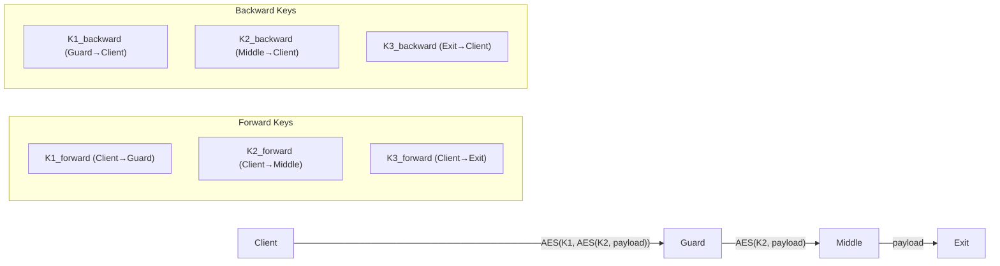

# Lesson 2: Tor Protocol Architecture: Onion Routing, Circuit Construction, Hidden Services

## 1. First-Principles Intuition & Invariants

The Tor network represents a distributed overlay network designed to provide anonymity through cryptographic indirection and computational unlinkability. At its foundation, Tor solves a fundamental problem in network communication: how can two parties exchange information when an adversary can observe all traffic metadata—source addresses, destination addresses, timing patterns, and packet sizes—across arbitrary network segments? Traditional encryption protocols like TLS protect payload contents but leave routing metadata exposed, creating a complete graph of who communicates with whom. Tor's architecture inverts this model by obscuring the routing layer itself through a technique called onion routing.

The core invariant of onion routing rests on nested cryptographic layers applied to packets before transmission. Each relay in a communication path removes one encryption layer, analogous to peeling an onion, revealing only the next hop destination without knowledge of either the ultimate source or final destination. This layered encryption creates a cryptographic chain where no single relay possesses complete circuit topology. The protocol enforces strict separation: entry guards see the client's true IP address but not the destination; middle relays see neither endpoint; and exit relays see the destination but not the originating client. This architectural constraint transforms the traffic analysis problem from a simple graph correlation attack into a computational inference problem requiring observation of multiple network segments simultaneously.

Tor's threat model assumes a global passive adversary capable of observing arbitrary network links but unable to compromise the cryptographic primitives themselves. The protocol does not defend against an adversary controlling all relays in a circuit—such an attacker achieves perfect deanonymization through timing correlation. Instead, Tor probabilistically distributes trust across thousands of independently operated relays, ensuring that circuit construction randomly selects relays from separate autonomous systems and geographic regions. The security guarantee degrades gracefully: an adversary controlling a fraction $f$ of network bandwidth has approximately $f^2$ probability of controlling both entry and exit positions in a three-hop circuit, enabling end-to-end correlation.

The protocol's cryptographic foundation relies on ephemeral Diffie-Hellman key exchanges at each hop, establishing forward-secret session keys that prevent retrospective decryption even if long-term relay identity keys are compromised. Each relay maintains an Ed25519 identity key for signing directory documents and authenticating circuit extensions, alongside short-lived X25519 keys for Diffie-Hellman exchanges rotated hourly. This dual-key architecture separates authentication from confidentiality, allowing relays to prove their identity through consensus documents while preserving forward secrecy for all encrypted traffic.

Hidden services—now formally called onion services—extend Tor's anonymity model bidirectionally, protecting both client and server identities. Traditional Tor circuits anonymize clients accessing clearnet destinations through exit relays, but exit relays necessarily learn destination addresses. Onion services eliminate this asymmetry by establishing rendezvous circuits where neither client nor server learns the other's network location. The protocol achieves this through introduction points and rendezvous points acting as cryptographic blind mailboxes, coordinating connection establishment without direct addressing. This architecture enables services to operate without revealing their hosting infrastructure, resistant to targeted network-layer attacks and censorship.

## 2. Core Architecture & Mechanics

The Tor network operates as a federated system of approximately 7,000 relays divided into functional roles: entry guards, middle relays, exit relays, and directory authorities. Directory authorities form a small hardcoded set of nine servers that collectively vote every hour to produce a network consensus document. This consensus functions as the network's authoritative state, listing all active relays with their IP addresses, cryptographic fingerprints, observed bandwidth, exit policies, and operational flags. Clients download this consensus to construct a weighted probability distribution for relay selection, preferring high-bandwidth relays while enforcing diversity constraints.

The consensus mechanism implements a Byzantine fault-tolerant voting protocol where each directory authority independently measures relay performance, validates cryptographic signatures, and tests reachability. Every hour, authorities exchange their individual votes containing relay descriptors and computed flags. A relay appears in the final consensus only if a majority quorum—at least five of nine authorities—agrees on its inclusion. Bandwidth weights in the consensus reflect measured throughput rather than self-reported capacity, preventing Sybil attacks where an adversary floods the network with low-bandwidth relays to increase circuit selection probability. Authorities measure bandwidth through periodic load tests, downloading test files through relays and computing achieved throughput.

Circuit construction proceeds through an incremental telescoping protocol where clients build circuits hop-by-hop, extending circuits one relay at a time while establishing shared secrets through authenticated Diffie-Hellman exchanges. The protocol begins with the client selecting an entry guard from relays marked with the Guard flag in the consensus. Entry guards represent a special relay class with high uptime and bandwidth, chosen to limit the number of relays that observe client IP addresses over time. Clients maintain a small persistent set of entry guards—typically three—rotating guards only when they become unreachable for extended periods. This guard rotation policy balances security against churn-based deanonymization attacks where adversaries wait for clients to select compromised guards.

The CREATE2 cell initiates circuit establishment, carrying an ephemeral X25519 public key generated by the client. The entry guard responds with a CREATED2 cell containing its own ephemeral public key and a SHA-256 hash authenticating the key exchange transcript. Both parties compute a shared secret using Curve25519 scalar multiplication, then derive symmetric session keys through HKDF-SHA256 key derivation. The derived key material produces separate keys for forward and backward traffic encryption using AES-256 in counter mode, alongside SHA-256 HMAC keys for per-cell authentication. This produces a cryptographic tunnel to the entry guard where all subsequent cells travel encrypted.

To extend the circuit, the client sends an EXTEND2 cell through the established tunnel to the entry guard, specifying the next relay's identity fingerprint and connection parameters. The entry guard establishes a TLS connection to the middle relay and forwards the CREATE2 handshake encapsulated within. The middle relay completes the handshake, sends back CREATED2, and the client now shares secrets with both relays. Critically, the middle relay never sees the client's IP address—it observes only the entry guard's address. The client can now send cells encrypted in nested layers: the outer layer decryptable by the entry guard reveals the middle relay as destination; the inner layer decryptable by the middle relay reveals the exit relay.



Each relay maintains only local circuit state: an incoming circuit identifier mapping to an outgoing circuit identifier and next-hop address. When a relay receives a cell on circuit ID 0x1A3F, it decrypts one encryption layer, looks up the outbound circuit ID 0x2B84, and forwards the cell to the next relay. Circuit IDs are locally significant, preventing correlation across hops. An observer at the entry guard sees circuit 0x1A3F connecting to the middle relay; an observer at the middle relay sees a different circuit 0x2B84 connecting to the exit relay. Without breaking encryption, linking these observations requires sophisticated traffic analysis correlating cell timing and volume patterns.

The protocol enforces strict cell size uniformity at 514 bytes: two bytes for circuit ID and 512 bytes for cell payload. All cells—whether carrying control commands, application data, or padding—maintain identical size to resist traffic analysis. When application data does not fill a cell, random padding fills the remainder. Variable-length cells break anonymity by leaking information through packet size distributions. The cell format supports multiplexing multiple application streams over a single circuit through stream identifiers embedded in RELAY cells, allowing concurrent HTTP requests or multiple TCP connections to share circuit overhead.

Stream isolation prevents cross-site correlation by ensuring that connections to different destinations do not share circuits. When a client requests a new destination—for example, navigating from one onion service to another—the Tor client constructs a fresh circuit rather than reusing existing circuits. This prevents a malicious exit relay from linking multiple requests to a single client. Circuit lifetimes are bounded: clients rotate circuits every ten minutes for exit traffic and immediately after any circuit failure, limiting the window for long-term traffic analysis.

Hidden service architecture introduces additional protocol layers to eliminate the asymmetry where exit relays learn destinations. An onion service begins by establishing introduction circuits to several introduction points—relays selected from the consensus that agree to forward connection requests. The service publishes a descriptor containing its long-term Ed25519 public key, the introduction points' addresses, and short-term authentication keys to a distributed hash table maintained by HSDirs—relays responsible for storing onion service descriptors. The descriptor's location in the DHT is deterministically computed from the onion address, derived from the service's public key through SHA-3 hashing and base32 encoding.

When a client wishes to access an onion service, it computes the descriptor's DHT location, downloads the descriptor from HSDirs, and extracts the introduction point addresses. The client then constructs a circuit to one introduction point and sends an INTRODUCE1 cell containing a rendezvous point address and an ephemeral Diffie-Hellman public key encrypted to the service's public key. The introduction point forwards this to the service through a pre-established introduction circuit. The service decrypts the request, verifies the client's authorization if required, and constructs a circuit to the client-specified rendezvous point, sending a RENDEZVOUS1 cell completing the handshake.

```text
Onion Service Connection Flow:

1. Service publishes descriptor to HSDirs:
   Service → Circuit → HSDir
   Descriptor = { Intro Points, Auth Keys, Signature }

2. Client fetches descriptor:
   Client → Circuit → HSDir → Descriptor

3. Client contacts introduction point:
   Client → Circuit → Intro Point → Service
   INTRODUCE1 = { Rendezvous Point, DH Key }

4. Service connects to rendezvous point:
   Service → Circuit → Rendezvous Point
   RENDEZVOUS1 = { DH Key, Confirmation }

5. Rendezvous point splices circuits:
   Client ←→ Rendezvous Point ←→ Service
   Neither party learns the other's network location
```

The rendezvous point functions as a circuit relay joining two independent circuits: one from the client and one from the service. After the handshake completes, the rendezvous point forwards cells bidirectionally between circuits, never decrypting payload contents. Both client and service now share a Diffie-Hellman derived secret, establishing an end-to-end encrypted tunnel layered atop the already-layered onion routing encryption. This nested encryption ensures that even if the rendezvous point is malicious, it cannot read application data.

Onion service addresses encode the service's public key into a 56-character base32 string ending in `.onion`, producing addresses like `thehiddenwiki7fhdx5oqvr5nqd7jqn4kl7xaqqz2gxm7u7r4vg6wf6qyd.onion`. The address derivation uses SHA-3-256 hashing of the public key concatenated with a checksum and version byte, ensuring that addresses are unforgeable—only the holder of the corresponding private key can publish valid descriptors. The protocol version is encoded in the address, allowing future cryptographic upgrades without breaking backward compatibility. Current v3 onion addresses use Ed25519 keys; legacy v2 addresses used RSA-1024 and are now deprecated due to insufficient security margins.

Client authorization extends hidden services with access control, requiring clients to possess a specific X25519 public key before the service will respond to connection requests. The service encrypts parts of its descriptor with authorized clients' public keys, and the introduction request includes a proof of key possession. This transforms onion services from pseudonymous to authenticated, useful for private communication platforms or internal corporate infrastructure deployed over Tor without clearnet exposure.

## 3. High-Performance Optimization & Failure Modes

Tor's latency characteristics stem from both cryptographic overhead and geographical relay distribution. A typical three-hop circuit traverses relays in different countries, accumulating round-trip times from each segment. Circuit construction requires three sequential round-trip handshakes: client to entry guard, client through guard to middle relay, and client through guard and middle to exit relay. This telescoping design, while cryptographically sound, introduces approximately 500-1000 milliseconds of latency before application data flows. Preemptive circuit construction mitigates this by maintaining a pool of pre-built circuits, allowing applications to use ready circuits immediately rather than waiting for construction.

The circuit pool strategy maintains clean circuits—circuits not yet used for any stream—to prevent cross-stream correlation. When an application requests connection, the client selects an appropriate circuit based on the destination's port and protocol. Exit policies complicate pool management: relays advertise which ports they allow, and clients must select exit relays matching the destination port. A circuit with an exit relay allowing only ports 80 and 443 cannot serve an SSH connection to port 22, requiring dynamic circuit construction or larger pools covering common port ranges.

Bandwidth throttling and congestion control operate per-circuit using a simplified sliding-window protocol. Relays advertise their bandwidth capacity in the consensus, and clients select relays probabilistically weighted by bandwidth to balance load. However, once a circuit is established, Tor implements a credit-based flow control system where each relay grants the previous relay a window of cells that can be sent before receiving acknowledgment. When the window depletes, the sender pauses until receiving a SENDME cell acknowledging cell receipt. This prevents fast senders from overwhelming slow relays, but introduces head-of-line blocking where a single slow relay stalls the entire circuit.

The protocol's fixed cell size creates padding overhead for small messages. A single-byte application payload consumes an entire 512-byte cell, yielding 0.2% efficiency. Bulk transfers amortize this overhead, but interactive applications suffer. Web browsing, which sends many small HTTP requests, experiences significant bandwidth amplification. Recent protocol extensions introduce conflux—a technique for splitting traffic across multiple circuits—improving both throughput and resilience. Conflux constructs two independent circuits to the same destination and load-balances cells across both, providing fault tolerance if one circuit fails and increasing aggregate bandwidth beyond a single circuit's capacity.

Circuit failure handling requires careful state management to avoid leaking information through error patterns. When a relay in a circuit becomes unreachable, clients must decide whether to retry, rebuild the circuit, or rotate entry guards. Premature guard rotation enables attacks where adversaries crash relays repeatedly, forcing clients to cycle through guards until selecting an adversary-controlled one. The protocol enforces guard stability by requiring sustained relay downtime before considering guard rotation, typically several days of unreachability. Failed circuits are immediately discarded and rebuilt with new relays, but the entry guard remains constant.

Directory authority consensus failures represent a critical system-wide vulnerability. If an adversary compromises a majority of directory authorities, they can inject malicious relays into the consensus, directing clients toward attacker-controlled circuits. The nine-authority quorum provides Byzantine fault tolerance for four compromised authorities, but lacks diversity: all authorities run the same software and operate in politically similar jurisdictions. Expanding the authority set or implementing alternative consensus mechanisms remains an ongoing research challenge balancing decentralization against the operational burden of coordinating additional authorities.

Onion service availability depends on the introduction point and HSDir reliability. If all introduction points go offline, the service becomes unreachable even though the underlying server remains operational. Services typically publish multiple introduction points for redundancy, but coordinated DoS attacks targeting introduction points can still deny service. The descriptor publication mechanism also creates timing vulnerabilities: descriptors are published to HSDirs computed from the current time period, rotating every 24 hours. An adversary observing all HSDirs during rotation windows learns when services republish descriptors, potentially correlating this timing with network activity to locate hidden services.

Traffic confirmation attacks represent the most practical deanonymization technique. An adversary controlling both entry and exit relays in a circuit can correlate timing patterns: when the client sends cells to the entry guard, the exit relay observes corresponding cells leaving toward the destination. Even without breaking encryption, statistical correlation of inter-cell timing reveals with high probability that the entry and exit belong to the same circuit. Defending against timing correlation requires mixing delays at each relay, but this conflicts with Tor's low-latency design goal. High-latency mix networks like Mixmaster provide stronger anonymity through deliberate delays measured in hours, but Tor prioritizes usability for interactive applications like web browsing.

Website fingerprinting attacks exploit patterns in encrypted traffic to infer which websites a client visits. Even though Tor encrypts payload contents, the sequence of cell sizes and timing reveals distinctive signatures. A webpage containing 50 objects—HTML, CSS, JavaScript, images—generates a characteristic burst pattern as the client fetches resources. Machine learning classifiers trained on traffic traces achieve 95%+ accuracy identifying websites from encrypted Tor traffic. Defenses include traffic padding strategies where clients and relays inject dummy cells to obscure genuine traffic patterns, though this increases bandwidth overhead and latency. The WTF-PAD algorithm implements adaptive padding that inserts dummy cells probabilistically based on traffic distribution models, providing statistical indistinguishability at modest bandwidth cost.

Bridge relays address censorship scenarios where adversaries block all public Tor relays by IP address. Bridges function as unlisted entry guards not published in the consensus document. Users in censored regions obtain bridge addresses through out-of-band channels—email, trusted contacts, or the BridgeDB service that distributes bridges through CAPTCHA-gated interfaces. This raises the cost of enumeration for censors, who must actively probe suspected bridge addresses rather than trivially downloading the public relay list. Pluggable transports extend this further by disguising Tor traffic as innocuous protocols: obfs4 wraps Tor cells in random-looking byte streams; meek tunnels Tor through HTTPS connections to major CDNs like Amazon CloudFront, exploiting collateral damage aversion where blocking Tor would require blocking the entire CDN. The protocol defines a pluggable transport API allowing external developers to implement new obfuscation schemes without modifying Tor core.

Operational security for hidden service operators demands careful attention to application-layer leaks. The Tor network anonymizes network transport, but applications can inadvertently reveal identity through content. An onion service serving personalized content, embedding unique identifiers in responses, or logging client IP addresses in application logs undermines Tor's protections. Similarly, resource exhaustion attacks targeting onion services proceed by establishing many introduction circuits, forcing the service to process computationally expensive Diffie-Hellman handshakes. PoW defenses—proof-of-work challenges issued to clients before accepting introduction requests—mitigate this by requiring clients to perform computational work proportional to request volume, rate-limiting attackers while imposing minimal burden on legitimate users.

The protocol's continued evolution balances backward compatibility against emerging threats. The transition from v2 to v3 onion services replaced RSA-1024 keys with Ed25519, increased address length from 16 to 56 characters, and redesigned the descriptor encryption scheme. Legacy v2 support was deprecated and removed to prevent cryptographic oracle attacks exploiting weak parameters. Future proposals include migrating from TAP (Tor Authentication Protocol) to ntor2 for relay handshakes, implementing post-quantum key exchange algorithms resistant to quantum computers, and developing improved congestion control mechanisms using forward error correction to recover from cell loss without retransmission delays.

Understanding Tor's architecture provides offensive security practitioners with both operational anonymity tools and attack surface awareness. Deploying infrastructure over onion services eliminates clearnet IP exposure, complicating attribution and reconnaissance. Conversely, recognizing traffic analysis limitations informs realistic threat modeling: Tor resists local network adversaries and prevents casual IP logging, but does not provide cryptographic guarantees against nation-state adversaries capable of global traffic observation. The protocol's value lies in its pragmatic security model—raising the cost of deanonymization through layered cryptographic indirection and distributed trust, rather than claiming absolute anonymity impossible against all adversaries.
