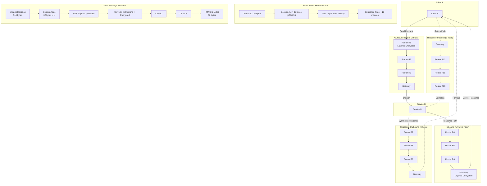
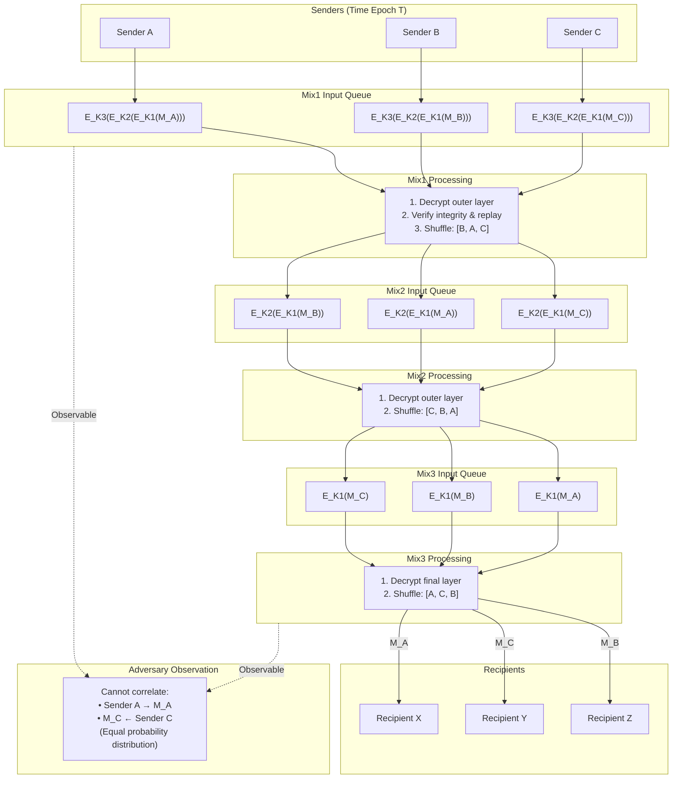

# Lesson 3: Alternative Networks: I2P, Freenet, Mixnets, Decentralized Architectures

## 1. First-Principles Intuition & Invariants

The Tor network establishes a powerful foundation for anonymous communication through its circuit-based architecture and onion routing protocol, yet its design embeds fundamental tradeoffs that leave entire categories of threat models inadequately addressed. Tor's reliance on a relatively small set of publicly enumerated directory authorities creates a centralized coordination point vulnerable to state-level adversaries capable of traffic correlation attacks across entry and exit nodes. The network's low-latency design prioritizes interactive web browsing at the cost of exposing users to timing analysis when adversaries control sufficient relay infrastructure or can observe both ends of a communication channel. Furthermore, Tor's assumption of honest relay operators and its dependency on voluntary bandwidth contributions from a limited pool of exit nodes creates economic and political pressure points that sophisticated attackers routinely exploit.

Alternative anonymity networks emerged not as incremental improvements to Tor's architecture but as fundamentally different approaches grounded in distinct threat models and performance tradeoffs. The Invisible Internet Project (I2P) abandons Tor's assumption that users primarily wish to access the clearnet, instead constructing a fully peer-to-peer darknet where every participant acts simultaneously as client, router, and potential service host. This architectural decision eliminates the exit node problem entirely while distributing trust across thousands of transient unidirectional tunnels rather than Tor's bidirectional circuits. Freenet takes an even more radical approach by treating anonymity as an emergent property of a distributed data store rather than a routing protocol, using cryptographic location keys and probabilistic forwarding to ensure that no node can determine whether it stores contraband content or merely participates in the network's normal operation. Mixnet architectures, descended from David Chaum's seminal 1981 paper "Untraceable Electronic Mail, Return Addresses, and Digital Pseudonyms," sacrifice interactive latency entirely in exchange for information-theoretic unlinkability guarantees through batched message reordering and cryptographic cover traffic.

The core invariant distinguishing these architectures from Tor lies in their temporal coupling between sender and receiver. Tor maintains a persistent circuit for the duration of a TCP stream, allowing an adversary who observes traffic entering and exiting the network to perform statistical correlation over seconds or minutes of observation. I2P's unidirectional tunnel pairs and Freenet's store-and-forward propagation deliberately break this temporal linkage, forcing adversaries to correlate patterns across hours or days of network activity while contending with exponentially growing state spaces as messages traverse multiple hops with variable delays. Mixnets formalize this temporal decoupling through explicit batch boundaries, introducing fixed delay epochs during which all messages are cryptographically processed together regardless of their ultimate destination. The tradeoff manifests starkly: while Tor can sustain interactive SSH sessions or streaming video with sub-second latency, I2P imposes multi-second delays for protocol handshakes, Freenet measures request completion in minutes or hours, and classical mixnets operate on email-like timescales measured in message batches rather than clock time.

Friend-to-friend (F2F) topologies represent a third axis of architectural differentiation, trading global reachability for compartmentalized trust boundaries. Where Tor and public I2P permit arbitrary nodes to join the routing infrastructure subject only to directory authority approval or distributed consensus, F2F networks like Freenet's darknet mode restrict connection graphs to explicitly authenticated peer relationships. Each node maintains encrypted tunnels exclusively to operators they know out-of-band, typically through pre-shared key material exchanged via secure channels outside the network itself. This social graph approach eliminates Sybil attacks where adversaries flood the network with malicious nodes, but introduces the opposite problem: network fragmentation and unreachable enclaves when trust graphs fail to form a connected component. The routing protocols must then perform depth-limited searches through friend lists, accepting that some content or services may be topologically unreachable even though they exist somewhere in the distributed system.

The distributed hash table (DHT) primitives underlying I2P's network database and Freenet's content addressing introduce a fourth fundamental distinction from Tor's centralized directory model. Rather than consulting authoritative servers for routing information, nodes maintain partial views of a Kademlia-style XOR metric space where each participant stores keys numerically close to their own randomly chosen identifier. Service resolution becomes a logarithmic search through this keyspace: a node seeking endpoint information for a destination hashes the target's identifier, computes XOR distances to known peers, and recursively queries the closest candidates until converging on the nodes responsible for that DHT segment. This self-organizing structure adapts automatically to churn as participants join and leave, but introduces new attack surfaces where adversaries can strategically choose identifiers to dominate regions of the keyspace, enabling targeted denial-of-service or traffic analysis against specific services.

Garlic routing, I2P's cryptographic protocol for bundling multiple messages into a single encrypted packet, extends onion routing's layered encryption concept into a multiplexing primitive. Where Tor wraps each cell in successive layers corresponding to circuit hops, garlic routing allows a sender to encrypt multiple independent messages—destined for different recipients or containing different protocol payloads—into a single garlic clove, then wrap that aggregate structure in routing layers. This multiplexing confounds traffic analysis by making it impossible for intermediate routers to determine whether a decrypted layer contains a single message continuing toward its destination or multiple messages that will fork to separate paths at the next hop. The cryptographic overhead increases proportionally to the number of bundled messages, but the anonymity set expands because adversaries cannot correlate encrypted packet sizes with plaintext message volumes.

The latency-anonymity tradeoff emerges as the central engineering tension across all these architectures. Low-latency designs like Tor accept that adversaries with global or strategically positioned traffic observation capabilities can perform correlation attacks, betting that the practical difficulty of achieving such positioning exceeds most threat models. High-latency designs like mixnets render correlation attacks computationally infeasible by introducing sufficient entropy into message timing that even perfect traffic logs at all network points cannot reconstruct sender-receiver relationships, accepting that this protection makes real-time applications impossible. I2P and Freenet occupy intermediate positions, tuning their tunnel refresh rates, message batching strategies, and probabilistic forwarding heuristics to balance interactive usability against resistance to correlation.

## 2. Core Architecture & Mechanics

I2P's architecture constructs anonymity from four cooperating subsystems: the network database implementing a distributed Kademlia DHT for peer discovery and service resolution, the tunnel management layer establishing unidirectional paths through the router mesh, the garlic routing protocol encrypting and multiplexing messages for transport, and the streaming library providing TCP-like reliability over the underlying datagram infrastructure. Every I2P router maintains a cryptographic identity consisting of a 2048-bit ElGamal encryption key pair, a 1024-bit DSA signing key pair, and a base64-encoded hash of its public keys serving as its router identity. This identity anchors the router's position in the DHT keyspace and signs all routing updates it publishes to the network database.

The network database partitions responsibility for storing router contact information and service lease sets across the DHT using XOR distance as the proximity metric. When a router with identifier $R_i$ publishes its contact information (IP address, port, supported transports, bandwidth tier, and uptime statistics), it computes the SHA-256 hash of its identity and stores this `RouterInfo` structure at the $k$ closest routers according to XOR distance $d(R_i, R_j) = R_i \oplus R_j$. The Kademlia parameter $k$ defaults to 8 in I2P implementations, creating redundancy against churn while limiting storage overhead. Lookups follow the standard iterative algorithm: the requesting node queries its $\alpha$ closest known peers (typically $\alpha = 3$), receiving either the requested data or references to closer nodes, recursively narrowing the search until converging on the authoritative storage nodes or timing out after reaching maximum hop depth.

Service lease sets represent I2P's equivalent of Tor hidden service descriptors, but embed fundamentally different availability semantics. Rather than maintaining a long-term `.onion` address tied to a persistent private key, I2P services publish short-lived lease sets containing a base32-encoded destination hash (derived from the service's cryptographic keys) and a list of tunnel gateway routers where the service currently accepts traffic. Each lease specifies an inbound tunnel identifier and an expiration timestamp, typically valid for ten minutes. Services must refresh their lease sets continuously, writing new tunnel bindings into the DHT before old leases expire or clients lose the ability to route traffic. This ephemeral design prevents adversaries from camping on specific DHT regions waiting for a target service to appear, but introduces reliability challenges when network instability interrupts lease publication.

Tunnel construction in I2P differs fundamentally from Tor's circuit establishment by creating pairs of unidirectional paths: outbound tunnels for sending traffic from the local router toward remote destinations, and inbound tunnels for receiving traffic back. Each tunnel consists of a chain of participant routers selected probabilistically from the network database, weighted by published bandwidth capacity and latency measurements. The tunnel creator generates a tunnel build message encrypted in layers for each hop, containing the tunnel identifier to use at that hop, the next-hop router identity, a shared AES session key, and a nonce for replay prevention. Unlike Tor's sequential circuit extension where each hop confirms before the next is contacted, I2P's tunnel build messages propagate through the entire chain in a single round trip, with each router decrypting its layer, verifying message integrity, and forwarding the remaining onion to the next participant.

The tunnel message format embodies I2P's core cryptographic construction. Each message consists of a 16-byte tunnel identifier, a 4-byte message expiration timestamp, a variable-length encrypted payload (up to 1730 bytes by default to remain under UDP MTU constraints), and a 32-byte HMAC-SHA256 integrity tag keyed by the tunnel's AES session key. As messages traverse the tunnel, each hop verifies the HMAC using its shared key, replaces the tunnel identifier with the next hop's identifier, and reencrypts the entire payload block in counter mode using its session key. This layered encryption-decryption scheme means that observing a message at two sequential tunnel hops reveals only that those two routers participate in some tunnel together, not whether the message originated locally, will exit at the next hop, or continues deeper into the network.

Garlic routing multiplexes these tunnel messages by bundling multiple independent messages into a single encrypted garlic clove. The sender constructs each individual message (termed a "garlic clove") with its own delivery instructions, encryption layer, and payload, then combines multiple cloves into a garlic bulb. The bulb includes a session key encrypted to the recipient's public key, a session tag allowing the recipient to recognize subsequent messages using symmetric key caching, and the AES-encrypted aggregate of all cloves. This session tag mechanism converts expensive public key operations into fast symmetric lookups after the first message in a session, amortizing ElGamal decryption costs across extended conversations. The recipient decrypts the garlic bulb using either the provided session key (for first contact) or a cached symmetric key (for subsequent messages), extracts the individual cloves, and processes each according to its embedded delivery instructions—some may be destined for local applications, others forwarded to outbound tunnels toward remote destinations.

Freenet's architecture abandons I2P's explicit tunneling in favor of a probabilistic routing protocol operating over a distributed data store. The network maintains two distinct modes: opennet, where nodes connect to arbitrary peers discovered through UDP bootstrapping, and darknet (F2F mode), where connections exist only between manually configured trusted relationships. In both modes, content addressing relies on cryptographic keys rather than location identifiers. Content-Hash Keys (CHKs) derive from the SHA-256 hash of the encrypted data block itself, creating self-verifying identifiers where successful decryption proves data integrity. Signed-Subspace Keys (SSKs) correspond to public keys from asymmetric key pairs, allowing content publishers to create mutable namespaces where updates can be verified against the original signing key.

Freenet's routing algorithm implements a variant of greedy depth-first search through a smallworld network topology where each node maintains location values between 0.0 and 1.0 representing its position in a virtual keyspace ring. Content keys map into this same space through consistent hashing, and routing decisions select the neighbor whose location value minimizes distance to the target key. When a node receives a request for key $K$, it computes $d_i = |L_i - H(K)|$ for each neighbor $i$ with location $L_i$, forwarding to the peer with minimum distance. If no neighbor is closer than the local node itself, the request either succeeds (data found in local store), fails (hops-to-live exhausted), or explores alternative branches through probabilistic backtracking.

The data storage layer implements a least-recently-used cache with probabilistic retention based on request frequency. Nodes store encrypted data blocks up to their configured cache limit (typically several gigabytes), evicting cold data when space pressure occurs. Content popularity naturally replicates across many nodes as requests propagate, creating redundancy for frequently accessed material while allowing rare content to gradually disappear from the network. This probabilistic availability property means Freenet cannot guarantee content persistence—unpopular data with no active republisher eventually vanishes as cache churn proceeds—but popular material achieves robust availability through emergent replication.

The darknet mode transforms Freenet's topology from a self-organizing smallworld graph into a social network constrained by explicit trust relationships. Each node maintains a configuration file listing peer identities (node references containing public keys, physical addresses, and cryptographic fingerprints) acquired through out-of-band channels. Connections establish encrypted tunnels only to these configured peers, and routing must find paths through this restricted graph even when the friend topology forms a poor approximation of the optimal smallworld structure. Nodes gradually adjust their location values to cluster near their friends' positions, improving routing efficiency within the constrained topology, but this adaptation process operates over weeks of continuous operation and never achieves the same path lengths as unconstrained opennet mode.

Mixnet architectures formalize message unlinkability through explicit cryptographic protocols rather than emergent network properties. The canonical Chaum mix establishes a single-server mixing point where batches of fixed-size messages arrive, undergo cryptographic transformation, and emit in permuted order. Each sender encrypts their message in layers corresponding to a predetermined path of mix servers: $C = E_{K_n}(E_{K_{n-1}}(...E_{K_1}(M)))$ where $M$ represents the plaintext message and $E_{K_i}$ denotes encryption under mix server $i$'s public key. The first mix receives this onion, decrypts the outer layer to reveal $E_{K_{n-1}}(...E_{K_1}(M))$ and forwarding instructions to mix server 2, accumulates a batch of such messages from multiple senders, and after reaching batch threshold or timeout, shuffles the decrypted messages into random order before forwarding.

This batching and reordering operation provides the core unlinkability guarantee: an adversary observing messages entering and exiting the mix cannot correlate specific inputs to outputs because the random permutation destroys temporal ordering information. The cryptographic layering ensures that mix server $i$ cannot read message contents beyond its own layer, learning only the next hop in the path. Even if an adversary compromises $n-1$ of $n$ mix servers in a path, the one honest server suffices to maintain sender-receiver unlinkability by performing its shuffle operation correctly.

Cover traffic mechanisms augment these architectural protections by injecting dummy messages into the network to obscure genuine traffic patterns. In low-latency networks like I2P, routers generate random-destination messages at intervals calibrated to smooth out bursty application traffic, making it harder for adversaries to distinguish active communication periods from idle periods. The statistical distribution of cover traffic must match legitimate traffic characteristics—message size distribution, inter-arrival times, and destination entropy—or adversaries can filter dummy traffic statistically and focus analysis on the remaining genuine messages. This requirement imposes substantial bandwidth overhead: doubling network capacity to achieve 50% cover traffic ratio, or quadrupling capacity for 75% cover ratio.

High-latency mixnets employ different cover traffic strategies because their batch-oriented operation naturally obscures traffic rates. Instead of continuous dummy messages, mix servers pad batches to fixed sizes when genuine message volume falls short, ensuring that adversaries observing mix outputs cannot infer sender activity levels from batch sizes. Some designs implement pool mixes where servers retain a reservoir of messages across batches, randomly selecting a subset to forward each epoch while holding the remainder, further decorrelating input and output timing patterns at the cost of increased latency variance.

The Byzantine resistance properties of these networks derive from their trust distribution models. Tor's directory authority model concentrates trust in nine hardcoded consensus servers, accepting that compromise of five authorities would enable network-wide attacks. I2P's DHT-based peer discovery distributes trust across thousands of routers storing network database entries, but introduces eclipse attack surfaces where adversaries controlling strategic keyspace regions can selectively filter routing information. Freenet's opennet mode relies on probabilistic routing properties emerging from the smallworld topology, assuming adversaries cannot manipulate node location values to create routing blackholes, while darknet mode eliminates this attack surface entirely by trusting only explicitly configured peers at the cost of reduced connectivity.

## 3. High-Performance Optimization & Failure Modes

Tunnel performance in I2P scales inversely with tunnel length and participant latency distributions. The default tunnel length of three hops provides reasonable anonymity against most adversaries while keeping round-trip latency manageable for interactive protocols. Reducing tunnel length to two hops or even one hop (direct connections) trades anonymity for performance, appropriate for threat models where the user trusts their ISP or local network administrator but wants protection against destination logging. Conversely, increasing tunnel length to four or five hops strengthens resistance against adversaries controlling multiple routers but introduces failure modes where any single unresponsive participant stalls the entire tunnel until timeout.

The tunnel pool management strategy directly impacts both throughput and anonymity. I2P routers maintain separate tunnel pools for different traffic classes: exploratory tunnels for DHT operations and network database queries, client tunnels for outbound application traffic, and server tunnets for hosting services. Exploratory tunnels use conservative participant selection favoring high-uptime, high-bandwidth routers to ensure reliable network database access. Client and server tunnels implement more aggressive participant diversity, deliberately selecting routers from different /16 netblocks and avoiding routers that appear in multiple concurrent tunnels to resist intersection attacks where adversaries correlate router appearances across tunnels to deanonymize users.

Tunnel refresh intervals balance security against overhead. Shorter refresh periods (two to three minutes) limit the window during which an adversary can compromise a participant and inject malicious traffic or perform confirmation attacks, but increase tunnel build overhead and DHT churn as services continuously republish lease sets. Longer refresh periods (ten to fifteen minutes) reduce bandwidth overhead but allow adversaries more time to exploit compromised tunnels. Adaptive refresh strategies adjust intervals based on observed failure rates: if a router experiences high tunnel build failure rates or frequent participant dropouts, it shifts to shorter tunnels with faster refresh cycles until network conditions stabilize.

The garlic routing multiplexing ratio determines the effectiveness of traffic analysis resistance. Bundling four to eight messages per garlic bulb achieves good statistical mixing—intermediate routers cannot reliably determine whether a bulb contains one message or many—while keeping cryptographic overhead manageable. Lower ratios (one to two messages per bulb) save CPU cycles but sacrifice unlinkability because adversaries can correlate bulb sizes with message volumes. Higher ratios (ten to sixteen messages per bulb) improve mixing but encounter diminishing returns as ElGamal encryption overhead dominates processing time and bulb sizes approach or exceed MTU limits, triggering IP fragmentation that itself leaks information.

Session tag management presents a subtle performance-security tradeoff. I2P's symmetric key caching mechanism stores up to thirty-two session tags per destination, allowing fast AES decryption instead of expensive ElGamal operations for subsequent messages. Aggressive tag usage depletes the tag pool quickly, forcing frequent session key renegotiations with public key operations, but minimizes key reuse that could enable traffic correlation. Conservative tag management extends tag lifetimes to hundreds of messages, amortizing ElGamal costs effectively but risking key compromise if an adversary captures sufficient traffic encrypted under the same session key.

Freenet's request routing efficiency depends critically on the accuracy of its location-based routing heuristic. Newly joined nodes start with random location values, resulting in poor routing performance until they gradually discover their optimal position through successful request forwarding. The location adjustment algorithm moves a node's location toward the keys it successfully serves, exploiting locality of reference under the assumption that future requests will cluster near past requests. This convergence process requires weeks of continuous operation in darknet mode where the friend topology constrains exploration, but proceeds faster in opennet mode where nodes can probe arbitrary peers. Operators can accelerate convergence by seeding new nodes with approximate location values derived from their friend graph's existing positions, though this introduces correlation between social relationships and keyspace positions that might leak information to adversaries analyzing network topology.

Data block size selection impacts both storage efficiency and retrieval latency. Freenet's default 32KB block size provides reasonable granularity for caching and retrieval while keeping block headers and cryptographic overhead manageable. Larger blocks (128KB or 256KB) reduce per-block overhead and improve throughput for large file transfers but decrease cache efficiency because replacing a single large block evicts more data than replacing many small blocks. Smaller blocks (8KB or 16KB) improve cache granularity and reduce wasted bandwidth when retrieving partially relevant data but increase header overhead and routing traffic as more requests propagate through the network.

The splitfile mechanism handles content larger than single blocks by encrypting files with random symmetric keys, splitting encrypted data into fixed-size segments, and storing each segment under a Content-Hash Key. The top-level metadata block contains the segment CHKs and decryption keys, published under a Signed-Subspace Key controlled by the content publisher. Retrieving a splitfile requires fetching the metadata block, then parallel retrieval of all segment blocks. This parallelism exploits Freenet's emergent replication: popular segments replicate widely, allowing clients to retrieve different segments from different nodes simultaneously. The redundancy factor determines how many extra segments to generate beyond the minimum required for reconstruction—typically 50% redundancy means encoding $N$ segments into $1.5N$ total blocks such that any $N$ blocks suffice to reconstruct the file. Higher redundancy increases availability against partial data loss but multiplies storage and insertion overhead.

Mixnet latency optimization focuses on batch size tuning and threshold policy. Fixed-batch schedules (flush every thirty seconds regardless of accumulation) provide predictable latency bounds but waste mixing opportunities when traffic is sparse. Threshold batching (flush when batch reaches sixteen messages or after sixty second timeout) adapts to traffic patterns, providing low latency during high-traffic periods while maintaining mixing quality during low traffic. Hybrid policies combine both: flush immediately when batch reaches capacity, or flush partial batches periodically, whichever occurs first.

The dummy message generation rate must track legitimate traffic patterns to maintain cover traffic effectiveness. Static rates (one dummy message every five seconds) fail when legitimate traffic bursts reveal timing patterns. Adaptive cover traffic monitors outgoing message rates over sliding windows, generating dummy traffic to maintain consistent aggregate rates observed by network adversaries. The feedback control loop adjusts dummy rates to smooth short-term fluctuations while avoiding excessive overhead during sustained high-traffic periods. This adaptation introduces its own timing side channel: if adversaries can trigger legitimate traffic bursts and observe cover traffic suppression, they learn about internal client activity levels.

Pool mix designs trade increased latency for stronger unlinkability by maintaining a reservoir of messages across batch epochs. The pool parameters—minimum pool size, forwarding probability, and pool mixing strategy—determine both anonymity properties and message delivery variance. A binomial pool mix forwards each message independently with probability $p$ each epoch, holding the remainder for future epochs. This introduces exponential tail latency: while the expected number of epochs before forwarding is $1/p$, individual messages may remain in the pool for many multiples of this expectation. The anonymity benefit scales with pool size: a pool maintaining one hundred messages provides stronger unlinkability than a pool with ten messages, but requires more traffic to keep the pool populated and avoid timing correlation between pool draining and traffic pattern changes.

Failure modes in I2P center on tunnel collapse and DHT eclipse attacks. Tunnel collapse occurs when intermediate routers crash, lose connectivity, or actively drop traffic, breaking the unidirectional path and requiring tunnel rebuild. The client detects collapse through message timeouts or explicit tunnel failure notifications from surviving participants. Rebuilding proceeds through the standard tunnel creation protocol, selecting new participants from the network database. During rebuild windows, application traffic either queues (for loss-sensitive protocols like streaming) or drops (for loss-tolerant protocols like datagram messaging). Persistent tunnel collapse indicating systemic connectivity issues triggers fallback to shorter tunnels or direct connections, degrading anonymity to maintain service.

Eclipse attacks against I2P's DHT exploit Kademlia's tolerance for adversarial node identifiers. An attacker generates thousands of router identities with SHA-256 hashes positioned near target destination hashes in the DHT keyspace, then publishes these malicious routers to the network database. When clients query for the target destination, routing converges on the adversary-controlled keyspace region, receiving only malicious RouterInfo entries or manipulated lease sets. Defenses include proof-of-work requirements for router identity generation, increasing the cost of Sybil identity creation, and paranoid routing modes that query multiple DHT regions simultaneously, accepting only lease sets that appear in sufficiently many responses.

Freenet's routing failures manifest as request timeouts when depth-limited searches exhaust their hop budgets without finding content. The hops-to-live counter decrements at each routing hop, and when it reaches zero, the request fails even if the data exists deeper in the network. This failure mode occurs predictably for content with narrow replication (data cached on few nodes) or when routing heuristics perform poorly (requesting node's location far from optimal retrieval path). Clients retry failed requests with increased hop limits, but this exacerbates the problem by flooding the network with deep searches that consume bandwidth without improving success rates. Effective mitigation requires content publishers to insert data at multiple locations (exploiting Freenet's tolerance for duplicate storage) and clients to maintain persistent peer connections that gradually improve routing accuracy through learning.

The datastore garbage collection algorithm introduces content availability cliffs when cache pressure triggers large-scale evictions. Freenet nodes running near capacity continuously evict least-recently-used blocks, but eviction rates spike when memory pressure crosses critical thresholds or when operating systems perform their own memory management. Unpopular content near eviction threshold can disappear network-wide within hours if multiple nodes simultaneously perform garbage collection. Content publishers combat this through active reinsertion where automated clients periodically retrieve and republish important content, artificially inflating its apparent popularity to resist eviction.

Darknet topology fragmentation emerges when friend graphs fail to form connected components or when critical bridge nodes disconnect. In pure F2F mode, content becomes strictly unreachable across disconnected components—no routing algorithm can traverse a graph partition. Operators detect fragmentation through declining request success rates and shrinking peer counts in routing tables. Mitigation requires out-of-band coordination to add bridge connections linking separated components, but this social process operates on human timescales (days or weeks) while network fragmentation damages service availability immediately. Some Freenet deployments enable hybrid mode where darknet nodes optionally establish opennet connections as fallback routes, trading the F2F security model for continued connectivity during topology failures.

Mixnet failure modes split between message loss and timing attacks. Message loss occurs when mix servers crash mid-batch or when network partitions prevent message forwarding, causing batched messages to vanish without delivery confirmation. Applications must implement end-to-end acknowledgment protocols to detect loss and retransmit, but this introduces new timing side channels where retransmission patterns leak information about original send times. Timing attacks exploit statistical properties of mix batch processing: adversaries injecting known dummy traffic and observing batch output timing can perform intersection attacks when their dummy messages appear in output batches with victim messages, gradually narrowing the anonymity set through repeated observations.

The fundamental latency-anonymity tradeoff admits no universal optimization. Each network architecture selects a point on this spectrum appropriate to its threat model: Tor prioritizes interactive usability for web browsing, accepting correlation attack vulnerability; I2P increases latency through unidirectional tunnels to resist short-term correlation; Freenet abandons real-time communication entirely for store-and-forward unlinkability; mixnets formalize batching delays to achieve information-theoretic guarantees. Practitioners must match architecture selection to operational requirements: low-latency networks for interactive protocols where usability dominates security, high-latency networks for asynchronous communication where strong unlinkability justifies delay, and hybrid designs that partition traffic by sensitivity, routing critical communications through high-latency mixnets while tolerating correlation risk for bulk traffic through low-latency tunnels.
