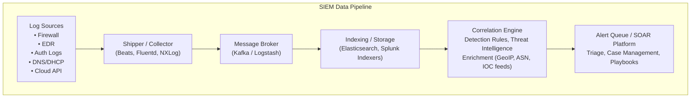

# Lesson 4: Defensive Countermeasures, Security Architecture, and Incident Response

## 1. First-Principles Intuition & Invariants

Every offensive technique studied in the preceding lessons carries an implicit dual: a defender who, given sufficient visibility and time, can detect, contain, and eradicate the intrusion. The discipline of defensive security is not the negation of offensive practice—it is its mirror image, governed by an asymmetry that shapes every architectural decision a security engineer must make. The attacker needs to succeed once; the defender must succeed every time. That asymmetry is not merely rhetorical. It encodes a thermodynamic reality about information systems: entropy flows naturally toward compromise, and defenders must continuously expend energy—engineering attention, tooling investment, and response capability—to hold the system in a secure state.

Understanding this asymmetry at first principles means recognizing what defense is not. Defense is not the installation of a firewall and the declaration of victory. It is not a compliance checklist, a one-time penetration test, or a fixed perimeter drawn around a data center. Defense is a continuous, probabilistic enterprise whose fundamental objective is to raise the cost of successful attack beyond what any realistic adversary is willing to pay. This cost-imposition model, formalized in frameworks like the Lockheed Martin Cyber Kill Chain and MITRE ATT&CK, treats the attacker as an economically rational agent navigating a decision tree. Every detection control, every access restriction, every logging layer you deploy is a node in that tree that forces the adversary to expend additional time, skill, and infrastructure—and therefore risk exposure.

The core theoretical invariant of defensive architecture is the concept of defense in depth, originally borrowed from military doctrine, where it describes the practice of trading space for time by establishing multiple successive defensive lines rather than concentrating all strength at a single perimeter. In information security, this translates directly into layered controls: network segmentation at the perimeter, host-based detection at the endpoint, privilege restriction at the identity layer, cryptographic integrity at the data layer, and behavioral monitoring at the application layer. No single layer is assumed to be impenetrable. The design objective is that the failure of any one layer triggers a detection event in the next, ensuring that a successful attacker cannot progress from initial access to mission completion without crossing multiple tripwires.

The second foundational invariant is the principle of least privilege, which states that every principal—whether a human user, a service account, an operating system process, or a network device—should hold precisely the permissions required to perform its function and no more. The security implication is mechanically rigorous: the blast radius of any compromise is bounded by the privilege level of the compromised principal. An attacker who gains code execution as an unprivileged web application process cannot directly exfiltrate `/etc/shadow` without a privilege escalation step, and that escalation step generates additional observable artifacts. Least privilege does not prevent compromise; it constrains propagation and amplifies signal.

The third invariant is the assumption of breach, which has become the dominant design philosophy since the collapse of the perimeter model driven by cloud adoption, remote work, and supply chain complexity. Assumption of breach demands that architects design systems so that the compromise of any single component—a workstation, a credential, an API key, a third-party library—does not grant an adversary transitive access to the entire estate. This is the foundation of zero-trust network architecture, micro-segmentation, and certificate-based mutual authentication. It reframes the security question from "how do we keep attackers out?" to "how do we detect, contain, and recover when they get in?"—a shift with profound implications for how detection and response tooling is designed and operated.

For hardware security researchers and embedded engineers, these invariants apply with equal force but manifest differently. A firmware image running on an ARM Cortex-M microcontroller cannot install a SIEM agent. A CAN bus network connecting automotive ECUs has no TCP/IP stack on which to run Suricata. Yet the invariants hold: least privilege is enforced through ARM TrustZone secure/non-secure world partitioning, defense in depth appears in the layering of secure boot, measured boot, and runtime attestation, and assumption of breach is operationalized through hardware security modules (HSMs) that isolate cryptographic material even when application firmware is fully compromised. The tooling changes; the principles do not.

---

## 2. Core Architecture & Mechanics

### Detection Infrastructure: IDS, IPS, and SIEM

The detection layer is the nervous system of defensive architecture. Its function is to convert the enormous volume of raw telemetry produced by a modern environment—network packets, system calls, authentication events, DNS queries, file integrity changes—into a prioritized stream of actionable security signals. Three categories of technology form the backbone of this infrastructure: intrusion detection and prevention systems (IDS/IPS), security information and event management (SIEM) platforms, and behavioral analysis engines.

An intrusion detection system operates by comparing observed traffic or host behavior against a reference model of malicious or anomalous activity. Signature-based IDS engines, exemplified by Suricata and Snort, maintain rule sets that describe the syntactic structure of known attack traffic: specific byte patterns in packet payloads, HTTP request structures characteristic of SQL injection, TLS handshake anomalies indicative of command-and-control beaconing, and so forth. The Suricata rule engine processes packets through a multi-stage pipeline: the packet acquisition layer (AF_PACKET or DPDK for high-throughput environments), a protocol decoder that reconstructs application-layer streams from TCP segments, a pattern matcher based on the Aho-Corasick algorithm for multi-string search, and finally a rule evaluation engine that applies boolean conditions to the decoded protocol fields.

The architectural distinction between detection (IDS) and prevention (IPS) is a question of placement and response authorization. An IDS deployed out-of-band on a SPAN port or network tap receives a copy of all traffic and raises alerts but cannot block packets already delivered to their destination. An IPS deployed inline holds the packet, evaluates it against its rule set, and either forwards or drops it before it reaches the destination. The tradeoff is response latency versus risk of false-positive-induced disruption: a misconfigured inline IPS rule can silently drop legitimate traffic, making the system indistinguishable from a network fault. For this reason, most mature organizations initially deploy IPS rules in alert-only mode, tune them against their specific traffic baseline, and only promote high-confidence signatures to blocking mode.

Anomaly-based detection supplements signature matching with statistical models of normal behavior. Rather than matching against known bad patterns, an anomaly engine learns the baseline distribution of observed metrics—bytes transferred per session, connection frequency per source IP, process spawn rates per host—and raises alerts when observations deviate beyond a threshold. This approach can detect novel, previously unseen attack techniques that have no corresponding signature, but it comes at the cost of higher false positive rates and significant tuning overhead. Modern production deployments use a hybrid approach: signature matching for high-confidence detection of known techniques, anomaly detection for surfacing outliers that warrant human investigation.

The SIEM platform sits above individual detection systems as an aggregation, correlation, and enrichment layer. Its core function is log ingestion: consuming event streams from firewalls, IDS sensors, endpoint detection and response (EDR) agents, authentication systems, cloud provider audit logs, and application-layer access logs, normalizing them into a common schema, and making them queryable at forensic timescales. Architecturally, a production SIEM is a distributed data pipeline. Elastic SIEM, Splunk Enterprise Security, and Microsoft Sentinel all share a common structural pattern:



The correlation engine is where raw events are transformed into security findings. A correlation rule might specify: "if a single source IP attempts authentication against more than twenty distinct accounts within sixty seconds and at least one attempt succeeds, generate a HIGH severity alert tagged CREDENTIAL_STUFFING." This rule combines event frequency, field cardinality, and outcome state across a time window—logic that cannot be expressed in a single-packet IDS signature. Correlation rules are the primary mechanism by which defenders detect multi-stage attack sequences: an initial reconnaissance scan, followed hours later by a phishing email delivery, followed by a callback from the target host to a command-and-control IP.

Threat intelligence integration enriches this correlation by providing curated feeds of known malicious indicators: IP addresses, domain names, file hashes, TLS certificate fingerprints, and YARA rules associated with tracked threat actor infrastructure. The MISP (Malware Information Sharing Platform) protocol standardizes threat intelligence sharing between organizations in STIX 2.1 format, allowing correlation engines to automatically cross-reference observed indicators against intelligence feeds without manual analyst intervention.

### Endpoint Detection and Response

Where network-based detection sees packets, endpoint detection and response (EDR) sees process execution. EDR agents, deployed as kernel-level drivers or user-space daemons with elevated privilege, instrument the operating system to capture a continuous telemetry stream of security-relevant events: process creation with full command-line arguments, network connection initiation, file writes to sensitive paths, registry modification on Windows, `ptrace` calls and `setuid` executions on Linux, DLL injection and memory allocation with executable permissions. CrowdStrike Falcon, SentinelOne, and Microsoft Defender for Endpoint all implement variants of this architecture.

The technical mechanism by which EDR agents intercept these events varies by operating system. On Windows, EDR vendors use kernel callbacks registered through `PsSetCreateProcessNotifyRoutineEx`, `ObRegisterCallbacks` for object handle interception, and minifilter drivers for filesystem I/O interception. On Linux, modern EDR implementations use kernel modules that hook `kprobe` attachment points on critical syscalls—`execve`, `clone`, `ptrace`, `open`, `connect`—or leverage the Linux Security Modules (LSM) framework, specifically the BPF-LSM interface introduced in kernel 5.7, which allows userspace security programs to attach policy hooks to LSM hook points without modifying kernel code.

For embedded and hardware security contexts, endpoint instrumentation takes a fundamentally different form. Firmware running on microcontrollers cannot host an EDR agent, but many modern SoCs implement hardware-level execution monitoring through Arm's CoreSight debug architecture and ETM (Embedded Trace Macrocell) tracing, which records instruction-level execution traces that can be analyzed offline for anomalous control flow. Debug Authentication interfaces (DAP) can be locked via fuses to prevent runtime instrumentation by unauthorized parties, but secure enclaves can expose attestation interfaces that provide evidence of firmware integrity to a remote verifier.

### Behavioral Analysis and the MITRE ATT&CK Framework

Behavioral detection transcends individual events to reason about sequences of attacker actions mapped to documented adversary tradecraft. MITRE ATT&CK is the most comprehensive public taxonomy of this tradecraft, organizing attacker behaviors into a matrix of Tactics (the high-level objective: Initial Access, Execution, Persistence, Privilege Escalation, Defense Evasion, Credential Access, Discovery, Lateral Movement, Collection, Command and Control, Exfiltration, Impact) and Techniques (the specific method by which that objective is achieved, identified by a T-number, e.g., T1055 for Process Injection, T1003 for OS Credential Dumping). Each technique includes sub-techniques, known threat actor groups that use it, available detection data sources, and recommended mitigations.

The operational value of ATT&CK for defenders is that it provides a structured vocabulary for measuring detection coverage. A mature security operations team will map their existing detection rules and telemetry sources against the ATT&CK matrix, identifying blind spots—techniques for which they have no detection capability—and prioritizing coverage improvements based on which techniques are most commonly used by threat actors targeting their industry vertical. The ATT&CK Navigator tool provides a heat-map visualization of this coverage mapping, making blind spots immediately visible.

Detecting sophisticated adversaries requires moving beyond atomic indicator matching toward behavioral sequence detection. A threat actor living off the land—using `certutil.exe` to download payloads, `wmic.exe` to execute them, and `net.exe` to perform discovery—will not trigger any signature based on file hash or known-malicious binary name, because all tools used are legitimate Windows components. Detection requires correlating the behavioral sequence: a web server process spawning `cmd.exe`, which spawns `certutil.exe` with a URL argument, which writes an executable to a temp directory, which is subsequently executed by a scheduled task. Each individual event is innocuous; their sequenced co-occurrence is the attack. This is precisely the detection logic implemented by rules engines in EDR platforms and by detection-as-code frameworks like Sigma, which provides a vendor-neutral rule format that can be compiled to Elasticsearch KQL, Splunk SPL, or Microsoft Sentinel KQL queries.

The following Sigma rule detects the classic web shell execution pattern—a web server process spawning an interactive shell—a technique that appears in dozens of tracked threat actor playbooks:

```yaml
title: Web Server Spawning Interactive Shell
id: 8202070f-edeb-4d31-a010-a26c72ac5600
status: stable
description: >
  Detects a web server process spawning a command interpreter,
  which is a primary indicator of web shell execution or
  server-side template injection exploitation.
references:
  - https://attack.mitre.org/techniques/T1505/003/
author: Security Engineering Team
date: 2024/01/15
tags:
  - attack.persistence
  - attack.t1505.003
  - attack.execution
  - attack.t1059.004
logsource:
  category: process_creation
  product: linux
detection:
  selection_parent:
    ParentImage|endswith:
      - '/apache2'
      - '/httpd'
      - '/nginx'
      - '/php-fpm'
      - '/tomcat'
      - 'java'
  selection_child:
    Image|endswith:
      - '/bash'
      - '/sh'
      - '/dash'
      - '/zsh'
      - '/python'
      - '/python3'
      - '/perl'
      - '/ruby'
  condition: selection_parent and selection_child
falsepositives:
  - Legitimate administrative scripts invoked via web interfaces
  - Configuration management tools with web triggers
level: high
```

This rule, compiled to Elasticsearch KQL and deployed against a process creation data source fed by an EDR agent, will fire whenever a process creation event matches the described parent-child relationship. It encodes institutional knowledge about the attack pattern in a reproducible, version-controlled, peer-reviewable artifact—which is the fundamental shift that detection-as-code introduces to security operations.

### Secure Architecture: Network Segmentation and Zero Trust

Network segmentation translates the defense-in-depth principle into a physical and logical topology. The classical three-tier DMZ architecture—untrusted external network, DMZ containing internet-facing services, trusted internal network—established that internet-facing systems should not share a network segment with internal resources, limiting the lateral movement available to an attacker who compromised a web server. This model was adequate for the monolithic data center era. Modern environments, with their mix of cloud workloads, SaaS applications, remote users, and IoT/embedded devices, have shattered the assumption that "internal" is synonymous with "trusted."

Zero-trust architecture (ZTA), defined formally in NIST SP 800-207, replaces the perimeter trust model with a policy engine that evaluates every access request independently, regardless of network location, using multiple signals: identity (who is the principal?), device posture (is the endpoint healthy, patched, managed?), context (from where, at what time, to what resource?), and behavior (does this access pattern match established norms?). The architectural components of a ZTA deployment include an identity provider (IdP) issuing short-lived tokens, a policy engine applying access rules, a policy enforcement point (PEP) intercepting and adjudicating resource requests, and continuous monitoring feeding device posture signals back into the policy engine.

For embedded systems and industrial control networks, micro-segmentation at Layer 2 and Layer 3 is the operationally achievable equivalent of zero trust. An industrial Ethernet network connecting PLCs, HMIs, and historian servers should be segmented using VLANs with inter-VLAN routing controlled by a stateful firewall with application-layer inspection. Modbus/TCP, DNP3, and EtherNet/IP traffic should be explicitly allowed only between known source-destination pairs on documented ports; all other inter-segment traffic should be denied by default. Purdue Model network segmentation—separating Level 0 (field devices) from Level 1 (PLCs/RTUs), Level 2 (supervisory/SCADA), Level 3 (site business network), and Level 4 (enterprise IT)—with firewalls at each level boundary, is the established defense-in-depth architecture for OT/ICS environments. The unidirectional security gateway (data diode), which enforces hardware-level one-way data flow from OT to IT, eliminates entire classes of lateral movement by making it physically impossible for a compromised IT host to send packets into the OT network.

### Vulnerability Assessment: From Scan to Remediation

Vulnerability assessment is the systematic process of identifying, classifying, and prioritizing security weaknesses in an environment before an adversary exploits them. The technical workflow spans three phases: discovery and enumeration, vulnerability scanning and validation, and risk-prioritized remediation planning.

Nmap remains the foundational tool for network discovery and service enumeration. The following scan sequence is a production-grade workflow for characterizing an internal network segment:

```bash
# Phase 1: Host discovery — ICMP echo, TCP SYN to port 443, ARP for /24 segments
nmap -sn -PE -PS443 -PA80 --source-port 53 10.10.0.0/16 -oG hosts_up.gnmap

# Phase 2: Targeted port scan on live hosts — SYN scan, all 65535 ports, rate limited
nmap -sS -p- --min-rate 2000 --max-retries 2 \
     -iL <(grep "Up" hosts_up.gnmap | awk '{print $2}') \
     -oA full_port_scan

# Phase 3: Service version detection and default script scan on discovered open ports
nmap -sV -sC --version-intensity 7 \
     -p $(grep "open" full_port_scan.gnmap | grep -oP '\d+/open' | \
          cut -d/ -f1 | sort -un | paste -sd,) \
     -iL <(grep "Up" hosts_up.gnmap | awk '{print $2}') \
     -oA service_version_scan

# Phase 4: Vulnerability script scan against high-interest services
nmap --script vuln,exploit -p 21,22,23,80,443,445,3389,8080,8443 \
     -iL <(grep "Up" hosts_up.gnmap | awk '{print $2}') \
     -oA vuln_scan
```

Authenticated vulnerability scanners, particularly Tenable Nessus, Qualys, and OpenVAS, perform significantly deeper assessment when provided with operating system credentials. With SSH credentials for Linux hosts or WMI credentials for Windows hosts, these scanners retrieve the installed package list and compare it against the NVD (National Vulnerability Database) CVE catalog, detecting vulnerable software versions that may not be externally visible. The gap between unauthenticated and authenticated scan results is a direct measure of your exposure to insider threat and post-compromise lateral movement vectors.

Vulnerability prioritization is a critical discipline that separates mature security programs from reactive ones. The Common Vulnerability Scoring System (CVSS) base score provides a severity rating, but it is a poor prioritization signal in isolation because it describes the theoretical severity of a vulnerability without regard to whether exploit code is publicly available, whether the affected service is internet-facing, or whether the vulnerability has been observed in active exploitation campaigns. The CISA Known Exploited Vulnerabilities (KEV) catalog, EPSS (Exploit Prediction Scoring System), and threat intelligence feeds provide the operationalization context that transforms a CVSS score into a prioritized remediation queue. A CVE with a CVSS base score of 7.5 that appears in the KEV catalog and has a public Metasploit module targeting an internet-facing service you operate is orders of magnitude higher priority than a CVSS 9.8 affecting a service deployed only on an air-gapped development network.

The following Python script integrates EPSS scores with an NVD CVE lookup to generate a risk-prioritized remediation list from a Nessus XML export:

```python
#!/usr/bin/env python3
"""
vuln_prioritizer.py

Consumes a Nessus .nessus XML export and enriches each finding
with EPSS probability scores and CISA KEV membership, producing
a risk-prioritized CSV for remediation planning.

Dependencies: requests, xml.etree.ElementTree (stdlib)
Usage: python3 vuln_prioritizer.py -i scan.nessus -o prioritized.csv
"""

import argparse
import csv
import json
import sys
import time
import xml.etree.ElementTree as ET
from dataclasses import dataclass, field, asdict
from typing import Optional
import requests

EPSS_API_BASE = "https://api.first.org/data/v1/epss"
KEV_URL = "https://www.cisa.gov/sites/default/files/feeds/known_exploited_vulnerabilities.json"
NVD_API_BASE = "https://services.nvd.nist.gov/rest/json/cves/2.0"

@dataclass
class Finding:
    host: str
    port: str
    protocol: str
    plugin_id: str
    plugin_name: str
    cve: str
    cvss_base_score: float
    epss_score: float = 0.0
    epss_percentile: float = 0.0
    in_kev: bool = False
    risk_score: float = field(init=False)

    def __post_init__(self):
        # Risk score weights: CVSS (40%), EPSS probability (40%), KEV membership (20%)
        kev_bonus = 20.0 if self.in_kev else 0.0
        self.risk_score = (
            (self.cvss_base_score / 10.0) * 40.0
            + self.epss_score * 40.0
            + kev_bonus
        )


def load_kev_catalog() -> set:
    """Downloads and returns the set of CVE IDs present in the CISA KEV catalog."""
    try:
        response = requests.get(KEV_URL, timeout=30)
        response.raise_for_status()
        data = response.json()
        return {v["cveID"] for v in data.get("vulnerabilities", [])}
    except requests.RequestException as exc:
        print(f"[WARN] Could not fetch KEV catalog: {exc}", file=sys.stderr)
        return set()


def fetch_epss_scores(cve_ids: list[str]) -> dict[str, tuple[float, float]]:
    """
    Fetches EPSS probability and percentile for a list of CVE IDs.
    Returns a dict mapping CVE ID -> (probability, percentile).
    Batches requests to respect API constraints.
    """
    result = {}
    batch_size = 30
    for i in range(0, len(cve_ids), batch_size):
        batch = cve_ids[i : i + batch_size]
        params = {"cve": ",".join(batch)}
        try:
            response = requests.get(EPSS_API_BASE, params=params, timeout=30)
            response.raise_for_status()
            data = response.json()
            for entry in data.get("data", []):
                result[entry["cve"]] = (
                    float(entry.get("epss", 0.0)),
                    float(entry.get("percentile", 0.0)),
                )
        except requests.RequestException as exc:
            print(f"[WARN] EPSS fetch failed for batch starting {batch[0]}: {exc}",
                  file=sys.stderr)
        time.sleep(0.5)  # Respect API rate limits
    return result


def parse_nessus_xml(filepath: str) -> list[dict]:
    """
    Parses a .nessus XML file and returns a list of raw finding dicts
    containing host, port, protocol, plugin metadata, and CVE IDs.
    """
    tree = ET.parse(filepath)
    root = tree.getroot()
    findings = []

    for report_host in root.iter("ReportHost"):
        host_ip = report_host.get("name", "unknown")
        for item in report_host.iter("ReportItem"):
            plugin_id = item.get("pluginID", "")
            plugin_name = item.get("pluginName", "")
            port = item.get("port", "0")
            protocol = item.get("protocol", "tcp")

            # Extract CVE references; a single finding may reference multiple CVEs
            cves = [cve.text.strip() for cve in item.findall("cve") if cve.text]

            # Extract CVSS base score from the cvss_base_score or risk_factor elements
            cvss_elem = item.find("cvss_base_score")
            cvss_score = float(cvss_elem.text.strip()) if cvss_elem is not None and cvss_elem.text else 0.0

            if cves:
                for cve in cves:
                    findings.append({
                        "host": host_ip,
                        "port": port,
                        "protocol": protocol,
                        "plugin_id": plugin_id,
                        "plugin_name": plugin_name,
                        "cve": cve,
                        "cvss_base_score": cvss_score,
                    })

    return findings


def main():
    parser = argparse.ArgumentParser(
        description="Risk-prioritize Nessus findings using EPSS and CISA KEV."
    )
    parser.add_argument("-i", "--input", required=True,
                        help="Path to .nessus XML export file")
    parser.add_argument("-o", "--output", required=True,
                        help="Path for prioritized CSV output")
    args = parser.parse_args()

    print("[*] Parsing Nessus XML...")
    raw_findings = parse_nessus_xml(args.input)
    print(f"[*] Found {len(raw_findings)} CVE-linked findings across all hosts.")

    unique_cves = list({f["cve"] for f in raw_findings})
    print(f"[*] Fetching EPSS scores for {len(unique_cves)} unique CVEs...")
    epss_data = fetch_epss_scores(unique_cves)

    print("[*] Fetching CISA KEV catalog...")
    kev_set = load_kev_catalog()
    print(f"[*] KEV catalog contains {len(kev_set)} entries.")

    findings = []
    for raw in raw_findings:
        cve = raw["cve"]
        epss_prob, epss_pctile = epss_data.get(cve, (0.0, 0.0))
        f = Finding(
            host=raw["host"],
            port=raw["port"],
            protocol=raw["protocol"],
            plugin_id=raw["plugin_id"],
            plugin_name=raw["plugin_name"],
            cve=cve,
            cvss_base_score=raw["cvss_base_score"],
            epss_score=epss_prob,
            epss_percentile=epss_pctile,
            in_kev=(cve in kev_set),
        )
        findings.append(f)

    # Sort descending by composite risk score
    findings.sort(key=lambda x: x.risk_score, reverse=True)

    fieldnames = [
        "host", "port", "protocol", "plugin_id", "plugin_name", "cve",
        "cvss_base_score", "epss_score", "epss_percentile", "in_kev", "risk_score",
    ]
    with open(args.output, "w", newline="") as csvfile:
        writer = csv.DictWriter(csvfile, fieldnames=fieldnames)
        writer.writeheader()
        for f in findings:
            writer.writerow(asdict(f))

    print(f"[+] Prioritized findings written to {args.output}")
    print(f"[+] Top 5 by risk score:")
    for f in findings[:5]:
        kev_flag = " [KEV]" if f.in_kev else ""
        print(f"    {f.cve} on {f.host}:{f.port} — "
              f"CVSS={f.cvss_base_score} EPSS={f.epss_score:.4f} "
              f"Risk={f.risk_score:.1f}{kev_flag}")


if __name__ == "__main__":
    main()
```

This script operationalizes risk-based vulnerability management: a CVSS 10.0 affecting an obscure internal service with no public exploit code will rank below a CVSS 7.8 with a KEV entry and a high EPSS percentile, accurately reflecting operational risk exposure rather than theoretical worst-case severity.

---

## 3. High-Performance Optimization & Failure Modes

### Scaling Detection Infrastructure Under Adversarial Conditions

Detection infrastructure fails in two distinct modes. The first is capacity failure: the system receives more events than it can process, causing log loss, alert queue overflow, and blind spots that a sophisticated adversary can deliberately induce. The second is quality failure: the system processes all events but generates alert volumes so high that analysts cannot triage them effectively, producing alert fatigue that is functionally equivalent to no detection at all.

Capacity failure in a SIEM pipeline is typically a throughput bottleneck at the ingestion or indexing tier. Under normal conditions, a large enterprise environment may generate 50,000 to 500,000 events per second (EPS). A coordinated attacker conducting a large-scale credential stuffing attack or a worm propagating across the network can spike this by one to two orders of magnitude within seconds. The architectural mitigation is a durable message broker—Apache Kafka being the standard choice—inserted between log collectors and the indexing tier. Kafka persists incoming event streams to disk with configurable retention, acting as a shock absorber that decouples ingestion rate from indexing rate. The indexing tier can process from Kafka at its maximum sustainable rate without dropping events; during the spike, the lag between event generation and indexing increases, but no data is lost. Kafka consumer groups allow multiple SIEM indexers to consume from the same topic in parallel, providing horizontal scaling.

Alert fatigue is the more insidious failure mode. Studies of security operations centers have documented average alert volumes of hundreds to thousands of alerts per analyst per day, with false positive rates frequently exceeding 90%. The consequence is that analysts begin triaging alerts by heuristic shortcuts—closing anything below a threshold severity, skipping alert categories that have historically been noisy—which creates systematic blind spots that sophisticated adversaries learn to exploit. Mitigating alert fatigue requires tuning discipline, alert deduplication, and automation. Tuning discipline means every detection rule must have a documented expected false positive rate, a designated owner, and a scheduled review; rules that have not generated true positive findings within a defined window are candidates for suppression or modification. Alert deduplication, implemented in the SIEM or the SOAR layer, groups related alerts into cases—multiple authentication failures from the same source IP against the same target account should produce one case, not fifty alerts. Automation through SOAR (Security Orchestration, Automation, and Response) platforms handles the high-volume, low-complexity triage actions: querying threat intelligence for an IP address, verifying whether a user account has been recently disabled, checking whether an alerted host has completed its latest patch cycle. These automated enrichment steps happen in seconds rather than the minutes or hours of manual analyst time, reserving human cognitive resources for the cases that genuinely require judgment.

For hardware security researchers operating outside the traditional SIEM model, the equivalent capacity challenge appears in firmware analysis pipelines and hardware-in-the-loop test environments. Analyzing large firmware corpora with static binary analysis tools—Ghidra's headless analyzer, binwalk for extraction, Firmwalker for credential hunting—generates substantial output that requires triage. Automating the extraction and initial triage pipeline with a tool like EMBA (Embedded Firmware Security Analyzer) addresses this by running dozens of analysis modules in parallel against a firmware image and producing a consolidated risk report, applying the same triage-by-severity logic that a SIEM applies to network events.

### Incident Response: Framework, Execution, and Forensic Discipline

Incident response is the operational discipline of systematically detecting, containing, eradicating, and recovering from security incidents while preserving forensic evidence and maintaining chain of custody. The NIST Computer Security Incident Handling Guide (SP 800-61r2) defines the incident response lifecycle in four phases—Preparation, Detection and Analysis, Containment/Eradication/Recovery, and Post-Incident Activity—each with specific procedural requirements and decision points.

Preparation is where the difference between a competent and an average security team is made, long before any incident occurs. It requires documented incident response plans, defined severity classifications, communication trees, pre-negotiated authority for containment actions (network isolation, account disablement), pre-positioned forensic tooling, and tabletop exercises that pressure-test the plan against realistic scenarios. A forensic toolkit pre-staged on a USB drive or a network share accessible from an isolated management network should include: a memory acquisition tool (`winpmem` for Windows, `LiME` loadable kernel module for Linux), disk imaging utilities (`dc3dd`, FTK Imager), volatile data collection scripts (capturing running processes, network connections, logged-on users, recently modified files), and hashing utilities for chain-of-custody documentation.

Detection and analysis in production begins with triage: determining whether an alert or anomaly represents a genuine security incident, a false positive, or expected behavior misclassified by a detection rule. The triage analyst follows the evidence chain from the initial alert through enrichment queries against the SIEM, then pivots to EDR data for host-level process and network telemetry if the initial signal warrants escalation. This pivoting workflow—moving from a network-level indicator to the specific process on the specific host that generated the traffic, then examining that process's parent chain, spawned children, and file writes—is the core investigative technique of incident analysis. The following Splunk SPL query exemplifies this pivot, moving from a network-layer beacon alert to the process responsible:

```spl
index=edr sourcetype=process_creation
    [search index=network_ids alert_name="Suspicious C2 Beacon"
     | fields src_ip
     | rename src_ip as host_ip]
| eval suspicious_spawn = if(
    match(parent_process_name, "(?i)(winword|excel|powerpnt|outlook|iexplore|chrome|firefox)"),
    "true", "false")
| where suspicious_spawn="true"
| table _time, host, host_ip, process_name, process_path, process_cmdline,
         parent_process_name, parent_process_cmdline, user, hash_sha256
| sort -_time
```

This query first retrieves source IPs from C2 beacon alerts, uses them as a subsearch to filter EDR process creation events on those hosts, then flags processes whose parent is a user-facing application—a common pattern for spear-phishing exploitation where a macro in a Word document spawns a payload.

Containment strategy must balance two competing imperatives: stopping the spread of the incident and preserving forensic evidence. Aggressive containment—immediately wiping and reimaging affected hosts—stops the bleeding but destroys the evidence needed to understand attacker tactics, establish the full scope of compromise, and prevent recurrence. The standard approach is to perform forensic acquisition first (memory image, disk image hash, volatile data capture), then contain. For active intrusions where the attacker retains interactive access and is actively exfiltrating data, the calculus shifts toward immediate network isolation even at the cost of some forensic fidelity.

Memory forensics is a critical capability for detecting sophisticated malware that operates exclusively in RAM—fileless malware that injects shellcode into legitimate processes, rootkits that hook the kernel to hide their presence from disk-based scanning, and credential harvesting tools that read LSASS process memory. The Volatility 3 framework provides a Python-based analysis platform for Windows, Linux, and macOS memory images. The following analysis sequence characterizes a compromised Windows host from a memory dump:

```bash
# Identify active processes and flag discrepancies with known-good process tree
python3 vol.py -f memory.dmp windows.pstree

# Detect hidden or injected processes by cross-referencing EPROCESS list
# with VAD (Virtual Address Descriptor) structures — rootkits that unlink
# from PsActiveProcessHead remain visible in VAD traversal
python3 vol.py -f memory.dmp windows.psxview

# Scan process virtual address space for executable memory regions
# not backed by a file on disk — primary indicator of injected shellcode
python3 vol.py -f memory.dmp windows.malfind

# Dump the VADs flagged by malfind to files for static analysis
python3 vol.py -f memory.dmp windows.malfind --dump

# Extract network connections with associated process context
python3 vol.py -f memory.dmp windows.netstat

# Identify loaded kernel modules and flag those absent from the
# PsLoadedModuleList — rootkit detection via module list comparison
python3 vol.py -f memory.dmp windows.modules
python3 vol.py -f memory.dmp windows.driverscan

# Dump the LSASS process to extract credential material (for attacker TTPs analysis)
python3 vol.py -f memory.dmp windows.handles --pid <lsass_pid> | grep -i "file\|key"
python3 vol.py -f memory.dmp windows.dumpfiles --pid <lsass_pid>
```

The `windows.malfind` plugin is particularly powerful: it traverses every process's virtual address descriptor tree, identifies memory regions with PAGE_EXECUTE_READWRITE protection that contain no corresponding file mapping—a canonical signature of shellcode injection, since legitimate code pages are mapped from EXE or DLL files and are therefore read-execute rather than read-write-execute. Every VAD region flagged by malfind should be dumped and submitted to static analysis (YARA scanning, disassembly, hash lookup in VirusTotal).

For firmware and embedded incident response—analyzing a suspected compromised IoT device, an automotive ECU exhibiting anomalous CAN traffic, or an FPGA with an unsigned bitstream—the workflow shifts to hardware-assisted forensics. JTAG and SWD debug interfaces, accessed through a J-Link or FTDI-based probe with OpenOCD, provide read access to CPU registers, memory, and flash contents at a level below any OS-layer anti-forensics. The following OpenOCD sequence extracts flash memory from an STM32F4 target:

```tcl
# openocd.cfg for STM32F4 via J-Link
source [find interface/jlink.cfg]
source [find target/stm32f4x.cfg]
transport select swd
adapter speed 4000

# Connect, halt, and extract flash to binary
init
reset halt
dump_image firmware_extracted.bin 0x08000000 0x100000
verify_image firmware_extracted.bin 0x08000000
shutdown
```

The extracted binary is then processed through a static analysis pipeline: `binwalk -e` for recursive extraction of embedded filesystems and compressed segments, `strings` for credential and URL harvesting, Ghidra's headless analyzer for function identification and cross-reference analysis, and custom YARA rules for known malware family signatures.

### Post-Incident: Threat Remediation and Security Posture Improvement

Eradication and recovery require confidence that the full scope of compromise is understood before clean systems are restored to production. Reintroducing a clean host into an environment where the initial access vector remains unpatched, or where attacker-established persistence mechanisms on adjacent hosts are undiscovered, guarantees reinfection. Scope determination—answering the questions "which systems are compromised?" and "how did the attacker establish persistence?"—must precede recovery.

Persistence enumeration on Windows focuses on the documented persistence locations that adversaries use most frequently: `HKCU\Software\Microsoft\Windows\CurrentVersion\Run`, scheduled tasks in `C:\Windows\System32\Tasks`, services registered in `HKLM\SYSTEM\CurrentControlSet\Services`, WMI event subscriptions (a fileless persistence mechanism that survives reimaging if WMI repository is restored from backup), and startup folder entries. Autoruns from Sysinternals remains the most comprehensive tool for enumerating Windows autostart locations and comparing entries against VirusTotal:

```powershell
# Automated Autoruns execution with VirusTotal checking and CSV export
# Run from an administrative PowerShell prompt on the suspect host
# or against a live-mounted forensic image using the /accepteula flag

autorunsc.exe -a * -c -h -s -u -vt -accepteula > autoruns_output.csv

# Parse CSV output for entries with VirusTotal detections above threshold
Import-Csv .\autoruns_output.csv |
    Where-Object { [int]$_.'VT detection' -gt 2 } |
    Select-Object 'Entry', 'Image Path', 'Launch String', 'VT detection', 'MD5 Hash' |
    Sort-Object 'VT detection' -Descending |
    Format-Table -AutoSize
```

Linux persistence enumeration covers cron jobs (`/etc/cron*`, `/var/spool/cron/crontabs/`), systemd unit files in `/etc/systemd/system/` and `/lib/systemd/system/`, SSH authorized keys across all user home directories, PAM module configuration for credential harvesting backdoors, and SUID/SGID binaries that have been modified since system installation:

```bash
# Find SUID/SGID binaries modified in the last 7 days
find / -perm /6000 -newer /var/log/dpkg.log -type f 2>/dev/null \
    -exec ls -la {} \; | tee suid_modified.txt

# Check all SSH authorized_keys files for unexpected entries
find /root /home -name "authorized_keys" 2>/dev/null \
    -exec echo "=== {} ===" \; -exec cat {} \;

# Enumerate systemd units not present in dpkg database (custom/malicious units)
systemctl list-units --type=service --all --no-pager | \
    awk '{print $1}' | grep '\.service$' | while read svc; do
        unit_file=$(systemctl show "$svc" -p FragmentPath | cut -d= -f2)
        if [ -n "$unit_file" ] && ! dpkg -S "$unit_file" &>/dev/null 2>&1; then
            echo "[UNKNOWN] $svc -> $unit_file"
        fi
    done

# Identify recently modified shared libraries that may indicate LD_PRELOAD hijacking
find /lib /lib64 /usr/lib -name "*.so*" -newer /var/log/dpkg.log \
    -type f 2>/dev/null | sort
```

The post-incident review—conducted after recovery and within a window where the event details remain fresh—is where the security posture improvements that prevent recurrence are identified. Its output should be a structured document mapping the incident timeline against the ATT&CK framework, identifying every detection control that failed or was absent, and translating each gap into a concrete remediation action with an owner and a deadline. This review is not a blame assignment exercise; it is an engineering retrospective whose sole product is a more capable detection and prevention architecture. The discipline of treating each incident as a forcing function for measurable security improvement is what separates security programs that become more resilient over time from those that cycle through the same breaches indefinitely.

The synthesis of the defensive disciplines covered in this lesson—detection engineering, secure architecture, vulnerability management, and incident response—is a closed loop. Threat intelligence informs detection rule development; detection generates incident findings; incident analysis reveals architectural weaknesses; architectural improvements reduce the attack surface; and the reduced surface is documented back into threat model updates and vulnerability assessment scope. A security program operating this loop continuously, grounded in the first principles of cost imposition, least privilege, and assumption of breach, embodies what it means to practice security as an engineering discipline rather than a compliance ritual.
