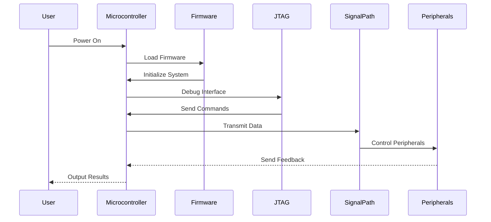

# Foundation: Hardware Hacking
## 1. Conceptual Mental Model (Beginner Intuition & First Principles)

Hardware hacking involves the manipulation and modification of electronic devices to achieve specific goals, often beyond their intended use. At its core, it is about understanding the physical components of a system and how they interact to perform tasks. This understanding is built on the principles of electronics, computer architecture, and materials science.

Imagine a simple circuit board as a city. The circuit board is the city, the components (resistors, capacitors, transistors) are the buildings, and the wires are the roads. Just as a city relies on its infrastructure to function, a circuit board relies on its components and connections to perform operations. In hardware hacking, we are essentially city planners and architects, modifying the city to suit our needs.

The fundamental principle here is that every electronic device is a system of interconnected components that work together to perform specific functions. By understanding these components and their interactions, we can modify the system to perform new functions or improve its performance.

## 2. Essential Terminology & Taxonomy (Foundational Glossary)

| Term             | Definition                                                                 | System Context                                                                 |
|------------------|----------------------------------------------------------------------------|--------------------------------------------------------------------------------|
| **Microcontroller** | A small, self-contained computer on a single integrated circuit containing a processor core, memory, and programmable input/output peripherals. | Acts as the brain of many embedded systems, controlling the behavior of devices like smartphones, cars, and appliances. |
| **Firmware**     | A type of software embedded into a hardware device that provides low-level control and monitoring of the device. | Firmware is crucial for the initial boot process and ongoing operation of devices, often stored in non-volatile memory like ROM or Flash. |
| **JTAG**         | Joint Test Action Group, a standard interface used for testing, debugging, and programming integrated circuits. | JTAG allows for the inspection and manipulation of a device's internal state, making it invaluable for hardware hacking and reverse engineering. |
| **Flashing**     | The process of writing a new firmware image to a device's memory. | Flashing is a common operation in hardware hacking, allowing hackers to modify the behavior of devices by updating their firmware. |
| **Soldering**    | The process of joining two or more metal items to form a single part by melting and flowing a filler metal (solder) between them. | Soldering is essential for physically connecting components on a circuit board, enabling the flow of electricity and data. |
| **Signal Integrity** | The quality of an electrical signal in terms of its distortion, loss, and timing. | Ensuring signal integrity is critical in hardware hacking to prevent data corruption and ensure reliable communication between components. |

## 3. Architecture & Core Workflow (Detailed ASCII & Mermaid Diagrams)

### ASCII Diagram

```
+-------------------+
|   Microcontroller |
|   (CPU, Memory)   |
+-------------------+
          |
          v
+-------------------+
|      Firmware     |
|  (Stored in ROM)  |
+-------------------+
          |
          v
+-------------------+
|       JTAG        |
| (Debug Interface) |
+-------------------+
          |
          v
+-------------------+
|     Signal Path   |
| (Wires, Connectors)|
+-------------------+
          |
          v
+-------------------+
|    External Peri- |
|    pherals (LEDs,  |
|    Sensors, etc.) |
+-------------------+
```

### Mermaid Sequence Diagram



## 4. Common Misconceptions & Mental Traps (Beginner & Intermediate Pitfalls)

### Misconception 1: Hardware Hacking is Only for Experts

**Trap:** Beginners often believe that hardware hacking requires extensive knowledge and experience, which can be intimidating.

**Reality:** While expertise is beneficial, hardware hacking can be approached incrementally. Start with simple projects, such as modifying a LED circuit, and gradually build your skills. Online resources, tutorials, and communities are invaluable for learning.

### Misconception 2: All Hardware is the Same

**Trap:** Beginners may assume that all hardware components and systems are similar, leading to confusion when encountering differences.

**Reality:** Hardware components and systems vary widely in complexity and functionality. Understanding the specific characteristics and differences of each component is crucial for effective hardware hacking.

### Misconception 3: Signal Integrity is Not Important

**Trap:** Beginners might overlook the importance of signal integrity, focusing instead on the functionality of individual components.

**Reality:** Signal integrity is fundamental to the reliable operation of electronic systems. Poor signal integrity can lead to data corruption, system instability, and other issues. Ensuring signal integrity requires careful design and testing.

## 5. Socratic Discussion Starters (Bridging to Intermediate Mastery)

### Discussion Question 1: How does the choice of microcontroller affect the performance and capabilities of a hardware project?

### Discussion Question 2: What are the ethical considerations involved in hardware hacking, and how can they be addressed?

### Discussion Question 3: How can one ensure signal integrity in complex electronic systems, and what are the consequences of neglecting it?

---

This chapter provides a foundational understanding of hardware hacking, bridging the gap between beginner intuition and intermediate architectural understanding. By exploring the principles, terminology, and workflows involved, learners can develop a deeper appreciation for the intricacies of electronic systems and the art of hardware hacking.
