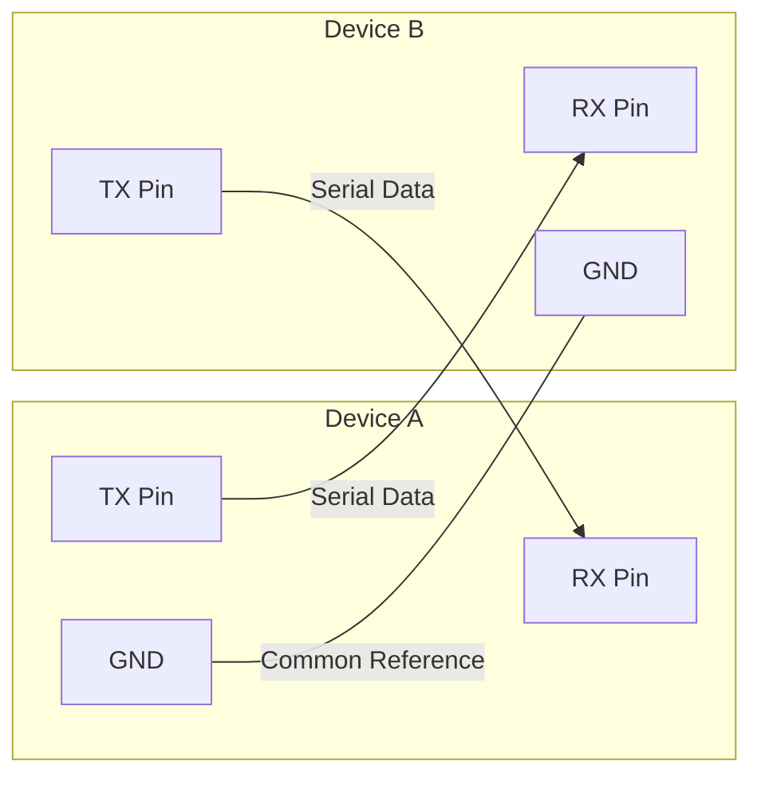
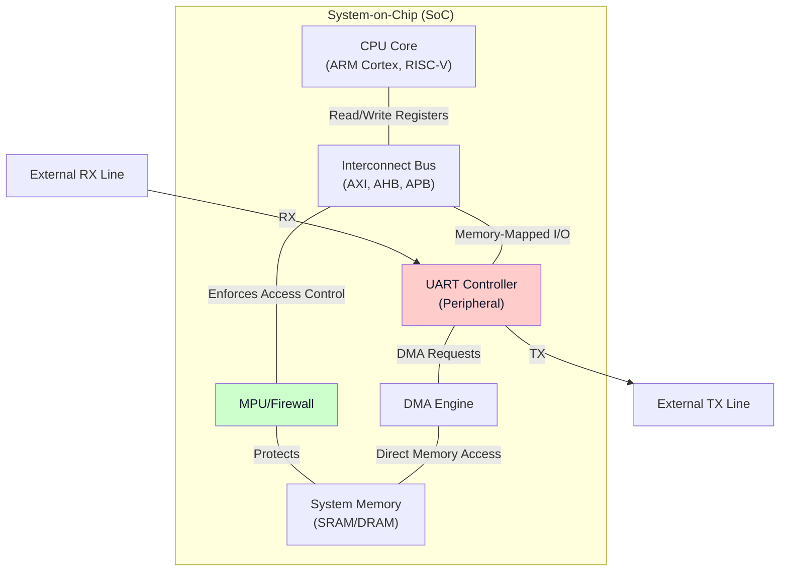
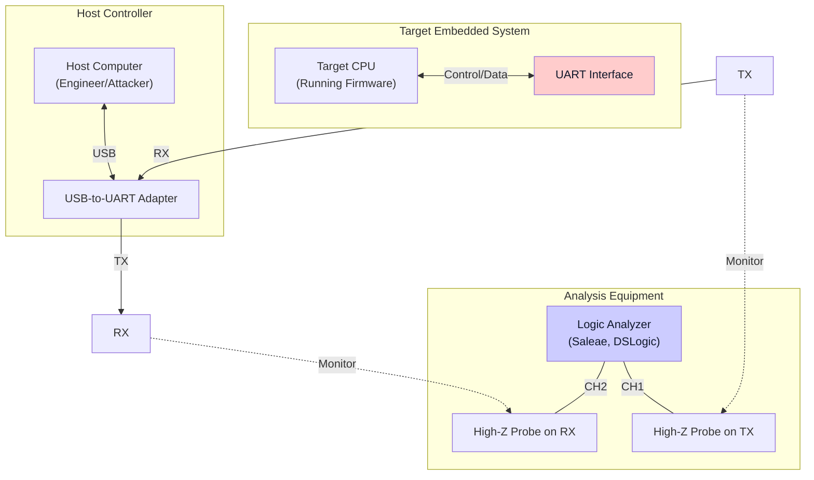
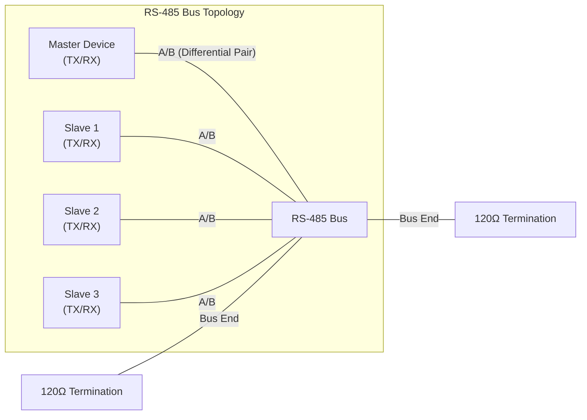
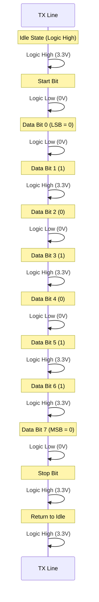
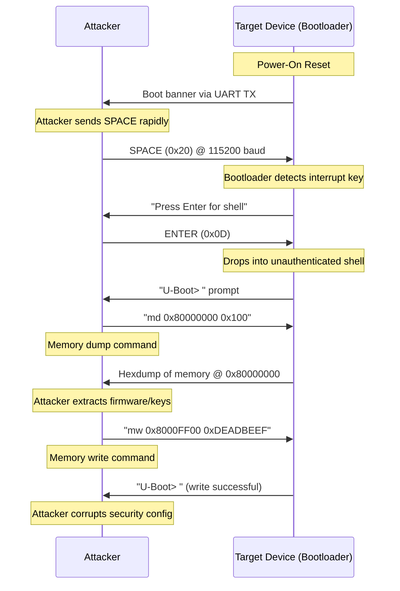

# Lesson 1: Foundations, Attack Surfaces & Physical Invariants

## Curriculum Roadmap

This lesson establishes the technical foundations for UART-based hardware reconnaissance and exploitation. UART (Universal Asynchronous Receiver/Transmitter) interfaces represent one of the most ubiquitous debug and communication channels in embedded systems, from consumer IoT devices to industrial controllers and automotive ECUs. Despite their prevalence, UART interfaces frequently expose critical attack surfaces due to their inherent design assumptions: asynchronous operation without clock recovery, minimal protocol overhead, and direct memory-mapped or DMA access to system resources.

We structure this lesson across three technical domains:

1. **Physical Signal Theory & Hardware Problem Space**: Analysis of UART's electrical characteristics, voltage thresholds, signal integrity requirements, and how these physical properties create exploitable attack vectors.
2. **Threat Modeling & Non-Negotiable Invariants**: Examination of security boundaries that UART implementations must preserve, including root-of-trust anchor points, memory isolation domains, and cryptographic integrity assumptions.
3. **High-Level Bus Topology & Interface Architecture**: Mapping of UART's position within system architectures, physical layer connections, and the information flow between host controllers, target systems, and analysis equipment.

## 1. Physical Signal Theory & Hardware Problem Space

### UART Physical Layer Fundamentals

UART operates at the physical layer using voltage signaling over single-ended transmission lines. Unlike synchronous serial protocols (SPI, I²C) that embed clock information in dedicated signal lines, UART is asynchronous—both transmitter and receiver must agree on timing parameters a priori. This design trades protocol complexity for simplicity, but introduces timing vulnerabilities and eliminates any cryptographic binding between endpoints.

The protocol transmits data serially: one start bit (logic low), 5-9 data bits (LSB first by convention), optional parity bit, and 1-2 stop bits (logic high). The idle state is logic high. This frame structure is transmitted at a predetermined baud rate (bits per second), with common rates ranging from 9600 to 115200 baud for embedded systems, up to several megabaud for high-speed applications.

### Voltage Logic Levels and Electrical Specifications

UART voltage levels are not standardized universally. The most common implementations follow TTL (Transistor-Transistor Logic) or CMOS (Complementary Metal-Oxide-Semiconductor) level conventions:

**TTL Levels (5V logic):**
- Logic High (1): 2.0V minimum (typically driven to 5V)
- Logic Low (0): 0.8V maximum (typically driven to 0V)
- Noise margin: ~1.2V on high side, ~0.8V on low side

**CMOS 3.3V Levels:**
- Logic High (1): 2.0V minimum (typically driven to 3.3V)
- Logic Low (0): 0.8V maximum (typically driven to 0V)
- Noise margin: ~1.3V on high side, ~0.8V on low side

**CMOS 1.8V Levels (modern SoCs):**
- Logic High (1): 1.17V minimum (65% of VDD)
- Logic Low (0): 0.63V maximum (35% of VDD)
- Noise margin: ~0.54V (30% of VDD)

These voltage thresholds define the input transition regions where receivers interpret signals. The hysteresis between thresholds provides noise immunity, but this same margin creates an exploitable attack surface: an attacker can inject signals within the valid voltage range without triggering obvious electrical anomalies.

**Attack Vector 1: Voltage-Level Glitching**

By precisely controlling injected voltage levels near threshold boundaries, an attacker can induce bit flips in UART data streams. For example, a glitch that momentarily pulls a logic high signal down to 2.1V on a 3.3V CMOS system may be misinterpreted as logic low by receivers with degraded input buffers or insufficient noise margin. This technique bypasses logical protocol layers entirely by exploiting analog electrical properties.

### Impedance, Termination, and Signal Integrity

UART transmission lines exhibit impedance characteristics that affect signal integrity. A typical UART trace on a PCB presents approximately 50-75Ω characteristic impedance. For short connections (< 30cm at baud rates ≤ 115200), impedance mismatches are generally tolerable due to slow rise times (microseconds). However, at higher baud rates or longer cable runs, reflections and ringing can corrupt data.

Most embedded UART implementations lack proper transmission line termination. The transmitter typically drives the line through a low-impedance CMOS output stage (10-50Ω), while the receiver presents a high-impedance input (typically >100kΩ). This impedance mismatch causes signal reflections at the receiver end, which propagate back to the transmitter. Without termination resistors matched to the line impedance, these reflections can cause overshoot, undershoot, and ringing that degrades timing margins.

**Pull-Up and Pull-Down Resistor Networks**

UART interfaces commonly employ resistor networks to establish default voltage states and protect against floating inputs:

**Pull-Up Resistors (typical values: 4.7kΩ - 10kΩ):**
- Maintain TX line at idle state (logic high) when transmitter is inactive or high-impedance
- Prevent floating inputs on RX lines from triggering spurious start bits
- Provide weak voltage source that can be overdriven by active transmitter

**Pull-Down Resistors (less common in UART):**
- Used in inverted UART implementations or specific protocols
- Establish default logic low state

The resistance value represents a trade-off: lower resistance provides stronger pull (faster rise times, better noise immunity) but increases power consumption when the active driver pulls the line to the opposite state. Higher resistance reduces power but increases susceptibility to noise coupling.

**Attack Vector 2: Resistor Network Manipulation**

Pull-up resistor values create a voltage divider when an external signal is injected. By calculating the effective parallel resistance, an attacker can inject a precisely calibrated current to shift the voltage to desired levels without overdriving the line. For a 3.3V system with a 4.7kΩ pull-up, injecting 0.35mA through a carefully chosen impedance will pull the idle line down to approximately 1.65V—within valid logic levels but potentially causing metastability in the receiver's input buffer.

Furthermore, if an attacker gains physical access to the PCB, they can replace pull-up resistors with lower values (e.g., 1kΩ) to reduce noise margins, making the system more susceptible to electromagnetic interference (EMI) or injected noise.

### Timing and Baud Rate Tolerances

UART's asynchronous nature means the receiver must sample incoming bits based solely on its local clock, synchronized only at each start bit. The receiver typically samples the line at 16× the configured baud rate, using a majority-vote algorithm on the middle samples to determine bit values.

**Timing Error Accumulation:**

For an N-bit frame (start + data + parity + stop), timing errors accumulate across the transmission. If the receiver's clock differs from the transmitter's by ε (expressed as a fraction), the cumulative error after N bits is N×ε. Standard UART implementations tolerate ±2-5% clock mismatch for 10-bit frames (1 start + 8 data + 1 stop).

Example: At 115200 baud with 1% clock error and 10-bit frames:
- Bit period: 8.68 μs
- Error per bit: 86.8 ns
- Cumulative error at stop bit: 868 ns (10% of bit period)

This remains within acceptable margins, but extended frames or higher clock errors cause framing errors.

**Attack Vector 3: Timing Manipulation**

An attacker with physical access can inject variable-rate signals to exploit timing tolerances. By transmitting frames at slightly off-rate baud (e.g., 115700 instead of 115200), the attacker can probe the receiver's clock recovery limits. More sophisticated attacks involve glitching the target's crystal oscillator or clock distribution network to induce temporary frequency shifts, causing the UART receiver to misinterpret subsequent data.

### Why Physical Security Fails Against UART Attacks

Physical security measures—tamper-evident enclosures, epoxy potting, secure boot chains—provide layers of defense against casual attackers. However, these measures fundamentally cannot protect UART interfaces that remain electrically accessible:

1. **Test Points and Vias**: PCBs retain test points, vias, or header footprints for UART signals, often labeled (TX, RX, GND) or identifiable through visual inspection and multimeter probing. Even unpopulated headers provide solder points for wire attachment.

2. **Signal Radiation**: UART traces radiate electromagnetic energy proportional to current slew rate and trace geometry. While weak, these emissions can be captured using near-field probes (H-field loops or E-field monopoles) positioned close to the PCB. Differential analysis of radiated signals can reconstruct transmitted data without physical contact.

3. **Non-Invasive Probing**: Modern logic analyzers use high-impedance probes (>1MΩ input impedance, < 1pF capacitance) that can be attached to UART traces with minimal circuit loading. The attached probe draws negligible current, making the intrusion electrically undetectable by the target system.

4. **Voltage Injection Through Shared Grounds**: Even if TX and RX lines are protected, UART requires a common ground reference. By injecting controlled currents into the ground plane, an attacker can modulate ground potential and induce noise that manifests as data corruption or exploitable timing variations.

5. **Side-Channel Leakage**: UART activity correlates with power consumption patterns and electromagnetic emissions from the CPU and peripheral buses. Sophisticated attacks combine UART signal capture with side-channel analysis to infer system state, cryptographic keys, or memory contents.

Physical security cannot eliminate these attack vectors without completely isolating UART signals—an impractical requirement given UART's role in manufacturing, debugging, and field diagnostics. This inherent tension between operational utility and security defines the hardware problem space.

## 2. Threat Modeling & Non-Negotiable Invariants

Threat modeling for UART interfaces requires identifying the security boundaries that must be preserved despite physical access. These boundaries define the "non-negotiable invariants"—properties that, if violated, compromise system integrity regardless of higher-layer protections.

### Root-of-Trust and Hardware Security Modules

The root-of-trust (RoT) is the minimal trusted computing base from which all security properties derive. In embedded systems, the RoT is typically anchored in:

1. **Immutable Boot ROM**: Mask ROM or one-time-programmable (OTP) memory containing the first-stage bootloader, which verifies subsequent boot stages cryptographically.
2. **Hardware Security Module (HSM) or Secure Element**: Dedicated cryptographic coprocessor with isolated key storage, often implemented as a separate chip or SoC enclave.
3. **Trusted Execution Environment (TEE)**: Processor-enforced isolation domain (e.g., ARM TrustZone, Intel SGX) providing protected memory and execution context.

**UART's Position Relative to Root-of-Trust:**

UART interfaces frequently bypass or exist outside the RoT boundary. Common scenarios include:

- **Debug UART**: Multiplexed with system console output, often active before secure boot completes. If an attacker can inject commands during boot, they may interrupt the boot sequence, drop into a bootloader shell, or execute arbitrary code before security initialization.
  
- **Bootloader Console**: Many embedded bootloaders (U-Boot, Das U-Boot, Barebox) expose interactive UART consoles. Default configurations may allow memory read/write commands, environment variable modification, or arbitrary code execution—all without authentication.

- **Kernel Serial Console**: Operating systems frequently configure UART as a console device (`/dev/ttyS0` on Linux). If kernel boot parameters (`console=ttyS0,115200`) are modifiable, an attacker can enable verbose logging, extract memory dumps, or trigger kernel debugger (kdb/kgdb) entry.

**Threat Model Implication:**

If UART is accessible before or outside the RoT, the RoT cannot make assumptions about the integrity of UART communication. Any data received via UART must be treated as untrusted input, even if transmitted by ostensibly trusted components. This requires:

- Authentication of UART commands using cryptographic signatures
- Rate limiting and input validation to prevent injection attacks
- Disabling or cryptographically binding UART interfaces during secure boot

Failure to enforce these protections allows an attacker to subvert the RoT by manipulating pre-boot or out-of-band communication channels.

### Memory Isolation Boundaries

Modern embedded systems implement memory isolation to prevent unauthorized access between domains:

1. **Memory Protection Unit (MPU)**: Configures memory region permissions (read, write, execute) at the bus level. Violations trigger hardware faults.
2. **Memory Management Unit (MMU)**: Provides virtual-to-physical address translation with page-level permissions. Used in systems running operating systems with virtual memory.
3. **Bus Firewalls**: Hardware-enforced access control on interconnect buses (AXI, AHB), restricting which bus masters can access specific memory-mapped peripherals or memory regions.

**UART DMA and Memory Access:**

UART peripherals often use Direct Memory Access (DMA) to transfer data between the UART FIFO and system memory without CPU intervention. This improves efficiency but creates a security-critical question: which memory regions can the UART DMA controller access?

In poorly isolated systems, the UART DMA engine has unrestricted access to the entire physical address space. An attacker can exploit this by:

1. Sending a carefully crafted UART frame that triggers a DMA transfer
2. Using DMA to write attacker-controlled data directly into privileged memory regions (kernel code, secure enclave, HSM registers)
3. Overwriting critical data structures (page tables, exception vectors, cryptographic keys)

**Threat Model Implication:**

Memory isolation boundaries must treat UART DMA controllers as untrusted bus masters. Best practices include:

- Configuring MPU/firewall rules to restrict UART DMA to dedicated buffers in non-privileged memory
- Implementing IOMMU (Input-Output Memory Management Unit) to provide virtual address translation for DMA, isolating DMA-accessible memory
- Validating UART DMA descriptors to prevent unauthorized memory access

Without these protections, UART interfaces provide a direct path to bypass software-layer security and manipulate memory contents.

### Cryptographic Invariants and Key Material Protection

Cryptographic invariants are assumptions about key confidentiality, algorithm integrity, and protocol correctness. UART interfaces threaten these invariants in multiple ways:

**1. Key Material Leakage via UART Debug Output:**

During development, engineers often enable verbose logging that inadvertently leaks sensitive data:

```c
// VULNERABLE: Debug print that leaks AES key
uint8_t aes_key[16] = { /* key bytes */ };
uart_printf("DEBUG: Loaded AES key: ");
for (int i = 0; i < 16; i++) {
    uart_printf("%02x ", aes_key[i]);
}
uart_printf("\n");
```

If this debug code remains active in production firmware, an attacker with UART access can extract cryptographic keys by simply reading console output.

**2. Timing Side-Channels via UART Output:**

Cryptographic operations exhibit timing variations based on input data. If these operations occur in close proximity to UART transmissions, an attacker can correlate UART timing with cryptographic timing:

```c
// VULNERABLE: UART print after timing-sensitive crypto operation
mbedtls_aes_crypt_ecb(&ctx, MBEDTLS_AES_ENCRYPT, plaintext, ciphertext);
uart_printf("Encryption complete\n");  // Timing reveals crypto duration
```

By measuring the time between UART characters or frames, an attacker reconstructs the duration of the encryption operation. Repeated measurements enable differential timing analysis to extract key bits.

**3. Protocol Downgrade via UART Command Injection:**

If UART provides access to configuration commands, an attacker may inject commands to weaken cryptographic settings:

```bash
# Attacker injects commands via UART
> set_crypto_mode AES-128-CBC    # Original secure config
> set_crypto_mode DES-ECB        # Downgrade to weak cipher
> disable_authentication          # Remove cryptographic checks
```

Without proper authentication and authorization on UART command interfaces, attackers can trivially bypass cryptographic protections.

**Threat Model Implication:**

Systems with UART interfaces must enforce cryptographic invariants through:

- **Key Zeroization**: Immediately zero key material after use; never store keys in buffers accessible to UART DMA
- **Timing Obfuscation**: Introduce constant-time operations or random delays to decorrelate UART output from cryptographic timing
- **Command Authentication**: Require HMAC or digital signature verification on any UART command that modifies security-critical configuration
- **Least Privilege**: Restrict UART command capabilities to the minimum required for legitimate debugging or diagnostics

Failure to protect these invariants means that physical access to UART undermines cryptographic security assumptions.

### Attack Surface Summary

The UART attack surface encompasses:

| Attack Vector | Exploited Property | Security Impact |
|---------------|-------------------|-----------------|
| Voltage glitching | Analog threshold margins | Bit flips, fault injection |
| Timing manipulation | Asynchronous clock recovery | Framing errors, data corruption |
| Command injection | Unauthenticated console access | Arbitrary code execution |
| DMA exploitation | Unrestricted memory access | Privilege escalation, memory corruption |
| Key extraction | Debug output or timing channels | Cryptographic bypass |
| Protocol downgrade | Weak configuration commands | Weakened security posture |

## 3. High-Level Bus Topology & Interface Architecture

Understanding UART's position within system architectures requires mapping physical connections, bus topologies, and data flow paths. This section provides architectural views of UART integration in embedded systems.

### Physical Layer Connections

UART interfaces consist of four primary signals:

1. **TX (Transmit)**: Data output from the transmitting device
2. **RX (Receive)**: Data input to the receiving device
3. **GND (Ground)**: Common reference potential
4. **Optional Hardware Flow Control**:
   - **RTS (Request to Send)**: Transmitter asserts when ready to send data
   - **CTS (Clear to Send)**: Receiver asserts when ready to receive data

The minimal UART connection requires only TX, RX, and GND, with TX of one device connected to RX of the other, and vice versa:



This crossover connection allows full-duplex bidirectional communication. Each device independently transmits on its TX line and receives on its RX line.

### System-Level Integration Architecture

Within an embedded system, UART peripherals connect to the CPU via on-chip interconnect buses. A typical architecture includes:



**Key Architectural Components:**

1. **UART Controller**: Memory-mapped peripheral with control registers (baud rate, parity, data bits), status registers (TX/RX ready, errors), and data FIFOs.

2. **DMA Engine**: Autonomously transfers data between UART FIFOs and memory buffers based on configured descriptors, reducing CPU load.

3. **MPU/Firewall**: Enforces memory access policies, ideally restricting UART DMA to designated buffer regions.

4. **Interconnect Bus**: Hierarchical bus structure (fast buses for CPU/memory, slower buses for peripherals) through which all memory-mapped I/O transactions route.

### Attack Scenario: UART Analysis Setup

In hardware reconnaissance scenarios, the attacker's objective is to intercept and analyze UART traffic between a host device and a target embedded system. The typical setup involves:



**Analysis Workflow:**

1. **Physical Connection**: Identify TX, RX, and GND pins on the target board (via visual inspection, datasheets, or probing with oscilloscope/multimeter).

2. **Passive Monitoring**: Connect high-impedance logic analyzer probes to TX and RX lines to capture bidirectional traffic without disturbing operation.

3. **Protocol Decoding**: Configure the logic analyzer to decode UART framing (start/stop bits, parity) at the detected baud rate, yielding ASCII text or binary data.

4. **Active Injection**: If command injection is the goal, use the USB-to-UART adapter to send crafted commands while monitoring responses on the analyzer.

### Multi-Drop and RS-485 Extensions

Standard UART is point-to-point. For multi-device networks, RS-485 extends UART using differential signaling:



**RS-485 Security Considerations:**

- **Multi-Drop Eavesdropping**: Any device on the bus can passively monitor all traffic. Confidentiality requires encryption at the application layer.
  
- **Bus Arbitration**: Without a MAC protocol, multiple simultaneous transmissions cause collisions. Attackers can inject traffic during valid transmissions to corrupt data.

- **Termination Manipulation**: Removing or adding termination resistors changes impedance matching, inducing reflections that corrupt high-speed traffic.

### Interface Timing Diagrams

A complete UART transmission frame visualized at the bit level:



For the byte `0x56` (binary `01010110`), transmitted LSB first:

- Start: LOW
- Bits: LOW, HIGH, LOW, HIGH, LOW, HIGH, HIGH, LOW
- Stop: HIGH

Each bit period duration is determined by the baud rate. At 115200 baud, each bit occupies 8.68 μs.

### Attack Scenario Flow: Bootloader Exploitation

A concrete example of UART exploitation targeting an embedded bootloader:



This sequence illustrates the typical attack flow:

1. **Reconnaissance**: Capture boot banner to identify bootloader version and supported commands.
2. **Interrupt Injection**: Send specific key sequence (often SPACE, ESC, or CTRL-C) during early boot to halt auto-boot.
3. **Shell Access**: Gain interactive console with memory read/write primitives.
4. **Exploitation**: Use bootloader commands to dump firmware, extract keys, or modify memory to disable security features.

## Conclusion

This lesson established the foundational knowledge required for UART-based hardware reconnaissance:

1. **Physical Layer Vulnerabilities**: UART's electrical signaling—voltage levels, resistor networks, timing tolerances—creates attack surfaces that physical security measures cannot eliminate. Voltage glitching, timing manipulation, and electromagnetic side-channels provide avenues for data interception and injection.

2. **Security Boundary Violations**: UART interfaces frequently bypass or exist outside root-of-trust boundaries. Unauthenticated debug consoles, unrestricted DMA access, and cryptographic key leakage via UART output undermine system security assumptions. Threat modeling must treat UART as a hostile interface requiring cryptographic authentication and memory isolation enforcement.

3. **Architectural Attack Surfaces**: UART's position within system architectures—memory-mapped peripheral, DMA-enabled data paths, early-boot accessibility—defines the scope of exploitable attack vectors. Understanding bus topology, timing diagrams, and multi-device configurations enables precise targeting of vulnerabilities.

The subsequent lessons will build upon this foundation, progressing from reconnaissance techniques (UART identification, baud rate detection) to active exploitation (command injection, firmware extraction) and defensive countermeasures (secure boot integration, authenticated debug interfaces).

**Key Takeaways:**

- UART security failures are rooted in physical and architectural properties, not merely software bugs.
- Effective hardware security requires holistic threat modeling that accounts for physical access, electrical manipulation, and system-level integration.
- The attacker's advantage lies in exploiting the inherent asymmetry: UART's design prioritizes simplicity and accessibility over security, creating persistent attack surfaces that defense-in-depth strategies must address explicitly.

Proceed to Lesson 2 for hands-on techniques in UART reconnaissance and traffic analysis.
