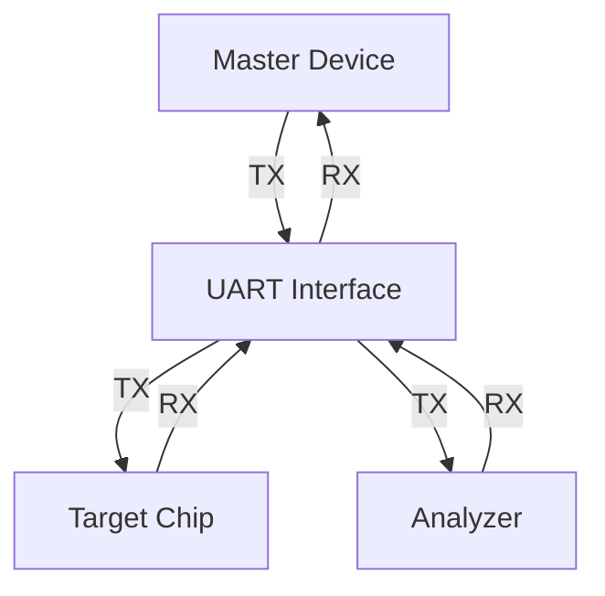

# Lesson 1: Foundations, Attack Surfaces & Physical Invariants

## Curriculum Roadmap
This lesson serves as the foundational cornerstone for our exploration into UART and serial reconnaissance within the realm of hardware security. We will delve into the physical signaling models that underpin UART communication, the attack surfaces that these models expose, and the physical invariants that govern the behavior of serial interfaces. By the end of this lesson, you will possess a comprehensive understanding of the hardware problem space, enabling you to identify and exploit vulnerabilities in UART-based systems. The curriculum roadmap is structured as follows:

1. **Physical Signal Theory & Hardware Problem Space**: We will explore the fundamental principles of physical signaling, including voltage logic levels and resistor networks, and discuss why physical security measures often fall short in protecting against determined attackers.
2. **Threat Modeling & Non-Negotiable Invariants**: This section will introduce the concept of root-of-trust, memory isolation boundaries, and cryptographic invariants, providing a framework for understanding the security implications of UART interfaces.
3. **High-Level Bus Topology & Interface Architecture**: We will examine the bus topology and interface architecture of UART communication, illustrating the interactions between the master device, target chip, and analyzer through a clean Mermaid diagram.

## 1. Physical Signal Theory & Hardware Problem Space

At the heart of UART (Universal Asynchronous Receiver/Transmitter) communication lies the transmission of digital data over serial interfaces. To fully understand the vulnerabilities inherent in UART-based systems, it is essential to delve into the physical signaling models that govern these transmissions. UART operates by transmitting data one bit at a time over a single wire, making it a prime target for physical attacks.

### Voltage Logic Levels

UART communication relies on well-defined voltage levels to represent binary data. In standard UART implementations, a logic '1' is typically represented by a high voltage level (e.g., 3.3V or 5V), while a logic '0' is represented by a low voltage level (e.g., 0V). These voltage levels are critical for the correct interpretation of data by the receiver. However, the precision of these voltage levels can be exploited by attackers to inject or manipulate data.

### Pull-Up and Pull-Down Resistor Networks

To ensure stable voltage levels in UART communication, pull-up and pull-down resistor networks are often employed. A pull-up resistor connects a signal line to a high voltage level, while a pull-down resistor connects it to a low voltage level. These resistors help maintain the correct voltage levels even when the signal line is left unconnected or is subject to external interference. However, these resistor networks can also be exploited by attackers to manipulate the voltage levels and, consequently, the data being transmitted.

### Why Physical Security Fails

Physical security measures, such as tamper-resistant enclosures and secure boot processes, are often implemented to protect against unauthorized access to hardware devices. However, these measures can be circumvented through physical attacks on the UART interface. By exploiting the physical signaling models and resistor networks, attackers can intercept, inject, or manipulate data being transmitted over the UART interface. This highlights the importance of understanding the underlying physical principles and the potential vulnerabilities they introduce.

## 2. Threat Modeling & Non-Negotiable Invariants

Threat modeling is a critical process in hardware security that involves identifying potential attack vectors and understanding the security implications of UART interfaces. By conducting a thorough threat model, we can identify the root-of-trust, memory isolation boundaries, and cryptographic invariants that must be preserved to ensure the security of UART-based systems.

### Root-of-Trust

The root-of-trust is the fundamental security assumption upon which a system's security is built. In the context of UART communication, the root-of-trust is the assumption that the UART interface is secure and that data transmitted over the interface is not being intercepted or manipulated. However, as we have discussed, the physical signaling models and resistor networks can be exploited by attackers to violate this assumption. Therefore, it is essential to understand the root-of-trust and the potential vulnerabilities that can compromise it.

### Memory Isolation Boundaries

Memory isolation boundaries are critical for preventing unauthorized access to sensitive data within a system. In UART communication, memory isolation boundaries are often established through the use of separate memory spaces for the UART interface and the rest of the system. However, these boundaries can be exploited by attackers through physical attacks on the UART interface. By intercepting or manipulating data being transmitted over the UART interface, attackers can gain unauthorized access to sensitive data.

### Cryptographic Invariants

Cryptographic invariants are the security assumptions that underpin cryptographic protocols and algorithms. In the context of UART communication, cryptographic invariants are often established through the use of encryption and authentication mechanisms to protect data transmitted over the interface. However, these invariants can be compromised through physical attacks on the UART interface. By intercepting or manipulating data being transmitted over the UART interface, attackers can bypass encryption and authentication mechanisms, gaining unauthorized access to sensitive data.

## 3. High-Level Bus Topology & Interface Architecture

To fully understand the interactions between the master device, target chip, and analyzer in UART communication, it is essential to examine the bus topology and interface architecture. The following Mermaid diagram illustrates the high-level bus topology and interface architecture of UART communication:

In this diagram, the master device and target chip communicate with each other through the UART interface. The analyzer is also connected to the UART interface, allowing it to intercept and analyze the data being transmitted. The TX and RX lines represent the transmit and receive lines of the UART interface, respectively.

The UART interface serves as the communication channel between the master device, target chip, and analyzer. The master device transmits data to the target chip through the TX line, and the target chip receives the data through the RX line. Similarly, the target chip transmits data to the master device through the TX line, and the master device receives the data through the RX line. The analyzer can intercept the data being transmitted over the UART interface by connecting to the TX and RX lines.

By understanding the bus topology and interface architecture of UART communication, we can identify the attack surfaces and potential vulnerabilities that can be exploited by attackers. For example, by intercepting the data being transmitted over the UART interface, attackers can gain unauthorized access to sensitive data. By manipulating the data being transmitted over the UART interface, attackers can inject malicious data into the system, leading to a wide range of security vulnerabilities.

In conclusion, this lesson has provided a comprehensive overview of the physical signaling models, attack surfaces, and physical invariants that govern UART communication. By understanding these foundational concepts, you will be better equipped to identify and exploit vulnerabilities in UART-based systems. In the next lesson, we will delve deeper into the specific techniques and tools used for UART and serial reconnaissance, enabling you to apply your knowledge in real-world scenarios.
