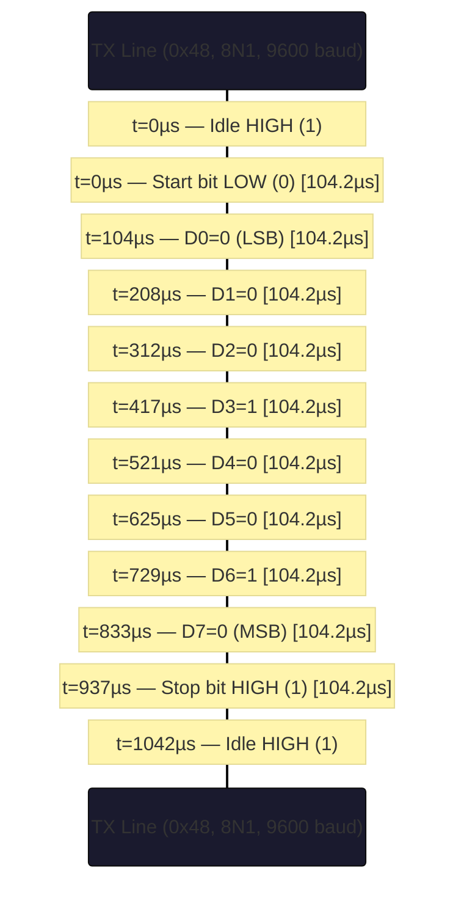
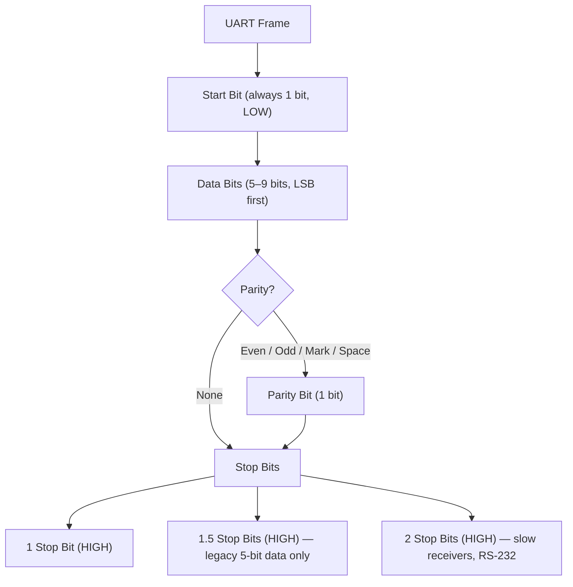
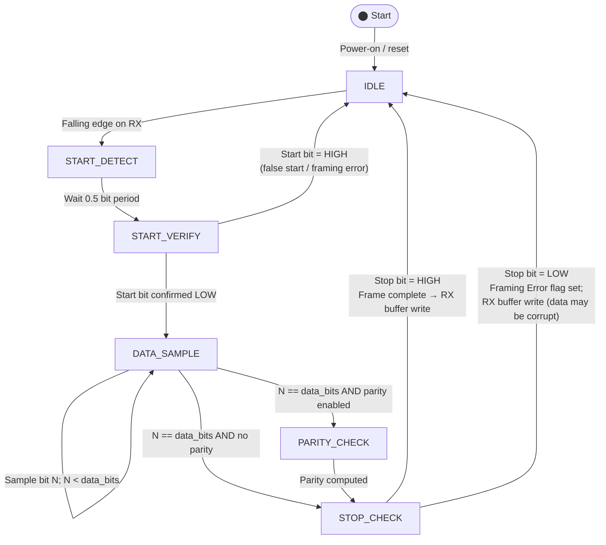
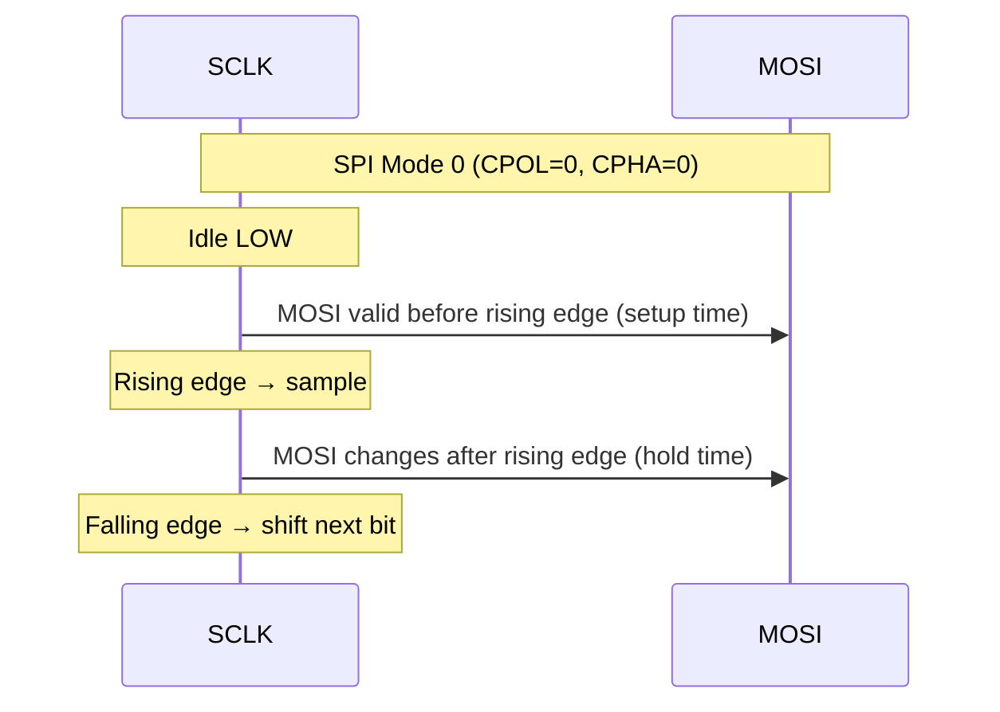
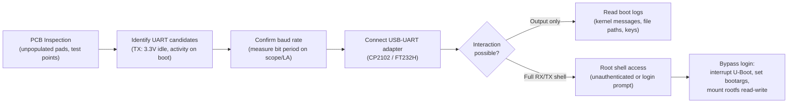
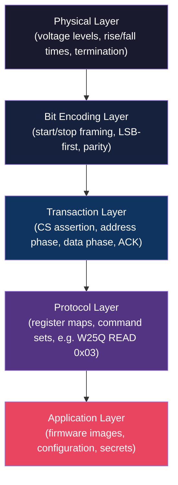

# Lesson 2: Protocol Mechanics & Bus Framing

## Overview

This lesson examines the low-level electrical and logical mechanics governing serial bus protocols — UART, SPI, and I²C — with particular emphasis on the timing constraints, frame architectures, and transaction lifecycles that hardware security engineers must master for successful bus analysis, protocol fuzzing, and fault injection. Every concept is derived from first principles; no detail is hand-waved away.

---

## 1. Clock Synchronization & Signal Timing: First Principles

### 1.1 Why Clocking Is the Core Problem

Any serial bus must solve one fundamental problem: *the receiver does not know when to sample the line.* Clocked (synchronous) buses solve this by transmitting a dedicated clock signal alongside data, allowing the receiver to latch data on a known edge. Asynchronous buses like UART cannot afford the extra wire in many embedded topologies and instead solve the problem through *prior agreement* — both ends are preconfigured to operate at the same symbol rate. This agreement is fragile; a baud rate mismatch as small as 2–3% accumulates enough phase error across a 10-bit frame to cause a mis-sample.

### 1.2 Baud Rate Derivation and Clock Tolerance

A UART peripheral derives its bit clock by dividing the system peripheral clock (PCLK) by a programmable integer divisor. On an STM32F4, for example:

```text
BRR = PCLK / (16 × BaudRate)   (oversampling-by-16 mode)
BRR = PCLK / (8  × BaudRate)   (oversampling-by-8 mode, for higher speeds)
```

The divisor is split into a 12-bit mantissa and a 4-bit fraction, giving 0.0625-bit resolution. With a 42 MHz APB1 clock and a target baud rate of 115200:

```text
BRR = 42,000,000 / (16 × 115,200) = 22.786...
Mantissa = 22  (0x16)
Fraction = round(0.786 × 16) = 13 (0x0D)
BRR register = 0x016D
Actual baud = 42,000,000 / (16 × 22.8125) = 115,107 bps
Error ≈ 0.08%  (well within the ±2% spec)
```

The EIA-232 / TIA-232 standard requires that the cumulative timing error across a full frame not exceed half a bit period. At 115200 baud, one bit is 8.68 µs; the cumulative allowable error over 10 bits is therefore ±4.34 µs. This is why clock source quality (crystal vs. RC oscillator) matters enormously in UART-heavy designs — an RC oscillator can drift 1–3% across temperature, rendering communication unreliable at high baud rates.

### 1.3 Receiver Oversampling and Mid-Bit Sampling

The receiver does not simply wait one bit period after the start bit. It oversamples the line (typically 16× or 8× the baud rate) and uses a *voting* or *majority* scheme to determine the bit value, rejecting narrow glitches. The sampling point is placed at the center of the bit period — the point of maximum setup and hold margin.

```text
Oversampling factor: 16
Start bit detected on falling edge at sample 0
Wait 8 samples (half a bit period) → center of start bit (verify it is still low)
Sample data bits at sample 8 of each subsequent bit period (samples 24, 40, 56, ... for bits 0–7)
```

In 16× oversampling mode, the UART hardware takes three consecutive samples at positions 7, 8, 9 (around the center) and applies majority vote. This rejects single-sample glitches of less than one oversampling period (1/16 of a bit time). At 115200 baud, that rejection window is ~542 ns — a useful but not unlimited glitch immunity budget for noisy embedded environments.

### 1.4 Setup and Hold Time in Clocked Protocols (SPI/I²C Context)

Setup and hold time become explicit and architecturally mandatory in synchronous protocols. For SPI:

- **t_setup**: minimum time data must be stable *before* the sampling clock edge.
- **t_hold**: minimum time data must remain stable *after* the sampling clock edge.

Violation of either causes metastability in the receiver's flip-flop input stage — the output enters a region between logic 0 and 1 and resolves randomly, corrupting the sample. This is not a software-recoverable condition; it is a physical consequence of bistable circuit dynamics described by the Arrhenius equation for metastability resolution time.

For a hardware attacker probing an SPI bus, understanding t_setup and t_hold is critical: a man-in-the-middle (MitM) interposer must re-drive data with sufficient margin on both sides of the clock edge, or it will itself inject metastability errors into the target.

---

## 2. UART Frame Architecture & Bit-Level Encoding

### 2.1 Electrical Conventions

UART signal levels are logic-level by default (0 V = logic 0, V_CC = logic 1) but are commonly level-shifted for transmission over longer distances:

| Standard | Logic 0 | Logic 1 | Max distance | Notes |
|---|---|---|---|---|
| TTL / CMOS (3.3V) | 0 V | 3.3 V | < 1 m | Direct MCU output |
| TTL / CMOS (5V) | 0 V | 5 V | < 1 m | Requires level shifting to 3.3V MCU |
| RS-232 (EIA-232) | +3 to +15 V | -3 to -15 V | ~15 m | Inverted logic; DB9 connector |
| RS-485 (EIA-485) | Differential | Differential | ~1200 m | Half or full duplex; bus topology |

This inversion in RS-232 is a frequent source of confusion when probing embedded systems: the idle line is at a *negative* voltage relative to ground, which registers as a logic 1. A UART-to-USB adapter (CP2102, CH340, FT232) handles this translation; direct connection of an RS-232 port to a 3.3V MCU GPIO will permanently damage the MCU.

### 2.2 Frame Structure: Exact Bit Ordering

UART always transmits the **LSB first**. This is in contrast to network byte order (big-endian, MSB first) and is a constant source of confusion during capture analysis.

For the byte `0x48` (ASCII `'H'`):

```text
Binary (MSB→LSB): 0100 1000
Transmitted order (LSB first): 0, 0, 0, 1, 0, 0, 1, 0
```

The complete wire encoding for 8N1 (8 data bits, no parity, 1 stop bit):

```text
Idle  Start  D0  D1  D2  D3  D4  D5  D6  D7  Stop  Idle
  1     0     0   0   0   1   0   0   1   0    1     1
```

At 9600 baud, each bit cell is exactly 1,000,000 / 9600 ≈ **104.167 µs**.

The following timing diagram renders the full waveform:



### 2.3 Parity Computation

Parity is computed over the **data bits only** (not start or stop bits), contrary to the original material's incorrect statement that the total including start and stop bits is counted.

- **Even parity**: parity bit set such that the count of 1-bits in `{D0..D7, P}` is even.
- **Odd parity**: parity bit set such that the count of 1-bits in `{D0..D7, P}` is odd.
- **Mark parity**: parity bit is always 1 (used for framing synchronization in some protocols).
- **Space parity**: parity bit is always 0.

For `0x48 = 0100 1000`, popcount = 2 (even). With even parity, P = 0. With odd parity, P = 1.

Parity provides only single-bit error *detection*, not correction, and cannot detect burst errors affecting 2 bits simultaneously. For anything beyond single-bit noise detection, higher-layer framing (CRC-8, CRC-16, CRC-32) is mandatory.

### 2.4 Frame Variants



The 1.5-stop-bit configuration is a historical artifact originating from 5-bit Baudot-coded teletype machines and has no meaningful application in modern embedded systems. Its presence in a silicon UART peripheral is purely for backward compatibility.

---

## 3. Bus Transaction Lifecycle: End-to-End Signal Trace

### 3.1 UART Transaction State Machine

The hardware state machine governing a UART receiver is non-trivial and directly relevant to fault-injection and glitch attacks:



The **framing error** condition is architecturally important: most UART peripherals still write the received data byte to the receive buffer even on a framing error, with the error flag set alongside. Software that does not check the error flag will process corrupt data silently — a common vulnerability in embedded firmware that hardware attackers exploit via deliberate baud-rate mismatches or voltage glitching during the stop bit window.

### 3.2 Multi-Protocol Comparison: Transaction Lifecycle

The following diagram captures the structural differences in bus transaction lifecycles across the three most common embedded serial buses:

```mermaid
sequenceDiagram
    participant M as Master / Host
    participant S as Slave / Target

    rect rgb(20, 60, 100)
        Note over M,S: UART (Asynchronous, point-to-point)
        M->>S: [START][D0..D7][STOP]
        Note over S: No acknowledgement; fire-and-forget
    end

    rect rgb(20, 100, 60)
        Note over M,S: SPI (Synchronous, full-duplex, CS-selected)
        M->>S: CS LOW (chip select asserted)
        M->>S: MOSI bit 7 (MSB) on SCLK rising edge
        S->>M: MISO bit 7 (MSB) simultaneously
        M->>S: MOSI bits 6..0 clocked out
        S->>M: MISO bits 6..0 clocked in
        M->>S: CS HIGH (deselect)
    end

    rect rgb(100, 40, 20)
        Note over M,S: I²C (Synchronous, half-duplex, addressed)
        M->>S: START condition (SDA HIGH→LOW while SCL HIGH)
        M->>S: 7-bit address + R/W̄ bit
        S->>M: ACK (SDA pulled LOW by slave on 9th clock)
        M->>S: Data byte(s) [each followed by ACK/NACK]
        M->>S: STOP condition (SDA LOW→HIGH while SCL HIGH)
    end
```

### 3.3 SPI Clock Polarity (CPOL) and Phase (CPHA): Precise Definitions

SPI has four distinct operating modes defined by the combination of CPOL and CPHA. These are frequently misunderstood and are a primary cause of SPI communication failures during hardware bring-up and protocol reverse engineering.

| Mode | CPOL | CPHA | Clock idle state | Data sampled on | Data shifted on |
|---|---|---|---|---|---|
| 0 | 0 | 0 | LOW | Rising edge | Falling edge |
| 1 | 0 | 1 | LOW | Falling edge | Rising edge |
| 2 | 1 | 0 | HIGH | Falling edge | Rising edge |
| 3 | 1 | 1 | HIGH | Rising edge | Falling edge |



When probing an unknown SPI device (e.g., a flash memory chip on a router PCB), determining the correct mode is essential before attempting a readback. An oscilloscope or logic analyzer capture of the CS, SCLK, and MOSI lines during a known operation (e.g., device power-on firmware load) will reveal idle clock state (CPOL) and the edge relationship (CPHA) unambiguously.

### 3.4 I²C Electrical Architecture and Arbitration

I²C uses open-drain outputs with pull-up resistors on both SDA and SCL. No device actively drives the line HIGH; it releases the line, and the pull-up passively charges it. This architecture enables:

1. **Multi-master arbitration**: two masters can begin a transaction simultaneously. Each monitors SDA while transmitting. If a master transmits a 1 (releases) but senses a 0 (another master pulled low), it loses arbitration and backs off.
2. **Clock stretching**: a slow slave holds SCL LOW to pause the master, buying time to prepare the next data byte.

Pull-up resistor selection critically affects signal integrity. The I²C specification defines maximum bus capacitance as 400 pF. The pull-up resistor must charge this capacitance fast enough for the target speed:

```text
t_rise_max (Standard mode, 100 kHz) = 1000 ns
t_rise_max (Fast mode, 400 kHz)     = 300 ns
t_rise_max (Fast-mode Plus, 1 MHz)  = 120 ns

R_max ≈ t_rise / (0.8473 × C_bus)   [for a 10%→90% threshold RC rise]
```

For a 400 pF bus at Fast mode: R_max ≈ 300 ns / (0.8473 × 400 pF) ≈ 884 Ω. Values above this cause rise-time violations. Values too low cause excessive current draw and potential drive-strength violations on devices with weak open-drain outputs.

---

## 4. Protocol Implementation: Production-Grade Code

### 4.1 Bitbang UART Transmitter in C (Timing-Critical, Interrupt-Disabled)

The following implementation is suitable for microcontrollers without a hardware UART peripheral, or for educational purposes demonstrating exact bit timing. It disables interrupts during transmission to maintain timing accuracy and uses a hardware timer for delay precision.

```c
/**
 * @file bitbang_uart.c
 * @brief Interrupt-safe, timer-accurate bitbang UART TX for ARM Cortex-M
 *
 * Assumes:
 *   - SysTick running at CPU_FREQ Hz
 *   - TX_PIN_SET() / TX_PIN_CLR() are single-cycle GPIO register writes
 *   - CPU frequency defined at compile time
 */

#include <stdint.h>
#include <stdbool.h>

#define CPU_FREQ_HZ     (168000000UL)   /* 168 MHz, e.g. STM32F4 at max speed */
#define BAUD_RATE       (115200UL)
#define CYCLES_PER_BIT  (CPU_FREQ_HZ / BAUD_RATE)   /* ~1458 cycles at 168MHz/115200 */

/* Platform-specific GPIO macros — replace with target register addresses */
#define TX_PIN_SET()    (GPIOA->BSRR = (1U << 9))   /* PA9 high */
#define TX_PIN_CLR()    (GPIOA->BSRR = (1U << 25))  /* PA9 low  (BSRR reset half) */

/**
 * @brief Busy-wait for exactly 'cycles' CPU cycles using DWT cycle counter.
 *        DWT->CYCCNT must be enabled before calling (see CoreDebug->DEMCR).
 */
static inline void delay_cycles(uint32_t cycles)
{
    uint32_t start = DWT->CYCCNT;
    /* Unsigned subtraction handles 32-bit wraparound correctly */
    while ((DWT->CYCCNT - start) < cycles);
}

/**
 * @brief Transmit one byte over bitbang UART (8N1, LSB first).
 *
 * @param byte  The octet to transmit.
 *
 * @note  Interrupts are disabled for the full frame duration (~87µs at 115200).
 *        Do not call from contexts where interrupt latency > CYCLES_PER_BIT.
 */
void uart_tx_byte(uint8_t byte)
{
    uint32_t primask;

    /* Save and disable interrupts atomically */
    __asm volatile ("MRS %0, PRIMASK\n\t"
                    "CPSID i"
                    : "=r"(primask) : : "memory");

    /* Start bit: drive LOW */
    TX_PIN_CLR();
    delay_cycles(CYCLES_PER_BIT);

    /* Data bits D0..D7, LSB first */
    for (uint8_t i = 0; i < 8; i++) {
        if (byte & (1U << i)) {
            TX_PIN_SET();
        } else {
            TX_PIN_CLR();
        }
        delay_cycles(CYCLES_PER_BIT);
    }

    /* Stop bit: drive HIGH */
    TX_PIN_SET();
    delay_cycles(CYCLES_PER_BIT);

    /* Restore interrupt state */
    __asm volatile ("MSR PRIMASK, %0" : : "r"(primask) : "memory");
}

/**
 * @brief Transmit a null-terminated string.
 */
void uart_tx_string(const char *s)
{
    while (*s) {
        uart_tx_byte((uint8_t)*s++);
    }
}
```

### 4.2 UART Frame Decoder in Python (Logic Analyzer Capture Post-Processing)

This decoder processes raw timestamped samples from a logic analyzer export (e.g., Saleae CSV) and reconstructs UART frames with full error detection. This is the kind of tool a hardware security researcher writes when analyzing a captured bus dump.

```python
"""
uart_decoder.py — UART frame decoder for logic analyzer CSV exports.

Input CSV format (Saleae Logic 2 digital export):
    Time[s],Channel 0
    0.000000000,1
    0.000104167,0      <- falling edge = start bit

Usage:
    python uart_decoder.py --input capture.csv --baud 115200 --bits 8 --parity none --stop 1
"""

from __future__ import annotations
import argparse
import csv
import sys
from dataclasses import dataclass, field
from enum import Enum
from typing import Generator

class Parity(Enum):
    NONE  = "none"
    EVEN  = "even"
    ODD   = "odd"
    MARK  = "mark"
    SPACE = "space"

@dataclass
class UARTFrame:
    timestamp_start: float          # time of start bit falling edge (seconds)
    data: int                       # decoded data byte
    parity_ok: bool | None          # None if parity not configured
    framing_error: bool             # stop bit was not HIGH
    raw_bits: list[int] = field(default_factory=list)

    def __str__(self) -> str:
        status = []
        if self.framing_error:
            status.append("FRAMING_ERR")
        if self.parity_ok is False:
            status.append("PARITY_ERR")
        status_str = " [" + ", ".join(status) + "]" if status else ""
        return (f"t={self.timestamp_start*1e6:10.3f}µs  "
                f"0x{self.data:02X}  '{chr(self.data) if 0x20 <= self.data < 0x7F else '.'}"
                f"'  bits={self.raw_bits}{status_str}")


def load_samples(path: str) -> list[tuple[float, int]]:
    """Load (timestamp, level) pairs from a Saleae-format CSV export."""
    samples: list[tuple[float, int]] = []
    with open(path, newline='') as f:
        reader = csv.reader(f)
        header = next(reader, None)
        for row in reader:
            if len(row) < 2:
                continue
            try:
                samples.append((float(row[0]), int(row[1])))
            except ValueError:
                continue
    return samples


def level_at(samples: list[tuple[float, int]], t: float) -> int:
    """
    Return the signal level at time t using the last-seen level before t.
    Logic analyzer exports edge events, not sample-per-clock; this reconstructs
    the held level.
    """
    level = 1  # UART idle is HIGH
    for ts, lvl in samples:
        if ts > t:
            break
        level = lvl
    return level


def decode_frames(
    samples: list[tuple[float, int]],
    baud_rate: float,
    data_bits: int = 8,
    parity: Parity = Parity.NONE,
    stop_bits: float = 1.0,
) -> Generator[UARTFrame, None, None]:
    """
    Scan sample list for UART frames and yield decoded UARTFrame objects.
    """
    bit_period = 1.0 / baud_rate
    half_bit   = bit_period * 0.5

    # Build a sorted list of falling-edge timestamps (start-bit candidates)
    falling_edges: list[float] = []
    prev_level = 1
    for ts, lvl in samples:
        if prev_level == 1 and lvl == 0:
            falling_edges.append(ts)
        prev_level = lvl

    processed_until = 0.0  # prevent re-entry into an already-decoded frame

    for edge_t in falling_edges:
        if edge_t < processed_until:
            continue

        # Verify start bit at center (avoid spike false positives)
        start_center = edge_t + half_bit
        if level_at(samples, start_center) != 0:
            continue  # false start

        raw_bits: list[int] = []
        t = edge_t + bit_period  # first data bit center

        for _ in range(data_bits):
            raw_bits.append(level_at(samples, t + half_bit - 1e-9))
            t += bit_period

        # Reconstruct byte (LSB first)
        value = 0
        for i, bit in enumerate(raw_bits):
            value |= (bit << i)

        # Parity check
        parity_ok: bool | None = None
        if parity != Parity.NONE:
            parity_bit = level_at(samples, t + half_bit - 1e-9)
            t += bit_period
            pop = bin(value).count('1')
            if parity == Parity.EVEN:
                parity_ok = ((pop + parity_bit) % 2 == 0)
            elif parity == Parity.ODD:
                parity_ok = ((pop + parity_bit) % 2 == 1)
            elif parity == Parity.MARK:
                parity_ok = (parity_bit == 1)
            elif parity == Parity.SPACE:
                parity_ok = (parity_bit == 0)

        # Stop bit verification
        stop_level = level_at(samples, t + half_bit - 1e-9)
        framing_error = (stop_level != 1)

        frame_end = t + (bit_period * stop_bits)
        processed_until = frame_end

        yield UARTFrame(
            timestamp_start=edge_t,
            data=value,
            parity_ok=parity_ok,
            framing_error=framing_error,
            raw_bits=raw_bits,
        )


def main() -> None:
    parser = argparse.ArgumentParser(description="UART frame decoder for logic analyzer CSV exports")
    parser.add_argument("--input",   required=True,  help="Path to Saleae CSV export")
    parser.add_argument("--baud",    type=float, default=115200.0, help="Baud rate (default: 115200)")
    parser.add_argument("--bits",    type=int,   default=8,        help="Data bits (default: 8)")
    parser.add_argument("--parity",  default="none",
                        choices=[p.value for p in Parity],         help="Parity mode (default: none)")
    parser.add_argument("--stop",    type=float, default=1.0,      help="Stop bits (default: 1)")
    args = parser.parse_args()

    samples = load_samples(args.input)
    if not samples:
        print("ERROR: no samples loaded", file=sys.stderr)
        sys.exit(1)

    parity = Parity(args.parity)
    frame_count = 0
    error_count = 0

    for frame in decode_frames(samples, args.baud, args.bits, parity, args.stop):
        print(frame)
        frame_count += 1
        if frame.framing_error or frame.parity_ok is False:
            error_count += 1

    print(f"\nDecoded {frame_count} frames, {error_count} errors.")


if __name__ == "__main__":
    main()
```

### 4.3 SPI Flash Readback in Python via `spidev` (Linux, Raspberry Pi)

This demonstrates a real SPI transaction lifecycle — asserting chip select, transmitting a command byte, transmitting address bytes, and reading back data — against a Winbond W25Q128 serial NOR flash (a device found on countless embedded targets):

```python
"""
spi_flash_read.py — Read firmware from Winbond W25Q128 (or compatible) SPI NOR flash.

Wiring (Raspberry Pi 4):
    Flash VCC  → 3.3V (pin 17)
    Flash GND  → GND  (pin 20)
    Flash CS   → CE0  (pin 24, GPIO 8)
    Flash CLK  → SCLK (pin 23, GPIO 11)
    Flash MOSI → MOSI (pin 19, GPIO 10)
    Flash MISO → MISO (pin 21, GPIO 9)
    Flash WP#  → 3.3V (write-protect disabled for readback)
    Flash HOLD#→ 3.3V (hold disabled)

Requires: pip install spidev
"""

import spidev
import struct
import sys

# W25Q128 instruction set (per datasheet rev. L, 2021)
CMD_READ_ID       = 0x9F   # JEDEC ID
CMD_READ_STATUS1  = 0x05
CMD_READ          = 0x03   # Normal read (up to 50 MHz)
CMD_FAST_READ     = 0x0B   # Fast read with 1 dummy byte (up to 133 MHz)

FLASH_SIZE_BYTES  = 16 * 1024 * 1024   # 128 Mbit = 16 MiB

def read_jedec_id(spi: spidev.SpiDev) -> tuple[int, int, int]:
    """
    Issue RDID (0x9F) and return (manufacturer_id, memory_type, capacity).
    Winbond W25Q128: 0xEF, 0x40, 0x18
    """
    resp = spi.xfer2([CMD_READ_ID, 0x00, 0x00, 0x00])
    return resp[1], resp[2], resp[3]

def read_status_register(spi: spidev.SpiDev) -> int:
    """Read Status Register 1. Bit 0 (WIP) = Write In Progress."""
    resp = spi.xfer2([CMD_READ_STATUS1, 0x00])
    return resp[1]

def wait_not_busy(spi: spidev.SpiDev) -> None:
    """Poll WIP bit until flash is not busy. Required before read after a write."""
    while read_status_register(spi) & 0x01:
        pass

def read_flash(spi: spidev.SpiDev, address: int, length: int) -> bytes:
    """
    Read `length` bytes from `address` using CMD_READ (0x03).

    SPI transaction structure:
        [0x03][ADDR_H][ADDR_M][ADDR_L][dummy clocks → data bytes]

    The W25Q128 uses 24-bit addresses (3-byte), supporting addresses 0x000000–0xFFFFFF.
    """
    if address < 0 or (address + length) > FLASH_SIZE_BYTES:
        raise ValueError(f"Address range 0x{address:06X}+{length} out of bounds")

    # Build command: 1 cmd byte + 3 address bytes + length dummy bytes for data
    cmd = [CMD_READ,
           (address >> 16) & 0xFF,
           (address >>  8) & 0xFF,
           (address >>  0) & 0xFF]
    cmd += [0x00] * length   # dummy bytes; received data overwrites these

    response = spi.xfer2(cmd)
    # Response bytes 0–3 are MISO during command/address phase (undefined); data starts at byte 4
    return bytes(response[4:])


def dump_firmware(output_path: str) -> None:
    spi = spidev.SpiDev()
    spi.open(0, 0)              # Bus 0, CE0
    spi.max_speed_hz = 1000000  # 1 MHz — conservative for in-circuit reads with parasitics
    spi.mode = 0                # W25Q128 supports modes 0 and 3

    try:
        mfr, mem_type, capacity = read_jedec_id(spi)
        print(f"JEDEC ID: 0x{mfr:02X} 0x{mem_type:02X} 0x{capacity:02X}")
        if mfr != 0xEF:
            print(f"WARNING: Unexpected manufacturer ID 0x{mfr:02X} (expected 0xEF for Winbond)")

        wait_not_busy(spi)

        chunk_size = 4096   # 4 KiB pages
        total_read = 0

        with open(output_path, 'wb') as f:
            address = 0
            while address < FLASH_SIZE_BYTES:
                n = min(chunk_size, FLASH_SIZE_BYTES - address)
                chunk = read_flash(spi, address, n)
                f.write(chunk)
                total_read += n
                address += n
                pct = 100.0 * total_read / FLASH_SIZE_BYTES
                print(f"\r  {pct:5.1f}%  ({total_read // 1024} KiB / {FLASH_SIZE_BYTES // 1024} KiB)", end='', flush=True)

        print(f"\nDone. Wrote {total_read} bytes to '{output_path}'")

    finally:
        spi.close()


if __name__ == "__main__":
    output = sys.argv[1] if len(sys.argv) > 1 else "firmware_dump.bin"
    dump_firmware(output)
```

---

## 5. Protocol Security Implications for Hardware Attackers

### 5.1 UART as a Debug Console Attack Vector

The majority of embedded Linux devices (routers, IP cameras, IoT gateways) expose a UART debug console on unpopulated header pads. The boot sequence almost universally outputs U-Boot or similar bootloader messages at a fixed baud rate before the application starts. Identifying and tapping this UART is typically the first step in a hardware security assessment.



### 5.2 SPI Flash Fault Injection via Clock Glitching

SPI flash devices lack any authentication mechanism. An attacker with physical access can read the entire firmware image by asserting CS and clocking out the contents. More aggressively, the clock line can be glitched (momentarily driven to an unexpected edge) during a write-enable or erase operation to corrupt flash contents in a controlled manner — a technique used in fault-injection attacks against secure boot chains.

The key insight: the SPI transaction lifecycle has no concept of an authenticated or privileged operation. The only protection layer is external (boot ROM validation of flash contents, secure enclave attestation). If those layers are absent or bypassable, SPI flash readback yields the full firmware.

### 5.3 I²C Address Scanning as an Enumeration Primitive

I²C uses a 7-bit address space (128 addresses, with 16 reserved), giving 112 usable device addresses. An attacker connected to an I²C bus can enumerate all present devices by transmitting a START condition followed by each possible address and observing ACK/NACK. This is exactly what the `i2cdetect` utility does on Linux. Devices discovered this way may include EEPROMs containing calibration data or secrets, secure elements (ATECC608A, TPM chips), power management ICs, and sensor arrays.

```bash
# On an embedded Linux target with I²C bus access:
i2cdetect -y 1   # scan I²C bus 1

# Read 256 bytes from EEPROM at address 0x50 (AT24C family):
i2cdump -y 1 0x50 b
```

---

## 6. Summary: Protocol Mechanics Hierarchy



Each layer is a compression of the layer below it. A hardware security engineer must be able to reason from the electrical waveform at layer 1 all the way up to the semantic content at layer 5. Missing any layer produces blind spots that attackers exploit. The bus framing mechanics covered in this lesson form the indispensable foundation for every higher-layer analysis technique — protocol reverse engineering, firmware extraction, fault injection, and man-in-the-middle interposition.
