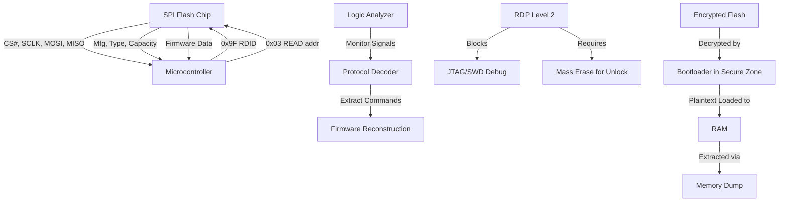
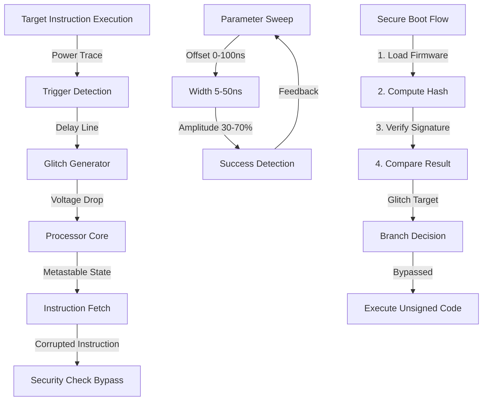
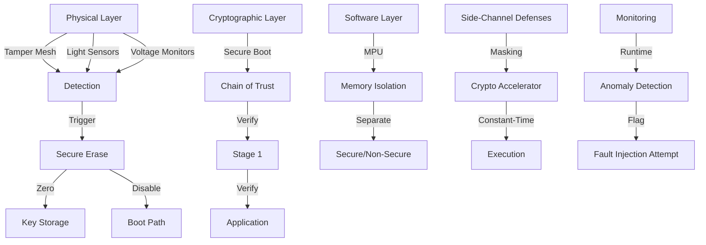

# Lesson 3: Exploitation Primitives, Glitching & Hardening

Embedded systems security operates at the intersection of hardware physics, microarchitectural state machines, and cryptographic protocols. This lesson examines the fundamental primitives attackers use to extract firmware, inject faults into execution flows, and the countermeasures designers deploy to harden systems against physical attacks. Understanding these mechanisms requires knowledge of memory hierarchies, timing-based vulnerabilities, and the physical limitations of silicon.

## 1. Firmware Extraction & Memory Access Primitives

### 1.1 Non-Volatile Memory Architectures

Firmware resides in non-volatile memory technologies with distinct electrical characteristics and access protocols. The most prevalent architectures include:

**SPI NOR Flash**: Serial Peripheral Interface flash memory uses a synchronous serial protocol with four signals: SCLK (clock), MOSI (master out, slave in), MISO (master in, slave out), and CS# (chip select, active low). NOR flash provides byte-level random access and executes-in-place (XIP) capability, making it suitable for code storage. Typical densities range from 512KB to 256MB with 3.3V or 1.8V operation.

**SPI NAND Flash**: Optimized for sequential access and higher densities (1GB+), NAND flash requires explicit page read operations and block erasure. Bad block management and ECC (Error Correction Code) complicate extraction but also reveal device state through metadata.

**eMMC/eUFS**: Embedded MultiMediaCard and Universal Flash Storage implement JEDEC-standardized protocols with advanced features including secure erase, write protection, and RPMB (Replay Protected Memory Block). These devices present as block storage and require command sequence analysis for extraction.

**OTP/eFuse Memory**: One-Time Programmable memory stores critical security material like encryption keys and device identifiers. Once programmed, these bits cannot be altered without physical destruction, making them targets for invasive probing.

### 1.2 SPI Flash Protocol Analysis

The SPI flash command set follows JEDEC JESD216 standard. Critical commands include:

- **0x9F (RDID)**: Read JEDEC ID, returns manufacturer, memory type, and capacity
- **0x03 (READ)**: Standard read with 24-bit address, clock limited to ~25MHz
- **0x0B (FAST_READ)**: High-speed read requiring dummy cycles for signal settling
- **0x05 (RDSR)**: Read Status Register, exposes write-protect and busy state
- **0x06 (WREN)**: Write Enable, required before any program/erase operation

A firmware extraction sequence over SPI involves:

```python
import spidev

class SPIFlashExtractor:
    def __init__(self, bus=0, device=0):
        self.spi = spidev.SpiDev()
        self.spi.open(bus, device)
        self.spi.max_speed_hz = 1000000  # 1MHz for stability
        self.spi.mode = 0  # CPOL=0, CPHA=0
        
    def read_jedec_id(self):
        """Read JEDEC manufacturer and device ID"""
        response = self.spi.xfer2([0x9F, 0x00, 0x00, 0x00])
        return {
            'manufacturer': response[1],
            'memory_type': response[2],
            'capacity': response[3]
        }
    
    def read_status_register(self):
        """Check write protection and busy status"""
        response = self.spi.xfer2([0x05, 0x00])
        return response[1]
    
    def read_memory(self, address, length):
        """Extract firmware from specified address"""
        data = bytearray()
        chunk_size = 4096  # Read in 4KB chunks
        
        for offset in range(0, length, chunk_size):
            addr = address + offset
            read_len = min(chunk_size, length - offset)
            
            # Construct READ command: [0x03, addr[23:16], addr[15:8], addr[7:0]]
            cmd = [0x03, (addr >> 16) & 0xFF, (addr >> 8) & 0xFF, addr & 0xFF]
            response = self.spi.xfer2(cmd + [0x00] * read_len)
            data.extend(response[4:])  # Skip command bytes
            
        return bytes(data)
    
    def full_dump(self, output_path):
        """Dump entire flash contents"""
        jedec = self.read_jedec_id()
        # Capacity byte encodes size as 2^n
        size = 1 << jedec['capacity']
        
        print(f"Dumping {size} bytes from flash...")
        firmware = self.read_memory(0x00000000, size)
        
        with open(output_path, 'wb') as f:
            f.write(firmware)
```

### 1.3 Readout Protection Mechanisms

Many microcontrollers implement RDP (Read-Out Protection) or similar mechanisms:

**STM32 RDP Levels**:
- Level 0: No protection, full debug access via SWD/JTAG
- Level 1: Debug disabled, flash readable only via bootloader
- Level 2: Permanent protection, debug permanently disabled, mass erase required for downgrade

**ESP32 Flash Encryption**: AES-256 encrypted flash with key stored in eFuse. The bootloader decrypts firmware transparently during execution. Extraction requires either:
1. Extracting plaintext from RAM during execution
2. Obtaining the flash encryption key via fault injection or side-channel analysis
3. Exploiting bootloader vulnerabilities before encryption initialization

### 1.4 Memory Carving and Runtime Extraction

When direct flash access is blocked, runtime memory extraction becomes necessary:

```python
import struct
import mmap

class RuntimeMemoryCarver:
    def __init__(self, pid):
        self.pid = pid
        self.maps = self._parse_maps()
        
    def _parse_maps(self):
        """Parse /proc/[pid]/maps for memory regions"""
        maps = []
        with open(f'/proc/{self.pid}/maps', 'r') as f:
            for line in f:
                parts = line.split()
                addr_range = parts[0].split('-')
                maps.append({
                    'start': int(addr_range[0], 16),
                    'end': int(addr_range[1], 16),
                    'perms': parts[1],
                    'path': parts[-1] if len(parts) > 5 else ''
                })
        return maps
    
    def dump_region(self, start, end):
        """Extract memory region via /proc/[pid]/mem"""
        try:
            with open(f'/proc/{self.pid}/mem', 'rb') as mem:
                mem.seek(start)
                return mem.read(end - start)
        except OSError:
            return None
    
    def find_firmware_signature(self, signature):
        """Locate firmware by known magic bytes"""
        for region in self.maps:
            if 'r' not in region['perms']:
                continue
            data = self.dump_region(region['start'], region['end'])
            if data and signature in data:
                offset = data.index(signature)
                return region['start'] + offset
        return None
    
    def reconstruct_firmware(self, known_vectors):
        """Reconstruct firmware using known interrupt vectors"""
        # ARM Cortex-M vector table starts with Stack Pointer and Reset Handler
        results = []
        for region in self.maps:
            data = self.dump_region(region['start'], region['end'])
            if not data or len(data) < 8:
                continue
            
            # Check for valid vector table pattern
            sp, reset_handler = struct.unpack('<II', data[:8])
            # SP should point to RAM, reset handler to flash
            if 0x20000000 <= sp <= 0x20100000 and 0x08000000 <= reset_handler <= 0x08200000:
                results.append({
                    'address': region['start'],
                    'data': data,
                    'confidence': 'high'
                })
        return results
```

### 1.5 Firmware Binary Analysis

Extracted firmware requires analysis to understand memory layout, identify bootloaders, and locate security-critical code:

```bash
# Identify architecture and entry point
file firmware.bin
binwalk -e firmware.bin  # Extract embedded filesystems

# Disassemble ARM Cortex-M firmware
arm-none-eabi-objdump -D -b binary -m arm -M force-thumb firmware.bin > disasm.txt

# Identify code and data regions via entropy
python -c "
import numpy as np
from scipy.stats import entropy

def calculate_entropy(data, block_size=256):
    entropy_values = []
    for i in range(0, len(data) - block_size, block_size):
        block = data[i:i+block_size]
        counts = np.bincount(np.frombuffer(block, dtype=np.uint8), minlength=256)
        prob = counts / block_size
        entropy_values.append(entropy(prob, base=2))
    return entropy_values

with open('firmware.bin', 'rb') as f:
    data = f.read()
    entropies = calculate_entropy(data)
    # Code typically 4.5-6.0, compressed/encrypted 7.5-8.0, zeros/padding near 0
    print(f'Mean entropy: {np.mean(entropies):.2f}')
"
```



## 2. Fault Injection & Glitch State Machines

### 2.1 Physical Basis of Fault Injection

Fault injection exploits the relationship between voltage, timing, and digital logic stability. A CMOS gate requires minimum setup and hold times for correct operation. When violated, the gate may latch incorrect values or propagate metastable states.

**Voltage Glitch Physics**: A power supply glitch reduces VDD below the threshold required for logic HIGH detection. If VDD drops to VDD_min during a critical instruction fetch or comparison, the processor may:
- Skip instructions (instruction fetch failure)
- Misread memory (SRAM cell discharge)
- Corrupt register values (flip-flop metastability)
- Bypass conditional branches (comparison logic failure)

The effectiveness depends on glitch parameters:
- **Amplitude**: Voltage drop magnitude (typically 30-70% of VDD)
- **Duration**: Pulse width (1-100ns for most microcontrollers)
- **Timing**: Delay from trigger event to glitch onset (sub-nanosecond precision required)

**Clock Glitch Mechanism**: Inserting an additional clock edge or shortening the clock period violates timing constraints. If a flip-flop's setup time is not met, it enters a metastable state that may resolve to either logic level unpredictably.

### 2.2 Glitch Hardware Implementation

A precision glitch platform requires:

1. **Trigger Generation**: Identify the target instruction cycle via side-channel monitoring (power trace, EM emission) or synchronized trigger signals
2. **Delay Control**: Sub-nanosecond adjustable delay from trigger to glitch
3. **Pulse Generation**: Controlled pulse width and amplitude
4. **Isolation**: Prevent glitch propagation to measurement equipment

```python
"""
ChipWhisperer-compatible voltage glitch generator
Requires FPGA with precise delay control
"""

class VoltageGlitchController:
    def __init__(self, fpga_interface):
        self.fpga = fpga_interface
        self.glitch_width_min = 1e-9   # 1ns minimum
        self.glitch_width_max = 100e-9  # 100ns maximum
        
    def configure_glitch(self, offset_ns, width_ns, repeat=1):
        """
        offset_ns: Delay from trigger to glitch onset
        width_ns: Glitch pulse duration
        repeat: Number of glitches per trigger
        """
        # Convert timing to FPGA clock cycles (assuming 200MHz = 5ns period)
        fpga_clock_period = 5e-9
        offset_cycles = int(offset_ns / fpga_clock_period)
        width_cycles = int(width_ns / fpga_clock_period)
        
        self.fpga.write_register('GLITCH_OFFSET', offset_cycles)
        self.fpga.write_register('GLITCH_WIDTH', width_cycles)
        self.fpga.write_register('GLITCH_REPEAT', repeat)
        
    def set_glitch_amplitude(self, voltage_drop_percent):
        """
        Control MOSFET gate voltage to modulate glitch depth
        voltage_drop_percent: 0-100, percentage of VDD to drop
        """
        # Convert to DAC value (12-bit DAC: 0-4095)
        dac_value = int((voltage_drop_percent / 100.0) * 4095)
        self.fpga.write_register('GLITCH_AMPLITUDE', dac_value)
    
    def arm_glitch(self):
        """Enable glitch generation on next trigger"""
        self.fpga.write_register('GLITCH_ARM', 1)
    
    def scan_parameters(self, target, verify_func, offset_range, width_range):
        """
        Automated parameter sweep to find successful glitch
        target: Device under test interface
        verify_func: Function returning True if glitch succeeded
        """
        results = []
        
        for offset in np.linspace(*offset_range, num=1000):
            for width in np.linspace(*width_range, num=100):
                self.configure_glitch(offset, width)
                self.arm_glitch()
                
                target.reset()
                target.execute_operation()  # Trigger glitch
                
                if verify_func(target):
                    results.append({
                        'offset': offset,
                        'width': width,
                        'success': True
                    })
                    
        return results
```

### 2.3 Target Attack Scenarios

**Secure Boot Bypass**: Secure boot verifies firmware signature before execution. The verification typically involves:

```c
// Typical secure boot verification (ARM Cortex-M)
bool verify_signature(uint8_t *firmware, size_t len, uint8_t *signature) {
    uint8_t computed_hash[32];
    sha256(firmware, len, computed_hash);
    
    bool valid = ecdsa_verify(computed_hash, 32, signature, public_key);
    
    if (valid) {
        return true;  // TARGET: Skip this comparison
    } else {
        secure_erase();
        while(1);  // Halt on failure
    }
}
```

A voltage glitch timed to the `if (valid)` comparison can cause the processor to skip the conditional branch, executing the success path regardless of signature validity. The attack sequence:

1. Identify the comparison instruction address via disassembly
2. Set breakpoint or trigger on memory access to that address
3. Generate glitch 0-20ns after trigger with 5-15ns width
4. Verify boot success with invalid signature

**PIN/Password Verification Bypass**:

```c
bool check_pin(uint8_t *input, uint8_t *stored) {
    uint8_t match = 0;
    for (int i = 0; i < 4; i++) {
        if (input[i] == stored[i]) {
            match++;  // TARGET: Corrupt match counter
        }
    }
    return (match == 4);
}
```

Glitching the `match++` increment or final comparison can bypass authentication. Multiple glitches may be required to corrupt the counter consistently.

### 2.4 Differential Fault Analysis (DFA)

DFA exploits fault injection during cryptographic operations to recover secret keys. For AES:

```python
"""
Differential Fault Analysis on AES
Inject fault during 9th round to recover 10th round key
"""

class AES_DFA:
    def __init__(self, oracle_func):
        self.oracle = oracle_func  # Function that performs AES with fault injection
        
    def inject_fault_round9(self, plaintext):
        """Inject single-byte fault in round 9, obtain faulty ciphertext"""
        return self.oracle(plaintext, fault_round=9, fault_byte=0)
    
    def recover_key_byte(self, plaintext, correct_ct, faulty_ct, byte_position):
        """
        Recover one byte of the last round key using DFA
        Based on differential behavior of S-box
        """
        candidates = []
        
        for key_guess in range(256):
            # Reverse last round for this key guess
            correct_state = self._reverse_last_round(correct_ct, key_guess, byte_position)
            faulty_state = self._reverse_last_round(faulty_ct, key_guess, byte_position)
            
            # Check if difference matches expected DFA pattern
            if self._validate_dfa_pattern(correct_state, faulty_state):
                candidates.append(key_guess)
        
        return candidates
    
    def _reverse_last_round(self, ciphertext, key_byte, position):
        """Partially reverse AES last round"""
        # XOR with key guess
        state = ciphertext[position] ^ key_byte
        # Reverse S-box
        return AES_INV_SBOX[state]
    
    def full_key_recovery(self, plaintext, num_faults=50):
        """Recover full AES-128 key using multiple faults"""
        correct_ct = self.oracle(plaintext, fault_round=None)
        key_candidates = [list(range(256)) for _ in range(16)]
        
        for _ in range(num_faults):
            faulty_ct = self.inject_fault_round9(plaintext)
            
            for byte_pos in range(16):
                candidates = self.recover_key_byte(plaintext, correct_ct, faulty_ct, byte_pos)
                key_candidates[byte_pos] = list(set(key_candidates[byte_pos]) & set(candidates))
        
        # After sufficient faults, each position should have 1 candidate
        recovered_key = bytes([candidates[0] for candidates in key_candidates])
        return recovered_key
```

### 2.5 Electromagnetic Fault Injection (EMFI)

EMFI uses localized EM pulses to induce faults without direct electrical connection. A coil positioned above the die couples energy into internal circuitry, causing bit flips or timing violations.

**EMFI Advantages**:
- Non-invasive, no physical contact required
- Spatially localized, can target specific chip regions
- Effective against packaged ICs

**EMFI Implementation**:

```python
class EMFIController:
    def __init__(self, pulse_generator, xy_stage):
        self.pulse = pulse_generator
        self.stage = xy_stage  # Precision X-Y positioning stage
        
    def configure_pulse(self, voltage_kv, duration_ns):
        """
        Configure EM pulse parameters
        voltage_kv: Coil drive voltage (1-10kV typical)
        duration_ns: Pulse duration (1-100ns)
        """
        self.pulse.set_voltage(voltage_kv)
        self.pulse.set_duration(duration_ns)
    
    def position_probe(self, x_mm, y_mm):
        """Position EM coil above target chip region"""
        self.stage.move_to(x_mm, y_mm)
    
    def spatial_scan(self, target, x_range, y_range, step_mm=0.1):
        """
        Scan chip surface to map fault-sensitive regions
        Returns heatmap of fault locations
        """
        fault_map = []
        
        for x in np.arange(x_range[0], x_range[1], step_mm):
            for y in np.arange(y_range[0], y_range[1], step_mm):
                self.position_probe(x, y)
                
                target.reset()
                self.pulse.fire()
                
                fault_detected = target.check_fault_condition()
                fault_map.append((x, y, fault_detected))
        
        return fault_map
```



## 3. Hardware Countermeasures & Defensive Invariants

### 3.1 Tamper Detection Architectures

Physical security measures detect and respond to invasive attacks:

**Tamper Mesh**: A conductive grid covering sensitive chip areas. Any physical penetration (drilling, probing, delayering) breaks conductivity, triggering erasure. Mesh patterns include:
- Single-layer serpentine traces (easily bypassed by FIB)
- Multi-layer overlapping meshes (harder to defeat without detection)
- Active meshes with continuous monitoring and challenge-response authentication

```c
// Tamper mesh monitoring in hardware security module
typedef struct {
    uint32_t mesh_status;      // Bit field for mesh segments
    uint32_t integrity_counter; // Incremented on each check
    uint8_t  nonce[16];        // Challenge for active mesh
    uint8_t  response[16];     // Expected response
} tamper_monitor_t;

void check_tamper_mesh(tamper_monitor_t *monitor) {
    // Read mesh continuity from GPIO pins
    uint32_t current_status = read_mesh_gpio();
    
    // Compare with expected pattern
    if (current_status != monitor->mesh_status) {
        // Tamper detected - trigger secure erase
        secure_erase_keys();
        disable_all_functions();
        while(1) { __WFI(); }  // Halt permanently
    }
    
    // Active mesh challenge-response
    send_mesh_challenge(monitor->nonce);
    uint8_t received[16];
    read_mesh_response(received);
    
    if (memcmp(received, monitor->response, 16) != 0) {
        secure_erase_keys();
        while(1) { __WFI(); }
    }
    
    monitor->integrity_counter++;
}
```

**Light Sensors**: Photodiodes detect die exposure from package removal. When ambient light exceeds threshold, the system enters secure erase mode. Advanced implementations use multiple sensors with redundancy and cross-verification.

**Voltage/Clock Monitors**: Detect glitching attempts by monitoring power supply and clock integrity:

```verilog
// Hardware voltage glitch detector in FPGA/ASIC
module glitch_detector (
    input wire vdd_monitor,        // Analog comparator output
    input wire clk,
    input wire reset_n,
    output reg glitch_detected
);

    reg [7:0] glitch_counter;
    reg [15:0] sample_window;
    
    always @(posedge clk or negedge reset_n) begin
        if (!reset_n) begin
            glitch_counter <= 0;
            glitch_detected <= 0;
        end else begin
            // Increment counter on voltage drop
            if (!vdd_monitor) begin
                glitch_counter <= glitch_counter + 1;
            end
            
            // Trigger alarm if multiple glitches in window
            sample_window <= sample_window + 1;
            if (sample_window == 0) begin
                if (glitch_counter > 2) begin
                    glitch_detected <= 1;  // Persistent alarm
                end
                glitch_counter <= 0;
            end
        end
    end
endmodule
```

### 3.2 Secure Boot and Chain of Trust

Secure boot establishes cryptographic verification from ROM through application code:

**Boot Flow**:
1. **ROM Bootloader (Stage 0)**: Immutable code in mask ROM verifies Stage 1
2. **Stage 1 Bootloader**: Stored in flash, verifies Stage 2 or application
3. **Application**: Final firmware image

Each stage verifies the next using public-key cryptography:

```c
// Secure boot implementation (simplified RSA-2048)
#include <mbedtls/rsa.h>
#include <mbedtls/sha256.h>

typedef struct {
    uint8_t signature[256];  // RSA-2048 signature
    uint32_t image_size;
    uint32_t load_address;
    uint32_t entry_point;
} secure_boot_header_t;

bool verify_and_load(uint8_t *image_region, const uint8_t *public_key_der) {
    secure_boot_header_t *header = (secure_boot_header_t *)image_region;
    uint8_t *image_data = image_region + sizeof(secure_boot_header_t);
    
    // Compute SHA-256 hash of image
    uint8_t hash[32];
    mbedtls_sha256_context sha_ctx;
    mbedtls_sha256_init(&sha_ctx);
    mbedtls_sha256_starts(&sha_ctx, 0);  // SHA-256
    mbedtls_sha256_update(&sha_ctx, image_data, header->image_size);
    mbedtls_sha256_finish(&sha_ctx, hash);
    mbedtls_sha256_free(&sha_ctx);
    
    // Verify RSA signature
    mbedtls_rsa_context rsa_ctx;
    mbedtls_rsa_init(&rsa_ctx, MBEDTLS_RSA_PKCS_V21, MBEDTLS_MD_SHA256);
    
    // Load public key
    if (mbedtls_rsa_parse_public_key(&rsa_ctx, public_key_der, strlen(public_key_der)) != 0) {
        return false;
    }
    
    // Verify signature over hash
    int ret = mbedtls_rsa_pkcs1_verify(&rsa_ctx, NULL, NULL, MBEDTLS_RSA_PUBLIC,
                                        MBEDTLS_MD_SHA256, 32, hash, header->signature);
    
    mbedtls_rsa_free(&rsa_ctx);
    
    if (ret != 0) {
        return false;  // Signature verification failed
    }
    
    // Load verified image to execution address
    memcpy((void *)header->load_address, image_data, header->image_size);
    
    // Jump to entry point
    void (*entry)(void) = (void (*)(void))header->entry_point;
    entry();  // This should never return
    
    return true;
}

// Anti-glitch countermeasures
bool verify_with_redundancy(uint8_t *image_region, const uint8_t *public_key_der) {
    // Perform verification multiple times with inverted logic
    bool result1 = verify_and_load(image_region, public_key_der);
    bool result2 = verify_and_load(image_region, public_key_der);
    bool result3 = !(!verify_and_load(image_region, public_key_der));
    
    // All three must agree
    if (result1 && result2 && result3) {
        return true;
    }
    
    // If any mismatch, assume glitch attack
    secure_erase_keys();
    while(1) { __WFI(); }
}
```

**Anti-Glitch Verification Patterns**:
- **Redundant Checks**: Perform verification multiple times, require unanimous agreement
- **Inverted Logic**: Check both `if (valid)` and `if (!invalid)`, detect inconsistency
- **Canary Values**: Place known values in registers, verify they remain unchanged after critical operations
- **Time Delays**: Introduce variable delays to desynchronize glitch timing

### 3.3 Memory Protection and Isolation

**Memory Protection Units (MPU)**: Define access permissions for memory regions:

```c
// ARM Cortex-M MPU configuration
void configure_mpu(void) {
    // Disable MPU during configuration
    MPU->CTRL = 0;
    
    // Region 0: Flash (RX, no write)
    MPU->RBAR = 0x08000000 | MPU_REGION_VALID | 0;
    MPU->RASR = MPU_RASR_ENABLE | MPU_RASR_SIZE_1MB | 
                MPU_RASR_AP_READONLY | MPU_RASR_XN_DISABLE;
    
    // Region 1: RAM (RW, no execute)
    MPU->RBAR = 0x20000000 | MPU_REGION_VALID | 1;
    MPU->RASR = MPU_RASR_ENABLE | MPU_RASR_SIZE_128KB | 
                MPU_RASR_AP_FULL_ACCESS | MPU_RASR_XN_ENABLE;
    
    // Region 2: Secure key storage (no access from unprivileged code)
    MPU->RBAR = 0x20010000 | MPU_REGION_VALID | 2;
    MPU->RASR = MPU_RASR_ENABLE | MPU_RASR_SIZE_4KB | 
                MPU_RASR_AP_PRIV_RW;
    
    // Enable MPU with default deny
    MPU->CTRL = MPU_CTRL_ENABLE | MPU_CTRL_PRIVDEFENA;
}
```

**TrustZone**: ARM TrustZone partitions the system into Secure and Non-Secure worlds:
- Secure World: Accesses all memory, handles cryptographic operations, key storage
- Non-Secure World: Restricted access, cannot read Secure memory
- Secure Gateway: Controlled transitions between worlds via `SG` instruction

### 3.4 Cryptographic Acceleration and Side-Channel Resistance

Hardware cryptographic accelerators provide:
- **Constant-Time Execution**: Eliminate timing dependencies on secret data
- **Masking**: Randomize intermediate values to defeat DPA (Differential Power Analysis)
- **Noise Injection**: Add random power consumption to obscure signal

```c
// Constant-time AES implementation (side-channel resistant)
void aes_sca_resistant(uint8_t *state, const uint8_t *key) {
    // Use hardware AES accelerator with masking
    uint8_t mask[16];
    rng_generate(mask, 16);  // Random mask
    
    // Mask input
    for (int i = 0; i < 16; i++) {
        state[i] ^= mask[i];
    }
    
    // Hardware AES with masked operations
    hw_aes_encrypt_masked(state, key, mask);
    
    // Unmask output
    for (int i = 0; i < 16; i++) {
        state[i] ^= mask[i];
    }
}
```

### 3.5 Multi-Layered Defense Strategy

Effective hardware security combines multiple countermeasures:



**Defense in Depth Example**:

```c
typedef struct {
    // Layer 1: Physical
    tamper_monitor_t tamper;
    bool light_sensor_triggered;
    
    // Layer 2: Cryptographic
    bool secure_boot_verified;
    uint8_t root_key[32];
    
    // Layer 3: Runtime
    uint32_t execution_canary;
    uint32_t integrity_check_counter;
    
} security_context_t;

void periodic_security_check(security_context_t *ctx) {
    // Check tamper mesh
    check_tamper_mesh(&ctx->tamper);
    
    // Verify canary value hasn't been corrupted by glitch
    if (ctx->execution_canary != 0xDEADBEEF) {
        secure_erase_keys();
        while(1) { __WFI(); }
    }
    
    // Re-verify secure boot periodically (anti-downgrade)
    if ((ctx->integrity_check_counter % 1000) == 0) {
        if (!verify_runtime_integrity()) {
            secure_erase_keys();
            while(1) { __WFI(); }
        }
    }
    
    ctx->integrity_check_counter++;
}
```

### 3.6 Limitations and Trade-offs

No countermeasure is absolute:
- **Tamper meshes** can be defeated by micro-probing through the mesh using FIB (Focused Ion Beam)
- **Secure boot** is vulnerable to fault injection during signature verification
- **Side-channel resistance** adds computational overhead and power consumption
- **TrustZone** requires careful software design to prevent privilege escalation

Effective defense requires:
1. Threat modeling: Identify which attacks are most relevant to your use case
2. Layered security: Combine multiple independent countermeasures
3. Testing: Validate defenses against known attack techniques
4. Continuous monitoring: Detect and respond to attacks at runtime

The arms race between attackers and defenders continues to evolve, requiring ongoing assessment and adaptation of security measures.
