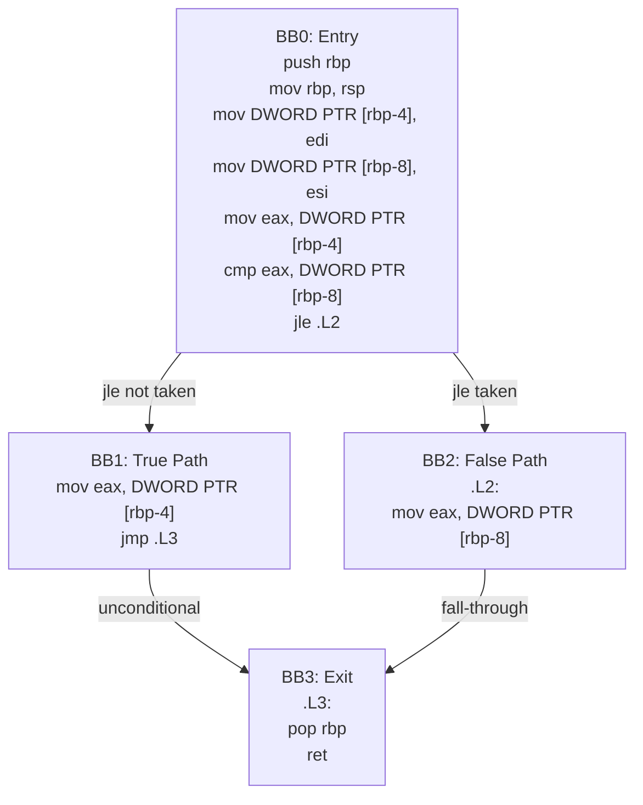

# Lesson 2: Static Analysis, Disassembly, Reverse Engineering Foundations

## 1. First-Principles Intuition & Invariants

Static analysis represents the foundational discipline of malware examination where the analyst never executes the suspect binary. This constraint transforms reverse engineering into a pure interpretive exercise: we must reconstruct the original programmer's intent and capability solely from the compiled artifact's structure, opcodes, and embedded data. The entire analysis chain rests on a single immutable fact—compiled binaries are not random noise but deterministic transformations of high-level source code through compiler toolchains that follow strict architectural conventions and Application Binary Interface specifications.

When a C compiler transforms source code into machine code, it does not merely translate instructions. It embeds a rich metadata ecosystem within the executable format itself: section headers delineate code from data, relocation tables specify how the loader must patch addresses at runtime, import tables declare external library dependencies, and symbol tables preserve function names and variable locations for debugging. These structural artifacts survive compilation and linking, creating forensic breadcrumbs that reveal architectural decisions, compiler toolchains, and even developer habits. A Windows Portable Executable file carries its entire memory layout blueprint in its headers—the loader knows precisely where to map the `.text` section containing executable code, where to place the `.data` section for initialized global variables, and how to resolve imports from system DLLs through the Import Address Table. Similarly, an ELF binary on Linux encodes its program headers with segment permissions, virtual address mappings, and dynamic linker instructions that orchestrate the process image construction before the first instruction executes.

The disassembly process reverses the compilation step by mapping machine code bytes back to human-readable assembly mnemonics. This is a deterministic one-to-one transformation for well-formed code: the x86-64 opcode `0x48 0x89 0xE5` unambiguously disassembles to `mov rbp, rsp`, the canonical function prologue that establishes a new stack frame. However, the critical invariant is that disassembly is a purely syntactic operation—it reconstructs the instruction stream but does not recover semantic meaning. The instruction sequence `xor eax, eax; ret` disassembles perfectly, but understanding that this implements a function returning zero requires human pattern recognition or sophisticated decompilation heuristics. This semantic gap is where reverse engineering expertise concentrates: distinguishing compiler-generated boilerplate from attacker logic, recognizing obfuscation patterns, and inferring control flow from indirect jumps and computed branch targets.

Decompilation attempts to bridge this semantic gap by applying architectural knowledge and dataflow analysis to reconstruct high-level pseudocode from assembly. Modern decompilers like Ghidra's Pcode intermediate representation or Hex-Rays IDA's microcode engine operate through multi-stage transformation pipelines. The disassembler first lifts machine code into an architecture-neutral intermediate language that eliminates instruction-set idiosyncrasies. A dataflow engine then tracks register and memory value propagation, identifying variable liveness ranges and type constraints. Finally, a structural analysis pass detects loop constructs, conditional branches, and function call conventions to emit C-like pseudocode. The decompiler's output is never the original source—it is a best-effort approximation constrained by information loss during compilation. Optimizing compilers aggressively inline functions, eliminate dead code, and reorder operations for performance, permanently erasing the original code organization. Stripped binaries that lack symbol tables force decompilers to invent generic names like `FUN_00401000` and `DAT_00403140`, rendering the output syntactically correct but semantically opaque.

Control flow graph reconstruction stands as the cornerstone of both disassembly and decompilation. A control flow graph models the program as a directed graph where nodes represent basic blocks—maximal sequences of instructions with a single entry point and single exit point—and edges represent possible execution transitions. A basic block terminates whenever control flow diverges: conditional branches create two outgoing edges for the taken and not-taken paths, unconditional jumps create a single edge to the target, and return instructions create edges to the caller's context. Constructing accurate CFGs from raw machine code requires recursive traversal starting from known entry points like the program's `main` function or DLL export tables. Linear sweep disassembly naively decodes every byte sequentially, but this fails catastrophically on x86 architectures where variable-length instruction encoding allows data and code to interleave. Recursive descent disassembly follows actual control flow paths, treating each jump or call target as a new basic block entry point, but struggles with indirect control flow where the target address is computed at runtime from a register or memory location.

Malware authors exploit these disassembly ambiguities through deliberate obfuscation. A classic technique inserts junk bytes after an unconditional jump: the dead code never executes, but linear sweep disassemblers attempt to decode it, producing garbage instructions that pollute the analysis. More sophisticated attacks use opaque predicates—conditional branches where the condition always evaluates the same way at runtime but appears data-dependent to static analysis. The instruction sequence `xor eax, eax; jz target` unconditionally jumps because `xor eax, eax` sets the zero flag, but naive CFG construction treats this as a conditional branch with two edges. Self-modifying code and runtime packers escalate the arms race by encrypting the payload and decrypting it in memory during execution, rendering static analysis completely ineffective until the unpacking routine is reverse-engineered and emulated.

Signature-based detection represents the operational application of static analysis at scale. Antivirus engines maintain databases of byte patterns—signatures—that uniquely identify known malware families. A signature might target a specific exploit shellcode sequence, a cryptographic constant used in a ransomware encryption routine, or a distinctive string embedded in a command-and-control protocol. The detection engine scans binaries byte-by-byte, applying efficient pattern matching algorithms like Aho-Corasick or Boyer-Moore to identify signature hits. However, signature detection suffers from fundamental brittleness: even trivial code modifications like reordering independent instructions, changing register allocation, or inserting no-op padding break exact byte-pattern matches. Modern YARA rules attempt to address this by supporting wildcard patterns, regular expressions, and boolean logic combining multiple conditions, but sophisticated malware evades signatures through polymorphism and metamorphism. Polymorphic malware generates functionally equivalent variants by randomizing encryption keys or instruction encodings, while metamorphic malware rewrites its own code structure entirely between infections, maintaining behavioral semantics while destroying byte-level similarity.

The static analysis workflow thus operates within a three-way tension between completeness, precision, and evasion resistance. Complete analysis requires exhaustive exploration of all possible execution paths, but malware samples may contain thousands of functions and millions of instructions. Precise analysis demands accurate type inference, pointer aliasing resolution, and interprocedural dataflow tracking, but these problems are formally undecidable in the general case. Evasion resistance requires detecting and penetrating obfuscation, but each new defensive layer introduces exponential complexity. Professional malware analysts navigate this space by combining automated tooling with expert intuition: automated scanners rapidly triage samples and identify suspicious API usage patterns, while human analysts focus on cryptographic routines, network communication protocols, and persistence mechanisms that reveal the attacker's true objectives.

## 2. Core Architecture & Mechanics

The Portable Executable format governs every user-mode Windows binary from command-line utilities to kernel drivers. At the physical file level, a PE file begins with the MS-DOS stub—a relic 16-bit executable that prints "This program cannot be run in DOS mode" when executed on legacy systems. This stub exists purely for backward compatibility and occupies the first 64 bytes, concluding with the MS-DOS signature `0x5A4D` (ASCII "MZ"). Immediately following the stub, a 32-bit offset points to the actual PE header, which begins with the four-byte signature `0x50450000` (ASCII "PE\0\0"). This architecture allows PE files to embed MS-DOS compatibility while the Windows loader jumps directly to the real header without parsing archaic 16-bit structures.

The COFF (Common Object File Format) header follows the PE signature and encodes critical architectural metadata in a compact 20-byte structure. The `Machine` field specifies the target CPU architecture: `0x014C` indicates x86, `0x8664` indicates x86-64, and `0xAA64` indicates ARM64. The `NumberOfSections` field declares how many section headers follow in the section table, while the `TimeDateStamp` embeds the Unix epoch timestamp of when the linker generated the file. The `SizeOfOptionalHeader` field paradoxically contains a required value despite the name "optional"—this header is mandatory for executables and contains the entire runtime loading specification. The `Characteristics` bitfield encodes crucial behavioral flags: bit 0x0002 indicates the image is executable, bit 0x0100 marks 32-bit architecture, bit 0x2000 indicates a DLL, and bit 0x1000 indicates a system file. Analysts examining suspicious DLLs immediately check whether the `IMAGE_FILE_DLL` flag is set to detect executables masquerading as libraries.

The Optional Header, despite its misleading name, forms the operational core of the PE format. This structure varies in size between PE32 (96 bytes) and PE32+ (112 bytes for 64-bit executables) and begins with a magic number: `0x010B` for PE32 or `0x020B` for PE32+. The `AddressOfEntryPoint` field specifies the Relative Virtual Address (RVA)—an offset from the image base—where execution begins. The loader calculates the absolute virtual address by adding this RVA to the `ImageBase` preferred load address, typically `0x00400000` for executables and `0x10000000` for DLLs on 32-bit systems. The `SectionAlignment` and `FileAlignment` fields control memory layout: sections must align to 4KB (0x1000 bytes) boundaries in virtual memory but can pack tighter on disk with 512-byte (0x200 byte) file alignment. This alignment requirement stems from the Windows memory manager's page granularity—the MMU cannot map memory at finer than page-level resolution, so each section must begin on a page boundary even if it wastes virtual address space.

The Data Directories array within the Optional Header provides a lookup table for critical subsystems. Each directory entry contains an RVA and size pair pointing to a specific metadata structure. Directory 0 specifies the Export Directory for DLLs exposing functions to other modules. Directory 1 locates the Import Directory listing external dependencies. Directory 2 points to the Resource Directory containing UI elements like icons and version information. Directory 5 identifies the Base Relocation Table required for ASLR support. Directory 6 references the Debug Directory containing CodeView records and PDB paths. Directory 12 specifies the Import Address Table (IAT) where the loader writes resolved function pointers. Malware often tampers with these directories: packed executables zero out the Import Directory to hide API dependencies until runtime unpacking, while rootkits patch the IAT to intercept system calls.

```
PE File Structure Layout (Conceptual Memory Map):

Offset    Structure                Size        Purpose
------    ---------                ----        -------
0x0000    MS-DOS Stub             64 bytes    Legacy compatibility executable
0x003C    PE Header Offset        4 bytes     Pointer to actual PE header
0x????    PE Signature            4 bytes     "PE\0\0" (0x50450000)
          COFF Header             20 bytes    Architecture, section count, flags
          Optional Header         96/112 B    Entry point, image base, subsystem
          Data Directories        128 bytes   Pointers to Import/Export/Reloc tables
          Section Headers         40B each    .text, .data, .rsrc sections
<sections>
          .text Section           Variable    Executable code (RX permissions)
          .data Section           Variable    Initialized globals (RW permissions)
          .rdata Section          Variable    Read-only data and Import tables
          .rsrc Section           Variable    Resources (icons, strings, UI)
```

Section headers immediately follow the Optional Header and describe each memory segment's properties. Each header occupies exactly 40 bytes and contains the section name in an 8-byte ASCII field (conventionally `.text`, `.data`, `.rdata`, `.rsrc`, but arbitrary names are legal). The `VirtualSize` field specifies how many bytes the section occupies in memory, while `VirtualAddress` gives its RVA from the image base. The `SizeOfRawData` and `PointerToRawData` fields locate the section's bytes within the physical file. The `Characteristics` bitfield encodes permission flags: `0x20000000` marks the section as executable code, `0x40000000` indicates readable data, and `0x80000000` denotes writable data. Windows enforces these permissions through the MMU's page protection mechanism—attempting to write to a read-only section or execute data sections triggers an access violation exception. Malware exploiting memory corruption vulnerabilities often targets writable executable sections or uses VirtualProtect API calls to remove NX (No-Execute) protections.

The Import Directory Table maps external dependencies by listing each imported DLL and its required functions. Each Import Directory entry contains the DLL name as a null-terminated ASCII string and two parallel arrays: the Import Name Table (INT) listing function names or ordinal numbers, and the Import Address Table (IAT) where the loader writes resolved function pointers at load time. During process initialization, the Windows loader parses the Import Directory, loads each dependent DLL, resolves exported function addresses, and patches the IAT entries. This architecture enables delay-loading optimizations where rarely-used libraries load on first access rather than startup. Analysts examining the Import Directory immediately identify suspicious API patterns: CreateRemoteThread combined with VirtualAllocEx and WriteProcessMemory indicates process injection, while CryptEncrypt or CryptGenRandom suggests cryptographic operations potentially for ransomware, and RegSetValueEx or RegCreateKeyEx reveal persistence mechanisms through registry modification.

ELF (Executable and Linkable Format) serves as the universal binary format across Linux, BSD, and most Unix-derived systems, supporting executables, shared libraries, and relocatable object files. The ELF header begins at offset zero with a 16-byte magic signature: the first four bytes `0x7F 0x45 0x4C 0x46` (ASCII "\x7FELF") identify the format, followed by fields specifying 32-bit versus 64-bit architecture, endianness, ABI version, and padding. The `e_type` field distinguishes executable files (ET_EXEC), position-independent executables (ET_DYN), relocatable objects (ET_REL), and shared libraries (ET_DYN with PT_INTERP). The `e_machine` field encodes the instruction set: `0x3E` for x86-64, `0x28` for ARM, and `0xB7` for AArch64. The `e_entry` field specifies the virtual address where execution begins, while `e_phoff` and `e_shoff` point to the Program Header Table and Section Header Table respectively.

Program Headers define memory segments for the runtime loader, specifying which file regions to map into the process address space and with what permissions. Each program header describes a segment through its type, file offset, virtual address, physical address (unused on virtual memory systems), file size, memory size, flags, and alignment. The most critical segment type is PT_LOAD, which instructs the loader to map a file region into memory. Typical executables contain two PT_LOAD segments: a read-execute segment for code and a read-write segment for data. The PT_INTERP segment specifies the dynamic linker path (typically `/lib64/ld-linux-x86-64.so.2`), while PT_DYNAMIC points to the `.dynamic` section containing shared library dependencies and relocation information. The flags bitfield encodes PF_X (execute), PF_W (write), and PF_R (read) permissions that the kernel enforces through page table entries.

Section Headers provide finer-grained metadata for linking and debugging, describing named file regions like `.text` for code, `.rodata` for read-only data, `.data` for initialized writable data, `.bss` for zero-initialized data, and `.symtab` or `.dynsym` for symbol tables. Each section header specifies the section name (as an index into the Section Header String Table `.shstrtab`), section type, flags, virtual address, file offset, size, and alignment requirements. The `.text` section typically has the SHF_ALLOC and SHF_EXECINSTR flags, indicating it should be loaded into memory and marked executable. The `.rodata` section contains string literals and constant data with SHF_ALLOC but not SHF_WRITE. The `.got` (Global Offset Table) and `.plt` (Procedure Linkage Table) sections implement position-independent code by indirecting function calls through writable tables that the dynamic linker populates at runtime.

```
ELF Memory Mapping (Position-Independent Executable):

Virtual Address    Segment Type       Permissions    Contents
---------------    ------------       -----------    --------
0x555555554000    PT_LOAD (code)     R-X            ELF header, .text, .rodata
0x555555755000    PT_LOAD (data)     RW-            .data, .bss, .got, .got.plt
0x7ffff7dd5000    PT_LOAD (libc)     R-X            libc.so.6 code
0x7ffff7fb0000    PT_LOAD (libc)     RW-            libc.so.6 data
0x7ffffffde000    Stack              RW-            Thread stack (grows down)
```

The symbol table sections `.symtab` and `.dynsym` preserve function and variable names along with their addresses, sizes, and binding attributes. Each symbol entry contains a name index into the string table, value (typically the symbol's virtual address), size, binding type (local, global, weak), symbol type (function, object, section), and section index. The binding type determines linkage visibility: STB_LOCAL symbols remain private within the object file, STB_GLOBAL symbols are visible to other compilation units, and STB_WEAK symbols provide default implementations that can be overridden. The symbol type distinguishes STT_FUNC for executable functions, STT_OBJECT for data variables, and STT_SECTION for section references. Stripped binaries remove `.symtab` to frustrate reverse engineering, but dynamically linked executables must retain `.dynsym` for runtime symbol resolution, providing analysts minimal naming information for imported library functions.

The relocation tables `.rel.text`, `.rel.dyn`, and `.rel.plt` encode how the linker and loader must patch addresses when combining object files or loading shared libraries at non-default addresses. Each relocation entry specifies an offset to patch, a symbol reference, and a relocation type. The most common x86-64 relocation types include R_X86_64_64 for absolute 64-bit addresses, R_X86_64_PC32 for PC-relative 32-bit offsets used in call instructions, R_X86_64_GLOB_DAT for GOT entries, and R_X86_64_JUMP_SLOT for PLT stubs. Position-independent code relies on PC-relative addressing and GOT indirection to avoid absolute address references, enabling the kernel to load the executable at any virtual address through ASLR. The dynamic linker processes relocations at load time or lazily on first function call through PLT lazy binding, trading startup latency for reduced relocation overhead.

Disassemblers operate through two fundamental algorithms: linear sweep and recursive descent. Linear sweep disassembly decodes instructions sequentially from start to finish, treating the entire code section as a continuous instruction stream. This approach works reliably on fixed-length instruction architectures like ARM and MIPS where every instruction occupies exactly four bytes and alignment rules prevent data interleaving. The disassembler reads four bytes, decodes them into an instruction mnemonic and operands, advances the instruction pointer by four bytes, and repeats until reaching the section boundary. However, variable-length instruction sets like x86 and x86-64 break this model catastrophically. An x86 instruction can range from one byte (`ret`, `nop`, `inc eax`) to fifteen bytes (prefixes plus complex memory operands), and no alignment requirements prevent compilers from packing instructions tightly. If the disassembler misaligns by even a single byte, it desynchronizes completely and produces nonsensical instruction streams until randomly realigning at a valid instruction boundary.

Recursive descent disassembly addresses this by following control flow rather than linear byte sequences. The algorithm maintains a work queue initialized with known entry points: the program's main entry point from the ELF header, exported functions from symbol tables, and exception handler addresses from unwind tables. For each queue entry, the disassembler decodes instructions sequentially until reaching a control flow transfer. Unconditional jumps and calls add their target addresses to the queue. Conditional branches add both the fall-through address and the branch target. Return instructions and indirect jumps terminate the current path. This approach guarantees that only actually reachable code is disassembled, avoiding data islands and padding bytes that linear sweep would incorrectly interpret as instructions. However, recursive descent struggles with indirect control flow where the target address depends on runtime register or memory contents that static analysis cannot resolve.

Control flow graph construction begins by partitioning the disassembled instruction stream into basic blocks. A basic block begins whenever an instruction is a branch target or immediately follows a branch instruction. It extends through a maximal sequence of instructions with no internal control flow—every instruction except the last falls through to the next instruction. The basic block terminates at the first control transfer instruction: conditional branches, unconditional jumps, calls, or returns. This partitioning converts the linear instruction stream into a directed graph where nodes represent basic blocks and edges represent possible execution transitions. A conditional branch creates two outgoing edges: the fall-through edge when the condition is false and the taken edge when true. Unconditional jumps create a single edge to the target. Return instructions create edges to all possible call sites, requiring interprocedural analysis to narrow this to the actual callers.



Decompilation transforms low-level assembly into high-level pseudocode through a multi-stage pipeline that progressively lifts abstraction levels. The first stage converts architecture-specific assembly into an intermediate representation that normalizes away instruction set quirks. Ghidra's Pcode and Hex-Rays' microcode both adopt RISC-like semantics with explicit register assignments and simple operations. An x86 instruction like `add DWORD PTR [rdi+rax*4], ecx` expands into multiple Pcode operations: load memory at address `rdi + rax * 4` into a temporary, add `ecx` to the temporary, store the result back to the same address. This expansion eliminates complex addressing modes and implicit flag updates, exposing data dependencies explicitly.

The dataflow analysis stage tracks value propagation through registers and memory to infer variable types and lifetimes. The decompiler constructs a Static Single Assignment (SSA) form where each variable is defined exactly once, introducing φ-functions at control flow merge points to reconcile values from different paths. SSA form enables powerful optimizations like dead code elimination, constant propagation, and common subexpression elimination. The type inference engine applies constraint-solving to determine whether a value represents a pointer, integer, float, or structure based on how it is used. If a value is dereferenced with a four-byte offset, the engine infers a pointer to a structure with at least a five-byte member. If the same value is compared against zero in a conditional branch, the engine strengthens the type constraint to a non-null pointer.

The structure analysis stage detects high-level control flow constructs by pattern matching on the control flow graph topology. A two-way branch where one path leads to a merge point and the other falls through matches an if-then statement. A back-edge in the CFG where a block branches to a dominating predecessor indicates a loop. The decompiler classifies loops into while, do-while, and for patterns based on where the condition check occurs. Function calls are identified through call instructions followed by stack cleanup, with parameters reconstructed from the calling convention. On x86-64 System V ABI, integer arguments pass in rdi, rsi, rdx, rcx, r8, r9 before spilling to the stack. The decompiler matches register writes before a call instruction to the parameter list, inferring argument count and types.

The final code generation stage emits C-like pseudocode with appropriate syntax for statements, expressions, and declarations. The decompiler must resolve ambiguities where multiple high-level constructs could produce the same assembly. A backward conditional branch could represent a while loop, a do-while loop, or a for loop depending on where the initialization and increment operations occur. The decompiler applies heuristics based on common compiler code generation patterns: initializers before the loop, increments at the end of the loop body, and condition checks at the top suggest a for loop. Register allocation patterns also provide hints—compilers typically preserve callee-saved registers across function calls, so a register saved on entry and restored before return likely holds a long-lived local variable.

```
Decompilation Pipeline Stages:

Machine Code (x86-64):
    48 89 7d f8          mov    QWORD PTR [rbp-8], rdi
    48 8b 45 f8          mov    rax, QWORD PTR [rbp-8]
    0f b6 00             movzx  eax, BYTE PTR [rax]
    84 c0                test   al, al
    74 0a                je     done

Pcode (Intermediate Representation):
    v0 = COPY rdi
    STORE ram(rbp - 8), v0
    v1 = LOAD ram(rbp - 8)
    v2 = LOAD ram(v1)
    v3 = INT_ZEXT v2
    CBRANCH !v3, done

SSA Form with Type Inference:
    ptr_0:8 = COPY rdi          ; ptr_0 is 8-byte pointer
    v0_1:1 = LOAD ptr_0:8       ; v0_1 is 1-byte integer
    v1_2:4 = ZEXT v0_1:1        ; v1_2 is 4-byte integer
    if (v1_2 == 0) goto done

High-Level Pseudocode:
    char* ptr = (char*)rdi;
    if (*ptr == 0) {
        goto done;
    }
```

Signature-based detection operates through pattern matching on file byte sequences. A signature consists of a byte pattern with optional wildcards and an associated malware family name. Antivirus engines scan binaries by reading chunks into memory and applying string matching algorithms to detect signature hits. The Aho-Corasick algorithm constructs a finite state machine from all signatures, enabling simultaneous matching of thousands of patterns in a single pass over the file. Each byte of input advances the state machine until it reaches an accepting state indicating a signature match. The Boyer-Moore algorithm optimizes single-pattern matching by preprocessing the pattern to skip forward through the input when mismatches occur, achieving sublinear time complexity on average.

YARA rules extend simple byte patterns with boolean logic, regular expressions, and metadata annotations. A YARA rule consists of a rule name, optional metadata key-value pairs, string definitions, and a boolean condition. String definitions specify fixed byte sequences with optional wildcards, text strings with case-insensitive matching, or regular expressions for complex patterns. The condition section combines these strings with boolean operators (and, or, not), counting operators (2 of them, all of them), offset constraints, and arithmetic comparisons. A rule detects malware when the condition evaluates to true against the binary's content. The YARA engine compiles rules into an efficient automaton and scans files by loading them into a memory buffer and evaluating rule conditions.

```yara
rule APT_ShadowBroker_DoublePulsar {
    meta:
        description = "Detects DoublePulsar SMB backdoor"
        author = "ACME Security Research"
        reference = "CVE-2017-0144"
        date = "2024-01-15"
    strings:
        $payload_marker = { 4D 5A ?? ?? ?? ?? ?? ?? ?? ?? ?? ?? ?? ?? ?? ?? 50 45 00 00 }
        $ping_opcode = { 78 56 34 12 }
        $install_cmd = "TRANS2_SESSION_SETUP" ascii nocase
        $backdoor_mutex = "Global\\msupdate" wide
    condition:
        uint16(0) == 0x5A4D and
        filesize < 500KB and
        ($payload_marker at pe.entry_point or
         all of ($ping_opcode, $install_cmd) or
         $backdoor_mutex)
}
```

Obfuscation techniques deliberately distort code to evade static analysis and signature detection. The simplest form, dead code insertion, adds non-functional instructions that never execute due to unconditional branches or opaque predicates. A sequence like `jmp target; <garbage bytes>; target: <real code>` confuses linear sweep disassemblers into decoding the garbage bytes as instructions. Opaque predicates use conditions that always evaluate the same way at runtime but appear data-dependent to static analysis. The predicate `(x * x) % 2 == 0 || (x * x) % 2 == 1` is always true for integer `x`, but automated tools cannot prove this without sophisticated theorem proving. Malware inserts these predicates to create fake branches that explode the control flow graph with unreachable paths.

Instruction substitution replaces simple operations with functionally equivalent but syntactically different sequences. The instruction `xor eax, eax` can be replaced with `sub eax, eax`, `and eax, 0`, or `mov eax, 0` without changing behavior. More complex substitutions use arithmetic identities: `x + 1` becomes `-(~x)`, exploiting two's complement representation. Control flow flattening transforms natural nested control flow into a state machine with a central dispatcher loop. Each original basic block becomes a case in a switch statement indexed by a state variable. The obfuscator replaces direct jumps with assignments to the state variable, forcing all control flow through the dispatcher. This destroys the natural CFG structure and frustrates pattern-based analysis.

Packing and runtime encryption provide the strongest obfuscation by encrypting the entire payload and decrypting it only in memory during execution. A packed executable contains three components: a small decryption stub, the encrypted payload, and optional anti-analysis checks. The stub executes first, allocates memory for the decrypted payload, decrypts the payload using a hardcoded or dynamically generated key, and transfers control to the decrypted code's entry point. Static analysis of the encrypted payload yields no information—it appears as random bytes with high entropy. The decryption stub itself is typically small and heavily obfuscated with anti-debugging and anti-VM checks. Common packers include UPX (Ultimate Packer for eXecutables), VMProtect, and Themida, each employing proprietary compression and encryption schemes.

```
Packing Detection Heuristics:

1. Entropy Analysis:
   - Compressed/encrypted sections have entropy > 7.5 (close to random)
   - Normal code entropy ≈ 5.5-6.5 due to instruction distribution
   - Tool: ent, signsrch, Detect It Easy

2. Section Anomalies:
   - Executable permissions on sections named UPX0, UPX1
   - Tiny code section with large writable section
   - Import table contains only LoadLibrary and GetProcAddress

3. Entry Point Analysis:
   - Entry point in unusual section (not .text)
   - High instruction density with few API calls
   - Stack string construction or decryption loops

4. Import Table:
   - Minimal imports (VirtualAlloc, VirtualProtect, LoadLibrary)
   - Resolves remaining APIs dynamically at runtime
   - Uses GetProcAddress to locate functions by hash
```

Identifying packers requires examining PE section characteristics and import tables. UPX-packed binaries contain sections named UPX0 (compressed data) and UPX1 (decompression code) with high entropy and minimal imports. The entry point resides in the decompression stub, which calls VirtualProtect to mark the payload section as executable, decompresses the data into this section, and jumps to the original entry point. Themida and VMProtect employ virtualization-based obfuscation, converting x86 instructions into a custom bytecode executed by an interpreter embedded in the stub. This virtualization layer adds arbitrary layers of indirection, making static analysis infeasible without first reverse-engineering the virtual machine instruction set and emulating the bytecode interpreter.

Unpacking strategies range from manual static reconstruction to dynamic instrumentation. Static unpacking requires reverse-engineering the decryption algorithm, extracting the encrypted payload and key, running the decryption routine in a controlled environment, and dumping the decrypted image. This approach fails against complex packers with anti-tampering checks, self-modifying code, and environment-specific decryption keys. Dynamic unpacking takes an execution-based approach: run the packed binary in a debugger or sandbox, let it decrypt itself in memory, identify when the original entry point executes through breakpoints or memory access monitoring, and dump the decrypted process image. Tools like x64dbg with Scylla plugin or OllyDumpEx automate this by scanning for PE headers in memory, reconstructing import tables, and writing a valid executable to disk.

## 3. High-Performance Optimization & Failure Modes

Professional malware analysis workflows balance depth of analysis against operational throughput. A security operations center processing thousands of samples daily cannot afford deep reverse engineering on every binary. The triage stage applies rapid automated checks to classify samples by threat level and prioritize analyst attention. The first filter scans file hashes against known malware databases like VirusTotal, malware repositories, and threat intelligence feeds. A match against known malware immediately flags the sample as high-priority if it is a targeted APT implant or low-priority if it is commodity malware already handled by endpoint protection. Hash lookups execute in constant time with negligible overhead, enabling sub-second triage of clean files.

The second filter applies YARA rule scanning against curated rule sets targeting specific malware families, exploit techniques, and suspicious behavioral patterns. Community rule repositories like Yara-Rules and signature-base provide thousands of open-source signatures covering prevalent threats. Custom rules target organization-specific threats identified through incident response. The YARA engine processes files at several hundred megabytes per second on modern CPUs, completing scans in seconds even for large binaries. Rule matches trigger automated classification: samples matching ransomware signatures enter the incident response pipeline, while samples matching generic backdoor patterns queue for manual triage. False positives occur when legitimate software matches overly broad signatures, requiring signature refinement through whitelisting and negative testing against clean file corpora.

Static property extraction identifies suspicious characteristics without deep disassembly. The analyzer parses PE or ELF headers to extract section characteristics, import tables, and resource metadata. Anomalies like writable executable sections, suspicious section names (.upx, .themida), tiny import tables with only LoadLibrary and GetProcAddress, or entry points outside the main code section indicate packing or obfuscation. String extraction scans for embedded URLs, IP addresses, file paths, registry keys, and mutex names using simple byte pattern matching. Suspicious strings like raw IP addresses instead of domain names, Tor onion addresses, references to system directories like `C:\Windows\System32`, or mutex names with random character patterns suggest malicious behavior. Entropy analysis computes Shannon entropy per section—high entropy (>7.5 bits per byte) indicates compression or encryption, while normal code exhibits entropy around 5.5-6.5 bits.

```
Automated Triage Workflow:

Input: Suspicious binary sample

Stage 1: Hash Lookup (< 1 second)
  - Compute SHA-256, SHA-1, MD5 hashes
  - Query VirusTotal, MalwareBazaar, local threat intel
  - If known-clean hash: ACCEPT
  - If known-malicious hash: ESCALATE to incident response
  - Otherwise: proceed to Stage 2

Stage 2: YARA Scanning (1-5 seconds)
  - Scan with organization rule sets
  - Scan with community signatures (Yara-Rules, signature-base)
  - If high-confidence match (APT, targeted malware): ESCALATE
  - If medium-confidence match (generic backdoor): QUEUE for analyst
  - Otherwise: proceed to Stage 3

Stage 3: Static Property Extraction (5-10 seconds)
  - Parse PE/ELF headers, extract sections and imports
  - Compute per-section entropy, identify suspicious values
  - Extract strings, identify URLs, IPs, paths, mutex names
  - Check for packer signatures (UPX, VMProtect, etc.)
  - Score sample based on anomaly count and severity
  - If score > HIGH_THRESHOLD: QUEUE for analyst
  - If score < LOW_THRESHOLD: QUARANTINE as suspicious
  - Otherwise: proceed to Stage 4 (sandbox execution)

Output: Classification + priority queue position
```

Disassembly optimization focuses on reducing false paths and improving CFG accuracy. Naïve recursive descent disassembly encounters multiple failure modes. Functions using indirect jumps through jump tables—common in switch statements and virtual function dispatch—create unbounded branching that recursive descent cannot resolve statically. The disassembler must either conservatively assume all code is reachable through indirect jumps (creating massive false path explosion) or apply heuristics to identify jump table patterns. Switch statement jump tables typically appear as a sequence of consecutive addresses stored in the .rodata section, accessed by indexing with a range-checked variable. The disassembler scans for `cmp; ja default_case; lea; jmp [table + index*8]` patterns and extracts the table bounds to enumerate possible targets.

Tail call optimization eliminates function epilogues by replacing call-then-return sequences with unconditional jumps. The compiler transforms `call func; ret` into `jmp func`, reusing the caller's stack frame for the callee. This optimization breaks traditional function boundary detection—the tail call appears as a jump rather than a call, and the function does not return to the caller. Disassemblers must recognize tail call patterns to avoid misclassifying internal jumps as control flow within the same function. Heuristics include detecting jumps to known function entry points (identified by preceding call instructions or symbol table entries) and recognizing post-jump code as unreachable dead code.

Interprocedural analysis propagates information across function boundaries to improve decompilation quality. The simplest form, constant propagation, tracks constant values passed as function arguments and propagates them into the callee's dataflow graph. If a function is always called with a specific constant for a parameter, the decompiler replaces that parameter with the constant throughout the function body, enabling dead code elimination and simplification. Pointer alias analysis determines whether two pointers might reference the same memory location, enabling aggressive optimization and precise dataflow tracking. The analyzer applies flow-insensitive and context-insensitive points-to analysis to conservatively approximate aliasing relationships, sacrificing precision for scalability.

Function signature inference reconstructs parameter types and counts from calling convention patterns. On x86-64 System V ABI, the first six integer arguments pass in registers rdi, rsi, rdx, rcx, r8, r9, while floating-point arguments use xmm0-xmm7. Additional arguments spill to the stack in right-to-left order. The decompiler identifies function calls, examines register assignments preceding the call, and matches them to the calling convention to infer argument count and register-based parameters. Stack arguments require analyzing stack pointer offsets and distinguishing function arguments from local variables. Return value inference examines the rax register usage after the call—if the caller immediately uses rax, it likely contains the return value.

```
Function Signature Reconstruction Example:

Assembly:
    mov    rdi, rax          ; arg1 = string pointer
    mov    esi, 0x100        ; arg2 = 256 (buffer size)
    call   <unknown_func>
    test   eax, eax          ; check return value
    js     error_handler     ; signed compare, negative = error

Inferred Signature:
    int unknown_func(char* buffer, int size);
    // Returns negative on error, non-negative on success
    // Likely: strncpy, snprintf, or similar buffer function
```

Signature generation for novel malware requires balancing specificity against generality. Overly specific signatures trigger on only exact byte sequences, enabling trivial evasion through instruction reordering or register renaming. Overly generic signatures generate false positives on legitimate software. The signature engineer identifies unique behavioral patterns or algorithmic constants unlikely to appear in benign code. Cryptographic constants like MD5 magic numbers (0x67452301, 0xEFCDAB89, 0x98BADCFE, 0x10325476) identify cryptographic routines but appear in both malware and legitimate encryption libraries. Network protocol headers or custom command-and-control packet structures provide more specific signatures since legitimate software rarely implements undocumented protocols.

Polymorphic malware defeats static signatures by randomizing non-functional code aspects while preserving semantics. Each infection generates a unique variant by selecting random instruction substitutions, inserting random dead code, and reordering independent instructions. The invariant semantic core—the actual malicious payload—remains functionally equivalent but syntactically distinct. Signature-based detection requires identifying the invariant portion and crafting patterns with wildcards to match variations. Metamorphic malware escalates this by rewriting the semantic core itself using code transformation rules: loop unrolling, subroutine inlining, instruction reordering, and register reallocation. Successive generations share no byte-level similarity, rendering signature-based detection infeasible.

Behavioral signature approaches circumvent syntactic evasion by targeting execution semantics rather than byte patterns. A behavioral signature describes observable actions like file creation in specific directories, registry key modifications, network connections to suspicious ports, or API call sequences indicating process injection. These signatures operate on execution traces collected through dynamic instrumentation, sandboxing, or endpoint detection agents. The signature engine builds automata recognizing malicious behavioral patterns: creating a file in the startup folder combined with registry run key modification indicates persistence establishment. Behavioral signatures resist polymorphism and metamorphism since attackers must change fundamental behavior—not just syntactic representation—to evade detection, which often conflicts with malware objectives.

Scalability bottlenecks emerge when analyzing large malware corpora or complex obfuscated samples. Disassembling a 10MB binary with aggressive obfuscation can consume gigabytes of RAM as the CFG explodes with fake branches and indirect jumps. Memory-efficient disassembly uses on-demand basic block expansion—store only explored blocks in memory and reconstruct them from the binary on cache miss. Disk-backed CFG representations serialize explored blocks to SQLite databases, trading memory for I/O latency. Distributed analysis parallelizes independent tasks like string extraction, import parsing, and section entropy computation across worker nodes. Function-level disassembly naturally parallelizes since functions are independent analysis units—distribute functions across workers and merge results in a central database.

Handling anti-analysis techniques requires recognizing and neutralizing detection evasion. Anti-debugging checks detect debugger presence through timing side channels (RDTSC instruction measuring execution time), debugger-specific system calls (IsDebuggerPresent, CheckRemoteDebuggerPresent), or interrupt exceptions (INT 3, INT 2D). The analyst patches out these checks by NOP-ing the conditional branches or forcing register values to simulate a non-debugging environment. Anti-VM detection queries hardware artifacts like CPU vendor strings, MAC address prefixes, registry keys (VirtualBox Guest Additions), and timing discrepancies. Sophisticated evasion configures analysis VMs to masquerade as physical hosts by spoofing hardware identifiers and installing timing attack mitigations.

Code coverage optimization ensures comprehensive CFG exploration despite obfuscation and indirect control flow. The analyst combines static disassembly with dynamic execution tracing to discover hidden code paths. Concrete execution provides ground truth but only explores the specific paths triggered by test inputs. Symbolic execution generalizes by tracking symbolic constraints on input variables and solving path conditions to generate inputs reaching unexplored branches. Concolic execution (concrete + symbolic) combines both: execute concretely while maintaining symbolic constraints, then solve constraints to generate inputs forcing alternate branches. This hybrid approach scales to large binaries while achieving high coverage.

```
Coverage-Guided Unpacking Strategy:

1. Initial Analysis:
   - Disassemble entry point stub
   - Identify decryption loop and control transfers
   - Set breakpoint on indirect jump or VirtualProtect call

2. Instrumented Execution:
   - Run in debugger (x64dbg, gdb) or emulator (QEMU)
   - Break when original entry point executes
   - Dump decrypted memory regions to disk

3. Memory Layout Reconstruction:
   - Identify PE/ELF header in memory
   - Parse section table and import directory
   - Fix import address table (resolve dynamic imports)
   - Rebuild relocation table if position-dependent

4. Verification:
   - Static analysis on unpacked binary
   - Diff against packed version to confirm correctness
   - Test execution to ensure functional equivalence

5. Iteration:
   - If multi-stage unpacking detected, repeat from step 2
   - Handle nested packers by unwrapping outer layers first
```

The complete static analysis workflow integrates all techniques into a systematic methodology. Initial triage categorizes samples by threat level through hash lookups and signature scanning. Medium-confidence detections proceed to static property extraction and disassembly. The analyst examines the import table for suspicious API patterns: process manipulation APIs (CreateRemoteThread, WriteProcessMemory), cryptographic APIs (CryptEncrypt, BCryptGenRandom), or anti-analysis APIs (IsDebuggerPresent, ZwQueryInformationProcess). String analysis identifies hardcoded configuration like C2 domains, encryption keys, or file paths. Entropy analysis detects packed sections requiring unpacking before meaningful analysis.

Disassembly proceeds from entry points through recursive descent, building the CFG while handling indirect jumps heuristically. The analyst identifies key functions by recognizing prologue patterns, call sites, and symbol names if available. Cryptographic routines exhibit characteristic constants and substitution-permutation patterns. Network communication functions call socket APIs and format protocol buffers. Persistence mechanisms write to registry run keys or startup folders. The analyst cross-references suspicious function calls with behavioral indicators to construct an attack lifecycle narrative: initial execution → privilege escalation → persistence establishment → C2 communication → data exfiltration.

Decompilation accelerates comprehension by presenting pseudocode approximating the original source. The analyst verifies decompiler output against disassembly for critical sections—decompilers occasionally misinterpret pointer arithmetic or control flow. Manual annotations document findings: rename functions and variables from generic names to descriptive labels, add comments explaining algorithmic logic, and mark obfuscated sections requiring deeper analysis. The annotated binary becomes institutional knowledge for the security team, enabling rapid comprehension in future incidents involving the same malware family.

The analyst documents findings in structured threat reports including sample metadata (hashes, file size, compile timestamp), behavioral indicators (file writes, registry modifications, network connections), MITRE ATT&CK technique mappings, and YARA signatures for detection. The report feeds into threat intelligence platforms and shares with the security community through information sharing and analysis centers. This intelligence loop closes the feedback cycle: analyst findings improve detection signatures, signatures guide future triage, and triage prioritizes analyst effort toward novel threats. The continuous refinement of signatures, heuristics, and analysis workflows represents the operational maturity curve of a defensive security program.
