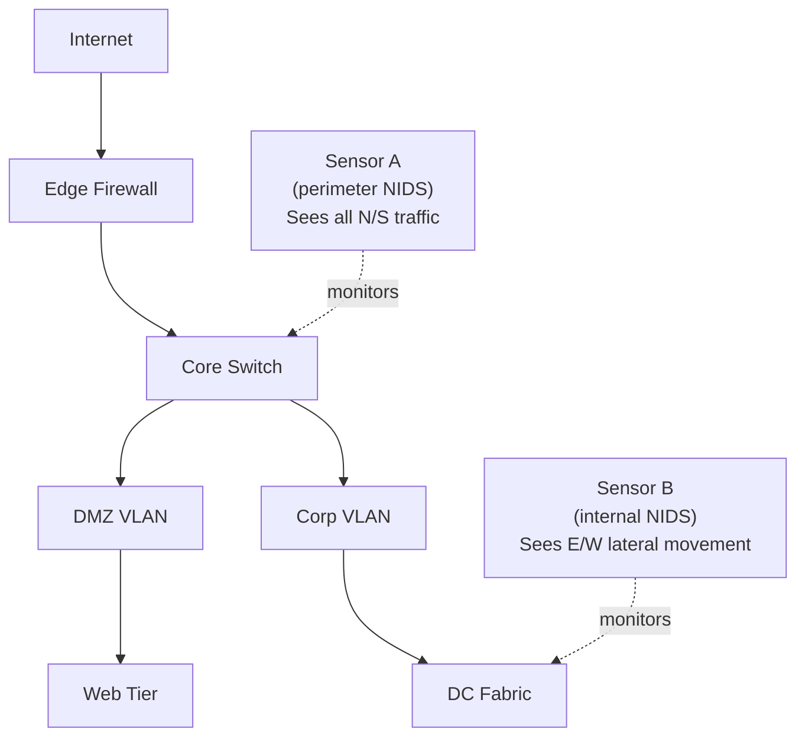

# Lesson 3: Intrusion Detection, Prevention Systems, Signature-Based Detection

## 1. First-Principles Intuition & Invariants

Network intrusion detection did not emerge from a moment of invention so much as from a gradual reckoning with an uncomfortable truth: once a network is connected to anything outside your administrative boundary, every packet crossing that boundary is, until proven otherwise, a threat. The 1988 Morris Worm demonstrated this with brutal clarity at a time when the ARPAnet's threat model was still fundamentally social, predicated on the gentlemen's agreement of academic trust. What James Anderson had formalized three years earlier in his 1980 paper on audit trail analysis — the idea that a system's own behavioral logs could reveal unauthorized use — was about to become the foundational axiom of an entire defensive discipline.

The invariant that underlies all intrusion detection, regardless of era or implementation, is fundamentally an information-theoretic one: legitimate traffic, observed across sufficient time and volume, produces a probability distribution. Attacks deviate from that distribution. The only engineering question is *how* you characterize the distribution and *how* you measure deviation from it. Every architecture you will encounter, from a classic Snort rule engine to a modern ML-based UEBA platform, is an implementation strategy for answering those two questions within a given set of computational constraints.

Signature-based detection answers the first question by collapsing the distribution to a finite set of known-bad patterns. This is not laziness — it is a deliberate trade between false-positive rate and latency. If you know a specific byte sequence appears in every exploitation attempt against Apache Struts CVE-2017-5638, matching that sequence against inbound traffic is deterministic, fast, and produces near-zero false positives for that specific threat. The cost you pay is completeness: signatures describe what has already been seen. Zero-day attacks, by definition, have no prior observation and therefore no signature. This boundary between known-bad enumeration and behavioral anomaly is the first architectural invariant every practitioner must internalize, because it determines where in your sensor stack you spend compute cycles, storage, and analyst time.

Anomaly detection answers the question differently. Rather than enumerating known-bad, it builds a statistical or learned model of known-good, then raises an alert when observed behavior falls outside the model's confidence bounds. The appeal is obvious: an anomaly detector could, in principle, detect the first instance of a never-before-seen exploit simply because the resulting traffic is structurally unusual. The engineering reality is messier. Network traffic is not drawn from a stationary distribution. Legitimate workloads change with business cycles, deployments, and user behavior. A model trained on Monday's traffic will generate meaningless noise on the Friday before a product launch. The fundamental tension in anomaly detection is that the more sensitive you make your deviation threshold, the more alert fatigue you inflict on the analysts who must triage your output. This is not a failure of anomaly detection as a concept — it is the governing constraint around which every real deployment must be architected.

Modern NIDS (Network Intrusion Detection System) and NIPS (Network Intrusion Prevention System) architectures resolve this tension through layered complementarity. The signature engine handles high-confidence, low-latency classification of known threats. The anomaly engine runs asynchronously, correlating aggregated flow data against behavioral baselines over longer time windows. The alert correlation engine — the component most frequently underinvested in — takes the independent output streams of both and applies temporal, topological, and severity logic to collapse hundreds of individual alerts into a small number of prioritized incidents. Each layer embodies different computational trade-offs, and understanding those trade-offs at the level of data structures and algorithms is what separates an operator who watches dashboards from an engineer who can tune a production sensor grid.

The physical topology in which sensors operate introduces a second class of invariants. A passive tap sees a copy of traffic and cannot inject or drop packets; it has zero impact on latency and cannot prevent an attack already in flight, only record it. An inline sensor sees the original traffic stream, can drop malicious packets in real time, and therefore converts detection into prevention — but it now sits on the critical path of every byte traversing your network. A single misconfigured rule or a sensor crash with inadequate failover logic can silently blackhole production traffic or, worse, fail open and pass everything unexamined. The choice between passive and inline deployment is never merely topological. It is a risk management decision that weighs the probability and cost of a missed attack against the probability and cost of a sensor-induced outage.

---

## 2. Core Architecture & Mechanics

### The Packet Processing Pipeline

The anatomy of a modern NIDS begins long before pattern matching occurs. Raw packets arrive from a capture interface, and the first engineering challenge is simply keeping up with line rate without dropping frames. A 10 Gbps interface can deliver up to approximately 14.88 million 64-byte packets per second. At that rate, any user-space processing that depends on the kernel's standard socket API — with its per-packet system call overhead and memory copies — will fall catastrophically behind. Production NIDS implementations bypass this bottleneck through kernel-bypass capture frameworks: PF_RING (with or without Zero Copy), AF_PACKET with TPACKET_V3 ring buffers, or DPDK (Data Plane Development Kit) for the highest-throughput deployments.

With TPACKET_V3, the kernel batches packets into fixed-size blocks in a shared memory ring buffer. User space polls the ring by checking a status word on each block header rather than issuing a `recvmsg()` call per packet. The result is that the cost of a system call is amortized across potentially thousands of packets per block, reducing per-packet overhead from hundreds of nanoseconds to single-digit nanoseconds. DPDK takes this further by polling the NIC directly from user space using UIO or VFIO drivers, eliminating kernel involvement entirely at the cost of dedicating physical CPU cores to busy-poll loops — an acceptable trade at datacenter scale where the alternative is dropping packets under load.

Once packets land in a capture buffer, they flow through a multi-stage pipeline that can be visualized as follows:

```
                    ┌─────────────────────────────────────────────────────────┐
                    │               NIDS/NIPS Processing Pipeline              │
                    └─────────────────────────────────────────────────────────┘

  NIC (10/25/100G)
        │
        ▼
┌──────────────────┐
│  Capture Layer   │  PF_RING / TPACKET_V3 / DPDK ring buffer
│  (kernel-bypass) │  Zero-copy DMA → user-space memory
└────────┬─────────┘
         │
         ▼
┌──────────────────┐
│  Packet Decoder  │  Ethernet → IP → TCP/UDP/ICMP → Application Layer
│  & Defragmenter  │  IP fragment reassembly, TCP stream normalization
└────────┬─────────┘
         │
         ▼
┌──────────────────┐
│  Flow Tracker /  │  5-tuple hash table (src_ip, dst_ip, src_port,
│  Session Engine  │  dst_port, proto) → per-flow state machine
└────────┬─────────┘
         │
         ├──────────────────────────┐
         ▼                          ▼
┌─────────────────┐       ┌──────────────────┐
│  Signature      │       │  Protocol         │
│  Match Engine   │       │  Anomaly Engine   │
│  (Aho-Corasick/ │       │  (flow statistics,│
│   Hyperscan)    │       │   ML baseline)    │
└────────┬────────┘       └────────┬──────────┘
         │                         │
         └─────────┬───────────────┘
                   ▼
         ┌──────────────────┐
         │  Alert Generator │  Severity scoring, metadata enrichment
         └────────┬─────────┘
                  │
                  ▼
         ┌──────────────────┐
         │  Correlation      │  Temporal clustering, topology context,
         │  Engine           │  kill-chain stage classification
         └────────┬──────────┘
                  │
                  ▼
         ┌──────────────────┐
         │  SIEM / SOC       │  Elasticsearch, Splunk, OpenSearch
         │  Output           │  EVE-JSON, PCAP archive, NetFlow export
         └──────────────────┘
```

### TCP Stream Normalization and the Evasion Problem

The most consequential and most frequently underestimated stage in the pipeline is stream normalization, which occurs before any signature ever fires. An attacker who understands how your sensor reassembles TCP streams can craft packets that reconstruct to the malicious payload on the target host but appear benign to the sensor — a technique Ptacek and Newsham documented exhaustively in their 1998 paper "Insertion, Evasion, and Denial of Service: Eluding Network Intrusion Detection." The attack surface is real and persistent: overlapping IP fragments, out-of-order TCP segments, TTL-expiring packets that reach the sensor but not the target, and TCP retransmissions carrying different data than the original segment all create ambiguity windows that an attacker can weaponize.

A correctly implemented preprocessor resolves these ambiguities by enforcing a single, deterministic reassembly policy. For TCP, this means maintaining a per-flow reassembly buffer keyed on the 5-tuple, tracking the sequence number space, and resolving overlapping segment conflicts according to either the target OS's known policy (Suricata and Snort both support OS-fingerprint-driven stream policies) or a conservative worst-case policy that accepts whichever data would reach the most permissive target. The computational cost of maintaining per-flow TCP state across millions of concurrent connections is non-trivial, which is why production sensors use hash tables with LRU eviction and per-flow memory budgets.

### Signature Matching: Aho-Corasick and Beyond

The core of signature-based detection is multi-pattern string matching. Given a ruleset of several thousand patterns that must be searched in every reassembled payload, the naive approach of running each pattern as an independent Boyer-Moore or KMP search is computationally ruinous — the complexity scales as O(P × N) where P is the number of patterns and N is the payload length. Aho-Corasick solves this by preprocessing all P patterns into a single finite automaton in which a single O(N) pass through the input simultaneously checks all patterns. The automaton has three types of transitions: goto transitions on character match, failure transitions for falling back to the longest proper suffix of the current state that is also a prefix of some pattern, and output links that emit all matching patterns when a terminal state is reached.

The practical limit of classic Aho-Corasick at 10+ Gbps is that it was designed around byte-at-a-time processing. Modern high-performance implementations, most notably Intel's Hyperscan library (now maintained under the VectorScan fork), exploit SIMD instruction sets — SSE4.2, AVX2, AVX-512 — to process 16, 32, or 64 bytes simultaneously using vectorized character class matching and bitfield intersection. Hyperscan represents patterns as a combination of non-deterministic finite automata (NFA), DFA acceleration structures, and literal string matchers, selecting the optimal representation per-pattern at compile time. Suricata integrates Hyperscan natively, and the performance delta over software Aho-Corasick is typically a factor of three to five at high packet rates.

A complete Suricata rule that illustrates the structure of a production signature for a real vulnerability class (the EternalBlue SMBv1 exploitation chain, MS17-010) is worth examining at the byte level:

```
alert tcp $EXTERNAL_NET any -> $HOME_NET 445 (
    msg:"ET EXPLOIT Possible ETERNALBLUE MS17-010 Echo Request (set)";
    flow:to_server,established;
    content:"|00 00 00 31 ff|SMB|2b 00 00 00 00 18 07 c0|";
    depth:16;
    content:"|4a 6c 4f 76|";
    distance:0;
    within:4;
    content:"|ff|SMBr|00 00 00 00 00 00 00 00 00|";
    distance:0;
    within:12;
    fast_pattern;
    sid:2024218;
    rev:2;
    classtype:attempted-admin;
    metadata:affected_product Windows_XP_Vista_7_8_10_Server_32_64_Bit,
              attack_target Server,
              cve CVE-2017-0144;
)
```

Each `content` keyword encodes a byte sequence that must appear in the payload at a constrained offset. The `depth` keyword limits the first match to the first 16 bytes of the payload, restricting the search window and improving performance. The `distance` and `within` keywords encode relative positioning constraints between consecutive content matches, forming a conjunction of anchored substring tests. The `fast_pattern` keyword nominates one content option as the primary pre-filter — Suricata builds a multi-pattern matcher on fast_pattern candidates and only evaluates the full rule when the pre-filter fires, dramatically reducing the number of full rule evaluations per packet. This two-phase architecture (pre-filter, then full rule evaluation) is the central performance invariant of modern signature engines: expensive operations run only after cheap operations have confirmed plausibility.

### Anomaly Detection: Flow Statistics and Behavioral Baselining

Where signature matching operates on packet content, anomaly detection operates on flow metadata — the statistical properties of a conversation rather than its payload. The five-tuple flow record is enriched with derived features: bytes transferred, packet count, inter-arrival time distribution, protocol flag ratios (SYN:FIN ratio, RST frequency), payload entropy, and connection duration. These features form a feature vector per flow that can be compared against a learned or computed baseline.

The simplest operational anomaly detector is CUSUM (Cumulative Sum Control Chart), which tracks the running cumulative deviation of an observed metric from its expected mean. For DDoS detection, CUSUM over SYN packet rate per destination IP is highly effective because SYN floods produce a monotonically increasing positive deviation that rapidly exceeds any reasonable threshold. CUSUM's advantage is that it requires no training, responds in real time, and has a single interpretable tuning parameter (the threshold K). Its limitation is that it has no model of normal traffic beyond its configured mean, making it brittle to workloads with high natural variance.

More capable anomaly detection systems use unsupervised machine learning on flow feature vectors. Isolation Forest is well-suited to network anomaly detection because it exploits the intuition that anomalous flows are few and structurally different from the majority, meaning they are isolated by shorter average path lengths in randomly constructed decision trees. The algorithm requires no labeled data and handles high-dimensional feature spaces without distance metric tuning. The critical implementation discipline is feature normalization: a raw byte count feature will numerically dominate entropy or flag-ratio features unless all features are standardized to comparable scales before training. For production deployment, models must be retrained periodically against rolling windows of recent traffic to prevent concept drift — the gradual divergence between the distribution the model was trained on and the distribution of current legitimate traffic.

The most common failure mode in anomaly-based NIDS is not false negatives but false positives that originate from legitimate but unusual traffic: a vulnerability scanner run against your own infrastructure, a large database backup over NFS, or a developer testing a custom protocol. The discipline of anomaly detection in production environments requires not just model quality but operational workflow: a ticketing system for analyst review, a feedback loop from resolved tickets back to model ground-truth labels, and an allow-list mechanism for known-good anomalous sources.

### Sensor Placement Geometry

The geometric question of where to place sensors in a network topology is a constrained optimization problem with no universal solution, but several governing principles reduce the solution space significantly. The first principle is that sensors must observe traffic at points of maximum coverage per sensor, which typically means ingress/egress boundaries rather than internal segments. A sensor at the perimeter firewall's inside interface sees all external traffic entering and leaving the organization. A sensor at the datacenter core switch sees all east-west traffic between servers. These two populations of traffic have fundamentally different threat profiles — perimeter traffic is dominated by exploitation attempts, C2 beaconing, and exfiltration; east-west traffic is dominated by lateral movement, internal reconnaissance, and privilege escalation.



Encrypted traffic fundamentally changes the sensor placement calculus. TLS 1.3 with forward secrecy prevents passive decryption; a sensor on a mirrored port sees only ciphertext and can inspect only metadata (certificate SNI, JA3/JA3S fingerprints, flow byte patterns). Meaningful content inspection of encrypted traffic requires either TLS interception at a termination proxy (introducing a trusted root CA on all endpoints) or deployment of the sensor on the decrypted side of that proxy. TLS interception at scale introduces its own security risks — the interception proxy becomes a high-value target — and is frequently prohibited by compliance frameworks for encrypted healthcare or financial data.

JA3 fingerprinting deserves particular emphasis because it provides high-signal behavioral classification of encrypted sessions without breaking encryption. The JA3 hash is computed from the TLS ClientHello message fields: TLS version, cipher suites, extension types, elliptic curves, and elliptic curve point formats, concatenated and MD5-hashed. Different TLS implementations (Chrome, Firefox, curl, Cobalt Strike's default profile, Metasploit's meterpreter) produce distinct JA3 hashes. A sensor that cannot read payload can still identify a Cobalt Strike beacon by its JA3 hash, its certificate serial number pattern, and its characteristic beaconing interval. The JA3S hash (computed from the ServerHello) combined with the client JA3 produces a tuple that uniquely identifies not just the client library but the specific server-client handshake pair, which is valuable for C2 channel identification.

---

## 3. High-Performance Optimization & Failure Modes

### CPU Affinity, NUMA Locality, and Worker Scaling

Suricata's parallel processing model is built around worker threads, each of which runs a full pipeline instance: packet capture, decode, stream tracking, detection, and output. The critical performance discipline is pinning each worker thread to a specific physical CPU core using CPU affinity, and ensuring that the memory allocated for packet buffers, flow tables, and signature state resides on the same NUMA node as that core. A worker thread on core 4 (NUMA node 0) accessing flow state allocated on NUMA node 1 incurs a cross-NUMA memory access penalty of roughly 40–90 nanoseconds per access on a typical dual-socket server — a figure that compounds ruinously when multiplied across millions of flows per second.

The following `suricata.yaml` worker configuration and CPU pinning section illustrates a production-tuned deployment on a 16-core dual-socket server:

```yaml
threading:
  set-cpu-affinity: yes
  cpu-affinity:
    - management-cpu-set:
        cpu: [ 0 ]
    - receive-cpu-set:
        cpu: [ 1 ]
    - worker-cpu-set:
        cpu: [ 2, 3, 4, 5, 6, 7, 8, 9, 10, 11, 12, 13, 14, 15 ]
        mode: "exclusive"
        prio:
          default: "high"

af-packet:
  - interface: eth0
    threads: 14
    cluster-id: 99
    cluster-type: cluster_flow
    defrag: yes
    use-mmap: yes
    mmap-locked: yes
    tpacket-v3: yes
    ring-size: 200000
    block-size: 1048576
    block-timeout: 10
    use-emergency-flush: yes
```

The `cluster_flow` cluster type instructs the kernel to distribute packets across receive queues using a 5-tuple hash, ensuring that all packets belonging to a single flow land on the same queue and are processed by the same worker thread. This eliminates the need for cross-thread synchronization when updating flow state — each worker owns its portion of the flow table exclusively. The `ring-size` of 200,000 blocks provides sufficient buffering to absorb bursts without dropping packets during transient detection spikes.

Flow table sizing is a frequent source of production failures. Suricata's flow hash table must be sized to hold the maximum number of concurrent tracked flows. Under-sizing causes hash collisions that evict active flows prematurely, breaking stream reassembly and causing missed detections on sessions that span multiple packets. The correct sizing formula is to estimate peak concurrent flows (typically empirically measured with `ss -s` or NetFlow data at peak traffic periods), multiply by 1.5 to account for hash table load factor efficiency, and round up to the next power of two for optimal modulo arithmetic:

```yaml
flow:
  memcap: 128mb
  hash-size: 65536
  prealloc: 10000
  emergency-recovery: 30
  prune-flows: 5

stream:
  memcap: 256mb
  checksum-validation: yes
  inline: no
  reassembly:
    memcap: 256mb
    depth: 1mb
    toserver-chunk-size: 2560
    toclient-chunk-size: 2560
```

### Alert Correlation: Collapsing Noise into Signal

A tuned production Suricata sensor on a medium-sized enterprise network generates between 10,000 and 500,000 raw alerts per day. No analyst can triage that volume individually, which makes the correlation engine not an optional enhancement but an operational requirement. Alert correlation is the process of grouping related alerts into incidents using three primary dimensions: temporal proximity (alerts that occur within a short time window involving the same source or destination), topological relationship (alerts involving hosts that communicate with each other), and kill-chain stage classification (alerts that map to reconnaissance, exploitation, C2 establishment, and exfiltration stages of the MITRE ATT&CK framework).

The following Python implementation demonstrates a correlation engine built on a sliding-window, graph-based approach. Each alert becomes a node in a directed graph. Edges are drawn between alerts that share a source or destination IP within a configurable time window. Connected components of the graph then represent candidate incidents. Scoring weights each component by the highest severity alert it contains, the breadth of ATT&CK stages represented, and the number of distinct destination hosts (a proxy for lateral movement scope):

```python
import json
import time
from collections import defaultdict
from dataclasses import dataclass, field
from typing import Dict, List, Set, Tuple
from datetime import datetime

@dataclass
class Alert:
    sid: int
    msg: str
    src_ip: str
    dst_ip: str
    timestamp: float
    severity: int
    attack_stage: str
    proto: str
    src_port: int
    dst_port: int

@dataclass
class Incident:
    incident_id: int
    alerts: List[Alert] = field(default_factory=list)
    involved_ips: Set[str] = field(default_factory=set)
    attack_stages: Set[str] = field(default_factory=set)
    max_severity: int = 0
    first_seen: float = 0.0
    last_seen: float = 0.0

    def score(self) -> float:
        stage_breadth = len(self.attack_stages)
        lateral_scope = len(self.involved_ips)
        duration_minutes = (self.last_seen - self.first_seen) / 60.0
        # Weight: severity dominates, stage breadth amplifies, scope adds linear signal
        return (self.max_severity * 10.0) + (stage_breadth * 5.0) + (lateral_scope * 2.0)


class CorrelationEngine:
    WINDOW_SECONDS = 300  # 5-minute sliding correlation window

    ATT&CK_STAGE_MAP = {
        "attempted-recon":    "Reconnaissance",
        "network-scan":       "Reconnaissance",
        "attempted-admin":    "Exploitation",
        "web-application-attack": "Exploitation",
        "trojan-activity":    "C2",
        "command-and-control": "C2",
        "data-theft":         "Exfiltration",
        "policy-violation":   "Exfiltration",
    }

    def __init__(self):
        self.pending_alerts: List[Alert] = []
        self.incidents: List[Incident] = []
        self._incident_counter = 0
        # ip -> list of alert indices for fast lookup
        self.ip_index: Dict[str, List[int]] = defaultdict(list)

    def ingest(self, alert: Alert) -> None:
        alert.attack_stage = self.ATT&CK_STAGE_MAP.get(
            alert.attack_stage, "Unknown"
        )
        self.pending_alerts.append(alert)
        idx = len(self.pending_alerts) - 1
        self.ip_index[alert.src_ip].append(idx)
        self.ip_index[alert.dst_ip].append(idx)
        self._expire_old_alerts(alert.timestamp)

    def _expire_old_alerts(self, now: float) -> None:
        cutoff = now - self.WINDOW_SECONDS
        expired_indices: Set[int] = set()
        new_alerts = []
        for i, a in enumerate(self.pending_alerts):
            if a.timestamp < cutoff:
                expired_indices.add(i)
            else:
                new_alerts.append(a)
        if expired_indices:
            self.pending_alerts = new_alerts
            # Rebuild IP index after expiry
            self.ip_index = defaultdict(list)
            for i, a in enumerate(self.pending_alerts):
                self.ip_index[a.src_ip].append(i)
                self.ip_index[a.dst_ip].append(i)

    def _find_connected_component(self, start_idx: int, visited: Set[int]) -> List[int]:
        stack = [start_idx]
        component = []
        while stack:
            idx = stack.pop()
            if idx in visited:
                continue
            visited.add(idx)
            component.append(idx)
            alert = self.pending_alerts[idx]
            for neighbor_idx in self.ip_index.get(alert.src_ip, []):
                if neighbor_idx not in visited:
                    stack.append(neighbor_idx)
            for neighbor_idx in self.ip_index.get(alert.dst_ip, []):
                if neighbor_idx not in visited:
                    stack.append(neighbor_idx)
        return component

    def correlate(self) -> List[Incident]:
        visited: Set[int] = set()
        new_incidents: List[Incident] = []

        for i in range(len(self.pending_alerts)):
            if i in visited:
                continue
            component = self._find_connected_component(i, visited)
            if len(component) < 2:
                continue  # Singleton alerts do not constitute an incident

            self._incident_counter += 1
            incident = Incident(incident_id=self._incident_counter)
            for idx in component:
                a = self.pending_alerts[idx]
                incident.alerts.append(a)
                incident.involved_ips.add(a.src_ip)
                incident.involved_ips.add(a.dst_ip)
                incident.attack_stages.add(a.attack_stage)
                incident.max_severity = max(incident.max_severity, a.severity)
                if incident.first_seen == 0.0 or a.timestamp < incident.first_seen:
                    incident.first_seen = a.timestamp
                if a.timestamp > incident.last_seen:
                    incident.last_seen = a.timestamp
            new_incidents.append(incident)

        # Sort by descending score so highest-priority incidents surface first
        new_incidents.sort(key=lambda inc: inc.score(), reverse=True)
        self.incidents.extend(new_incidents)
        return new_incidents


def parse_eve_json_alert(line: str) -> Alert | None:
    try:
        event = json.loads(line)
        if event.get("event_type") != "alert":
            return None
        ts = datetime.fromisoformat(event["timestamp"].replace("Z", "+00:00")).timestamp()
        alert_meta = event["alert"]
        return Alert(
            sid=alert_meta["signature_id"],
            msg=alert_meta["signature"],
            src_ip=event["src_ip"],
            dst_ip=event["dest_ip"],
            timestamp=ts,
            severity=alert_meta.get("severity", 3),
            attack_stage=alert_meta.get("category", "unknown"),
            proto=event.get("proto", ""),
            src_port=event.get("src_port", 0),
            dst_port=event.get("dest_port", 0),
        )
    except (KeyError, ValueError, json.JSONDecodeError):
        return None


if __name__ == "__main__":
    engine = CorrelationEngine()

    # Read Suricata EVE-JSON log and feed alerts into the correlation engine
    with open("/var/log/suricata/eve.json", "r") as fh:
        for line in fh:
            alert = parse_eve_json_alert(line.strip())
            if alert is not None:
                engine.ingest(alert)

    incidents = engine.correlate()

    for inc in incidents[:10]:  # Print top 10 by score
        print(f"\n[Incident {inc.incident_id}] Score: {inc.score():.1f}")
        print(f"  Duration: {(inc.last_seen - inc.first_seen):.0f}s | "
              f"Stages: {', '.join(inc.attack_stages)} | "
              f"IPs: {len(inc.involved_ips)} | "
              f"Alerts: {len(inc.alerts)}")
        for a in sorted(inc.alerts, key=lambda x: x.timestamp)[:5]:
            print(f"    [{a.severity}] {a.src_ip}:{a.src_port} -> "
                  f"{a.dst_ip}:{a.dst_port} | {a.msg}")
```

### False Positive Mitigation: Tuning as an Engineering Discipline

False positive suppression is where NIDS deployments most commonly fail in production. A common but destructive response to alert fatigue is disabling or globally suppressing noisy rules. This is operationally equivalent to removing smoke detectors because they fire when you cook — it eliminates the noise by eliminating the signal. The correct approach is targeted suppression with explicit scope constraints.

Suricata's suppression list allows you to disable a specific rule only for specific source or destination IP ranges, preserving the rule's effectiveness against external sources while eliminating noise from known-safe internal systems. The following threshold and suppression configuration illustrates the production pattern:

```yaml
# /etc/suricata/threshold.conf

# Suppress SMB scanning alerts from the internal vulnerability scanner
suppress gen_id 1, sig_id 2024218, track by_src, ip 192.168.10.50/32

# Suppress DNS anomaly alerts from authorized resolvers
suppress gen_id 1, sig_id 2027758, track by_src, ip 10.0.0.53/32
suppress gen_id 1, sig_id 2027758, track by_src, ip 10.0.0.54/32

# Rate-limit scan detection alerts: fire at most once per source IP per 60 seconds
rate_filter gen_id 1, sig_id 2010936, track by_src, count 1, seconds 60, \
  new_action alert, timeout 60

# Threshold: require 50 occurrences within 10 seconds before alerting on
# generic port scan signatures (reduces noise from brief legitimate probes)
threshold gen_id 1, sig_id 2009582, type threshold, track by_src, \
  count 50, seconds 10
```

Each suppression decision must be documented with a justification, an owner, and an expiration date. An undocumented suppression list is a liability: when the vulnerability scanner is decommissioned, the suppression remains and silently blinds the sensor to real attacks from that IP range if it is later reassigned. This is the operational failure mode that enables long-dwell-time compromises — the attacker sources from an IP range that a stale suppression rule has blinded.

### Inline Prevention: Fail-Open vs. Fail-Closed

When a NIPS sensor is deployed inline, the hardware bypass configuration determines behavior during sensor failure. A fail-open configuration uses a network bypass card — a hardware device that physically bridges the two interfaces through a relay when the sensor's keep-alive heartbeat stops — ensuring that traffic continues to flow if the sensor crashes. This is the operationally safer choice for critical production paths because it prevents the sensor from becoming a single point of failure. A fail-closed configuration drops all traffic on sensor failure, trading availability for security. The correct choice depends on your threat model: a sensor protecting a payment processing segment where any unauthorized transaction is catastrophic should fail closed; a sensor on a general corporate internet breakout should almost always fail open.

The final optimization that separates a tuned NIPS from one that generates outage tickets is rule action hygiene. In Suricata IPS mode (using NFQ or AF_PACKET inline), rules can carry `drop`, `reject`, `alert`, or `pass` actions. Aggressive practitioners promote high-confidence exploit signatures directly to `drop`. The discipline required is a staged promotion process: new rules run as `alert` for a minimum of two weeks, during which false positive rates are measured against a ticketing baseline. Only rules with a measured false positive rate below a defined threshold (typically under 0.01% of matching traffic) are promoted to `drop`. This two-phase promotion process is not bureaucratic overhead — it is the engineering control that prevents a rule written for one CVE from silently dropping traffic from a legitimate application that happens to match the same byte sequence.

The deepest understanding a practitioner can carry away from intrusion detection engineering is that no single mechanism is complete. Signatures catch what has been seen before. Anomaly detection catches what deviates from baseline. Correlation transforms alert volume into actionable incident priority. Stream normalization closes the evasion window that would otherwise make all of the above irrelevant. These components are not alternatives to each other — they are layers of a coherent defense, each compensating for the others' blind spots, and each requiring continuous engineering discipline to remain effective as the threat landscape evolves.
