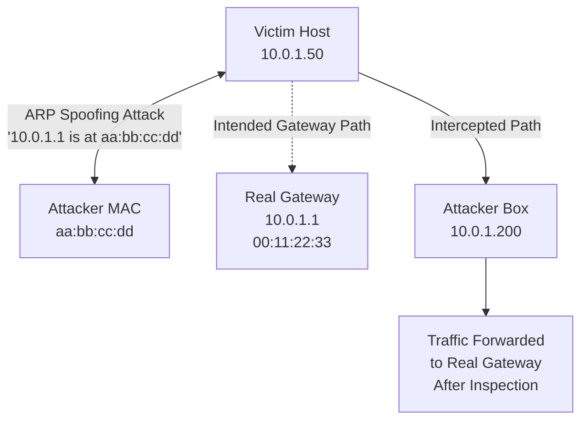
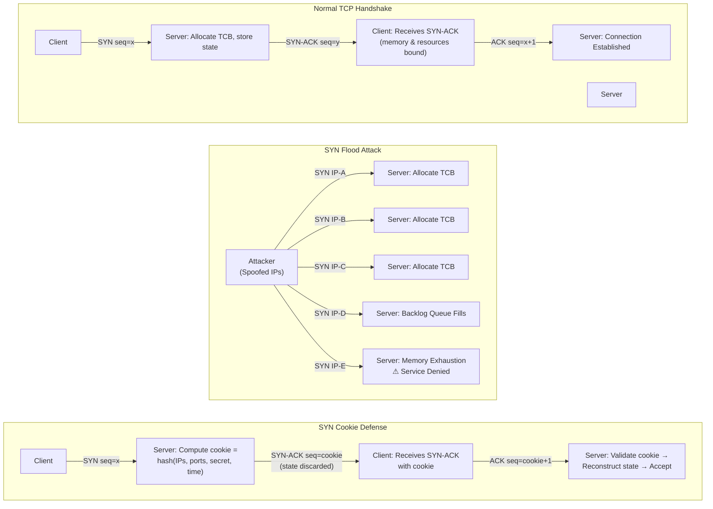
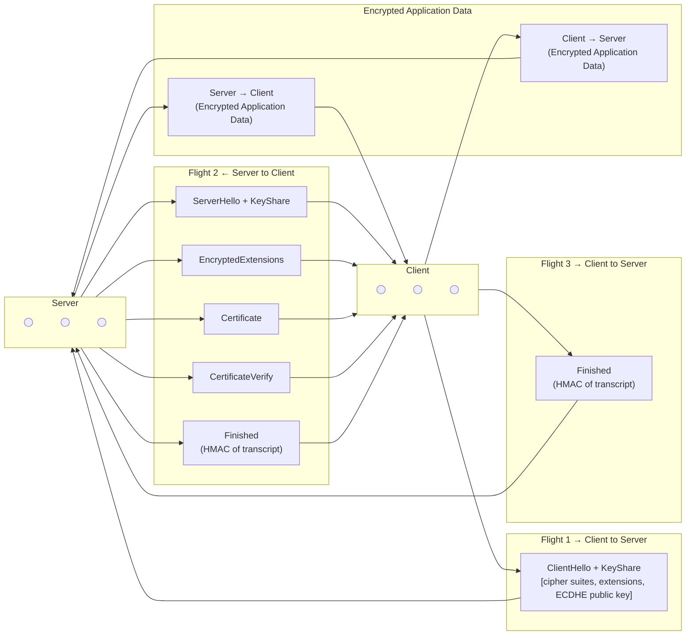

# Lesson 1: Security Foundations, Threat Models, Attack Surfaces

## 1. First-Principles Intuition & Invariants

Network security exists because networks are hostile environments by design. The original ARPANET architects operated in a cooperative research context where mutual trust was assumed, and authentication was largely social rather than cryptographic. The Transmission Control Protocol emerged from an era when every packet traversing the wire was presumed legitimate, every peer node was presumed honest, and every application was presumed benign. This foundational optimism persists in the IPv4 and IPv6 specifications, in the Border Gateway Protocol's complete lack of cryptographic route validation, and in the fact that the Domain Name System spent decades without DNSSEC signatures. Modern network security is therefore a continuous exercise in retrofitting defensive mechanisms onto protocols that were never designed to resist adversarial manipulation.

The discipline rests on three interrelated invariants that govern every defensive posture, every threat model, and every risk calculus. The first is the principle of least privilege, which dictates that every network entity—whether a process, a user credential, a routing daemon, or a hardware network interface—must operate with the minimum permissions required to fulfill its function and no more. The second is defense in depth, a layered strategy that assumes every individual control will eventually fail and therefore mandates multiple independent defensive layers across physical, network, host, application, and data strata. The third is the principle of fail-safe defaults, which demands that in the absence of explicit policy allowing an action, the default disposition must be denial. A firewall ruleset that permits all traffic by default and selectively blocks attackers is fundamentally weaker than one that denies all traffic by default and selectively permits known-good flows, because the former assumes omniscient attacker enumeration while the latter assumes only the bounded set of legitimate services must be modeled.

The cornerstone abstraction in security reasoning is the CIA triad: confidentiality, integrity, and availability. Confidentiality ensures that data is accessible only to authorized principals and that unauthorized disclosure is prevented through cryptographic primitives, access control mechanisms, and information flow policies. Network confidentiality is primarily achieved through transport-layer encryption protocols such as TLS 1.3, which provides forward secrecy via ephemeral Diffie-Hellman key exchange and authenticated encryption with associated data using AES-GCM or ChaCha20-Poly1305. At the network layer, IPsec Encapsulating Security Payload provides confidentiality for site-to-site VPN tunnels and is commonly deployed in enterprise perimeter security architectures.

Integrity guarantees that data has not been tampered with in transit or at rest, and that any unauthorized modification is detectable. Network integrity is enforced through message authentication codes, digital signatures, and cryptographic hash functions. TLS provides integrity via HMAC or AEAD cipher constructs, while IPsec Authentication Header computes an HMAC-SHA256 digest over the entire IP packet, including immutable header fields. In BGP, the Resource Public Key Infrastructure framework uses X.509 certificates and Route Origin Authorizations to cryptographically attest that an autonomous system is authorized to originate a given IP prefix, thereby preventing prefix hijacking attacks that exploit BGP's default trust model.

Availability ensures that systems and data remain accessible to legitimate users despite adversarial efforts to disrupt service. Network availability threats manifest as denial-of-service attacks, which exploit asymmetries in resource consumption to exhaust server capacity, link bandwidth, or stateful middlebox resources. Volumetric DDoS attacks leverage amplification vectors such as open DNS resolvers, NTP servers, and memcached instances to reflect and amplify attack traffic toward victim infrastructure. Protocol-state exhaustion attacks exploit the finite memory available for TCP connection tracking or TLS handshake processing, while application-layer attacks craft HTTP requests that trigger expensive database queries or cryptographic operations. Defending availability requires rate limiting, connection state management, anycast traffic distribution, and upstream filtering via transit providers or cloud-based DDoS mitigation services.

The security policy lifecycle begins with asset identification and classification. An organization must enumerate every network-accessible service, every data store containing sensitive information, every credential database, and every network segment that requires isolation. Classification assigns sensitivity labels based on the impact of confidentiality loss, integrity violation, or availability disruption. Regulatory frameworks such as the Payment Card Industry Data Security Standard impose specific technical controls for environments processing cardholder data, while healthcare organizations operating under HIPAA must implement network segmentation, audit logging, and encryption for protected health information.

Threat modeling is the systematic process of identifying adversaries, enumerating attack vectors, and prioritizing defensive controls based on risk likelihood and impact. The STRIDE framework categorizes threats into six classes: Spoofing (impersonation of identity), Tampering (unauthorized data modification), Repudiation (denial of action performed), Information Disclosure (exposure of confidential data), Denial of Service (resource exhaustion), and Elevation of Privilege (unauthorized capability acquisition). Spoofing attacks exploit weak authentication mechanisms such as IP address-based trust relationships, ARP cache poisoning to intercept Layer 2 frames, or DNS spoofing to redirect clients to attacker-controlled infrastructure. Tampering attacks manipulate protocol fields, application payloads, or routing tables to alter behavior or corrupt data integrity.

Adversary modeling must account for capability, intent, and opportunity. A script kiddie wielding commodity exploit frameworks poses a fundamentally different threat than an advanced persistent threat actor with zero-day exploit arsenals, custom malware toolchains, and sustained operational budgets measured in millions of dollars. Nation-state adversaries have demonstrated capabilities including supply-chain implant insertion, compromise of certificate authorities to issue fraudulent TLS certificates, and exploitation of BGP to hijack IP prefixes for traffic interception. Criminal ransomware syndicates operate with business models that include affiliate programs, customer support operations, and negotiated payment terms, reflecting the industrialization of offensive operations.

The attack surface is the sum of all points where an adversary can attempt to inject data or extract information from a system. In network security, the attack surface comprises every listening TCP or UDP port, every protocol parser that processes untrusted input, every web application endpoint, every exposed management interface, and every transitive trust relationship. Reducing attack surface is a continuous engineering discipline: disabling unnecessary services, restricting network access via firewall policies, enforcing mutual TLS authentication for service-to-service communication, and isolating high-risk components within dedicated network segments.

Attack surface analysis begins with network reconnaissance, the same process an adversary conducts during the initial phase of intrusion. Port scanning using tools such as Nmap reveals listening services, operating system fingerprints, and service version banners. DNS enumeration discovers subdomains and service records, while certificate transparency logs expose TLS certificates and associated domain names. An attacker probing a corporate perimeter will identify exposed SSH servers, VPN gateways, web applications, and email infrastructure, then prioritize targets based on known vulnerabilities, default credentials, or exploitable misconfigurations.

The network perimeter is a logical boundary separating trusted internal networks from untrusted external networks, enforced through stateful packet-filtering firewalls, next-generation firewalls with deep packet inspection, and web application firewalls that parse HTTP protocol semantics. Traditional perimeter security assumes a hard outer shell with a soft interior, permitting lateral movement once initial access is achieved. Modern zero-trust architectures reject this model, mandating continuous authentication and authorization for every transaction regardless of network location. Zero-trust network access systems verify device posture, user identity, and contextual attributes before granting access to individual applications, implementing micro-segmentation that contains lateral movement even after initial compromise.

Risk assessment quantifies the expected loss from security incidents as the product of threat likelihood and impact magnitude. Quantitative risk analysis employs actuarial methods to estimate annual loss expectancy in monetary terms, while qualitative risk analysis uses ordinal scales to rank risks for prioritization. The FAIR framework decomposes risk into constituent factors including threat event frequency, vulnerability likelihood, loss magnitude, and control effectiveness. Risk treatment options include acceptance (acknowledging residual risk within tolerance), mitigation (implementing controls to reduce likelihood or impact), transfer (shifting financial risk via insurance or contractual indemnification), and avoidance (eliminating the risky activity entirely).

Security controls are categorized into preventive, detective, and corrective classes. Preventive controls such as firewalls, access control lists, and encryption block attacks before they succeed. Detective controls including intrusion detection systems, security information and event management platforms, and NetFlow analysis identify attacks in progress or forensically reconstruct past incidents. Corrective controls encompass incident response procedures, automated threat remediation, and disaster recovery capabilities that restore systems to secure operational states.

The principle of security by design demands that defensive mechanisms be architected into systems from inception rather than retrofitted post-deployment. Secure network design employs segmentation to partition resources into trust zones connected via choke points where policy enforcement is concentrated. A typical enterprise architecture isolates user workstations, production servers, development environments, and administrative jump hosts into separate VLANs or subnets, with inter-segment traffic traversing firewalls that enforce least-privilege policies. DMZ architectures place externally accessible services such as web servers and email gateways in a semi-trusted zone with tightly restricted access to internal networks, minimizing the impact of perimeter compromise.

Cryptographic protocols provide the mathematical foundation for confidentiality, integrity, and authentication in hostile network environments. Public-key cryptography enables key exchange without pre-shared secrets, using algorithms such as RSA, Elliptic Curve Diffie-Hellman, or post-quantum lattice-based constructions. Digital signatures provide non-repudiation and sender authentication, binding a message to a private key holder via constructions such as ECDSA or EdDSA. Hash functions such as SHA-256 or BLAKE2 provide collision resistance for integrity verification, while key derivation functions like PBKDF2 or Argon2 transform human-memorable passwords into cryptographic keys with resistance to brute-force enumeration.

## 2. Core Architecture & Mechanics

The operational model for network security begins with the network stack itself, where every layer introduces distinct attack vectors and defensive opportunities. At Layer 1, physical security controls prevent unauthorized cable taps, fiber optic splitters, or rogue device insertion. Layer 2 switching environments are vulnerable to ARP spoofing attacks where an attacker broadcasts fraudulent ARP replies associating their MAC address with the IP address of the default gateway, causing all victim traffic to route through the attacker's machine for inspection or manipulation. Dynamic ARP Inspection mitigates this by validating ARP packets against a trusted binding database maintained via DHCP snooping, dropping frames with inconsistent IP-to-MAC mappings.

Virtual LAN hopping exploits switch misconfigurations where access ports are configured in trunking mode or where the native VLAN is improperly secured. An attacker sends double-tagged 802.1Q frames where the outer tag matches the native VLAN and the inner tag specifies the target restricted VLAN. The first switch strips the outer tag and forwards the frame, and the second switch processes the inner tag, delivering the frame to the restricted segment. Mitigation requires disabling DTP negotiation, explicitly configuring access ports, and assigning an unused VLAN as the native VLAN on trunk links.

At Layer 3, IP spoofing attacks forge source addresses to evade filtering, implicate innocent third parties, or exploit trust relationships based on source IP. Ingress filtering per BCP 38 mandates that edge routers discard packets with source addresses outside the address block allocated to that network, preventing a compromised host from transmitting spoofed packets. Egress filtering prevents an internal attacker from spoofing external addresses. Unicast Reverse Path Forwarding enables routers to verify that the source address of an incoming packet is reachable via the interface on which it arrived, discarding asymmetrically routed or spoofed traffic.

The TCP three-way handshake is a stateful negotiation vulnerable to SYN flood attacks where an attacker transmits a high volume of SYN packets with spoofed source addresses, causing the server to allocate connection state and await responses that never arrive. The server's backlog queue fills with half-open connections, exhausting memory and preventing legitimate clients from establishing sessions. SYN cookies defend against this by encoding connection state into the initial sequence number using a cryptographic hash of the client address, server address, port numbers, and a time-varying secret. The server discards state immediately after replying with SYN-ACK, reconstructing it only when the client returns a valid ACK containing the derived sequence number.

The Domain Name System translates human-readable domain names into IP addresses through a hierarchical distributed database. DNS queries are typically transmitted over UDP port 53 without authentication, enabling cache poisoning attacks where an attacker injects fraudulent resource records into a resolver's cache. The Kaminsky attack exploits the birthday paradox to efficiently match the 16-bit transaction ID and ephemeral source port, allowing attackers to spoof authoritative responses before legitimate replies arrive. DNSSEC mitigates cache poisoning by cryptographically signing DNS records using RSASHA256 or ECDSAP256SHA256, allowing resolvers to validate the authenticity and integrity of responses via a chain of trust rooted in the DNS root zone's trust anchors.

Transport Layer Security provides a secure channel over an untrusted network through a multi-phase handshake that negotiates protocol version, cipher suite, and cryptographic keys while authenticating the server and optionally the client. The TLS 1.3 handshake begins with a ClientHello message containing supported cipher suites, extensions, and an ephemeral key share for elliptic curve Diffie-Hellman. The server responds with ServerHello selecting the cipher suite, followed by EncryptedExtensions, CertificateVerify proving possession of the private key corresponding to the certificate, and Finished containing an HMAC over the handshake transcript. All messages after ServerHello are encrypted using keys derived from the shared secret.

Firewalls enforce network security policy by filtering packets based on header fields, connection state, and application-layer semantics. A stateless packet filter examines each packet in isolation, applying access control lists that specify source address, destination address, protocol, and port numbers. A stateful firewall tracks TCP connection state, permitting return traffic for established sessions while blocking unsolicited inbound packets. Next-generation firewalls integrate deep packet inspection, intrusion prevention signatures, TLS decryption, and application identification to enforce granular policies beyond transport-layer ports. An enterprise firewall policy typically implements a default-deny posture, explicitly permitting HTTP/HTTPS to web servers, SMTP to mail relays, SSH to bastion hosts, and DNS to resolvers while logging all denied connections for anomaly analysis.

Network address translation maps private RFC 1918 addresses to public IP addresses, enabling address space conservation and providing incidental obscurity by hiding internal topology. Port Address Translation multiplexes thousands of internal hosts behind a single public IP by rewriting source ports and maintaining a translation table mapping external port numbers to internal address-port pairs. NAT breaks end-to-end connectivity assumptions and complicates peer-to-peer protocols, requiring traversal techniques such as STUN, TURN, or ICE for interactive applications like VoIP and WebRTC. From a security perspective, NAT provides a rudimentary stateful filtering function but is not a substitute for a properly configured firewall.

Intrusion detection systems monitor network traffic or host activity for indicators of compromise, matching observed patterns against signature databases or behavioral baselines. Signature-based detection identifies known attack patterns such as Metasploit payloads, SQL injection syntax, or malware command-and-control traffic. Anomaly-based detection establishes statistical models of normal behavior and triggers alerts on deviations such as unusual port scans, abnormal protocol usage, or traffic volume spikes. Snort and Suricata are open-source network intrusion detection engines that process packets at line rate, applying regular expression pattern matching and protocol dissectors to identify malicious activity. Deployment typically uses a passive TAP or SPAN port to avoid introducing latency or becoming a single point of failure.

Security information and event management platforms aggregate logs from firewalls, web servers, authentication systems, and endpoint agents, normalizing events into a common schema and correlating disparate indicators to detect multi-stage attacks. A sophisticated intrusion might manifest as a failed SSH login from an external IP, followed by successful authentication from a compromised internal host, followed by unusual database queries, followed by large outbound data transfers. No single event is conclusive, but the correlation of these indicators within a temporal window suggests credential compromise and data exfiltration. SIEM rule engines encode detection logic using domain-specific query languages, while machine learning models identify subtle deviations that evade signature-based detection.

Honeypots are intentionally vulnerable systems deployed to attract and study attacker behavior. A production honeypot mimics a real service such as SSH or RDP, logging all authentication attempts and interactive commands to characterize attacker tools, techniques, and procedures. High-interaction honeypots provide full operating systems where attackers can execute arbitrary code, enabling deep forensic analysis but requiring robust isolation to prevent pivot attacks. Honeytokens are decoy credentials, database records, or API keys instrumented to trigger alerts when accessed, providing high-fidelity breach detection with minimal false positives.

## 3. High-Performance Optimization & Failure Modes

Network security architectures must operate at scale, processing hundreds of gigabits per second of traffic across thousands of concurrent sessions without introducing latency that degrades application performance. Hardware-accelerated firewalls and intrusion prevention systems employ specialized ASICs or FPGAs to perform packet classification, regular expression matching, and cryptographic operations at line rate. Content-addressable memory enables parallel lookup of firewall rules, matching packets against thousands of entries in a single clock cycle. DMA engines transfer packets from network interfaces directly to processing engines, bypassing kernel memory copies that impose CPU overhead.

TLS termination offload moves cryptographic operations from application servers to dedicated load balancers or reverse proxies, amortizing handshake costs across a pool of backend instances. RSA private key operations are computationally expensive, particularly for 4096-bit keys, and can become a bottleneck under high connection rates. Elliptic curve cryptography using Curve25519 or P-256 provides equivalent security with dramatically lower computational cost, while TLS session resumption mechanisms such as session tickets allow clients to reestablish encrypted sessions without full handshakes. A properly tuned load balancer can terminate 100,000 TLS connections per second using AES-NI and AVX-512 instruction set extensions for accelerated symmetric cryptography.

Distributed denial-of-service mitigation requires global traffic distribution using anycast routing, where the same IP prefix is announced from multiple geographic locations, causing clients to route to the topologically nearest scrubbing center. Attack traffic is absorbed across dispersed infrastructure with aggregate capacity measured in terabits per second, while legitimate traffic is forwarded to origin servers via GRE tunnels or direct server return. Volumetric attack detection employs statistical anomaly detection on NetFlow records, identifying traffic patterns inconsistent with baseline behavior. Rate limiting and challenge-response mechanisms filter malicious requests, while legitimate clients complete JavaScript proof-of-work challenges or CAPTCHA verification.

DNS amplification attacks exploit the fact that a small query can trigger a much larger response, particularly for DNSSEC-signed records or ANY queries that return all record types. An attacker spoofs the victim's IP address as the query source, causing authoritative nameservers to flood the victim with amplified responses. Response Rate Limiting mitigates this by capping the number of identical responses a nameserver will send to a single IP within a time window, sacrificing some legitimate query responses to prevent abuse. Source address validation prevents spoofing at the network edge, eliminating the attacker's ability to redirect responses toward victims.

BGP hijacking attacks exploit the protocol's lack of route origin validation, allowing an adversary to announce unauthorized IP prefixes and attract traffic intended for the legitimate owner. In 2008, Pakistan Telecom hijacked YouTube's /24 prefix in an attempt at domestic censorship, inadvertently blackholing global traffic. RPKI cryptographically binds IP prefixes to autonomous system numbers using Route Origin Authorizations signed by the regional internet registry holding the allocation. Routers validate BGP announcements against RPKI repositories, rejecting routes with invalid or unverifiable origin attestations. BGPsec extends this by signing the entire AS path, preventing path manipulation attacks, but deployment remains limited due to computational overhead and operational complexity.

Zero-day vulnerabilities represent the ultimate failure mode, where an attacker exploits an unknown flaw before vendors can develop patches. Virtual patching deploys intrusion prevention signatures or web application firewall rules that block exploitation attempts based on attack patterns rather than vulnerability remediation. A SQL injection vulnerability in an application might remain unpatched for weeks, but a WAF rule detecting UNION SELECT statements in user input provides immediate protection. Network segmentation contains the blast radius of successful exploits by restricting lateral movement, requiring attackers to compromise additional systems rather than freely pivoting across flat networks.

Cryptographic failures include weak key generation, deprecated algorithms, improper certificate validation, and side-channel vulnerabilities. The Logjam attack exploited servers accepting 512-bit Diffie-Hellman groups, enabling precomputation attacks that broke the key exchange. The BEAST, CRIME, BREACH, and POODLE attacks exploited weaknesses in TLS cipher modes, compression, and padding oracles. Modern best practices mandate TLS 1.3 or TLS 1.2 with forward-secret ECDHE key exchange, authenticated encryption using AES-GCM or ChaCha20-Poly1305, and strict certificate validation including hostname verification, expiration checks, and OCSP revocation status.

Credential theft remains the most pragmatic attack vector, bypassing sophisticated technical controls by exploiting human authentication factors. Phishing campaigns harvest passwords through fake login pages, while keyloggers and infostealers extract credentials from compromised endpoints. Multi-factor authentication mitigates password compromise by requiring possession of a hardware token, mobile device, or biometric factor. FIDO2 and WebAuthn provide phishing-resistant authentication using public-key cryptography, where the private key never leaves the hardware authenticator and each origin receives a unique key pair, preventing credential reuse across sites.

Insider threats represent a distinct adversary class with legitimate access to systems and data, requiring detective and deterrent controls rather than purely preventive measures. Data loss prevention systems inspect outbound network traffic, email attachments, and removable media transfers, blocking or alerting on sensitive content patterns such as credit card numbers, social security numbers, or confidential document classifications. User and entity behavior analytics establish baseline activity profiles and flag anomalies such as unusual database queries, off-hours access, or bulk data downloads. Privileged access management systems mediate administrative credentials through session recording, approval workflows, and just-in-time credential provisioning with automatic expiration.

Network security monitoring generates vast quantities of logs, alerts, and packet captures that require efficient storage, indexing, and analysis. Full packet capture provides definitive forensic evidence but consumes terabytes of storage per day on high-throughput links. Selective capture based on triggers such as IDS alerts or suspicious flow metadata balances forensic fidelity with storage constraints. Metadata-only approaches such as NetFlow, IPFIX, or Zeek connection logs sacrifice packet payloads but enable long-term retention and efficient querying for anomaly hunting. Flow records capture source and destination addresses, ports, protocols, byte counts, and timestamp ranges, enabling retrospective analysis of lateral movement, data exfiltration, and command-and-control communication patterns.

Incident response transforms security monitoring into operational resilience through preparation, detection, analysis, containment, eradication, and recovery phases. Preparation includes maintaining network diagrams, asset inventories, runbooks for common scenarios, and communication plans for coordination across technical, legal, and executive stakeholders. Detection relies on SIEM correlation, IDS alerts, threat intelligence feeds, and user reports. Analysis involves packet capture examination, memory forensics, disk imaging, and timeline reconstruction to determine scope, attribution, and persistence mechanisms. Containment isolates compromised systems via firewall rules, VLAN reassignment, or physical network disconnection while preserving forensic evidence. Eradication removes attacker persistence mechanisms such as backdoors, scheduled tasks, or modified binaries. Recovery validates system integrity through clean reinstallation or known-good backups, rotates compromised credentials, and applies patches before restoring service.

Threat intelligence operationalizes the collective knowledge of adversary tools, tactics, and infrastructure into actionable defensive measures. Indicators of compromise include malicious IP addresses, domain names, file hashes, and URL patterns derived from incident investigations, malware analysis, and information-sharing communities. Tactical intelligence describes attack methodologies such as spear-phishing lures, exploit kits, or credential-harvesting techniques. Strategic intelligence characterizes adversary motivations, capabilities, and campaign objectives, informing risk assessments and resource allocation. Automated threat feeds integrate with firewalls, proxies, and SIEM platforms to block known-malicious infrastructure, while structured threat information expression enables machine-readable sharing of indicators, campaigns, and adversary profiles across organizational boundaries.

The defender's dilemma is asymmetric: attackers need only one successful exploitation vector, while defenders must secure every asset, patch every vulnerability, and detect every intrusion. This asymmetry drives the adoption of assume-breach mentalities where security architectures are designed to contain and detect compromises rather than exclusively preventing initial access. Endpoint detection and response, network traffic analysis, and deception technologies provide visibility into post-exploitation activity, enabling rapid response before attackers achieve operational objectives. Security orchestration, automation, and response platforms codify incident response procedures, automatically executing containment actions such as firewall rule updates, account disablement, or host isolation, reducing mean time to respond from hours to seconds.

Human factors remain the ultimate vulnerability, with social engineering attacks exploiting cognitive biases, authority compliance, and urgency manipulation. Security awareness training conditions employees to scrutinize unexpected requests, verify sender identities through out-of-band communication, and report suspicious activity. Technical controls including email security gateways, sender policy framework, DKIM, and DMARC validation reduce phishing delivery rates by validating sender authenticity and filtering known-malicious content. However, sophisticated adversaries craft highly targeted spear-phishing campaigns with contextual lures derived from reconnaissance of organizational structure, business relationships, and individual roles, requiring defense-in-depth strategies that assume some percentage of phishing emails will successfully deceive recipients.
