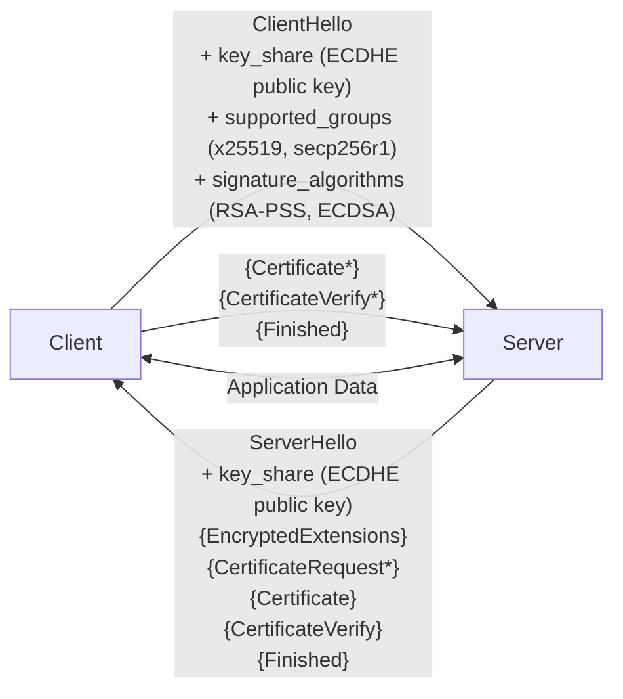

# Lesson 2: Cryptographic Protocols for Network Security

## 1. First-Principles Intuition & Invariants

The security of networked systems rests upon a mathematical foundation that operates across inherently untrusted communication channels. When Alice transmits data to Bob over a network controlled by adversarial entities, she faces three fundamental challenges that cryptographic protocols must address: ensuring confidentiality so that eavesdroppers cannot read the message content, guaranteeing integrity so that tampering is detectable, and establishing authenticity so that Bob can verify the message genuinely originated from Alice. These properties form the CIA triad of information security, though here confidentiality, integrity, and authenticity take precedence over availability in our protocol analysis.

Cryptographic protocols compose primitive operations—symmetric encryption, asymmetric key exchange, hash functions, and digital signatures—into state machines that maintain security invariants even when an adversary can observe, intercept, delay, replay, or modify arbitrary network traffic. The Dolev-Yao threat model formalizes this adversarial environment by assuming the attacker controls the entire network fabric except the endpoints themselves, yet cannot break the underlying mathematical primitives through computational means. This model forces protocol designers to construct security arguments that hold even when every intermediate router, switch, and transmission medium operates under adversarial control.

The distinction between symmetric and asymmetric cryptography emerges from fundamentally different mathematical structures. Symmetric algorithms like AES operate on the principle of a shared secret key known to both parties, transforming plaintext through substitution-permutation networks that iterate confusion and diffusion operations across multiple rounds. The security derives from the computational infeasibility of inverting these operations without the key, despite the algorithm itself being public knowledge per Kerckhoffs's principle. Block ciphers partition data into fixed-size blocks and apply the keyed transformation, while stream ciphers generate a pseudorandom keystream that XORs with plaintext to produce ciphertext.

Asymmetric cryptography introduces a mathematical asymmetry through trapdoor functions—operations that are computationally easy in one direction but prohibitively expensive to reverse without special knowledge. RSA encryption exploits the difficulty of factoring large semiprimes, while elliptic curve cryptography leverages the discrete logarithm problem on algebraic curves. Each participant generates a keypair: a public key that anyone can use to encrypt messages or verify signatures, and a private key that enables decryption or signature generation. This asymmetry eliminates the key distribution problem that plagues symmetric systems, enabling secure communication between parties who have never met and share no prior secrets.

Hash functions provide a third cryptographic primitive, implementing one-way compression that maps arbitrary-length input data to fixed-size digests. A cryptographically secure hash function satisfies three properties: preimage resistance, meaning an attacker cannot find an input that produces a specific hash value; second preimage resistance, preventing the discovery of a different input producing the same hash as a given message; and collision resistance, making it infeasible to find any two distinct inputs that hash to the same value. These properties enable hash functions to serve as integrity checksums, message authentication codes when combined with secret keys, and fundamental building blocks in digital signature schemes.

Digital signatures bind cryptographic primitives into an authentication mechanism that provides non-repudiation. When Alice signs a message, she first computes its cryptographic hash, then encrypts this digest with her private key. Bob verifies the signature by decrypting it with Alice's public key and comparing the result against his own hash computation of the received message. This construction ensures that only Alice, possessing the private key, could have generated the signature, while the hash prevents signature forgery through existential attacks. The signature travels with the message, creating an unforgeable cryptographic proof of authorship and integrity.

The key exchange problem requires two parties to establish a shared symmetric key across an insecure channel without any prior shared secrets. The Diffie-Hellman protocol solves this through modular exponentiation in cyclic groups. Alice generates a random secret integer *a* and transmits *g^a mod p* to Bob, where *g* is a generator of the group and *p* is a large prime. Bob similarly generates secret *b* and sends *g^b mod p* to Alice. Both parties can compute the shared secret *g^ab mod p*: Alice computes *(g^b)^a mod p* while Bob computes *(g^a)^b mod p*. An eavesdropper observing both public values faces the computational Diffie-Hellman problem of computing *g^ab mod p* given only *g^a* and *g^b*, which is believed to be intractable for appropriately chosen parameters.

Public Key Infrastructure provides the organizational framework that binds public keys to real-world identities through a hierarchy of trust anchored in certificate authorities. A digital certificate contains a public key, identifying information about its owner, validity period, permitted key usage, and a digital signature from a trusted CA. The X.509 standard defines the certificate structure as an ASN.1-encoded data structure containing version, serial number, signature algorithm identifier, issuer distinguished name, validity period, subject distinguished name, subject public key info, and extensions. The CA signature proves that the authority verified the subject's identity and binds the public key to that identity. Root CA certificates are self-signed and distributed through operating system trust stores, forming the trust anchors from which all certificate chain validation begins.

Certificate validation follows a deterministic algorithm that constructs and verifies a chain from the leaf certificate to a trusted root. The validator checks that each certificate in the chain was signed by the private key corresponding to the public key in the next certificate, verifies that no certificate has expired, confirms that no certificate appears on a revocation list, and ensures that key usage extensions permit the certificate's application. Name constraints in intermediate CA certificates restrict which domains subordinate certificates can authenticate, preventing a compromised intermediate CA from issuing fraudulent certificates for arbitrary domains. This hierarchical trust model distributes the burden of identity verification across multiple entities while maintaining a clear chain of cryptographic accountability.

## 2. Core Architecture & Mechanics

Transport Layer Security implements cryptographic protocol composition through a carefully orchestrated handshake that establishes authenticated, confidential channels over TCP connections. The protocol operates through two phases: a handshake phase that authenticates parties and negotiates cryptographic parameters, and a record protocol phase that encrypts and authenticates application data. TLS 1.3, the current standard, removes legacy cryptographic algorithms and streamlines the handshake to reduce round-trip latency while strengthening security guarantees.

The TLS handshake begins when the client sends a ClientHello message containing the highest protocol version supported, a random 32-byte nonce, a session ID for resumption, a list of supported cipher suites ordered by preference, and a list of supported compression methods. Critically, the ClientHello also includes extensions that signal advanced capabilities. The supported_groups extension specifies elliptic curves or finite field groups for key exchange, while the key_share extension provides ephemeral public key material for supported groups, enabling 1-RTT handshakes. The server_name extension carries the hostname via Server Name Indication, allowing virtual hosting of multiple TLS services on a single IP address.

Upon receiving the ClientHello, the server selects cryptographic parameters by choosing the most preferred mutually supported cipher suite, selecting a key exchange group, and generating its own ephemeral key pair. The ServerHello response mirrors the ClientHello structure but contains the server's choices and its ephemeral public key share. Both parties now possess sufficient information to derive the shared secret through elliptic curve Diffie-Hellman: the client combines the server's public key with its own private key, while the server performs the reciprocal operation. This shared secret enters a key derivation function that expands it into multiple symmetric keys through HKDF (HMAC-based Key Derivation Function).

The key derivation process produces a hierarchy of secrets through successive HKDF-Expand operations. The initial shared secret becomes the early secret when combined with the PSK (pre-shared key) if session resumption applies, or simply the ECDHE shared secret for full handshakes. This feeds into the handshake secret, which derives client and server handshake traffic secrets. These secrets generate the keys that encrypt all subsequent handshake messages, providing forward secrecy even during the handshake itself. The handshake secret then derives the master secret, which produces application traffic secrets that generate the keys protecting actual application data.

The Certificate message contains the server's X.509 certificate chain, transmitting each certificate as a DER-encoded ASN.1 structure. The leaf certificate must contain a public key matching the signature algorithm negotiated in the handshake, and its subject or subject alternative name must match the SNI hostname provided by the client. The CertificateVerify message provides the cryptographic proof that the server possesses the private key corresponding to the certificate's public key. The server computes a hash of the entire handshake transcript up to this point, then signs this hash with its private key. The client verifies this signature using the public key from the certificate, confirming both that the server holds the private key and that no tampering has occurred during the handshake.

The Finished message completes the handshake authentication by computing an HMAC over the entire handshake transcript using a finished key derived from the handshake traffic secret. Both client and server send Finished messages, each proving they observed the same handshake sequence and derived identical keys. Any tampering with handshake messages will cause the HMAC verification to fail, aborting the connection. This construction prevents downgrade attacks where an adversary modifies the ClientHello to force selection of weak cryptographic algorithms, because the transcript hash in CertificateVerify and Finished encompasses the original ClientHello containing the client's true preferences.

The TLS record protocol encrypts application data using authenticated encryption with associated data (AEAD) ciphers like AES-GCM or ChaCha20-Poly1305. Each record contains a type field identifying the content (application data, handshake, alert), a protocol version field, and a length field, followed by the encrypted payload. The AEAD construction combines encryption and authentication in a single operation: the cipher encrypts the plaintext while simultaneously computing an authentication tag over both the ciphertext and the record header. This tag prevents tampering with the ciphertext or manipulation of the record framing. Each record is encrypted with a sequence number that increments with every record, preventing replay and reordering attacks.

Forward secrecy emerges from the ephemeral nature of the ECDHE key exchange. The client and server generate fresh key pairs for each connection, derive the shared secret, and securely erase the private keys after completing key derivation. Even if an attacker later compromises the server's long-term private key used for authentication, they cannot decrypt previously recorded sessions because those sessions were protected by ephemeral keys that no longer exist. This property critically limits the damage from private key compromise, ensuring that past communications remain confidential even after future security breaches.

IPsec operates at the network layer, providing cryptographic protection for IP packets themselves rather than application-layer protocols. This positioning enables IPsec to transparently secure all traffic from a host or network without requiring application modifications. IPsec defines two protocols: the Authentication Header (AH) provides integrity and authentication but not confidentiality, while the Encapsulating Security Payload (ESP) provides confidentiality, integrity, and authentication. ESP has largely superseded AH because authentication can be achieved through ESP's AEAD ciphers without the additional header overhead.

Security Associations form the fundamental management structure in IPsec, defining the cryptographic algorithms, keys, and parameters for a unidirectional security relationship between two endpoints. Each SA is identified by a Security Parameter Index (SPI), destination IP address, and security protocol (AH or ESP). A bidirectional IPsec connection requires two SAs, one for each direction. The Security Association Database (SAD) stores active SAs, while the Security Policy Database (SPD) contains rules that determine when IPsec protection applies to packets. When the kernel processes an outbound packet, it consults the SPD to determine whether the packet requires IPsec protection, which SA to use, and whether to permit, block, or bypass the packet.

Internet Key Exchange (IKEv2) automates SA establishment through a protocol that authenticates peers, negotiates cryptographic parameters, and derives shared keying material. IKE operates in two phases: IKE_SA_INIT establishes the IKE SA through Diffie-Hellman key exchange and negotiates cryptographic algorithms, while IKE_AUTH authenticates both parties using public key signatures or pre-shared keys and establishes the first child SA for actual data protection. The initial exchange transmits nonces, key exchange material, and lists of supported algorithms. Both parties compute the shared secret SKEYSEED through the negotiated key derivation function, then expand this into multiple keys for encrypting IKE messages, authenticating IKE messages, and deriving child SA keys.

Perfect Forward Secrecy in IKE is achieved through periodic rekeying that establishes new child SAs with fresh Diffie-Hellman exchanges. The CREATE_CHILD_SA exchange generates new keying material without tearing down the existing IKE SA, enabling seamless key rotation that limits the cryptographic lifetime of any single key. Implementations typically rekey based on time intervals or data volume thresholds, balancing the performance overhead of key exchange against the security benefit of limiting key exposure.

SSH protocol architecture separates concerns through a layered design spanning transport, authentication, and connection protocols. The SSH-TRANS transport layer establishes the encrypted channel, negotiating algorithms and performing key exchange through methods like diffie-hellman-group-exchange-sha256 or ecdh-sha2-nistp256. Algorithm negotiation follows a preference list mechanism where the client proposes ordered lists of key exchange methods, server host key algorithms, encryption algorithms, MAC algorithms, and compression algorithms for each direction. The server selects the first mutually supported algorithm from each list. This bidirectional negotiation allows different algorithms for client-to-server and server-to-client traffic, accommodating asymmetric performance characteristics.

Host key verification prevents man-in-the-middle attacks by cryptographically binding the server's identity to its public key. On first connection, SSH clients encounter the trust-on-first-use (TOFU) problem: they have no prior knowledge of the server's legitimate key. The client displays the key fingerprint—a hash of the public key—and prompts the user to verify it through an out-of-band mechanism. After acceptance, the client stores the host key in the known_hosts file, mapping hostname to public key. On subsequent connections, SSH verifies the server's key matches the stored value, rejecting connections if the key changes unless explicitly overridden.

The SSH-AUTH authentication layer implements multiple authentication methods with cryptographic strength varying from username/password to public key authentication. Public key authentication provides the strongest security: the client proves possession of the private key corresponding to an authorized public key without transmitting the private key. The client sends a signature computed over session identifier, authentication request type, username, service name, and the public key itself. The server verifies this signature using the public key from its authorized_keys file, confirming both key possession and authentication intent. The signature includes the session identifier to prevent replay across different SSH connections.

Certificate-based authentication in SSH extends public key authentication with identity binding through certificate authorities. An SSH certificate contains the user's public key, a serial number, certificate type (user or host), key ID, valid principals, validity period, critical options, extensions, the signing CA's public key, and the CA's signature over all preceding fields. When authenticating, the client presents the certificate instead of a bare public key. The server validates the certificate by checking the CA signature, verifying the validity period, confirming the username matches a valid principal, and checking any critical options or extensions. This mechanism enables centralized key management across large organizations without requiring distribution of user public keys to every server.

Wireguard represents a modern approach to VPN cryptography through radical protocol simplification and opinionated algorithm selection. Rather than negotiating algorithms, Wireguard mandates Curve25519 for key exchange, ChaCha20Poly1305 for AEAD encryption, BLAKE2s for hashing, and SipHash for hashtable keys. This eliminates algorithm negotiation complexity and forces quick deprecation of the entire protocol if any primitive weakens rather than maintaining compatibility with increasingly fragile legacy algorithms.

The Noise protocol framework underpins Wireguard's handshake design, providing formally verified patterns for key exchange. Wireguard implements the Noise_IK pattern: initiator knows responder's static public key, enabling the initiator to encrypt the handshake payload from the first message. The handshake consists of a single initiator message and single responder message, establishing the session with minimal latency. Both parties possess static Curve25519 keypairs configured out-of-band. The initiator generates an ephemeral keypair, performs three Diffie-Hellman operations (ephemeral-static, static-static, and ephemeral-static in the opposite direction), and mixes the results into a chaining key through BLAKE2s. This produces symmetric keys that encrypt the remainder of the handshake and the subsequent data transport.

Wireguard's cryptokey routing directly binds cryptographic identity to network addressing. Each peer's configuration maps their static public key to a list of allowed IP addresses. Outbound packets are routed to the peer whose allowed-ips contain the destination address, while inbound packets are only accepted if their decrypted source IP address appears in the sending peer's allowed-ips. This prevents IP spoofing even within the VPN tunnel, as packets must both decrypt successfully under the peer's session keys and originate from an IP address cryptographically authorized for that peer.

The protocol achieves silence by transmitting no keepalive or status messages unless necessary for NAT traversal. Peers exchange handshake initiation only when they have data to send and no recent handshake exists. After a period without traffic, the session keys remain valid but unused, producing no network activity. This makes Wireguard connections stateless from the network perspective—observers cannot distinguish active from inactive tunnels—and eliminates the timing side channels that plague keepalive-based protocols.

## 3. High-Performance Optimization & Failure Modes

Cryptographic protocol performance bottlenecks typically concentrate in asymmetric operations, particularly RSA signature verification during TLS handshakes. While modern processors implement AES acceleration through AES-NI instructions that achieve multi-gigabit throughput, RSA verification using 2048-bit keys requires hundreds of microseconds per operation. High-traffic servers process thousands of new TLS connections per second, making handshake optimization critical. Session resumption addresses this by allowing clients to reuse cryptographic state from previous connections. TLS 1.3 session tickets encrypt the server's session state and transmit it to the client, which presents the ticket on subsequent connections. The server decrypts the ticket to restore the session without performing asymmetric cryptography, reducing handshake latency from 2-RTT to 1-RTT and eliminating expensive public key operations.

OCSP stapling optimizes certificate validation by bundling revocation status directly in the TLS handshake. Traditional OCSP requires clients to contact the certificate authority's OCSP responder during handshake validation, introducing additional latency and creating privacy concerns as the CA learns which websites the client visits. With stapling, the server periodically fetches a signed OCSP response from the CA and includes it in the TLS handshake. Clients verify the OCSP signature and check the response timestamp but avoid direct CA contact. This eliminates the latency penalty and privacy leak while maintaining the security property that revoked certificates are rejected.

Elliptic curve cryptography delivers substantial performance improvements over RSA through smaller key sizes that provide equivalent security levels. A 256-bit ECC key offers security comparable to a 3072-bit RSA key, and the mathematical operations on elliptic curves require significantly less computation than modular exponentiation on large integers. The widespread deployment of Curve25519 in modern protocols reflects both its performance advantage and its carefully designed security properties that resist implementation vulnerabilities. The curve's Montgomery form enables efficient, constant-time scalar multiplication that avoids timing side channels, while its cofactor of 8 provides inherent protection against small-subgroup attacks.

Hardware cryptographic acceleration appears in modern processors through instruction set extensions like Intel AES-NI, ARMv8 Cryptographic Extensions, and IBM's CPACF. AES-NI provides dedicated instructions for AES round operations—AESENC, AESENCLAST, AESDEC, AESDECLAST—along with key expansion instructions. These instructions execute in 4-7 CPU cycles and operate on 128-bit registers, enabling pipelined AES processing that saturates memory bandwidth before exhausting encryption capacity. Implementations using AES-NI achieve 10+ Gbps throughput per core, transforming AES from a performance bottleneck into a negligible overhead.

The ChaCha20-Poly1305 cipher suite emerges as the preferred choice for systems lacking AES-NI acceleration. ChaCha20 implements a stream cipher through addition, XOR, and rotation operations on 32-bit words, avoiding the table lookups that made software AES vulnerable to cache-timing attacks. Poly1305 computes message authentication through arithmetic in GF(2^130-5), achieving high performance on general-purpose processors. The combined AEAD construction provides competitive performance with AES-GCM on unaccelerated hardware while maintaining constant-time properties that resist side-channel analysis.

Cryptographic protocol implementations face timing side channels where execution time leaks information about secret keys. RSA implementations that use Montgomery multiplication without constant-time guarantees leak the private exponent through timing variations in modular reduction. AES implementations using table lookups leak key bytes through cache timing: the cache state after table access depends on the accessed address, which depends on key bits and known plaintext. Attacks like FLUSH+RELOAD exploit shared caches in virtualized environments to reconstruct AES keys by observing the victim's cache access patterns. Constant-time implementations eliminate data-dependent branches and memory access patterns, ensuring execution time depends only on the input size, not secret values.

Protocol composition failures occur when individually secure protocols combine in ways that violate security assumptions. The RC4 NOMORE attack exploited TLS's use of RC4 stream cipher by leveraging the bias in RC4's keystream. While individual RC4 encryptions appeared secure, statistical analysis across many encryptions encrypted with related keys revealed plaintext patterns. The attack succeeded because TLS's session key derivation produced related keys across connections, violating RC4's assumption of independently random keys. This illustrates the principle that protocol security requires reasoning about the complete system, not just component security in isolation.

Certificate validation failures represent a persistent source of TLS vulnerabilities despite the protocol's cryptographic strength. Implementations that fail to verify certificate chains, skip hostname validation, or accept self-signed certificates without user interaction create vulnerabilities that cryptographic strength cannot address. The validation process must verify every certificate in the chain back to a trusted root, confirm that the leaf certificate's subject alternative name matches the requested hostname, check validity periods, and verify that no certificate appears on a revocation list. Skipping any step enables man-in-the-middle attacks where an attacker presents their own certificate for the target domain.

Downgrade attacks attempt to force connections to use weak cryptographic algorithms by manipulating protocol negotiation. The FREAK (Factoring RSA Export Keys) attack exploited servers that still supported 512-bit RSA export cipher suites from the 1990s. An attacker modified the ClientHello to request only export ciphers, the server selected an export suite, and the attacker could break the 512-bit RSA key through factorization to obtain the session key. TLS 1.3 prevents these attacks through the Finished message hash that cryptographically binds the negotiated parameters to the authentication, making any tampering with the ClientHello detectable.

Replay attacks target protocols that fail to include freshness guarantees. An attacker records valid protocol messages and retransmits them to cause unintended actions. Cryptographic protocols prevent replay through nonces (numbers used once) and sequence numbers. Each TLS record includes an implicit sequence number in its AEAD authenticated data, causing replayed records to fail authentication. IPsec maintains an anti-replay window tracking recently seen sequence numbers and rejecting duplicates. SSH includes a sequence number in its packet authentication, preventing both replay and reordering attacks.

Key management failures undermine otherwise sound cryptographic protocols. Long-lived static keys concentrate risk: their compromise affects all past and future communications. Organizations must implement key rotation schedules that balance operational complexity against cryptographic hygiene. Private keys require protection through hardware security modules or secure enclaves that perform cryptographic operations without exposing key material to the host operating system. Key generation must use cryptographically strong random number generators; the Debian OpenSSL vulnerability demonstrated how weak random number generation completely undermines RSA key security by making keys predictable.

The post-quantum cryptography transition represents the next major evolution in network security protocols. Quantum computers capable of running Shor's algorithm would break RSA, Diffie-Hellman, and elliptic curve cryptography by efficiently solving factorization and discrete logarithm problems. NIST has standardized lattice-based key encapsulation mechanisms like CRYSTALS-Kyber that resist quantum attacks through hard problems on algebraic lattices. These algorithms require substantially larger public keys and ciphertexts than current ECC, creating protocol engineering challenges around packet size and bandwidth consumption. Hybrid approaches that combine classical and post-quantum key exchange provide defense-in-depth during the transition period, ensuring security against both classical and quantum adversaries.

Protocol ossification occurs when middleboxes inspect and make assumptions about protocol structures, preventing protocol evolution. TLS 1.3 deployment initially failed because middleboxes rejected the new handshake format. Engineers worked around this through the version negotiation mechanism that makes TLS 1.3 handshakes superficially resemble TLS 1.2 to middleboxes while signaling true capabilities through extensions. The encrypted extensions message in TLS 1.3 encrypts protocol parameters immediately after key exchange, preventing middleboxes from inspecting and making assumptions about protocol internals. This design ensures future TLS evolution remains possible without middlebox interference.

Rate limiting and denial-of-service prevention require careful protocol design to avoid expensive cryptographic operations on unauthenticated messages. TLS 1.3's HelloRetryRequest enables servers to request specific key share parameters from clients without performing expensive computations on potentially invalid ClientHellos. IKEv2 implements cookie-based DoS protection where the responder can demand the initiator include a cookie in subsequent messages, proving the initiator's source IP address is valid before the responder allocates state. These mechanisms ensure attackers cannot exhaust server resources through handshake floods without completing computationally expensive proof-of-work.

Cryptographic agility paradoxically introduces vulnerability through complexity. Protocols that negotiate from dozens of algorithm combinations increase attack surface and implementation complexity, creating opportunities for downgrade attacks and configuration errors. Modern protocol design emphasizes opinionated algorithm selection with limited supported combinations, accepting lack of flexibility in exchange for reduced complexity and attack surface. When algorithms must be deprecated due to cryptanalytic advances, version bumps replace gradual algorithm removal, ensuring clean breaks that avoid maintaining compatibility with weakened primitives.
