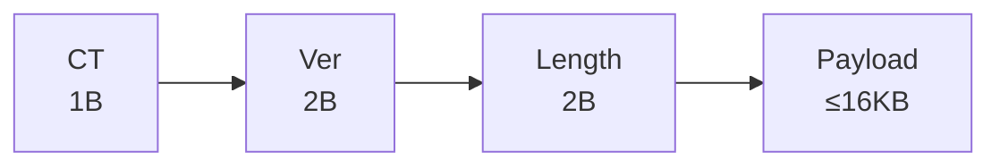
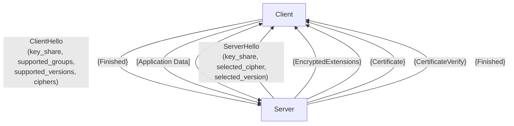

# Lesson 4: Transport Layer Security & Application Layer Protections

## 1. First-Principles Intuition & Invariants

The fundamental problem that TLS solves is not merely encryption. Any engineer who reduces TLS to "it encrypts traffic" has missed the deeper invariant: TLS is a *trust establishment protocol* that happens to also provide confidentiality, integrity, and authentication, in that order of logical precedence. You cannot have meaningful confidentiality without first answering the question of *who* you are encrypting to. A channel that is perfectly encrypted but whose endpoint identity is unverified is not a secure channel — it is a private conversation with an unknown party, and in adversarial network environments, that party may be your attacker.

To understand why TLS evolved the way it did, you must start from the physical reality of packet-switched networks. When a TCP segment leaves a client on a corporate LAN, it traverses an Ethernet switch, one or more routers, potentially a transit provider's backbone, and finally an edge router at the destination. At every one of these hops, the data is in cleartext if unprotected. An attacker with access to any single link — via ARP spoofing, BGP hijacking, a compromised router, a malicious Wi-Fi access point, or a wiretap — can read, modify, or inject application data. This is the threat model that the IETF standardized against when designing TLS, and understanding it explains every design decision in the protocol's history.

SSL 2.0, designed by Netscape in 1995, was a first-generation attempt. It had catastrophic flaws: weak MAC construction, padding oracle vulnerabilities, and a ciphersuite negotiation mechanism that did not authenticate the negotiation itself, making it trivially downgrade-attackable. SSL 3.0 improved this but was itself vulnerable to the POODLE attack in 2014, which exploited the CBC padding oracle inherent in the protocol's MAC-then-encrypt ordering. TLS 1.0 (RFC 2246) and 1.1 (RFC 4346) carried forward this MAC-then-encrypt construction and CBC mode ciphers, making them vulnerable to BEAST and LUCKY13. TLS 1.2 (RFC 5246, 2008) introduced AEAD ciphers — Authenticated Encryption with Associated Data — which fuse the MAC and encryption operations into a single primitive, eliminating the padding oracle class entirely. TLS 1.3 (RFC 8446, 2018) made AEAD mandatory, removed all non-forward-secret key exchange mechanisms, reduced the handshake to one round-trip, and eliminated a decade of legacy negotiation complexity. For offensive practitioners, this history is a clinical study in how protocol versioning creates downgrade attack surfaces.

The three invariants that every version of TLS must satisfy are authenticity, confidentiality, and integrity. Authenticity is provided by the X.509 certificate chain, which ties a public key to an identity through a chain of cryptographic signatures rooted in a trusted Certificate Authority. Confidentiality is provided by symmetric encryption of the record layer, with keys derived via the handshake. Integrity is provided by the AEAD tag appended to every record. If any of these three properties is broken — a compromised CA, a weak cipher, a truncation attack — the entire security model collapses. This is why TLS configuration is not merely a performance tuning exercise. A misconfigured TLS endpoint is indistinguishable from no TLS at all from an attacker's perspective.

The forward secrecy property deserves special attention because it changes the adversary's cost model fundamentally. Without forward secrecy (pre-TLS 1.3 RSA key exchange), an attacker who records today's encrypted traffic and later compromises the server's private key can decrypt all recorded sessions retroactively. This is a passive surveillance strategy: record everything now, decrypt later. Ephemeral Diffie-Hellman (DHE) and Elliptic Curve Diffie-Hellman Ephemeral (ECDHE) key exchange eliminate this by generating a fresh key pair per session. The session keys are never stored, so recording today's traffic provides no value even if the long-term private key is extracted from the server next year. TLS 1.3 makes ECDHE mandatory, closing this passive collection attack permanently for compliant implementations.

---

## 2. Core Architecture & Mechanics

### The TLS Record Layer

TLS sits between the transport layer (TCP) and the application layer (HTTP, SMTP, etc.), operating as a framing and protection sublayer. All TLS traffic is segmented into *records*, each with a 5-byte header identifying the content type (Handshake = 22, Alert = 21, ChangeCipherSpec = 20, Application Data = 23), the protocol version, and the payload length. The maximum record size is 16,384 bytes.



In TLS 1.3, the outer content type field is set to 23 (Application Data) for all protected records regardless of actual content, and the real content type is encrypted inside the payload as the last byte. This prevents traffic analysis from distinguishing handshake messages from application data at the record boundary — a meaningful improvement against traffic fingerprinting.

### The TLS 1.3 Handshake

TLS 1.3 achieves full handshake completion in one round-trip (1-RTT), with an optional zero round-trip resumption mode (0-RTT). The 1-RTT handshake proceeds as follows.



The server transmits its Certificate, CertificateVerify, and Finished messages already encrypted (shown in curly braces) using the *handshake traffic secret*, which is derived immediately after the key_share exchange. This means the server's identity is never transmitted in cleartext — unlike TLS 1.2, where the certificate was sent in the clear. The key schedule in TLS 1.3 uses HKDF (HMAC-based Key Derivation Function) to derive a hierarchy of secrets from the ECDHE shared secret.

The HKDF key schedule derives five distinct secret values from a single early secret and the ECDHE output:

```
Early Secret
     |
     +-- (binder_key, early_traffic_secret, early_exporter_secret)
     |
Handshake Secret
     |
     +-- (client_handshake_traffic_secret)
     +-- (server_handshake_traffic_secret)
     |
Master Secret
     |
     +-- (client_application_traffic_secret_0)
     +-- (server_application_traffic_secret_0)
     +-- (exporter_master_secret)
     +-- (resumption_master_secret)
```

Each traffic secret is expanded into an actual encryption key and IV using `HKDF-Expand-Label`. The client and server maintain separate write keys, so traffic in each direction is protected independently. Record sequence numbers are used to construct the per-record nonce by XORing the sequence number with the base IV, ensuring nonce uniqueness without requiring a random nonce per record.

### X.509 Certificate Chain Validation

Certificate validation is the mechanism by which TLS's authenticity property is actually enforced, and it is also the most historically abused attack surface in the protocol stack. A certificate is an ASN.1-encoded data structure containing a subject name, a public key, a validity period, extension fields, and a signature from an issuing CA. The validation algorithm is defined in RFC 5280 and requires the following conditions to hold simultaneously.

The certificate must chain to a trust anchor in the client's root store. Each certificate in the chain must have been signed by the issuer named in the next certificate up. No certificate in the chain may be expired at the time of validation. The leaf certificate's Subject Alternative Name (SAN) extension must contain the hostname the client is connecting to. The Extended Key Usage (EKU) extension must permit TLS server authentication (OID 1.3.6.1.5.5.7.3.1). And the certificate must not appear in a Certificate Revocation List (CRL) or fail an OCSP (Online Certificate Status Protocol) check.

The weakness exploited in real attacks is usually at the chain validation step or the hostname matching step. Prior to widespread enforcement, many TLS implementations had bugs where a null byte embedded in a CN field would truncate hostname comparison — a vulnerability famously demonstrated by Moxie Marlinspike in 2009. Modern implementations use SAN fields exclusively, but the fundamental trust model — that any one of hundreds of root CAs in a browser's root store can issue a certificate for any domain — remains a systemic risk. Certificate Transparency (CT, RFC 6962) addresses this by requiring all publicly-trusted certificates to be logged in append-only Merkle tree logs, enabling domain owners to audit certificates issued for their names and enabling monitors to detect misissued certificates within hours.

### Cipher Suite Mechanics

A cipher suite in TLS 1.3 is a two-component tuple specifying the AEAD algorithm and the hash function used in HKDF. The three mandated suites are `TLS_AES_256_GCM_SHA384`, `TLS_AES_128_GCM_SHA256`, and `TLS_CHACHA20_POLY1305_SHA256`. In TLS 1.2, cipher suites are four-component tuples: key exchange, authentication, bulk cipher, and MAC. The proliferation of legacy suites in TLS 1.2 — RC4, 3DES, CBC-mode AES without AEAD, anonymous DH — created a large attack surface that TLS 1.3 eliminated by simply removing support for all of them.

AES-GCM combines AES in counter mode (for encryption) with GHASH (a polynomial MAC over GF(2^128)) into a single AEAD construction. The 128-bit authentication tag is computed over both the ciphertext and the associated data (the record header), ensuring that modifying either the payload or the header is detectable. ChaCha20-Poly1305 is preferred in environments where hardware AES acceleration is unavailable — particularly embedded systems and mobile processors lacking AES-NI — because ChaCha20 is a pure software stream cipher that runs at comparable speed without hardware assistance.

### Practical TLS Configuration and Auditing

The gap between a theoretically correct TLS implementation and a production deployment is where most real vulnerabilities live. The following `openssl` command performs a complete handshake and dumps the negotiated parameters, certificate chain, and extensions:

```sh
openssl s_client \
  -connect target.example.com:443 \
  -servername target.example.com \
  -tls1_3 \
  -showcerts \
  -tlsextdebug \
  -msg 2>&1 | tee tls_audit.txt
```

The `-msg` flag causes OpenSSL to print each TLS record as it is exchanged, giving a full trace of the handshake at the record layer. For a comprehensive server-side audit across all protocol versions and cipher suites, `testssl.sh` is the canonical tool:

```sh
testssl.sh \
  --full \
  --logfile testssl_output.txt \
  --jsonfile testssl_output.json \
  --severity LOW \
  --color 0 \
  https://target.example.com
```

This performs probes for BEAST, BREACH, CRIME, DROWN, FREAK, HEARTBLEED, LOGJAM, LUCKY13, POODLE, ROBOT, SWEET32, and misconfigured OCSP stapling. Each finding is tagged with a severity level and a CVE reference where applicable. For embedded systems where `testssl.sh` is unavailable, `nmap`'s `ssl-enum-ciphers` NSE script provides equivalent negotiation enumeration:

```sh
nmap --script ssl-enum-ciphers \
     -p 443,8443 \
     --script-args ssl-enum-ciphers.try_all_ciphers=true \
     target.example.com
```

The output grades each supported cipher suite from A (ECDHE + AEAD) down to F (NULL, anonymous, export-grade) and identifies whether the server respects the client's cipher preference ordering or enforces its own.

---

## 3. High-Performance Optimization & Failure Modes

### Certificate Validation Failures and Revocation Gaps

The most operationally significant failure mode in TLS deployments is not broken encryption — it is broken certificate validation. OCSP stapling is the correct solution to revocation checking latency and privacy, but it is frequently misconfigured. Without OCSP stapling, the client must connect to the CA's OCSP responder to check revocation status, adding a DNS lookup and an HTTP request to the handshake latency. If the OCSP responder is unavailable and the client's implementation performs a "soft fail" (treating unavailability as valid), revocation is effectively non-functional. With `nginx`, correct OCSP stapling configuration requires:

```nginx
ssl_stapling on;
ssl_stapling_verify on;
ssl_trusted_certificate /etc/ssl/certs/chain.pem;
resolver 8.8.8.8 8.8.4.4 valid=300s;
resolver_timeout 5s;
```

The `ssl_trusted_certificate` directive must point to the full intermediate chain, not just the leaf certificate, because nginx needs to verify the OCSP response signature against the issuing CA. The `resolver` directive is mandatory; without it, nginx cannot perform the OCSP lookup to pre-fetch the staple. After configuration, verifying the staple is in the response:

```sh
openssl s_client \
  -connect target.example.com:443 \
  -servername target.example.com \
  -status 2>&1 | grep -A 20 "OCSP response"
```

A correct response includes `OCSP Response Status: successful` and a `Cert Status: good` field with a `Next Update` timestamp within 7 days.

### HSTS and Certificate Pinning

HTTP Strict Transport Security (HSTS, RFC 6797) is the mechanism by which a server instructs compliant clients to refuse all future plaintext HTTP connections for a configured duration. The header:

```
Strict-Transport-Security: max-age=31536000; includeSubDomains; preload
```

instructs the client to cache the HSTS policy for one year, apply it to all subdomains, and to submit the domain for inclusion in browser HSTS preload lists. The preload list is baked into browser binaries, ensuring that even a first-time visitor — who has never received the header — is protected from SSL stripping attacks. For offensive practitioners, HSTS preloading represents a hard enforcement point: an SSL stripping tool like `sslstrip` will fail against a preloaded domain because the browser will refuse to issue the initial HTTP request at all.

HTTP Public Key Pinning (HPKP) has been deprecated in favor of Certificate Transparency monitoring, primarily because a misconfigured pin permanently locks users out of a domain if the pinned key is lost. The correct modern equivalent for high-security deployments is CT monitoring via tools like `certspotter` or the Google CT transparency APIs, combined with CAA (Certification Authority Authorization) DNS records that restrict which CAs are permitted to issue for the domain.

### TLS Session Resumption and 0-RTT Attack Surface

TLS 1.3 supports session resumption via Pre-Shared Key (PSK) mode. After a completed handshake, the server sends a `NewSessionTicket` message containing a PSK identity and a ticket lifetime. On a subsequent connection, the client includes the PSK in its ClientHello, allowing the server to skip the full key exchange and derive session keys from the shared PSK. This is the 1-RTT resumption path.

The 0-RTT mode — also called "early data" — goes further: the client sends application data alongside the ClientHello, before the server responds at all. This eliminates the round-trip entirely, but introduces a replay vulnerability. Because the server receives 0-RTT data before it can verify the client's Finished message, an attacker who captures a ClientHello with early data can replay it to a different server instance or at a later time. RFC 8446 requires that 0-RTT data be treated as potentially replayed, and application-layer endpoints must implement idempotency checks (nonce deduplication, anti-replay state). For offensive practitioners testing APIs behind TLS 1.3, the 0-RTT surface is worth probing: send a captured ClientHello with early data to an API endpoint and observe whether the server processes the replayed request. Any state-mutating operation (funds transfer, password reset) that is accessible via 0-RTT without server-side replay protection is a valid vulnerability.

The correct nginx configuration to disable 0-RTT while retaining 1-RTT resumption:

```nginx
ssl_early_data off;
```

### DNSSEC: Authenticated DNS Resolution

DNS operates by default as an unauthenticated protocol. A resolver receiving a DNS response has no mechanism to verify that the response came from the authoritative server rather than an attacker on the path. DNS cache poisoning — injecting forged responses into a resolver's cache — was demonstrated at large scale by the Kaminsky attack in 2008, which exploited the 16-bit transaction ID space and predictable source ports to successfully forge responses with moderate computational effort.

DNSSEC (RFC 4033–4035) addresses this by adding a chain of cryptographic signatures to the DNS hierarchy. Each zone signs its resource records with a Zone Signing Key (ZSK), and publishes the ZSK's public key in a DNSKEY record. The key itself is signed by the zone's Key Signing Key (KSK), and the KSK is validated by the parent zone's DS (Delegation Signer) record, forming a chain of trust from the DNS root down to the queried name.

The DNSSEC validation chain for a query to `mail.example.com` resolves as follows. The root zone's KSK is used to verify the root's DNSKEY RRset. The root's ZSK signs the `.com` zone's DS record. The `.com` zone's KSK is verified against that DS record, and `.com`'s ZSK signs the `example.com` DS record. Finally, `example.com`'s KSK is verified against its DS record, and its ZSK covers all RRsets in the zone, including the A record for `mail.example.com`.

```
Root KSK (trust anchor)
    |-- signs Root ZSK (DNSKEY)
        |-- Root ZSK signs .com DS record
            |-- .com KSK verified by DS
                |-- .com ZSK signs example.com DS
                    |-- example.com KSK verified by DS
                        |-- example.com ZSK signs mail.example.com A RR
```

RRSIG records carry the actual signatures over each RRset, and NSEC/NSEC3 records provide authenticated denial of existence for names that do not exist in a zone. For security practitioners, DNSSEC validation failure on a live resolver is a high-confidence indicator of on-path manipulation. Testing with `dig`:

```sh
dig +dnssec +multi @8.8.8.8 mail.example.com A
```

The `ad` (Authenticated Data) flag in the response header indicates that the resolver has validated the DNSSEC chain successfully. Its absence for a DNSSEC-signed domain indicates either a validation failure or a non-validating resolver. For more granular chain tracing:

```sh
delv @8.8.8.8 +rtrace mail.example.com A
```

`delv` performs its own DNSSEC validation independently of the resolver and prints the full validation chain, making it invaluable for diagnosing delegation errors and expired signatures.

### Email Authentication Protocols: SPF, DKIM, and DMARC

Email's historical design contains no sender authentication at the protocol level. SMTP allows any server to claim any envelope sender address, and the RFC 5321 `MAIL FROM` command is not validated. The three email authentication standards — SPF, DKIM, and DMARC — form a layered defense that closes this gap at the DNS and cryptographic level respectively.

SPF (Sender Policy Framework, RFC 7208) is a DNS record that declares which IP addresses or hostnames are authorized to send mail for a domain. When a receiving MTA accepts an SMTP connection, it queries the `TXT` record for the envelope sender's domain and checks whether the connecting IP is listed. A complete SPF record for a domain that sends only via Google Workspace and a single on-premise relay:

```
v=spf1 include:_spf.google.com ip4:203.0.113.42/32 -all
```

The `-all` qualifier (hard fail) instructs receivers to reject mail from any IP not matching the policy. `~all` (soft fail) causes marking rather than rejection, and is appropriate only during SPF rollout testing, not in production. The critical operational failure mode is SPF's 10-DNS-lookup limit: SPF evaluation must complete within 10 DNS lookups (excluding `MX` and `PTR` lookups), and exceeding this limit causes SPF to return a `permerror`, which many receivers treat as equivalent to failure. Flattening nested `include:` chains and replacing them with explicit IP ranges is the standard remediation.

DKIM (DomainKeys Identified Mail, RFC 6376) signs the message body and selected headers with an RSA or Ed25519 private key. The corresponding public key is published as a DNS `TXT` record at a selector subdomain. The receiving MTA verifies the signature using the published key, confirming both that the message was sent by an entity holding the private key and that the signed content was not modified in transit.

A DKIM signature header looks like this:

```
DKIM-Signature: v=1; a=rsa-sha256; c=relaxed/relaxed;
  d=example.com; s=selector1;
  h=from:to:subject:date:message-id;
  bh=base64_body_hash;
  b=base64_signature_value
```

The `d=` tag identifies the signing domain, `s=` identifies the selector, and `h=` lists the headers included in the signature. The `bh=` field is a hash of the canonicalized message body. DKIM's vulnerability surface is primarily in key management: 1024-bit RSA keys are factoring-feasible with sufficient compute, and 2048-bit minimum keys are mandatory for new deployments. Ed25519 is now supported in RFC 8463 and provides equivalent security at 64-byte key sizes, making it preferable for all new deployments. Key rotation must be implemented — a selector's TXT record should be updated at minimum every six months, with old selectors' private keys destroyed.

DMARC (Domain-based Message Authentication, Reporting, and Conformance, RFC 7489) ties SPF and DKIM together by requiring that the authenticated domain in either check *aligns* with the visible `From:` header domain. This closes the alignment gap: an attacker can craft a message that passes SPF by using a different envelope sender domain while displaying a spoofed `From:` address. DMARC enforcement requires that the SPF-authenticated domain or the DKIM `d=` domain either exactly matches the `From:` domain (strict alignment) or is an organizational subdomain of it (relaxed alignment).

A production DMARC record implementing reject policy with aggregate and forensic reporting:

```
_dmarc.example.com. IN TXT "v=DMARC1; p=reject; sp=reject;
  rua=mailto:dmarc-rua@example.com;
  ruf=mailto:dmarc-ruf@example.com;
  fo=1; adkim=s; aspf=s; pct=100"
```

The `p=reject` policy instructs receivers to discard non-conforming messages entirely. `fo=1` requests failure reports for messages that fail either SPF or DKIM (not both), providing maximum forensic visibility. The migration path to `p=reject` must proceed through `p=none` (monitoring only) and `p=quarantine` (spam folder marking) to avoid rejecting legitimate mail from misconfigured sending infrastructure. During this process, the `rua` aggregate reports — which arrive as XML files from participating receivers — are the primary diagnostic tool. Processing them through `parsedmarc` or `dmarcian` yields per-source-IP pass/fail breakdowns that identify unauthenticated sending paths before enforcement.

### Verifying the Full Email Authentication Stack

A complete verification workflow against a live domain uses the following toolchain. First, verify SPF resolution and policy:

```sh
dig +short TXT example.com | grep spf
```

Then verify the DKIM public key for a known selector:

```sh
dig +short TXT selector1._domainkey.example.com
```

Then verify DMARC policy:

```sh
dig +short TXT _dmarc.example.com
```

For end-to-end authentication testing, sending a test message through the full delivery path and examining the `Authentication-Results` header inserted by the receiving MTA is the definitive check:

```
Authentication-Results: mx.google.com;
   dkim=pass header.i=@example.com header.s=selector1;
   spf=pass (google.com: domain of sender@example.com
     designates 203.0.113.42 as permitted sender)
     smtp.mailfrom=sender@example.com;
   dmarc=pass (p=REJECT sp=REJECT dis=NONE)
     header.from=example.com
```

All three checks must show `pass` for a correctly configured domain under DMARC `p=reject`. Any single failure causes the DMARC evaluation to fail, and the disposition defined in the policy record is applied. For offensive practitioners, the DMARC alignment requirement means that spoofing a domain under `p=reject` with strict alignment requires breaking either the DKIM private key or the SPF record — both of which require attacking the target's key management or DNS infrastructure rather than simply manipulating SMTP headers.

The complete picture of transport and application layer security is a layered stack of trust assertions: TLS provides authenticated, confidential, integer-protected transport; DNSSEC provides authenticated name resolution preventing the hijacking of that transport's endpoint; and SPF/DKIM/DMARC provide authenticated sender identity for the email application layer. Each layer has precise failure modes, specific attack surfaces, and definable correctness conditions. For the security practitioner, the operative skill is not merely knowing that these protocols exist, but being able to probe each layer independently, identify the gap between configured policy and enforced reality, and understand which gaps an attacker can exploit from which network positions.
