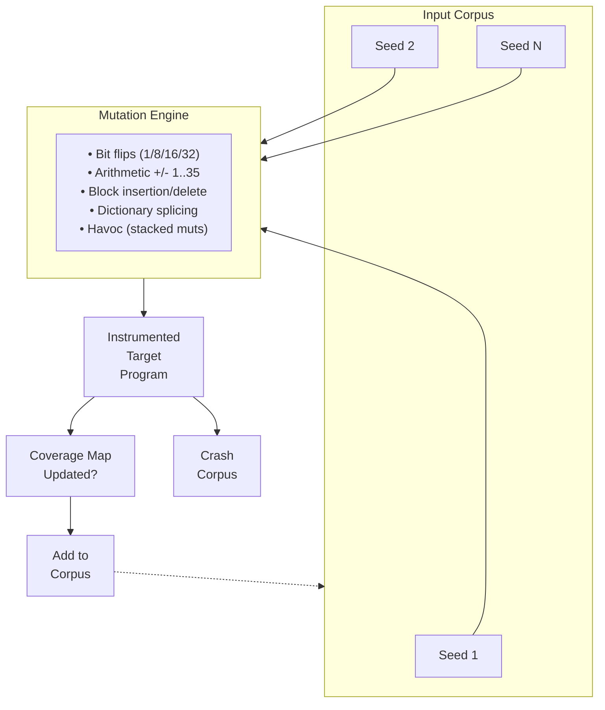

# Lesson 2: Vulnerability Discovery Mechanisms

## 1. First-Principles Intuition & Invariants

Vulnerability discovery represents the foundational phase of offensive security operations, transforming abstract software systems into concrete attack surfaces through systematic analysis of program state machines, memory layouts, and trust boundary enforcement. While exploitation techniques capture tactical attention, the discovery phase embodies the intellectual core of security research—the disciplined reduction of complex systems into falsifiable hypotheses about where programmer assumptions diverge from operational reality.

At its essence, a vulnerability exists wherever a program's actual behavior differs from its security-critical specification in a way an adversary can influence. This gap emerges from fundamental tensions in software engineering: the semantic distance between high-level languages and machine execution models, the composability failures when integrating third-party code, the economic pressures favoring features over correctness, and the inherent complexity ceiling beyond which human reasoning about program state becomes probabilistic rather than deterministic. Understanding vulnerability classes requires grounding in the execution substrates where these gaps manifest—virtual memory management, type system enforcement boundaries, parser state machines, and the contract between user space and kernel privilege domains.

Modern vulnerability discovery operates across a spectrum of techniques unified by a common epistemological framework. At one extreme, static analysis examines program source or intermediate representations without execution, constructing abstract interpretation models that over-approximate possible runtime behaviors. These techniques excel at proving the *absence* of certain bug classes through exhaustive path exploration but suffer from state explosion and conservative assumptions that generate false positives. At the opposite extreme, dynamic analysis observes concrete executions on real or emulated hardware, trading completeness for precision by testing actual code paths with specific inputs. Between these poles lies a rich space of hybrid techniques—symbolic execution that treats inputs as algebraic variables, concolic testing that alternates concrete and symbolic reasoning, and grammar-based fuzzing that encodes input structure to guide mutation.

The economic reality of vulnerability discovery shapes research methodology in profound ways. High-value targets like operating system kernels, browsers, and cryptographic implementations receive sustained attention from both defensive researchers and offensive actors, creating evolutionary pressure toward increasingly subtle bug classes. The low-hanging fruit—obvious buffer overflows in network parsers, trivial SQL injections in web forms—have largely been harvested from mainstream software through decades of tooling improvement and developer education. Contemporary vulnerability research increasingly focuses on logic flaws, race conditions, type confusion in complex object hierarchies, and subtle violations of architectural invariants that resist automated detection. This progression mirrors the fundamental asymmetry in software security: defenders must eliminate all exploitable paths, while attackers need discover only one.

Vulnerability classification systems attempt to impose taxonomic structure on this discovery space, with varying success. The Common Weakness Enumeration (CWE) provides hierarchical categorization spanning memory safety violations (buffer overflows, use-after-free, double-free), injection flaws (SQL, command, XSS), cryptographic errors, race conditions, and access control failures. The Common Vulnerability Scoring System (CVSS) quantifies exploitability and impact through formulaic combination of attack vector, complexity, privileges required, and CIA triad consequences. While these frameworks enable communication and prioritization, they often obscure the mechanistic relationships between root causes—for instance, how type confusion and integer overflow both represent failures in maintaining algebraic invariants across representation boundaries.

The proof-of-concept construction process embodies a rigorous engineering discipline distinct from both defensive development and pure research. A PoC must demonstrate exploitability with sufficient reliability to distinguish genuine vulnerabilities from theoretical concerns, yet requires careful scoping to avoid weaponization ethics dilemmas. For memory corruption, this typically means achieving arbitrary code execution or demonstrating information disclosure through controlled memory operations. For logic flaws, it requires violating specified security properties—privilege escalation, authentication bypass, or unauthorized data access. The reliability requirement introduces substantial complexity: heap layout manipulation, ASLR defeating information leaks, ROP chain construction, and cache timing for side channels all demand deep understanding of non-deterministic runtime behavior.

Exploit reliability models provide quantitative frameworks for reasoning about PoC robustness across different deployment scenarios. A deterministic exploit succeeds with probability one under specified preconditions, typically achievable only against targets with disabled mitigations or highly constrained environments. Probabilistic exploits succeed with some measured frequency, often requiring multiple attempts or specific timing conditions—heap spraying to increase allocation predictability, or race condition exploitation requiring thousands of attempts. Environmental stability factors include ASLR entropy (typically 8-28 bits depending on architecture and configuration), heap allocator algorithm (dlmalloc, jemalloc, tcmalloc each presenting distinct exploitation primitives), and kernel version-specific structure layouts that change across minor updates.

## 2. Core Architecture & Mechanics

The vulnerability discovery pipeline consists of conceptually distinct phases that in practice form iterative feedback loops. Initial reconnaissance establishes the attack surface through documentation review, protocol analysis, and build artifact inspection. Static analysis follows, examining source code or disassembled binaries for patterns matching known vulnerability classes. Dynamic analysis then exercises the program with crafted inputs, monitoring for abnormal behavior. When anomalies surface, root cause analysis reconstructs the causal chain from user-controlled input to exploitable program state. Finally, PoC development validates exploitability and quantifies reliability under realistic deployment conditions.

Static analysis techniques operate by constructing intermediate representations that abstract away execution details while preserving security-relevant properties. Control flow graphs capture branch and loop structure, enabling reachability analysis to determine whether attacker-controlled inputs can flow to dangerous sinks like `system()`, `strcpy()`, or kernel copy operations. Data flow analysis tracks how values propagate through the program, identifying taint flows from untrusted sources to sensitive operations. Abstract interpretation builds symbolic execution domains representing sets of possible program states, using lattice theory to ensure termination through widening operators that over-approximate unbounded iteration.

Consider a canonical buffer overflow scenario in C code handling network packet processing:

```c
struct packet_header {
    uint16_t length;
    uint16_t type;
    uint32_t session_id;
};

void process_packet(uint8_t *buffer, size_t buffer_size) {
    struct packet_header *hdr = (struct packet_header *)buffer;
    uint8_t payload[256];
    
    // Vulnerability: hdr->length is attacker-controlled
    // No validation against sizeof(payload)
    memcpy(payload, buffer + sizeof(struct packet_header), hdr->length);
    
    handle_payload(payload, hdr->length);
}
```

Static analysis would identify this through taint tracking: `hdr->length` originates from untrusted network input (`buffer`), flows unchecked into `memcpy`'s size parameter, and can exceed the 256-byte `payload` allocation. The control flow graph shows no validation branch between the pointer dereference and the memory operation. Abstract interpretation would represent `hdr->length` as the interval `[0, 65535]` (full uint16_t range), immediately identifying that this exceeds the safe bound `[0, 256]`.

Dynamic analysis complements static techniques by observing actual runtime behavior, exposing bugs that manifest only under specific preconditions or when interacting with external state. Instrumentation transforms the target program to record execution traces, memory operations, or control flow decisions. Address Sanitizer (ASan) recompiles code with shadow memory tracking that records allocated regions' bounds and validity state, catching out-of-bounds accesses and use-after-free at the instruction triggering the violation. MemorySanitizer detects uninitialized memory reads by tracking byte-level initialization state through execution. UndefinedBehaviorSanitizer instruments arithmetic operations to detect integer overflows, misaligned pointer dereferences, and other violations of C/C++ language semantics.

Fuzzing automates dynamic testing by generating large input corpora, feeding them to the target program, and monitoring for crashes or sanitizer violations. Coverage-guided fuzzing, pioneered by American Fuzzy Lop (AFL) and refined in libFuzzer, instruments the target to track basic block or edge coverage, then uses genetic algorithms to evolve inputs that maximize exploration of unexercised code paths. The coverage bitmap captures a hash of each taken edge (source block, destination block), updating hit counts to detect frequency changes. The mutation engine applies transformations—bit flips, arithmetic operations, dictionary token splicing, havoc mode combining multiple mutations—to seed inputs, retaining those that increase coverage for further iteration.

The fuzzing feedback loop operates continuously:



For structured inputs like network protocols or file formats, grammar-based fuzzing encodes validity constraints to avoid early parser rejection. Protocol description languages specify field layouts, length encoding, checksums, and dependencies between fields. The fuzzer respects these constraints while mutating semantic content, enabling deeper penetration into processing logic. Consider a simplified TLV (Type-Length-Value) protocol grammar:

```
Message := Header Payload*
Header  := uint16(magic=0x4B) uint16(version) uint32(length)
Payload := uint8(type) uint16(length) byte[length](data)
```

A grammar-aware fuzzer maintains the `magic` constant to pass initial validation, mutates `version` to test compatibility checks, and ensures each payload's `length` field matches its `data` array size while varying the `data` content. This approach dramatically improves code coverage compared to format-agnostic fuzzing that would be rejected at the header parsing stage.

Symbolic execution bridges static and dynamic analysis by treating program inputs as symbolic variables rather than concrete values, then using SMT (Satisfiability Modulo Theories) solvers to reason about path conditions. As execution proceeds, the symbolic executor maintains a path constraint—a conjunction of boolean predicates that must hold for the current execution path to be taken. At each branch, the executor queries the solver for satisfiability: if both branches are feasible, it forks execution, adding the branch condition to one path and its negation to the other. This enables systematic exploration of the program's state space, with each path representing a disjoint set of concrete input values.

Consider analyzing a simple authentication check:

```c
bool authenticate(uint8_t *input, size_t len) {
    if (len < 8) return false;
    
    uint32_t user_id = *(uint32_t *)input;
    uint32_t password_hash = *(uint32_t *)(input + 4);
    
    if (user_id == 0x41424344) {  // "ABCD"
        if (password_hash == 0x70617373) {  // "pass"
            return true;
        }
    }
    return false;
}
```

Symbolic execution would mark `input` as symbolic, then explore four paths. The first branch `len < 8` adds constraint `len ≥ 8` to the true path. The second branch creates paths with `user_id = 0x41424344` and `user_id ≠ 0x41424344`. The third branch further divides the equal case. The solver can then generate concrete inputs satisfying each path's constraints: `len=7` triggers early return, `len=8, input[0..3]=ABCD, input[4..7]=pass` achieves authentication, and so forth. This exhaustively covers the authentication logic without requiring manual test case construction.

Path explosion represents symbolic execution's fundamental scalability challenge. Programs with loops, recursion, or complex data structures generate exponentially many paths. Practical tools employ state merging (combining paths with similar symbolic state), state pruning (abandoning low-priority paths), and concolic execution (alternating symbolic and concrete execution to guide exploration). Angr, KLEE, and Manticore exemplify modern symbolic execution frameworks applied to binary analysis, firmware emulation, and smart contract verification respectively.

Taint analysis, whether implemented statically or dynamically, tracks how untrusted data propagates through a program to identify potential injection points. Each memory location and register carries a taint tag indicating whether it contains attacker-influenced data. Sources—network sockets, file descriptors, environment variables—mark their outputs as tainted. Propagation rules specify how taint flows through operations: arithmetic on tainted values produces tainted results, memory stores propagate taint to the destination, and string operations transfer taint between buffers. Sinks—dangerous functions like `system()`, `eval()`, SQL query execution—trigger warnings when receiving tainted input without sanitization.

The propagation model must handle implicit flows where control flow depends on tainted data, potentially leaking information through timing or resource consumption. Consider:

```c
uint32_t secret = get_secret();
uint32_t index = user_input & 0x0F;  // Tainted

if (secret & (1 << index)) {
    expensive_operation();
}
```

Though `secret` itself is not tainted, the execution time leaks information about its bit at position `index`, determined by attacker-controlled input. Precise taint tracking would mark the branch outcome as implicitly tainted, propagating to any side effects within the conditional block. However, this often produces false positives as most control flow naturally depends on external input; practical taint systems typically track only explicit data flows, accepting some incompleteness.

Race condition discovery requires specialized techniques since non-deterministic thread interleavings produce transient states invisible to traditional testing. ThreadSanitizer instruments synchronization operations—mutex locks, atomic operations, memory barriers—to construct a happens-before graph capturing temporal ordering constraints. It detects data races by identifying conflicting accesses (at least one write) to shared memory with no ordering relationship. Consider a classic TOCTOU (Time-Of-Check-Time-Of-Use) vulnerability:

```c
// Thread 1: Privileged operation
if (access("/tmp/file", R_OK) == 0) {  // Check
    FILE *fp = fopen("/tmp/file", "r");  // Use
    // ... read sensitive data ...
    fclose(fp);
}

// Thread 2: Attacker-controlled
unlink("/tmp/file");
symlink("/etc/shadow", "/tmp/file");
```

The race window between `access()` and `fopen()` allows an attacker to replace the file with a symbolic link, escalating privileges. ThreadSanitizer would detect concurrent accesses to the filesystem namespace entry, though detecting the semantic security violation requires understanding TOCTOU patterns. Specialized model checkers like CHESS systematically explore thread interleavings, while fuzzing tools like Razzer specifically target race condition discovery through controlled scheduling delays.

## 3. High-Performance Optimization & Failure Modes

Scaling vulnerability discovery to production software demands algorithmic refinements and engineering optimizations that dramatically improve throughput while managing false positive rates. The core tension lies between precision and performance: exhaustive verification techniques provide strong correctness guarantees but suffer combinatorial explosion, while heuristic approaches scale efficiently but miss vulnerabilities or generate spurious reports requiring manual triage.

Coverage-guided fuzzing optimization begins with instrumentation efficiency. AFL's original fork-server model eliminated per-execution program restart overhead by forking from a checkpoint after initialization, reducing per-input overhead from milliseconds to microseconds. Persistent mode further amortized costs by reusing a single process across thousands of inputs, requiring targets to be refactored into harness loops. LLVM-based instrumentation reduces coverage tracking overhead through deduplication of edge counters and removal of instrumentation in non-critical code regions. Modern fuzzers achieve tens of thousands of executions per second on commodity hardware, compared to hundreds for naive approaches.

Corpus minimization algorithms reduce redundant test cases while preserving coverage. Given a corpus achieving edge coverage set *C*, the goal is finding a minimal subset achieving the same coverage. This is an instance of the NP-complete set cover problem, practically solved through greedy approximation: iteratively select inputs covering the most uncovered edges, remove covered edges, repeat until complete. Sophisticated minimizers like afl-cmin also consider input size, favoring smaller test cases that execute faster and mutate more efficiently. A well-minimized corpus might contain hundreds of inputs rather than millions, dramatically accelerating subsequent fuzzing campaigns.

Dictionary extraction from sample inputs or binary analysis seeds the fuzzer with domain-specific tokens likely to be meaningful. For protocol fuzzing, these include magic constants, command keywords, and field delimiters. AFL's dictionary mode splices these tokens into random positions, increasing the probability of passing validity checks that would otherwise reject random mutations. Automated extraction uses techniques like taint analysis to identify comparison constants (`if (magic == 0x4A5A)`) and string literal references in disassembled binaries, building dictionaries without requiring source code access.

Symbolic execution scalability improvements focus on mitigating path explosion through intelligent search strategies and constraint solver optimization. Under-constrained symbolic execution analyzes functions in isolation with fully symbolic inputs, avoiding the path explosion from preceding code. This trades completeness for scalability—results may include false positives from infeasible paths—but enables analyzing deep code without modeling entire program state. Search heuristics prioritize paths likely to reach interesting code regions: coverage-optimizing search favors paths executing new basic blocks, bug-targeted search weights paths approaching dangerous sinks, and random search provides baseline randomization preventing pathological cases.

SMT solver performance critically impacts symbolic execution throughput since solvers dominate runtime on complex path conditions. Modern tools employ incremental solving, reusing prior solve results when adding constraints rather than solving from scratch. The Z3 solver implements incremental APIs allowing push/pop of constraint contexts, enabling efficient backtracking during path exploration. Constraint simplification through term rewriting, constant propagation, and dead code elimination reduces formula complexity before solver invocation. For memory-intensive programs, theory of arrays queries dominate solving time; specialized decision procedures for array operations dramatically improve performance over generic quantifier elimination.

Hybrid fuzzing combines coverage-guided fuzzing with symbolic execution to achieve both scalability and path precision. Driller exemplifies this architecture: AFL fuzzes until coverage plateaus, then invokes symbolic execution on inputs reaching uncovered edges to generate inputs satisfying complex branch predicates. Symbolic execution produces one or two concrete inputs, which seed back into AFL for further mutation. This division of labor leverages fuzzing's throughput on shallow paths and symbolic execution's precision on deep, constrained paths. QSYM extends this model with optimistic solving—assuming unconstrained symbolic state for efficiency—and on-demand constraint refinement when concretization causes path divergence.

False positive management represents a persistent challenge in automated vulnerability discovery. Static analysis tools report thousands of potential issues in large codebases, the vast majority benign due to conservative over-approximation or incomplete modeling of library semantics. Ranking mechanisms prioritize likely true positives through heuristics: data flow path length (shorter paths less likely to include sanitizers), sink dangerousness (memory corruption > information leak), and historical bug density in surrounding code. Machine learning classifiers trained on manually triaged reports achieve 60-80% precision at 90% recall, substantially reducing analyst burden but requiring labeled training data specific to each codebase.

Sanitizer performance overhead limits deployment in production environments despite their bug-finding efficacy. ASan imposes 2× memory overhead and 50-100% runtime slowdown from shadow memory operations and instrumentation checks. This precludes continuous deployment, relegating sanitizers to development and testing. Sampling-based approaches reduce overhead by checking only a fraction of operations—10% of memory accesses or 1% of allocations—at the cost of missing some bugs. Probabilistic memory safety instruments only hot code paths identified through profiling, or uses static analysis to prove safety in cold regions, achieving < 10% overhead while catching most violations.

Kernel and firmware fuzzing presents unique challenges from restricted execution environments and hardware dependencies. Syzkaller, the Linux kernel fuzzer, uses declarative syscall specifications to generate API call sequences respecting capability requirements, resource dependencies, and pointer validity constraints. It executes in virtual machines with crash detection via kernel panic or hung task timeouts, achieving thousands of syscalls per second through VM snapshot/restore. For bare-metal firmware, rehosting techniques extract firmware images and emulate peripherals in QEMU or custom emulators, though incomplete peripheral models often cause execution divergence. Symbolic peripheral models treat device registers as symbolic values, exploring both normal and error conditions systematically.

Exploit PoC development for discovered vulnerabilities requires transforming crashes into controlled code execution, a process demanding deep understanding of memory allocators, runtime mitigations, and architecture specifics. Heap vulnerabilities typically begin with heap spraying to increase allocation predictability: allocating hundreds or thousands of objects to saturate allocator free lists, forcing subsequent allocations into contiguous regions. The attacker then triggers the vulnerable allocation and overflow, corrupting a controlled adjacent object's metadata. For use-after-free, heap feng shui manipulates allocator state to place a different object type in the freed location, creating type confusion when the dangling pointer is dereferenced.

ASLR defeating requires information leaks exposing memory layout. Partial pointer overwrites leverage the fact that ASLR randomizes only high-order address bits, leaving page offsets constant. Overwriting the least significant byte of a heap pointer can redirect it to a nearby attacker-controlled buffer without requiring knowledge of the randomized base. Format string vulnerabilities, out-of-bounds reads, and uninitialized memory disclosure provide direct leaks. In browsers, JavaScript-accessible objects share address space with native code, enabling scripted probing for leaked addresses through side channels or intended APIs like ArrayBuffer access.

ROP chain construction automates the process of chaining short instruction sequences—gadgets—ending in `ret` instructions to build arbitrary computation from existing code. Tools like ROPgadget and ropper scan binaries for useful gadget patterns: pop-pop-ret for stack pivoting, arithmetic operations for computation, and syscall invocations for kernel interaction. Chain construction solves a constraint satisfaction problem: given target operations (write `/bin/sh` address to register, invoke `execve()`), find gadget sequence and stack layout achieving those semantics. Modern chains incorporate JOP (Jump-Oriented Programming) using indirect jumps and COP (Call-Oriented Programming) using function pointers for environments where `ret` instructions are scarce.

Reliability engineering for PoCs requires characterizing success probability across deployment variations. For ASLR entropy *E* bits, bruteforce probability is *2^-E* per attempt. 64-bit processes with full ASLR have ~28 bits of heap randomness and ~28 bits of library randomness, requiring ~2^28 attempts for reliable exploitation—infeasible without information leaks. However, 32-bit processes offer only 8-16 bits, enabling bruteforce within minutes. Heap allocator determinism varies significantly: dlmalloc 2.8 exhibits highly predictable allocation patterns under specific sequences, while jemalloc's size-class segregation and randomized chunk placement resist heap spraying. PoC documentation must specify success conditions: "Reliable on Ubuntu 20.04 x64 with default ASLR; ~1% success on systems with full entropy."

Vulnerability lifecycle management governs disclosure timing and responsible reporting practices. Coordinated disclosure gives vendors time to develop patches before public release, typically 90 days per Google Project Zero policy. Zero-day exploits—unknown to vendors—have dramatically higher value to attackers, creating economic incentives for private exploit markets rather than public disclosure. Bug bounty programs attempt to compete with these markets by offering financial rewards for responsible disclosure, with top-tier payouts reaching $100,000+ for critical vulnerabilities in platforms like Chrome, iOS, and Windows. Researchers must navigate ethical considerations around disclosure timing, weighing public safety risks from unpatched vulnerabilities against vendors' need for development time and coordination across complex supply chains.
