# Lesson 1: Executable Anatomy and Binary Formats

## 1. First-Principles Intuition & Invariants

Every compiled binary is a contract. On one side stands the compiler and linker, which transform human-readable source into a structured artifact encoding not just machine instructions but metadata, addressing hints, type information, and layout constraints. On the other side stands the operating system loader, which must interpret that artifact, map it into virtual memory, satisfy its external dependencies, and finally transfer control to the program's entry point. Reverse engineering begins with understanding this contract in exhaustive detail, because every field in an ELF header, every section directive in a PE image, every load command in a Mach-O binary carries a precise semantic that determines how a process is born and what it can do.

The story of binary formats is inseparable from the history of linking and loading. Early Unix systems used the `a.out` format, a name inherited from the assembler output of the PDP-7 era. The format was brutally simple: a fixed-size header, a text segment, a data segment, and a symbol table. Its simplicity was also its fatal limitation. Supporting shared libraries, position-independent code, and dynamic relocation at scale demanded a more expressive container. AT&T's System V Release 4 introduced the **Executable and Linking Format** (ELF) in 1988, and it has since become the dominant binary format across Linux, Android, most embedded RTOS environments, and game consoles. Microsoft's **Portable Executable** (PE) format, itself a derivative of COFF (Common Object File Format), governs every Windows executable, DLL, driver, and kernel module. Apple's **Mach-O** (Mach Object) format, rooted in the Carnegie Mellon Mach microkernel, structures every binary on macOS, iOS, and their silicon derivatives, including firmware images for the Secure Enclave Processor.

For the security researcher, these formats are primary evidence. A malware analyst reading a suspicious DLL is reading a PE structure. A vulnerability researcher auditing a firmware image extracted from a router flash chip is reading ELF or raw COFF objects. An iOS jailbreak developer patching a kernel extension is rewriting Mach-O load commands. The format is not an implementation detail; it is the first layer of semantic meaning in every binary artifact you will ever analyze.

The central invariant that governs all three formats is the distinction between the **linking view** and the **execution view**. During linking, a binary is organized into *sections*: fine-grained, named regions of content that carry attributes meaningful to the linker. The `.text` section holds compiled instructions. The `.data` section holds initialized global variables. The `.rodata` section holds read-only constants and string literals. The `.bss` section reserves space for zero-initialized data without consuming bytes in the file itself. These sections carry relocation tables that the linker uses to patch addresses when combining multiple object files into a single executable. During execution, the operating system loader ignores section granularity and instead maps *segments*, which are coarser groupings of sections sharing the same runtime permissions: read, write, and execute. The kernel's virtual memory subsystem maps segments to pages; it has no concept of sections at all. This means that stripping a binary of its section header table does not impair execution but does dramatically impede static analysis, a property that every packer and obfuscator exploits aggressively.

The second invariant is **address space layout**. Modern 64-bit ELF executables compiled as position-independent executables (PIE) are loaded at a randomly chosen base address determined by ASLR. The linker emits virtual addresses relative to a nominal load base (typically 0 for PIE executables, a fixed high address for position-dependent ones), and the loader applies a single addend to transform those nominal addresses into actual runtime addresses. This addend is the **load bias**. All symbol addresses, all branch targets, all global variable references in GOT entries must be adjusted by this bias before execution begins. A researcher who reads a raw address from a binary's symbol table and assumes it reflects the runtime address without accounting for ASLR and the load bias will draw incorrect conclusions from every subsequent analysis step.

The third invariant concerns the **lifecycle of a symbol**. A symbol name is born in source code, lives in an object file's symbol table with a section-relative value, travels through the linker where it may be assigned a virtual address or exported as a dynamic symbol, and finally either survives into the final binary's dynamic symbol table (if exported) or is stripped away (if local and the binary is stripped). Dynamic symbols are resolved at runtime by the dynamic linker through a combination of hash tables and relocation entries. Static symbols present in a debug build's symbol table provide exact function boundaries and variable names. When a binary is fully stripped, every static symbol disappears, leaving the reverser to reconstruct function boundaries from code heuristics alone. Understanding which symbols survive which stage of this lifecycle determines what information is available during static and dynamic analysis and what must be reconstructed from first principles.

---

## 2. Core Architecture & Mechanics

### The ELF Binary Layout

An ELF file is organized around a small set of precisely defined data structures. The root of the entire format is the **ELF header** (`Elf64_Ehdr` in 64-bit), which occupies the first 64 bytes of any ELF file. Its magic bytes, `0x7f 0x45 0x4c 0x46` (`\x7fELF`), serve as the first check in every binary identification routine. The header encodes the file class (32-bit or 64-bit), the data encoding (little-endian or big-endian), the ELF version, the OS/ABI (which is almost always `ELFOSABI_NONE` = 0 for Linux, since Linux-specific extensions are negotiated through other mechanisms), the object file type (`ET_EXEC` for a non-PIE executable, `ET_DYN` for a shared object or PIE executable, `ET_REL` for a relocatable object file, `ET_CORE` for a core dump), the target ISA, the entry point virtual address, and the file offsets of both the Program Header Table and the Section Header Table.

```
ELF File Structure (64-bit)
─────────────────────────────────────────────────────
 Offset 0x00  ┌─────────────────────────────────────┐
              │         ELF Header (64 bytes)        │
              │  Magic | Class | Endian | Type | ISA │
              │  e_entry | e_phoff | e_shoff          │
 Offset 0x40  ├─────────────────────────────────────┤
              │      Program Header Table            │
              │   (e_phnum × Elf64_Phdr entries)     │
              │   PT_LOAD, PT_DYNAMIC, PT_INTERP...  │
              ├─────────────────────────────────────┤
              │                                     │
              │          Sections                   │
              │  .interp  .dynsym  .dynstr  .rela   │
              │  .plt     .text    .rodata  .data    │
              │  .bss     .symtab  .strtab  .debug   │
              │                                     │
              ├─────────────────────────────────────┤
              │      Section Header Table            │
              │   (e_shnum × Elf64_Shdr entries)     │
 EOF          └─────────────────────────────────────┘
```

Each **Program Header** (`Elf64_Phdr`) describes one segment from the execution view. The fields that matter most to a reverser are `p_type` (the segment type), `p_offset` (file offset where the segment begins), `p_vaddr` (virtual address at which the segment should be mapped), `p_filesz` (number of bytes to read from the file), `p_memsz` (number of bytes to reserve in virtual memory, which may exceed `p_filesz` for the `.bss` region at the end of a `PT_LOAD` segment), and `p_flags` (the permission bits, `PF_R=4`, `PF_W=2`, `PF_X=1`).

The `PT_INTERP` segment points to a null-terminated path string identifying the program interpreter, almost always `/lib64/ld-linux-x86-64.so.2` on x86-64 Linux. The kernel, upon `execve`, maps the binary into memory, reads this path, and then loads and transfers control to the dynamic linker rather than directly to `e_entry`. This is the mechanism that makes dynamic linking possible, and it is the first thing a researcher should examine when analyzing a suspicious binary: a statically linked malware implant will have no `PT_INTERP` segment, while a binary with an unusual or non-standard interpreter path is an immediate red flag for user-mode rootkit techniques.

The `PT_DYNAMIC` segment, which overlaps with the `.dynamic` section in the linking view, contains a tag-value array of type `Elf64_Dyn`. Each entry carries a `d_tag` identifying its type and a union holding either an address (`d_ptr`) or a value (`d_val`). The tags critical to dynamic linking include `DT_NEEDED` (the name of a required shared library), `DT_SYMTAB` and `DT_STRTAB` (addresses of the dynamic symbol table and its associated string table), `DT_RELA` or `DT_REL` (addresses of relocation tables), `DT_PLTGOT` (address of the Global Offset Table), `DT_JMPREL` (address of PLT relocation entries), `DT_INIT` and `DT_FINI` (addresses of initialization and finalization functions), and `DT_RUNPATH` or `DT_RPATH` (library search paths, relevant for hijacking attacks). Every dynamic analysis workflow begins with parsing this table, because it encodes the entire dependency graph and address map of the binary's runtime linking infrastructure.

**Symbol Tables and String Tables.** An ELF binary carries up to two symbol tables. The static symbol table, `.symtab`, contains entries for every symbol the compiler and linker knew about: local functions, local variables, global functions, global variables, and debugging aids like file and section markers. Each entry (`Elf64_Sym`) encodes a byte offset into the associated `.strtab` string table for the symbol's name, the symbol's value (which is a virtual address for defined symbols, zero for undefined ones), the symbol's size in bytes, binding and type attributes packed into a single byte, visibility, and a section index indicating which section the symbol is defined in. The dynamic symbol table, `.dynsym`, is a subset containing only the symbols that need to be resolved at runtime: exported functions and variables that other libraries or the main executable will reference, and imported symbols that this binary requires from its dependencies. The `.dynsym` and its `.dynstr` string table are mapped into memory at runtime; the `.symtab` is not, which is why stripping a binary with `strip` removes `.symtab` without breaking execution.

**Relocation Entries.** A relocation record describes a location in the binary that must be patched with an address computed at link time or load time. ELF uses two relocation record formats: `Elf64_Rel`, which carries a file offset and an info field encoding the relocation type and the target symbol's index in the symbol table, and `Elf64_Rela`, which adds an explicit addend. On x86-64, the system uses `RELA` format throughout. The relocation type encodes the precise arithmetic the linker or loader must perform. For example, `R_X86_64_64` instructs the linker to write the full 64-bit absolute address of the referenced symbol plus the addend into the target location. `R_X86_64_PC32` writes a 32-bit PC-relative displacement. `R_X86_64_GLOB_DAT` instructs the dynamic linker to fill a GOT slot with the runtime address of a symbol. `R_X86_64_JUMP_SLOT` fills a PLT GOT slot for lazy binding. `R_X86_64_RELATIVE` fills a location with the load base address plus an addend, handling internal forward references in position-independent code without requiring symbol resolution at all.

Understanding relocations is essential for analyzing position-independent shellcode, firmware images for microcontrollers (where the linker script places code in flash but data in RAM, requiring relocations to fix up initialized data pointers), and obfuscated binaries that rewrite their own relocation tables as an anti-analysis technique.

**The PLT/GOT Mechanism.** The Procedure Linkage Table and Global Offset Table together implement lazy binding: the deferred resolution of imported function addresses until the first call. When compiled code calls an external function such as `malloc`, the compiler emits a `call` instruction to a stub in the PLT rather than directly to `malloc`'s address. The PLT stub performs an indirect jump through a slot in the GOT. Before the first call, that GOT slot contains the address of a resolver trampoline back in the PLT. On the first call, the trampoline pushes a relocation index and the address of the link map onto the stack and jumps to `_dl_runtime_resolve` in the dynamic linker. The dynamic linker walks the symbol tables of all loaded shared objects, finds `malloc` in `libc`'s `.dynsym`, writes its address into the GOT slot, and jumps to it. All subsequent calls find the GOT slot already populated and jump directly, paying no further resolution cost.

```mermaid
flowchart TD
    subgraph first ["First call to malloc()"]
        A1["call site"]
        B1["PLT[malloc] stub:<br/>jmp [GOT[malloc]]"]
        C1["push reloc_index"]
        D1["jmp PLT[0]<br/>(resolver trampoline)"]
        E1["_dl_runtime_resolve()"]
        F1["resolve symbol<br/>write GOT[malloc] = &malloc in libc"]
        G1["jmp malloc"]
        H1["malloc in libc"]
        
        A1 --> B1
        B1 -->|"GOT slot initially<br/>points to next instruction"| C1
        C1 --> D1
        D1 --> E1
        E1 --> F1
        F1 --> G1
        G1 --> H1
    end
    
    subgraph subsequent ["Subsequent calls to malloc()"]
        A2["call site"]
        B2["PLT[malloc] stub:<br/>jmp [GOT[malloc]]"]
        C2["malloc in libc"]
        
        A2 --> B2
        B2 -->|"direct, no resolver"| C2
    end
```



For a security researcher, the GOT is a high-value target. GOT overwrite attacks corrupt a GOT slot with the address of an attacker-controlled function, redirecting all subsequent calls to that imported function. Full RELRO (`RELRO=FULL`), enforced by marking the GOT read-only after the dynamic linker finishes all relocations, mitigates this class of attack by marking the entire GOT non-writable before execution reaches `main`. Partial RELRO only protects the non-PLT portion of the GOT; the PLT GOT slots remain writable for lazy binding. Enumerating RELRO status is therefore one of the first binary hardening checks in any exploit development workflow.

### The PE Binary Layout

The Portable Executable format carries significant historical baggage from DOS compatibility. Every PE file begins with an **MS-DOS stub**, a minimal DOS executable whose only purpose is to print "This program cannot be run in DOS mode" and exit. The DOS header (`IMAGE_DOS_HEADER`) is 64 bytes, and its last meaningful field is `e_lfanew`, a 32-bit offset pointing to the actual PE signature `PE\0\0` followed by the **COFF File Header** (`IMAGE_FILE_HEADER`) and the **Optional Header** (`IMAGE_OPTIONAL_HEADER`). The Optional Header is not optional; it is mandatory for executables and contains the most operationally significant fields in the entire format.

```
PE File Structure
─────────────────────────────────────────────────────
 0x00   ┌─────────────────────────────────────────┐
        │  IMAGE_DOS_HEADER  (64 bytes)            │
        │  MZ magic | e_lfanew ──────────────────┐ │
 ...    ├─────────────────────────────────────────┤ │
        │  DOS stub code                          │ │
 e_lfanew ├────────────────────────────────────── ◄─┘
        │  PE Signature: "PE\0\0"                 │
        ├─────────────────────────────────────────┤
        │  IMAGE_FILE_HEADER  (20 bytes)          │
        │  Machine | NumberOfSections | TimeDateStamp│
        ├─────────────────────────────────────────┤
        │  IMAGE_OPTIONAL_HEADER  (240 bytes PE32+)│
        │  AddressOfEntryPoint | ImageBase        │
        │  SizeOfImage | SizeOfHeaders            │
        │  DataDirectory[16]                      │
        ├─────────────────────────────────────────┤
        │  Section Table                          │
        │  (NumberOfSections × IMAGE_SECTION_HEADER)│
        ├─────────────────────────────────────────┤
        │  .text   .rdata   .data   .rsrc  .reloc │
 EOF    └─────────────────────────────────────────┘
```

The Optional Header's `DataDirectory` array is the index to every major subsystem of the PE format. It contains 16 entries, each a `{VirtualAddress, Size}` pair pointing to a specific data structure by **Relative Virtual Address** (RVA). An RVA in PE is always relative to the `ImageBase` field in the Optional Header: a runtime address equals `ImageBase + RVA`. With ASLR enabled on modern Windows, the actual load base differs from `ImageBase`, so the PE loader applies a delta (analogous to ELF's load bias) and processes the base relocation table (`IMAGE_DIRECTORY_ENTRY_BASERELOC`) to fix up all absolute addresses embedded in the image.

The data directory entries that demand immediate attention in any analysis include `IMAGE_DIRECTORY_ENTRY_EXPORT` (the Export Directory, which describes functions this module exports by name and ordinal), `IMAGE_DIRECTORY_ENTRY_IMPORT` (the Import Directory, which lists all DLLs the binary imports from and the functions it needs from each), `IMAGE_DIRECTORY_ENTRY_RESOURCE` (the Resource Directory, which embeds versioning data, icons, manifests, and in malware analysis, frequently encrypted payloads or configuration blobs), `IMAGE_DIRECTORY_ENTRY_EXCEPTION` (the exception handler table, used on x64 for structured exception handling unwind information), `IMAGE_DIRECTORY_ENTRY_SECURITY` (the Authenticode signature), `IMAGE_DIRECTORY_ENTRY_TLS` (Thread Local Storage callbacks, a common anti-analysis technique for executing code before `main` or `DllMain`), and `IMAGE_DIRECTORY_ENTRY_LOAD_CONFIG` (the Load Configuration Directory, which carries Control Flow Guard function pointer tables and stack cookie values).

**The Import Address Table.** The PE equivalent of the ELF PLT/GOT mechanism is the Import Address Table (IAT). The Import Directory contains an array of `IMAGE_IMPORT_DESCRIPTOR` structures, one per imported DLL. Each descriptor points to two parallel arrays: the Import Name Table (INT, also called the OriginalFirstThunk array), which lists the imported symbol names and ordinals from the file on disk and is never modified, and the Import Address Table (FirstThunk array), which starts as a copy of the INT and is overwritten by the Windows loader with the actual runtime addresses of the imported functions. When compiled code calls an imported function, it does so through an indirect call through the IAT slot: `call [__imp_VirtualAlloc]`. The Windows loader fills every IAT slot before transferring control to the program entry point, meaning PE imports are always eagerly resolved (there is no lazy binding by default). The IAT is therefore a complete runtime map of a process's imported API surface, and its forensic analysis immediately reveals the capabilities of a suspicious binary.

Malware frequently uses IAT obfuscation to defeat this analysis. Common techniques include importing functions by ordinal only (omitting the name string), resolving functions manually at runtime by walking the PEB's loader data structures to find module base addresses and then parsing their export directories, and using encrypted import stubs that call `LoadLibrary` and `GetProcAddress` through obfuscated wrappers. Each of these techniques requires a different countermeasure: ordinal resolution against a known export table, PEB walk detection through heap or TEB analysis, and dynamic tracing to intercept the actual API calls.

### The Mach-O Binary Layout

Mach-O organizes a binary as a sequence of variable-length **load commands** immediately following a fixed-size header. The header (`mach_header_64` for 64-bit) encodes a magic number (`0xFEEDFACF` for 64-bit little-endian, `0xCFFAEDFE` as it appears in memory on a little-endian system when read as a 32-bit integer), the CPU type and subtype (which distinguish x86-64 from ARM64 and further distinguish Apple Silicon variants), the file type (`MH_EXECUTE`, `MH_DYLIB`, `MH_BUNDLE`, `MH_KEXT_BUNDLE`, `MH_FILESET` for the new merged kernel cache format used in Apple Silicon), and flags encoding properties like `MH_PIE` (address space randomization), `MH_TWOLEVEL` (two-level namespace symbol resolution, which binds symbols to their source library rather than searching a flat global namespace), and `MH_NO_HEAP_EXECUTION` (the macOS equivalent of NX on the heap).

```
Mach-O File Structure (64-bit)
─────────────────────────────────────────────────────
 0x00  ┌─────────────────────────────────────────┐
       │   mach_header_64  (32 bytes)             │
       │   magic | cputype | filetype | ncmds     │
       │   sizeofcmds | flags                     │
       ├─────────────────────────────────────────┤
       │   Load Commands  (variable length)       │
       │                                         │
       │   LC_SEGMENT_64 __TEXT                  │
       │     __text  __stubs  __stub_helper       │
       │     __unwind_info  __eh_frame            │
       │   LC_SEGMENT_64 __DATA_CONST            │
       │     __got  __cfstring  __objc_selrefs   │
       │   LC_SEGMENT_64 __DATA                  │
       │     __data  __bss  __la_symbol_ptr       │
       │   LC_DYLD_INFO_ONLY                     │
       │   LC_SYMTAB                             │
       │   LC_DYSYMTAB                           │
       │   LC_LOAD_DYLINKER                      │
       │   LC_LOAD_DYLIB  (one per dependency)   │
       │   LC_CODE_SIGNATURE                     │
       │   LC_BUILD_VERSION                      │
       ├─────────────────────────────────────────┤
       │   Raw Section Content                   │
       │   (__text, __data, __got, etc.)          │
 EOF   └─────────────────────────────────────────┘
```

The `LC_DYLD_INFO_ONLY` load command is the operational center of Mach-O dynamic linking. It contains file offsets for five compressed data streams: the **rebase information** (addresses within the image that contain absolute pointers and must be rebased when the image is loaded at a non-zero ASLR slide), the **binding information** (symbols that must be bound to their source libraries at load time), the **weak binding information** (symbols that may be absent and whose slots should be zeroed if unresolved), the **lazy binding information** (the Mach-O equivalent of PLT lazy binding, encoded as a small bytecode stream per lazy symbol), and the **export information** (a trie-encoded table of all symbols this binary exports). The rebase and binding streams are encoded in a compact bytecode format using opcodes and immediate values, which requires a decoder to process, distinguishing them from the flat array structures used by ELF and PE.

On Apple Silicon with the dyld shared cache, most system frameworks are pre-linked into a single large cache file at known offsets, and their binding information is pre-computed at cache build time. When a process loads, dyld maps the shared cache into its address space rather than mapping individual framework dylibs. This means that analyzing system API calls in a Mach-O binary on Apple Silicon requires locating the target symbol within the shared cache rather than within a standalone framework file, a workflow difference that trips up tools designed for the traditional dylib model.

### Practical Inspection Workflow

The following commands form the core of any initial binary triage. They are ordered from coarse identification to fine-grained structure interrogation.

**ELF on Linux:**

```bash
# Identify file type, architecture, and linking model
file target_binary

# Display ELF header fields
readelf -h target_binary

# List all program headers (segments) with permissions and offsets
readelf -l target_binary

# List all section headers with types, addresses, and sizes
readelf -S target_binary

# Display dynamic segment (DT_ tags)
readelf -d target_binary

# Display dynamic symbol table
readelf --dyn-syms target_binary

# Display all relocation entries
readelf -r target_binary

# Display static symbol table (if not stripped)
readelf -s target_binary

# Check binary hardening (RELRO, NX, stack canary, PIE, RPATH)
checksec --file=target_binary

# Hexdump first 64 bytes to verify ELF magic and manual header parse
xxd target_binary | head -4
```

**PE on Linux (using pefile / pedump) and Windows:**

```bash
# On Linux with python-pefile
python3 -c "
import pefile, sys
pe = pefile.PE(sys.argv[1])
pe.print_info()
" target.exe

# On Windows with dumpbin (MSVC toolchain)
dumpbin /headers target.exe
dumpbin /imports target.exe
dumpbin /exports target.dll
dumpbin /relocations target.exe
dumpbin /loadconfig target.exe

# Check PE characteristics and security features
python3 -c "
import pefile
pe = pefile.PE('target.exe')
print('ASLR:', bool(pe.OPTIONAL_HEADER.DllCharacteristics & 0x0040))
print('DEP:', bool(pe.OPTIONAL_HEADER.DllCharacteristics & 0x0100))
print('CFG:', bool(pe.OPTIONAL_HEADER.DllCharacteristics & 0x4000))
print('Authenticode:', pe.OPTIONAL_HEADER.DATA_DIRECTORY[4].Size > 0)
"
```

**Mach-O on macOS:**

```bash
# Identify Mach-O file type and architecture
file target_binary

# Display all load commands
otool -l target_binary

# Display text section disassembly
otool -tv target_binary

# Display symbol table
nm -a target_binary

# Display linked dynamic libraries
otool -L target_binary

# Display Mach-O header
otool -h target_binary

# Display rebase and binding opcodes (dyld info)
dyldinfo -rebase -bind -lazy_bind -export target_binary

# For universal (fat) binaries, list architectures
lipo -info target_binary
```

---

## 3. High-Performance Optimization & Failure Modes

### Navigating Stripped Binaries

Stripping removes the `.symtab` and `.strtab` sections from an ELF binary, eliminates the COFF symbol table from a PE, and prunes the `LC_SYMTAB` name strings from a Mach-O. The binary continues to execute correctly because the kernel loader and dynamic linker operate exclusively from the execution view: program headers, segments, and the dynamic symbol table. For the analyst, stripping transforms a readable annotated map into an unlabeled terrain.

The standard recovery technique is **function identification heuristics** applied by disassembly tools such as IDA Pro, Ghidra, and Binary Ninja. These tools scan executable segments for prologue patterns: on x86-64, `push rbp; mov rbp, rsp` or the modern `sub rsp, N` prologue, potentially preceded by a `nop` or alignment padding inserted by the compiler. On ARM64, the canonical prologue `stp x29, x30, [sp, #-N]!; mov x29, sp` serves the same role. These heuristics fail on hand-written assembly, heavily optimized code where the compiler omits frame pointers (`-fomit-frame-pointer`), and obfuscated binaries that intentionally insert junk bytes to misalign prologue detection.

A more robust technique is **recursive descent disassembly**, which starts from known entry points (the `e_entry` field, all `DT_INIT_ARRAY` entries, all exported symbols in `.dynsym`, all exception handler unwind tables) and follows all statically determinable control flow edges. Code reachable only through computed indirect jumps (function pointer tables, vtables, switch statement dispatch tables) requires additional analysis to recover. FLIRT (Fast Library Identification and Recognition Technology) signature matching, as implemented in IDA Pro, compares byte patterns of stripped functions against a database of known library signatures to restore names for standard library code, dramatically reducing the analysis surface to only the binary's novel logic.

### Anti-Analysis Techniques Encoded in Binary Structure

Several structural manipulations exploit the gap between what the OS loader requires and what analysis tools assume. Understanding them from first principles is the prerequisite for defeating them.

**Section header table destruction** is the simplest. Because the kernel loader uses only program headers, an attacker or packer can zero out the `e_shoff` field (the section header table offset) in the ELF header, set `e_shnum` to zero, and execution continues unaffected. Tools that rely on the section header table, including naive versions of `objdump` and `strings` applied to section-mapped addresses rather than raw file offsets, will fail to locate `.text` and other sections. The correct recovery is to reconstruct sections from the program headers by analyzing the content type of each `PT_LOAD` segment's mapped region.

**Segment permission manipulation** exploits the fact that readable, writable, and executable permissions are enforced at the page granularity by the MMU, but are initially set by the loader based on `p_flags`. A runtime-packed binary often maps a single `PT_LOAD` segment as `RWX`, unpacks shellcode or a second-stage binary into it at runtime, and then executes from it. This `RWX` mapping is a high-confidence indicator of packing or self-modifying code. Detecting it in a static analysis context requires inspecting `p_flags` for all `PT_LOAD` segments; detecting it at runtime requires process memory scanning for pages with the executable and writable bits simultaneously set.

**TLS callbacks in PE binaries** abuse the `IMAGE_DIRECTORY_ENTRY_TLS` data directory. The `IMAGE_TLS_DIRECTORY` structure contains a pointer to an array of `PIMAGE_TLS_CALLBACK` function pointers. The Windows loader calls each callback with a reason code before calling the binary's standard entry point (`AddressOfEntryPoint` in the Optional Header). Malware uses TLS callbacks to execute anti-debugging checks, decrypt payloads, and modify the binary's own PE header before any user-space debugger that attaches at the entry point can observe these actions. Defeating TLS callback evasion requires either patching the TLS callback array to redirect to a no-op before attaching, setting a breakpoint at the TLS callback addresses (which requires knowing them, hence the need to parse the TLS directory before execution), or using a kernel-mode debugger that intercepts process creation before any user-space code runs.

**Mach-O code signature requirements** on modern macOS and all iOS devices mean that a Mach-O binary with an invalid or absent `LC_CODE_SIGNATURE` load command will be killed by the kernel before it executes a single instruction. The `LC_CODE_SIGNATURE` points to a `SuperBlob` structure containing a `CodeDirectory` (a Merkle-tree-like structure of SHA-256 hashes of every 4096-byte page of the binary), and optionally a CMS signature blob for cryptographic verification. Patching a Mach-O binary on macOS requires either re-signing with a valid developer certificate, using `codesign --force --sign -` to apply an ad-hoc signature (permissible for local execution outside the App Store), or disabling System Integrity Protection in a research environment. On iOS, kernel exploits that allow unsigned code execution work precisely by bypassing the page-at-a-time hash verification that the kernel performs against the `CodeDirectory` on every page fault into a mapped executable region.

### Overlay Data and File Structure Anomalies

The PE format defines `SizeOfImage` as the total virtual size of the mapped image and `SizeOfHeaders` as the size of the headers plus the section table. Any data appended to the file beyond the last section's raw data is called an **overlay**. The overlay is not mapped into the process address space by the standard PE loader. It is freely readable by the process by opening its own image file on disk, and malware commonly uses it to store encrypted payloads, configuration data, and embedded second-stage executables. Forensically, any PE file whose actual file size substantially exceeds the sum of all section raw sizes plus header size warrants immediate inspection of the trailing bytes.

An analogous technique in ELF is the use of **gaps between segments**. Because segment boundaries are page-aligned and sections within segments need not fill the entire segment, gaps between mapped segments may be populated with hidden code or data. These regions have valid virtual addresses (since they lie within a mapped segment's virtual range) but do not correspond to any named section. The correct inspection method is to map the entire virtual address space coverage of each `PT_LOAD` segment and compare it against the union of all section headers that fall within that segment, flagging any gaps.

The discipline of binary format analysis ultimately rests on a single habit: treat every field as a semantic claim that can be verified against the actual content of the file. When the `e_entry` field points into the middle of a section, when a PE's `SizeOfCode` field contradicts the actual `.text` section size, when a Mach-O `LC_CODE_SIGNATURE` offset exceeds the file size, the discrepancy is not noise, it is a signal. Every anomaly between structure and content is a place where either a tool has made an incorrect assumption or an adversary has embedded a decision. In either case, understanding the format from the byte level up is the only reliable basis for making the correct inference.
