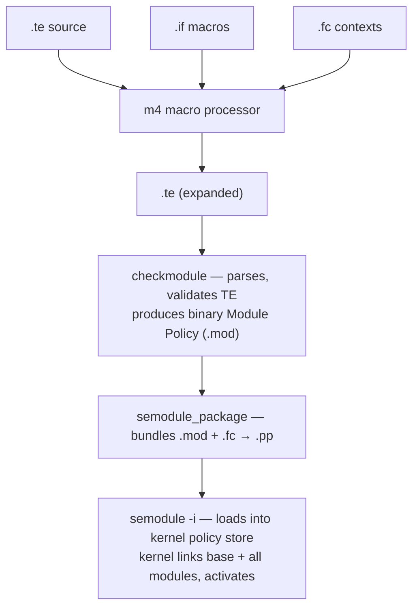

# Lesson 2: Policy Architecture, Language Primitives

## 1. First-Principles Intuition & Invariants

Every access control system rests on a foundational question: who decides what a process is allowed to do, and when was that decision made? In discretionary access control (DAC), the answer is the resource owner, at runtime, using permission bits that can be changed by the same process that relies on them. This circularity is not a bug in a narrow sense; it is the entire design philosophy of Unix permissions, which optimized for administrative convenience rather than adversarial resistance. SELinux was engineered on a different axiom entirely: policy is defined by a system administrator, compiled into a binary artifact before the system boots, and enforced by the kernel regardless of what any process — including root — requests at runtime. The policy is not advisory; it is mandatory.

This distinction is not merely philosophical. Consider a vulnerability in a web server that achieves arbitrary code execution as the `apache` user or even as `root`. Under DAC, that compromised process inherits the full capability set of its user. Under SELinux Mandatory Access Control (MAC), the process runs in a *type domain* — a label enforced by the kernel — and that domain has been granted only the permissions necessary to serve HTTP requests. The exploit may succeed in corrupting execution flow, but the resulting process cannot open `/etc/shadow`, cannot write to `/boot`, and cannot load a kernel module because those operations require rules that were never written into policy for the `httpd_t` domain. The attacker has compromised code, but the blast radius is bounded at policy compilation time, not at runtime.

The theoretical foundation for this architecture is the *type enforcement* (TE) model, which was formalized at the National Security Agency in the early 1990s as part of the Flask microkernel security architecture. Flask decomposed the access decision into two orthogonal operations: a *security server* that evaluates policy and renders a decision, and an *object manager* embedded in the kernel that caches and enforces that decision. Linux Security Modules (LSM), merged into mainline Linux in 2.6, gave SELinux its integration point: a dense array of hook functions called by the kernel at every security-relevant operation — `open`, `mmap`, `connect`, `execve`, `mprotect`, and several hundred others — before the kernel's own capability checks complete. The LSM hooks receive the security labels of both the subject (process) and the object (file, socket, IPC resource), hand them to the SELinux security server, and either proceed or return `-EACCES` based on the verdict.

The fundamental invariant of SELinux policy that every practitioner must internalize is this: **all access is denied by default unless an explicit `allow` rule grants it**. There is no concept of an implicit permission inherited from group membership or process privilege. A transition from `init_t` to `httpd_t` on `execve` of the web server binary is not automatic — it requires an explicit `type_transition` rule. A file created by a process in domain `httpd_t` does not inherit a type from its parent directory by default — it receives the type specified by the transition rules in policy, or falls back to the filesystem default. This closed-world assumption is what gives SELinux its security guarantees and what makes policy authorship genuinely difficult: you cannot rely on ambient privilege, only on rules you have explicitly authored.

The second invariant is *orthogonality of enforcement*. SELinux labels coexist with, and are evaluated after, DAC checks. A process must pass both. This means SELinux can tighten permissions below what DAC grants (`root` being the canonical example), but it cannot loosen them above what DAC forbids. In practice, for hardened systems this is irrelevant since DAC permissions are set permissively and SELinux is the actual enforcement layer, but it matters during policy debugging: an `avc: denied` message tells you SELinux blocked the operation, while a silent failure might mean DAC blocked it before SELinux was even consulted.

The third invariant concerns *label persistence and consistency*. A security label — called a *security context* — is a four-part tuple: `user:role:type:level`. The `type` component is the dominant field for most enforcement decisions under TE policy. Files on disk have extended attributes (`security.selinux`) that store their type. Processes carry their domain in the kernel's `task_struct`, derived at `execve` from the executable's type and the calling domain's transition rules. Network packets carry labels in netlabel or CIPSO headers. This pervasiveness means that any object whose label is unknown, corrupted, or missing (the `unlabeled_t` type in policy) is immediately constrained by the rules governing `unlabeled_t`, which in a strict policy are essentially none. An unlabeled file on an SELinux system is effectively inaccessible until relabeled — a property that becomes a powerful invariant for detecting filesystem tampering in embedded and IoT contexts.

---

## 2. Core Architecture & Mechanics

### Policy Compilation Pipeline

SELinux policy is not interpreted at runtime from text files. It is compiled into a monolithic binary — the *policy store* — using a toolchain that performs semantic validation, macro expansion, and optimization. Understanding this pipeline is essential for practitioners who write custom policy, audit vendor policy, or analyze the attack surface exposed to a confined process.

The source language is split across three distinct file types. Plain `.te` files contain type enforcement rules: type declarations, attribute assignments, `allow` rules, and `type_transition` statements. Interface files (`.if`) define reusable macros that abstract common rule patterns, the SELinux equivalent of a library header. File context files (`.fc`) define the regular expressions that `restorecon` and `setfiles` use to assign types to filesystem paths. These three artifacts feed into the `checkpolicy` and `semodule_package` toolchain, which produces a loadable `.pp` module. The kernel's policy loader then links all loaded modules with the base policy into the kernel's internal representation.



The key architectural insight here is that the kernel's active policy is a *linked* artifact. The base policy module contains all core types, and additional modules extend it. When `semodule -i my_module.pp` runs, the entire policy store is relinked and replaced atomically — the kernel sees a consistent new policy at the moment of reload, with no window during which partial rules are active. This matters for security: policy updates on a running system cannot be partially applied.

### Type Declarations, Attributes, and Domain Transitions

The building block of every SELinux policy is the *type declaration*. A type is simply a named label — an integer in the kernel's internal representation — associated with either a process domain or a file/resource class. The declaration syntax is minimal:

```text
type httpd_t;
type httpd_exec_t;
type httpd_log_t;
type httpd_var_run_t;
```

These four declarations define a process domain (`httpd_t`), an entry point file type (`httpd_exec_t`), a log file type (`httpd_log_t`), and a runtime state directory type (`httpd_var_run_t`). Without attributes or allow rules, these types are isolated islands — no process can reach them, and no transition targets them. They become meaningful only through the rules that connect them.

Attributes are the mechanism by which SELinux policy achieves composability without combinatorial explosion. Rather than writing allow rules for every domain that needs to read a configuration file, the policy author declares an attribute and writes the rule once against the attribute. All types that inherit the attribute automatically benefit from the rule.

```text
attribute domain;
attribute file_type;
attribute exec_type;

type httpd_t;
typeattribute httpd_t domain;

type httpd_exec_t;
typeattribute httpd_exec_t file_type, exec_type;
```

This pattern is pervasive in the Reference Policy, the upstream SELinux policy maintained by Tresys/Red Hat that ships with Fedora, RHEL, and most enterprise Linux distributions. When you read `corenet_tcp_bind_generic_port(httpd_t)` in an interface file, you are calling a macro that expands to allow rules against attribute-grouped types — it does not enumerate every network socket type individually.

Domain transitions are the mechanism by which a process changes its security label across an `execve`. The kernel enforces three conditions for a transition to occur: the calling domain must have `execute` permission on the executable's type, it must have `transition` permission to the new domain, and the entry point type must have `entrypoint` permission for the new domain. All three conditions expressed in policy look like this:

```text
allow httpd_t httpd_exec_t : file { execute read open getattr };
allow httpd_t httpd_t      : process transition;
allow httpd_t httpd_exec_t : file entrypoint;

type_transition httpd_t httpd_exec_t : process httpd_t;
```

The `type_transition` rule is automatic — when `init_t` (or `systemd_t`) executes a file labeled `httpd_exec_t`, the kernel automatically transitions the new process into `httpd_t` without any userspace cooperation. This is architecturally important for security: the transition is enforced by the kernel, not requested by the process. A compromised `init` cannot suppress the transition by simply not calling `setcon()`.

For practitioners working on embedded systems or custom init frameworks, this mechanism means you must label your init binaries, service executables, and any wrapper scripts correctly, or the transition will silently fail and your service will run under its parent's domain — often `init_t` or `kernel_t` — granting it far more access than intended and producing no AVC denial because the domain has the permissions needed.

### The Four Rule Types: Allow, AuditAllow, DontAudit, NeverAllow

SELinux TE policy expresses decisions using exactly four rule keywords, each with a distinct semantic.

The `allow` rule is the grant primitive. `allow httpd_t httpd_log_t : file { write append create getattr }` permits a process in domain `httpd_t` to perform those specific operations on any file labeled `httpd_log_t`. Every component of this rule is mandatory: the source domain, the target type, the object class (here `file`, but could be `dir`, `socket`, `process`, `capability`, `netlink_route_socket`, and over 70 others), and the permission set within that class.

The `auditallow` rule is a pure audit primitive — it generates an AVC message in the audit log every time the operation *succeeds*. It does not grant permission; that must come from an `allow` rule. Its primary use case is forensic: you want to know every time `httpd_t` reads a configuration file, not because you want to block it, but because you want an audit trail. For hardware security researchers analyzing firmware behavior or performing dynamic taint analysis, `auditallow` is a low-overhead instrumentation mechanism that requires no kernel recompilation or eBPF infrastructure.

The `dontaudit` rule suppresses the AVC denial log message for a specific operation. This sounds counterintuitive — why would you silence a denial? — but in practice it is essential for reducing audit log noise from operations that are known-harmless and expected to fail. A web server probing for `/etc/host.conf` during library initialization will generate a denial if that file is labeled `etc_t` and `httpd_t` has no read permission on it. If this probe is a cosmetic library check that always fails gracefully, logging thousands of denials per hour obscures real security events. The `dontaudit` rule silences the log entry while keeping the enforcement. Its danger, and this is a critical practitioner warning, is that it can mask legitimate access denials during policy development. The `semodule --disable_dontaudit` flag re-enables all suppressed audit messages and should be standard procedure when debugging unexpected application failures on SELinux systems.

The `neverallow` rule is unique: it is a compile-time assertion, not a runtime enforcement mechanism. It does not create a kernel rule; it causes `checkpolicy` to abort with an error if any other rule in the loaded policy would grant the specified permission. `neverallow ~httpd_t httpd_config_t : file write;` asserts that no domain except `httpd_t` should ever be allowed to write files labeled `httpd_config_t`. If a module author accidentally grants that permission — perhaps through an overly broad attribute assignment — the policy will fail to compile. This makes `neverallow` the SELinux equivalent of a compile-time invariant, a property that defensive policy authors and security auditors should exploit aggressively. The NSA's MLS policy ships dozens of `neverallow` assertions protecting the highest-sensitivity label transitions; auditing these assertions is one of the most efficient ways to understand a policy's security model.

### Role-Based Access Control Integration

SELinux implements RBAC as a layer above TE, governing which users may enter which roles, and which roles may transition to which type domains. The model is intentionally not fine-grained at the object level — that is TE's job. RBAC in SELinux answers a narrower question: given a human user identity, what set of domains can they legitimately reach?

A role declaration establishes a named role, and `role_allow` rules determine which roles can transition to other roles. A type is associated with a role through `role` declarations:

```text
role staff_r;
role sysadm_r;

role staff_r types { staff_t staff_su_t };
role sysadm_r types { sysadm_t staff_t };

allow staff_r sysadm_r;
```

This policy fragment says that a user in the `staff_r` role, running in `staff_t` or `staff_su_t` domains, may transition to `sysadm_r` — presumably after authentication through `su` or `sudo`. The `allow staff_r sysadm_r` rule does not cause the transition automatically; it permits it, subject to the TE rules that govern the actual domain transition through the `su` binary's exec transition.

For embedded and IoT practitioners, RBAC is often stripped to its minimal form: a single `system_r` role and a single `user_r` role, because there is no concept of interactive users logging in through a session manager. The RBAC layer exists in the policy but all process domains are assigned to `system_r`, and the actual enforcement is handled entirely by TE. This is correct practice — do not over-engineer RBAC for headless systems, but do not remove it from the policy grammar entirely, since the kernel enforces role consistency and removing roles requires policy recompilation.

### Multi-Level Security and Sensitivity Labels

Multi-Level Security (MLS) adds a fourth dimension to the security context — the `level` field — implementing a Mandatory Integrity / Information Flow model derived from the Bell-LaPadula secrecy model and the Biba integrity model. A level consists of a *sensitivity* and a set of *categories*: `s0:c0,c1` means sensitivity level zero with categories zero and one. The kernel enforces two foundational properties: no read up (a process may not read data at a higher sensitivity than its own clearance), and no write down (a process may not write data to a lower sensitivity than its own label).

The practical relevance of MLS for the security practitioner audience is not in its theoretical purity but in its operational mechanics. MLS policy constraints are expressed as `mlsconstrain` rules that operate on pairs of contexts and are evaluated alongside TE rules. A process in `httpd_t` at `s0` trying to access a file at `s1` will be denied not by an `allow` rule but by the MLS constraint on the `file` class's `read` permission, which checks `h1 dom h2` (the high-clearance of the subject dominates the high-clearance of the object). This constraint evaluates independently of TE, meaning you can have a correct TE `allow` rule and still be denied by MLS — a source of confusion in multi-category deployments.

```text
mlsconstrain file { read getattr }
    ( l1 dom l2 );

mlsconstrain file { write append }
    ( h1 domby h2 );
```

The first constraint permits a read only if the subject's low-sensitivity level dominates the object's low level. The second permits a write only if the subject's high-sensitivity level is dominated by the object's high level (no write-down). For practitioners working in environments that handle data at multiple classification levels — defense contractors, aerospace firmware vendors, government systems — these constraints are non-negotiable infrastructure, not an optional add-on.

---

## 3. High-Performance Optimization & Failure Modes

### The AVC Cache and Policy Lookup Performance

The kernel's access vector cache (AVC) is a fixed-size hash table that caches the results of policy lookups. Without the AVC, every system call that triggers an LSM hook would require a full policy binary traversal — prohibitively expensive at kernel-syscall frequencies. The AVC stores `(source_type, target_type, class) → allowed_permissions` entries, amortizing the lookup cost across millions of identical operations.

The AVC miss rate is the most important performance variable in SELinux-enabled systems under high syscall load. You can observe AVC statistics directly:

```bash
cat /sys/fs/selinux/avc/cache_stats
```

This outputs per-CPU hit/miss/alloc/reclaim counts. On a correctly labeled system with stable policy, the miss rate should drop to near zero within seconds of a service starting, as the AVC warms up with the domain's access pattern. A persistently high miss rate — above 5% under steady-state load — indicates one of three conditions: the domain is accessing an unusually wide variety of object types (pathological for security, since this implies the domain has overly broad access), the policy has an extremely large number of distinct types causing cache pressure, or the AVC size is misconfigured.

The AVC hash table size is tunable at boot via the `avc_cache_threshold` kernel parameter, defaulting to 512 entries. For high-throughput servers or embedded systems with constrained memory, this threshold requires explicit tuning:

```bash
# Increase AVC cache to 2048 entries (must be a power of two)
# Add to kernel command line: selinux_avc_threshold=2048
grep avc_cache_threshold /boot/grub2/grub.cfg
```

Practitioners optimizing SELinux for latency-sensitive workloads — real-time control systems, high-frequency network processing — should profile AVC miss rates alongside application latency to determine whether policy type granularity is contributing to syscall overhead.

### Policy Authoring Workflow: From AVC Denials to Correct Rules

The standard iterative policy development workflow for a new application domain follows a sequence of controlled permissiveness, audit collection, automated rule generation, and semantic validation. The tooling is `audit2allow` for rule generation, `audit2why` for semantic explanation, and `sesearch` for policy querying.

Place the application's domain in permissive mode without permissiving the entire system. This is a critical point: system-wide permissive mode (`setenforce 0`) defeats all enforcement globally and should never be used on production systems. Per-domain permissive mode allows the target application to function while SELinux continues enforcing all other domains:

```bash
semanage permissive -a httpd_t
```

Run the application through its full operational profile — startup, nominal operation, shutdown, error recovery. The kernel will log all operations that would have been denied as AVC messages tagged with `permissive=1`. Collect these:

```bash
ausearch -m avc -ts recent | audit2allow -m my_httpd_policy
```

`audit2allow` generates a `.te` snippet with `allow` rules derived from the denials. This output is a starting point, not a finished policy. Every generated rule must be audited by the practitioner for semantic correctness. `audit2allow` will faithfully generate `allow my_httpd_t kernel_t : process { ptrace }` if the application triggered that denial, but granting a web server ptrace permission over kernel threads is a critical security defect regardless of what the application requested.

The correct workflow is to pipe `audit2allow` output into `audit2why` for each denial to understand the underlying cause before accepting the rule:

```bash
ausearch -m avc -ts recent | audit2why
```

`audit2why` explains why the denial occurred — missing allow rule, missing role association, MLS constraint violation — and distinguishes cases where adding an `allow` rule would actually be incorrect (MLS violations, for instance, require label corrections rather than new allow rules).

After generating candidate rules, use `sesearch` to query the loaded policy and verify the rules are absent before adding them, and present after loading:

```bash
# Query existing allow rules for a domain
sesearch --allow --source httpd_t --class file

# Check for neverallow assertions before submitting a new rule
sesearch --neverallow --source httpd_t --target etc_t --class file
```

### Failure Mode: The Unlabeled Filesystem Problem

One of the most dangerous failure modes in production SELinux deployments — and the most common source of "SELinux is broken" misdiagnoses — is the unlabeled filesystem. This occurs when files exist without a `security.selinux` extended attribute, typically after an in-place OS upgrade, a filesystem restore from a non-SELinux backup, or a mount of a foreign filesystem.

Files without labels receive the `unlabeled_t` type. Because `unlabeled_t` has almost no allow rules in standard policy, any process attempting to access these files will be denied with an AVC message pointing to `unlabeled_t` as the target type. The fix is relabeling, not policy expansion — expanding allow rules for `unlabeled_t` would defeat the entire purpose of mandatory labeling.

```bash
# Check for unlabeled files in a directory tree
find /var/www/html -context "*:unlabeled_t:*" -print

# Restore correct labels based on file context database
restorecon -Rv /var/www/html

# Full system relabel on next boot (creates flag file for systemd)
touch /.autorelabel
systemctl reboot
```

For embedded engineers shipping custom firmware images, the relabeling step must be part of the image build pipeline. Use `setfiles` with the compiled policy binary and file context definitions to stamp labels into the filesystem image before flashing:

```bash
setfiles -r /path/to/rootfs \
    /etc/selinux/targeted/contexts/files/file_contexts \
    /path/to/rootfs
```

Failing to do this means the device boots with a fully unlabeled filesystem and SELinux either runs in permissive mode (providing no enforcement) or denies everything (bricking the device). Neither outcome is acceptable in a shipping embedded product.

### Failure Mode: Incorrect Type Transitions for Custom Init Systems

Embedded systems frequently use minimal init frameworks — BusyBox init, s6, runit, or custom C init binaries — rather than systemd. These frameworks do not call `setexeccon()` before `execve()` to request a domain transition, nor do they interact with the SELinux policy in any way. The kernel's automatic `type_transition` rules are therefore the only mechanism available, and they are fragile if the init binary is not labeled correctly.

The diagnostic approach is to identify the domain of the init process, the label of each service binary, and verify the `type_transition` chain:

```bash
# Check init's current domain
ps -eZ | grep init

# Check binary label
ls -Z /sbin/my_service

# Verify transition rule exists
sesearch --type_trans --source init_t --target my_service_exec_t --class process
```

If no transition rule exists, the service executes in `init_t`, inheriting init's full permission set. The correct fix is to add the missing `type_transition` rule and ensure the binary carries the correct `exec_t` label — not to broaden `init_t`'s permissions or run the system without enforcement.

### NeverAllow as a Policy Invariant Testing Strategy

For practitioners performing security audits of third-party SELinux policies — vendor policies shipping with IoT firmware, container base images, or embedded Linux distributions — the `neverallow` mechanism provides a systematic way to assert and test invariants about what the policy should *never* permit.

The audit workflow is to compile a set of `neverallow` assertions representing your security model and attempt to load them as a separate module:

```text
neverallow ~kernel_t self : capability sys_module;
neverallow ~sysadm_t ~shadow_t : file { read write };
neverallow httpd_t { etc_t passwd_file_t shadow_t } : file write;
```

These three assertions say, respectively: only the kernel domain may load modules; only the sysadmin domain may access shadow-type files; and the web server domain must never write to core system configuration types. Load these as a policy module and if `checkpolicy` accepts them against the target policy's binary, your invariants hold. If it rejects them with a conflict, you have identified a genuine policy weakness — a rule exists that your security model prohibits — and can trace it back to the specific `.te` source rule that grants the offending permission.

This technique is essentially property-based testing for security policy, and it scales to complex multi-domain policies where manual rule inspection becomes impractical. For offensive security practitioners, the inverse is equally useful: searching for `allow` rules that contradict what a vendor's documentation claims their policy enforces reveals the gap between stated security model and actual enforcement.
