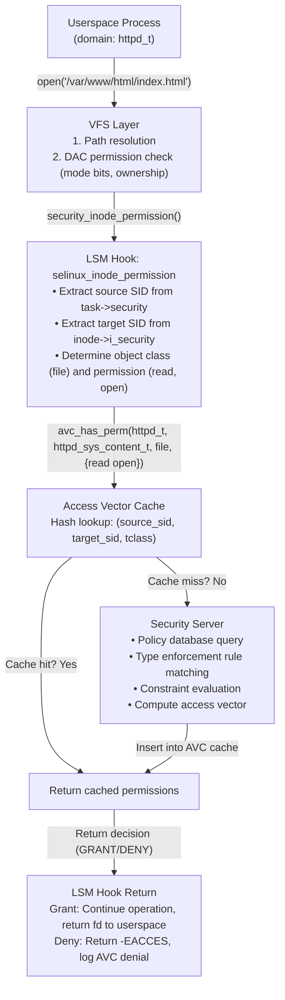

# Lesson 3: Enforcement Mechanisms, Kernel Integration

## 1. First-Principles Intuition & Invariants

SELinux operates as a mandatory access control enforcement framework embedded deeply within the Linux kernel, fundamentally altering the traditional discretionary access control model where resource owners determine access permissions. To understand how SELinux intercepts every security-sensitive operation in the kernel and evaluates it against a centralized policy, we must first grasp the architectural contract between the kernel's generic security infrastructure and SELinux's policy engine.

At the heart of this integration lies the Linux Security Module framework, a generalized hooking interface introduced in the 2.6 kernel series to allow pluggable security modules without hard-coding specific mandatory access control implementations directly into core kernel subsystems. The LSM framework instruments critical kernel code paths—system call handlers, filesystem operations, network socket operations, IPC mechanisms, and capability checks—with strategically placed function calls that delegate authorization decisions to the active security module. When SELinux registers itself as the active LSM at boot time, it installs callback functions at these hook points, transforming every security-relevant kernel operation into a two-phase process: first the traditional discretionary access control check executes, and only if that passes does control flow into the SELinux authorization logic.

This architectural layering establishes a crucial invariant: SELinux enforcement always occurs after DAC checks, never replacing them but instead supplementing them with mandatory policy constraints. A process attempting to open a file must first satisfy traditional Unix permission bits and ownership rules before SELinux even evaluates whether the process domain has the appropriate type enforcement permissions for the target file's security context. This ordering reflects a defense-in-depth philosophy where DAC provides coarse-grained, easily administered first-pass filtering while SELinux enforces fine-grained, system-wide mandatory constraints that transcend individual user preferences.

The enforcement decision flow centers on three principal components that form SELinux's runtime architecture: the object managers embedded throughout the kernel that request authorization decisions, the security server that evaluates policy rules and renders access verdicts, and the Access Vector Cache that memoizes recent decisions to avoid repeatedly consulting the policy engine for identical authorization queries. Understanding the mechanical operation of these components, their data flow patterns, and their performance characteristics is essential for practitioners debugging policy violations, optimizing enforcement overhead, or analyzing security module behavior during exploit development or system hardening.

The fundamental security model enforced by these mechanisms revolves around the concept of subjects acting on objects, where every entity in the system carries a security context comprising a user identity, a role, a type, and optionally a sensitivity level. When a subject attempts an operation on an object, SELinux extracts both security contexts, identifies the operation class and the specific permission requested, then queries the policy to determine whether any allow rule explicitly grants that permission. This default-deny posture means that unless policy explicitly permits an operation, it will be blocked, establishing a security invariant that prevents privilege escalation through unanticipated code paths or unmodeled interactions.

## 2. Core Architecture & Mechanics

The LSM framework instruments the kernel through a comprehensive set of hook functions declared in the `security_operations` structure, which SELinux populates during module initialization. These hooks cluster into logical subsystems: filesystem hooks intercept operations like `open`, `read`, `write`, `unlink`, and `chmod`; process hooks mediate `fork`, `execve`, `setuid`, and signal delivery; socket hooks control network operations including `bind`, `connect`, `send`, and `receive`; and IPC hooks govern shared memory, semaphores, and message queues. Each hook receives relevant kernel objects and operation parameters, allowing the security module to inspect the complete context of the requested operation.

Consider the filesystem open operation as a concrete example of this hook invocation pattern. When userspace issues an `open` system call, the kernel's virtual filesystem layer resolves the pathname to an inode, performs discretionary permission checks against the inode's mode bits and ownership, then invokes the `security_inode_permission` hook before returning the file descriptor to userspace. SELinux's implementation of this hook extracts the security context from the calling process's task structure, retrieves the security context associated with the target inode from its extended attributes, determines the requested permission based on the open flags, and initiates a policy query to the security server.

The security server constitutes the policy enforcement engine, maintaining an in-kernel representation of the compiled binary policy loaded during system initialization. This policy representation structures type enforcement rules, role-based access control constraints, and multi-level security rules into efficient lookup tables indexed by security context components. When an object manager requests an authorization decision, the security server parses the source context, target context, and requested permission triplet, then walks the policy tables to identify matching allow rules. If the policy contains an explicit allow statement granting the source type permission to perform the requested operation on the target type within the appropriate object class, the security server returns an access granted decision; otherwise it returns denial.

The Access Vector Cache dramatically reduces the performance overhead of this policy consultation process by memoizing security server decisions in a hash table keyed by the tuple of source security identifier, target security identifier, and object class. Each cache entry stores a bitmask representing the complete set of permissions granted between that source-target pair for that object class, allowing subsequent authorization requests to be satisfied through a single hash lookup rather than a full policy traversal. The AVC implements a least-recently-used eviction policy to manage cache capacity, and it invalidates affected entries whenever policy is reloaded or security contexts change, maintaining cache coherency with the authoritative policy representation.

The mechanical flow of an enforcement decision proceeds through these components in a precisely orchestrated sequence:



The security identifier abstraction plays a critical role in this architecture, serving as an integer handle that represents a complete security context string. When the kernel needs to associate a security context with an object, SELinux allocates a SID and maintains the bidirectional mapping between SIDs and context strings in the security server's SID table. This indirection allows the kernel to perform rapid integer comparisons and hash table lookups rather than manipulating variable-length security context strings throughout the enforcement path, while centralizing string parsing and validation logic within the security server.

Object managers exist as specialized enforcement components distributed throughout the kernel subsystems, each responsible for mediating access to a particular object type according to SELinux policy. The inode security manager handles filesystem objects, maintaining security contexts in extended attributes and enforcing type transitions during file creation. The task security manager controls process operations, implementing domain transitions during `execve` and enforcing constraints on signal delivery and ptrace attachment. The socket security manager mediates network operations, labeling packets with the sending process's security context and enforcing ingress filtering based on network peer labels. Each object manager implements the security hook callbacks relevant to its subsystem, translating kernel-specific operations into abstract permission checks that the security server can evaluate against policy.

Domain transitions represent one of the most powerful and complex enforcement mechanisms in SELinux, allowing processes to change their security context during `execve` system calls based on policy-defined rules. When a process executes a new program binary, the kernel invokes the `security_bpo_creds_for_exec` hook, prompting SELinux to determine whether a domain transition should occur. The security server evaluates three distinct policy rules: a transition rule specifying the target domain, a type enforcement rule allowing the source domain to execute the program file, and a type enforcement rule allowing the source domain to transition into the target domain. Only when all three rules exist and grant the necessary permissions does the domain transition proceed, with the new process credentials receiving the target domain label.

This three-rule requirement establishes a defense-in-depth mechanism preventing unauthorized privilege escalation through domain transitions. Consider a confined web server process running in the `httpd_t` domain attempting to execute a CGI script labeled `httpd_sys_script_exec_t` that should run in the elevated `httpd_sys_script_t` domain. Policy must explicitly contain a type transition rule `type_transition httpd_t httpd_sys_script_exec_t : process httpd_sys_script_t`, an allow rule `allow httpd_t httpd_sys_script_exec_t : file { execute }` granting execute permission on the script file, and an allow rule `allow httpd_t httpd_sys_script_t : process transition` authorizing the domain change. If any of these rules is absent, the transition fails and the CGI script either executes within the parent `httpd_t` domain or the `execve` call is denied entirely depending on policy configuration.

File relabeling operations through the `chcon` utility or the `setfilecon` library function trigger a distinct enforcement path that validates the calling process's authority to change security contexts. The `security_inode_setxattr` hook intercepts attempts to modify the `security.selinux` extended attribute, and SELinux checks whether the source domain possesses `relabelfrom` permission for the file's current type and `relabelto` permission for the proposed new type. This symmetric permission model prevents a confined process from both removing restrictive labels from files it controls and from applying privileged labels to files it creates, containing the damage from a compromised application even if it gains limited write access to filesystem objects.

The enforcement mode configuration determines how SELinux responds to policy violations, providing three distinct operational states that balance security enforcement against system usability during policy development and troubleshooting. In enforcing mode, the security server's denial decisions are immediately enforced, returning permission denied errors to the calling process and blocking the attempted operation. Permissive mode allows all operations to proceed regardless of policy but logs every denial decision to the audit log, enabling administrators to observe what would be blocked under full enforcement without disrupting application functionality. Disabled mode completely deactivates the LSM hooks, eliminating all SELinux enforcement overhead but also removing mandatory access control protection. The kernel parameter `enforcing=0` on the boot command line or the runtime `setenforce` command toggle between enforcing and permissive modes, while permanently disabling SELinux requires modifying `/etc/selinux/config` and rebooting.

## 3. High-Performance Optimization & Failure Modes

The Access Vector Cache serves as the primary performance optimization mechanism in the SELinux enforcement path, but its effectiveness depends critically on cache hit rates and eviction patterns under realistic workload conditions. A well-configured system with stable process populations and predictable filesystem access patterns typically achieves AVC hit rates exceeding ninety-five percent, reducing the overhead of most enforcement decisions to a single hash table lookup. However, workloads that rapidly create and destroy processes with diverse security contexts or that access filesystem objects with high label diversity can thrash the AVC, forcing frequent fallback to the computationally expensive security server policy walks.

Profiling AVC performance requires examining the cache statistics exposed through the SELinux filesystem mounted at `/sys/fs/selinux`. The `avc/cache_stats` file reports hit and miss counts across cache buckets, revealing both overall hit rate and the distribution of cache pressure across hash table partitions. Pathological miss rates often indicate either insufficient cache capacity for the workload's working set or excessive security context diversity resulting from overly granular policy labeling. Increasing the AVC cache size through the `avc_cache_threshold` tunable can mitigate capacity constraints, while policy refactoring to consolidate related types into coarser-grained equivalence classes reduces the cardinality of the SID space and improves cache density.

```c
#include <stdio.h>
#include <stdlib.h>
#include <string.h>
#include <selinux/selinux.h>
#include <selinux/avc.h>

/*
 * AVC cache instrumentation utility
 * Demonstrates direct interaction with the SELinux userspace AVC
 * and performance measurement of policy decision caching.
 */

struct avc_stats {
    unsigned long lookups;
    unsigned long hits;
    unsigned long misses;
    unsigned long allocations;
    unsigned long reclaims;
};

void parse_cache_stats(const char *stats_path, struct avc_stats *stats) {
    FILE *fp = fopen(stats_path, "r");
    if (!fp) {
        perror("Failed to open AVC cache stats");
        return;
    }

    char line[256];
    memset(stats, 0, sizeof(*stats));
    
    while (fgets(line, sizeof(line), fp)) {
        if (sscanf(line, "lookups: %lu", &stats->lookups) == 1) continue;
        if (sscanf(line, "hits: %lu", &stats->hits) == 1) continue;
        if (sscanf(line, "misses: %lu", &stats->misses) == 1) continue;
        if (sscanf(line, "allocations: %lu", &stats->allocations) == 1) continue;
        if (sscanf(line, "reclaims: %lu", &stats->reclaims) == 1) continue;
    }
    
    fclose(fp);
}

void display_cache_performance(const struct avc_stats *stats) {
    double hit_rate = 0.0;
    if (stats->lookups > 0) {
        hit_rate = (double)stats->hits / stats->lookups * 100.0;
    }
    
    printf("=== SELinux AVC Cache Performance ===\n");
    printf("Total lookups:     %lu\n", stats->lookups);
    printf("Cache hits:        %lu\n", stats->hits);
    printf("Cache misses:      %lu\n", stats->misses);
    printf("Hit rate:          %.2f%%\n", hit_rate);
    printf("Allocations:       %lu\n", stats->allocations);
    printf("Reclaims:          %lu\n", stats->reclaims);
    
    if (hit_rate < 90.0) {
        printf("\n[WARNING] Cache hit rate below 90%% - consider:\n");
        printf("  - Increasing AVC cache size\n");
        printf("  - Reducing security context cardinality\n");
        printf("  - Analyzing policy for excessive type granularity\n");
    }
}

int main(void) {
    if (!is_selinux_enabled()) {
        fprintf(stderr, "SELinux is not enabled on this system\n");
        return 1;
    }

    struct avc_stats stats;
    parse_cache_stats("/sys/fs/selinux/avc/cache_stats", &stats);
    display_cache_performance(&stats);

    return 0;
}
```

Compile and execute this instrumentation utility to baseline AVC performance on a production system:

```bash
gcc -Wall -O2 -o avc_stats avc_stats.c -lselinux
./avc_stats
```

Domain transition failures constitute one of the most common operational issues encountered when deploying SELinux in production environments, manifesting as applications failing to start, spawned subprocesses executing with incorrect security contexts, or privilege escalation mechanisms unexpectedly blocked. Diagnosing these failures requires systematic analysis of the three-rule transition requirement, examining audit logs to identify which component of the transition authorization failed. The `ausearch` utility filters audit logs for AVC denial messages, and the `audit2why` tool translates denial records into human-readable explanations identifying missing policy rules.

A complete domain transition diagnostic workflow proceeds through several stages of progressively deeper investigation. First, verify that the executable file carries the expected target domain label using `ls -Z` to display security contexts, confirming that the file's type matches the policy's type transition rule. Second, examine recent AVC denials using `ausearch -m avc -ts recent` to identify which permission was denied—execute permission on the file, transition permission from source to target domain, or entrypoint permission allowing the target domain to use the file as an entry point. Third, use `sesearch` to query the loaded policy for relevant rules, confirming whether the required allow and transition rules exist or are missing. Fourth, if rules exist but transitions still fail, investigate whether conditional policy statements or constraint rules are blocking the transition based on runtime conditions.

```bash
#!/bin/bash
# Domain transition diagnostic script
# Analyzes why a domain transition may be failing

set -euo pipefail

if [ $# -ne 2 ]; then
    echo "Usage: $0 <source_domain> <target_executable>"
    exit 1
fi

SOURCE_DOMAIN="$1"
TARGET_EXEC="$2"

echo "=== SELinux Domain Transition Diagnostic ==="
echo "Source domain: $SOURCE_DOMAIN"
echo "Target executable: $TARGET_EXEC"
echo

# Check if SELinux is enabled
if ! sestatus | grep -q "SELinux status:.*enabled"; then
    echo "ERROR: SELinux is not enabled"
    exit 1
fi

# Get current file context
echo "[1] Target executable security context:"
ls -Z "$TARGET_EXEC" 2>/dev/null || echo "File not found or inaccessible"
TARGET_TYPE=$(ls -Z "$TARGET_EXEC" 2>/dev/null | awk '{print $4}' | cut -d: -f3)
echo

# Check for type transition rules
echo "[2] Searching for type transition rules:"
sesearch --type_trans -s "$SOURCE_DOMAIN" -t "$TARGET_TYPE" -c process 2>/dev/null | \
    grep -v "^$" || echo "No type transition rules found"
echo

# Check for execute permission
echo "[3] Checking execute permission:"
sesearch --allow -s "$SOURCE_DOMAIN" -t "$TARGET_TYPE" -c file -p execute 2>/dev/null | \
    grep -v "^$" || echo "No execute permission found"
echo

# Check for transition permission
echo "[4] Checking transition permission:"
TRANSITION_TARGET=$(sesearch --type_trans -s "$SOURCE_DOMAIN" -t "$TARGET_TYPE" -c process 2>/dev/null | \
    awk '{print $NF}' | tr -d ';' | head -n1)

if [ -n "$TRANSITION_TARGET" ]; then
    echo "Expected target domain: $TRANSITION_TARGET"
    sesearch --allow -s "$SOURCE_DOMAIN" -t "$TRANSITION_TARGET" -c process -p transition 2>/dev/null | \
        grep -v "^$" || echo "No transition permission found"
    echo
    
    # Check for entrypoint permission
    echo "[5] Checking entrypoint permission:"
    sesearch --allow -s "$TRANSITION_TARGET" -t "$TARGET_TYPE" -c file -p entrypoint 2>/dev/null | \
        grep -v "^$" || echo "No entrypoint permission found"
else
    echo "Cannot determine target domain - no transition rule found"
fi
echo

# Check recent AVC denials
echo "[6] Recent AVC denials related to this transition:"
ausearch -m avc -ts recent 2>/dev/null | \
    grep -E "($SOURCE_DOMAIN|$TARGET_TYPE)" | \
    tail -20 || echo "No recent denials found"
```

File relabeling operations require careful coordination between filesystem extended attribute operations and the AVC cache invalidation mechanism to maintain enforcement consistency. When a security context changes through `chcon`, `restorecon`, or programmatic `setfilecon` calls, the kernel must not only update the persistent label stored in the `security.selinux` extended attribute but also invalidate all AVC cache entries referencing the modified object's previous SID. Failure to invalidate cached decisions would allow processes to continue accessing the relabeled object under the authorization rules associated with its old context, creating a temporal window where mandatory access control enforcement becomes inconsistent with the authoritative policy.

The inode security structure maintained by SELinux includes a SID field that caches the object's current security identifier, avoiding repeated extended attribute reads during rapid successive access operations. When a relabel operation executes, the `selinux_inode_setsecurity` hook allocates a new SID corresponding to the updated security context string, replaces the cached SID in the inode security structure, and invokes `avc_ss_reset` to flush affected cache entries. This synchronous invalidation ensures that subsequent access control decisions reflect the modified label, though it introduces a performance cost proportional to the number of cached entries referencing the relabeled object.

Production systems performing bulk relabeling operations—such as `restorecon -R` traversing an entire filesystem hierarchy—can experience substantial performance degradation from repeated AVC cache thrashing. Each relabeled inode triggers cache invalidation, and subsequent accesses to those inodes force security server queries to repopulate the cache. Optimizing these workflows requires batching relabel operations where possible and scheduling them during maintenance windows when enforcement overhead is acceptable. For initial filesystem labeling during system installation or upgrade, temporarily setting SELinux to permissive mode eliminates cache invalidation overhead while still logging what enforcement decisions would occur, allowing faster relabeling followed by a switch to enforcing mode once labeling stabilizes.

Enforcement mode transitions themselves present subtle consistency challenges that operators must understand to avoid security gaps or operational disruptions. Switching from permissive to enforcing mode through `setenforce 1` immediately activates denial enforcement for all subsequent operations, but it does not retroactively revoke access granted to already-open file descriptors or established network connections. A process that opened a file while enforcement was permissive retains that file descriptor even after transitioning to enforcing mode, allowing continued access that would be denied for a fresh open attempt. This semantic preserves running process state across mode transitions but requires operators to recognize that achieving full enforcement may necessitate restarting affected services to close legacy file descriptors and force reauthorization under enforcing mode policy.

The disabled enforcement mode deserves particular attention due to its interaction with persistent filesystem security contexts and the challenges of re-enabling SELinux after extended disabled operation. When SELinux is disabled, the kernel completely bypasses LSM hook invocations, eliminating all enforcement overhead but also ceasing to maintain security contexts on newly created files. Files created while SELinux is disabled lack the `security.selinux` extended attribute entirely, and when SELinux is subsequently re-enabled, these files appear with the default `unlabeled_t` type. This label typically receives highly restrictive policy, causing widespread application failures as programs cannot access their own configuration files or data directories. Recovering from this state requires a full filesystem relabel using `restorecon -R /` or `fixfiles relabel`, which can consume hours on large filesystems and requires careful coordination to avoid service disruptions.

Debugging enforcement decisions in production environments demands a structured approach combining audit log analysis, policy introspection, and runtime context examination. The `audit.log` file records every policy denial as an AVC message containing the source context, target context, object class, denied permissions, and additional metadata like process ID and executable path. Parsing these records manually becomes intractable under high denial rates, necessitating tools like `audit2allow` that aggregate denials and generate policy module source code to allow the denied operations. However, blindly applying `audit2allow` suggestions undermines security by permitting potentially dangerous operations without understanding why they occurred or whether they represent legitimate application behavior versus indicators of compromise.

A rigorous denial analysis workflow distinguishes between expected denials resulting from policy intentionally confining applications and unexpected denials indicating policy bugs or application misbehavior. Expected denials include confined web servers attempting to access user home directories, sandboxed applications trying to load unsigned kernel modules, or restricted services attempting network operations outside their designated port ranges. These denials represent policy working as designed, and they should not prompt policy relaxation. Unexpected denials might include system daemons failing to read their own configuration files due to incorrect labeling, legitimate applications blocked from accessing temporary directories because of missing policy rules, or service startup failures from unanticipated domain transition requirements. Only after categorizing a denial as unexpected and confirming the blocked operation is necessary for legitimate functionality should operators consider modifying policy to permit it.

The SELinux troubleshooting workflow integrates several specialized utilities forming a complete diagnostic toolkit. The `seinfo` command queries the loaded policy binary to enumerate types, classes, roles, users, and policy statistics, providing the foundation for understanding the policy's structure. The `sesearch` utility performs rule queries with sophisticated filtering by source type, target type, object class, and permission, enabling operators to verify whether specific allow rules exist. The `semanage` tool administers persistent policy customizations including file context mappings, port definitions, and boolean values, maintaining these modifications across system reboots and policy reloads. The `restorecon` utility recursively applies file context definitions from policy to filesystem objects, correcting labeling inconsistencies. Together these tools provide comprehensive visibility into policy state and enforcement behavior essential for operational troubleshooting.

```c
#include <stdio.h>
#include <stdlib.h>
#include <string.h>
#include <unistd.h>
#include <errno.h>
#include <selinux/selinux.h>
#include <selinux/context.h>

/*
 * Runtime enforcement mode controller and context inspector
 * Demonstrates programmatic SELinux mode manipulation and
 * security context introspection for diagnostic purposes.
 */

void print_current_mode(void) {
    int mode = security_getenforce();
    const char *mode_str;
    
    switch (mode) {
        case 1:
            mode_str = "Enforcing";
            break;
        case 0:
            mode_str = "Permissive";
            break;
        case -1:
            mode_str = "Disabled or Error";
            break;
        default:
            mode_str = "Unknown";
    }
    
    printf("Current enforcement mode: %s\n", mode_str);
}

void print_process_context(pid_t pid) {
    char *context = NULL;
    
    if (getpidcon(pid, &context) < 0) {
        fprintf(stderr, "Failed to get context for PID %d: %s\n",
                pid, strerror(errno));
        return;
    }
    
    context_t ctx = context_new(context);
    if (!ctx) {
        fprintf(stderr, "Failed to parse context: %s\n", context);
        freecon(context);
        return;
    }
    
    printf("\nProcess %d security context breakdown:\n", pid);
    printf("  Full context: %s\n", context);
    printf("  User:         %s\n", context_user_get(ctx));
    printf("  Role:         %s\n", context_role_get(ctx));
    printf("  Type:         %s\n", context_type_get(ctx));
    
    const char *range = context_range_get(ctx);
    if (range && strlen(range) > 0) {
        printf("  Range:        %s\n", range);
    }
    
    context_free(ctx);
    freecon(context);
}

void print_file_context(const char *path) {
    char *context = NULL;
    
    if (getfilecon(path, &context) < 0) {
        fprintf(stderr, "Failed to get context for %s: %s\n",
                path, strerror(errno));
        return;
    }
    
    context_t ctx = context_new(context);
    if (!ctx) {
        fprintf(stderr, "Failed to parse context: %s\n", context);
        freecon(context);
        return;
    }
    
    printf("\nFile '%s' security context:\n", path);
    printf("  Full context: %s\n", context);
    printf("  User:         %s\n", context_user_get(ctx));
    printf("  Role:         %s\n", context_role_get(ctx));
    printf("  Type:         %s\n", context_type_get(ctx));
    
    context_free(ctx);
    freecon(context);
}

int set_enforcement_mode(int enforcing) {
    if (geteuid() != 0) {
        fprintf(stderr, "Must be root to change enforcement mode\n");
        return -1;
    }
    
    if (security_setenforce(enforcing) < 0) {
        fprintf(stderr, "Failed to set enforcement mode: %s\n",
                strerror(errno));
        return -1;
    }
    
    printf("Enforcement mode set to: %s\n",
           enforcing ? "Enforcing" : "Permissive");
    return 0;
}

int check_access(const char *scontext, const char *tcontext,
                 const char *tclass, const char *perm) {
    int rc = selinux_check_access(scontext, tcontext, tclass, perm, NULL);
    
    printf("\nAccess check: %s -> %s (%s:%s)\n",
           scontext, tcontext, tclass, perm);
    printf("  Result: %s\n", rc == 0 ? "GRANTED" : "DENIED");
    
    return rc;
}

int main(int argc, char **argv) {
    if (!is_selinux_enabled()) {
        fprintf(stderr, "SELinux is not enabled on this system\n");
        return 1;
    }
    
    printf("=== SELinux Runtime Diagnostic Tool ===\n\n");
    
    print_current_mode();
    print_process_context(getpid());
    
    if (argc > 1) {
        for (int i = 1; i < argc; i++) {
            if (access(argv[i], F_OK) == 0) {
                print_file_context(argv[i]);
            }
        }
    }
    
    // Example access check
    char *my_context = NULL;
    if (getcon(&my_context) == 0) {
        check_access(my_context, "system_u:object_r:etc_t:s0",
                    "file", "read");
        freecon(my_context);
    }
    
    return 0;
}
```

Compile this diagnostic utility with full SELinux library support:

```bash
gcc -Wall -O2 -o selinux_runtime selinux_runtime.c -lselinux
# Run as root to examine enforcement mode and context details
sudo ./selinux_runtime /etc/passwd /var/log/audit/audit.log
```

Understanding the mechanical operation of enforcement mechanisms and their integration with kernel subsystems provides the foundation for effective SELinux deployment, troubleshooting, and security analysis. The LSM hook architecture, security server decision flow, AVC caching strategy, and domain transition semantics collectively implement a comprehensive mandatory access control framework that fundamentally alters the Linux security model from discretionary owner-controlled permissions to centrally administered mandatory policy. Mastering these mechanisms enables practitioners to confidently deploy SELinux in production environments, diagnose policy violations efficiently, and leverage mandatory access control as a robust defense against privilege escalation and lateral movement during security incidents.
