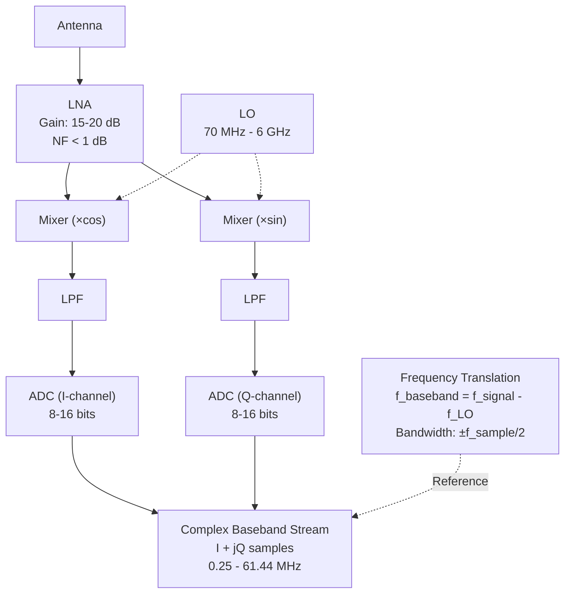

# Lesson 1: RF Fundamentals, Signal Theory, Spectrum Analysis

## 1. First-Principles Intuition & Invariants

Radio frequency signals represent one of the oldest yet most persistently exploitable attack surfaces in modern computing systems. Every wireless protocol, from Bluetooth and Wi-Fi to proprietary industrial control telemetry and satellite downlinks, transmits information as electromagnetic waves propagating through space at the speed of light. Unlike network packets traversing layered protocol stacks where defensive instrumentation is well-established, RF transmissions exist as raw analog phenomena in the physical domain before any digital processing occurs. This creates a fundamental asymmetry: attackers with software-defined radio capabilities can observe, manipulate, and inject signals at the physical layer with minimal forensic trace, bypassing cryptographic protections that assume integrity of the transmission medium itself.

Understanding software-defined radio begins with the recognition that all electromagnetic radiation at frequencies suitable for communication—ranging from hundreds of kilohertz to hundreds of gigahertz—obeys Maxwell's equations governing wave propagation. An accelerating charge generates time-varying electric and magnetic fields that detach from their source and propagate outward as coupled electromagnetic waves. The frequency of oscillation determines wavelength through the relationship λ = c/f, where c approximates 3×10⁸ meters per second in vacuum. A 2.4 GHz Wi-Fi transmission therefore exhibits a wavelength of approximately 12.5 centimeters, while a 433 MHz IoT telemetry signal stretches to roughly 69 centimeters. These physical dimensions govern antenna design, propagation characteristics, and ultimately the feasibility of interception or injection attacks at various ranges.

The power density of electromagnetic radiation diminishes with the square of distance from an isotropic radiator, formalized in the Friis transmission equation. This inverse-square law imposes a fundamental detection range limitation: doubling the distance from transmitter to receiver reduces received power by a factor of four, or six decibels. Real-world propagation exhibits additional attenuation from atmospheric absorption, reflection from conductive surfaces, diffraction around obstacles, and multipath interference where signals arrive via multiple paths with varying delays. Urban environments create particularly complex propagation channels where signals bounce off buildings, vehicles, and terrain features, producing frequency-selective fading that can enhance or destroy signal integrity depending on precise geometry and carrier frequency.

Security practitioners must internalize the distinction between time-domain and frequency-domain representations of signals. A time-domain waveform plots instantaneous voltage or field strength against time, revealing amplitude variations and temporal structure. The same signal transformed into the frequency domain through Fourier analysis reveals its spectral composition: which frequencies carry energy and at what relative amplitudes. This dual representation is not merely mathematical convenience but reflects physical reality—any time-domain signal can be decomposed into a sum of sinusoidal components at specific frequencies, each with defined amplitude and phase. The Fourier transform establishes that time-domain multiplication corresponds to frequency-domain convolution and vice versa, a relationship exploited in modulation schemes and also in signal processing attacks that manipulate spectrum occupancy.

Bandwidth quantifies the range of frequencies a signal occupies and directly constrains information capacity. Shannon's channel capacity theorem establishes the maximum theoretical data rate achievable over a channel with bandwidth B and signal-to-noise ratio SNR as C = B log₂(1 + SNR). This fundamental limit reveals why wideband signals can carry more information than narrowband ones and why raising transmit power alone cannot overcome bandwidth constraints. Modern wireless protocols employ sophisticated modulation schemes—phase-shift keying, quadrature amplitude modulation, orthogonal frequency-division multiplexing—to approach Shannon capacity while remaining robust to noise and interference. Each modulation scheme presents distinct vulnerability profiles: simpler schemes like on-off keying are trivial to demodulate and replay, while complex schemes like 256-QAM demand precise carrier synchronization but reveal more information through constellation analysis.

The sampling theorem, attributed to Nyquist and Shannon, governs the conversion of continuous-time analog signals into discrete-time digital representations. To perfectly reconstruct a bandlimited analog signal from its samples, the sampling rate must exceed twice the highest frequency component present. This minimum rate, the Nyquist rate, defines a boundary between faithful representation and aliasing—the phenomenon where frequency components above half the sampling rate fold back into the observable spectrum, masquerading as lower frequencies. Software-defined radios face this constraint directly: a receiver sampling at 10 million samples per second can only faithfully capture signals spanning a 5 MHz bandwidth. Signals outside this range either require higher sampling rates or analog front-end filtering to prevent aliasing artifacts that corrupt analysis.

Noise floor represents the baseline power level of thermal noise and other unintentional emissions present across the spectrum. Thermal noise arises from random electron motion in resistive components and obeys Nyquist's thermal noise formula: the available noise power equals kTB, where k is Boltzmann's constant, T absolute temperature in Kelvin, and B the measurement bandwidth. At room temperature this yields approximately -174 dBm per Hertz of bandwidth, establishing a fundamental detection limit no receiver can overcome without cooling to cryogenic temperatures. Real-world noise floors sit higher due to amplifier noise figures, quantization noise from analog-to-digital converters, phase noise in local oscillators, and environmental interference from switching power supplies, nearby transmitters, and atmospheric phenomena. Signal detection requires sufficient power above this noise floor to achieve acceptable bit error rates, typically quantified through the minimum discernible signal metric.

Complex baseband representation through in-phase and quadrature components—I/Q notation—provides the mathematical foundation for modern software-defined radio architectures. Rather than processing real-valued signals at RF carrier frequencies, receivers downconvert incoming signals to near-DC baseband and represent them as complex numbers where the real part corresponds to the in-phase component and the imaginary part to the quadrature component. This representation preserves both amplitude and phase information while eliminating the need to sample at twice the carrier frequency, only requiring sampling at twice the signal bandwidth. A 100 MHz wide signal centered at 2.45 GHz needs only 100 million complex samples per second at baseband, not 4.9 billion real samples per second at the carrier. This reduction in sampling rate makes software-defined radio practical on general-purpose computing hardware where analog-to-digital converters feeding CPU or FPGA processing can operate at achievable rates.

## 2. Core Architecture & Mechanics

The physical architecture of a software-defined radio receiver begins with an antenna that converts electromagnetic field variations into time-varying voltages. Antenna design embodies fundamental tradeoffs between bandwidth, gain, and directionality. A simple monopole or dipole antenna exhibits broad bandwidth and omnidirectional pattern but provides no gain—it captures the same power density present in the ambient field. Directional antennas like Yagi arrays or parabolic dishes concentrate sensitivity in a narrow beam, providing gain that extends effective range but requiring precise pointing. For security research, omnidirectional antennas facilitate wide-area spectrum surveillance while directional antennas enable targeted interception or direction-finding to geolocate transmitters.

Immediately following the antenna, a low-noise amplifier raises signal levels above the noise floor of subsequent stages without adding substantial additional noise. The noise figure of this first amplifier dominates the entire receiver chain's noise performance through Friis's cascade noise formula, making LNA selection critical. Typical LNAs provide 10-20 dB of gain with noise figures below 1 dB, improving the receiver's minimum discernible signal by the difference between gain and noise figure. However, excessive LNA gain creates susceptibility to overload from strong signals, driving the receiver into saturation where nonlinearities generate spurious mixing products and desensitization to weaker signals. Security practitioners surveilling congested spectrum must balance sensitivity against dynamic range, sometimes inserting switchable attenuators to prevent overload from nearby transmitters.

The superheterodyne architecture employed by most software-defined radios translates RF signals to an intermediate frequency through mixing—multiplying the input signal by a local oscillator sine wave. Trigonometric identities reveal that multiplying two sinusoids produces sum and difference frequencies: mixing an RF signal at frequency f_RF with a local oscillator at f_LO generates components at f_RF + f_LO and |f_RF - f_LO|. Filtering retains only the difference frequency, translating the desired signal to a fixed intermediate frequency where most selectivity and gain occur. Modern SDR platforms often employ zero-IF or low-IF architectures that mix directly to baseband or near-baseband, eliminating the need for high-quality IF filters at the cost of requiring precise I/Q balance and local oscillator phase noise performance.

Complex mixing generates the I/Q baseband representation through quadrature downconversion. The incoming IF signal is split and mixed with two local oscillators at the IF frequency but phase-shifted 90 degrees relative to each other. One mixer produces the in-phase component by multiplying the signal by cos(2πf_IFt), while the other generates the quadrature component through multiplication by sin(2πf_IFt). Low-pass filtering removes the sum frequency components, leaving baseband I and Q signals that together form a complex-valued representation of the original RF signal. This quadrature architecture preserves the sign of frequency offsets—signals above the IF appear as positive frequencies in the complex baseband spectrum, while those below manifest as negative frequencies. Without quadrature processing, a single real mixer produces ambiguous images where signals equidistant above and below the IF become indistinguishable.

The analog-to-digital conversion stage quantizes the continuous-amplitude I and Q baseband signals into discrete digital values at regular sampling intervals. An N-bit ADC maps the analog voltage range into 2^N discrete levels, introducing quantization noise with power proportional to the voltage step size. An 8-bit converter provides approximately 50 dB of dynamic range between full scale and quantization noise floor, while 12-bit conversion extends this to 74 dB and 14-bit to 86 dB. Practical software-defined radios employ 8 to 16 bits depending on application—narrowband signal analysis benefits from higher bit depth to resolve weak signals in the presence of strong ones, while wideband spectrum monitoring accepts lower resolution to achieve higher sampling rates within ADC and interface bandwidth constraints.

Sampling rate selection must satisfy the Nyquist criterion while accounting for aliasing and practical filter rolloff characteristics. An ideal brick-wall anti-aliasing filter with infinite attenuation beyond half the sampling rate cannot be physically realized; real filters exhibit gradual transition bands where attenuation increases progressively. To prevent aliasing from signals in the transition region, sampling rates typically exceed twice the signal bandwidth by 20-30 percent, providing guardband for realistic filter characteristics. A 10 MHz bandwidth signal might be sampled at 12.5 or 15 MHz to accommodate filter rolloff. Alternatively, oversampling at rates far exceeding the Nyquist minimum spreads quantization noise across a wider bandwidth; subsequent digital filtering and decimation then removes out-of-band noise, effectively increasing resolution at the cost of higher instantaneous data rates.

Digital signal processing on the I/Q sample stream begins with Fourier transformation to convert time-domain samples into frequency-domain spectra. The discrete Fourier transform computes N complex frequency bins from N complex time samples, revealing the power spectral density across the captured bandwidth. Each bin corresponds to a frequency resolution of f_sample/N, establishing a tradeoff between frequency precision and time resolution—longer transforms provide finer frequency resolution but average over longer time intervals, obscuring rapid signal variations. The Fast Fourier Transform algorithm reduces computational complexity from O(N²) to O(N log N) through divide-and-conquer decomposition, making real-time spectrum analysis feasible. Security researchers analyzing frequency-hopping spread spectrum systems must carefully select FFT size to balance temporal resolution needed to track hops against frequency resolution required to distinguish adjacent channels.

Window functions applied before Fourier transformation mitigate spectral leakage caused by discontinuities when the sample buffer does not contain an integer number of signal periods. A rectangular window—equivalent to no windowing—exhibits severe spectral leakage with sidelobes only 13 dB below the main lobe, obscuring weak signals near strong ones. The Hanning window reduces sidelobes to 32 dB below the main lobe, while the Blackman-Harris window achieves 92 dB suppression at the cost of wider main lobe bandwidth. Security applications surveilling spectrum occupancy typically employ Hanning or Hamming windows as reasonable compromises, while interference hunting demanding extreme dynamic range may warrant Blackman-Harris despite reduced frequency resolution.

Power spectral density calculation from FFT output requires squaring the magnitude of each complex frequency bin and applying appropriate scaling. The raw FFT magnitude must be normalized by FFT size and window power gain, then converted to power units—typically watts or decibels relative to one milliwatt. Many spectrum analysis tools display power spectral density in dBm/Hz by further dividing by the effective noise bandwidth of the window function. This normalization makes measurements comparable across different FFT sizes and sampling rates, essential when characterizing signals or comparing observations from different receiver configurations. The noise floor in such displays should ideally be flat across frequency, deviations indicating either amplifier noise figure variations, filtering effects, or I/Q imbalance artifacts.

I/Q imbalance manifests as image rejection degradation where signals mirrored across DC appear as spurious responses. Perfect quadrature mixing requires exactly 90 degrees phase shift between the I and Q local oscillators and precisely matched gain in both channels. Real hardware exhibits phase errors of several degrees and gain mismatches of several percent, causing incomplete cancellation of the undesired image frequency. A signal 1 MHz above the local oscillator should appear only at +1 MHz in the complex baseband spectrum, but I/Q imbalance leaks energy into the -1 MHz bin where its mirror image should reside. Image rejection ratios quantify this suppression—typical low-cost SDR hardware achieves 25-35 dB, high-performance receivers 45-60 dB. Software calibration can improve rejection by measuring imbalance parameters and applying correction through digital filtering, critical when weak target signals sit opposite strong interferers across the spectrum center.

DC offset appears as a large spectral spike at zero frequency in the baseband spectrum, arising from local oscillator leakage and analog mixer imbalances. Because the local oscillator signal itself passes through the mixer and appears at DC after downconversion, any LO leakage produces a constant voltage offset in the I/Q outputs. This DC component typically exceeds thermal noise by 30-60 dB, obscuring signals near the center of the captured bandwidth. Hardware implementations employ AC coupling or feedback loops to null DC offsets, while software processing applies high-pass filtering or subtracts the mean value computed over recent samples. Security researchers must account for DC offset when tuning to target signals—placing the target frequency several hundred kilohertz away from the LO frequency ensures the DC spike does not mask the signal of interest.

## 3. High-Performance Optimization & Failure Modes

Spectrum survey workflows for security assessment demand efficient tuning strategies to characterize RF activity across wide frequency ranges. A single SDR tuning captures bandwidth limited by sampling rate—typically 2 to 60 MHz for common hardware. Surveying the entire 2.4 GHz ISM band from 2400 to 2483.5 MHz requires multiple tunings with appropriate overlap to prevent missing signals at band edges where filter rolloff reduces sensitivity. Optimal survey strategy sets the LO frequency to the center of each segment and captures bandwidth equal to 70-80 percent of the sampling rate, providing guardband for filter transition regions. Successive tunings then overlap by 10-20 percent to ensure no gaps. A 20 MHz sampling rate SDR covering 2.4 GHz would require six captures: 2407, 2423, 2439, 2455, 2471, and 2487 MHz center frequencies, each capturing 16 MHz of usable bandwidth with 2 MHz overlap.

Automated spectrum monitoring through continuous FFT processing generates enormous data volumes requiring careful storage and analysis strategy. A 2048-point FFT computed at 10 MHz sampling rate produces spectra every 204.8 microseconds—nearly 5000 spectra per second. Storing raw FFT magnitude arrays consumes approximately 4 megabytes per second for 16-bit values, or 345 gigabytes per day. Practical monitoring systems employ data reduction techniques: retain only peak power per frequency bin over time intervals, detect and record only bins exceeding threshold, or compute summary statistics—minimum, maximum, mean, and variance—over decimated time windows. Security researchers hunting for sporadic transmissions must balance storage constraints against the risk of missing brief signal bursts, often implementing trigger-based recording that streams full-resolution data to disk only when activity is detected.

Dynamic range limitations constrain simultaneous observation of weak and strong signals. The spurious-free dynamic range quantifies the power ratio between the largest signal the receiver can handle and the smallest distinguishable from spurious mixing products and quantization artifacts. An 8-bit ADC with 50 dB quantization-limited dynamic range combined with 70 dB third-order intermodulation distortion performance yields effective SFDR of approximately 50 dB—strong signals 50 dB above the noise floor will generate spurious products at the noise floor level that could mask weak signals. When surveilling congested spectrum containing high-power cellular base stations adjacent to weak IoT telemetry, the practitioner faces a fundamental tradeoff: sufficient gain to detect weak targets drives strong signals into saturation, while attenuation preventing overload may push weak signals below the noise floor. Multi-stage surveillance addresses this through sequential captures—first wide-dynamic-range monitoring with moderate gain to catalog all activity, then targeted high-gain narrow-bandwidth captures focused on weak signals after identifying quiet spectrum regions.

Local oscillator phase noise degrades sensitivity to weak signals in the presence of strong nearby transmitters through reciprocal mixing. An ideal local oscillator produces a pure sine wave at a single frequency, but real oscillators exhibit phase noise—random frequency fluctuations appearing as spectral skirts extending outward from the carrier. When this noisy LO mixes with a strong signal, the phase noise modulates onto the downconverted result, effectively spreading the strong signal's spectrum. A weak signal falling within this spread spectrum becomes masked by the phase noise sideband of the strong signal, even though the weak signal occupies a different RF channel. High-performance oscillators minimize phase noise through temperature compensation, low-noise voltage references, and careful shielding, achieving phase noise floors below -130 dBc/Hz at 10 kHz offset. Low-cost SDR platforms may exhibit -90 dBc/Hz, limiting reception of weak signals within a few hundred kilohertz of strong transmitters.

Automatic gain control circuits adjust receiver gain dynamically to maintain ADC input within its optimal range despite varying signal power. When monitoring unknown spectrum, AGC prevents saturation from unexpected strong signals while maintaining sensitivity to weak ones. However, AGC creates complications for power measurement and signal analysis—recorded power levels no longer reflect true RF power but instead depend on AGC state. Security researchers characterizing transmitter power or comparing signal strengths across time must disable AGC and operate in manual gain mode, carefully selecting gain to utilize ADC range without clipping. AGC also introduces temporal artifacts as the control loop adjusts gain, creating transient amplitude variations unrelated to the signal itself. Analyzing fast-hopping signals or precise timing of burst transmissions demands AGC disable to avoid confusing gain changes with signal modulation.

Sampling clock stability determines frequency accuracy and long-term drift characteristics. SDR platforms derive sampling clocks from crystal oscillators with specified frequency accuracy, typically 0.5 to 50 parts per million. A 10 MHz reference with 1 ppm accuracy exhibits 10 Hz uncertainty, scaling linearly with observed frequency—at 1 GHz this becomes 1 kHz error. For short observations this manifests as static frequency offset easily corrected, but over minutes to hours temperature-dependent drift causes the apparent frequency to wander. Precision frequency measurement for transmitter fingerprinting or long-duration signal recording requires external reference discipline. GPS-disciplined oscillators provide sub-ppb accuracy by phase-locking the local reference to GPS satellite timing signals, while direct sampling at 10 MHz reference outputs from laboratory instruments transfers their stability to the SDR. Security labs conducting RF analysis should verify sampling clock accuracy against known reference transmissions—NOAA time signal stations or commercial paging networks provide stable carriers for calibration.

Interference rejection through spatial, temporal, and spectral filtering enhances detection of weak signals amid congestion. Directional antennas provide spatial filtering by attenuating signals outside the main beam, effective against interference from known directions. Temporal filtering through averaging suppresses uncorrelated noise while preserving coherent signals—averaging N FFT spectra improves signal-to-noise ratio by √N, though this assumes static signals and fails for transient bursts. Spectral filtering through digital bandpass design isolates narrow signals from wideband interference. Modern SDR software implements arbitrary-bandwidth filters through finite impulse response or infinite impulse response designs, typically using least-squares or Parks-McClellan algorithms to optimize transition bandwidth against stopband attenuation. A security researcher targeting a 25 kHz bandwidth signal in a 10 MHz capture can apply a 30 kHz FIR bandpass filter, rejecting out-of-band interference while preserving signal fidelity. Filter group delay must be considered for timing-sensitive analysis—linear phase FIR filters maintain constant time delay across their passband, essential when correlating signals in time.

Capture synchronization across multiple SDR receivers enables direction finding, beamforming, and multi-site correlation analysis. Coherent multi-receiver systems share a common sampling clock and trigger signal, ensuring samples from all receivers represent the same absolute time instant. This permits phase comparison between receivers—the foundation of direction finding through time-difference-of-arrival and phase-difference-of-arrival techniques. Without coherent clocking, independent crystal oscillators in each receiver drift relative to each other at several microseconds per minute, destroying phase relationships within milliseconds. Security researchers conducting physical transmitter geolocation must either use SDR hardware designed for coherent operation—typically requiring wired clock distribution and trigger lines—or employ GPS-disciplined oscillators at each site with coordinated absolute timing. Post-processing can compensate for residual frequency offsets between receivers through cross-correlation and phase-locked loop tracking, but initial capture must maintain sub-degree phase stability for the analysis to succeed.

Computational resource management becomes critical when processing high sample rates in real time. A 20 MHz complex sample rate generates 40 million floating-point values per second after I/Q interleaving, requiring sustained memory bandwidth exceeding 160 MB/s for 32-bit samples. Naive FFT processing on this stream can overwhelm general-purpose CPUs—a 4096-point FFT computed every 204.8 microseconds demands completion within that interval to avoid backlog. Optimization strategies include SIMD vectorization of FFT implementations using AVX or NEON instructions, GPU acceleration of FFT and filtering through CUDA or OpenCL frameworks, and FPGA-based front-end processing that performs channelization before streaming reduced-bandwidth signals to the host. Security research platforms performing automated signal analysis on streaming wideband captures should benchmark processing throughput under peak load conditions, accounting for disk I/O, network streaming, and visualization demands. Dropped samples due to processing overload create temporal gaps that may miss critical transmissions; robust implementations employ ring buffers and priority scheduling to maintain real-time sample flow even during filesystem or network congestion.
